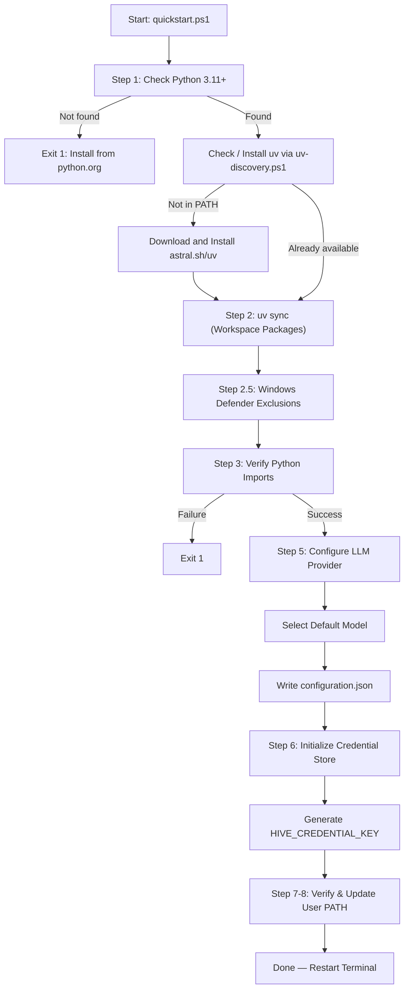
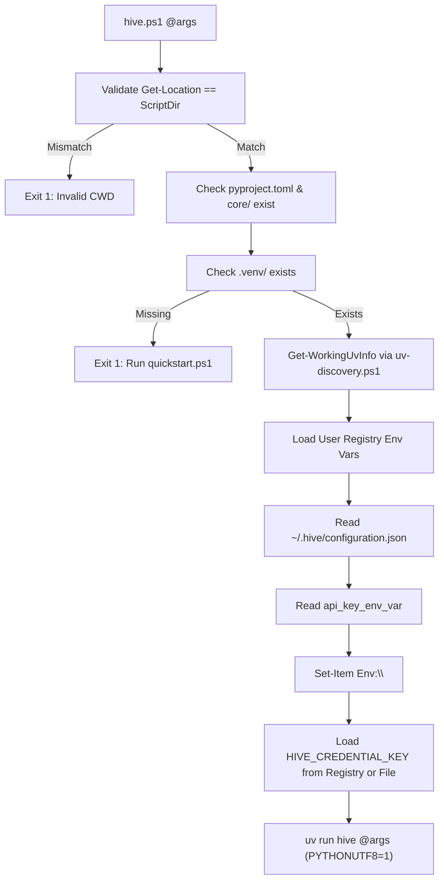
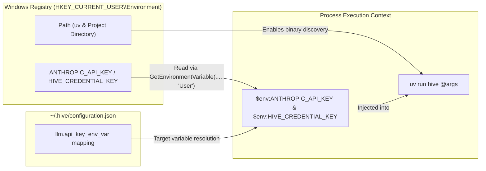

<!-- source: DeepWiki mcp.deepwiki.com · repo aden-hive/hive · page 2.2 Environment Setup (Windows) · fetched 2026-10-27 -->

# Environment Setup (Windows)

<details>
<summary>Relevant source files</summary>

The following files were used as context for generating this wiki page:

- [core/codex_oauth.py](core/codex_oauth.py)
- [core/framework/config.py](core/framework/config.py)
- [core/framework/llm/key_check.py](core/framework/llm/key_check.py)
- [core/framework/storage/checkpoint_store.py](core/framework/storage/checkpoint_store.py)
- [core/tests/test_key_check_packaged.py](core/tests/test_key_check_packaged.py)
- [hive.ps1](hive.ps1)
- [quickstart.ps1](quickstart.ps1)
- [quickstart.sh](quickstart.sh)
- [scripts/benchmark_quickstart.ps1](scripts/benchmark_quickstart.ps1)
- [scripts/check_llm_key.py](scripts/check_llm_key.py)
- [scripts/check_requirements.py](scripts/check_requirements.py)
- [scripts/test_check_requirements.py](scripts/test_check_requirements.py)
- [scripts/uv-discovery.ps1](scripts/uv-discovery.ps1)
- [tools/src/aden_tools/credentials/browser.py](tools/src/aden_tools/credentials/browser.py)
- [tools/src/aden_tools/credentials/shell_config.py](tools/src/aden_tools/credentials/shell_config.py)

</details>


This page covers the Windows-specific setup path for the Hive agent framework. It details the execution of `quickstart.ps1`, the underlying `uv` discovery mechanisms via `scripts/uv-discovery.ps1`, and the `hive.ps1` runtime wrapper. For Linux and macOS environments, see [2.1](). For global configuration file structures and environment variable schemas, see [2.3]().

---

## Prerequisites

| Requirement | Minimum Version | Notes |
|---|---|---|
| PowerShell | 5.1+ | Enforced via `#Requires -Version 5.1` at script headers [quickstart.ps1:1]() |
| Python | 3.11+ | Evaluated across `python3.13`, `python3.12`, `python3.11`, `python3`, `python` binaries |
| Internet access | — | Required for bootstrapping `uv` and package synchronization |

---

## Running the Setup Wizard

To initialize the development environment and configure runtime dependencies on Windows, execute the setup wizard from the project root in an interactive PowerShell terminal:

```powershell
.\quickstart.ps1
```

The script operates interactively, prompting before applying persistent environment registry changes or optional security modifications, and terminates with exit code `1` upon encountering fatal configuration or dependency errors.

Sources: [quickstart.ps1:1-20]()

---

## Setup Flow

**Setup wizard flow — `quickstart.ps1`**



Sources: [quickstart.ps1:304-1124](), [hive.ps1:1-15]()

---

## Step-by-Step Breakdown

### Python and uv Discovery (`uv-discovery.ps1`)

The onboarding script delegates binary resolution to `scripts/uv-discovery.ps1`. The discovery module locates valid Python installations meeting the `3.11+` requirement and validates `uv` executables across standard user paths (`%USERPROFILE%\.local\bin\uv.exe`) and system `PATH` environments.

If `uv` is absent, `quickstart.ps1` fetches and executes the official Astral installer script:

```powershell
Invoke-RestMethod https://astral.sh/uv/install.ps1 | Invoke-Expression
```

Upon successful installation, `%USERPROFILE%\.local\bin` is appended to the user-level registry `Path` environment variable to ensure persistence across reboots.

Sources: [quickstart.ps1:307-416]()

### Package Installation and Workspace Sync

Dependencies are resolved by invoking `uv sync` from the project root directory. This provisions the virtual environment (`.venv`) and installs workspace packages defined in `pyproject.toml`. Following core package resolution, Playwright Chromium binaries are provisioned via `uv run python -m playwright install chromium` to support browser automation subsystems.

Sources: [quickstart.ps1:422-469]()

### Windows Defender Exclusions (Optional)

Real-time antivirus scanning on Windows can severely degrade I/O performance during `uv sync` and agent execution loops. The wizard provides an option to configure path exclusions via `Test-DefenderExclusions` and `Add-MpPreference`.

**Protected Exclusion Targets:**
* Project root directory (`$ScriptDir`)
* Virtual environment path (`$ScriptDir\.venv`)
* Package cache directory (`%LOCALAPPDATA%\uv`)

**Security Safeguards:** `Test-DefenderExclusions` validates that target paths strictly resolve within project boundaries or localized user application directories (`$env:LOCALAPPDATA`, `$env:APPDATA`) before modifying system registry rules. If administrative privileges are missing (`Test-IsAdmin`), the wizard outputs raw administrative PowerShell snippets for manual execution.

Sources: [quickstart.ps1:99-268](), [quickstart.ps1:472-599]()

### LLM Provider Configuration and Registry Storage

The wizard scans process environment blocks and registry keys for API tokens associated with supported providers (such as Anthropic, OpenAI, and Google Gemini). Selected keys are stored persistently as **User-level environment variables** via the .NET API:

```powershell
[System.Environment]::SetEnvironmentVariable($SelectedEnvVar, $apiKey, "User")
```

The provider selection and target model mappings are committed to `~/.hive/configuration.json` [quickstart.ps1:648-908]().

Sources: [quickstart.ps1:648-908](), [core/framework/config.py:42-55]()

### Credential Store Initialization

Credential encryption relies on Fernet symmetric keys. During setup, `quickstart.ps1` performs the following initialization steps:
1. Verifies or generates a `HIVE_CREDENTIAL_KEY` string via `cryptography.fernet.Fernet`.
2. Persists the key to the Windows User environment registry and `~/.hive/secrets/credential_key` [hive.ps1:64-77]().
3. Provisions directory structures under `~/.hive/credentials/` for encrypted secret storage.

Sources: [quickstart.ps1:911-967](), [hive.ps1:64-77]()

---

## The `hive.ps1` Runtime Wrapper

`hive.ps1` serves as the primary entry point for executing Hive CLI commands within Windows environments.

### Why `hive.ps1` Is Necessary

Unlike Linux and macOS shells that source login scripts (`.bashrc`, `.zshrc`) upon terminal creation, Windows handles user-level environment variables through the registry (`HKEY_CURRENT_USER\Environment`). Modern terminals (such as VS Code integrated terminals or Windows Terminal tabs) frequently fail to inherit newly added environment variables or path entries dynamically. `hive.ps1` bridges this gap by explicitly pulling variables from the registry at runtime.

Sources: [hive.ps1:1-10]()

### Runtime Startup Flow

**Runtime wrapper flow — `hive.ps1`**



Sources: [hive.ps1:11-82](), [scripts/uv-discovery.ps1]()

### Environment Variable Binding Architecture

The mapping between persistent storage and process execution context is structured as follows:



Sources: [hive.ps1:44-82](), [core/framework/config.py:42-55]()

---

## Troubleshooting

| Symptom | Underlying Cause | Corrective Action |
|---|---|---|
| `uv not found` error | Terminal session lacks updated `PATH` references | Close and restart the terminal window |
| `API key not found` during execution | User environment variables not propagated to process | Invoke via `.\hive.ps1` rather than raw `uv run hive` to trigger registry lookups |
| `Virtual environment not found` | Workspace dependencies not installed | Run `.\quickstart.ps1` to provision `.venv` |
| Defender exclusion failure | Insufficient administrative privileges | Execute suggested `Add-MpPreference` statements in an elevated shell |
| CWD validation failure | Terminal opened outside project root | `cd` into the repository root directory before invocation |

Sources: [hive.ps1:14-32](), [quickstart.ps1:919-967]()

---
Sources: [quickstart.ps1:1-1124](), [hive.ps1:1-82](), [core/framework/config.py:1-182](), [scripts/check_llm_key.py:1-68]()

---

