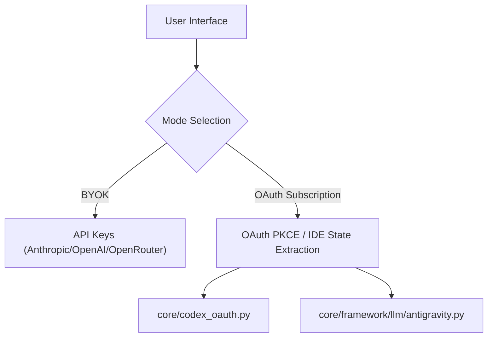
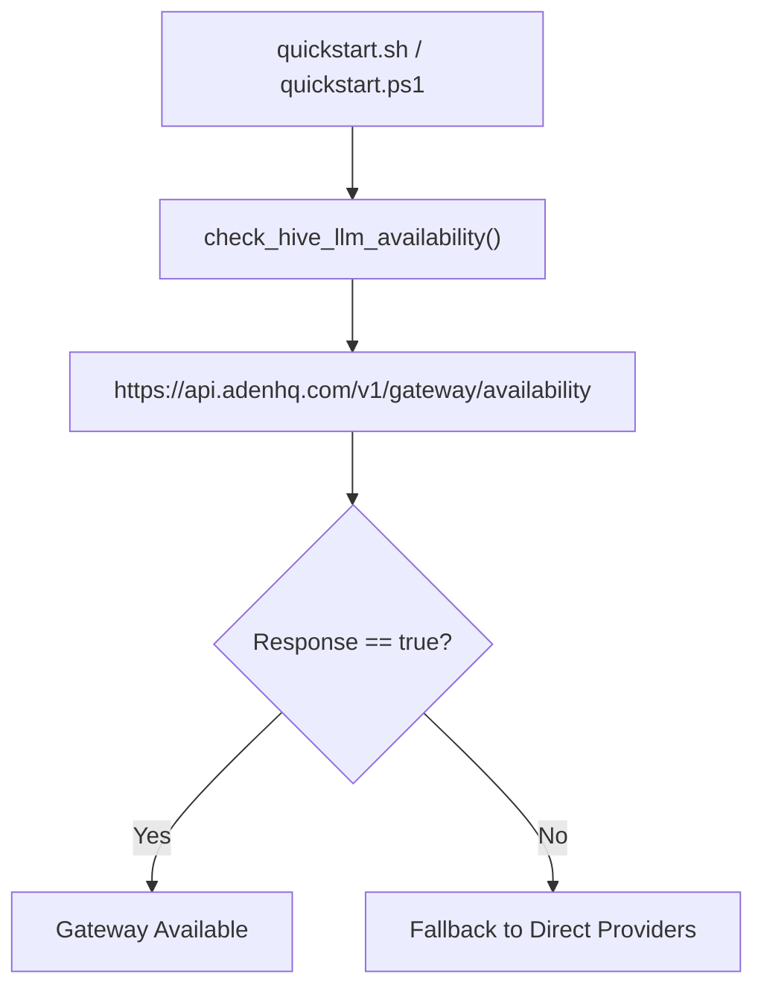
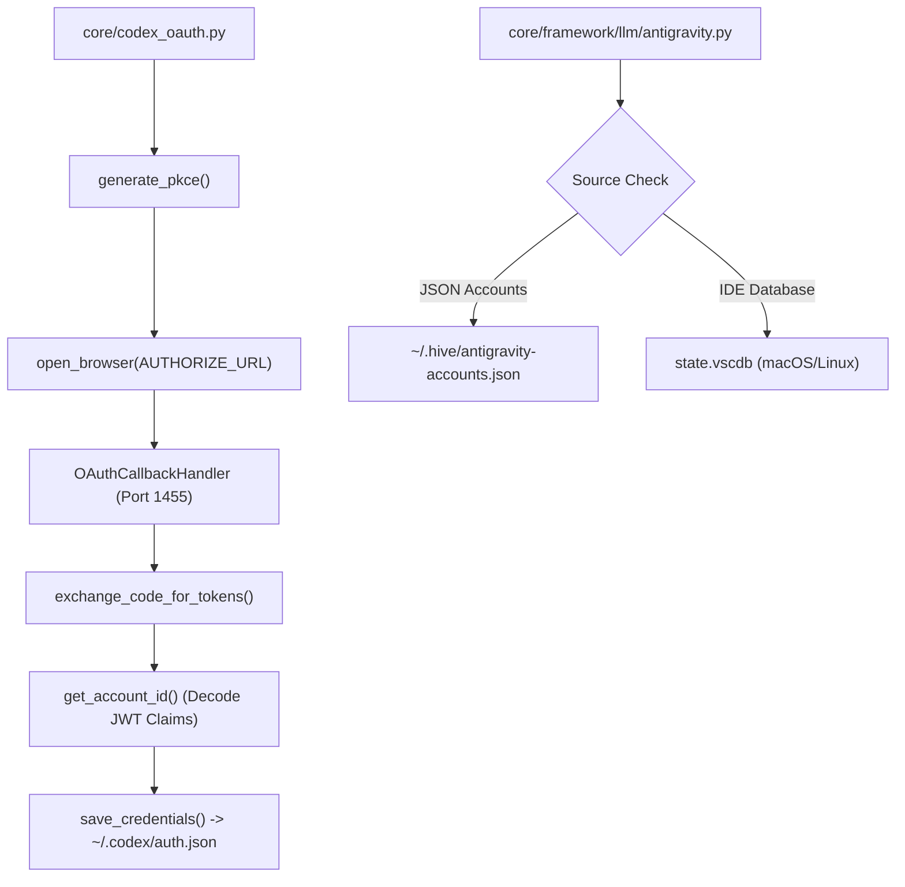

<!-- source: DeepWiki mcp.deepwiki.com · repo aden-hive/hive · page 2.4 LLM Provider Setup and Key Validation · fetched 2026-10-27 -->

# LLM Provider Setup and Key Validation

<details>
<summary>Relevant source files</summary>

The following files were used as context for generating this wiki page:

- [core/codex_oauth.py](core/codex_oauth.py)
- [core/framework/agents/queen/mcp_servers.json](core/framework/agents/queen/mcp_servers.json)
- [core/framework/config.py](core/framework/config.py)
- [core/framework/llm/antigravity.py](core/framework/llm/antigravity.py)
- [core/framework/llm/key_check.py](core/framework/llm/key_check.py)
- [core/framework/loader/mcp_client.py](core/framework/loader/mcp_client.py)
- [core/framework/storage/checkpoint_store.py](core/framework/storage/checkpoint_store.py)
- [core/tests/e2e/longmemeval.py](core/tests/e2e/longmemeval.py)
- [core/tests/e2e/test_longmemeval.py](core/tests/e2e/test_longmemeval.py)
- [core/tests/test_antigravity_schema.py](core/tests/test_antigravity_schema.py)
- [core/tests/test_key_check_packaged.py](core/tests/test_key_check_packaged.py)
- [core/tests/test_mcp_client.py](core/tests/test_mcp_client.py)
- [docs/memory-benchmark.md](docs/memory-benchmark.md)
- [hive.ps1](hive.ps1)
- [quickstart.ps1](quickstart.ps1)
- [quickstart.sh](quickstart.sh)
- [scripts/benchmark_quickstart.ps1](scripts/benchmark_quickstart.ps1)
- [scripts/check_llm_key.py](scripts/check_llm_key.py)
- [scripts/check_requirements.py](scripts/check_requirements.py)
- [scripts/test_check_requirements.py](scripts/test_check_requirements.py)
- [scripts/uv-discovery.ps1](scripts/uv-discovery.ps1)
- [tools/src/aden_tools/credentials/browser.py](tools/src/aden_tools/credentials/browser.py)
- [tools/src/aden_tools/credentials/shell_config.py](tools/src/aden_tools/credentials/shell_config.py)

</details>


## Purpose and Scope
This document covers the technical architecture and implementation details for LLM provider configuration, Bring-Your-Own-Key (BYOK) vs. subscription/OAuth execution modes, the Hive LLM proxy, zero-token key validation mechanisms, and credential discovery routines.

---

## 1. BYOK vs. Subscription Modes
Hive supports multiple provider integration patterns, bifurcated into standard BYOK (Bring Your Own Key) strategies and managed/subscription OAuth modes.

* **BYOK Mode**: Users supply API keys directly for standard commercial models (Anthropic, OpenAI, OpenRouter, and compatible endpoints). These keys are stored securely and passed via standard client headers (`x-api-key` or `Authorization: Bearer`).
* **Subscription / OAuth Modes**: Advanced modes bypass manual API key entry by leveraging browser-based PKCE or local account state extraction:
  * **OpenAI Codex / ChatGPT Plus/Pro**: Executed via an automated local OAuth PKCE flow (`core/codex_oauth.py`), storing user tokens in `~/.codex/auth.json`.
  * **Antigravity (Google Cloud Code Assist)**: Managed via `core/framework/llm/antigravity.py`, which pulls Google OAuth tokens either from `~/.hive/antigravity-accounts.json` or by scanning IDE state databases (`state.vscdb`).


Sources: `core/codex_oauth.py:1-160`, `core/framework/llm/antigravity.py:79-171`

---

## 2. The Hive LLM Proxy and Gateway Routing
Hive provides gateway availability detection and routing through the centralized Hive LLM Endpoint (`https://api.adenhq.com`). 

* **Endpoint Configuration**: The gateway base URL is defined as `HIVE_LLM_ENDPOINT = "https://api.adenhq.com"` (`quickstart.sh:36-37`, `core/framework/config.py:19`).
* **Availability Checks**: Onboarding wizards (`quickstart.sh` and `quickstart.ps1`) ping the gateway availability route to verify connectivity and gateway status before prompting for credentials:
  * Unix availability checks use `check_hive_llm_availability()` (`quickstart.sh:39-52`).
  * Windows availability checks use `Test-HiveGatewayAvailability()` (`quickstart.ps1:30-41`).


Sources: `quickstart.sh:35-52`, `quickstart.ps1:24-41`

---

## 3. Zero-Token Key Validation
To prevent billing users or consuming token quotas during onboarding and Settings management, Hive implements zero-token key checks.

* **CLI Runner**: `scripts/check_llm_key.py` serves as the CLI wrapper accepting provider IDs, keys, optional API bases, and models, returning a JSON response and strict exit codes (`0` for valid, `1` for invalid, `2` for network/timeout errors) (`scripts/check_llm_key.py:1-69`).
* **Core Logic**: `framework/llm/key_check.py` implements provider-specific validation functions:
  * `check_anthropic()`: Sends an empty message payload with `max_tokens=1` to `https://api.anthropic.com/v1/messages`. Status codes `200`, `400`, or `429` confirm key validity without executing real generations (`core/framework/llm/key_check.py:127-145`).
  * `check_openai_compatible()` / `check_openrouter()`: Performs a lightweight `GET /models` request against the provider endpoint using the bearer token (`core/framework/llm/key_check.py:148-179`).

```mermaid
graph TD
    CLI["scripts/check_llm_key.py"] --> CoreCheck["framework.llm.key_check.check_key()"]
    CoreCheck --> ProviderRouter{"Provider Type"}
    ProviderRouter -->|Anthropic| AnthropicCheck["check_anthropic() (POST /v1/messages, max_tokens=1)"]
    ProviderRouter -->|OpenAI / Compatible| OpenAI espèces["check_openai_compatible() (GET /models)"]
    ProviderRouter -->|OpenRouter| OpenRouterCheck["check_openrouter() (GET /api/v1/models)"]
    AnthropicCheck --> ResultJSON["JSON: {"valid": bool, "message": str}"]
    OpenAI espèces --> ResultJSON
    OpenRouterCheck --> ResultJSON
```
Sources: `core/framework/llm/key_check.py:1-179`, `scripts/check_llm_key.py:1-69`

---

## 4. OAuth Credential Discovery and Flows
For managed subscriptions, Hive extracts or negotiates credentials dynamically.

* **OpenAI Codex OAuth Flow (`core/codex_oauth.py`)**:
  1. Generates PKCE verifier and challenge (`generate_pkce()`) (`core/codex_oauth.py:52-57`).
  2. Spawns an internal HTTP callback server on port `1455` (`OAuthCallbackHandler`) (`core/codex_oauth.py:178-206`).
  3. Launches the user's browser via `open_browser()` (`core/codex_oauth.py:162-175`).
  4. Exchanges the authorization code for access and refresh tokens (`exchange_code_for_tokens()`) (`core/codex_oauth.py:79-110`).
  5. Decodes JWT claims to extract the `account_id` and persists credentials securely to `~/.codex/auth.json` (`core/codex_oauth.py:129-160`).
* **Antigravity Credential Loader (`core/framework/llm/antigravity.py`)**:
  * Reads multi-account JSON schemas from `~/.hive/antigravity-accounts.json` (`core/framework/llm/antigravity.py:79-138`).
  * Falls back to reading IDE SQLite state databases (`state.vscdb`) on macOS/Linux to extract OAuth tokens (`_load_from_ide_db()`) (`core/framework/llm/antigravity.py:140-171`).


Sources: `core/codex_oauth.py:52-175`, `core/framework/llm/antigravity.py:79-171`

---

