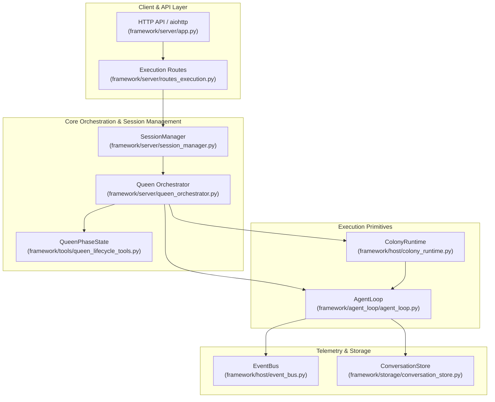

<!-- source: DeepWiki mcp.deepwiki.com · repo aden-hive/hive · page 3 Architecture · fetched 2026-10-27 -->

# Architecture

Relevant source files

The following files were used as context for generating this wiki page:

- [core/framework/agent_loop/agent_loop.py](core/framework/agent_loop/agent_loop.py)
- [core/framework/agent_loop/conversation.py](core/framework/agent_loop/conversation.py)
- [core/framework/agent_loop/internals/cursor_persistence.py](core/framework/agent_loop/internals/cursor_persistence.py)
- [core/framework/agent_loop/internals/types.py](core/framework/agent_loop/internals/types.py)
- [core/framework/agent_loop/internals/vision_fallback.py](core/framework/agent_loop/internals/vision_fallback.py)
- [core/framework/agents/queen/nodes/__init__.py](core/framework/agents/queen/nodes/__init__.py)
- [core/framework/agents/queen/queen_profiles.py](core/framework/agents/queen/queen_profiles.py)
- [core/framework/agents/queen/tests/test_deferred_handle_redeemers.py](core/framework/agents/queen/tests/test_deferred_handle_redeemers.py)
- [core/framework/host/colony_runtime.py](core/framework/host/colony_runtime.py)
- [core/framework/host/worker.py](core/framework/host/worker.py)
- [core/framework/server/app.py](core/framework/server/app.py)
- [core/framework/server/queen_orchestrator.py](core/framework/server/queen_orchestrator.py)
- [core/framework/server/routes_execution.py](core/framework/server/routes_execution.py)
- [core/framework/server/session_manager.py](core/framework/server/session_manager.py)
- [core/framework/storage/conversation_store.py](core/framework/storage/conversation_store.py)
- [core/framework/tools/queen_lifecycle_tools.py](core/framework/tools/queen_lifecycle_tools.py)
- [core/tests/test_event_loop_node.py](core/tests/test_event_loop_node.py)
- [core/tests/test_node_conversation.py](core/tests/test_node_conversation.py)
- [core/tests/test_worker_started_at.py](core/tests/test_worker_started_at.py)

This page provides a high-level overview of the Hive runtime architecture. Hive is built around a unified execution model where `AgentLoop` serves as the single execution primitive for both persistent Queen agents and bounded worker clones [core/framework/agent_loop/agent_loop.py:1-10](). 

For deep technical details, see the child pages:
- Agent Loop: [Agent Loop](#3.1)
- Queen Orchestration and Colony Runtime: [Queen Orchestration and Colony Runtime](#3.2)
- Sessions and State Management: [Sessions and State Management](#3.3)
- Event Bus and Observability: [Event Bus and Observability](#3.4)
- LLM Provider Layer: [LLM Provider Layer](#3.5)
- Judge, Stall Detection and Channels: [Judge, Stall Detection and Channels](#3.6)

---

## High-Level Architecture Overview

The Hive runtime coordinates chat interactions, persistent queen sessions, dynamic colony forking, parallel worker execution via `ColonyRuntime`, and event telemetry via `EventBus`.

**Diagram: Runtime Subsystems Mapped to Code Entities**

Sources: [core/framework/server/app.py:1-15](), [core/framework/server/session_manager.py:1-22](), [core/framework/server/queen_orchestrator.py:1-15](), [core/framework/tools/queen_lifecycle_tools.py:111-139](), [core/framework/agent_loop/agent_loop.py:1-10](), [core/framework/host/colony_runtime.py:1-12]()

---

## 3.1 Agent Loop

`AgentLoop` is the single execution primitive in Hive, driving multi-turn LLM streaming loops, tool execution, and judge evaluation [core/framework/agent_loop/agent_loop.py:1-10](). It handles message compaction, tool input coercion, persistence, and vision fallbacks for text-only models.

For a complete deep dive, see [Agent Loop](#3.1).

Sources: [core/framework/agent_loop/agent_loop.py:1-10]()

---

## 3.2 Queen Orchestration and Colony Runtime

Queens manage persistent user interactions and can fork work into a colony of parallel workers using `ColonyRuntime` [core/framework/host/colony_runtime.py:1-10](). The queen switches between independent and colony phases using `QueenPhaseState` [core/framework/tools/queen_lifecycle_tools.py:111-139](), orchestrating workers, tasks, and tracker databases.

For details, see [Queen Orchestration and Colony Runtime](#3.2).

Sources: [core/framework/tools/queen_lifecycle_tools.py:111-139](), [core/framework/host/colony_runtime.py:1-10]()

---

## 3.3 Sessions and State Management

`SessionManager` governs session creation, colony binding, forking, and path-traversal protections under `HIVE_HOME` [core/framework/server/session_manager.py:1-22](). It coordinates disk storage structures and session state schemas.

For details, see [Sessions and State Management](#3.3).

Sources: [core/framework/server/session_manager.py:1-22]()

---

## 3.4 Event Bus and Observability

The `EventBus` provides publish/sub telemetry across agent loops and workers. Events are logged into per-session `events.jsonl` files, feeding runtime logs, debuggers, and timeline viewers.

For details, see [Event Bus and Observability](#3.4).

Sources: [core/framework/host/event_bus.py:1-40]()

---

## 3.5 LLM Provider Layer

Hive abstracts LLM interactions through the `LLMProvider` interface, supporting LiteLLMProxy, Anthropic, Antigravity, and Mock providers with stream event protocols and model capability detection.

For details, see [LLM Provider Layer](#3.5).

Sources: [core/framework/llm/provider.py:1-50]()

---

## 3.6 Judge, Stall Detection and Channels

The judge slot (`ChannelHost.judge`) evaluates loop convergence, while stall detection heuristics identify doom loops and visible errors, routing external chat channels to queen sessions.

For details, see [Judge, Stall Detection and Channels](#3.6).

Sources: [core/framework/agent_loop/internals/judge_pipeline.py:1-60](), [core/framework/agent_loop/internals/stall_detector.py:1-60]()

---

