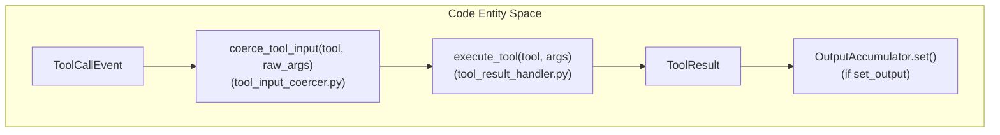

<!-- source: DeepWiki mcp.deepwiki.com · repo aden-hive/hive · page 3.1 Agent Loop · fetched 2026-10-27 -->

# Agent Loop

Relevant source files

The following files were used as context for generating this wiki page:

- [core/framework/agent_loop/agent_loop.py](core/framework/agent_loop/agent_loop.py)
- [core/framework/agent_loop/conversation.py](core/framework/agent_loop/conversation.py)
- [core/framework/agent_loop/internals/cursor_persistence.py](core/framework/agent_loop/internals/cursor_persistence.py)
- [core/framework/agent_loop/internals/synthetic_tools.py](core/framework/agent_loop/internals/synthetic_tools.py)
- [core/framework/agent_loop/internals/tool_input_coercer.py](core/framework/agent_loop/internals/tool_input_coercer.py)
- [core/framework/agent_loop/internals/types.py](core/framework/agent_loop/internals/types.py)
- [core/framework/agent_loop/internals/vision_fallback.py](core/framework/agent_loop/internals/vision_fallback.py)
- [core/framework/agents/queen/queen_profiles.py](core/framework/agents/queen/queen_profiles.py)
- [core/framework/agents/queen/tests/test_deferred_handle_redeemers.py](core/framework/agents/queen/tests/test_deferred_handle_redeemers.py)
- [core/framework/storage/conversation_store.py](core/framework/storage/conversation_store.py)
- [core/tests/test_event_loop_node.py](core/tests/test_event_loop_node.py)
- [core/tests/test_node_conversation.py](core/tests/test_node_conversation.py)
- [core/tests/test_tool_input_coercer.py](core/tests/test_tool_input_coercer.py)

This page documents `AgentLoop`, the core execution primitive for multi-turn LLM streaming loops with integrated tool execution, streaming event handling, synthetic tools, and judge evaluation in the Hive framework [core/framework/agent_loop/agent_loop.py:1-10](). 

For detailed message management, token estimation, and persistence, see [Conversation, Compaction and Persistence](#3.1.1). For text-only image handling and spillover strategies, see [Vision Fallback and Tool Results](#3.1.2).

---

## Overview and Iteration Lifecycle

`AgentLoop` implements `AgentProtocol` and manages the synchronous-to-asynchronous execution bridge for agent turns [core/framework/agent_loop/agent_loop.py:3-10](). The loop operates iteratively up to a configured ceiling (`max_iterations`), processing model output deltas, executing tool calls, evaluating completions via judges, and publishing lifecycle events to the `EventBus` [core/framework/agent_loop/agent_loop.py:43-57]().

**Iteration Lifecycle Diagram (Natural Language to Code Entities):**

```mermaid
flowchart TD
  subgraph "Code Entity Space"
    AE["AgentLoop.execute()"] --> RST["restore()\n(cursor_persistence.py)"]
    RST --> IT["for iteration in range(max_iterations)"]
    IT --> CP["check_pause()\n(cursor_persistence.py)"]
    CP --> DQ["drain_injection_queue()\n(cursor_persistence.py)"]
    DQ --> ST["_run_single_turn()\n(agent_loop.py)"]
    ST --> JD["judge_turn()\n(judge_pipeline.py)"]
    JD -->|"ACCEPT"| ACC["OutputAccumulator.to_dict()"]
    JD -->|"RETRY"| FB["_inject_retry_feedback()"]
    FB --> IT
  end

  subgraph "Natural Language Space"
    A["Start Agent Run"] --> B["Restore State & Checkpoint"]
    B --> C["Run Iteration Loop"]
    C --> D["Check Pause & Inbound Events"]
    D --> E["Stream LLM & Execute Tools"]
    E --> F["Evaluate Turn with Judge"]
    F -->|"Accept"| G["Return AgentResult"]
    F -->|"Retry"| H["Inject Feedback & Continue"]
  end
```

Sources: [core/framework/agent_loop/agent_loop.py:1-10](), [core/framework/agent_loop/internals/cursor_persistence.py:49-59]()

---

## Streaming Event Handling

During each turn, `AgentLoop` calls `LLMProvider.stream()` to consume an asynchronous iterator of `StreamEvent` objects [core/framework/agent_loop/agent_loop.py:4](). These events are processed sequentially:
- `TextDeltaEvent` and `ReasoningDeltaEvent`: Stream text chunks to the client and update internal snapshots while stripping internal reasoning scaffolds (such as `<think>` blocks and pillar tags) [core/framework/agent_loop/agent_loop.py:121-140]().
- `ToolCallEvent`: Triggers tool dispatch and execution via the registered tool executor [core/framework/agent_loop/agent_loop.py:77-84]().
- `FinishEvent`: Finalizes token counts (`input_tokens`, `output_tokens`) and captures stop reasons [core/tests/test_event_loop_node.py:75-96]().
- `StreamErrorEvent`: Propagates stream failures or triggers internal backoff retries [core/framework/agent_loop/agent_loop.py:110-116]().

Sources: [core/framework/agent_loop/agent_loop.py:110-116](), [core/tests/test_event_loop_node.py:36-65]()

---

## Tool Dispatch, Synthetic Tools and Input Coercion

Tool inputs received from non-frontier or secondary models often suffer from structural drift (e.g., stringified types, scalar arguments wrapped in lists, or labeled option objects). `AgentLoop` relies on `coerce_tool_input` to sanitize tool arguments before execution against the tool schema [core/framework/agent_loop/internals/tool_input_coercer.py:1-12]().

In addition to user-provided or MCP tools, `AgentLoop` injects framework-level synthetic tools:
- `set_output`: Allows the model to populate keys in the `OutputAccumulator` [core/framework/agent_loop/internals/synthetic_tools.py:1-5]().
- `ask_user`: Pauses execution to prompt the user for structured feedback or clarification [core/framework/agent_loop/internals/synthetic_tools.py:134-145]().
- `report_to_parent` / `escalate`: Used by worker clones to return control or escalate failures to the controlling Queen [core/framework/agent_loop/internals/synthetic_tools.py:72-74]().

**Tool Dispatch and Coercion Flow:**

Sources: [core/framework/agent_loop/internals/tool_input_coercer.py:1-15](), [core/framework/agent_loop/internals/tool_result_handler.py:77-84]()

---

## Judge Verdicts and Completion Criteria

Loop termination is governed by either an explicit `JudgeProtocol` implementation or an implicit stop reason [core/framework/agent_loop/agent_loop.py:7](). The judge evaluates the current context and returns a `JudgeVerdict` containing an `action` (`"ACCEPT"`, `"RETRY"`, or `"ESCALATE"`) and optional `feedback` [core/framework/agent_loop/internals/types.py:31-40]().

- `ACCEPT`: The loop finishes successfully, returning an `AgentResult` containing accumulated outputs and final conversation state [core/framework/agent_loop/internals/types.py:34]()
- `RETRY`: The judge feedback is injected as a user-role reminder message into the conversation history, and the loop proceeds to the next iteration [core/framework/agent_loop/internals/types.py:34]()
- `ESCALATE`: The loop terminates with an error status, surfacing the failure reason up to the caller or parent Queen [core/framework/agent_loop/internals/types.py:34]()

Sources: [core/framework/agent_loop/agent_loop.py:58-61](), [core/framework/agent_loop/internals/types.py:31-46]()

---

## LoopConfig Budgets, Limits, and Grace Iterations

The behavior of `AgentLoop` is configured via `LoopConfig`, which establishes execution bounds and pacing controls [core/framework/agent_loop/internals/types.py:49-51]().

| Parameter | Default | Description |
|---|---|---|
| `max_iterations` | `50` | Hard iteration limit before loop termination |
| `grace_iterations` | `0` | Extra iterations granted after maxes are hit, restricting tools to a terminal whitelist (`report_to_parent`, `task_update`) |
| `tool_call_budget` | `0` | Per-turn tool call pacing budget before soft/hard checkpoints trigger |
| `tool_call_lifetime_budget` | `0` | Cumulative tool call budget across the entire run |
| `max_context_tokens` | `180_000` | Context token window before proactive compaction triggers |

Sources: [core/framework/agent_loop/internals/types.py:49-135]()

---

## Output Accumulation and Write-Through Storage

`OutputAccumulator` collects key-value results produced during execution and writes them directly to the underlying `ConversationStore` cursor via write-through persistence [core/framework/agent_loop/agent_loop.py:9](). This ensures that crash recovery mechanisms can restore partial outputs without repeating previously completed execution turns [core/framework/agent_loop/internals/cursor_persistence.py:140-152]().

Sources: [core/framework/agent_loop/agent_loop.py:9](), [core/framework/agent_loop/internals/cursor_persistence.py:140-152]()

---

## Child Pages

For deeper technical details on specific subsystems, consult the following child pages:
- [Conversation, Compaction and Persistence](#3.1.1) — Covers `NodeConversation` message management, token estimation, microcompaction, cursor persistence, and `FileConversationStore`.
- [Vision Fallback and Tool Results](#3.1.2) — Covers the `vision_fallback` subagent for text-only models, fractional coordinate remapping, and large tool-result spillover management.

Sources: [core/framework/agent_loop/agent_loop.py:1-10]()

---

