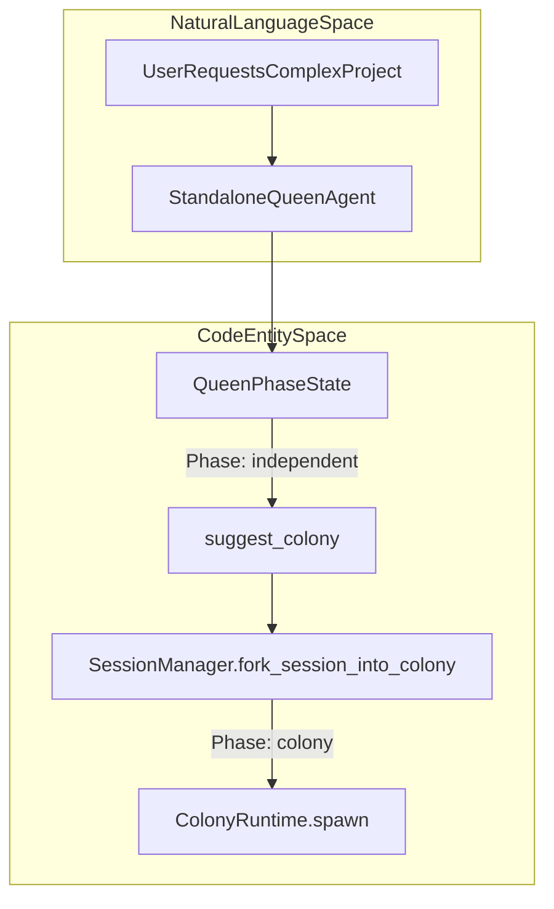
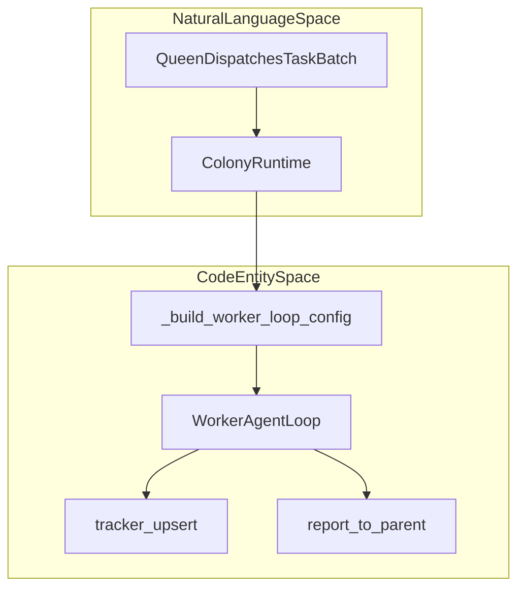

<!-- source: DeepWiki mcp.deepwiki.com · repo aden-hive/hive · page 3.2 Queen Orchestration and Colony Runtime · fetched 2026-10-27 -->

# Queen Orchestration and Colony Runtime

Relevant source files

The following files were used as context for generating this wiki page:

- [core/framework/agents/queen/nodes/__init__.py](core/framework/agents/queen/nodes/__init__.py)
- [core/framework/agents/queen/queen_tools_defaults.py](core/framework/agents/queen/queen_tools_defaults.py)
- [core/framework/host/colony_metadata.py](core/framework/host/colony_metadata.py)
- [core/framework/host/colony_runtime.py](core/framework/host/colony_runtime.py)
- [core/framework/host/colony_tools_config.py](core/framework/host/colony_tools_config.py)
- [core/framework/host/worker.py](core/framework/host/worker.py)
- [core/framework/host/worker_profiles.py](core/framework/host/worker_profiles.py)
- [core/framework/llm/capabilities.py](core/framework/llm/capabilities.py)
- [core/framework/server/app.py](core/framework/server/app.py)
- [core/framework/server/queen_orchestrator.py](core/framework/server/queen_orchestrator.py)
- [core/framework/server/routes_colony_tools.py](core/framework/server/routes_colony_tools.py)
- [core/framework/server/routes_execution.py](core/framework/server/routes_execution.py)
- [core/framework/server/routes_queen_tools.py](core/framework/server/routes_queen_tools.py)
- [core/framework/server/session_manager.py](core/framework/server/session_manager.py)
- [core/framework/server/tests/test_colony_tools.py](core/framework/server/tests/test_colony_tools.py)
- [core/framework/server/tests/test_mcp_routes.py](core/framework/server/tests/test_mcp_routes.py)
- [core/framework/server/tests/test_queen_tools.py](core/framework/server/tests/test_queen_tools.py)
- [core/framework/tools/queen_lifecycle_tools.py](core/framework/tools/queen_lifecycle_tools.py)
- [core/frontend/src/api/queens.ts](core/frontend/src/api/queens.ts)
- [core/tests/test_capabilities.py](core/tests/test_capabilities.py)
- [core/tests/test_colony_runtime_overseer.py](core/tests/test_colony_runtime_overseer.py)
- [core/tests/test_run_parallel_workers_tool.py](core/tests/test_run_parallel_workers_tool.py)
- [core/tests/test_worker_started_at.py](core/tests/test_worker_started_at.py)

## Purpose and Scope

This page documents the queen orchestration subsystem and the colony runtime environment in Hive. The Queen agent acts as the persistent overseer of a user session, operating across distinct lifecycle phases to manage standalone tasks or coordinate parallel worker colonies. 

The runtime architecture bridges natural language instructions and structured tool execution through `QueenPhaseState`, dynamic tool gating, pivot mechanisms, and the `ColonyRuntime` worker dispatch engine.

For deep dives into specific subsystems, refer to the child pages:
- **3.2.1** [Queen Profiles, Selection and Tools](#3.2.1)
- **3.2.2** [Queen Memory and Reflection](#3.2.2)
- **3.2.3** [Tasks, Tracker and Sentinel](#3.2.3)

---

## 1. Queen Operating Phases and `QueenPhaseState`

The queen's operating lifecycle is governed by `QueenPhaseState`, a mutable state container that tracks whether the agent functions as a standalone entity or an overseer of a parallel worker colony [core/framework/tools/queen_lifecycle_tools.py:112-126](). 

The two primary operating phases are:
- **Independent**: The queen acts as a standalone agent with access to MCP tools and task management primitives, but no worker clones [core/framework/tools/queen_lifecycle_tools.py:116](). When the user requests parallel or recurring work, the queen invokes `suggest_colony` to trigger a fork [core/framework/tools/queen_lifecycle_tools.py:117]().
- **Colony**: The colony has been forked, and worker instances execute assigned work items [core/framework/tools/queen_lifecycle_tools.py:120-122](). The queen monitors progress, handles escalations, and aggregates results.

Legacy phase names (such as `working`, `reviewing`, or `incubating`) are normalized via `normalize_legacy_phase()` on read paths to ensure seamless cold-resume compatibility [core/framework/tools/queen_lifecycle_tools.py:92-108]().

Sources: `core/framework/tools/queen_lifecycle_tools.py`, `core/framework/agents/queen/nodes/__init__.py`

---

## 2. Queen Orchestration and Lifecycle Tools

Queen orchestration is managed by `queen_orchestrator.create_queen`, which constructs the agent executor, binds event listeners, and configures prompt sections based on model vision capabilities [core/framework/agents/queen/nodes/__init__.py:18-28]().

Lifecycle tools give the queen control over colony execution and task planning:
- `suggest_colony`: A synthetic tool that captures high-level goals and passes them to a pivot payload sink [core/framework/server/queen_orchestrator.py:28-44]().
- `task_create`, `task_update`, `task_list`, `task_get`: Manage the queen's internal task store for structured planning.
- `run_worker`, `stop_worker`, `get_worker_status`: Direct management interfaces for spawned workers within `ColonyRuntime` [core/framework/tools/queen_lifecycle_tools.py:85-97]().

For details on queen personas, model overrides, and role-based tool allowlists, see [Queen Profiles, Selection and Tools](#3.2.1).

Sources: `core/framework/server/queen_orchestrator.py`, `core/framework/tools/queen_lifecycle_tools.py`

---

## 3. Colony Runtime and Worker Dispatch

`ColonyRuntime` orchestrates a colony of parallel worker clones [core/framework/host/colony_runtime.py:1-10](). Each worker is an independent instantiation of the agent execution loop sharing the queen's prompt structure and restricted tool subsets [core/framework/host/colony_runtime.py:1-5]().

Concurrency bounds are enforced via configuration and environment variables such as `HIVE_MAX_CONCURRENT_WORKERS` [core/framework/host/colony_runtime.py:141](). Worker execution parameters—including iteration ceilings and token budgets—are constructed via `_build_worker_loop_config` using bounds defined in worker profiles [core/framework/host/colony_runtime.py:88-135](). Adaptive operating budgets dynamically adjust execution limits based on historical worker success rates.

Sources: `core/framework/host/colony_runtime.py`

---

## 4. Worker Escalations and Profiles

Workers communicate status and request intervention through event subscriptions managed by `install_worker_escalation_routing` [core/framework/server/queen_orchestrator.py:105-124](). When a worker emits an escalation event, it is captured in `session.pending_escalations` and surfaced as an addressed system reminder to the queen [core/framework/server/queen_orchestrator.py:127-160]().

To prevent inbox saturation, `MAX_PENDING_ESCALATIONS` enforces strict back-pressure, automatically replying with a `queue_full` notice if unhandled escalations exceed thresholds [core/framework/server/queen_orchestrator.py:25-141](). Worker execution profiles and default configurations are established in `worker_definition.DEFAULT_LOOP_CONFIG` [core/framework/host/colony_runtime.py:100-124]().

For details on tracker integration, task stores, and automated routing via Sentinel, see [Tasks, Tracker and Sentinel](#3.2.3). For information regarding memory persistence and reflection agents, see [Queen Memory and Reflection](#3.2.2).

Sources: `core/framework/server/queen_orchestrator.py`, `core/framework/host/colony_runtime.py`

---

