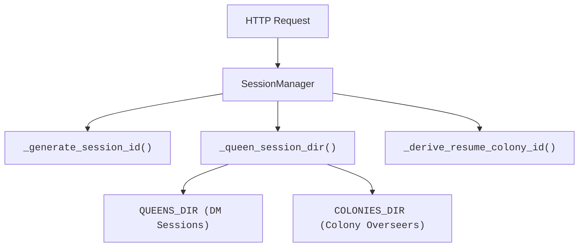
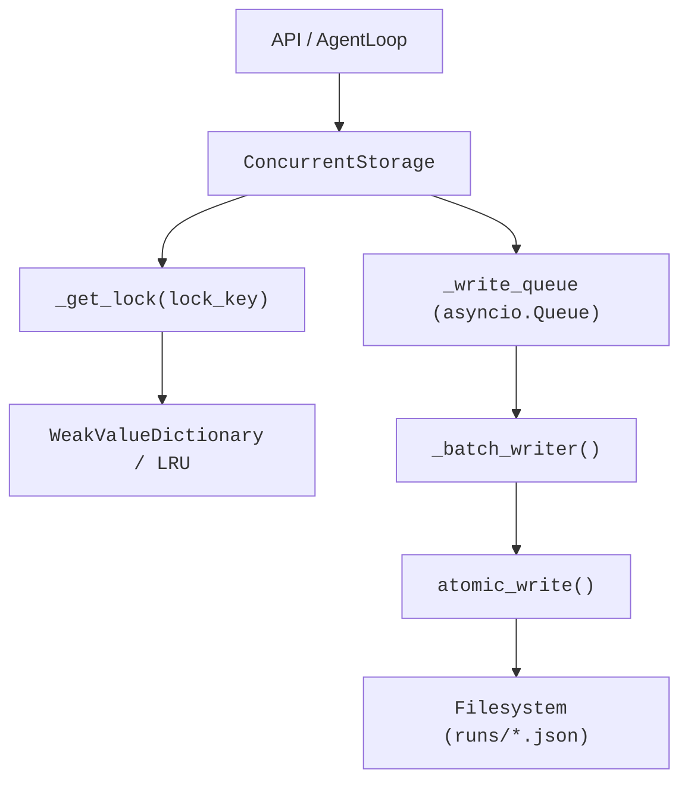
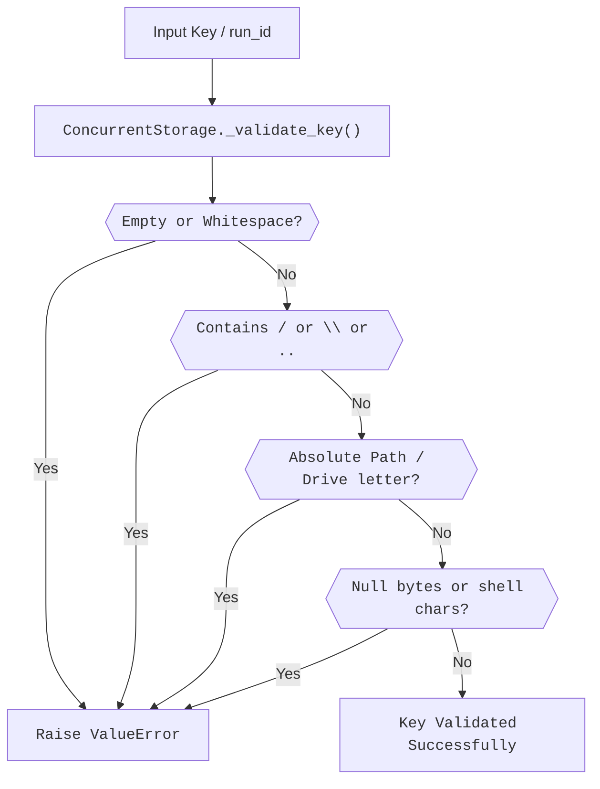

<!-- source: DeepWiki mcp.deepwiki.com · repo aden-hive/hive · page 3.3 Sessions and State Management · fetched 2026-10-27 -->

# Sessions andState Management

<details>
<summary>Relevant source files</summary>

The following files were used as context for generating this wiki page:

- [.github/workflows/auto-close-duplicates.yml](.github/workflows/auto-close-duplicates.yml)
- [core/framework/agents/queen/nodes/__init__.py](core/framework/agents/queen/nodes/__init__.py)
- [core/framework/agents/queen/timeline.py](core/framework/agents/queen/timeline.py)
- [core/framework/host/colony_runtime.py](core/framework/host/colony_runtime.py)
- [core/framework/host/worker.py](core/framework/host/worker.py)
- [core/framework/schemas/session_state.py](core/framework/schemas/session_state.py)
- [core/framework/server/app.py](core/framework/server/app.py)
- [core/framework/server/queen_orchestrator.py](core/framework/server/queen_orchestrator.py)
- [core/framework/server/routes_execution.py](core/framework/server/routes_execution.py)
- [core/framework/server/session_fork.py](core/framework/server/session_fork.py)
- [core/framework/server/session_manager.py](core/framework/server/session_manager.py)
- [core/framework/server/session_titles.py](core/framework/server/session_titles.py)
- [core/framework/storage/__init__.py](core/framework/storage/__init__.py)
- [core/framework/storage/concurrent.py](core/framework/storage/concurrent.py)
- [core/framework/storage/session_store.py](core/framework/storage/session_store.py)
- [core/framework/testing/debug_tool.py](core/framework/testing/debug_tool.py)
- [core/framework/testing/test_storage.py](core/framework/testing/test_storage.py)
- [core/framework/tools/queen_lifecycle_tools.py](core/framework/tools/queen_lifecycle_tools.py)
- [core/tests/test_path_traversal_fix.py](core/tests/test_path_traversal_fix.py)
- [core/tests/test_storage.py](core/tests/test_storage.py)
- [core/tests/test_worker_started_at.py](core/tests/test_worker_started_at.py)
- [package.json](package.json)
- [scripts/auto-close-duplicates.test.ts](scripts/auto-close-duplicates.test.ts)
- [scripts/auto-close-duplicates.ts](scripts/auto-close-duplicates.ts)

</details>


This page documents the state and session management subsystem in Hive, centered around `SessionManager` [core/framework/server/session_manager.py:1](), unified session state schemas [core/framework/schemas/session_state.py:1](), and thread-safe concurrent storage with path-traversal protections [core/framework/storage/concurrent.py:1]().

---

## 1. Session Creation and Colony Binding

The HTTP API server relies on `SessionManager` as the primary lifecycle coordinator. Sessions represent a Queen agent session that can operate independently or be bound to a colony directory.

### Session ID Generation and Directory Layout
Sessions are uniquely identified by a timestamp-prefixed hash generated by `_generate_session_id()` [core/framework/server/session_manager.py:32-36]:
```python
def _generate_session_id() -> str:
    ts = datetime.now().strftime("%Y%m%d_%H%M%S")
    return f"session_{ts}_{uuid.uuid4().hex[:8]}"
```

Session directories are separated into DM sessions and colony overseer sessions via `_queen_session_dir()` [core/framework/server/session_manager.py:38-59]:
- **DM Session**: Stored under `queens/<queen>/sessions/<session_id>/`
- **Colony Queen Session**: Stored under `colonies/<colony>/queens/<queen>/sessions/<session_id>/`

To resolve sessions across both trees, `_iter_queen_session_dirs()` [core/framework/server/session_manager.py:61-92] and `_find_queen_session_dir()` [core/framework/server/session_manager.py:94-102] scan all candidate locations. `_derive_resume_colony_id()` [core/framework/server/session_manager.py:116-140] handles re-attaching sessions to their owning colony on resume.


*Figure 3.3.1: Session creation and directory mapping architecture.*

Sources: `core/framework/server/session_manager.py:1-140`

---

## 2. Forking, Sibling Colonies and Session Titles

When a queen determines that work requires parallel execution or isolation, it triggers a colony fork. 

### Pivot Payloads and Sibling Colonies
The queen initiates a fork through the `task_create(new_colony=true)` synthetic tool call. This is intercepted by `_make_pivot_payload_sink()` [core/framework/server/queen_orchestrator.py:28-70], which validates the state and stores the handoff payload (`{goal, handoff, tasks, source_phase}`) in `session.pending_colony_pivot` [core/framework/server/queen_orchestrator.py:66]. The frontend popup-accept route then reads this payload to instantiate a sibling colony.

### Session Titles
Automatic session titles are generated and updated asynchronously via background naming tasks implemented in `session_titles.py` [core/framework/server/session_titles.py:1] based on the initial user prompt and conversation context.

Sources: `core/framework/server/queen_orchestrator.py:28-70`, `core/framework/server/session_fork.py:1-1`, `core/framework/server/session_titles.py:1-1`

---

## 3. Session State Schemas

Hive unifies run execution, metrics, and logs into a single structured Pydantic model: `SessionState` [core/framework/schemas/session_state.py:85-159].

### Core Schema Components
- **`SessionStatus`** [core/framework/schemas/session_state.py:19-27]: Enum tracking execution status (`active`, `paused`, `completed`, `failed`, `cancelled`).
- **`SessionTimestamps`** [core/framework/schemas/session_state.py:29-38]: ISO 8601 timestamps (`started_at`, `updated_at`, `completed_at`, `paused_at_time`).
- **`SessionProgress`** [core/framework/schemas/session_state.py:40-60]: Execution path tracking (`current_node`, `steps_executed`, `total_tokens`, `path`, `execution_quality`).
- **`SessionMetrics`** [core/framework/schemas/session_state.py:72-82]: Decision counts, problem counts, token usages, and traversed edges.
- **`SessionState`** [core/framework/schemas/session_state.py:85-159]: Root container carrying `schema_version = "1.1"` [core/framework/schemas/session_state.py:98], `checkpoint_enabled` flags [core/framework/schemas/session_state.py:148], and trigger bindings [core/framework/schemas/session_state.py:152-156].

Sources: `core/framework/schemas/session_state.py:1-200`

---

## 4. SessionStore, Checkpoints and Concurrent File Storage

Persistence is managed by `ConcurrentStorage` [core/framework/storage/concurrent.py:36-104], providing thread-safe operations, async file locking, and batch writes.

### ConcurrentStorage Architecture
- **Async File Locking**: `_get_lock()` [core/framework/storage/concurrent.py:126-156] manages per-key `asyncio.Lock` instances backed by a `WeakValueDictionary` [core/framework/storage/concurrent.py:88] and an LRU tracking queue (`_lru_tracking`) to prevent write corruption.
- **Write Batching**: Background coroutine `_batch_writer()` [core/framework/storage/concurrent.py:83] flushes pending writes at configured `batch_interval` [core/framework/storage/concurrent.py:62] intervals.
- **Atomic Writes**: `_save_run_sync()` [core/framework/storage/concurrent.py:191-204] utilizes `atomic_write()` [core/framework/utils/io.py:20] (temporary file staging followed by POSIX rename) to ensure runs are never persisted in a partially written state.
- **`SessionStore`**: Provides higher-level session checkpoint and state persistence atop the storage primitives.


*Figure 3.3.2: ConcurrentStorage locking and batch write flow.*

Sources: `core/framework/storage/concurrent.py:36-204`, `core/framework/storage/session_store.py:1-1`

---

## 5. Path-Traversal Protections

To protect against arbitrary file read/write vulnerabilities through malicious session or run IDs, `ConcurrentStorage` implements strict key validation via `_validate_key()` [core/framework/storage/concurrent.py:160-188].

### Validation Rules
Every storage key and run ID is validated against the following checks before any filesystem interaction occurs:
1. **Empty Check**: Rejects empty or whitespace-only keys.
2. **Path Separators**: Rejects any key containing `/` or `\\` [core/framework/storage/concurrent.py:173].
3. **Traversal Sequences**: Rejects `..` or leading dots `.` [core/framework/storage/concurrent.py:176].
4. **Absolute Paths**: Rejects Unix absolute paths (`/`) and Windows drive prefixes (`C:`) [core/framework/storage/concurrent.py:179].
5. **Control Characters**: Rejects null bytes (`\x00`) [core/framework/storage/concurrent.py:182].
6. **Shell Characters**: Rejects dangerous shell metacharacters (`<`, `>`, `|`, `&`, `$`, `` ` ``, `'`, `"`) [core/framework/storage/concurrent.py:185].


*Figure 3.3.3: Path-traversal validation workflow in `ConcurrentStorage._validate_key()`.*

Sources: `core/framework/storage/concurrent.py:160-188`, `core/tests/test_path_traversal_fix.py:16-171`

---

