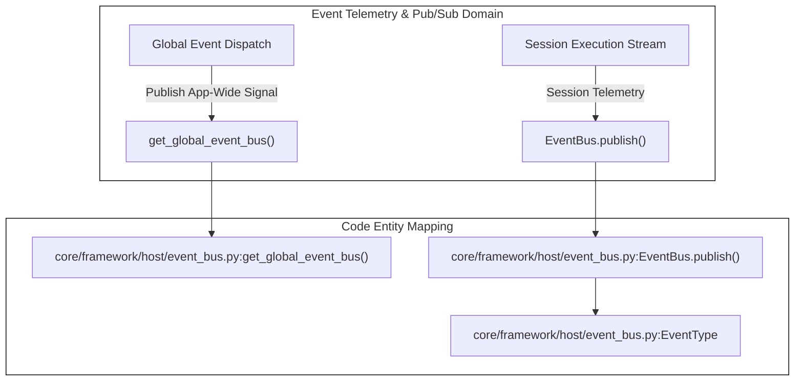
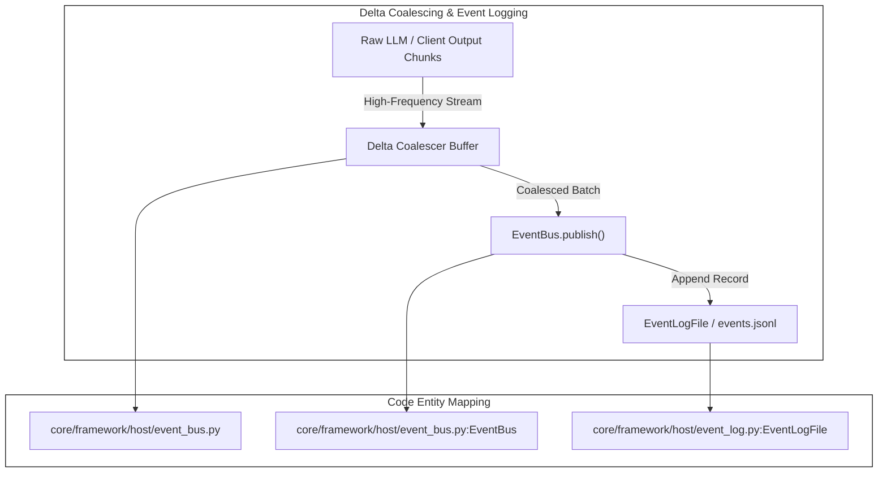

<!-- source: DeepWiki mcp.deepwiki.com · repo aden-hive/hive · page 3.4 Event Bus and Observability · fetched 2026-10-27 -->

# Event Bus and Observability

Relevant source files

The following files were used as context for generating this wiki page:

- [core/framework/agent_loop/internals/event_publishing.py](core/framework/agent_loop/internals/event_publishing.py)
- [core/framework/host/event_bus.py](core/framework/host/event_bus.py)
- [core/framework/llm/__init__.py](core/framework/llm/__init__.py)
- [core/framework/llm/anthropic.py](core/framework/llm/anthropic.py)
- [core/framework/llm/litellm.py](core/framework/llm/litellm.py)
- [core/framework/llm/mock.py](core/framework/llm/mock.py)
- [core/framework/llm/provider.py](core/framework/llm/provider.py)
- [core/framework/llm/stream_events.py](core/framework/llm/stream_events.py)
- [core/framework/observability/README.md](core/framework/observability/README.md)
- [core/framework/observability/logging.py](core/framework/observability/logging.py)
- [core/framework/server/routes_logs.py](core/framework/server/routes_logs.py)
- [core/framework/server/tests/test_runtime_logs.py](core/framework/server/tests/test_runtime_logs.py)
- [core/framework/testing/llm_judge.py](core/framework/testing/llm_judge.py)
- [core/framework/tracker/llm_debug_logger.py](core/framework/tracker/llm_debug_logger.py)
- [core/frontend/src/components/RuntimeLogsDrawer.test.tsx](core/frontend/src/components/RuntimeLogsDrawer.test.tsx)
- [core/frontend/src/components/RuntimeLogsDrawer.tsx](core/frontend/src/components/RuntimeLogsDrawer.tsx)
- [core/frontend/src/hooks/use-runtime-logs.ts](core/frontend/src/hooks/use-runtime-logs.ts)
- [core/tests/test_event_bus.py](core/tests/test_event_bus.py)
- [core/tests/test_litellm_provider.py](core/tests/test_litellm_provider.py)
- [core/tests/test_llm_judge.py](core/tests/test_llm_judge.py)
- [core/tests/test_stream_events.py](core/tests/test_stream_events.py)
- [scripts/llm_timeline_viewer.py](scripts/llm_timeline_viewer.py)

This page covers the core observability and eventing architecture of Hive. It details the `EventBus` pub/sub system [core/framework/host/event_bus.py](), `AgentEvent` schemas, delta coalescing mechanisms, per-session `events.jsonl` persistence [core/framework/host/event_log.py](), runtime logging configuration [core/framework/observability/logging.py](), the three-level observability storage hierarchy [core/framework/runtime/runtime_log_store.py](), and the LLM debug logger [core/framework/tracker/llm_debug_logger.py]() alongside its interactive timeline viewer [scripts/llm_timeline_viewer.py]().

---

## 1. EventBus Pub/Sub and AgentEvent Schema

The `EventBus` class in [core/framework/host/event_bus.py]() provides an in-process, asynchronous publish/subscribe broker for real-time telemetry across concurrent agent execution streams. Sessions instantiate their own `EventBus` instances for session-scoped event streaming, while cross-cutting app-wide state changes (such as credential updates or tool catalog refreshes) utilize a process-wide global bus accessed via `get_global_event_bus()` [core/framework/host/event_bus.py:74-85]().

Events are structured as `AgentEvent` objects carrying metadata including `type` (belonging to the `EventType` string enum) [core/framework/host/event_bus.py:102-170](), `stream_id`, `execution_id`, and payload data.

Title: "Event Bus Data Flow Mapping"
Sources: [core/framework/host/event_bus.py]()

---

## 2. Delta Coalescing and Per-Session `events.jsonl` Logs

High-frequency events such as text streaming deltas (`LLM_TEXT_DELTA`, `CLIENT_OUTPUT_DELTA`) are processed through delta coalescing to prevent flooding client sockets and disk I/O channels. Concurrently, session event logs are appended to disk as `events.jsonl` files via `EventLogFile` [core/framework/host/event_log.py]() under the session's storage root.

Title: "Delta Coalescing and Logging Data Flow"
Sources: [core/framework/host/event_bus.py](), [core/framework/host/event_log.py]()

---

## 3. Runtime Logging Configuration and Structured Formatters

Structured logging configuration is managed by `configure_logging()` in [core/framework/observability/logging.py](). It supports dual output modes via `StructuredFormatter` (JSON format for production traceability) and `HumanReadableFormatter` (colorized output for terminal debugging) [core/framework/observability/logging.py:47-162](). Context propagation across asynchronous boundaries relies on the `trace_context` `ContextVar` [core/framework/observability/logging.py:34](). Additionally, `RecentLogs` [core/framework/observability/logging.py:164-187]() retains the last capacity log lines in a memory buffer to supply the dashboard's runtime logs drawer.

Sources: [core/framework/observability/logging.py]()

---

## 4. Three-Level Observability Logs

Hive records execution history across three distinct levels of granularity, stored under `{storage_root}/sessions/{session_id}/logs/` [core/framework/runtime/runtime_log_store.py]() and coordinated by `RuntimeLogger` [core/framework/runtime/runtime_logger.py]() and `RuntimeLogStore` [core/framework/runtime/runtime_log_store.py]().

| Level | Filename | Record Model | Description |
|---|---|---|---|
| **Level 1** | `summary.json` | `RunSummaryLog` | High-level execution summary, aggregated token counts, and status written at run completion. |
| **Level 2** | `details.jsonl` | `NodeDetail` | Per-node completion details, verdict tallies, and attention flags appended incrementally. |
| **Level 3** | `tool_logs.jsonl` | `NodeStepLog` | Per-iteration execution steps containing raw LLM text, tool inputs, results, and latency metrics. |

Sources: [core/framework/runtime/runtime_logger.py](), [core/framework/runtime/runtime_log_store.py]()

---

## 5. LLM Debug Logger and Timeline Viewer

The LLM debug logger [core/framework/tracker/llm_debug_logger.py]() captures raw provider request payloads—including system prompts, tool schemas, and full message histories—into JSONL log files. The companion script `scripts/llm_timeline_viewer.py` provides a local web-based timeline interface [scripts/llm_timeline_viewer.py:1-44]() that parses these logs via `_reassemble_records()` [scripts/llm_timeline_viewer.py:115-160](), enabling developers to click through user inputs, tool calls, and assistant completions to inspect raw upstream traffic.

Sources: [core/framework/tracker/llm_debug_logger.py](), [scripts/llm_timeline_viewer.py]()

---

