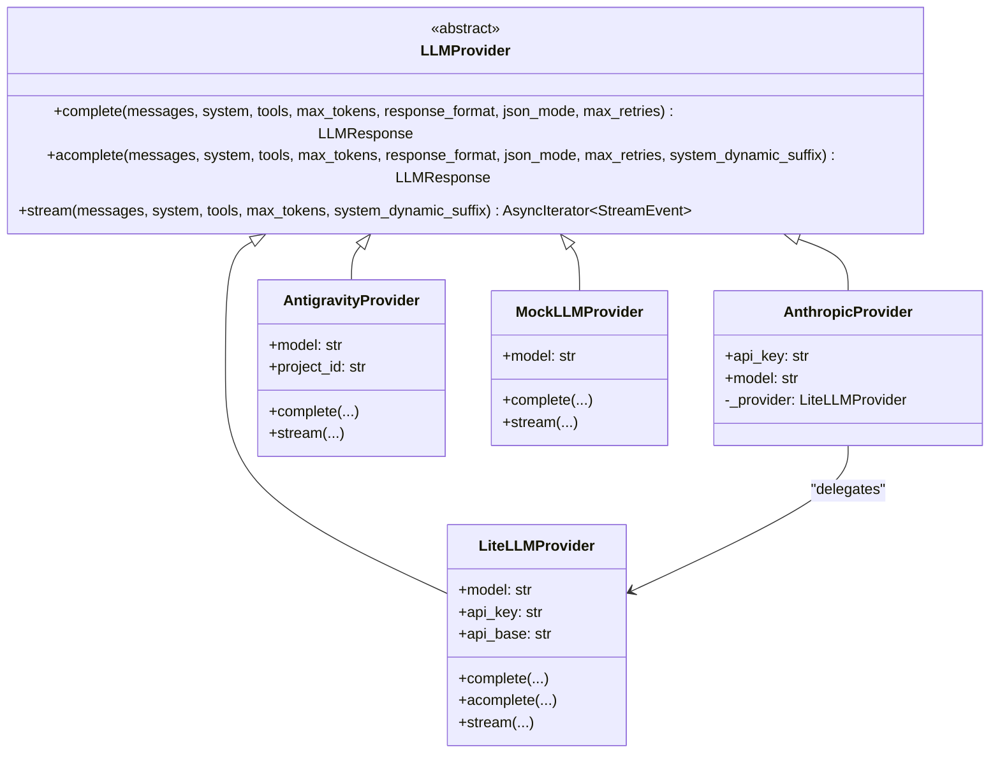

<!-- source: DeepWiki mcp.deepwiki.com · repo aden-hive/hive · page 3.5 LLM Provider Layer · fetched 2026-10-27 -->

# LLM Provider Layer

<details>
<summary>Relevant source files</summary>

The following files were used as context for generating this wiki page:

- [core/framework/agent_loop/internals/event_publishing.py](core/framework/agent_loop/internals/event_publishing.py)
- [core/framework/agent_loop/internals/tool_result_handler.py](core/framework/agent_loop/internals/tool_result_handler.py)
- [core/framework/agents/queen/mcp_servers.json](core/framework/agents/queen/mcp_servers.json)
- [core/framework/host/event_bus.py](core/framework/host/event_bus.py)
- [core/framework/llm/__init__.py](core/framework/llm/__init__.py)
- [core/framework/llm/anthropic.py](core/framework/llm/anthropic.py)
- [core/framework/llm/antigravity.py](core/framework/llm/antigravity.py)
- [core/framework/llm/capabilities.py](core/framework/llm/capabilities.py)
- [core/framework/llm/litellm.py](core/framework/llm/litellm.py)
- [core/framework/llm/mock.py](core/framework/llm/mock.py)
- [core/framework/llm/model_catalog.json](core/framework/llm/model_catalog.json)
- [core/framework/llm/model_catalog.py](core/framework/llm/model_catalog.py)
- [core/framework/llm/provider.py](core/framework/llm/provider.py)
- [core/framework/llm/stream_events.py](core/framework/llm/stream_events.py)
- [core/framework/loader/mcp_client.py](core/framework/loader/mcp_client.py)
- [core/framework/testing/llm_judge.py](core/framework/testing/llm_judge.py)
- [core/tests/e2e/longmemeval.py](core/tests/e2e/longmemeval.py)
- [core/tests/e2e/test_longmemeval.py](core/tests/e2e/test_longmemeval.py)
- [core/tests/test_antigravity_schema.py](core/tests/test_antigravity_schema.py)
- [core/tests/test_capabilities.py](core/tests/test_capabilities.py)
- [core/tests/test_colony_runtime_overseer.py](core/tests/test_colony_runtime_overseer.py)
- [core/tests/test_event_bus.py](core/tests/test_event_bus.py)
- [core/tests/test_litellm_provider.py](core/tests/test_litellm_provider.py)
- [core/tests/test_llm_judge.py](core/tests/test_llm_judge.py)
- [core/tests/test_mcp_client.py](core/tests/test_mcp_client.py)
- [core/tests/test_model_catalog.py](core/tests/test_model_catalog.py)
- [core/tests/test_run_parallel_workers_tool.py](core/tests/test_run_parallel_workers_tool.py)
- [core/tests/test_stream_events.py](core/tests/test_stream_events.py)
- [docs/memory-benchmark.md](docs/memory-benchmark.md)
- [docs/releases/v0.10.2.md](docs/releases/v0.10.2.md)

</details>


## Purpose and Scope

The LLM Provider Layer acts as the abstraction boundary between Hive's execution engine (`AgentLoop`, Queen orchestrators, and tool execution managers) and underlying model vendors. By routing all completion and streaming requests through the `LLMProvider` abstract interface [core/framework/llm/provider.py:85-186](), Hive supports multiple pluggable backends—including OpenAI, Anthropic, Google Gemini, DeepSeek, Mistral, Groq, local runtimes like Ollama and vLLM, Google's internal Antigravity gateway, and a deterministic `MockLLMProvider` for testing [core/framework/llm/litellm.py:1-8](), [core/framework/llm/antigravity.py:1-13](), [core/framework/llm/mock.py:1-33]().

This page details the provider interface, concrete implementations (`LiteLLMProvider`, `AnthropicProvider`, `AntigravityProvider`, `MockLLMProvider`), runtime monkey-patches, the streaming event protocol, and model capability detection.

---

## 1. `LLMProvider` Interface & Data Structures

All model interactions conform to the abstract base class `LLMProvider` defined in `core/framework/llm/provider.py`. It specifies synchronous (`complete`) and asynchronous (`acomplete`, `stream`) entry points.

### Core Data Structures

Structured data returned or consumed by providers are defined as dataclasses in `core/framework/llm/provider.py`:

| Dataclass | Fields | Purpose |
|---|---|---|
| `LLMResponse` | `content`, `model`, `input_tokens`, `output_tokens`, `cached_tokens`, `cache_creation_tokens`, `cost_usd`, `credits`, `stop_reason`, `raw_response` | Unified response containing generation text, token metrics, cost/credit tracking, and finish reasons [core/framework/llm/provider.py:11-39]() |
| `Tool` | `name`, `description`, `parameters`, `produces_image`, `concurrency_safe` | Declares tool schemas, image generation capabilities, and concurrency flags for assistant turns [core/framework/llm/provider.py:41-57]() |
| `ToolUse` | `id`, `name`, `input` | Represents a parsed tool invocation requested by the model [core/framework/llm/provider.py:59-66]() |
| `ToolResult` | `tool_use_id`, `content`, `is_error`, `image_content`, `is_skill_content`, `spillover_path` | Contains tool execution outcomes, inline/spilled images, and skill content blocks [core/framework/llm/provider.py:68-83]() |



Sources: [core/framework/llm/provider.py:1-186](), [core/framework/llm/anthropic.py:28-61]()

---

## 2. `LiteLLMProvider` & Runtime Patches

`LiteLLMProvider` [core/framework/llm/litellm.py:1-3666]() serves as the primary implementation, leveraging the `litellm` package to normalize OpenAI-compatible wire formats across vendors.

### Proxy Rewriting & Bearer Authentication

When routing requests through custom endpoints or the Hive LLM proxy, `_api_base_needs_bearer_auth()` checks if the target endpoint expects an `Authorization: Bearer` token instead of vendor-specific keys (e.g., `x-api-key` for Anthropic) [core/framework/llm/litellm.py:55-76]().

### Runtime Monkey-Patches

LiteLLM interacts with various vendor APIs that have evolving or strict requirements. `LiteLLMProvider` applies two critical runtime patches upon import:
1. **Anthropic OAuth Patch (`_patch_litellm_anthropic_oauth`)**: Fixes a LiteLLM bug where OAuth tokens (`sk-ant-oat`) were placed in `x-api-key`. The patch ensures they are sent exclusively via `Authorization: Bearer` alongside the required `anthropic-beta` headers [core/framework/llm/litellm.py:79-141]().
2. **Metadata `NoneType` Patch (`_patch_litellm_metadata_nonetype`)**: Prevents `TypeError` crashes when `metadata` keyword arguments are explicitly passed as `None` in internal calls [core/framework/llm/litellm.py:143-170]().

### Retries, Backoff, and Failed Request Dumps

Rate limits (HTTP 429) and transient connection errors trigger exponential backoff up to `RATE_LIMIT_MAX_RETRIES` (default 10) [core/framework/llm/litellm.py:76-78](). Retry delays prioritize `retry-after-ms` and `retry-after` HTTP headers before falling back to exponential calculation [core/framework/llm/litellm.py:133-186](). When requests fail permanently or return empty responses, full payloads are serialized to `~/.hive/failed_requests/` for post-mortem debugging [core/framework/llm/litellm.py:99-130]().

```mermaid
sequenceDispatcher
    title "LiteLLMProvider Execution & Retry Flow"
    participant CL as "AgentLoop"
    participant LP as "LiteLLMProvider"
    participant LC as "litellm.completion"
    participant RE as "FailedRequestStore"

    CL->>LP: "complete(messages, system, tools)"
    loop "Attempt < RATE_LIMIT_MAX_RETRIES"
        LP->>LC: "completion(model, messages, api_base)"
        alt "Success / Content Returned"
            LC-->>LP: "LLMResponse"
            LP-->>CL: "LLMResponse"
        else "RateLimitError / Empty Response"
            LC-->>LP: "Exception / 429"
            LP->>RE: "dump_request_json(~/.hive/failed_requests/)"
            LP->>LP: "sleep(_compute_retry_delay())"
        end
    end
```

Sources: [core/framework/llm/litellm.py:55-380](), [core/tests/test_litellm_provider.py:1-1919]()

---

## 3. Specialized Providers

### `AnthropicProvider`
`AnthropicProvider` acts as a backward-compatible wrapper that delegates internal calls to a configured `LiteLLMProvider` instance [core/framework/llm/anthropic.py:28-102](). It resolves API keys via the `CredentialStoreAdapter` or the `ANTHROPIC_API_KEY` environment variable [core/framework/llm/anthropic.py:10-26]().

### Antigravity Provider
`AntigravityProvider` connects to Google's internal Cloud Code Assist gateway ("Antigravity"), which routes requests to Gemini, Claude, and GPT-OSS models via a unified Gemini-style interface [core/framework/llm/antigravity.py:1-13](). 
- Authentication uses Google OAuth2. Credentials are automatically discovered from `~/.hive/antigravity-accounts.json` or IDE SQLite state databases (`state.vscdb`) on macOS and Linux [core/framework/llm/antigravity.py:10-141]().

### `MockLLMProvider`
`MockLLMProvider` bypasses external network calls entirely, enabling unit tests and structural agent validation [core/framework/llm/mock.py:17-33](). It parses expected output keys from system prompts (e.g., JSON schema hints or `output_keys: [...]`) and generates synthetic structured JSON or text responses [core/framework/llm/mock.py:44-114]().

Sources: [core/framework/llm/anthropic.py:28-102](), [core/framework/llm/antigravity.py:1-141](), [core/framework/llm/mock.py:17-195]()

---

## 4. StreamEvent Protocol

Streaming operations return an asynchronous iterator yielding concrete `StreamEvent` subclasses defined in `core/framework/llm/stream_events.py`:

| Event Class | Description | Key Attributes |
|---|---|---|
| `TextDeltaEvent` | Emitted as text tokens arrive incrementally | `content`, `snapshot` [core/framework/llm/mock.py:9-14]() |
| `ToolCallEvent` | Yielded once tool call chunks fully assemble and parse | `tool_use_id`, `tool_name`, `tool_input` [core/framework/llm/antigravity.py:28-36]() |
| `TextEndEvent` | Concludes a text generation block | `full_text` |
| `FinishEvent` | Emitted upon completion with usage metrics | `stop_reason`, `input_tokens`, `output_tokens`, `model` |
| `StreamErrorEvent` | Signals unrecoverable or transient stream errors | `error`, `recoverable` |

Sources: [core/framework/llm/antigravity.py:28-36](), [core/framework/llm/mock.py:9-14]()

---

## 5. Model Catalog and Capability Detection

Hive maintains a curated model catalog (`model_catalog.json`) that defines pricing models, token ceilings, context limits, and capability flags per provider [core/framework/llm/model_catalog.json:1-222]().

Capability checks in `capabilities.py` interrogate these definitions:
- `supports_image_tool_results(model)`: Determines whether a model can accept image attachments in messages [core/framework/llm/capabilities.py:19-30]().
- `filter_tools_for_model(tools, model)`: Automatically strips image-producing tools (like browser screenshots) from tool schemas when running against text-only models (e.g., DeepSeek chat or GLM-5) to prevent wasted API calls and error injection [core/framework/llm/capabilities.py:32-49]().
- `supports_images_in_tool_results(model)`: Validates if the target API supports embedding image blocks directly within `tool_result` content blocks (natively supported by Anthropic-routed endpoints; other providers require hoisting images into subsequent `user` messages) [core/framework/llm/capabilities.py:64-85]().

Sources: [core/framework/llm/model_catalog.json:1-222](), [core/framework/llm/capabilities.py:1-85]()

---

