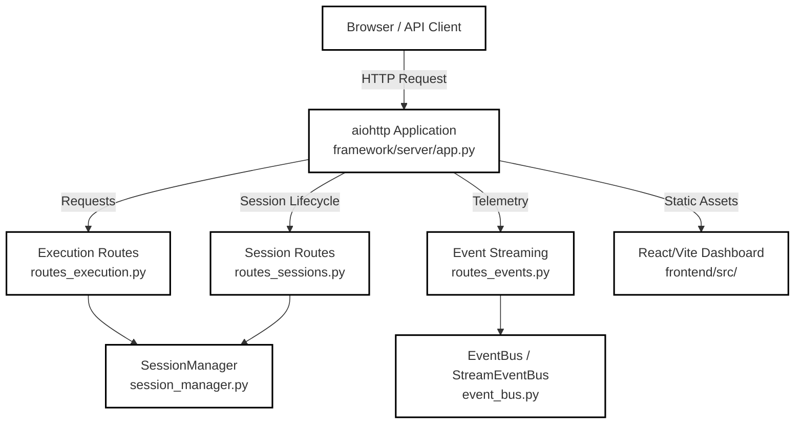
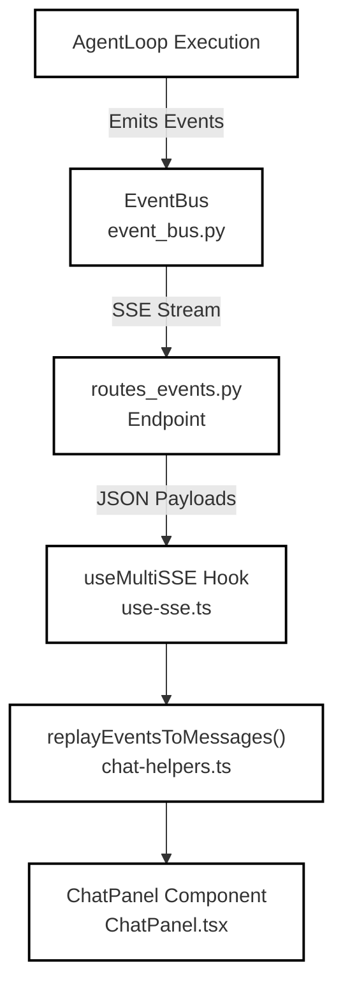

<!-- source: DeepWiki mcp.deepwiki.com · repo aden-hive/hive · page 4 HTTP Server and Web Dashboard · fetched 2026-10-27 -->

# HTTP Server and Web Dashboard

Relevant source files

The following files were used as context for generating this wiki page:

- [core/framework/agents/queen/nodes/__init__.py](core/framework/agents/queen/nodes/__init__.py)
- [core/framework/host/colony_runtime.py](core/framework/host/colony_runtime.py)
- [core/framework/host/worker.py](core/framework/host/worker.py)
- [core/framework/server/app.py](core/framework/server/app.py)
- [core/framework/server/queen_orchestrator.py](core/framework/server/queen_orchestrator.py)
- [core/framework/server/routes_events.py](core/framework/server/routes_events.py)
- [core/framework/server/routes_execution.py](core/framework/server/routes_execution.py)
- [core/framework/server/routes_sessions.py](core/framework/server/routes_sessions.py)
- [core/framework/server/session_manager.py](core/framework/server/session_manager.py)
- [core/framework/tools/queen_lifecycle_tools.py](core/framework/tools/queen_lifecycle_tools.py)
- [core/frontend/src/api/sessions.ts](core/frontend/src/api/sessions.ts)
- [core/frontend/src/api/types.ts](core/frontend/src/api/types.ts)
- [core/frontend/src/components/ChatPanel.tsx](core/frontend/src/components/ChatPanel.tsx)
- [core/frontend/src/lib/chat-helpers.test.ts](core/frontend/src/lib/chat-helpers.test.ts)
- [core/frontend/src/lib/chat-helpers.ts](core/frontend/src/lib/chat-helpers.ts)
- [core/frontend/src/pages/colony-chat.tsx](core/frontend/src/pages/colony-chat.tsx)
- [core/frontend/src/pages/queen-dm.tsx](core/frontend/src/pages/queen-dm.tsx)
- [core/tests/test_worker_started_at.py](core/tests/test_worker_started_at.py)

This wiki page provides an overview of the HTTP server infrastructure and the web dashboard interface for `aden-hive`. The server is built on `aiohttp` [core/framework/server/app.py:1-1200](), managing session lifecycles, agent executions, SSE telemetry streaming, and static asset serving for the bundled React/Vite dashboard.

As a parent page, this section summarizes the high-level architecture. Detailed reference material is maintained in the child pages:
- [REST API Reference](#4.1) — Detailed specifications for endpoints covering sessions, chat execution, queens, colonies, tasks, and configurations.
- [Event Streaming (SSE) and Chat Pipeline](#4.2) — Server-sent events (`routes_events`), session snapshots, and frontend state reconstruction via `chat-helpers.ts`.
- [Frontend Application Structure](#4.3) — React/Vite application layout, React contexts, routing, and component libraries.

---

## 4. HTTP Server and Web Dashboard Overview

The `aden-hive` runtime exposes its capabilities through an asynchronous HTTP server factory implemented with `aiohttp` [core/framework/server/app.py:1-165](). The server initializes middleware, configures a dedicated request thread pool executor (`get_request_executor`) [core/framework/server/app.py:38-55]() to prevent blocking I/O starvations from queen operations, and mounts REST and event-streaming route modules. 

Simultaneously, the server serves the compiled React single-page application from the frontend build artifacts, enabling seamless deployment as a self-contained desktop or local-network bridge node.

*Figure 4.1: High-level request routing architecture mapping HTTP transport to core management and event systems.*

Sources:
- `core/framework/server/app.py:1-165`
- `core/framework/server/session_manager.py:1-115`
- `core/framework/server/routes_sessions.py:1-47`
- `core/framework/server/routes_execution.py:1-15`

---

## 4.1 REST API Reference

The HTTP server exposes structured JSON APIs to manage queen agent sessions, colony runtimes, task execution, tools, credentials, and logs. All session-primary interactions route through `SessionManager` [core/framework/server/session_manager.py:1-60]() and execute within thread-isolated workers [core/framework/server/app.py:38-55]().

For detailed request/response schemas, error handling (such as `credential_errors` and 424 status codes) [core/framework/server/routes_sessions.py:76-106](), and route parameters, see the child page:
- [REST API Reference](#4.1)

Sources:
- `core/framework/server/app.py:38-55`
- `core/framework/server/session_manager.py:1-60`
- `core/framework/server/routes_sessions.py:76-106`

---

## 4.2 Event Streaming (SSE) and Chat Pipeline

Real-time telemetry and LLM token generation are streamed to the frontend via Server-Sent Events (SSE). The event pipeline relies on an underlying `EventBus` pub/sub system [core/framework/server/routes_events.py]() that broadcasts agent loops, tool invocations, and input requests (`client_input_requested`) [core/frontend/src/lib/chat-helpers.ts:143-174]().

*Figure 4.2: Data flow mapping server-side event generation to frontend chat reconstruction.*

The frontend processes these streams using pure functional helpers (`chat-helpers.ts`) [core/frontend/src/lib/chat-helpers.ts:1-45]() to deduplicate events, rebuild conversation timelines, and render interactive tool widgets. For details on historical event replay and stream subscriptions, see the child page:
- [Event Streaming (SSE) and Chat Pipeline](#4.2)

Sources:
- `core/frontend/src/lib/chat-helpers.ts:1-174`

---

## 4.3 Frontend Application Structure

The web dashboard is a React and Vite single-page application located in `core/frontend` [core/frontend/src/pages/queen-dm.tsx](). It manages multiple views including queen DMs, colony multi-worker chats [core/frontend/src/pages/colony-chat.tsx](), organizational charts, credential managers, and prompt libraries.

State management is structured around specialized React contexts (`ColonyContext`, `SessionUsageContext`, `DebugStateContext`) [core/frontend/src/pages/queen-dm.tsx:40-46]() and API wrapper modules [core/frontend/src/api/types.ts:1-56](). For comprehensive documentation on application routing, layout nesting, and UI components, see the child page:
- [Frontend Application Structure](#4.3)

Sources:
- `core/frontend/src/pages/queen-dm.tsx:40-46`
- `core/frontend/src/pages/colony-chat.tsx:1-44`
- `core/frontend/src/api/types.ts:1-56`

---

