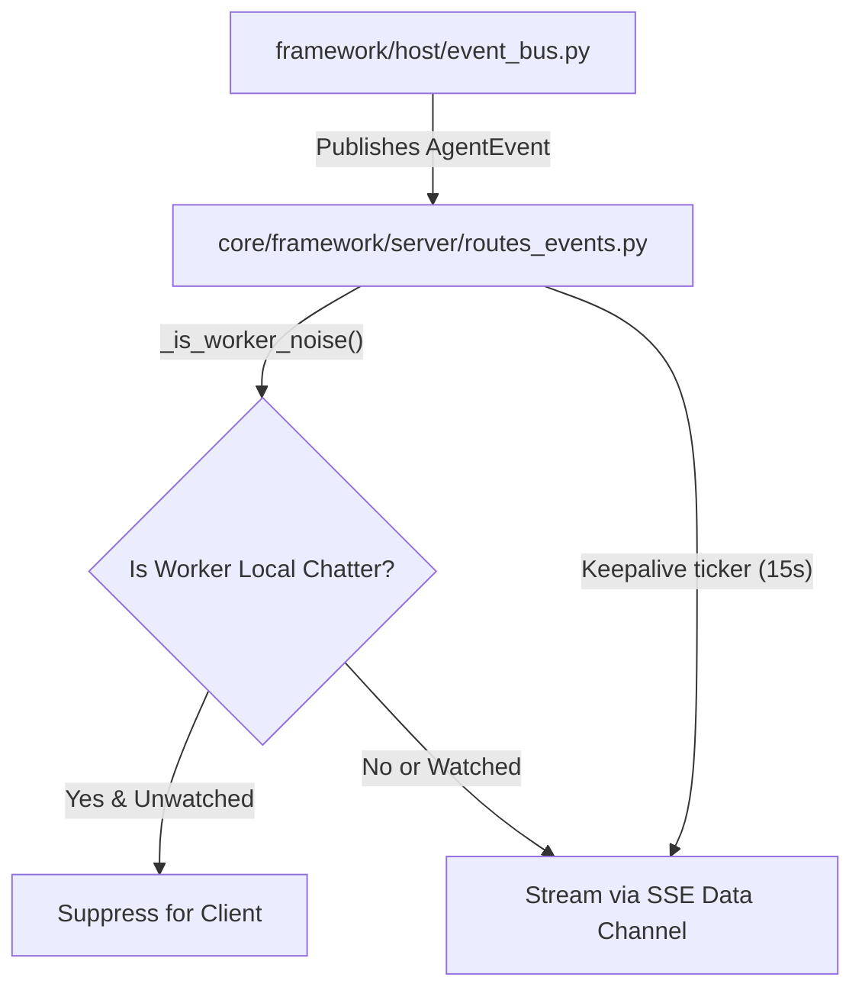
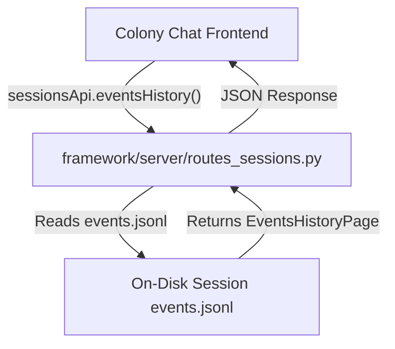
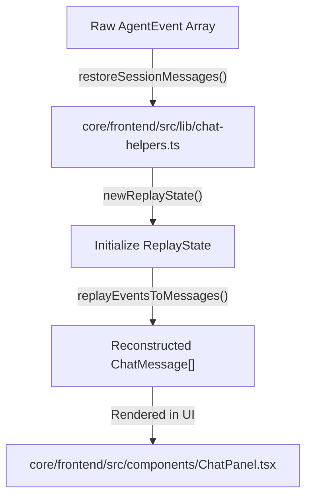

<!-- source: DeepWiki mcp.deepwiki.com · repo aden-hive/hive · page 4.2 Event Streaming (SSE) and Chat Pipeline · fetched 2026-10-27 -->

# Event Streaming (SSE) and Chat Pipeline

Relevant source files

The following files were used as context for generating this wiki page:

- [core/framework/server/routes_events.py](core/framework/server/routes_events.py)
- [core/framework/server/routes_sessions.py](core/framework/server/routes_sessions.py)
- [core/frontend/src/api/execution.ts](core/frontend/src/api/execution.ts)
- [core/frontend/src/api/sessions.ts](core/frontend/src/api/sessions.ts)
- [core/frontend/src/api/types.ts](core/frontend/src/api/types.ts)
- [core/frontend/src/components/ChatPanel.tsx](core/frontend/src/components/ChatPanel.tsx)
- [core/frontend/src/lib/chat-helpers.test.ts](core/frontend/src/lib/chat-helpers.test.ts)
- [core/frontend/src/lib/chat-helpers.ts](core/frontend/src/lib/chat-helpers.ts)
- [core/frontend/src/pages/colony-chat.tsx](core/frontend/src/pages/colony-chat.tsx)
- [core/frontend/src/pages/queen-dm.tsx](core/frontend/src/pages/queen-dm.tsx)

### Purpose and Scope

This page documents the real-time Server-Sent Events (SSE) streaming infrastructure, event routing policies, history replay mechanisms, and the frontend chat-helpers pipeline (`chat-helpers.ts`) that transforms raw telemetry into interactive chat transcripts, streaming deltas, and tool status pills.

---

### 1. SSE Route Implementation and Event Policies (`routes_events.py`)

The SSE endpoint streams asynchronous runtime events (`AgentEvent`) from the server to connected clients (`use-sse.ts`). It governs event visibility, filters worker noise from queen DM transcripts, and formats event payloads.

- **Default Event Types**: The server defines a comprehensive default whitelist (`DEFAULT_EVENT_TYPES`) in `core/framework/server/routes_events.py:22-90` covering stream deltas (`client_output_delta`, `llm_text_delta`), tool executions (`tool_call_started`, `tool_call_completed`), execution lifecycle states, triggers, tasks, and compaction updates.
- **Worker Noise Filtering**: To prevent background colony workers from flooding the primary queen chat transcript, `routes_events.py` applies `_is_worker_noise` (`core/framework/server/routes_events.py:114-121`), relying on the policy function `is_worker_local` from `framework.host.events_policy` (`core/framework/server/routes_events.py:16`).
- **Client Opt-in Watching**: Clients can pass a `?watch=` query parameter parsed by `_parse_watch` (`core/framework/server/routes_events.py:124-134`) to stream specific worker stream IDs or `*` for all chatter. `is_suppressed_for_client` (`core/framework/server/routes_events.py:136-149`) enforces these stream subscriptions.

Sources: `core/framework/server/routes_events.py:1-171`

---

### 2. Session Snapshots and History Replay (`routes_sessions.py`, `sessions.ts`)

When clients reload or open an existing session, the UI restores past transcripts using historical event logs rather than relying solely on ephemeral SSE buffers.

- **Events History Endpoint**: The backend route `GET /api/sessions/{session_id}/events/history` (`core/framework/server/routes_sessions.py:13-14`) reads the persisted `events.jsonl` log file associated with the session.
- **Backward Paged Cursors**: Implemented via `sessionsApi.eventsHistory` (`core/frontend/src/api/sessions.ts:168-177`), clients request pages using `limit`, `before_offset`, and `before_index` parameters. The response returns an `EventsHistoryPage` (`core/frontend/src/api/sessions.ts:10-27`) containing an array of `AgentEvent` objects, byte offsets, and `has_more_older` boolean flags to support infinite scrolling through older logs.
- **Session Snapshots**: `compute_session_snapshot` (`core/framework/server/routes_events.py:13`) aggregates live state during connection handshake to initialize clients.

Sources: `core/framework/server/routes_sessions.py:13-14`, `core/frontend/src/api/sessions.ts:10-27`, `core/frontend/src/api/sessions.ts:168-177`

---

### 3. Frontend Chat Pipeline, Replay, and Deduplication (`chat-helpers.ts`)

The frontend converts raw streams and historical events into structured UI messages without React state dependencies.

- **Event-to-Message Transformation**: `sseEventToChatMessage` (`core/frontend/src/lib/chat-helpers.ts:98-174`) maps event types like `client_output_delta` into `ChatMessage` objects (`core/frontend/src/components/ChatPanel.tsx`). It computes stable deduplication keys combining `execution_id`, loop iteration numbers (`turnId`, `data.iteration`), and inner tool turns (`inner_turn`).
- **Transcript Replay State Machine**: `replayEventsToMessages` (`core/frontend/src/lib/chat-helpers.ts`) processes an array of historic or live events sequentially using `newReplayState()` (`core/frontend/src/lib/chat-helpers.ts`) to reconstruct assistant responses, user prompts, and inline tool status pills.
- **Session Restore Execution**: `restoreSessionMessages` (`core/frontend/src/pages/colony-chat.tsx:75-173`) fetches historical events on session load, scans for trailing queen operating phases (`independent` or `colony`), detects pending `client_input_requested` questions, and executes `replayEventsToMessages` to prepopulate the chat view.

Sources: `core/frontend/src/lib/chat-helpers.ts:1-174`, `core/frontend/src/pages/colony-chat.tsx:75-173`

---

