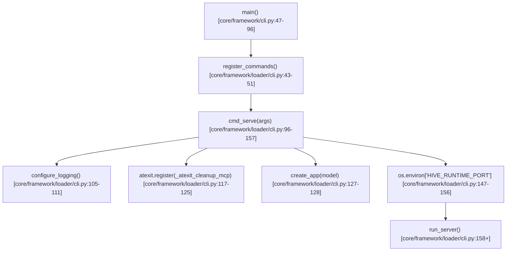
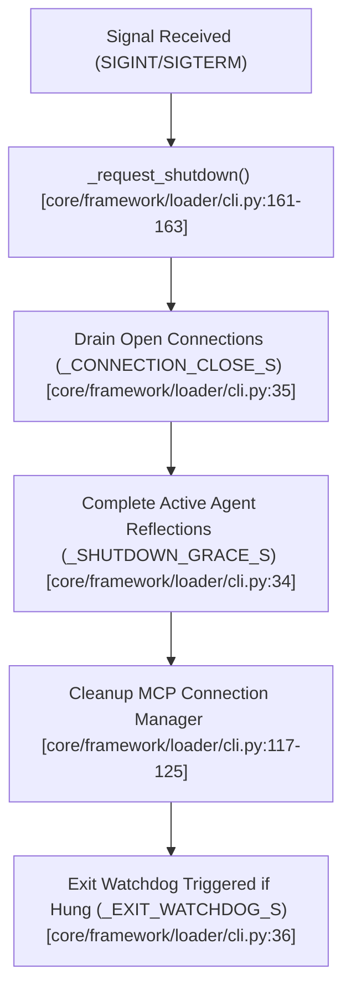
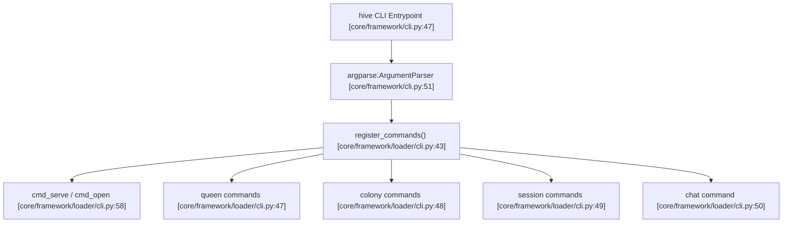

<!-- source: DeepWiki mcp.deepwiki.com · repo aden-hive/hive · page 5.1 Server and Colony Commands · fetched 2026-10-27 -->

# Server and Colony Commands

Relevant source files

The following files were used as context for generating this wiki page:

- [.github/workflows/ci.yml](.github/workflows/ci.yml)
- [.python-version](.python-version)
- [AGENTS.md](AGENTS.md)
- [CLAUDE.md](CLAUDE.md)
- [core/README.md](core/README.md)
- [core/framework/cli.py](core/framework/cli.py)
- [core/framework/loader/cli.py](core/framework/loader/cli.py)
- [core/framework/server/tests/test_session_shutdown.py](core/framework/server/tests/test_session_shutdown.py)
- [core/framework/testing/__init__.py](core/framework/testing/__init__.py)
- [core/frontend/vite.config.ts](core/frontend/vite.config.ts)
- [core/hatch_build.py](core/hatch_build.py)
- [core/tests/test_mcp_connection_manager.py](core/tests/test_mcp_connection_manager.py)
- [core/tests/test_mcp_registry_cli.py](core/tests/test_mcp_registry_cli.py)
- [core/tests/test_runner_cli_frontend.py](core/tests/test_runner_cli_frontend.py)
- [docs/releases/v1.0.2.md](docs/releases/v1.0.2.md)
- [docs/releases/v1.0.3.md](docs/releases/v1.0.3.md)
- [tools/README.md](tools/README.md)

This page details the implementation of the server startup sequence, port advertisement, signal handling, graceful shutdown procedures, and management commands for queens, colonies, sessions, and chat interactions residing in `core/framework/cli.py` and `core/framework/loader/cli.py`.

---

## 1. Server Initialization and Port Advertisement (`cmd_serve`)

The Hive command-line interface acts as the control plane entrypoint, initialized via `core/framework/cli.py` which configures `sys.path` and delegates subcommand parsing to modular registries [core/framework/cli.py:28-68](). The server runner subsystem, defined in `core/framework/loader/cli.py`, implements `cmd_serve` and `cmd_open` [core/framework/loader/cli.py:58-94]().

When executing `hive serve` or `hive open`, `cmd_serve` performs the following initialization steps:
1. Configures runtime logging levels via `configure_logging()` (INFO by default, or DEBUG if `--debug` is passed) [core/framework/loader/cli.py:105-111]().
2. Registers a last-resort cleanup handler (`_atexit_cleanup_mcp`) via `atexit` to ensure spawned Model Context Protocol (MCP) subprocesses are terminated upon process exit [core/framework/loader/cli.py:113-125]().
3. Instantiates the `aiohttp` application using `create_app(model=model)` [core/framework/loader/cli.py:127-128]().
4. Advertises the runtime port to environment inheritance by setting `os.environ["HIVE_RUNTIME_PORT"]` prior to server binding or colony preloading. This ensures child processes (such as MCP servers and agent shell commands) can resolve the active HTTP server port [core/framework/loader/cli.py:147-156]().

### Diagram: Server Startup and Initialization Data Flow

*Sources: [core/framework/cli.py:47-96](), [core/framework/loader/cli.py:43-157]()*

---

## 2. Signal Handling and Graceful Shutdown

To prevent data corruption in SQLite trackers (`tracker.db`) and guarantee that active LLM agent loops complete ongoing reflections, `cmd_serve` incorporates a strict shutdown lifecycle controlled by time constants and asynchronous signal listeners [core/framework/loader/cli.py:31-36]().

### Shutdown Constants
* `_SHUTDOWN_GRACE_S = 6.0`: Maximum allotted time for active sessions to finish their final reflections [core/framework/loader/cli.py:34]().
* `_CONNECTION_CLOSE_S = 3.0`: Time granted for open HTTP/SSE connections to drain [core/framework/loader/cli.py:35]().
* `_EXIT_WATCHDOG_S = 5.0`: Hard watchdog limit forcing process termination if threads hang post-shutdown [core/framework/loader/cli.py:36]().

Signal handlers (`SIGINT`, `SIGTERM`) intercept termination requests, invoking `_request_shutdown` to flag asynchronous events. The server teardown sequence systematically disconnects client pools, shuts down background telemetry routines, and unbinds active ports within the bounded grace periods.

### Diagram: Graceful Shutdown Sequence

*Sources: [core/framework/loader/cli.py:31-36](), [core/framework/loader/cli.py:117-125](), [core/framework/loader/cli.py:161-163]()*

---

## 3. Queen, Colony, Session, and Chat Management Commands

The CLI registers hierarchical command groups under `hive queen`, `hive colony`, `hive session`, and `hive chat` [core/framework/cli.py:65](), [core/framework/loader/cli.py:43-51]().

### Command Subsystems

| Subsystem | Command Pattern | Role & Implementation |
| --- | --- | --- |
| **Queen Management** | `hive queen list` `hive queen show <queen_id>` `hive queen sessions <queen_id>` | Lists built-in Queen personas, inspects YAML profiles and system prompts, and queries active or historical session identifiers tied to a specific Queen persona. |
| **Colony Management** | `hive colony list` `hive colony info <name>` `hive colony delete <name>` | Discovers self-contained colony directories under `$HIVE_HOME/colonies/`, parses worker templates (`worker.json`), inspects shared SQLite ledgers (`tracker.db`), and safely purges colony directories [core/README.md:45-59](). |
| **Session Management** | `hive session list [--cold]` `hive session stop <session_id>` | Enumerates live runtime sessions managed by `SessionManager` or scans on-disk cold storage (`--cold`), and forcefully terminates active agent execution loops. |
| **Chat Pipeline** | `hive chat <session_id> "message"` | Directs single-turn or continuous chat payloads to a live Queen session via internal HTTP API requests. |

### Diagram: CLI Subcommand Routing Architecture

*Sources: [core/framework/cli.py:47-68](), [core/framework/loader/cli.py:43-51]() *

---

