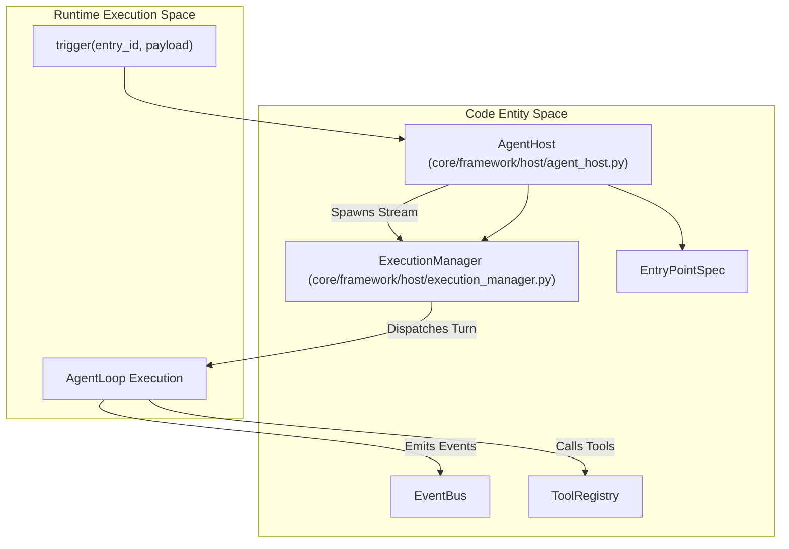
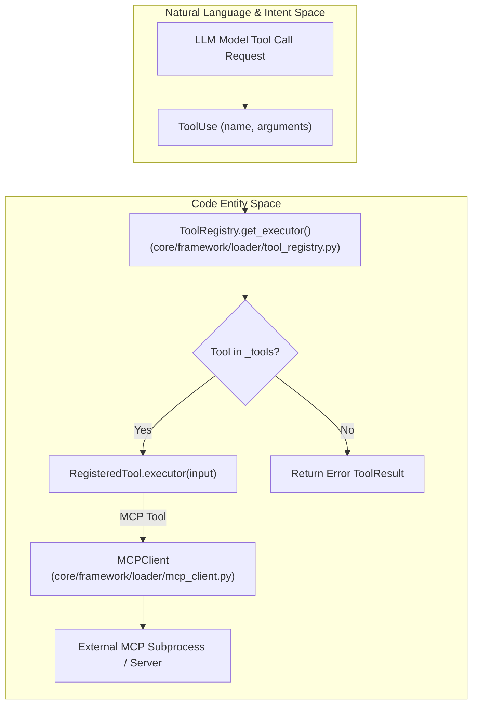

<!-- source: DeepWiki mcp.deepwiki.com · repo aden-hive/hive · page 5.2 Agent Loading and Tool Registry · fetched 2026-10-27 -->

# Agent Loading and Tool Registry

Relevant source files

The following files were used as context for generating this wiki page:

- [core/.mcp.json](core/.mcp.json)
- [core/MCP_BUILDER_TOOLS_GUIDE.md](core/MCP_BUILDER_TOOLS_GUIDE.md)
- [core/MCP_INTEGRATION_GUIDE.md](core/MCP_INTEGRATION_GUIDE.md)
- [core/examples/mcp_servers.json](core/examples/mcp_servers.json)
- [core/framework/host/agent_host.py](core/framework/host/agent_host.py)
- [core/framework/host/execution_manager.py](core/framework/host/execution_manager.py)
- [core/framework/loader/agent_loader.py](core/framework/loader/agent_loader.py)
- [core/framework/loader/mcp_registry.py](core/framework/loader/mcp_registry.py)
- [core/framework/loader/tool_registry.py](core/framework/loader/tool_registry.py)
- [core/framework/pipeline/stages/credential_resolver.py](core/framework/pipeline/stages/credential_resolver.py)
- [core/framework/pipeline/stages/llm_provider.py](core/framework/pipeline/stages/llm_provider.py)
- [core/framework/pipeline/stages/mcp_registry.py](core/framework/pipeline/stages/mcp_registry.py)
- [core/framework/pipeline/stages/skill_registry.py](core/framework/pipeline/stages/skill_registry.py)
- [core/framework/server/compaction_status.py](core/framework/server/compaction_status.py)
- [core/framework/server/tests/conftest.py](core/framework/server/tests/conftest.py)
- [core/framework/storage/session_summary.py](core/framework/storage/session_summary.py)
- [core/frontend/src/components/ChatPanel.thinkingTurns.test.ts](core/frontend/src/components/ChatPanel.thinkingTurns.test.ts)
- [core/frontend/src/components/HiveMap.tsx](core/frontend/src/components/HiveMap.tsx)
- [core/tests/conftest.py](core/tests/conftest.py)
- [core/tests/test_janitor_review_fixes.py](core/tests/test_janitor_review_fixes.py)
- [core/tests/test_mcp_registry.py](core/tests/test_mcp_registry.py)
- [core/tests/test_tool_registry.py](core/tests/test_tool_registry.py)
- [docs/releases/v0.11.0.md](docs/releases/v0.11.0.md)
- [tools/src/chart_tools/__init__.py](tools/src/chart_tools/__init__.py)
- [tools/src/chart_tools/renderer.py](tools/src/chart_tools/renderer.py)
- [tools/src/chart_tools/theme.py](tools/src/chart_tools/theme.py)
- [tools/src/chart_tools/tools.py](tools/src/chart_tools/tools.py)
- [tools/tests/test_chart_tools_smoke.py](tools/tests/test_chart_tools_smoke.py)

This page documents the subsystems responsible for loading agents, managing execution runtimes, discovering and registering tools, and executing the initialization pipeline stages. Specifically, it covers `agent_loader`, `agent_host`, `execution_manager`, `ToolRegistry`, `MCPRegistry`, `MCPClient`, and the pipeline stages (`mcp_registry`, `llm_provider`, `credential_resolver`, `skill_registry`).

Sources: `[core/framework/loader/agent_loader.py:1-50](), [core/framework/loader/tool_registry.py:1-136](), [core/framework/pipeline/stages/mcp_registry.py:1-25]()`

---

## 1. Agent Loading (`agent_loader.py`)

The `agent_loader` module is responsible for loading exported agents, resolving their dependencies, preparing configurations, and handling subscription auth/OAuth tokens (such as Claude Code and Codex credentials stored in macOS Keychain or local JSON files).

### Key Functions and Flows

- `_read_claude_credentials()` and `_refresh_claude_code_token()`: Manage authentication state for Anthropic/Claude Code integrations, supporting proactive token refreshes using OAuth refresh tokens [core/framework/loader/agent_loader.py:120-173]().
- Preload validation: Invokes `run_preload_validation()` to ensure that environment variables, Python versions, and core dependencies are satisfied before instantiating runtimes [core/framework/loader/agent_loader.py:19-20]().

Sources: `[core/framework/loader/agent_loader.py:1-205]()`

---

## 2. Agent Host and Execution Manager (`agent_host.py`, `execution_manager.py`)

`AgentHost` acts as the top-level orchestrator for multi-entry-point agents, coordinating concurrent execution streams while maintaining outcome-driven tracking [core/framework/host/agent_host.py:73-123](). 

### Architecture Diagram: Agent Host & Execution Space

Sources: `[core/framework/host/agent_host.py:39-175](), [core/framework/host/execution_manager.py:1-50]()`

---

## 3. Tool Registry and MCP Subsystem

The tool ecosystem hinges on three main components: `ToolRegistry`, `MCPRegistry`, and `MCPClient`.

### Tool Discovery Order
1. Python module (`tools.py` in agent package) via `discover_from_module()` [core/framework/loader/tool_registry.py:131-218]()
2. MCP servers via `.mcp.json` or explicit registration (`register_mcp_server()`) [core/framework/loader/tool_registry.py:352-449]()
3. Explicit manual registration (`register()` / `register_function()`)

### Architecture Diagram: Natural Language to Tool Execution Entity Space

Sources: `[core/framework/loader/tool_registry.py:34-160](), [core/framework/loader/mcp_registry.py:67-96]()`

---

## 4. Pipeline Stages

Initialization pipeline stages encapsulate modular setup steps executed before an agent loop or colony worker starts. The pipeline framework processes stages sequentially based on their `order` attribute.

| Pipeline Stage Class | Module File | Order | Purpose |
|---|---|---|---|
| `McpRegistryStage` | `framework.pipeline.stages.mcp_registry` | `50` | Resolves MCP server references from config and registers tools into `ToolRegistry` [core/framework/pipeline/stages/mcp_registry.py:20-25]() |
| `LlmProviderStage` | `framework.pipeline.stages.llm_provider` | `10` | Resolves and validates the configured LLM provider instance |
| `CredentialResolverStage` | `framework.pipeline.stages.credential_resolver` | `20` | Resolves required credentials and API keys from storage or environment |
| `SkillRegistryStage` | `framework.pipeline.stages.skill_registry` | `30` | Discovers and loads available skills for agent prompt injection |

Sources: `[core/framework/pipeline/stages/mcp_registry.py:1-104]()`

---

