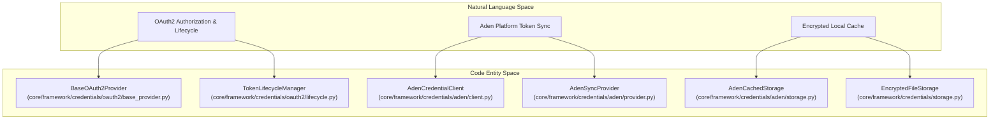
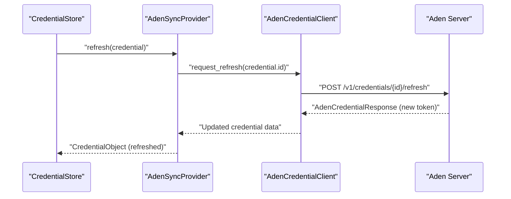
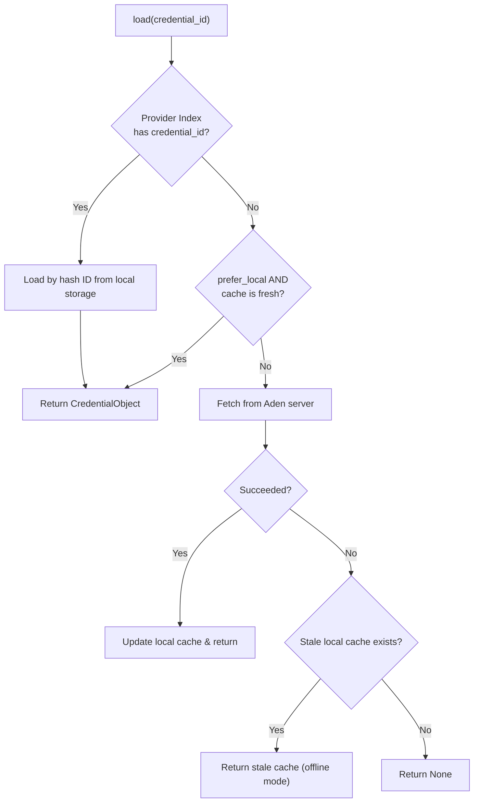

<!-- source: DeepWiki mcp.deepwiki.com · repo aden-hive/hive · page 6.2 OAuth2 and Aden Platform Sync · fetched 2026-10-27 -->

# OAuth2 and Aden Platform Sync

Relevant source files

The following files were used as context for generating this wiki page:

- [.claude/skills/triage-issue/SKILL.md](.claude/skills/triage-issue/SKILL.md)
- [core/framework/credentials/aden/__init__.py](core/framework/credentials/aden/__init__.py)
- [core/framework/credentials/aden/client.py](core/framework/credentials/aden/client.py)
- [core/framework/credentials/aden/provider.py](core/framework/credentials/aden/provider.py)
- [core/framework/credentials/aden/storage.py](core/framework/credentials/aden/storage.py)
- [core/framework/credentials/aden/tests/__init__.py](core/framework/credentials/aden/tests/__init__.py)
- [core/framework/credentials/aden/tests/test_aden_sync.py](core/framework/credentials/aden/tests/test_aden_sync.py)
- [core/framework/credentials/oauth2/base_provider.py](core/framework/credentials/oauth2/base_provider.py)
- [core/framework/credentials/oauth2/lifecycle.py](core/framework/credentials/oauth2/lifecycle.py)
- [core/framework/credentials/provider.py](core/framework/credentials/provider.py)
- [core/framework/credentials/storage.py](core/framework/credentials/storage.py)
- [core/framework/credentials/template.py](core/framework/credentials/template.py)
- [core/framework/credentials/tests/test_credential_store.py](core/framework/credentials/tests/test_credential_store.py)
- [docs/aden-credential-sync.md](docs/aden-credential-sync.md)

This page documents the OAuth2 provider and lifecycle management subsystem, browser-based authorization helpers, `AdenCredentialClient`, `AdenSyncProvider`, and the Fernet-encrypted `AdenCachedStorage` with offline fallback. These components coordinate credential retrieval, token refresh delegation, and persistent caching across Hive agents and the Aden authentication platform.

---

## Overview and Code Architecture

The credential subsystem bridges local agent operations with external OAuth2 and platform-managed credentials. The architecture combines generic OAuth2 flow handling (`BaseOAuth2Provider`, `TokenLifecycleManager`) with server-delegated credential synchronization via `AdenSyncProvider` and `AdenCachedStorage`.

### System-to-Code Mapping Diagram

Sources: [core/framework/credentials/oauth2/base_provider.py:27-68](), [core/framework/credentials/oauth2/lifecycle.py:39-68](), [core/framework/credentials/aden/client.py:239-431](), [core/framework/credentials/aden/provider.py:62-116](), [core/framework/credentials/aden/storage.py:59-121]()

---

## OAuth2 Provider and Lifecycle Modules

The OAuth2 subsystem implements standard RFC 6749 flows, token exchange, client credentials grants, and automated background or on-demand refreshing.

### `BaseOAuth2Provider`

Defined in `core/framework/credentials/oauth2/base_provider.py`, `BaseOAuth2Provider` manages standard OAuth2 server interactions:

| Method | Description |
|---|---|
| `get_authorization_url(state, redirect_uri, scopes)` | Generates the anti-CSRF protected consent URL [core/framework/credentials/oauth2/base_provider.py:113-148]() |
| `exchange_code(code, redirect_uri)` | Exchanges authorization codes for `OAuth2Token` instances [core/framework/credentials/oauth2/base_provider.py:149-180]() |
| `client_credentials_grant(scopes)` | Executes service-to-service client credentials authentication [core/framework/credentials/oauth2/base_provider.py:181-206]() |

Sources: [core/framework/credentials/oauth2/base_provider.py:27-206]()

### `TokenLifecycleManager`

Defined in `core/framework/credentials/oauth2/lifecycle.py`, `TokenLifecycleManager` coordinates automated token persistence, expiration checking, and refresh execution:

- **Async & Sync Access**: Provides `get_valid_token()` [core/framework/credentials/oauth2/lifecycle.py:103-143]() and `sync_get_valid_token()` [core/framework/credentials/oauth2/lifecycle.py:184-215]() to fetch valid tokens, automatically invoking refresh logic if expiration is within the configured buffer window.
- **Revocation**: Supports explicit token revocation via `revoke()` [core/framework/credentials/oauth2/lifecycle.py:167-181]().

Sources: [core/framework/credentials/oauth2/lifecycle.py:39-215]()

---

## `AdenCredentialClient`

[core/framework/credentials/aden/client.py:239-431]()

`AdenCredentialClient` provides an HTTP client built on `httpx.Client` for communicating with the Aden authentication server. All requests are authenticated via `Authorization: Bearer {api_key}` using `ADEN_API_KEY`.

### Client Configuration and Methods

| Configuration Parameter | Default | Description |
|---|---|---|
| `base_url` | required | Aden REST API base URL (e.g., `https://api.adenhq.com`) [core/framework/credentials/aden/client.py:88-89]() |
| `api_key` | `ADEN_API_KEY` env | Agent authentication token [core/framework/credentials/aden/client.py:91-92]() |
| `tenant_id` | `None` | Optional multi-tenant deployment identifier [core/framework/credentials/aden/client.py:94-95]() |

| Method | HTTP Route | Description |
|---|---|---|
| `list_integrations()` | `GET /v1/credentials` | Returns `list[AdenIntegrationInfo]` for all authorized integrations [core/framework/credentials/aden/client.py:239-260]() |
| `get_credential(id)` | `GET /v1/credentials/{id}` | Fetches access token and metadata [core/framework/credentials/aden/client.py:262-285]() |
| `request_refresh(id)` | `POST /v1/credentials/{id}/refresh` | Forces a token refresh on the Aden platform [core/framework/credentials/aden/client.py:287-310]() |
| `validate_token(id)` | `GET /v1/credentials/{id}/validate` | Checks token validity without returning secret values [core/framework/credentials/aden/client.py:312-335]() |

Sources: [core/framework/credentials/aden/client.py:85-346]()

---

## `AdenSyncProvider`

[core/framework/credentials/aden/provider.py:62-116]()

`AdenSyncProvider` implements the `CredentialProvider` interface to delegate token lifecycle management to the Aden server while caching short-lived access tokens locally.

### Data Flow and Refresh Delegation

Sources: [core/framework/credentials/aden/provider.py:151-211](), [docs/aden-credential-sync.md:97-133]()

- **`can_handle(credential)`**: Matches credentials explicitly assigned to `provider_id` or carrying the `_aden_managed` metadata flag [core/framework/credentials/aden/provider.py:128-150]().
- **`sync_all(store)`**: Populates the local credential store by listing all active integrations and fetching initial access tokens [core/framework/credentials/aden/provider.py:281-316]().

Sources: [core/framework/credentials/aden/provider.py:62-316]()

---

## `AdenCachedStorage` and Offline Fallback

[core/framework/credentials/aden/storage.py:59-121]()

`AdenCachedStorage` wraps a local storage backend (typically `EncryptedFileStorage`) with a TTL-based caching layer and offline fallback behavior.

### Storage Execution Flow

Sources: [core/framework/credentials/aden/storage.py:134-213]()

### In-Memory Indexing and Aliasing

`AdenCachedStorage` maintains two memory indices:
- `_provider_index`: Maps provider names (e.g., `"hubspot"`) to hash-based credential IDs [core/framework/credentials/aden/storage.py:117-118]().
- `_alias_index`: Maps `"provider:alias"` strings to hash IDs to support multi-account naming (e.g., `"google:Timothy"`) [core/framework/credentials/aden/storage.py:119-121]().

Sources: [core/framework/credentials/aden/storage.py:59-133]()

---

## Environment Variables and Store Integration

| Environment Variable | Description |
|---|---|
| `ADEN_API_KEY` | Agent API key required by `AdenCredentialClient` [core/framework/credentials/aden/client.py:107-111]() |
| `ADEN_API_URL` | Optional base URL override for the Aden platform API |
| `HIVE_CREDENTIAL_KEY` | 32-byte Fernet symmetric key for `EncryptedFileStorage` at-rest encryption [core/framework/credentials/storage.py:110-165]() |

Integration is initialized via factory helpers on `CredentialStore` [core/framework/credentials/store.py:665-756](), wiring client, provider, and cached storage automatically.

Sources: [core/framework/credentials/aden/client.py:85-112](), [core/framework/credentials/storage.py:96-165](), [core/framework/credentials/store.py:665-756]()

---

