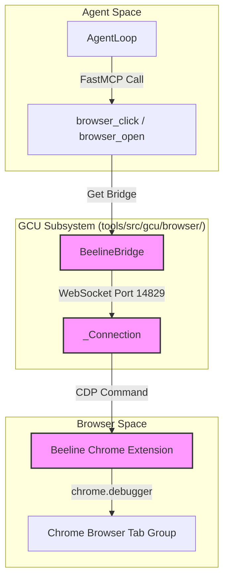
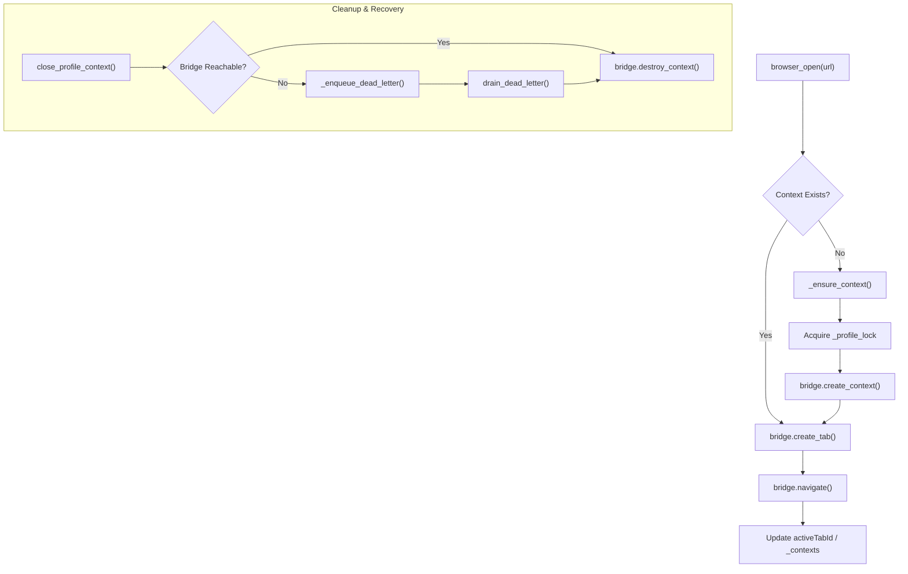

<!-- source: DeepWiki mcp.deepwiki.com · repo aden-hive/hive · page 7.1 Browser Automation (GCU) · fetched 2026-10-27 -->

# Browser Automation (GCU)

<details>
<summary>Relevant source files</summary>

The following files were used as context for generating this wiki page:

- [.claude/settings.json](.claude/settings.json)
- [core/framework/skills/_default_skills/browser-automation/SKILL.md](core/framework/skills/_default_skills/browser-automation/SKILL.md)
- [scripts/browser_remote.py](scripts/browser_remote.py)
- [scripts/browser_remote_ui.html](scripts/browser_remote_ui.html)
- [tools/src/aden_tools/tools/web_scrape_tool/README.md](tools/src/aden_tools/tools/web_scrape_tool/README.md)
- [tools/src/aden_tools/tools/web_scrape_tool/web_scrape_tool.py](tools/src/aden_tools/tools/web_scrape_tool/web_scrape_tool.py)
- [tools/src/gcu/__init__.py](tools/src/gcu/__init__.py)
- [tools/src/gcu/browser/__init__.py](tools/src/gcu/browser/__init__.py)
- [tools/src/gcu/browser/bridge.py](tools/src/gcu/browser/bridge.py)
- [tools/src/gcu/browser/refs.py](tools/src/gcu/browser/refs.py)
- [tools/src/gcu/browser/session.py](tools/src/gcu/browser/session.py)
- [tools/src/gcu/browser/tools/__init__.py](tools/src/gcu/browser/tools/__init__.py)
- [tools/src/gcu/browser/tools/advanced.py](tools/src/gcu/browser/tools/advanced.py)
- [tools/src/gcu/browser/tools/inspection.py](tools/src/gcu/browser/tools/inspection.py)
- [tools/src/gcu/browser/tools/interactions.py](tools/src/gcu/browser/tools/interactions.py)
- [tools/src/gcu/browser/tools/lifecycle.py](tools/src/gcu/browser/tools/lifecycle.py)
- [tools/src/gcu/browser/tools/navigation.py](tools/src/gcu/browser/tools/navigation.py)
- [tools/src/gcu/browser/tools/tabs.py](tools/src/gcu/browser/tools/tabs.py)
- [tools/src/gcu/server.py](tools/src/gcu/server.py)
- [tools/tests/test_bridge_multiconnection.py](tools/tests/test_bridge_multiconnection.py)
- [tools/tests/test_browser_tools_comprehensive.py](tools/tests/test_browser_tools_comprehensive.py)
- [tools/tests/test_refs.py](tools/tests/test_refs.py)
- [tools/tests/test_x_page_load_repro.py](tools/tests/test_x_page_load_repro.py)
- [tools/tests/tools/test_image_gen_tool.py](tools/tests/tools/test_image_gen_tool.py)
- [tools/tests/tools/test_web_scrape_tool.py](tools/tests/tools/test_web_scrape_tool.py)

</details>


The Generic Control Unit (GCU) browser subsystem provides native browser automation for Hive agents by communicating directly with the user's running Chrome browser via the Beeline Chrome extension and the Chrome DevTools Protocol (CDP). Unlike traditional test automation frameworks, GCU bypasses Playwright or standalone headless binaries, allowing agents to operate inside the user's authenticated session (preserving existing cookies, logins, and extensions like LinkedIn or Gmail).

---

## 1. Architecture and the Beeline Bridge

The core of the GCU subsystem is a WebSocket bridge server that listens for connections from the Beeline Chrome extension (`tools/src/gcu/browser/bridge.py`). 

The bridge server binds to primary port `14829`, with a legacy fallback port `9229` to support older extension builds (`tools/src/gcu/browser/bridge.py:50-58`). It maintains multiple simultaneous profile connections via the `_Connection` class, tracking connection metadata, pings, and active requests per browser profile (`tools/src/gcu/browser/bridge.py:91-137`). To identify Hive-owned tab groups across restarts without altering the user-facing tab strip, tab groups are tagged with a zero-width space marker (`HIVE_GROUP_MARKER = "\u200b"`, matching `background.js`) (`tools/src/gcu/browser/bridge.py:68`).

### Architecture and Data Flow


*Sources: `tools/src/gcu/browser/bridge.py:50-137`, `tools/src/gcu/browser/tools/interactions.py:100-166`*

---

## 2. Browser Contexts and Tab Management

Browser execution contexts map agent identities and profiles to Chrome tab groups. The lifecycle manager tracks active contexts in memory via `_contexts` and uses per-profile asynchronous locks (`_profile_lock`) to prevent race conditions when multiple agents initialize contexts simultaneously (`tools/src/gcu/browser/tools/lifecycle.py:28-33`).

Tab tools (`browser_open`, `browser_tabs`, `browser_close`, `browser_activate_tab`) are registered through FastMCP (`tools/src/gcu/browser/tools/tabs.py:130-191`). 
- `browser_open` lazy-creates contexts if none exist, reusing seed `about:blank` tabs or opening new tabs inside the designated agent group (`tools/src/gcu/browser/tools/tabs.py:75-85`).
- `browser_tabs` aggregates open tabs, checking against overflow limits and reporting active tab identifiers (`tools/src/gcu/browser/tools/tabs.py:131-168`).

To prevent resource leaks when subagents terminate abruptly during extension reloads, unclosed contexts enter a dead-letter queue (`_DEAD_LETTER`) and are retried via `drain_dead_letter()` (`tools/src/gcu/browser/tools/lifecycle.py:35-108`).

### Tab Lifecycle & Context Flow


*Sources: `tools/src/gcu/browser/tools/tabs.py:75-191`, `tools/src/gcu/browser/tools/lifecycle.py:28-108`*

---

## 3. Viewport-Fraction Interactions & Visual Feedback

Coordinate-based actions (clicking, hovering, dragging) use **viewport fractions (0.0 to 1.0)** rather than raw pixels. This normalization ensures interactions remain invariant to device pixel ratios, window resizing, or vision API tiling (`tools/src/gcu/browser/tools/inspection.py:78-83`, `core/framework/skills/_default_skills/browser-automation/SKILL.md:40-48`).

When `browser_click` executes:
1. It queries the bridge and validates the active context and tab (`tools/src/gcu/browser/tools/interactions.py:148-164`).
2. Following interaction, a settlement pause occurs (`_AUTO_SNAPSHOT_SETTLE_S = 0.5`) to allow React commits and layout re-renders to complete (`tools/src/gcu/browser/tools/interactions.py:27, 86-93`).
3. `_build_visual_response` captures a post-action screenshot, overlays coordinate click markers via `_resize_and_annotate`, and returns both text and image content blocks to the agent (`tools/src/gcu/browser/tools/interactions.py:43-77`).

---

## 4. Snapshots, Screenshots & Artifacts

Inspection capabilities (`tools/src/gcu/browser/tools/inspection.py`) allow agents to inspect page layouts via accessibility trees (`browser_snapshot`) and visual rasters (`browser_screenshot`).

- **Screenshots**: Captured images are resized down to a standard bandwidth-optimized width (`_SCREENSHOT_WIDTH = 800`) and encoded as JPEG quality 75 (`tools/src/gcu/browser/tools/inspection.py:84, 134-152`). Concurrency is bounded by `_resize_semaphore` to prevent native memory exhaustion (`tools/src/gcu/browser/tools/inspection.py:94-104`).
- **Artifact Persistence**: Large text/HTML snapshots and screenshot binaries are written to disk rather than passed inline through JSON boundaries, preventing context window poisoning. Artifact directories are resolved via `_resolve_browser_artifact_dir()`, favoring `<HIVE_STORAGE_PATH>/data` (per-agent storage) and falling back to `<HIVE_HOME>/tool-artifacts` (`tools/src/gcu/browser/tools/inspection.py:31-75`).

---

## 5. Shadow-Piercing Queries & Advanced Tools

Complex inspection and manipulation require specialized tools housed in `tools/src/gcu/browser/tools/advanced.py`:
- `browser_evaluate`: Executes raw JavaScript expressions in the page context (`tools/src/gcu/browser/tools/advanced.py:76-97`).
- `browser_upload`: Handles direct file inputs or triggered native file dialog interceptions via CDP (`tools/src/gcu/browser/tools/advanced.py:134-163`).
- **Blocker Resolution**: When interactions fail due to foreign extension overlays (e.g., Grammarly or Calendly injecting into shadow roots), `_resolve_blockers` audits tab health using `bridge.tab_health(force_audit=True)` to classify culprits and return actionable error metadata (`tools/src/gcu/browser/tools/advanced.py:25-70`).

---

## 6. The `hive-browser` CLI & Agent Integration

Agents interact with the browser subsystem via terminal execution commands (`terminal_exec`) running the `hive-browser` CLI with `--json`, as defined in the default `hive.browser-automation` skill (`core/framework/skills/_default_skills/browser-automation/SKILL.md:10-12`):

```bash
hive-browser open --url "https://example.com" --json
hive-browser screenshot --json
hive-browser interact --action left_click --coordinate 0.35,0.20 --json
hive-browser page shadow-query "button.submit" --json
```

### Key Operating Rules for Agents
1. **No Process Management**: The browser belongs to the user. Agents must never kill, restart, or spawn standalone browser binaries (`--remote-debugging-port`, headless flags, etc.) (`SKILL.md:14-18`).
2. **Profile Targeting**: Multi-account workflows require passing `--browser-profile <label>` to bind correctly to connected Chrome user profiles (`SKILL.md:24-33`).
3. **Coordinates Over Selectors**: On shadow-DOM heavy or dynamically styled pages, agents rely on `hive-browser screenshot` combined with fractional `--coordinate` arguments to guarantee hit-testing accuracy (`SKILL.md:40-54`).

*Sources: `core/framework/skills/_default_skills/browser-automation/SKILL.md:1-57`*

---

