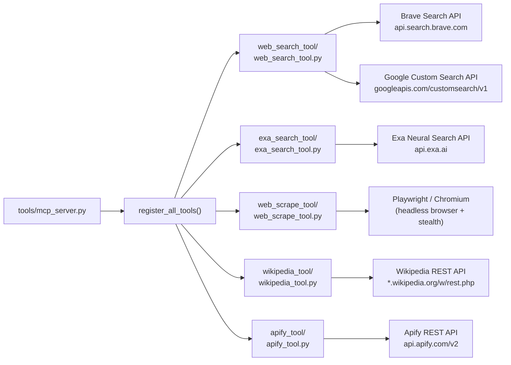
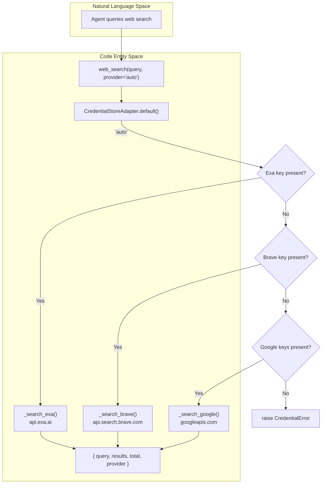
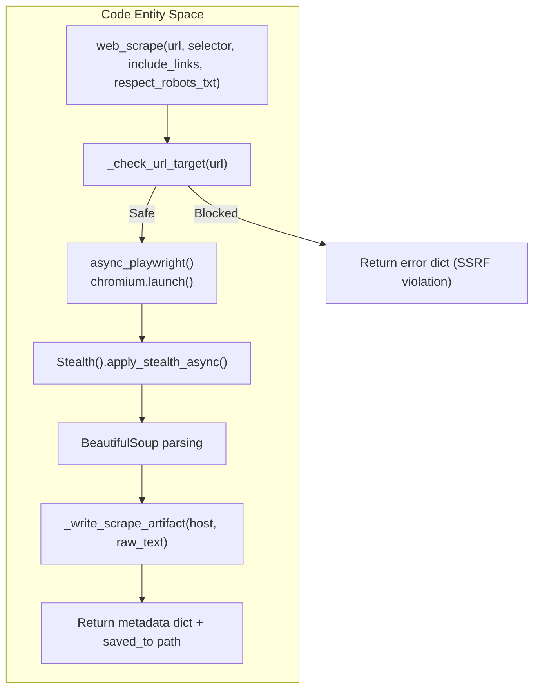

<!-- source: DeepWiki mcp.deepwiki.com · repo aden-hive/hive · page 7.4 Search, Research and Web Tools · fetched 2026-10-27 -->

# Search, Research and Web Tools

Relevant source files

The following files were used as context for generating this wiki page:

- [tools/BUILDING_TOOLS.md](tools/BUILDING_TOOLS.md)
- [tools/mcp_server.py](tools/mcp_server.py)
- [tools/src/aden_tools/__init__.py](tools/src/aden_tools/__init__.py)
- [tools/src/aden_tools/credentials/apify.py](tools/src/aden_tools/credentials/apify.py)
- [tools/src/aden_tools/credentials/hubspot.py](tools/src/aden_tools/credentials/hubspot.py)
- [tools/src/aden_tools/credentials/postgres.py](tools/src/aden_tools/credentials/postgres.py)
- [tools/src/aden_tools/tools/apify_tool/README.md](tools/src/aden_tools/tools/apify_tool/README.md)
- [tools/src/aden_tools/tools/apify_tool/__init__.py](tools/src/aden_tools/tools/apify_tool/__init__.py)
- [tools/src/aden_tools/tools/apify_tool/apify_tool.py](tools/src/aden_tools/tools/apify_tool/apify_tool.py)
- [tools/src/aden_tools/tools/hubspot_tool/hubspot_tool.py](tools/src/aden_tools/tools/hubspot_tool/hubspot_tool.py)
- [tools/src/aden_tools/tools/hubspot_tool/tests/test_hubspot_tool.py](tools/src/aden_tools/tools/hubspot_tool/tests/test_hubspot_tool.py)
- [tools/src/aden_tools/tools/postgres_tool/README.md](tools/src/aden_tools/tools/postgres_tool/README.md)
- [tools/src/aden_tools/tools/postgres_tool/__init__.py](tools/src/aden_tools/tools/postgres_tool/__init__.py)
- [tools/src/aden_tools/tools/postgres_tool/postgres_tool.py](tools/src/aden_tools/tools/postgres_tool/postgres_tool.py)
- [tools/src/aden_tools/tools/web_scrape_tool/README.md](tools/src/aden_tools/tools/web_scrape_tool/README.md)
- [tools/src/aden_tools/tools/web_scrape_tool/web_scrape_tool.py](tools/src/aden_tools/tools/web_scrape_tool/web_scrape_tool.py)
- [tools/src/aden_tools/tools/web_search_tool/web_search_tool.py](tools/src/aden_tools/tools/web_search_tool/web_search_tool.py)
- [tools/src/aden_tools/tools/wikipedia_tool/README.md](tools/src/aden_tools/tools/wikipedia_tool/README.md)
- [tools/src/aden_tools/tools/wikipedia_tool/__init__.py](tools/src/aden_tools/tools/wikipedia_tool/__init__.py)
- [tools/src/aden_tools/tools/wikipedia_tool/wikipedia_tool.py](tools/src/aden_tools/tools/wikipedia_tool/wikipedia_tool.py)
- [tools/tests/conftest.py](tools/tests/conftest.py)
- [tools/tests/test_bridge_multiconnection.py](tools/tests/test_bridge_multiconnection.py)
- [tools/tests/test_browser_tools_comprehensive.py](tools/tests/test_browser_tools_comprehensive.py)
- [tools/tests/test_env_helpers.py](tools/tests/test_env_helpers.py)
- [tools/tests/tools/test_apify_tool.py](tools/tests/tools/test_apify_tool.py)
- [tools/tests/tools/test_image_gen_tool.py](tools/tests/tools/test_image_gen_tool.py)
- [tools/tests/tools/test_postgres_tool.py](tools/tests/tools/test_postgres_tool.py)
- [tools/tests/tools/test_web_scrape_tool.py](tools/tests/tools/test_web_scrape_tool.py)
- [tools/tests/tools/test_web_search_tool.py](tools/tests/tools/test_web_search_tool.py)
- [tools/tests/tools/test_wikipedia_tool.py](tools/tests/tools/test_wikipedia_tool.py)

This page documents the search, research, scraping, and web utility tools available in the `aden_tools` package. Covered tools include `web_search`, `exa_search`, `web_scrape`, `wikipedia`, `news`, `apify`, image generation, and PDF reading tools, along with provider auto-detection, SSRF protection, and proxy billing mechanisms.

For the overall tools package structure, MCP server entry point, and credential management, see [Credential Management](#6). For how agents discover and invoke these tools at runtime, see [REST API Reference](#4.1).

---

## Tool Module Map

**Diagram: Web, Search, and Research Tool Modules and External Dependencies**

Sources: [tools/mcp_server.py:68-89](), [tools/src/aden_tools/tools/web_scrape_tool/web_scrape_tool.py:1-33](), [tools/src/aden_tools/tools/wikipedia_tool/wikipedia_tool.py:1-14](), [tools/src/aden_tools/tools/apify_tool/apify_tool.py:1-24]()

---

## Web Search and Neural Search: `web_search` and `exa_search`

The search subsystem provides keyword search via Brave/Google (`web_search`) and neural/semantic search via Exa (`exa_search`).

### Provider Auto-Detection and Proxy Billing

When `provider="auto"` is configured, the system evaluates available credentials in priority order:
1. **Exa** (`EXA_API_KEY`) for neural intent.
2. **Brave** (`BRAVE_SEARCH_API_KEY`) for general web indexing.
3. **Google** (`GOOGLE_API_KEY` + `GOOGLE_CSE_ID`) as a fallback.

**Diagram: Search Provider Dispatch and Entity Mapping**

Sources: [tools/mcp_server.py:68-89](), [tools/tests/conftest.py:39-47]()

---

## Web Scraping: `web_scrape`

**File:** `tools/src/aden_tools/tools/web_scrape_tool/web_scrape_tool.py`

The `web_scrape` tool fetches web pages using headless Chromium via Playwright, applying `playwright_stealth` to bypass bot detection and rendering JavaScript-heavy single-page applications.

### SSRF Protection and Security Guards

Before any network connection or headless navigation occurs, the target URL undergoes rigorous Server-Side Request Forgery (SSRF) validation:
- Hostname extraction via `urlparse` [tools/src/aden_tools/tools/web_scrape_tool/web_scrape_tool.py:86-88]().
- Direct IP literal check via `ipaddress.ip_address` [tools/src/aden_tools/tools/web_scrape_tool/web_scrape_tool.py:90-95]().
- Asynchronous DNS resolution capped at 5.0 seconds using `asyncio.wait_for` and `loop.getaddrinfo` [tools/src/aden_tools/tools/web_scrape_tool/web_scrape_tool.py:98-106]().
- Validation against internal network ranges via `_is_internal_address()` (rejecting loopback, private RFC 1918 blocks, link-local, and multicast addresses) [tools/src/aden_tools/tools/web_scrape_tool/web_scrape_tool.py:71-78]().

### Artifact Persistence

To prevent poisoning the agent's context window with multi-kilobyte JSON-escaped strings, extracted page bodies are written directly to disk as raw UTF-8 text files (`web_scrape_<unix_ms>_<host>.txt`) [tools/src/aden_tools/tools/web_scrape_tool/web_scrape_tool.py:57-68](). The tool response returns metadata (`saved_to`, `total_length`, `title`, `headings`, `structured_data`) while offloading the payload storage to `<HIVE_STORAGE_PATH>/data` or `<HIVE_HOME>/tool-artifacts` [tools/src/aden_tools/tools/web_scrape_tool/web_scrape_tool.py:38-55]().

**Diagram: `web_scrape` Execution and Artifact Flow**

Sources: [tools/src/aden_tools/tools/web_scrape_tool/web_scrape_tool.py:38-170](), [tools/tests/tools/test_web_scrape_tool.py:26-128]()

---

## Knowledge & Research: `wikipedia`, `news` and PDF Reading

### Wikipedia Tool (`wikipedia_tool.py`)

**File:** `tools/src/aden_tools/tools/wikipedia_tool/wikipedia_tool.py`

The `search_wikipedia` tool queries the Wikipedia Public REST API (`https://<lang>.wikipedia.org/w/rest.php/v1/search/page`) using standard `httpx` without external library dependencies [tools/src/aden_tools/tools/wikipedia_tool/wikipedia_tool.py:1-6]().

- **Parameters:** `query`, `lang` (default `"en"`), `num_results` (capped between 1 and 10) [tools/src/aden_tools/tools/wikipedia_tool/wikipedia_tool.py:26-41]().
- **HTML Sanitization:** Excerpts containing search match markup (e.g., `<b>`, ``) are stripped via regular expressions [tools/src/aden_tools/tools/wikipedia_tool/wikipedia_tool.py:19-23]().
- **Return Shape:** Returns query metadata and a list of articles containing `title`, `url`, `description`, and `snippet` [tools/src/aden_tools/tools/wikipedia_tool/wikipedia_tool.py:81]().

Sources: [tools/src/aden_tools/tools/wikipedia_tool/wikipedia_tool.py:1-88](), [tools/tests/tools/test_wikipedia_tool.py:1-109]()

---

## Automation & Scraping Platforms: `apify`

**File:** `tools/src/aden_tools/tools/apify_tool/apify_tool.py`

The Apify integration enables agents to run cloud Actors, monitor execution status, and retrieve dataset items or key-value store records via the Apify API v2 (`https://api.apify.com/v2`) [tools/src/aden_tools/tools/apify_tool/apify_tool.py:1-23]().

### Key Functions and Endpoints

| Function | Endpoint | Description |
|---|---|---|
| `apify_run_actor` | `POST /acts/{actor_id}/runs` | Trigger an Actor run with input JSON and memory/timeout allocations [tools/src/aden_tools/tools/apify_tool/apify_tool.py:80-140](). |
| `apify_get_run` | `GET /acts/{actor_id}/runs/{run_id}` | Check status, timing, and compute resource usage (`ACTOR_COMPUTE_UNITS`) [tools/src/aden_tools/tools/apify_tool/apify_tool.py:143-177](). |
| `apify_get_dataset_items` | `GET /datasets/{dataset_id}/items` | Retrieve crawled or scraped structured items [tools/src/aden_tools/tools/apify_tool/apify_tool.py:180-200](). |

Credential resolution checks `CredentialStoreAdapter` first, falling back to the `APIFY_API_TOKEN` environment variable [tools/src/aden_tools/tools/apify_tool/apify_tool.py:26-30]().

Sources: [tools/src/aden_tools/tools/apify_tool/apify_tool.py:1-200](), [tools/tests/tools/test_apify_tool.py:1-178]()

---

## Credential Summary

| Tool Module | Credential Key | Environment Variable | Required at Startup |
|---|---|---|---|
| `web_search` (Brave) | `brave_search` | `BRAVE_SEARCH_API_KEY` | No [tools/mcp_server.py:22-28]() |
| `web_search` (Google) | `google_search` / `google_cse` | `GOOGLE_API_KEY` + `GOOGLE_CSE_ID` | No |
| `exa_search` | `exa` | `EXA_API_KEY` | No |
| `apify` | `apify` | `APIFY_API_TOKEN` | No [tools/src/aden_tools/tools/apify_tool/apify_tool.py:26-30]() |
| `web_scrape` | None | None | No [tools/src/aden_tools/tools/web_scrape_tool/README.md:28-30]() |
| `wikipedia` | None | None | No |

Sources: [tools/mcp_server.py:21-28](), [tools/src/aden_tools/tools/web_scrape_tool/README.md:28-30](), [tools/src/aden_tools/tools/apify_tool/apify_tool.py:26-30]()

---

