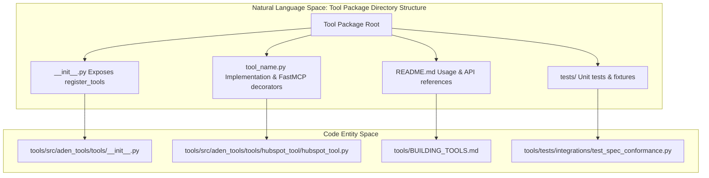
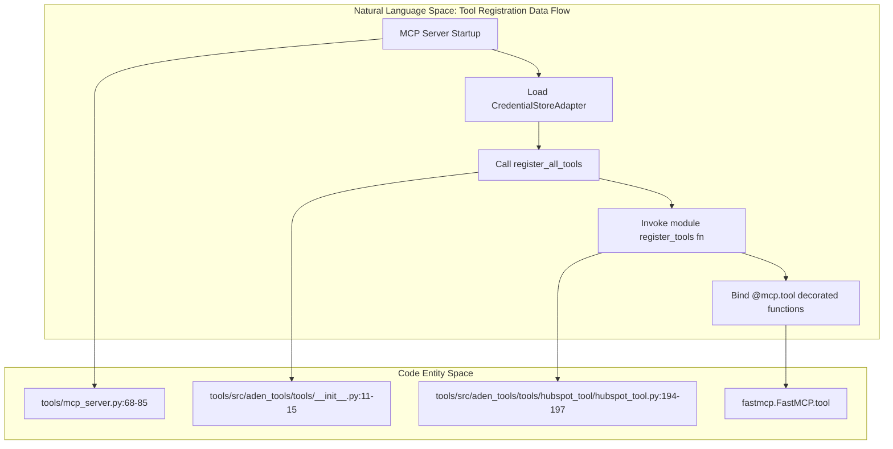

<!-- source: DeepWiki mcp.deepwiki.com · repo aden-hive/hive · page 7.6 Writing a New Tool · fetched 2026-10-27 -->

# Writing a New Tool

Relevant source files

The following files were used as context for generating this wiki page:

- [core/tests/test_janitor_worker_deepclean.py](core/tests/test_janitor_worker_deepclean.py)
- [core/tests/test_run_worker_tool.py](core/tests/test_run_worker_tool.py)
- [core/tests/test_worker_definition.py](core/tests/test_worker_definition.py)
- [tools/BUILDING_TOOLS.md](tools/BUILDING_TOOLS.md)
- [tools/mcp_server.py](tools/mcp_server.py)
- [tools/src/aden_tools/__init__.py](tools/src/aden_tools/__init__.py)
- [tools/src/aden_tools/credentials/__init__.py](tools/src/aden_tools/credentials/__init__.py)
- [tools/src/aden_tools/credentials/health_check.py](tools/src/aden_tools/credentials/health_check.py)
- [tools/src/aden_tools/credentials/hubspot.py](tools/src/aden_tools/credentials/hubspot.py)
- [tools/src/aden_tools/tools/__init__.py](tools/src/aden_tools/tools/__init__.py)
- [tools/src/aden_tools/tools/hubspot_tool/hubspot_tool.py](tools/src/aden_tools/tools/hubspot_tool/hubspot_tool.py)
- [tools/src/aden_tools/tools/hubspot_tool/tests/test_hubspot_tool.py](tools/src/aden_tools/tools/hubspot_tool/tests/test_hubspot_tool.py)
- [tools/src/aden_tools/tools/web_search_tool/web_search_tool.py](tools/src/aden_tools/tools/web_search_tool/web_search_tool.py)
- [tools/src/terminal_tools/common/limits.py](tools/src/terminal_tools/common/limits.py)
- [tools/tests/conftest.py](tools/tests/conftest.py)
- [tools/tests/integrations/__init__.py](tools/tests/integrations/__init__.py)
- [tools/tests/integrations/conftest.py](tools/tests/integrations/conftest.py)
- [tools/tests/integrations/test_input_validation.py](tools/tests/integrations/test_input_validation.py)
- [tools/tests/integrations/test_registration.py](tools/tests/integrations/test_registration.py)
- [tools/tests/integrations/test_spec_conformance.py](tools/tests/integrations/test_spec_conformance.py)
- [tools/tests/test_command_guard.py](tools/tests/test_command_guard.py)
- [tools/tests/test_credential_registry.py](tools/tests/test_credential_registry.py)
- [tools/tests/test_credentials.py](tools/tests/test_credentials.py)
- [tools/tests/test_env_helpers.py](tools/tests/test_env_helpers.py)
- [tools/tests/test_health_checks.py](tools/tests/test_health_checks.py)
- [tools/tests/test_live_health_checks.py](tools/tests/test_live_health_checks.py)
- [tools/tests/tools/test_google_sheets_tool.py](tools/tests/tools/test_google_sheets_tool.py)
- [tools/tests/tools/test_web_search_tool.py](tools/tests/tools/test_web_search_tool.py)

### Purpose and Scope
This page provides a complete technical guide for adding a new tool integration to the `aden-tools` package within the Hive ecosystem [tools/src/aden_tools/tools/__init__.py:1-15](). It covers directory layouts, the required `register_tools` signature, credential definitions (`CredentialSpec`), health-checker implementation, testing suites, spec conformance checks, and verified/unverified runtime gating.

---

### 1. Directory Layout and Module Conventions
Every tool package resides under `tools/src/aden_tools/tools/`. A tool integration must follow a standardized layout containing the implementation module, package initialization file, documentation, and unit tests.

Sources: [tools/src/aden_tools/tools/__init__.py:1-15](), [tools/tests/integrations/conftest.py:45-85]()

---

### 2. The `register_tools` Function and FastMCP Integration
Tools expose their functionality to the Model Context Protocol (MCP) server via a `register_tools` function [tools/tests/integrations/test_spec_conformance.py:48-74](). This function accepts a `FastMCP` instance and an optional `CredentialStoreAdapter` [tools/src/aden_tools/tools/hubspot_tool/hubspot_tool.py:194-204]().

Sources: [tools/mcp_server.py:68-85](), [tools/src/aden_tools/tools/__init__.py:1-15](), [tools/src/aden_tools/tools/hubspot_tool/hubspot_tool.py:194-197]()

- **Signature Requirements**:
  - Must accept `mcp: FastMCP` as its first parameter [tools/tests/integrations/test_spec_conformance.py:88-95]().
  - If the tool requires authentication, it must accept `credentials: CredentialStoreAdapter | None = None` defaulting to `None` [tools/tests/integrations/test_spec_conformance.py:96-110]().
  - Credential-less utility or meta-tools omit the `credentials` parameter entirely [tools/src/aden_tools/credentials/__init__.py:51-53]().

Sources: [tools/tests/integrations/test_spec_conformance.py:80-110](), [tools/src/aden_tools/credentials/__init__.py:51-53]()

---

### 3. Credential Specifications and Health Checkers
Integrations that rely on external APIs must declare a `CredentialSpec` and provide a corresponding `CredentialHealthChecker` implementation [tools/src/aden_tools/credentials/__init__.py:54-58](), [tools/tests/test_credential_registry.py:37-46]().

- **Defining a CredentialSpec**:
  - Placed in `tools/src/aden_tools/credentials/<integration>.py`.
  - Defines `env_var`, `tools`, `help_url`, `description`, `credential_id`, and `credential_key` [tools/tests/integrations/test_spec_conformance.py:116-157]().
  - Merged into the global `CREDENTIAL_SPECS` registry in `tools/src/aden_tools/credentials/__init__.py` [tools/src/aden_tools/credentials/__init__.py:151-181]().

- **Implementing a Health Checker**:
  - Implements the `CredentialHealthChecker` protocol [tools/src/aden_tools/credentials/health_check.py:32-46]().
  - Performs a lightweight API call returning a `HealthCheckResult` (valid, message, details) [tools/src/aden_tools/credentials/health_check.py:18-30](), [tools/src/aden_tools/credentials/health_check.py:54-75]().
  - Registered in the `HEALTH_CHECKERS` dictionary in `tools/src/aden_tools/credentials/health_check.py` [tools/tests/test_health_checks.py:20-57]().

Sources: [tools/src/aden_tools/credentials/__init__.py:54-58](), [tools/src/aden_tools/credentials/health_check.py:18-75](), [tools/tests/test_credential_registry.py:37-46](), [tools/tests/test_health_checks.py:20-57]()

---

### 4. Verified vs. Unverified Gating
Hive maintains strict controls over which tool integrations load into production agent colonies by default.

- **Verified Tools**:
  - Stable, production-vetted integrations residing directly on `main` [tools/src/aden_tools/tools/__init__.py:28-34]().
  - Explicitly imported and exposed in `tools/src/aden_tools/tools/__init__.py` [tools/src/aden_tools/tools/__init__.py:33-129]().
  - Credential-less tools (such as `image_generate` or `senders_tool`) *must* be verified; unverified credential-less tools are dropped by the queen MCP admission gate [tools/src/aden_tools/tools/__init__.py:78-82](), [tools/src/aden_tools/tools/__init__.py:115-120]().

- **Unverified Tools**:
  - Community contributions and experimental integrations [tools/src/aden_tools/tools/__init__.py:36-37]().
  - Loaded only when `INCLUDE_UNVERIFIED_TOOLS` is explicitly set to `"true"`, `"1"`, or `"yes"` via environment variables [tools/mcp_server.py:17-20](), [tools/mcp_server.py:84-85]().

Sources: [tools/src/aden_tools/tools/__init__.py:28-129](), [tools/mcp_server.py:17-20](), [tools/mcp_server.py:84-85]()

---

### 5. Testing, Conformance, and Registration Suites
Before submitting a new tool, it must pass automated test suites that enforce codebase consistency and structural compliance.

- **Spec Conformance Tests (`test_spec_conformance.py`)**:
  - Verifies module export structures, function signatures, non-empty fields on `CredentialSpec`, and validates that tools listed in specs correspond to actual `@mcp.tool()` registrations [tools/tests/integrations/test_spec_conformance.py:1-167]().
- **Credential Registry Tests (`test_credential_registry.py`)**:
  - Enforces that any credential spec with a `health_check_endpoint` has a corresponding entry in `HEALTH_CHECKERS` and checks for duplicate environment variable collisions [tools/tests/test_credential_registry.py:20-104]().
- **Registration Test Suites (`test_registration.py`)**:
  - Ensures all registered tools initialize cleanly without namespace collisions or schema malformations.

Sources: [tools/tests/integrations/test_spec_conformance.py:1-167](), [tools/tests/test_credential_registry.py:20-104]()

---

