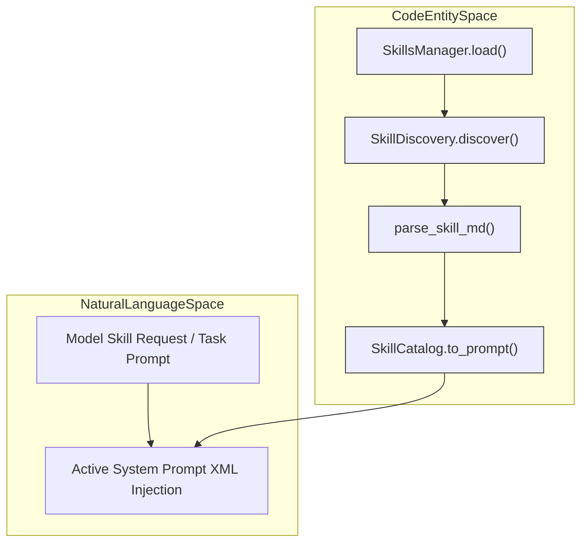
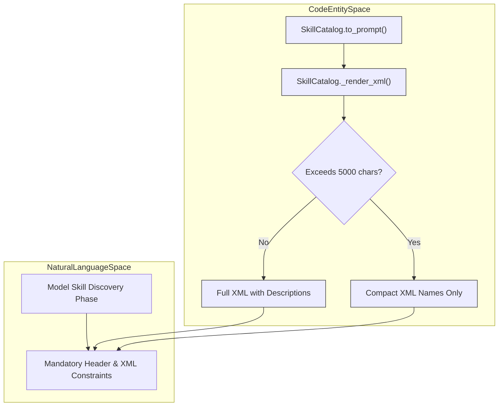
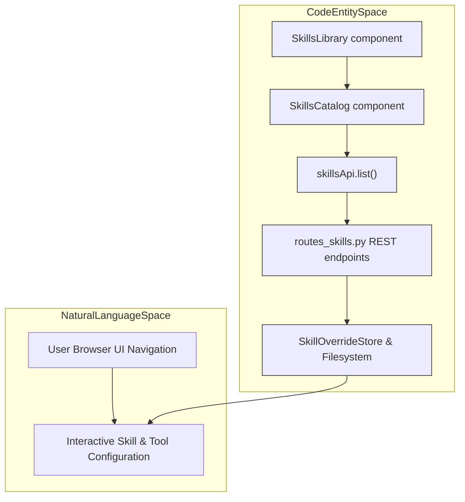

<!-- source: DeepWiki mcp.deepwiki.com · repo aden-hive/hive · page 8.1 Skill Catalog, Discovery and Overrides · fetched 2026-10-27 -->

# Skill Catalog, Discovery and Overrides

Relevant source files

The following files were used as context for generating this wiki page:

- [core/framework/server/routes_skills.py](core/framework/server/routes_skills.py)
- [core/framework/skills/__init__.py](core/framework/skills/__init__.py)
- [core/framework/skills/catalog.py](core/framework/skills/catalog.py)
- [core/framework/skills/config.py](core/framework/skills/config.py)
- [core/framework/skills/discovery.py](core/framework/skills/discovery.py)
- [core/framework/skills/manager.py](core/framework/skills/manager.py)
- [core/framework/skills/overrides.py](core/framework/skills/overrides.py)
- [core/framework/skills/parser.py](core/framework/skills/parser.py)
- [core/frontend/src/api/skills.ts](core/frontend/src/api/skills.ts)
- [core/frontend/src/components/QueenToolsSection.tsx](core/frontend/src/components/QueenToolsSection.tsx)
- [core/frontend/src/components/ToolsEditor.tsx](core/frontend/src/components/ToolsEditor.tsx)
- [core/frontend/src/data/prompts.ts](core/frontend/src/data/prompts.ts)
- [core/frontend/src/pages/prompt-library.tsx](core/frontend/src/pages/prompt-library.tsx)
- [core/frontend/src/pages/skills-library.tsx](core/frontend/src/pages/skills-library.tsx)
- [core/frontend/src/pages/tool-library.tsx](core/frontend/src/pages/tool-library.tsx)
- [core/tests/test_routes_skills.py](core/tests/test_routes_skills.py)
- [core/tests/test_skill_catalog.py](core/tests/test_skill_catalog.py)
- [core/tests/test_skill_discovery.py](core/tests/test_skill_discovery.py)
- [core/tests/test_skill_integration.py](core/tests/test_skill_integration.py)
- [core/tests/test_skill_overrides.py](core/tests/test_skill_overrides.py)
- [core/tests/test_skill_parser.py](core/tests/test_skill_parser.py)
- [core/tests/test_skill_resources.py](core/tests/test_skill_resources.py)
- [core/tests/test_skill_trust.py](core/tests/test_skill_trust.py)
- [docs/releases/v0.10.0.md](docs/releases/v0.10.0.md)

This page documents the Hive Agent Skills subsystem, which implements the open Agent Skills standard (`agentskills.io`) for portable skill discovery, parsing, cataloging, overrides, REST APIs, and UI integration.

---

## 1. Unified Skill Lifecycle Manager (`SkillsManager`)

The `SkillsManager` class acts as the single facade owning skill discovery, loading, and prompt generation [core/framework/skills/manager.py:3-87](). The runtime instantiates one manager during startup, caching prompt strings consumed by execution streams, graph executors, and event loops [core/framework/skills/manager.py:80-87]().

`SkillsManagerConfig` defines execution options such as `skills_config`, `project_root`, `interactive` trust settings, `queen_id`, `queen_overrides_path`, and `extra_scope_dirs` [core/framework/skills/manager.py:37-79]().

Sources: [core/framework/skills/manager.py:3-87](), [core/framework/skills/manager.py:137-168]()

---

## 2. Discovery and Scope Resolution

`SkillDiscovery` scans standard filesystem locations and custom scopes to aggregate `ParsedSkill` instances [core/framework/skills/discovery.py:82-110](). 

### Scope Priority Order
Scopes are evaluated in deterministic priority order where later entries override earlier ones on name collisions:
1. `framework`: Built-in default skills (`_default_skills/`) [core/framework/skills/discovery.py:113-118]()
2. `preset`: Bundled capability packs defaulting to off (`_preset_skills/`) [core/framework/skills/discovery.py:124-127]()
3. `user`: Cross-client paths (`~/.agents/skills/`), external skills, and Hive-specific paths (`~/.hive/skills/`) [core/framework/skills/discovery.py:130-170]()
4. `queen_ui` / `colony_ui`: Extra scopes registered via `ExtraScope` [core/framework/skills/discovery.py:50-65,173-175]()
5. `project`: Project-specific root folders [core/framework/skills/discovery.py:105-106]()

Sources: [core/framework/skills/discovery.py:36-43](), [core/framework/skills/discovery.py:82-175]()

---

## 3. Parsing and Validation (`parse_skill_md`)

`parse_skill_md` reads `SKILL.md` files, separating YAML frontmatter from markdown instruction bodies [core/framework/skills/parser.py:69-122](). 

It features built-in YAML error recovery via `_try_fix_yaml`, which automatically wraps unquoted colon values in quotes (e.g., `description: Use for: research tasks`) [core/framework/skills/parser.py:46-66]() and logs non-fatal parsing issues through `log_skill_error` [core/framework/skills/parser.py:80-162](). Required fields include `description`, with `name` falling back to the parent directory name [core/framework/skills/parser.py:175-192]().

Sources: [core/framework/skills/parser.py:1-192]()

---

## 4. Catalog In-Memory Index and Prompt Generation (`SkillCatalog`)

`SkillCatalog` indexes discovered skills in memory and generates structured XML injected into system prompts [core/framework/skills/catalog.py:1-110]().

When the rendered XML body exceeds `_COMPACT_THRESHOLD_CHARS` (5,000 characters), the catalog falls back to a compact variant that drops `<description>` tags while preserving every skill's `<name>` for global model awareness [core/framework/skills/catalog.py:16-20,116-121](). Descriptions are also capped via `_cap_description` to prevent context bloat [core/framework/skills/catalog.py:25,124-140]().

Sources: [core/framework/skills/catalog.py:16-140]()

---

## 5. Overrides and Persistence

Queen-level customizations are managed via `SkillOverrideStore`, reading and writing state to `skills_overrides.json` located inside individual queen directories (`~/.hive/agents/queens/{queen_id}/skills_overrides.json`) [core/framework/skills/manager.py:48-53](). Overrides control skill enable/disable flags and track provenance for downstream components and UI surfaces [core/framework/skills/manager.py:37-53]().

Sources: [core/framework/skills/manager.py:37-53](), [core/framework/server/routes_skills.py:50-55]()

---

## 6. REST API Endpoints (`routes_skills.py`)

The HTTP server exposes two primary API surfaces under `routes_skills.py`:

1. **Per-Queen Routes**:
   - `GET /api/queen/{queen_id}/skills` [core/framework/server/routes_skills.py:6](): List skill overrides and status for a queen.
   - `POST /api/queen/{queen_id}/skills` [core/framework/server/routes_skills.py:7]()
   - `PATCH /api/queen/{queen_id}/skills/{skill_name}` [core/framework/server/routes_skills.py:8](): Modify individual skill states.
   - `GET /api/queen/{queen_id}/skills/{skill_name}/body` [core/framework/server/routes_skills.py:9]()
   - `PUT /api/queen/{queen_id}/skills/{skill_name}/body` [core/framework/server/routes_skills.py:10]()
   - `DELETE /api/queen/{queen_id}/skills/{skill_name}` [core/framework/server/routes_skills.py:12]()
   - `POST /api/queen/{queen_id}/skills/reload` [core/framework/server/routes_skills.py:13]()

2. **Aggregated Library Routes**:
   - `GET /api/skills` [core/framework/server/routes_skills.py:16](): Full catalog and inversion maps (`visible_to.*`).
   - `GET /api/skills/{name}` [core/framework/server/routes_skills.py:17](): Full body and file listings.
   - `GET /api/skills/scopes` [core/framework/server/routes_skills.py:18]()
   - `POST /api/skills/upload` [core/frontend/src/pages/skills-library.tsx:1-129]()

Sources: [core/framework/server/routes_skills.py:1-31]()

---

## 7. Frontend Skills Library UI (`skills-library.tsx`)

The frontend dashboard (`core/frontend/src/pages/skills-library.tsx`) renders the primary **Skills** and **MCP Tools** catalog views [core/frontend/src/pages/skills-library.tsx:88-129](). It integrates with `skillsApi` to support searching, filtering, viewing individual skill documentation, and selecting queen contexts for targeted skill injection [core/frontend/src/pages/skills-library.tsx:162-192]().

Sources: [core/frontend/src/pages/skills-library.tsx:1-192]()

---

