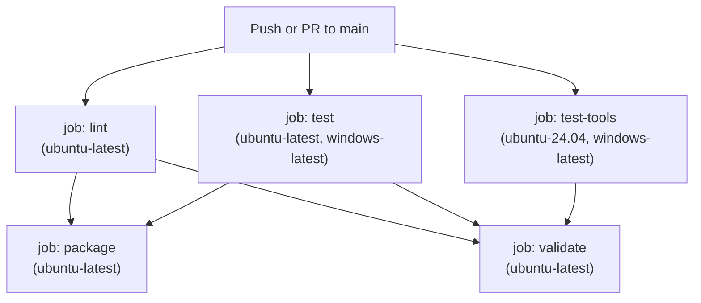
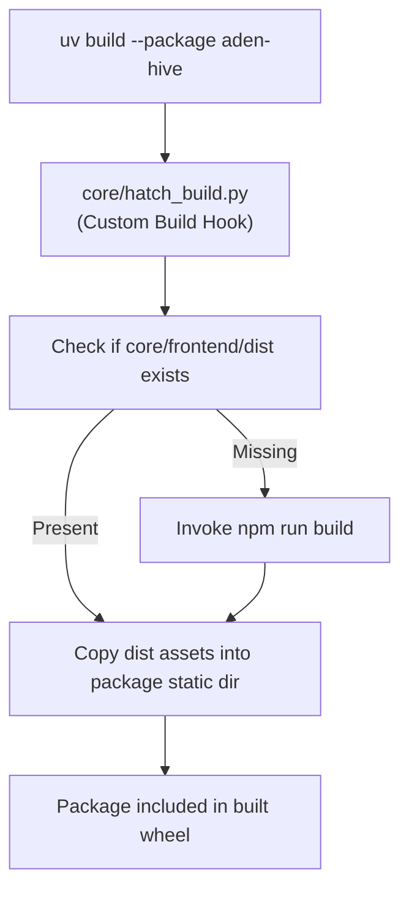
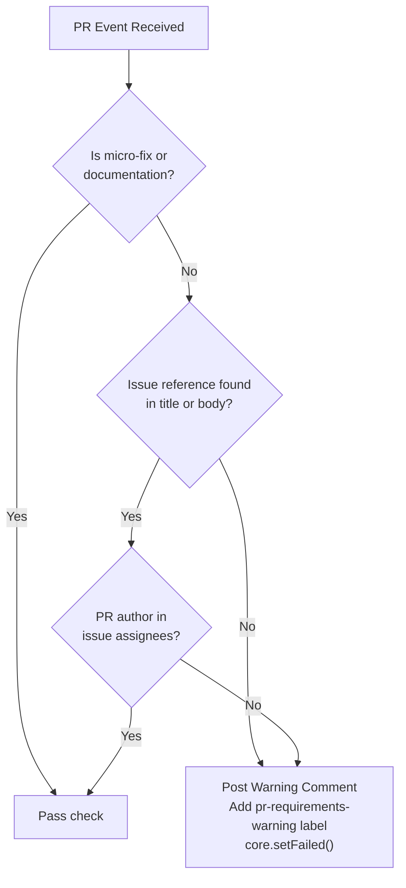
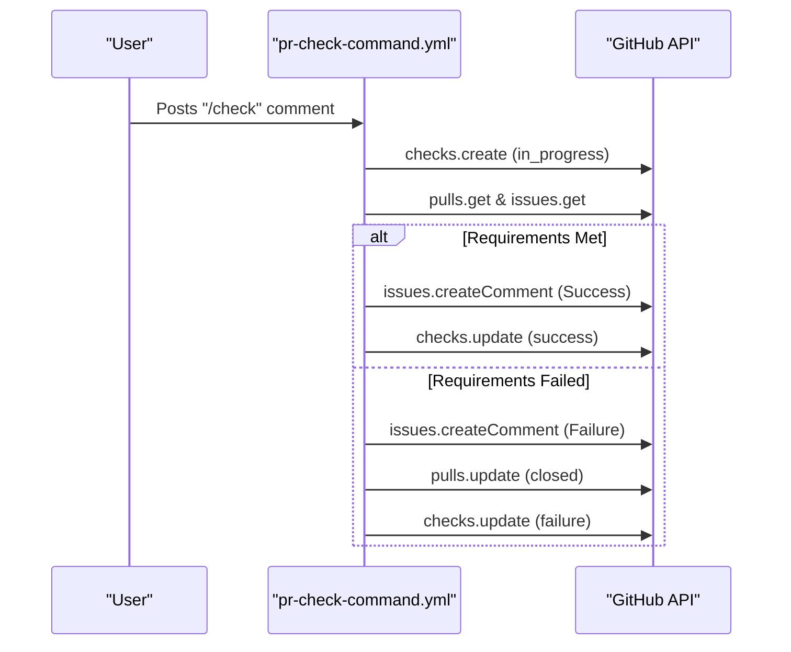
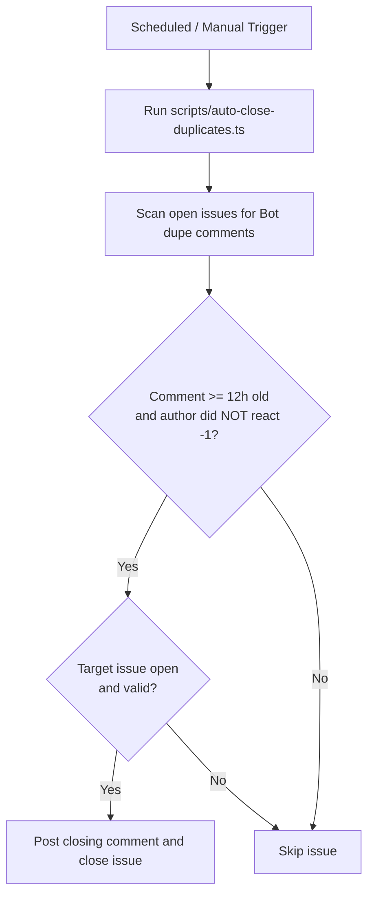

<!-- source: DeepWiki mcp.deepwiki.com · repo aden-hive/hive · page 9.2 CI/CD and GitHub Automation · fetched 2026-10-27 -->

# CI/CD and GitHub Automation

<details>
<summary>Relevant source files</summary>

The following files were used as context for generating this wiki page:

- [.github/workflows/auto-close-duplicates.yml](.github/workflows/auto-close-duplicates.yml)
- [.github/workflows/ci.yml](.github/workflows/ci.yml)
- [.github/workflows/pr-check-command.yml](.github/workflows/pr-check-command.yml)
- [.github/workflows/pr-requirements-backfill.yml](.github/workflows/pr-requirements-backfill.yml)
- [.github/workflows/pr-requirements-enforce.yml](.github/workflows/pr-requirements-enforce.yml)
- [.github/workflows/pr-requirements.yml](.github/workflows/pr-requirements.yml)
- [.python-version](.python-version)
- [AGENTS.md](AGENTS.md)
- [CLAUDE.md](CLAUDE.md)
- [core/README.md](core/README.md)
- [core/framework/loader/cli.py](core/framework/loader/cli.py)
- [core/framework/server/tests/test_session_shutdown.py](core/framework/server/tests/test_session_shutdown.py)
- [core/framework/storage/__init__.py](core/framework/storage/__init__.py)
- [core/framework/storage/concurrent.py](core/framework/storage/concurrent.py)
- [core/framework/storage/session_store.py](core/framework/storage/session_store.py)
- [core/framework/testing/debug_tool.py](core/framework/testing/debug_tool.py)
- [core/framework/testing/test_storage.py](core/framework/testing/test_storage.py)
- [core/hatch_build.py](core/hatch_build.py)
- [core/tests/test_path_traversal_fix.py](core/tests/test_path_traversal_fix.py)
- [core/tests/test_storage.py](core/tests/test_storage.py)
- [docs/pr-requirements.md](docs/pr-requirements.md)
- [docs/releases/v1.0.2.md](docs/releases/v1.0.2.md)
- [package.json](package.json)
- [scripts/auto-close-duplicates.test.ts](scripts/auto-close-duplicates.test.ts)
- [scripts/auto-close-duplicates.ts](scripts/auto-close-duplicates.ts)
- [tools/README.md](tools/README.md)

</details>


This page documents the GitHub Actions workflows and automation pipelines in the Hive codebase (`https://github.com/aden-hive/hive`), covering the `ci.yml` lint/test/package/validate execution graph, PR requirement enforcement, manual PR checking, duplicate issue cleanup, and wheel packaging with the frontend build hook.

---

## Workflow Overview

The repository utilizes several GitHub Actions workflows to govern pull requests, execute continuous integration testing across operating systems, package wheels with embedded frontend assets, and automate issue management.

**Workflow inventory**

| Workflow file | Trigger | Purpose |
|---|---|---|
| `ci.yml` | Push to `main`, PR to `main` | Lint, cross-platform tests, package builds, and agent export validation |
| `pr-requirements.yml` | PR opened/reopened/edited/synchronized | Enforce linked-issue and assignee governance policy |
| `pr-check-command.yml` | `/check` comment on a PR | Manual re-run of requirements check with Check Run reporting |
| `auto-close-duplicates.yml` | Cron (midnight daily) + manual dispatch | Auto-close confirmed duplicate issues after grace period |
| `pr-requirements-backfill.yml` | Manual dispatch (`workflow_dispatch`) | Apply requirements check retroactively to open PRs |

Sources: [.github/workflows/ci.yml:1-12](), [.github/workflows/pr-requirements.yml:1-6](), [.github/workflows/pr-requirements-enforce.yml:1-7](), [.github/workflows/pr-requirements-backfill.yml:1-10]()

---

## Continuous Integration Pipeline (`ci.yml`)

The main CI pipeline executes on pushes and pull requests targeting the `main` branch. It uses concurrency groups to cancel in-progress runs on the same reference.

### Job Topology and Execution Graph

The pipeline consists of parallel linting and testing jobs, followed by packaging and validation jobs.



Sources: [.github/workflows/ci.yml:1-157]()

### Job Definitions

#### 1. `lint`
Runs on `ubuntu-latest` with Python 3.11. It synchronizes dependencies using `uv` and checks code style and formatting via `ruff`.
```yaml
      - name: Install dependencies
        run: uv sync --project core --group dev

      - name: Ruff lint
        run: |
          uv run --project core ruff check core/
          uv run --project core ruff check tools/

      - name: Ruff format
        run: |
          uv run --project core ruff format --check core/
          uv run --project core ruff format --check tools/
```
Sources: [.github/workflows/ci.yml:14-42]()

#### 2. `test`
Runs across a matrix of `[ubuntu-latest, windows-latest]` on Python 3.11. It runs core unit tests and framework unit tests, ignoring dummy agents.
```yaml
      - name: Install dependencies and run tests
        working-directory: core
        run: |
          uv sync
          uv run pytest tests/ -v --ignore=tests/dummy_agents

      - name: Run framework unit tests
        working-directory: core
        run: uv run pytest framework/ -v --ignore=framework/testing
```
Sources: [.github/workflows/ci.yml:43-73]()

#### 3. `test-tools`
Runs on `[ubuntu-24.04, windows-latest]` in the `tools` directory with the `dev` extra. It installs headless Chromium via Playwright for ECharts/Mermaid rendering smoke tests and ensures `ripgrep` is available.
```yaml
      - name: Install dependencies
        working-directory: tools
        run: uv sync --extra dev

      - name: Install and verify ripgrep
        run: uv run --no-sync scripts/ensure_ripgrep.py --install

      - name: Install browser and run tests
        working-directory: tools
        run: |
          uv run playwright install chromium
          uv run pytest tests/ -v
```
Sources: [.github/workflows/ci.yml:74-110]()

#### 4. `package`
Builds the React frontend dashboard (`core/frontend`), packages `aden-hive` and `aden-tools` into PyPI-style wheels using `uv build`, installs them into an isolated virtual environment, and runs verification scripts against the installed package.
```yaml
      - name: Build the dashboard
        working-directory: core/frontend
        run: |
          npm ci --no-fund --no-audit
          npm run build

      - name: Build aden-hive and aden-tools
        run: |
          uv build --package aden-hive --out-dir dist
          uv build --package aden-tools --out-dir dist

      - name: Install them into a clean virtualenv, outside the workspace
        run: |
          uv venv /tmp/hive-pkg --python 3.11
          uv pip install --python /tmp/hive-pkg --no-sources --find-links dist "aden-hive[tools]"
```
Sources: [.github/workflows/ci.yml:111-153]()

#### 5. `validate`
Depends on `lint`, `test`, and `test-tools`. It iterates over exported agent directories under `exports/` and verifies that every `agent.json` file contains valid JSON structure.
```yaml
          for agent_dir in "${agent_dirs[@]}"; do
            if [ -f "$agent_dir/agent.json" ]; then
              echo "Validating $agent_dir"
              uv run python -c "import json; json.load(open('$agent_dir/agent.json'))"
              validated=$((validated + 1))
            fi
          done
```
Sources: [.github/workflows/ci.yml:154-206]()

---

## Wheel Packaging and Frontend Build Hook (`core/hatch_build.py`)

When packaging `aden-hive`, the build process uses `core/hatch_build.py` as a custom Hatch build hook to bundle the compiled React frontend static assets directly into the Python wheel distribution.



Sources: [core/hatch_build.py](), [.github/workflows/ci.yml:111-144]()

Sources for CI Pipeline and Packaging: [.github/workflows/ci.yml:1-206]()

---

## PR Requirements Enforcement and Backfill

### Policy and Checks

Every pull request must link to an issue and have the PR author assigned to that issue. Micro-fixes (< 20 lines, documentation, typos, linting) and documentation PRs are exempt if labeled or prefixed accordingly.



Sources: [.github/workflows/pr-requirements.yml:15-100]()

### Enforcement and Backfill Workflows

- **`pr-requirements.yml`**: Evaluates newly opened, edited, or synchronized PRs against the criteria, leaving a warning comment and labeling the PR `pr-requirements-warning` if requirements fail.
- **`pr-requirements-enforce.yml`**: Runs daily via cron schedule (`0 0 * * *`) to scan open PRs carrying the `pr-requirements-warning` label past a 24-hour grace period, closing them automatically with an explanatory comment.
- **`pr-requirements-backfill.yml`**: Provides a manual dispatch trigger to enforce requirements retroactively across active pull requests.

Sources: [.github/workflows/pr-requirements.yml:1-163](), [.github/workflows/pr-requirements-enforce.yml:1-54](), [.github/workflows/pr-requirements-backfill.yml:1-138]()

Sources for PR Governance: [.github/workflows/pr-requirements.yml:1-163](), [.github/workflows/pr-requirements-enforce.yml:1-54](), [.github/workflows/pr-requirements-backfill.yml:1-138]()

---

## Manual PR Check Command (`pr-check-command.yml`)

Contributors or maintainers can manually trigger requirements re-evaluation by commenting `/check` on a pull request.



Sources: [.github/workflows/pr-check-command.yml:1-204]()

Sources for PR Check Command: [.github/workflows/pr-check-command.yml:1-204]()

---

## Auto-Close Duplicates (`auto-close-duplicates.yml`)

The duplicate closure workflow executes every 6 hours via cron (`0 */6 * * *`) and runs `scripts/auto-close-duplicates.ts`.

**Core decision logic functions:**
- `isDupeComment(comment)`: Verifies bot authorship and duplicate identification phrasing.
- `extractDuplicateIssueNumber(body)`: Parses referenced issue numbers or URLs.
- `isDupeCommentOldEnough(commentDate, twelveHoursAgo)`: Enforces the 12-hour grace period.
- `authorDisagreedWithDupe(reactions, issue)`: Checks if the issue author reacted with `-1` (thumbs-down), which prevents closure.
- `decideAutoClose(issue, comment, getTargetIssue)`: Evaluates whether the target issue is open and distinct before executing closure.



Sources: [.github/workflows/auto-close-duplicates.yml:1-34](), [scripts/auto-close-duplicates.ts](), [scripts/auto-close-duplicates.test.ts:1-261]()

Sources for Auto-Close Duplicates: [.github/workflows/auto-close-duplicates.yml:1-34](), [scripts/auto-close-duplicates.ts](), [scripts/auto-close-duplicates.test.ts:1-261]()

---

