# Page: Overview

# Overview

<details>
<summary>Relevant source files</summary>

The following files were used as context for generating this wiki page:

- [CHANGELOG.md](CHANGELOG.md)
- [CONTRIBUTING.md](CONTRIBUTING.md)
- [README.md](README.md)
- [SECURITY.md](SECURITY.md)
- [core/pyproject.toml](core/pyproject.toml)
- [docs/architecture/README.md](docs/architecture/README.md)
- [docs/configuration.md](docs/configuration.md)
- [docs/developer-guide.md](docs/developer-guide.md)
- [docs/environment-setup.md](docs/environment-setup.md)
- [docs/getting-started.md](docs/getting-started.md)
- [docs/key_concepts/colony.md](docs/key_concepts/colony.md)
- [docs/key_concepts/coordination.md](docs/key_concepts/coordination.md)
- [docs/key_concepts/goals_outcome.md](docs/key_concepts/goals_outcome.md)
- [docs/key_concepts/improvement.md](docs/key_concepts/improvement.md)
- [docs/key_concepts/queen.md](docs/key_concepts/queen.md)
- [docs/key_concepts/the_loop.md](docs/key_concepts/the_loop.md)
- [docs/key_concepts/worker_agent.md](docs/key_concepts/worker_agent.md)
- [docs/releases/v1.0.0.md](docs/releases/v1.0.0.md)
- [docs/releases/v1.0.10.md](docs/releases/v1.0.10.md)
- [docs/releases/v1.0.7.md](docs/releases/v1.0.7.md)
- [docs/releases/v1.0.9.md](docs/releases/v1.0.9.md)
- [docs/roadmap.md](docs/roadmap.md)
- [tools/pyproject.toml](tools/pyproject.toml)
- [uv.lock](uv.lock)

</details>


Hive is an open-source runtime and framework for colonies of AI agents designed to perform real business work [README.md:27-31](). Rather than requiring developers to design compiled execution graphs, Hive is built around the **Queen/Worker/Colony model** and a single execution primitive: the `AgentLoop` [docs/architecture/README.md:3-5](). 

This page provides a high-level overview of Hive's core runtime model, workspace layout, and subsystems. For deep technical details, please refer to the child pages:
- **[Key Concepts: Queen, Worker, Colony, Tracker](#1.1)** — Persistent Queen agents, bounded Worker clones, Colony directories under `HIVE_HOME`, and the shared SQLite `tracker.db`.
- **[Repository Layout and Packaging](#1.2)** — The `uv` workspace (`aden-hive` and `aden-tools`), entrypoints, frontend bundling, and build targets.
- **[Public API for Building on Hive](#1.3)** — Stable public API surface for embedding Hive primitives in external applications.

Sources: [README.md:27-31](), [docs/architecture/README.md:3-5]()

---

## Architecture and Subsystems Overview

Hive replaces traditional multi-agent workflow graphs with dynamic agent colonies coordinated through disk-backed ledgers and tool calls [docs/architecture/README.md:3-7](). 

**Diagram: Hive Top-Level Architecture and Code Mapping**

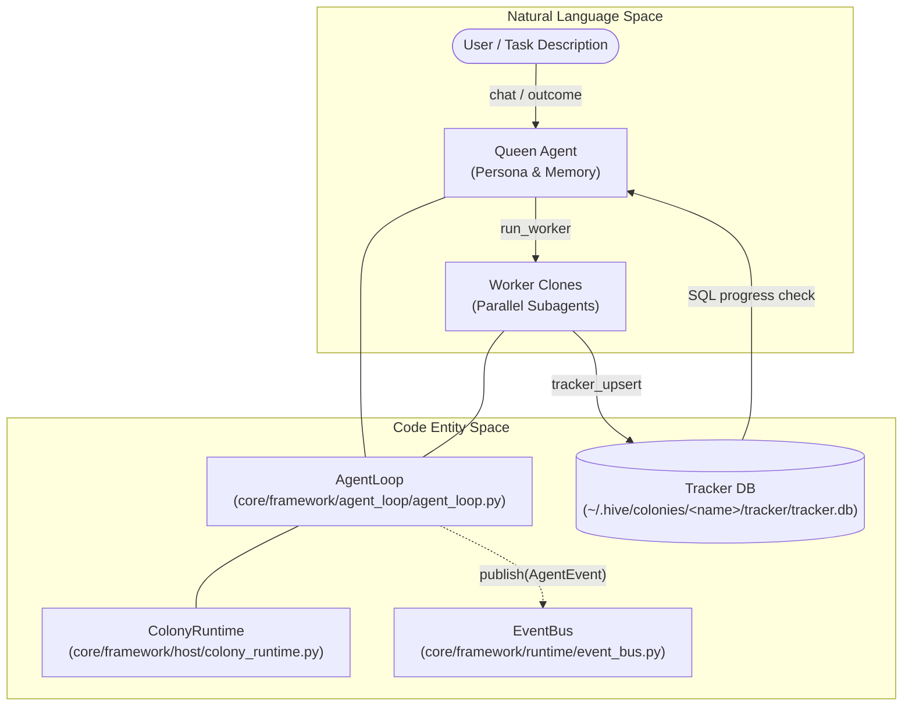

Sources: [docs/architecture/README.md:15-49](), [core/framework/agent_loop/agent_loop.py:1-50]()

---

## Colony Execution and Code Entity Mapping

The lifecycle of tasks within a colony bridges high-level user goals to concrete Python execution units and disk storage.

**Diagram: Colony Execution Flow and Code Entities**

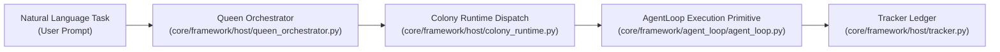

Sources: [docs/architecture/README.md:70-105](), [core/framework/host/queen_orchestrator.py:1-40]()

---

## 1.1. Key Concepts: Queen, Worker, Colony, Tracker

Hive's domain model centers around persistent executive agents (`Queen`), dynamic task-specific instances (`Worker`), shared workspace directories (`Colony`), and atomic persistence (`Tracker`) [docs/architecture/README.md:3-62](). 

- **Queen**: A long-lived, persona-driven agent with its own task plan, conversation history, and memory files. The queen interacts directly with the user, performs an initial "pilot" execution to derive a methodology or skill, and orchestrates scaling [README.md:43-48]().
- **Worker**: A short-lived clone of the agent loop configured with a narrower tool set, strict iteration budgets (typically 3 working turns + 1 grace turn), and no direct user interaction [docs/architecture/README.md:72-79]().
- **Colony**: A self-contained directory under `HIVE_HOME` (defaulting to `~/.hive/colonies/<name>/`) holding configuration, state databases, worker specs, skills, and playbooks [docs/architecture/README.md:55-68]().
- **Tracker**: A shared SQLite database (`tracker.db`) that serves as the colony's central ledger. Workers record fine-grained progress via `tracker_upsert`, allowing the queen to query state using SQL rather than relying on bloated context windows [README.md:47-50](), [docs/architecture/README.md:101-105]().

For detailed coverage of the domain model, coordination loops, and memory systems, see [Key Concepts: Queen, Worker, Colony, Tracker](#1.1).

Sources: [README.md:43-50](), [docs/architecture/README.md:3-105]()

---

## 1.2. Repository Layout and Packaging

Hive is structured as a modern `uv` workspace comprising core runtime packages, built-in tool extensions, and a React frontend [uv.lock:16-20]().

- **`aden-hive` (`core/`)**: The core Python package housing the `AgentLoop`, runtime orchestration, storage, LLM providers, and CLI entry points (`hive`, `hive-cred`, `hive-browser`) [core/pyproject.toml:1-52]().
- **`aden-tools` (`tools/`)**: Optional extension package providing FastMCP servers, web search, browser automation (`gcu`), and enterprise integrations [uv.lock:99-131](), [tools/pyproject.toml:1-106]().
- **Frontend (`core/framework/server/frontend/`)**: React/Vite dashboard bundled into the wheel via custom hatch build hooks [core/pyproject.toml:50-61]().

For complete details on workspace setup, pyproject configurations, and build targets, see [Repository Layout and Packaging](#1.2).

Sources: [uv.lock:16-20](), [core/pyproject.toml:1-61](), [tools/pyproject.toml:1-106]()

---

## 1.3. Public API for Building on Hive

Developers can embed Hive's core execution primitives in external Python applications by depending on `aden-hive` [CHANGELOG.md:41-45](). The stable public API surface exposes core runtime classes and types directly from package entry points:

- **`AgentLoop`**: The single multi-turn streaming LLM execution primitive (`core/hive/__init__.py`) [CHANGELOG.md:41-45]().
- **Providers & Buses**: `LiteLLMProvider`, `EventBus`, and event schemas [CHANGELOG.md:41-45]().
- **Turn Context**: The `hive.turn_context` entry point protocol allowing installed packages to inject context before agent turns [CHANGELOG.md:15-16]().

For programmatic usage guidelines, embedding patterns, and type definitions, see [Public API for Building on Hive](#1.3).

Sources: [CHANGELOG.md:15-16](), [CHANGELOG.md:41-45]()

---

# Page: Key Concepts: Queen, Worker, Colony, Tracker

# Key Concepts: Queen, Worker, Colony, Tracker

<details>
<summary>Relevant source files</summary>

The following files were used as context for generating this wiki page:

- [CONTRIBUTING.md](CONTRIBUTING.md)
- [README.md](README.md)
- [SECURITY.md](SECURITY.md)
- [core/framework/agents/queen/__init__.py](core/framework/agents/queen/__init__.py)
- [core/framework/agents/queen/agent.py](core/framework/agents/queen/agent.py)
- [core/framework/agents/queen/config.py](core/framework/agents/queen/config.py)
- [core/framework/agents/queen/tests/conftest.py](core/framework/agents/queen/tests/conftest.py)
- [docs/architecture/README.md](docs/architecture/README.md)
- [docs/configuration.md](docs/configuration.md)
- [docs/developer-guide.md](docs/developer-guide.md)
- [docs/environment-setup.md](docs/environment-setup.md)
- [docs/getting-started.md](docs/getting-started.md)
- [docs/key_concepts/colony.md](docs/key_concepts/colony.md)
- [docs/key_concepts/coordination.md](docs/key_concepts/coordination.md)
- [docs/key_concepts/goals_outcome.md](docs/key_concepts/goals_outcome.md)
- [docs/key_concepts/improvement.md](docs/key_concepts/improvement.md)
- [docs/key_concepts/queen.md](docs/key_concepts/queen.md)
- [docs/key_concepts/the_loop.md](docs/key_concepts/the_loop.md)
- [docs/key_concepts/worker_agent.md](docs/key_concepts/worker_agent.md)
- [docs/releases/v1.0.0.md](docs/releases/v1.0.0.md)
- [docs/releases/v1.0.7.md](docs/releases/v1.0.7.md)
- [docs/roadmap.md](docs/roadmap.md)

</details>


## Purpose and Scope

This document defines the core domain model of Hive (`https://github.com/aden-hive/hive`): persistent Queen agents (`core/framework/agents/queen/agent.py`), bounded Worker clones (`core/framework/host/colony_runtime.py`), Colony directory structures under `HIVE_HOME` (`docs/architecture/README.md`), the shared SQLite ledger (`tracker.db`), outcome-driven task management (`core/framework/schemas/goal.py`), and continuous improvement loops.

---

## 1. The Persistent Queen Agent

The Queen is a long-lived instance of the core execution primitive, `AgentLoop`, functioning as the primary user-facing orchestration unit [`docs/key_concepts/queen.md:3-4`](). Unlike transient workers, the Queen maintains persona identity, carries scoped markdown memory files, tracks multi-turn conversations, and builds persistent task plans (`docs/key_concepts/queen.md`).

The Queen's runtime bounds and execution thresholds are configured via `queen_loop_config` and `queen_colony_loop_config` defined in `core/framework/agents/queen/agent.py`:

```python
queen_loop_config = {
    "max_iterations": 999_999,
    "tool_call_budget": 30,
    "max_context_tokens": 180_000,
}

queen_colony_loop_config = {
    "max_iterations": 999_999,
    "tool_call_budget": 50,
    "tool_call_hard_multiple": 10,
    "max_context_tokens": 180_000,
}
```
*[core/framework/agents/queen/agent.py:20-36]()*

The Queen operates in two distinct execution phases (`docs/key_concepts/queen.md:28-34]()`):
1. **Independent Phase**: Operates as a standalone agent executing initial tasks directly.
2. **Colony Phase**: Unlocks expanded tool budgets and delegates sub-tasks by spawning parallel worker clones.

### Diagram: Queen Execution and Persona Lifecycle

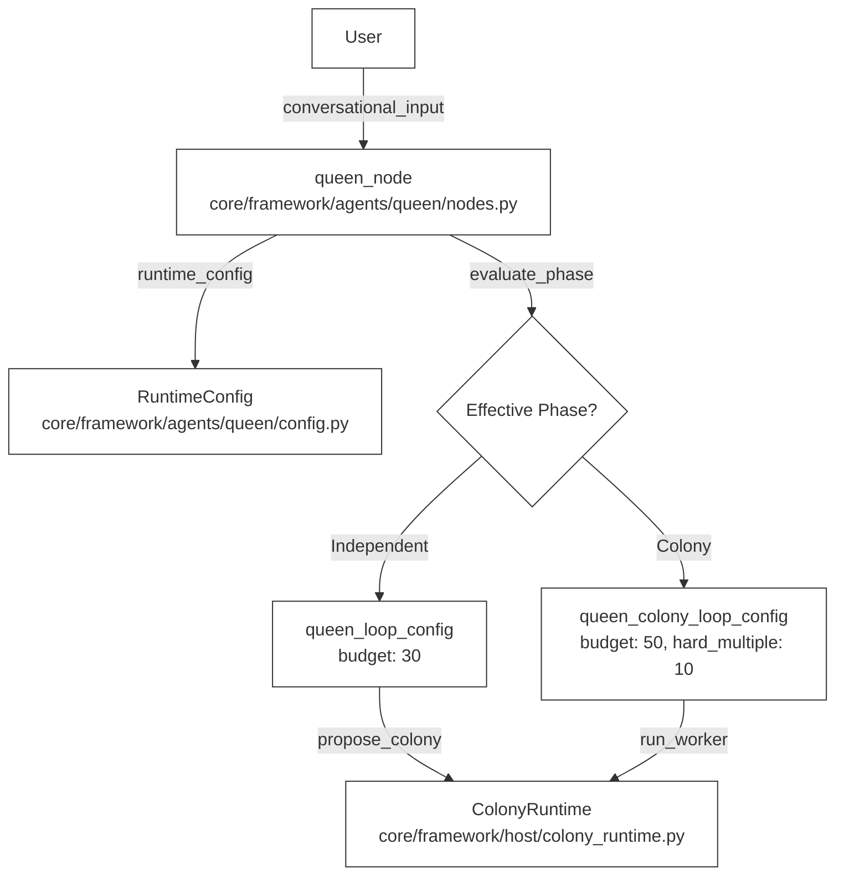

Sources: `core/framework/agents/queen/agent.py`, `core/framework/agents/queen/config.py`, `docs/key_concepts/queen.md`

---

## 2. Bounded Worker Clones

Workers are short-lived, narrow instances of `AgentLoop` spawned by the Queen via `run_worker` (`docs/architecture/README.md:77-79]()`). Unlike Queens, workers are memoryless, lack persona definitions, and cannot communicate directly with the user or spawn other workers (`docs/key_concepts/queen.md:38()`, `docs/architecture/README.md:79()`).

### Execution Constraints and Lifecycles
* **Tool Allotment**: Subsets of the Queen's tool set (excluding queen-only orchestration tools).
* **Budget Limits**: Fixed working turns (typically 3 working turns plus 1 grace turn), capped tool calls per turn (30), and lifetime caps (`docs/architecture/README.md:77-78]()`).
* **Grace Turn Restrictions**: During grace iterations, workers are restricted to calling `report_to_parent`, `tracker_upsert`, and `task_update` (`docs/architecture/README.md:77-78]()`).

Sources: `core/framework/host/colony_runtime.py`, `docs/architecture/README.md`

---

## 3. Colony Directories and HIVE_HOME

A Colony represents an isolated working directory under `~/.hive/colonies/<name>/` that aggregates shared operational state, storage partitions, and execution ledgers (`docs/architecture/README.md:19-69]()`).

### Colony File Layout

| Directory / File Path | Purpose / Technical Role |
|-----------------------|--------------------------|
| `worker.json` | Worker specifications used for cloning (`docs/architecture/README.md:61()`) |
| `tracker/tracker.db` | Shared SQLite ledger for structured unit-of-work progress (`docs/architecture/README.md:62()`) |
| `colony.db` | Administrative metadata and playbook execution logs (`docs/architecture/README.md:63()`) |
| `skills/` | Colony-scoped skill definitions written by the Queen (`docs/architecture/README.md:64()`) |
| `playbooks/` | Saved executable playbook scripts (`docs/architecture/README.md:65()`) |
| `triggers.json` | Scheduled cron, interval, and webhook trigger definitions (`docs/architecture/README.md:66()`) |
| `queens/<queen>/sessions/<id>/` | Queen session transcripts, event logs, and task plans (`docs/architecture/README.md:67()`) |
| `workers/<id>/` | Individual worker state storage (`docs/architecture/README.md:68()`) |

### Diagram: Colony Storage Architecture & Code Bindings

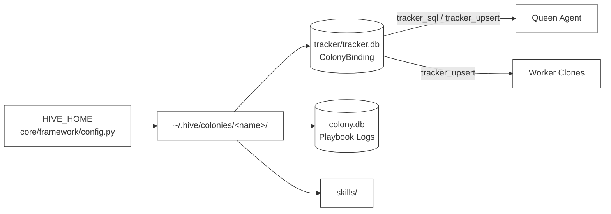

Sources: `docs/architecture/README.md`, `core/framework/config.py`

---

## 4. The Shared SQLite Tracker (`tracker.db`)

To avoid shared memory buffers or message-passing queues, colonies synchronize via an on-disk SQLite ledger located at `tracker/tracker.db` (`docs/architecture/README.md:100-105]()`). Access is governed by immutable `ColonyBinding` objects (`core/framework/host/colony_binding.py`) that bind runtime handles directly to the correct database path.

* **Schema Definition**: The Queen executes `tracker_sql` to define custom tables and designates writable columns via `tracker_register_writable` (`docs/architecture/README.md:104-105]()`).
* **Execution Ledger**: Workers execute `tracker_upsert` to write exactly one row per unit of work, providing deterministic state tracking (`docs/architecture/README.md:100-105]()`).

Sources: `docs/architecture/README.md`, `core/framework/host/colony_binding.py`

---

## 5. Goals, Outcomes, and Coordination

Hive implements **Outcome-Driven Development (ODD)** where objectives are specified via success criteria and hard/soft constraints rather than rigid procedural code graphs (`docs/key_concepts/goals_outcome.md:5-23]()`).

### Structured Goal Schema
Structured goals are instantiated using `Goal` and evaluated via `SuccessCriterion` definitions (`core/framework/schemas/goal.py`, `docs/key_concepts/goals_outcome.md:33-68()`):

```python
Goal(
    id="deep-research",
    name="Deep Research Report",
    success_criteria=[
        SuccessCriterion(
            id="comprehensive",
            description="Report covers all major aspects",
            metric="llm_judge",
            weight=0.4
        )
    ],
    constraints=[
        Constraint(
            id="no_spam",
            description="Never send more than 3 messages",
            constraint_type="hard",
            category="safety"
        )
    ]
)
```
*[docs/key_concepts/goals_outcome.md:40-81]()*

* **Hard Constraints**: Injected into system prompts as `MUST` directives for model-level compliance (`docs/key_concepts/goals_outcome.md:91()`).
* **Soft Constraints**: Injected as `SHOULD` preferences (`docs/key_concepts/goals_outcome.md:91()`).
* **Coordination Subsystems**: Coordinated via an EventBus telemetry layer, a persistent reminder hub, and a file-backed task plan (`docs/architecture/README.md:28-44()`).

Sources: `core/framework/schemas/goal.py`, `docs/key_concepts/goals_outcome.md`, `docs/architecture/README.md`

---

## 6. Continuous Improvement Loops

The core execution model follows an iterative **"execute first, then systematize"** paradigm (`docs/key_concepts/queen.md:29-34()`):

1. **Pilot Execution**: The Queen executes the initial unit of work herself to discover edge cases and establish operational feasibility (`README.md:44-47()` generators).
2. **Skill Codification**: Successful execution workflows are codified into reusable skills via `write_skill` (`docs/roadmap.md:9()`).
3. **Mass Fan-Out**: Spawned workers inherit codified skills and process queued units of work against the shared `tracker.db` (`README.md:47-48()`).
4. **Audit and Reflection**: The Queen audits tracker states via SQL, reconciling errors and refining reflection memories (`README.md:48()`, `docs/key_concepts/queen.md:36-38()`).

Sources: `README.md`, `docs/key_concepts/queen.md`, `docs/roadmap.md`

---

# Page: Repository Layout and Packaging

# Repository Layout and Packaging

<details>
<summary>Relevant source files</summary>

The following files were used as context for generating this wiki page:

- [.github/workflows/ci.yml](.github/workflows/ci.yml)
- [.gitignore](.gitignore)
- [.python-version](.python-version)
- [AGENTS.md](AGENTS.md)
- [CHANGELOG.md](CHANGELOG.md)
- [CLAUDE.md](CLAUDE.md)
- [Makefile](Makefile)
- [core/README.md](core/README.md)
- [core/framework/loader/cli.py](core/framework/loader/cli.py)
- [core/framework/server/tests/test_session_shutdown.py](core/framework/server/tests/test_session_shutdown.py)
- [core/hatch_build.py](core/hatch_build.py)
- [core/pyproject.toml](core/pyproject.toml)
- [docs/releases/v1.0.10.md](docs/releases/v1.0.10.md)
- [docs/releases/v1.0.2.md](docs/releases/v1.0.2.md)
- [docs/releases/v1.0.9.md](docs/releases/v1.0.9.md)
- [tools/README.md](tools/README.md)
- [tools/pyproject.toml](tools/pyproject.toml)
- [uv.lock](uv.lock)

</details>


## Purpose and Scope
This page details the repository layout, `uv` workspace structure, package configuration (`aden-hive` and `aden-tools`), command-line entry points, Hatchling build hooks for frontend bundling, Makefile automation targets, and repository conventions. Hive is organized as a multi-package `uv` workspace to cleanly separate the core goal-driven runtime (`aden-hive`) from the broad ecosystem of third-party integrations and tool wrappers (`aden-tools`).

---

## 1. The `uv` Workspace and Package Structure

Hive uses an explicit `uv` workspace configuration defined in the root `uv.lock` file, encompassing two core members: `aden-hive` (located in `core/`) and `aden-tools` (located in `tools/`) [uv.lock:1-21](). 

The `aden-hive` package houses the core runtime primitives, including `AgentLoop`, `ColonyRuntime`, HTTP server handlers, and the public embedding API. The `aden-tools` package provides verified and unverified Model Context Protocol (MCP) servers, browser automation (`gcu`), terminal utilities, memory extensions, and charting modules.

### Workspace Architecture

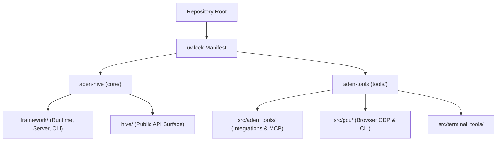
*Sources: [uv.lock:1-21](), [core/pyproject.toml:1-55](), [tools/pyproject.toml:1-107]()*

---

## 2. Package Definitions and Dependencies

### Core Package (`aden-hive`)
The `aden-hive` package (`core/pyproject.toml`) defines the minimum runtime dependencies required to run the agent loop, manage state, and interact with LLM providers (`pydantic`, `anthropic`, `httpx`, `litellm`, `mcp`, `fastmcp`, `croniter`, `psutil`) [core/pyproject.toml:1-20](). Optional dependencies include `webhook`/`server` (via `aiohttp`), `tools` (pulling in `aden-tools`), and `testing` [core/pyproject.toml:22-31]().

### Tools Package (`aden-tools`)
The `aden-tools` package (`tools/pyproject.toml`) depends on `aden-hive` and pulls in the comprehensive suite of external client libraries, database drivers (`duckdb`, `psycopg2-binary`), web scrapers (`playwright`, `beautifulsoup4`), document processors (`pdfplumber`, `fpdf2`), and cloud integrations [tools/pyproject.toml:19-48]().

---

## 3. Pyproject Entrypoints and CLI Scripts

Both packages expose executable CLI entrypoints via `[project.scripts]` tables in their respective `pyproject.toml` files, enabling global or virtual environment command routing.

| Executable | Target Module | Package | Description |
| :--- | :--- | :--- | :--- |
| `hive` | `framework.cli:main` | `aden-hive` | Main control plane CLI for starting servers, managing queens, colonies, and sessions [core/pyproject.toml:36-37]() |
| `hive-cred` | `framework.credentials.cli:main` | `aden-hive` | Credential retrieval utility for CLI scripts and agent tools [core/pyproject.toml:38-42]() |
| `hive-browser` | `gcu.cli:main` | `aden-tools` | Chrome-native browser control automation utility [tools/pyproject.toml:89-92]() |

### Entrypoint Resolution Flow

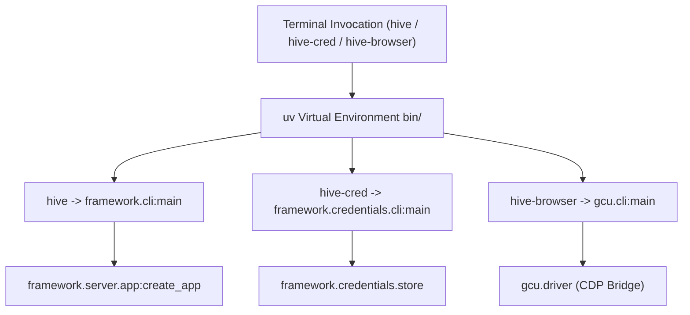
*Sources: [core/pyproject.toml:36-42](), [tools/pyproject.toml:89-92](), [core/framework/loader/cli.py:1-79]() *

---

## 4. Hatch Build Frontend Bundling

The `aden-hive` package embeds the React web dashboard directly into Python wheels by leveraging Hatchling build hooks and sdist artifacts.

*   **Sdist Artifacts**: The source distribution includes pre-built frontend files under `frontend/dist/` specified via `artifacts = ["frontend/dist/"]` in `core/pyproject.toml` [core/pyproject.toml:57-59]().
*   **Wheel Bundling Hook**: Custom build hooks (`[tool.hatch.build.targets.wheel.hooks.custom]`) invoke custom build scripts (such as `core/hatch_build.py`) to compile or package the frontend static assets into `framework/server/frontend` inside the generated wheel [core/pyproject.toml:50-56]().

### Build Pipeline Data Flow

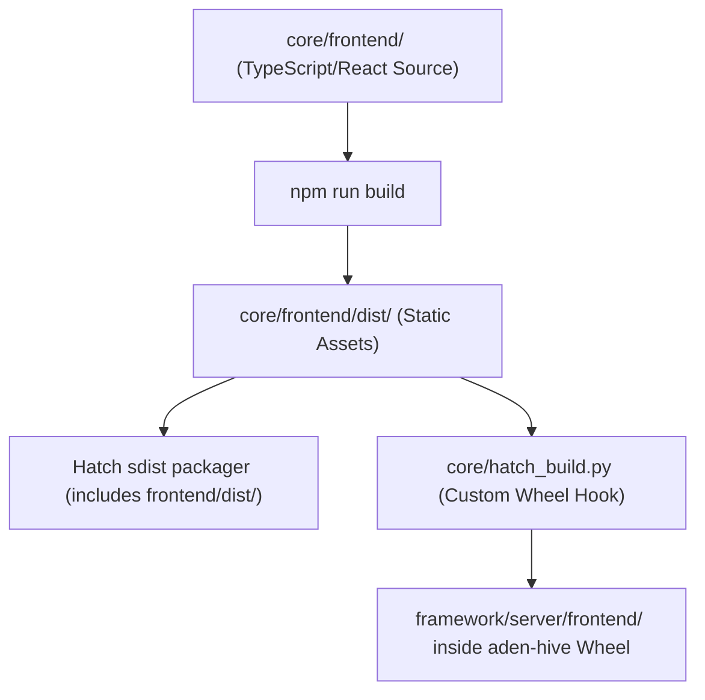
*Sources: [core/pyproject.toml:50-61](), [.github/workflows/ci.yml:127-139]() *

---

## 5. Makefile Targets and Development Automation

Development workflows are standardized via the root `Makefile`. The Makefile automatically prepends `~/.local/bin` to `PATH` to support Git Bash environments on Windows [Makefile:1-6]().

### Key Makefile Targets

*   `lint`: Executes `ruff check --fix` and `ruff format` across both `core/` and `tools/` directories [Makefile:14-18]().
*   `check`: Runs CI-safe lint and format checks without modifying files [Makefile:24-28]().
*   `test`: Runs core and tool test suites (excluding live external APIs) [Makefile:30-33]().
*   `test-tools`: Executes isolated mock tool tests under `tools/` [Makefile:34-36]().
*   `test-live`: Runs live integration tests requiring real API credentials (`-m live`) [Makefile:37-39]().
*   `frontend-install`: Installs npm dependencies in `core/frontend/` [Makefile:49-51]().
*   `frontend-build`: Compiles the React dashboard for production distribution [Makefile:55-56]().

*Sources: [Makefile:1-56]*

---

## 6. Gitignore and Editor Conventions

The repository enforces strict change hygiene and artifact exclusion via `.gitignore` [:.gitignore:1-89]().

*   **Dependencies & Build Outputs**: Excludes `node_modules/`, `dist/`, `build/`, `.venv/`, and `tools/src/uv.lock` [:.gitignore:1-19]().
*   **Runtime Scratch Data**: Prevents committing user-generated agent data, workspace files, local databases, and runtime logs under `data/`, `core/data/`, and `workdir/` [:.gitignore:8-64]() & [:.gitignore:87-88]().
*   **IDE Conventions**: Ignores `.idea/`, `.vscode/*` (while preserving recommended settings examples), and system-specific files like `.DS_Store` [:.gitignore:25-36]().

*Sources: [._gitignore:1-89]*

---

# Page: Public API for Building on Hive

# Public API for Building on Hive

<details>
<summary>Relevant source files</summary>

The following files were used as context for generating this wiki page:

- [core/framework/__init__.py](core/framework/__init__.py)
- [core/framework/agent_loop/__init__.py](core/framework/agent_loop/__init__.py)
- [core/framework/agent_loop/turn_context_reminder.py](core/framework/agent_loop/turn_context_reminder.py)
- [core/framework/agent_loop/types.py](core/framework/agent_loop/types.py)
- [core/framework/host/__init__.py](core/framework/host/__init__.py)
- [core/framework/host/agent_host.py](core/framework/host/agent_host.py)
- [core/framework/host/execution_manager.py](core/framework/host/execution_manager.py)
- [core/framework/loader/agent_loader.py](core/framework/loader/agent_loader.py)
- [core/framework/pipeline/stages/skill_registry.py](core/framework/pipeline/stages/skill_registry.py)
- [core/framework/py.typed](core/framework/py.typed)
- [core/framework/server/compaction_status.py](core/framework/server/compaction_status.py)
- [core/framework/server/tests/test_turn_context.py](core/framework/server/tests/test_turn_context.py)
- [core/framework/server/turn_context.py](core/framework/server/turn_context.py)
- [core/framework/storage/session_summary.py](core/framework/storage/session_summary.py)
- [core/hive/__init__.py](core/hive/__init__.py)
- [core/hive/py.typed](core/hive/py.typed)
- [core/setup_mcp.sh](core/setup_mcp.sh)
- [core/tests/test_public_api.py](core/tests/test_public_api.py)
- [docs/building-on-hive.md](docs/building-on-hive.md)

</details>


This section documents the stable public API surface exposed by the `aden-hive` core package (`core/hive/__init__.py`) and framework packages (`core/framework/__init__.py`, `agent_loop` types, `turn_context`, and channels) for embedding Hive runtime primitives in external applications.

---

## 1. Package Architecture and Stability Contract

Hive exposes its stable public API through the top-level `hive` package. The package implements a lightweight import mechanism where individual components are imported on first use, ensuring that importing `hive` remains cheap and applications only pay initialization costs for modules they invoke [docs/building-on-hive.md:33-57] [core/hive/__init__.py:1-11].

### Semantic Versioning and Internal Isolation
* **`hive` Namespace**: Names exported from `hive` follow strict semantic versioning starting from version `1.0.1`. Breaking changes to these APIs trigger major version increments [docs/building-on-hive.md:58-60].
* **`framework` Namespace**: Everything imported directly from `framework.*` is considered an internal implementation detail and may change across any release [docs/building-on-hive.md:58-60].
* **Package Extras**: The base `aden-hive` install contains only execution primitives. Optional extras enable servers (`server`) and built-in tool ecosystems (`tools`) [docs/building-on-hive.md:6-23].

| Extra | Added Dependencies | Required For |
|---|---|---|
| `server` | `aiohttp` | `SSEResponse`, custom web endpoints, and HTTP hosting [docs/building-on-hive.md:18-20] |
| `tools` | `aden-tools` (terminal, files, browser, memory, charts) | Full worker colonies, agent runtimes, and dashboard tooling [docs/building-on-hive.md:21-22] |

Sources: `docs/building-on-hive.md:1-60`, `core/hive/__init__.py:1-121`

---

## 2. Core Execution Primitives: AgentLoop, AgentSpec, and AgentContext

The core execution primitive for individual agents is `AgentLoop`, driven by declarative configuration classes `AgentSpec` and runtime containers `AgentContext` [core/hive/__init__.py:64-72].

### Execution Flow and Reporting
An `AgentLoop` executes iterative LLM turns, dispatches tool calls, and evaluates execution termination or error states. When an `on_report` callback is provided, the agent is granted the `report_to_parent` tool, allowing it to return an `AgentReport` containing status, summaries, and structured receipts [docs/building-on-hive.md:33-54].

### Natural Language to Code Entity Mapping: Agent Execution

Title: Mapping Agent Execution Concepts to Framework Classes

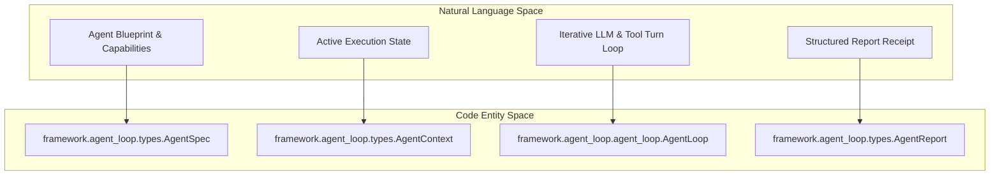
Sources: `core/framework/agent_loop/types.py:21-193`, `core/hive/__init__.py:64-72`, `docs/building-on-hive.md:33-54`

---

## 3. Model Providers and Streaming Events

Hive abstracts model communication through the `LLMProvider` interface and structured streaming event protocols [core/hive/__init__.py:77-93].

### Provider Implementations
* **`LiteLLMProvider`**: Proxies requests via LiteLLM, handling provider-specific rewriting, prompt caching breakpoints, and automatic retries [core/hive/__init__.py:82].
* **`AnthropicProvider`**: Native integration for Anthropic models [core/hive/__init__.py:83].
* **`MockLLMProvider`**: Scriptable provider for testing loops without network calls [core/hive/__init__.py:84].

### Stream Events
Model generation emits discrete event types subclassing `StreamEvent`, including `TextDeltaEvent`, `ToolCallEvent`, `ReasoningStartEvent`, `ReasoningDeltaEvent`, `FinishEvent`, and `StreamErrorEvent` [core/hive/__init__.py:39-49].

Sources: `core/hive/__init__.py:35-49`, `core/hive/__init__.py:77-93`, `core/tests/test_public_api.py:64-84`

---

## 4. External Integration Channels (`hive.channels`)

Chat applications and external messaging platforms can connect to Queen agent sessions running inside `hive serve` by registering factories in the `hive.channels` entry-point group [docs/building-on-hive.md:61-80].

### Channel Host Protocol
Channels interact with the runtime via `ChannelHost` and `QueenOutput` interfaces. Each group chat or direct message thread corresponds to a unique Queen session ID managed by the host [docs/building-on-hive.md:81-116].

### Natural Language to Code Entity Mapping: Channel Integration

Title: Mapping Chat Integrations to Channel Host Entities

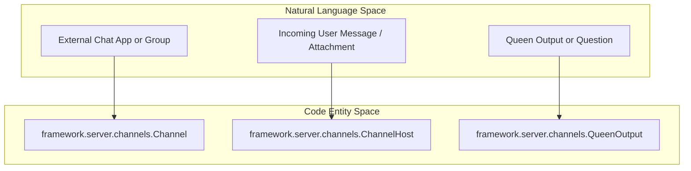
Sources: `docs/building-on-hive.md:61-117`, `core/hive/__init__.py:113-117`

---

## 5. Turn Context Injection (`hive.turn_context`)

Turn-context plugins allow external applications to inject dynamic context into a Queen session right before she processes a user turn. The text returned by the provider is injected as a `<system-reminder>` immediately preceding the user message [docs/building-on-hive.md:118-138].

### Turn Context Host
Packages register under the `hive.turn_context` entry-point group and receive a `TurnContextHost` reference [docs/building-on-hive.md:125-146]. The implementation provides the `context(queen_id, message)` coroutine, which evaluates active state or external stores and returns supplementary prompt text or `None` [docs/building-on-hive.md:151-153].

Sources: `docs/building-on-hive.md:118-156`, `core/hive/__init__.py:118-120`

---

# Page: Getting Started

# Getting Started

<details>
<summary>Relevant source files</summary>

The following files were used as context for generating this wiki page:

- [CONTRIBUTING.md](CONTRIBUTING.md)
- [README.md](README.md)
- [SECURITY.md](SECURITY.md)
- [core/framework/config.py](core/framework/config.py)
- [core/framework/llm/key_check.py](core/framework/llm/key_check.py)
- [core/tests/test_key_check_packaged.py](core/tests/test_key_check_packaged.py)
- [docs/configuration.md](docs/configuration.md)
- [docs/developer-guide.md](docs/developer-guide.md)
- [docs/environment-setup.md](docs/environment-setup.md)
- [docs/getting-started.md](docs/getting-started.md)
- [hive.ps1](hive.ps1)
- [quickstart.ps1](quickstart.ps1)
- [quickstart.sh](quickstart.sh)
- [scripts/check_llm_key.py](scripts/check_llm_key.py)
- [scripts/uv-discovery.ps1](scripts/uv-discovery.ps1)

</details>


This page guides new users through setting up the Hive environment, cloning the repository, running automated onboarding, configuring an LLM provider, and launching the dashboard with `hive open`. As a parent overview, this section introduces the primary onboarding workflows and links out to platform-specific installation guides and configuration references.

For detailed instructions, see the child pages:
- [Environment Setup (Linux and macOS)](#2.1)
- [Environment Setup (Windows)](#2.2)
- [Configuration Reference](#2.3)
- [LLM Provider Setup and Key Validation](#2.4)

Sources: [README.md:63-74](), [docs/getting-started.md:1-15]()

---

## 1. Quickstart and Installation Overview

Getting started with Hive begins by cloning the repository and running the automated onboarding script (`quickstart.sh` on Unix-based systems or `quickstart.ps1` on Windows) [README.md:64-67](). These interactive wizards check prerequisites such as Python 3.11+, automatically install the `uv` package manager if missing, set up a shared workspace virtual environment via `uv sync`, install native dependencies (such as Chromium for browser automation), and prompt for LLM credentials [quickstart.sh:119-195](), [quickstart.ps1:8-12]().

### Quickstart and Onboarding Pipeline

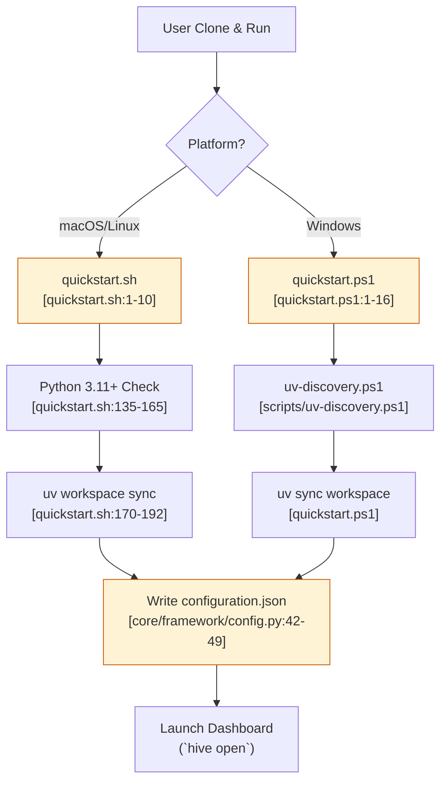

Sources: [quickstart.sh:1-192](), [quickstart.ps1:1-28](), [core/framework/config.py:42-49]()

---

## 2. Platform-Specific Environment Setup

Hive supports macOS, Linux, and Windows with platform-tailored onboarding routines [CONTRIBUTING.md:154-156](). 

- **Linux and macOS:** Automated via `quickstart.sh`, validating Python 3.11+, `uv`, Node.js (for frontend building), and native libraries [quickstart.sh:1-203](). For a granular walkthrough, see [Environment Setup (Linux and macOS)](#2.1).
- **Windows:** Automated via `quickstart.ps1`, `uv-discovery.ps1`, and the `hive.ps1` wrapper script [hive.ps1:1-15](). It handles registry-based environment variable loading, Windows Defender path exclusions, and secure `HIVE_CREDENTIAL_KEY` handling [quickstart.ps1:146-211](), [hive.ps1:43-77](). For complete Windows instructions, see [Environment Setup (Windows)](#2.2).

Sources: [quickstart.sh:1-203](), [quickstart.ps1:1-211](), [hive.ps1:1-77]()

---

## 3. Configuration Reference

Runtime configuration is centralized under `HIVE_HOME` (defaulting to `~/.hive/`) [core/framework/config.py:42-49](). The primary configuration file, `~/.hive/configuration.json`, stores global settings including the default LLM provider, `queen_llm`/`worker_llm` overrides, judge slots, vision fallback parameters, and key pools [docs/configuration.md:15-87](). 

### LLM Validation and Configuration Mapping

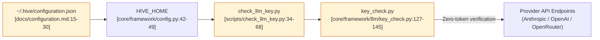

For comprehensive details on environment variables, model catalogs, capability flags, and UI provider selection, see [Configuration Reference](#2.3).

Sources: [core/framework/config.py:42-49](), [docs/configuration.md:15-90](), [scripts/check_llm_key.py:34-68](), [core/framework/llm/key_check.py:127-145]()

---

## 4. LLM Provider Setup and Key Validation

Hive supports both Bring-Your-Own-Key (BYOK) modes (for Anthropic, OpenAI, OpenRouter, Groq, Cerebras, DeepSeek) and subscription-backed modes (such as Claude Code, Codex, Kimi, and Antigravity) [README.md:56-61](), [docs/configuration.md:93-116](). 

To prevent unnecessary token expenditure during onboarding and configuration updates, Hive implements zero-token key validation routines (`scripts/check_llm_key.py` and `framework.llm.key_check`) [scripts/check_llm_key.py:1-14](), [core/framework/llm/key_check.py:1-11](). These scripts send minimal or empty probes (such as 400-triggering empty message arrays or model listing requests) to verify authentication status instantly [core/framework/llm/key_check.py:127-162](). OAuth credential discovery handles subscription-based logins automatically.

For deeper insights into provider modes, the Hive LLM proxy, and credential validation internals, see [LLM Provider Setup and Key Validation](#2.4).

Sources: [README.md:56-61](), [scripts/check_llm_key.py:1-68](), [core/framework/llm/key_check.py:1-162]()

---

# Page: Environment Setup (Linux and macOS)

# Environment Setup (Linux and macOS)

<details>
<summary>Relevant source files</summary>

The following files were used as context for generating this wiki page:

- [CONTRIBUTING.md](CONTRIBUTING.md)
- [README.md](README.md)
- [SECURITY.md](SECURITY.md)
- [core/framework/config.py](core/framework/config.py)
- [core/framework/llm/key_check.py](core/framework/llm/key_check.py)
- [core/tests/test_key_check_packaged.py](core/tests/test_key_check_packaged.py)
- [docs/configuration.md](docs/configuration.md)
- [docs/developer-guide.md](docs/developer-guide.md)
- [docs/environment-setup.md](docs/environment-setup.md)
- [docs/getting-started.md](docs/getting-started.md)
- [hive.ps1](hive.ps1)
- [quickstart.ps1](quickstart.ps1)
- [quickstart.sh](quickstart.sh)
- [scripts/check_llm_key.py](scripts/check_llm_key.py)
- [scripts/uv-discovery.ps1](scripts/uv-discovery.ps1)

</details>


## Purpose and Scope

This page documents the technical implementation and step-by-step execution flow of `quickstart.sh`, the interactive onboarding wizard for Linux and macOS environments [quickstart.sh:1-10]. It details Python 3.11+ resolution, automatic `uv` binary bootstrapping, Node.js 20+ requirement checks for the frontend dashboard, native dependency checks (SQLite, Playwright Chromium, Tesseract/OCR components), workspace synchronization via `uv sync`, shell RC file detection (`detect_shell_rc`), interactive LLM provider and subscription parsing, and post-setup verification mechanisms (`check_key` in `core/framework/llm/key_check.py`) [quickstart.sh:119-657, core/framework/llm/key_check.py:1-50].

For Windows-specific onboarding (`quickstart.ps1` and `hive.ps1`), see section 2.2. For global configuration layout (`~/.hive/configuration.json`), see section 2.3.

Sources: [quickstart.sh:1-10](), [quickstart.sh:119-657](), [core/framework/llm/key_check.py:1-50]()

---

## Prerequisites and System Requirements

The onboarding script expects a Unix-compatible environment with standard command-line utilities.

| Requirement | Minimum Version | Code Verification / Enforcement |
|---|---|---|
| Python | 3.11+ | `quickstart.sh` candidate loop (`python3.11`, `python3.12`, `python3.13`, `python3`, `python`) [quickstart.sh:135-145]() |
| `uv` | Any (Auto-installed if missing) | Fetched via `curl -LsSf https://astral.sh/uv/install.sh` [quickstart.sh:171-179]() |
| Node.js | 20.0+ | Checked via `node --version` for dashboard builds [quickstart.sh:194-203]() |
| `curl` | Any | Used for fetching `uv` and checking gateway availability [quickstart.sh:42-52](), [quickstart.sh:173-177]() |
| Git | Any | Required for repository cloning [README.md:54]() |

Sources: [quickstart.sh:42-52](), [quickstart.sh:135-145](), [quickstart.sh:171-203](), [README.md:54]()

---

## Wizard Step Map & Code Entity Architecture

The following diagram bridges natural language concepts in the onboarding process to exact code symbols, script functions, and configuration files within the repository.

**`quickstart.sh` Execution and Code Entity Mapping**

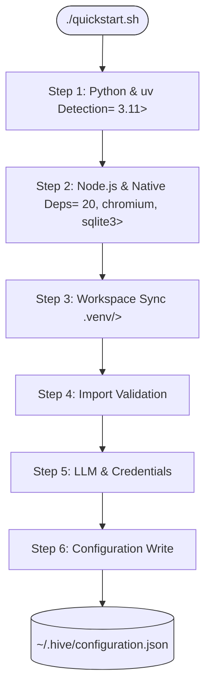

Sources: [quickstart.sh:119-657](), [core/framework/config.py:42-49]()

---

## Step-by-Step Walkthrough of `quickstart.sh`

### Python Detection and `uv` Bootstrapping

The wizard initiates execution by scanning for a valid Python interpreter supporting version 3.11 or higher [quickstart.sh:135-165]. It iterates through an explicit list of candidate commands:

```bash
python3.11 python3.12 python3.13 python3 python
```[quickstart.sh:136]

For each candidate, it executes an inline Python snippet to query `sys.version_info.major` and `sys.version_info.minor` [quickstart.sh:138-140]. The first interpreter satisfying `major == 3` and `minor >= 11` is assigned to `PYTHON_CMD` [quickstart.sh:140-143]. If no qualifying interpreter is found, the script terminates with exit status 1 [quickstart.sh:147-165].

Next, the script inspects the host environment for the `uv` package manager via `command -v uv` [quickstart.sh:171]. If absent, it invokes `curl` to download and execute the official Astral installer script, appending `$HOME/.local/bin` to the active `PATH` session variable [quickstart.sh:172-180]:

```bash
curl -LsSf https://astral.sh/uv/install.sh | sh
export PATH="$HOME/.local/bin:$PATH"
```[quickstart.sh:179-180]

Sources: [quickstart.sh:135-192]()

### Node.js and Frontend Dashboard Requirements

The wizard evaluates Node.js availability to ensure the web dashboard frontend can be built or served [quickstart.sh:194-203]. It executes `node --version`, extracts the major version token, and validates that `NODE_MAJOR` is greater than or equal to `20` [quickstart.sh:197-199]. If Node.js is missing or below version 20, a warning is emitted (`NODE_AVAILABLE=false`), allowing backend and CLI operations to proceed while noting that frontend compilation requires an upgrade [quickstart.sh:195-203].

Sources: [quickstart.sh:194-203]()

### Workspace Synchronization (`uv sync`)

Hive utilizes a `uv` workspace layout combining the core framework (`core/`) and tools package (`tools/`) [CONTRIBUTING.md:104-118]. The wizard runs `uv sync` from the repository root [quickstart.sh:186-192]. This constructs a unified virtual environment at `.venv/` containing both packages in editable/workspace linkage mode.

**`uv` Workspace Layout and Virtual Environment Binding**

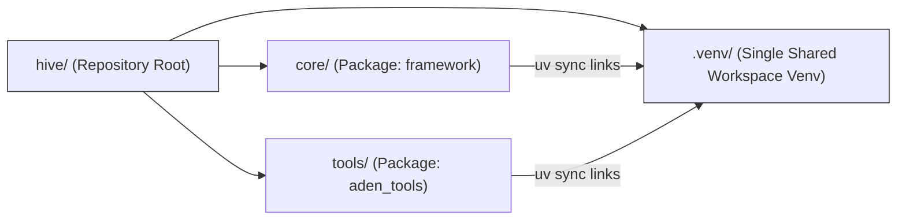

Sources: [CONTRIBUTING.md:104-118](), [docs/environment-setup.md:247-268]()

### Native Dependencies and Playwright Chromium

Following workspace synchronization, the wizard addresses native execution dependencies:
1. **SQLite**: Relies on Python's built-in `sqlite3` module backed by platform-native SQLite libraries (WAL mode enabled for `tracker.db`) [core/framework/config.py:126-143].
2. **Chromium (Browser Automation)**: Installed via Playwright using `uv run python -m playwright install chromium` [quickstart.sh:210-215]. Playwright failures are caught gracefully as non-fatal warnings [quickstart.sh:215].
3. **Tesseract / OCR**: Utilized by specific document and image-processing tools within `aden_tools` [tools/src/aden_tools/].

Sources: [core/framework/config.py:126-143](), [quickstart.sh:210-215](), [tools/src/aden_tools/]()

### LLM Provider Configuration and Key Validation

The wizard presents interactive menus to configure LLM access and credential storage [quickstart.sh:276-657]. 
- **Subscription Detection**: Inspects existing credential paths such as `~/.claude/.credentials.json` to offer subscription passthrough modes (e.g., Claude Code, ZAI Code) [quickstart.sh:676-710].
- **API Key Prompts**: Prompts for provider-specific keys (Anthropic, OpenAI, OpenRouter, Hive LLM, etc.) [quickstart.sh:279-314].
- **Zero-Token Key Validation**: Validates keys before saving by invoking validation routines defined in `core/framework/llm/key_check.py` (such as `check_anthropic` and `check_openrouter`) to prevent spending tokens during onboarding [scripts/check_llm_key.py:1-69, core/framework/llm/key_check.py:127-187].
- **Shell RC Integration**: `detect_shell_rc()` identifies the user's active shell profile (`~/.zshrc`, `~/.bashrc`, or `~/.profile`) and appends environment export statements [quickstart.sh:532-560].
- **Configuration Output**: Writes the selected provider, model ID, and token parameters into `~/.hive/configuration.json` via `save_configuration()` [quickstart.sh:618-657, docs/configuration.md:15-32].

Sources: [quickstart.sh:276-657](), [scripts/check_llm_key.py:1-68](), [core/framework/llm/key_check.py:127-187](), [docs/configuration.md:15-32]()

---

## Verification and Troubleshooting

### Post-Setup Verification

To manually verify that the environment is correctly initialized, execute the import checks via `uv run` [docs/getting-started.md:26-27]:

```bash
uv run python -c "import framework; print('✓ framework OK')"
uv run python -c "import aden_tools; print('✓ aden_tools OK')"
uv run python -c "import litellm; print('✓ litellm OK')"
uv run python -c "from framework.mcp import agent_builder_server; print('✓ MCP OK')"
```[docs/getting-started.md:26-27, docs/getting-started.md:200-207]

### Common Resolution Steps

| Symptom / Error | Root Cause | Corrective Action |
|---|---|---|
| `Python 3.11+ is required` | System interpreter version is too low | Install Python 3.11+ from official sources or via Homebrew [docs/environment-setup.md:73-76] |
| `uv installation failed` | `curl` utility missing or network block | Install `curl` or manually install `uv` from `astral.sh/uv` [docs/environment-setup.md:174-177] |
| `ModuleNotFoundError: No module named 'framework'` | Workspace dependency sync (`uv sync`) not completed | Run `uv sync` from the repository root [docs/environment-setup.md:180-188] |
| `externally-managed-environment` (PEP 668) | Operating system package manager protection on global python | Use `uv venv` and activate `.venv` before running setup [docs/environment-setup.md:147-156] |

Sources: [docs/environment-setup.md:73-188](), [docs/getting-started.md:26-27]()

---

Sources: [quickstart.sh:1-2398](), [core/framework/config.py:1-1222](), [core/framework/llm/key_check.py:1-367](), [scripts/check_llm_key.py:1-68](), [docs/environment-setup.md:1-457](), [docs/getting-started.md:1-239](), [CONTRIBUTING.md:1-1182]()

---

# Page: Environment Setup (Windows)

# Environment Setup (Windows)

<details>
<summary>Relevant source files</summary>

The following files were used as context for generating this wiki page:

- [core/codex_oauth.py](core/codex_oauth.py)
- [core/framework/config.py](core/framework/config.py)
- [core/framework/llm/key_check.py](core/framework/llm/key_check.py)
- [core/framework/storage/checkpoint_store.py](core/framework/storage/checkpoint_store.py)
- [core/tests/test_key_check_packaged.py](core/tests/test_key_check_packaged.py)
- [hive.ps1](hive.ps1)
- [quickstart.ps1](quickstart.ps1)
- [quickstart.sh](quickstart.sh)
- [scripts/benchmark_quickstart.ps1](scripts/benchmark_quickstart.ps1)
- [scripts/check_llm_key.py](scripts/check_llm_key.py)
- [scripts/check_requirements.py](scripts/check_requirements.py)
- [scripts/test_check_requirements.py](scripts/test_check_requirements.py)
- [scripts/uv-discovery.ps1](scripts/uv-discovery.ps1)
- [tools/src/aden_tools/credentials/browser.py](tools/src/aden_tools/credentials/browser.py)
- [tools/src/aden_tools/credentials/shell_config.py](tools/src/aden_tools/credentials/shell_config.py)

</details>


This page covers the Windows-specific setup path for the Hive agent framework. It details the execution of `quickstart.ps1`, the underlying `uv` discovery mechanisms via `scripts/uv-discovery.ps1`, and the `hive.ps1` runtime wrapper. For Linux and macOS environments, see [2.1](). For global configuration file structures and environment variable schemas, see [2.3]().

---

## Prerequisites

| Requirement | Minimum Version | Notes |
|---|---|---|
| PowerShell | 5.1+ | Enforced via `#Requires -Version 5.1` at script headers [quickstart.ps1:1]() |
| Python | 3.11+ | Evaluated across `python3.13`, `python3.12`, `python3.11`, `python3`, `python` binaries |
| Internet access | — | Required for bootstrapping `uv` and package synchronization |

---

## Running the Setup Wizard

To initialize the development environment and configure runtime dependencies on Windows, execute the setup wizard from the project root in an interactive PowerShell terminal:

```powershell
.\quickstart.ps1
```

The script operates interactively, prompting before applying persistent environment registry changes or optional security modifications, and terminates with exit code `1` upon encountering fatal configuration or dependency errors.

Sources: [quickstart.ps1:1-20]()

---

## Setup Flow

**Setup wizard flow — `quickstart.ps1`**

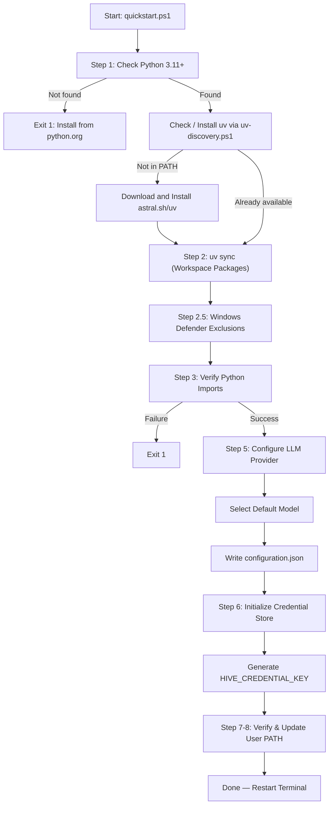

Sources: [quickstart.ps1:304-1124](), [hive.ps1:1-15]()

---

## Step-by-Step Breakdown

### Python and uv Discovery (`uv-discovery.ps1`)

The onboarding script delegates binary resolution to `scripts/uv-discovery.ps1`. The discovery module locates valid Python installations meeting the `3.11+` requirement and validates `uv` executables across standard user paths (`%USERPROFILE%\.local\bin\uv.exe`) and system `PATH` environments.

If `uv` is absent, `quickstart.ps1` fetches and executes the official Astral installer script:

```powershell
Invoke-RestMethod https://astral.sh/uv/install.ps1 | Invoke-Expression
```

Upon successful installation, `%USERPROFILE%\.local\bin` is appended to the user-level registry `Path` environment variable to ensure persistence across reboots.

Sources: [quickstart.ps1:307-416]()

### Package Installation and Workspace Sync

Dependencies are resolved by invoking `uv sync` from the project root directory. This provisions the virtual environment (`.venv`) and installs workspace packages defined in `pyproject.toml`. Following core package resolution, Playwright Chromium binaries are provisioned via `uv run python -m playwright install chromium` to support browser automation subsystems.

Sources: [quickstart.ps1:422-469]()

### Windows Defender Exclusions (Optional)

Real-time antivirus scanning on Windows can severely degrade I/O performance during `uv sync` and agent execution loops. The wizard provides an option to configure path exclusions via `Test-DefenderExclusions` and `Add-MpPreference`.

**Protected Exclusion Targets:**
* Project root directory (`$ScriptDir`)
* Virtual environment path (`$ScriptDir\.venv`)
* Package cache directory (`%LOCALAPPDATA%\uv`)

**Security Safeguards:** `Test-DefenderExclusions` validates that target paths strictly resolve within project boundaries or localized user application directories (`$env:LOCALAPPDATA`, `$env:APPDATA`) before modifying system registry rules. If administrative privileges are missing (`Test-IsAdmin`), the wizard outputs raw administrative PowerShell snippets for manual execution.

Sources: [quickstart.ps1:99-268](), [quickstart.ps1:472-599]()

### LLM Provider Configuration and Registry Storage

The wizard scans process environment blocks and registry keys for API tokens associated with supported providers (such as Anthropic, OpenAI, and Google Gemini). Selected keys are stored persistently as **User-level environment variables** via the .NET API:

```powershell
[System.Environment]::SetEnvironmentVariable($SelectedEnvVar, $apiKey, "User")
```

The provider selection and target model mappings are committed to `~/.hive/configuration.json` [quickstart.ps1:648-908]().

Sources: [quickstart.ps1:648-908](), [core/framework/config.py:42-55]()

### Credential Store Initialization

Credential encryption relies on Fernet symmetric keys. During setup, `quickstart.ps1` performs the following initialization steps:
1. Verifies or generates a `HIVE_CREDENTIAL_KEY` string via `cryptography.fernet.Fernet`.
2. Persists the key to the Windows User environment registry and `~/.hive/secrets/credential_key` [hive.ps1:64-77]().
3. Provisions directory structures under `~/.hive/credentials/` for encrypted secret storage.

Sources: [quickstart.ps1:911-967](), [hive.ps1:64-77]()

---

## The `hive.ps1` Runtime Wrapper

`hive.ps1` serves as the primary entry point for executing Hive CLI commands within Windows environments.

### Why `hive.ps1` Is Necessary

Unlike Linux and macOS shells that source login scripts (`.bashrc`, `.zshrc`) upon terminal creation, Windows handles user-level environment variables through the registry (`HKEY_CURRENT_USER\Environment`). Modern terminals (such as VS Code integrated terminals or Windows Terminal tabs) frequently fail to inherit newly added environment variables or path entries dynamically. `hive.ps1` bridges this gap by explicitly pulling variables from the registry at runtime.

Sources: [hive.ps1:1-10]()

### Runtime Startup Flow

**Runtime wrapper flow — `hive.ps1`**

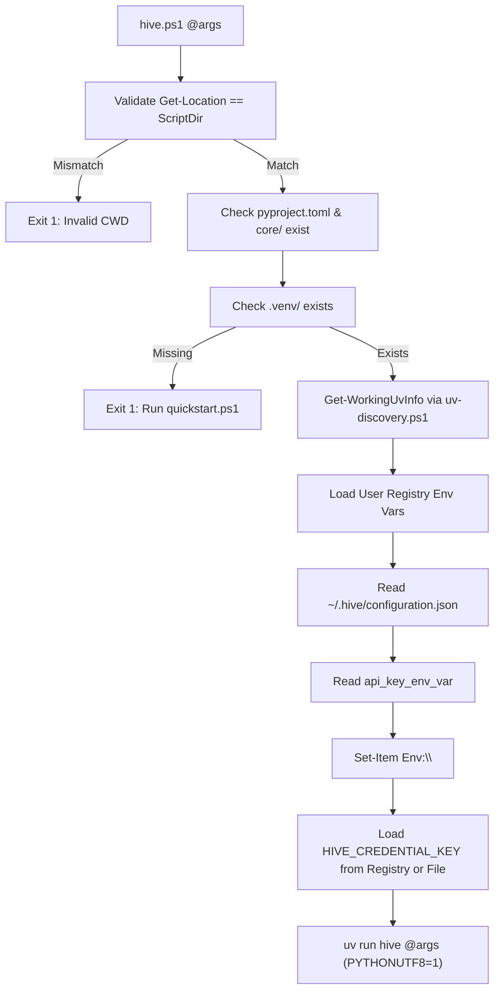

Sources: [hive.ps1:11-82](), [scripts/uv-discovery.ps1]()

### Environment Variable Binding Architecture

The mapping between persistent storage and process execution context is structured as follows:

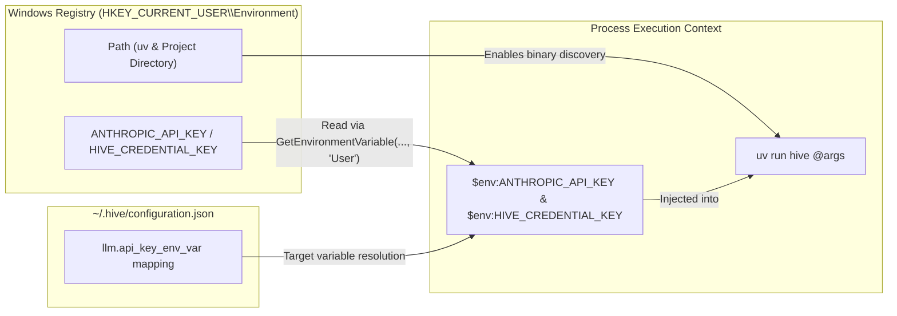

Sources: [hive.ps1:44-82](), [core/framework/config.py:42-55]()

---

## Troubleshooting

| Symptom | Underlying Cause | Corrective Action |
|---|---|---|
| `uv not found` error | Terminal session lacks updated `PATH` references | Close and restart the terminal window |
| `API key not found` during execution | User environment variables not propagated to process | Invoke via `.\hive.ps1` rather than raw `uv run hive` to trigger registry lookups |
| `Virtual environment not found` | Workspace dependencies not installed | Run `.\quickstart.ps1` to provision `.venv` |
| Defender exclusion failure | Insufficient administrative privileges | Execute suggested `Add-MpPreference` statements in an elevated shell |
| CWD validation failure | Terminal opened outside project root | `cd` into the repository root directory before invocation |

Sources: [hive.ps1:14-32](), [quickstart.ps1:919-967]()

---
Sources: [quickstart.ps1:1-1124](), [hive.ps1:1-82](), [core/framework/config.py:1-182](), [scripts/check_llm_key.py:1-68]()

---

# Page: Configuration Reference

# Configuration Reference

<details>
<summary>Relevant source files</summary>

The following files were used as context for generating this wiki page:

- [core/framework/agent_loop/internals/tool_result_handler.py](core/framework/agent_loop/internals/tool_result_handler.py)
- [core/framework/config.py](core/framework/config.py)
- [core/framework/llm/capabilities.py](core/framework/llm/capabilities.py)
- [core/framework/llm/key_check.py](core/framework/llm/key_check.py)
- [core/framework/llm/model_catalog.json](core/framework/llm/model_catalog.json)
- [core/framework/llm/model_catalog.py](core/framework/llm/model_catalog.py)
- [core/framework/server/routes_config.py](core/framework/server/routes_config.py)
- [core/framework/server/routes_queens.py](core/framework/server/routes_queens.py)
- [core/frontend/src/api/config.ts](core/frontend/src/api/config.ts)
- [core/frontend/src/components/ModelSwitcher.tsx](core/frontend/src/components/ModelSwitcher.tsx)
- [core/frontend/src/components/ProviderManager.tsx](core/frontend/src/components/ProviderManager.tsx)
- [core/frontend/src/components/SettingsModal.tsx](core/frontend/src/components/SettingsModal.tsx)
- [core/tests/test_capabilities.py](core/tests/test_capabilities.py)
- [core/tests/test_colony_runtime_overseer.py](core/tests/test_colony_runtime_overseer.py)
- [core/tests/test_key_check_packaged.py](core/tests/test_key_check_packaged.py)
- [core/tests/test_model_catalog.py](core/tests/test_model_catalog.py)
- [core/tests/test_run_parallel_workers_tool.py](core/tests/test_run_parallel_workers_tool.py)
- [docs/releases/v0.10.2.md](docs/releases/v0.10.2.md)
- [hive.ps1](hive.ps1)
- [quickstart.ps1](quickstart.ps1)
- [quickstart.sh](quickstart.sh)
- [scripts/check_llm_key.py](scripts/check_llm_key.py)
- [scripts/uv-discovery.ps1](scripts/uv-discovery.ps1)

</details>


This page documents the configuration architecture of the Hive runtime, covering the `HIVE_HOME` directory layout, the global configuration file (`~/.hive/configuration.json`) with its provider slots (`queen_llm`, `worker_llm`, `judge`, `vision_fallback`), environment variables, model catalogs and capability detection modules, and UI configuration components.

---

## 1. `HIVE_HOME` Layout and Directory Structure

The Hive runtime stores persistent state, queen identities, colonies, memories, and configuration files under a root directory known as `HIVE_HOME`. By default, this resolves to `~/.hive/`, but it can be overridden via the `HIVE_HOME` environment variable (for example, when spawned by the Electron desktop shell) [core/framework/config.py:42-49]().

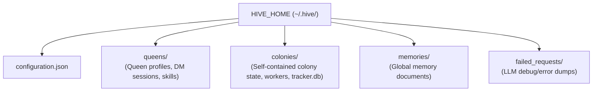

### Key Subdirectories
* `configuration.json`: Global configuration storing active providers, model selections, and slot overrides [core/framework/config.py:42-54]().
* `queens/`: Contains independent queen identity directories (`queens/<queen_id>/`), each holding `profile.yaml`, `skills/`, and DM chat sessions (`sessions/<session_id>/`) [core/framework/config.py:86-116]().
* `colonies/`: Contains self-contained colony workspaces (`colonies/<colony_id>/`). Each colony houses its own `metadata.json`, `tracker/tracker.db`, colony-scoped skills, queen overseer sessions, and parallel worker run states (`workers/<session_id>/`) [core/framework/config.py:118-181]().
* `memories/`: Stores global memory documents and vector store indexes [core/framework/config.py:52]().

Sources: [core/framework/config.py:42-181]()

---

## 2. Global Configuration File (`~/.hive/configuration.json`)

The global configuration file dictates default LLM providers, model mappings, provider slots, and credential pools. It is managed via `framework.config` and exposed to the web dashboard via REST API endpoints in `framework.server.routes_config` [core/framework/config.py:1-117](), [core/framework/server/routes_config.py:1-7]().

### Configuration Schema and Provider Slots
`configuration.json` supports multiple model slots to separate roles like reasoning queens, executing workers, judge evaluation, and vision fallback handling:

```json
{
  "llm": {
    "provider": "anthropic",
    "model": "claude-sonnet-4-5-20250929",
    "max_tokens": 8192
  },
  "queen_llm": {
    "provider": "anthropic",
    "model": "claude-opus-4-6"
  },
  "worker_llm": {
    "provider": "openai",
    "model": "gpt-5.4-mini"
  },
  "judge": {
    "provider": "anthropic",
    "model": "claude-haiku-4-5-20251001"
  },
  "vision_fallback": {
    "provider": "openai",
    "model": "gpt-5.4"
  },
  "created_at": "2026-01-15T12:00:00+00:00"
}
```

* `llm`: The default fallback provider and model slot used when specialized slots are omitted.
* `queen_llm`: High-capability reasoning model assigned to Queen orchestration, planning, and task distribution.
* `worker_llm`: Cost-effective or high-throughput model assigned to parallel worker execution.
* `judge`: Evaluator slot used by stall detection and verification loops (`ChannelHost.judge`) [core/framework/server/routes_config.py:84-90]().
* `vision_fallback`: Dedicated vision-capable model invoked when text-only models require image captioning or visual processing [core/frontend/src/api/config.ts:80-82]().

Sources: [core/framework/config.py:1-117](), [core/framework/server/routes_config.py:1-1426](), [core/frontend/src/api/config.ts:80-92]()

---

## 3. Environment Variables

Runtime flags, credentials, and overrides can be supplied via environment variables. These take precedence or supply fallback values when configuration file entries are absent.

| Environment Variable | Scope | Description |
|---|---|---|
| `HIVE_HOME` | Runtime Path | Overrides the default `~/.hive` root directory [core/framework/config.py:42-47]() |
| `HIVE_DESKTOP_MODE` | Runtime Flag | Enables Electron desktop shell mode (skips standalone frontend builds) [core/framework/config.py:21-22]() |
| `ANTHROPIC_API_KEY` | Provider Key | API key for Anthropic Claude models [core/framework/server/routes_config.py:43-58]() |
| `OPENAI_API_KEY` | Provider Key | API key for OpenAI GPT models [core/framework/server/routes_config.py:43-58]() |
| `ZAI_API_KEY` | Subscription | Credential key for ZAI Code subscription plans [core/framework/server/routes_config.py:205-208]() |
| `MOCK_MODE` | Runtime Flag | Skips live LLM calls and executes with mock responses during tests |

Sources: [core/framework/config.py:21-47](), [core/framework/server/routes_config.py:43-208]()

---

## 4. Model Catalog and Capability Detection

Model capabilities, context windows, max output tokens, and vision support are managed via a centralized model catalog JSON file and capability helper modules [core/framework/llm/model_catalog.json:1-662](), [core/framework/llm/model_catalog.py:1](), [core/framework/llm/capabilities.py:1-85]().

### Model Catalog Structure
`core/framework/llm/model_catalog.json` defines supported providers and their respective model parameters:

```json
{
  "schema_version": 1,
  "providers": {
    "anthropic": {
      "default_model": "claude-haiku-4-5-20251001",
      "models": [
        {
          "id": "claude-opus-4-6",
          "label": "Opus 4.6 - Most capable",
          "recommended": true,
          "max_tokens": 128000,
          "max_context_tokens": 872000,
          "supports_vision": true
        }
      ]
    }
  }
}
```

### Capability Detection Architecture
The `framework.llm.capabilities` module inspects model metadata to route tool results and determine vision compatibility [core/framework/llm/capabilities.py:1-85]().

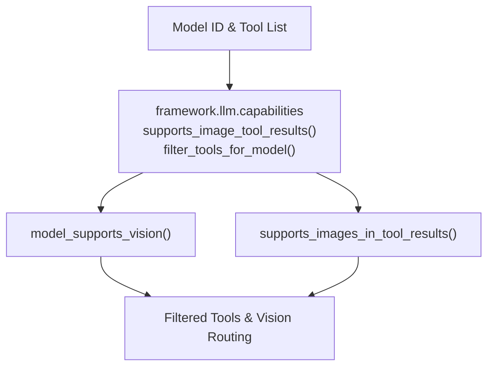

* `supports_image_tool_results(model)`: Verifies if a model can receive image blocks in message payloads [core/framework/llm/capabilities.py:19-30]().
* `filter_tools_for_model(tools, model)`: Strips `produces_image=True` tool definitions from tool schemas when evaluated against text-only models, preventing invalid tool dispatches [core/framework/llm/capabilities.py:32-49]().
* `supports_images_in_tool_results(model)`: Determines whether the target API (e.g. Anthropic/Claude-routed proxies) supports native image payloads directly inside `tool_result` blocks [core/framework/llm/capabilities.py:64-85]().

Sources: [core/framework/llm/model_catalog.json:1-32](), [core/framework/llm/model_catalog.py:1-100](), [core/framework/llm/capabilities.py:1-85]()

---

## 5. Provider and Model Selection in the UI

The web dashboard provides configuration modals and settings panes to inspect and update active provider slots, API keys, and model preferences [core/frontend/src/components/SettingsModal.tsx:1-853](), [core/framework/server/routes_config.py:1-7]().

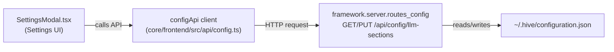

### API Endpoints
* `GET /api/config/llm`: Returns active provider status, active subscription state, and connected provider keys [core/framework/server/routes_config.py:4-7](), [core/frontend/src/api/config.ts:115]().
* `PUT /api/config/llm`: Hot-swaps running agent sessions with new provider and model configurations [core/framework/server/routes_config.py:4-7](), [core/frontend/src/api/config.ts:174-175]().
* `GET /api/config/llm-sections`: Inspects the independent provider slots (`llm`, `worker_llm`, `vision_fallback`, `judge`) [core/frontend/src/api/config.ts:120-121]().
* `PUT /api/config/llm-sections`: Validates and commits updates to individual provider slots [core/frontend/src/api/config.ts:125-129]().

Sources: [core/framework/server/routes_config.py:1-10](), [core/frontend/src/components/SettingsModal.tsx:47-90](), [core/frontend/src/api/config.ts:114-130]()

---

# Page: LLM Provider Setup and Key Validation

# LLM Provider Setup and Key Validation

<details>
<summary>Relevant source files</summary>

The following files were used as context for generating this wiki page:

- [core/codex_oauth.py](core/codex_oauth.py)
- [core/framework/agents/queen/mcp_servers.json](core/framework/agents/queen/mcp_servers.json)
- [core/framework/config.py](core/framework/config.py)
- [core/framework/llm/antigravity.py](core/framework/llm/antigravity.py)
- [core/framework/llm/key_check.py](core/framework/llm/key_check.py)
- [core/framework/loader/mcp_client.py](core/framework/loader/mcp_client.py)
- [core/framework/storage/checkpoint_store.py](core/framework/storage/checkpoint_store.py)
- [core/tests/e2e/longmemeval.py](core/tests/e2e/longmemeval.py)
- [core/tests/e2e/test_longmemeval.py](core/tests/e2e/test_longmemeval.py)
- [core/tests/test_antigravity_schema.py](core/tests/test_antigravity_schema.py)
- [core/tests/test_key_check_packaged.py](core/tests/test_key_check_packaged.py)
- [core/tests/test_mcp_client.py](core/tests/test_mcp_client.py)
- [docs/memory-benchmark.md](docs/memory-benchmark.md)
- [hive.ps1](hive.ps1)
- [quickstart.ps1](quickstart.ps1)
- [quickstart.sh](quickstart.sh)
- [scripts/benchmark_quickstart.ps1](scripts/benchmark_quickstart.ps1)
- [scripts/check_llm_key.py](scripts/check_llm_key.py)
- [scripts/check_requirements.py](scripts/check_requirements.py)
- [scripts/test_check_requirements.py](scripts/test_check_requirements.py)
- [scripts/uv-discovery.ps1](scripts/uv-discovery.ps1)
- [tools/src/aden_tools/credentials/browser.py](tools/src/aden_tools/credentials/browser.py)
- [tools/src/aden_tools/credentials/shell_config.py](tools/src/aden_tools/credentials/shell_config.py)

</details>


## Purpose and Scope
This document covers the technical architecture and implementation details for LLM provider configuration, Bring-Your-Own-Key (BYOK) vs. subscription/OAuth execution modes, the Hive LLM proxy, zero-token key validation mechanisms, and credential discovery routines.

---

## 1. BYOK vs. Subscription Modes
Hive supports multiple provider integration patterns, bifurcated into standard BYOK (Bring Your Own Key) strategies and managed/subscription OAuth modes.

* **BYOK Mode**: Users supply API keys directly for standard commercial models (Anthropic, OpenAI, OpenRouter, and compatible endpoints). These keys are stored securely and passed via standard client headers (`x-api-key` or `Authorization: Bearer`).
* **Subscription / OAuth Modes**: Advanced modes bypass manual API key entry by leveraging browser-based PKCE or local account state extraction:
  * **OpenAI Codex / ChatGPT Plus/Pro**: Executed via an automated local OAuth PKCE flow (`core/codex_oauth.py`), storing user tokens in `~/.codex/auth.json`.
  * **Antigravity (Google Cloud Code Assist)**: Managed via `core/framework/llm/antigravity.py`, which pulls Google OAuth tokens either from `~/.hive/antigravity-accounts.json` or by scanning IDE state databases (`state.vscdb`).

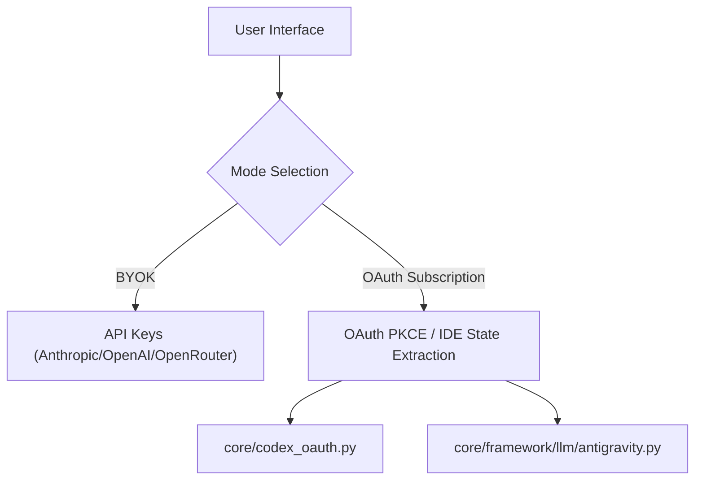
Sources: `core/codex_oauth.py:1-160`, `core/framework/llm/antigravity.py:79-171`

---

## 2. The Hive LLM Proxy and Gateway Routing
Hive provides gateway availability detection and routing through the centralized Hive LLM Endpoint (`https://api.adenhq.com`). 

* **Endpoint Configuration**: The gateway base URL is defined as `HIVE_LLM_ENDPOINT = "https://api.adenhq.com"` (`quickstart.sh:36-37`, `core/framework/config.py:19`).
* **Availability Checks**: Onboarding wizards (`quickstart.sh` and `quickstart.ps1`) ping the gateway availability route to verify connectivity and gateway status before prompting for credentials:
  * Unix availability checks use `check_hive_llm_availability()` (`quickstart.sh:39-52`).
  * Windows availability checks use `Test-HiveGatewayAvailability()` (`quickstart.ps1:30-41`).

```mermaid
graph TD
    Script["quickstart.sh / quickstart.ps1"] --> CheckFunc["check_hive_llm_availability()"]
    CheckFunc --> Endpoint["https://api.adenhq.com/v1/gateway/availability"]
    Endpoint --> ReturnStatus{"Response == true?"}
    ReturnStatus -->|Yes| GatewayReady["Gateway Available"]
    ReturnStatus -->|No| GatewayOffline["Fallback to Direct Providers"]
```
Sources: `quickstart.sh:35-52`, `quickstart.ps1:24-41`

---

## 3. Zero-Token Key Validation
To prevent billing users or consuming token quotas during onboarding and Settings management, Hive implements zero-token key checks.

* **CLI Runner**: `scripts/check_llm_key.py` serves as the CLI wrapper accepting provider IDs, keys, optional API bases, and models, returning a JSON response and strict exit codes (`0` for valid, `1` for invalid, `2` for network/timeout errors) (`scripts/check_llm_key.py:1-69`).
* **Core Logic**: `framework/llm/key_check.py` implements provider-specific validation functions:
  * `check_anthropic()`: Sends an empty message payload with `max_tokens=1` to `https://api.anthropic.com/v1/messages`. Status codes `200`, `400`, or `429` confirm key validity without executing real generations (`core/framework/llm/key_check.py:127-145`).
  * `check_openai_compatible()` / `check_openrouter()`: Performs a lightweight `GET /models` request against the provider endpoint using the bearer token (`core/framework/llm/key_check.py:148-179`).

```mermaid
graph TD
    CLI["scripts/check_llm_key.py"] --> CoreCheck["framework.llm.key_check.check_key()"]
    CoreCheck --> ProviderRouter{"Provider Type"}
    ProviderRouter -->|Anthropic| AnthropicCheck["check_anthropic() (POST /v1/messages, max_tokens=1)"]
    ProviderRouter -->|OpenAI / Compatible| OpenAI espèces["check_openai_compatible() (GET /models)"]
    ProviderRouter -->|OpenRouter| OpenRouterCheck["check_openrouter() (GET /api/v1/models)"]
    AnthropicCheck --> ResultJSON["JSON: {"valid": bool, "message": str}"]
    OpenAI espèces --> ResultJSON
    OpenRouterCheck --> ResultJSON
```
Sources: `core/framework/llm/key_check.py:1-179`, `scripts/check_llm_key.py:1-69`

---

## 4. OAuth Credential Discovery and Flows
For managed subscriptions, Hive extracts or negotiates credentials dynamically.

* **OpenAI Codex OAuth Flow (`core/codex_oauth.py`)**:
  1. Generates PKCE verifier and challenge (`generate_pkce()`) (`core/codex_oauth.py:52-57`).
  2. Spawns an internal HTTP callback server on port `1455` (`OAuthCallbackHandler`) (`core/codex_oauth.py:178-206`).
  3. Launches the user's browser via `open_browser()` (`core/codex_oauth.py:162-175`).
  4. Exchanges the authorization code for access and refresh tokens (`exchange_code_for_tokens()`) (`core/codex_oauth.py:79-110`).
  5. Decodes JWT claims to extract the `account_id` and persists credentials securely to `~/.codex/auth.json` (`core/codex_oauth.py:129-160`).
* **Antigravity Credential Loader (`core/framework/llm/antigravity.py`)**:
  * Reads multi-account JSON schemas from `~/.hive/antigravity-accounts.json` (`core/framework/llm/antigravity.py:79-138`).
  * Falls back to reading IDE SQLite state databases (`state.vscdb`) on macOS/Linux to extract OAuth tokens (`_load_from_ide_db()`) (`core/framework/llm/antigravity.py:140-171`).

```mermaid
graph TD
    OAuthScript["core/codex_oauth.py"] --> PKCE["generate_pkce()"]
    PKCE --> Browser["open_browser(AUTHORIZE_URL)"]
    Browser --> CallbackServer["OAuthCallbackHandler (Port 1455)"]
    CallbackServer --> TokenExchange["exchange_code_for_tokens()"]
    TokenExchange --> JWT["get_account_id() (Decode JWT Claims)"]
    JWT --> SaveCreds["save_credentials() -> ~/.codex/auth.json"]
    
    AntigravityModule["core/framework/llm/antigravity.py"] --> CheckFiles{"Source Check"}
    CheckFiles -->|JSON Accounts| AccountsJSON["~/.hive/antigravity-accounts.json"]
    CheckFiles -->|IDE Database| StateDB["state.vscdb (macOS/Linux)"]
```
Sources: `core/codex_oauth.py:52-175`, `core/framework/llm/antigravity.py:79-171`

---

# Page: Architecture

# Architecture

<details>
<summary>Relevant source files</summary>

The following files were used as context for generating this wiki page:

- [core/framework/agent_loop/agent_loop.py](core/framework/agent_loop/agent_loop.py)
- [core/framework/agent_loop/conversation.py](core/framework/agent_loop/conversation.py)
- [core/framework/agent_loop/internals/cursor_persistence.py](core/framework/agent_loop/internals/cursor_persistence.py)
- [core/framework/agent_loop/internals/types.py](core/framework/agent_loop/internals/types.py)
- [core/framework/agent_loop/internals/vision_fallback.py](core/framework/agent_loop/internals/vision_fallback.py)
- [core/framework/agents/queen/nodes/__init__.py](core/framework/agents/queen/nodes/__init__.py)
- [core/framework/agents/queen/queen_profiles.py](core/framework/agents/queen/queen_profiles.py)
- [core/framework/agents/queen/tests/test_deferred_handle_redeemers.py](core/framework/agents/queen/tests/test_deferred_handle_redeemers.py)
- [core/framework/host/colony_runtime.py](core/framework/host/colony_runtime.py)
- [core/framework/host/worker.py](core/framework/host/worker.py)
- [core/framework/server/app.py](core/framework/server/app.py)
- [core/framework/server/queen_orchestrator.py](core/framework/server/queen_orchestrator.py)
- [core/framework/server/routes_execution.py](core/framework/server/routes_execution.py)
- [core/framework/server/session_manager.py](core/framework/server/session_manager.py)
- [core/framework/storage/conversation_store.py](core/framework/storage/conversation_store.py)
- [core/framework/tools/queen_lifecycle_tools.py](core/framework/tools/queen_lifecycle_tools.py)
- [core/tests/test_event_loop_node.py](core/tests/test_event_loop_node.py)
- [core/tests/test_node_conversation.py](core/tests/test_node_conversation.py)
- [core/tests/test_worker_started_at.py](core/tests/test_worker_started_at.py)

</details>


This page provides a high-level overview of the Hive runtime architecture. Hive is built around a unified execution model where `AgentLoop` serves as the single execution primitive for both persistent Queen agents and bounded worker clones [core/framework/agent_loop/agent_loop.py:1-10](). 

For deep technical details, see the child pages:
- Agent Loop: [Agent Loop](#3.1)
- Queen Orchestration and Colony Runtime: [Queen Orchestration and Colony Runtime](#3.2)
- Sessions and State Management: [Sessions and State Management](#3.3)
- Event Bus and Observability: [Event Bus and Observability](#3.4)
- LLM Provider Layer: [LLM Provider Layer](#3.5)
- Judge, Stall Detection and Channels: [Judge, Stall Detection and Channels](#3.6)

---

## High-Level Architecture Overview

The Hive runtime coordinates chat interactions, persistent queen sessions, dynamic colony forking, parallel worker execution via `ColonyRuntime`, and event telemetry via `EventBus`.

**Diagram: Runtime Subsystems Mapped to Code Entities**

```mermaid
flowchart TB
    subgraph ClientLayer["Client & API Layer"]
        HTTP["HTTP API / aiohttp\n(framework/server/app.py)"]
        RoutesExec["Execution Routes\n(framework/server/routes_execution.py)"]
    end

    subgraph CoreOrchestration["Core Orchestration & Session Management"]
        SessionManager["SessionManager\n(framework/server/session_manager.py)"]
        QueenOrchestrator["Queen Orchestrator\n(framework/server/queen_orchestrator.py)"]
        QueenPhaseState["QueenPhaseState\n(framework/tools/queen_lifecycle_tools.py)"]
    end

    subgraph ExecutionPrimitives["Execution Primitives"]
        AgentLoop["AgentLoop\n(framework/agent_loop/agent_loop.py)"]
        ColonyRuntime["ColonyRuntime\n(framework/host/colony_runtime.py)"]
    end

    subgraph TelemetryStorage["Telemetry & Storage"]
        EventBus["EventBus\n(framework/host/event_bus.py)"]
        ConversationStore["ConversationStore\n(framework/storage/conversation_store.py)"]
    end

    HTTP --> RoutesExec
    RoutesExec --> SessionManager
    SessionManager --> QueenOrchestrator
    QueenOrchestrator --> QueenPhaseState
    QueenOrchestrator --> AgentLoop
    QueenOrchestrator --> ColonyRuntime
    ColonyRuntime --> AgentLoop
    AgentLoop --> ConversationStore
    AgentLoop --> EventBus
```

Sources: [core/framework/server/app.py:1-15](), [core/framework/server/session_manager.py:1-22](), [core/framework/server/queen_orchestrator.py:1-15](), [core/framework/tools/queen_lifecycle_tools.py:111-139](), [core/framework/agent_loop/agent_loop.py:1-10](), [core/framework/host/colony_runtime.py:1-12]()

---

## 3.1 Agent Loop

`AgentLoop` is the single execution primitive in Hive, driving multi-turn LLM streaming loops, tool execution, and judge evaluation [core/framework/agent_loop/agent_loop.py:1-10](). It handles message compaction, tool input coercion, persistence, and vision fallbacks for text-only models.

For a complete deep dive, see [Agent Loop](#3.1).

Sources: [core/framework/agent_loop/agent_loop.py:1-10]()

---

## 3.2 Queen Orchestration and Colony Runtime

Queens manage persistent user interactions and can fork work into a colony of parallel workers using `ColonyRuntime` [core/framework/host/colony_runtime.py:1-10](). The queen switches between independent and colony phases using `QueenPhaseState` [core/framework/tools/queen_lifecycle_tools.py:111-139](), orchestrating workers, tasks, and tracker databases.

For details, see [Queen Orchestration and Colony Runtime](#3.2).

Sources: [core/framework/tools/queen_lifecycle_tools.py:111-139](), [core/framework/host/colony_runtime.py:1-10]()

---

## 3.3 Sessions and State Management

`SessionManager` governs session creation, colony binding, forking, and path-traversal protections under `HIVE_HOME` [core/framework/server/session_manager.py:1-22](). It coordinates disk storage structures and session state schemas.

For details, see [Sessions and State Management](#3.3).

Sources: [core/framework/server/session_manager.py:1-22]()

---

## 3.4 Event Bus and Observability

The `EventBus` provides publish/sub telemetry across agent loops and workers. Events are logged into per-session `events.jsonl` files, feeding runtime logs, debuggers, and timeline viewers.

For details, see [Event Bus and Observability](#3.4).

Sources: [core/framework/host/event_bus.py:1-40]()

---

## 3.5 LLM Provider Layer

Hive abstracts LLM interactions through the `LLMProvider` interface, supporting LiteLLMProxy, Anthropic, Antigravity, and Mock providers with stream event protocols and model capability detection.

For details, see [LLM Provider Layer](#3.5).

Sources: [core/framework/llm/provider.py:1-50]()

---

## 3.6 Judge, Stall Detection and Channels

The judge slot (`ChannelHost.judge`) evaluates loop convergence, while stall detection heuristics identify doom loops and visible errors, routing external chat channels to queen sessions.

For details, see [Judge, Stall Detection and Channels](#3.6).

Sources: [core/framework/agent_loop/internals/judge_pipeline.py:1-60](), [core/framework/agent_loop/internals/stall_detector.py:1-60]()

---

# Page: Agent Loop

# Agent Loop

<details>
<summary>Relevant source files</summary>

The following files were used as context for generating this wiki page:

- [core/framework/agent_loop/agent_loop.py](core/framework/agent_loop/agent_loop.py)
- [core/framework/agent_loop/conversation.py](core/framework/agent_loop/conversation.py)
- [core/framework/agent_loop/internals/cursor_persistence.py](core/framework/agent_loop/internals/cursor_persistence.py)
- [core/framework/agent_loop/internals/synthetic_tools.py](core/framework/agent_loop/internals/synthetic_tools.py)
- [core/framework/agent_loop/internals/tool_input_coercer.py](core/framework/agent_loop/internals/tool_input_coercer.py)
- [core/framework/agent_loop/internals/types.py](core/framework/agent_loop/internals/types.py)
- [core/framework/agent_loop/internals/vision_fallback.py](core/framework/agent_loop/internals/vision_fallback.py)
- [core/framework/agents/queen/queen_profiles.py](core/framework/agents/queen/queen_profiles.py)
- [core/framework/agents/queen/tests/test_deferred_handle_redeemers.py](core/framework/agents/queen/tests/test_deferred_handle_redeemers.py)
- [core/framework/storage/conversation_store.py](core/framework/storage/conversation_store.py)
- [core/tests/test_event_loop_node.py](core/tests/test_event_loop_node.py)
- [core/tests/test_node_conversation.py](core/tests/test_node_conversation.py)
- [core/tests/test_tool_input_coercer.py](core/tests/test_tool_input_coercer.py)

</details>


This page documents `AgentLoop`, the core execution primitive for multi-turn LLM streaming loops with integrated tool execution, streaming event handling, synthetic tools, and judge evaluation in the Hive framework [core/framework/agent_loop/agent_loop.py:1-10](). 

For detailed message management, token estimation, and persistence, see [Conversation, Compaction and Persistence](#3.1.1). For text-only image handling and spillover strategies, see [Vision Fallback and Tool Results](#3.1.2).

---

## Overview and Iteration Lifecycle

`AgentLoop` implements `AgentProtocol` and manages the synchronous-to-asynchronous execution bridge for agent turns [core/framework/agent_loop/agent_loop.py:3-10](). The loop operates iteratively up to a configured ceiling (`max_iterations`), processing model output deltas, executing tool calls, evaluating completions via judges, and publishing lifecycle events to the `EventBus` [core/framework/agent_loop/agent_loop.py:43-57]().

**Iteration Lifecycle Diagram (Natural Language to Code Entities):**

```mermaid
flowchart TD
  subgraph "Code Entity Space"
    AE["AgentLoop.execute()"] --> RST["restore()\n(cursor_persistence.py)"]
    RST --> IT["for iteration in range(max_iterations)"]
    IT --> CP["check_pause()\n(cursor_persistence.py)"]
    CP --> DQ["drain_injection_queue()\n(cursor_persistence.py)"]
    DQ --> ST["_run_single_turn()\n(agent_loop.py)"]
    ST --> JD["judge_turn()\n(judge_pipeline.py)"]
    JD -->|"ACCEPT"| ACC["OutputAccumulator.to_dict()"]
    JD -->|"RETRY"| FB["_inject_retry_feedback()"]
    FB --> IT
  end

  subgraph "Natural Language Space"
    A["Start Agent Run"] --> B["Restore State & Checkpoint"]
    B --> C["Run Iteration Loop"]
    C --> D["Check Pause & Inbound Events"]
    D --> E["Stream LLM & Execute Tools"]
    E --> F["Evaluate Turn with Judge"]
    F -->|"Accept"| G["Return AgentResult"]
    F -->|"Retry"| H["Inject Feedback & Continue"]
  end
```
Sources: [core/framework/agent_loop/agent_loop.py:1-10](), [core/framework/agent_loop/internals/cursor_persistence.py:49-59]()

---

## Streaming Event Handling

During each turn, `AgentLoop` calls `LLMProvider.stream()` to consume an asynchronous iterator of `StreamEvent` objects [core/framework/agent_loop/agent_loop.py:4](). These events are processed sequentially:
- `TextDeltaEvent` and `ReasoningDeltaEvent`: Stream text chunks to the client and update internal snapshots while stripping internal reasoning scaffolds (such as `<think>` blocks and pillar tags) [core/framework/agent_loop/agent_loop.py:121-140]().
- `ToolCallEvent`: Triggers tool dispatch and execution via the registered tool executor [core/framework/agent_loop/agent_loop.py:77-84]().
- `FinishEvent`: Finalizes token counts (`input_tokens`, `output_tokens`) and captures stop reasons [core/tests/test_event_loop_node.py:75-96]().
- `StreamErrorEvent`: Propagates stream failures or triggers internal backoff retries [core/framework/agent_loop/agent_loop.py:110-116]().

Sources: [core/framework/agent_loop/agent_loop.py:110-116](), [core/tests/test_event_loop_node.py:36-65]()

---

## Tool Dispatch, Synthetic Tools and Input Coercion

Tool inputs received from non-frontier or secondary models often suffer from structural drift (e.g., stringified types, scalar arguments wrapped in lists, or labeled option objects). `AgentLoop` relies on `coerce_tool_input` to sanitize tool arguments before execution against the tool schema [core/framework/agent_loop/internals/tool_input_coercer.py:1-12]().

In addition to user-provided or MCP tools, `AgentLoop` injects framework-level synthetic tools:
- `set_output`: Allows the model to populate keys in the `OutputAccumulator` [core/framework/agent_loop/internals/synthetic_tools.py:1-5]().
- `ask_user`: Pauses execution to prompt the user for structured feedback or clarification [core/framework/agent_loop/internals/synthetic_tools.py:134-145]().
- `report_to_parent` / `escalate`: Used by worker clones to return control or escalate failures to the controlling Queen [core/framework/agent_loop/internals/synthetic_tools.py:72-74]().

**Tool Dispatch and Coercion Flow:**

```mermaid
flowchart TD
  subgraph "Code Entity Space"
    TCE["ToolCallEvent"] --> CTI["coerce_tool_input(tool, raw_args)\n(tool_input_coercer.py)"]
    CTI --> EX["execute_tool(tool, args)\n(tool_result_handler.py)"]
    EX --> TR["ToolResult"]
    TR --> ACC["OutputAccumulator.set()\n(if set_output)"]
  end
```
Sources: [core/framework/agent_loop/internals/tool_input_coercer.py:1-15](), [core/framework/agent_loop/internals/tool_result_handler.py:77-84]()

---

## Judge Verdicts and Completion Criteria

Loop termination is governed by either an explicit `JudgeProtocol` implementation or an implicit stop reason [core/framework/agent_loop/agent_loop.py:7](). The judge evaluates the current context and returns a `JudgeVerdict` containing an `action` (`"ACCEPT"`, `"RETRY"`, or `"ESCALATE"`) and optional `feedback` [core/framework/agent_loop/internals/types.py:31-40]().

- `ACCEPT`: The loop finishes successfully, returning an `AgentResult` containing accumulated outputs and final conversation state [core/framework/agent_loop/internals/types.py:34]()
- `RETRY`: The judge feedback is injected as a user-role reminder message into the conversation history, and the loop proceeds to the next iteration [core/framework/agent_loop/internals/types.py:34]()
- `ESCALATE`: The loop terminates with an error status, surfacing the failure reason up to the caller or parent Queen [core/framework/agent_loop/internals/types.py:34]()

Sources: [core/framework/agent_loop/agent_loop.py:58-61](), [core/framework/agent_loop/internals/types.py:31-46]()

---

## LoopConfig Budgets, Limits, and Grace Iterations

The behavior of `AgentLoop` is configured via `LoopConfig`, which establishes execution bounds and pacing controls [core/framework/agent_loop/internals/types.py:49-51]().

| Parameter | Default | Description |
|---|---|---|
| `max_iterations` | `50` | Hard iteration limit before loop termination |
| `grace_iterations` | `0` | Extra iterations granted after maxes are hit, restricting tools to a terminal whitelist (`report_to_parent`, `task_update`) |
| `tool_call_budget` | `0` | Per-turn tool call pacing budget before soft/hard checkpoints trigger |
| `tool_call_lifetime_budget` | `0` | Cumulative tool call budget across the entire run |
| `max_context_tokens` | `180_000` | Context token window before proactive compaction triggers |

Sources: [core/framework/agent_loop/internals/types.py:49-135]()

---

## Output Accumulation and Write-Through Storage

`OutputAccumulator` collects key-value results produced during execution and writes them directly to the underlying `ConversationStore` cursor via write-through persistence [core/framework/agent_loop/agent_loop.py:9](). This ensures that crash recovery mechanisms can restore partial outputs without repeating previously completed execution turns [core/framework/agent_loop/internals/cursor_persistence.py:140-152]().

Sources: [core/framework/agent_loop/agent_loop.py:9](), [core/framework/agent_loop/internals/cursor_persistence.py:140-152]()

---

## Child Pages

For deeper technical details on specific subsystems, consult the following child pages:
- [Conversation, Compaction and Persistence](#3.1.1) — Covers `NodeConversation` message management, token estimation, microcompaction, cursor persistence, and `FileConversationStore`.
- [Vision Fallback and Tool Results](#3.1.2) — Covers the `vision_fallback` subagent for text-only models, fractional coordinate remapping, and large tool-result spillover management.

Sources: [core/framework/agent_loop/agent_loop.py:1-10]()

---

# Page: Conversation, Compaction and Persistence

# Conversation, Compaction and Persistence

<details>
<summary>Relevant source files</summary>

The following files were used as context for generating this wiki page:

- [core/framework/agent_loop/agent_loop.py](core/framework/agent_loop/agent_loop.py)
- [core/framework/agent_loop/conversation.py](core/framework/agent_loop/conversation.py)
- [core/framework/agent_loop/internals/compaction.py](core/framework/agent_loop/internals/compaction.py)
- [core/framework/agent_loop/internals/cursor_persistence.py](core/framework/agent_loop/internals/cursor_persistence.py)
- [core/framework/agent_loop/internals/types.py](core/framework/agent_loop/internals/types.py)
- [core/framework/agent_loop/internals/vision_fallback.py](core/framework/agent_loop/internals/vision_fallback.py)
- [core/framework/agent_loop/past_conversations_reminder.py](core/framework/agent_loop/past_conversations_reminder.py)
- [core/framework/agent_loop/reminders.py](core/framework/agent_loop/reminders.py)
- [core/framework/agents/queen/queen_profiles.py](core/framework/agents/queen/queen_profiles.py)
- [core/framework/agents/queen/tests/test_deferred_handle_redeemers.py](core/framework/agents/queen/tests/test_deferred_handle_redeemers.py)
- [core/framework/orchestrator/orchestrator.py](core/framework/orchestrator/orchestrator.py)
- [core/framework/server/routes_colony_workers.py](core/framework/server/routes_colony_workers.py)
- [core/framework/storage/conversation_store.py](core/framework/storage/conversation_store.py)
- [core/framework/tools/harness_tools.py](core/framework/tools/harness_tools.py)
- [core/frontend/src/api/colonyWorkers.ts](core/frontend/src/api/colonyWorkers.ts)
- [core/frontend/src/components/ParallelSubagentBubble.tsx](core/frontend/src/components/ParallelSubagentBubble.tsx)
- [core/frontend/src/components/WorkerRunBubble.tsx](core/frontend/src/components/WorkerRunBubble.tsx)
- [core/frontend/src/context/ColonyWorkersContext.tsx](core/frontend/src/context/ColonyWorkersContext.tsx)
- [core/frontend/src/context/QueenProfileContext.tsx](core/frontend/src/context/QueenProfileContext.tsx)
- [core/frontend/src/layouts/AppLayout.tsx](core/frontend/src/layouts/AppLayout.tsx)
- [core/frontend/src/lib/graphUtils.ts](core/frontend/src/lib/graphUtils.ts)
- [core/tests/test_event_loop_node.py](core/tests/test_event_loop_node.py)
- [core/tests/test_memory_timeline_recall.py](core/tests/test_memory_timeline_recall.py)
- [core/tests/test_node_conversation.py](core/tests/test_node_conversation.py)
- [tools/src/memory_tools/recall.py](tools/src/memory_tools/recall.py)
- [tools/tests/test_memory_recall_timeline.py](tools/tests/test_memory_recall_timeline.py)

</details>


## Purpose and Scope

This page documents message management, token estimation, multi-level compaction (microcompaction, phase-aware, and tool-result pruning), cursor persistence/crash recovery, the `ConversationStore` protocol with its `FileConversationStore` implementation, and reminders/past-conversation injection within Hive's `AgentLoop` and graph execution framework.

---

## 1. Overview and Component Architecture

Each agent execution within Hive maintains an isolated or shared conversation stream managed by `NodeConversation` [core/framework/agent_loop/conversation.py:1](). It coordinates message sequencing, token budget enforcement, proactive compaction, orphan tool-call recovery, and write-through persistence via `ConversationStore` [core/framework/agent_loop/conversation.py:102]().

The following diagram maps high-level conversation management concepts to their concrete code entities in the codebase:

```mermaid
graph TD
    subgraph NaturalLanguageSpace ["Natural Language Space"]
        A["MessageHistory"]
        B["ConversationStorage"]
        C["TokenBudget"]
    end

    subgraph CodeEntitySpace ["Code Entity Space"]
        D["NodeConversation\n(core/framework/agent_loop/conversation.py)"]
        E["FileConversationStore\n(core/framework/storage/conversation_store.py)"]
        F["LoopConfig\n(core/framework/agent_loop/internals/types.py)"]
        G["Message\n(core/framework/agent_loop/conversation.py)"]
    end

    A --> D
    D --> G
    B --> E
    C --> F
```

Sources: [core/framework/agent_loop/conversation.py:1-121](), [core/framework/storage/conversation_store.py:1-40]()

---

## 2. The `Message` Dataclass

Every turn, tool invocation, and system injection in a conversation is represented by a `Message` instance [core/framework/agent_loop/conversation.py:74]().

```python
@dataclass
class Message:
    seq: int
    role: Literal["user", "assistant", "tool"]
    content: str
    tool_use_id: str | None = None
    tool_calls: list[dict[str, Any]] | None = None
    is_error: bool = False
    phase_id: str | None = None
    is_transition_marker: bool = False
    is_client_input: bool = False
    image_content: list[dict[str, Any]] | None = None
    is_skill_content: bool = False
    run_id: str | None = None
    is_system_reminder: bool = False
    truncated: bool = False
    inherited_from: str | None = None
    is_trigger: bool = False
    thinking_blocks: list[dict[str, Any]] | None = None
    reasoning_content: str | None = None
    images: list[dict[str, Any]] | None = None
```

Key attributes supporting advanced features include:
- **`thinking_blocks`**: Stores reasoning blocks (such as Anthropic extended thinking signatures or DeepSeek/GLM signatures) verbatim so they can be echoed back on follow-up requests, avoiding API `400` errors [core/tests/test_node_conversation.py:134-148]().
- **`reasoning_content`**: OpenAI-compatible reasoning string used by models like Qwen and DeepSeek [core/tests/test_node_conversation.py:159-168]().
- **`is_system_reminder`**: Flags framework-injected guidance (idle nudges, stream-stall hints) rendered as compact system notices rather than user speech [core/framework/agent_loop/conversation.py:103-107]().
- **`is_trigger`**: Identifies user messages synthesized from timer ticks or webhook triggers [core/framework/agent_loop/conversation.py:119-122]().

Sources: [core/framework/agent_loop/conversation.py:73-143](), [core/tests/test_node_conversation.py:134-168]()

---

## 3. `NodeConversation` Message Management

`NodeConversation` maintains the ordered list of `Message` objects, assigns monotonic sequence numbers (`seq`), handles orphan repair, and executes write-through updates [core/framework/agent_loop/conversation.py:1-30]().

### Orphaned Tool Call Repair
When an agent loop is interrupted or cancelled mid-execution, an `assistant` message containing `tool_calls` may lack a corresponding `tool`-role response. Before passing messages to the LLM via `to_llm_messages()`, the conversation inspects and repairs these sequences by injecting a synthetic error message [core/framework/agent_loop/conversation.py:312-353]():
```json
{"role": "tool", "tool_call_id": "<id>", "content": "ERROR: Tool execution was interrupted."}
```

Sources: [core/framework/agent_loop/conversation.py:312-353]()

---

## 4. Token Estimation and Compaction Pipeline

To prevent context window overflow, Hive implements a multi-level compaction strategy handled by `framework/agent_loop/internals/compaction.py` [core/framework/agent_loop/internals/compaction.py:1-10]().

### Compaction Tiers
1. **Microcompaction (Count-based tool result clearing)**: Clears older, compactable tool results (e.g., `pdf_read`, `terminal_exec`, `web_scrape`) while keeping the most recent `MICROCOMPACT_KEEP_RECENT` (default `6`) intact [core/framework/agent_loop/internals/compaction.py:70-110]().
2. **Prune Old Tool Results**: Token-budget based reduction of verbose tool outputs that reference spillover files on disk [core/framework/agent_loop/internals/compaction.py:1-10]().
3. **Structure-Preserving Compaction / Spillover**: Large payloads are spilled to disk with a placeholder reference [core/framework/agent_loop/internals/compaction.py:1-10]().
4. **LLM Summary Compaction**: Summarizes older conversation blocks via an auxiliary LLM call when context usage crosses the threshold defined in `LoopConfig` [core/framework/agent_loop/internals/compaction.py:1-10](), [core/framework/agent_loop/internals/types.py:49-110]().
5. **Phase-Graduated Compaction**: In continuous conversation mode, protects the current phase and immediately preceding phase while summarizing older phases [core/framework/agent_loop/conversation.py:515-618]().

Sources: [core/framework/agent_loop/internals/compaction.py:1-110](), [core/framework/agent_loop/internals/types.py:49-110]()

---

## 5. Reminders and Past-Conversation Injection

Hive injects contextual reminders and past-conversation summaries into the active agent loop via `ReminderHub` and `past_conversations_reminder.py` [core/framework/agent_loop/agent_loop.py:95-104](). These mechanisms allow workers and queens to recall past interaction history or receive periodic housekeeping nudges without cluttering the core instruction prompt.

Sources: [core/framework/agent_loop/agent_loop.py:95-104](), [core/framework/agent_loop/reminders.py:1-104]()

---

## 6. Cursor Persistence and Crash Recovery

To support crash recovery and process restarts, execution checkpoints are persisted via cursor records [core/framework/agent_loop/internals/cursor_persistence.py:1-6](). 

The following diagram maps the crash recovery subsystem concepts to their underlying code components:

```mermaid
graph TD
    subgraph NaturalLanguageSpace ["Natural Language Space"]
        H["CrashRecovery"]
        I["ExecutionCursor"]
        J["RestoredSessionState"]
    end

    subgraph CodeEntitySpace ["Code Entity Space"]
        K["restore()\n(core/framework/agent_loop/internals/cursor_persistence.py)"]
        L["write_cursor()\n(core/framework/agent_loop/internals/cursor_persistence.py)"]
        M["RestoredState\n(core/framework/agent_loop/internals/cursor_persistence.py)"]
    end

    H --> K
    I --> L
    J --> M
```

`restore()` recovers conversation parts, loop iteration counters, accumulators, and stall detection metrics from storage [core/framework/agent_loop/internals/cursor_persistence.py:49-138](). `write_cursor()` records progress after each iteration [core/framework/agent_loop/internals/cursor_persistence.py:140-174]().

Sources: [core/framework/agent_loop/internals/cursor_persistence.py:1-174]()

---

## 7. Storage Protocols and `FileConversationStore`

Conversations persist to disk through the `ConversationStore` protocol implemented by `FileConversationStore` [core/framework/storage/conversation_store.py:1-115]().

**Directory Layout:**
```
{base_path}/
    meta.json          ← system_prompt, config metadata
    cursor.json        ← {"next_seq": <int>, "iteration": <int>}
    parts/
        0000000000.json
        0000000001.json
        ...
```

The `ConversationStore` protocol defines asynchronous methods for part writes, bulk reads, metadata handling, cursor management, and pruning [core/framework/storage/conversation_store.py:1-115]().

Sources: [core/framework/storage/conversation_store.py:1-115]()

---

# Page: Vision Fallback and Tool Results

# Vision Fallback and Tool Results

<details>
<summary>Relevant source files</summary>

The following files were used as context for generating this wiki page:

- [core/framework/agent_loop/agent_loop.py](core/framework/agent_loop/agent_loop.py)
- [core/framework/agent_loop/conversation.py](core/framework/agent_loop/conversation.py)
- [core/framework/agent_loop/internals/cursor_persistence.py](core/framework/agent_loop/internals/cursor_persistence.py)
- [core/framework/agent_loop/internals/tool_result_handler.py](core/framework/agent_loop/internals/tool_result_handler.py)
- [core/framework/agent_loop/internals/types.py](core/framework/agent_loop/internals/types.py)
- [core/framework/agent_loop/internals/vision_fallback.py](core/framework/agent_loop/internals/vision_fallback.py)
- [core/framework/agents/queen/queen_profiles.py](core/framework/agents/queen/queen_profiles.py)
- [core/framework/agents/queen/tests/test_deferred_handle_redeemers.py](core/framework/agents/queen/tests/test_deferred_handle_redeemers.py)
- [core/framework/llm/model_catalog.json](core/framework/llm/model_catalog.json)
- [core/framework/llm/model_catalog.py](core/framework/llm/model_catalog.py)
- [core/framework/storage/conversation_store.py](core/framework/storage/conversation_store.py)
- [core/tests/test_event_loop_node.py](core/tests/test_event_loop_node.py)
- [core/tests/test_model_catalog.py](core/tests/test_model_catalog.py)
- [core/tests/test_node_conversation.py](core/tests/test_node_conversation.py)
- [docs/releases/v0.10.2.md](docs/releases/v0.10.2.md)

</details>


## Purpose and Scope
This document covers the technical architecture and implementation details of Hive's vision fallback pipeline and tool result management systems, located within the event loop internals (`core/framework/agent_loop/internals/`). 

Specifically, this page details how text-only LLMs interact with graphical tools via the `vision_fallback` subagent, how fractional viewport coordinates and crop boxes are remapped, how tool executions are isolated via `tool_result_handler`, and how large tool results are safely truncated, previewed, and spilled over to disk.

---

## 1. Vision Fallback for Text-Only Models
When an agent model does not support native image processing (i.e., its entry in `core/framework/llm/model_catalog.json` specifies `supports_vision: false`), tool results containing images (such as browser screenshots or element clips) cannot be sent directly to the model's context window. Without intervention, the main agent would only see a bare metadata envelope.

The `vision_fallback` module intercepts these tool results and delegates image interpretation to a configured vision model (defined in `~/.hive/configuration.json` under the `vision_fallback` block) [core/framework/agent_loop/internals/vision_fallback.py:1-24]().

```mermaid
graph TD
    subgraph "NaturalLanguageSpace"
        A["MainAgentToolCall"] --> B["ToolExecutionResultWithImages"]
    end
    subgraph "CodeEntitySpace"
        B --> C["caption_tool_image"]
        D["extract_intent_for_tool"] --> C
        C --> E["LiteLLMVisionModel"]
        E --> F["TextualCaptionWithCoordinates"]
    end
    F --> G["NodeConversation"]

    style A fill:#fff,stroke:#000,stroke-width:1px
    style B fill:#fff,stroke:#000,stroke-width:1px
    style C fill:#fff,stroke:#000,stroke-width:1px
    style D fill:#fff,stroke:#000,stroke-width:1px
    style E fill:#fff,stroke:#000,stroke-width:1px
    style F fill:#fff,stroke:#000,stroke-width:1px
    style G fill:#fff,stroke:#000,stroke-width:1px
```
*Diagram 1: Data flow bridging natural language agent intent and tool execution results to the `caption_tool_image` pipeline.*

Sources: `core/framework/agent_loop/internals/vision_fallback.py:1-46`, `core/framework/llm/model_catalog.json:100-140`

---

## 2. Fractional Coordinates and Crop Remapping
Because text-only models cannot "see" click targets, the vision subagent prompt forces the fallback vision model to output exact viewport fraction coordinates `(fx, fy)` in the range `[0..1]` where `(0,0)` is the top-left and `(1,1)` is the bottom-right [core/framework/agent_loop/internals/vision_fallback.py:65-101]().

When dealing with cropped images (such as element clips or zoom actions), the subagent's coordinates are relative to the crop rather than the full viewport. The framework handles this via:
1. `crop_box_from_tool_result()`: Extracts the `[vx0, vy0, vx1, vy1]` boundary box from the tool result JSON envelope [core/framework/agent_loop/internals/vision_fallback.py:110-140]().
2. `remap_caption_for_crop()`: Rewrites the subagent's `(fx, fy)` coordinate labels from crop-relative fractions into full-viewport fractions so that subsequent mouse actions target the correct screen coordinates [core/framework/agent_loop/internals/vision_fallback.py:143-154]().

```mermaid
graph TD
    subgraph "CodeEntitySpace"
        H["crop_box_from_tool_result"] --> I["ExtractCropBoxCoordinates"]
        I --> J["remap_caption_for_crop"]
        J --> K["FullViewportFractionCoordinates"]
    end

    style H fill:#fff,stroke:#000,stroke-width:1px
    style I fill:#fff,stroke:#000,stroke-width:1px
    style J fill:#fff,stroke:#000,stroke-width:1px
    style K fill:#fff,stroke:#000,stroke-width:1px
```
*Diagram 2: Coordinate remapping pipeline for subagent visual outputs.*

Sources: `core/framework/agent_loop/internals/vision_fallback.py:110-154`

---

## 3. Tool Execution and `tool_result_handler`
Tool execution is managed by `core/framework/agent_loop/internals/tool_result_handler.py`. To prevent synchronous or hanging tools (such as blocking MCP STDIO calls) from starving the main event loop or HTTP API threads, Hive implements a dedicated bounded thread pool executor (`_tool_executor`) [core/framework/agent_loop/internals/tool_result_handler.py:27-51]().

### Error Classification
Exceptions encountered during tool execution or LLM streaming are classified via helper functions:
* `is_transient_error()`: Identifies retryable errors such as `RateLimitError`, `APIConnectionError`, `InternalServerError`, `TimeoutError`, and related HTTP/stream status exceptions [core/framework/agent_loop/internals/tool_result_handler.py:72-123]().
* `is_context_too_large_error()`: Detects whether an exception indicates that the LLM input payload exceeded the model's maximum token window [core/framework/agent_loop/internals/tool_result_handler.py:54-70]().

Sources: `core/framework/agent_loop/internals/tool_result_handler.py:27-123`

---

## 4. Large Tool-Result Spillover and Previews
To protect the LLM context window from being flooded by large tool outputs (e.g., massive database dumps or log files), `tool_result_handler` applies automated truncation and disk spillover policies [core/framework/agent_loop/internals/tool_result_handler.py:1-6].

* **Disk Spillover**: Results exceeding the character threshold are written to disk under `spillover_dir`, leaving a lightweight reference preview in the conversation context [core/framework/agent_loop/internals/types.py:133-145](). The agent can re-read full payloads via terminal or file tools on demand.
* **JSON Previews & Metadata**: For structured data, `build_json_preview()` generates a smart preview highlighting array lengths (showing the first 3 and last 1 items of large arrays), while `extract_json_metadata()` returns key names, value types, and array dimensions so the model understands the broader schema [core/framework/agent_loop/internals/tool_result_handler.py:125-189]().

Sources: `core/framework/agent_loop/internals/tool_result_handler.py:125-189`, `core/framework/agent_loop/internals/types.py:133-145`

---

# Page: Queen Orchestration and Colony Runtime

# Queen Orchestration and Colony Runtime

<details>
<summary>Relevant source files</summary>

The following files were used as context for generating this wiki page:

- [core/framework/agents/queen/nodes/__init__.py](core/framework/agents/queen/nodes/__init__.py)
- [core/framework/agents/queen/queen_tools_defaults.py](core/framework/agents/queen/queen_tools_defaults.py)
- [core/framework/host/colony_metadata.py](core/framework/host/colony_metadata.py)
- [core/framework/host/colony_runtime.py](core/framework/host/colony_runtime.py)
- [core/framework/host/colony_tools_config.py](core/framework/host/colony_tools_config.py)
- [core/framework/host/worker.py](core/framework/host/worker.py)
- [core/framework/host/worker_profiles.py](core/framework/host/worker_profiles.py)
- [core/framework/llm/capabilities.py](core/framework/llm/capabilities.py)
- [core/framework/server/app.py](core/framework/server/app.py)
- [core/framework/server/queen_orchestrator.py](core/framework/server/queen_orchestrator.py)
- [core/framework/server/routes_colony_tools.py](core/framework/server/routes_colony_tools.py)
- [core/framework/server/routes_execution.py](core/framework/server/routes_execution.py)
- [core/framework/server/routes_queen_tools.py](core/framework/server/routes_queen_tools.py)
- [core/framework/server/session_manager.py](core/framework/server/session_manager.py)
- [core/framework/server/tests/test_colony_tools.py](core/framework/server/tests/test_colony_tools.py)
- [core/framework/server/tests/test_mcp_routes.py](core/framework/server/tests/test_mcp_routes.py)
- [core/framework/server/tests/test_queen_tools.py](core/framework/server/tests/test_queen_tools.py)
- [core/framework/tools/queen_lifecycle_tools.py](core/framework/tools/queen_lifecycle_tools.py)
- [core/frontend/src/api/queens.ts](core/frontend/src/api/queens.ts)
- [core/tests/test_capabilities.py](core/tests/test_capabilities.py)
- [core/tests/test_colony_runtime_overseer.py](core/tests/test_colony_runtime_overseer.py)
- [core/tests/test_run_parallel_workers_tool.py](core/tests/test_run_parallel_workers_tool.py)
- [core/tests/test_worker_started_at.py](core/tests/test_worker_started_at.py)

</details>


## Purpose and Scope

This page documents the queen orchestration subsystem and the colony runtime environment in Hive. The Queen agent acts as the persistent overseer of a user session, operating across distinct lifecycle phases to manage standalone tasks or coordinate parallel worker colonies. 

The runtime architecture bridges natural language instructions and structured tool execution through `QueenPhaseState`, dynamic tool gating, pivot mechanisms, and the `ColonyRuntime` worker dispatch engine.

For deep dives into specific subsystems, refer to the child pages:
- **3.2.1** [Queen Profiles, Selection and Tools](#3.2.1)
- **3.2.2** [Queen Memory and Reflection](#3.2.2)
- **3.2.3** [Tasks, Tracker and Sentinel](#3.2.3)

---

## 1. Queen Operating Phases and `QueenPhaseState`

The queen's operating lifecycle is governed by `QueenPhaseState`, a mutable state container that tracks whether the agent functions as a standalone entity or an overseer of a parallel worker colony [core/framework/tools/queen_lifecycle_tools.py:112-126](). 

The two primary operating phases are:
- **Independent**: The queen acts as a standalone agent with access to MCP tools and task management primitives, but no worker clones [core/framework/tools/queen_lifecycle_tools.py:116](). When the user requests parallel or recurring work, the queen invokes `suggest_colony` to trigger a fork [core/framework/tools/queen_lifecycle_tools.py:117]().
- **Colony**: The colony has been forked, and worker instances execute assigned work items [core/framework/tools/queen_lifecycle_tools.py:120-122](). The queen monitors progress, handles escalations, and aggregates results.

Legacy phase names (such as `working`, `reviewing`, or `incubating`) are normalized via `normalize_legacy_phase()` on read paths to ensure seamless cold-resume compatibility [core/framework/tools/queen_lifecycle_tools.py:92-108]().

```mermaid
graph TD
    subgraph "NaturalLanguageSpace"
      A["UserRequestsComplexProject"] --> B["StandaloneQueenAgent"]
    end
    subgraph "CodeEntitySpace"
      B --> C["QueenPhaseState"]
      C -->|Phase: independent| D["suggest_colony"]
      D --> E["SessionManager.fork_session_into_colony"]
      E -->|Phase: colony| F["ColonyRuntime.spawn"]
    end
```

Sources: `core/framework/tools/queen_lifecycle_tools.py`, `core/framework/agents/queen/nodes/__init__.py`

---

## 2. Queen Orchestration and Lifecycle Tools

Queen orchestration is managed by `queen_orchestrator.create_queen`, which constructs the agent executor, binds event listeners, and configures prompt sections based on model vision capabilities [core/framework/agents/queen/nodes/__init__.py:18-28]().

Lifecycle tools give the queen control over colony execution and task planning:
- `suggest_colony`: A synthetic tool that captures high-level goals and passes them to a pivot payload sink [core/framework/server/queen_orchestrator.py:28-44]().
- `task_create`, `task_update`, `task_list`, `task_get`: Manage the queen's internal task store for structured planning.
- `run_worker`, `stop_worker`, `get_worker_status`: Direct management interfaces for spawned workers within `ColonyRuntime` [core/framework/tools/queen_lifecycle_tools.py:85-97]().

For details on queen personas, model overrides, and role-based tool allowlists, see [Queen Profiles, Selection and Tools](#3.2.1).

Sources: `core/framework/server/queen_orchestrator.py`, `core/framework/tools/queen_lifecycle_tools.py`

---

## 3. Colony Runtime and Worker Dispatch

`ColonyRuntime` orchestrates a colony of parallel worker clones [core/framework/host/colony_runtime.py:1-10](). Each worker is an independent instantiation of the agent execution loop sharing the queen's prompt structure and restricted tool subsets [core/framework/host/colony_runtime.py:1-5]().

Concurrency bounds are enforced via configuration and environment variables such as `HIVE_MAX_CONCURRENT_WORKERS` [core/framework/host/colony_runtime.py:141](). Worker execution parameters—including iteration ceilings and token budgets—are constructed via `_build_worker_loop_config` using bounds defined in worker profiles [core/framework/host/colony_runtime.py:88-135](). Adaptive operating budgets dynamically adjust execution limits based on historical worker success rates.

```mermaid
graph TD
    subgraph "NaturalLanguageSpace"
      A["QueenDispatchesTaskBatch"] --> B["ColonyRuntime"]
    end
    subgraph "CodeEntitySpace"
      B --> C["_build_worker_loop_config"]
      C --> D["WorkerAgentLoop"]
      D --> E["tracker_upsert"]
      D --> F["report_to_parent"]
    end
```

Sources: `core/framework/host/colony_runtime.py`

---

## 4. Worker Escalations and Profiles

Workers communicate status and request intervention through event subscriptions managed by `install_worker_escalation_routing` [core/framework/server/queen_orchestrator.py:105-124](). When a worker emits an escalation event, it is captured in `session.pending_escalations` and surfaced as an addressed system reminder to the queen [core/framework/server/queen_orchestrator.py:127-160]().

To prevent inbox saturation, `MAX_PENDING_ESCALATIONS` enforces strict back-pressure, automatically replying with a `queue_full` notice if unhandled escalations exceed thresholds [core/framework/server/queen_orchestrator.py:25-141](). Worker execution profiles and default configurations are established in `worker_definition.DEFAULT_LOOP_CONFIG` [core/framework/host/colony_runtime.py:100-124]().

For details on tracker integration, task stores, and automated routing via Sentinel, see [Tasks, Tracker and Sentinel](#3.2.3). For information regarding memory persistence and reflection agents, see [Queen Memory and Reflection](#3.2.2).

Sources: `core/framework/server/queen_orchestrator.py`, `core/framework/host/colony_runtime.py`

---

# Page: Queen Profiles, Selection and Tools

# Queen Profiles, Selection and Tools

<details>
<summary>Relevant source files</summary>

The following files were used as context for generating this wiki page:

- [core/framework/agents/queen/__init__.py](core/framework/agents/queen/__init__.py)
- [core/framework/agents/queen/agent.py](core/framework/agents/queen/agent.py)
- [core/framework/agents/queen/config.py](core/framework/agents/queen/config.py)
- [core/framework/agents/queen/queen_tools_defaults.py](core/framework/agents/queen/queen_tools_defaults.py)
- [core/framework/agents/queen/tests/conftest.py](core/framework/agents/queen/tests/conftest.py)
- [core/framework/host/colony_metadata.py](core/framework/host/colony_metadata.py)
- [core/framework/host/colony_tools_config.py](core/framework/host/colony_tools_config.py)
- [core/framework/host/worker_profiles.py](core/framework/host/worker_profiles.py)
- [core/framework/server/queen_models.py](core/framework/server/queen_models.py)
- [core/framework/server/routes_colony_tools.py](core/framework/server/routes_colony_tools.py)
- [core/framework/server/routes_queen_tools.py](core/framework/server/routes_queen_tools.py)
- [core/framework/server/tests/test_colony_tools.py](core/framework/server/tests/test_colony_tools.py)
- [core/framework/server/tests/test_mcp_routes.py](core/framework/server/tests/test_mcp_routes.py)
- [core/framework/server/tests/test_queen_models.py](core/framework/server/tests/test_queen_models.py)
- [core/framework/server/tests/test_queen_tools.py](core/framework/server/tests/test_queen_tools.py)
- [core/frontend/src/api/queens.ts](core/frontend/src/api/queens.ts)
- [core/frontend/src/components/QueenModelSection.test.tsx](core/frontend/src/components/QueenModelSection.test.tsx)
- [core/frontend/src/components/QueenModelSection.tsx](core/frontend/src/components/QueenModelSection.tsx)

</details>


## Purpose and Scope
This page covers the architecture of Queen agents in Hive, detailing how role-based YAML personas are loaded (`queen_profiles.py`), how queens are selected and routed (`select_queen` / `select_queen_and_colony`), queen-specific loop configurations (`agent.py`), default and customized tool allowlists via category mappings (`queen_tools_defaults.py`, `routes_queen_tools.py`, `QueenPhaseState`), and dedicated LLM model overrides (`queen_models.py`).

---

## 1. Queen Personas and YAML Definitions
Queens are persistent orchestration agents equipped with domain-specific personas. Each queen is defined by a profile containing descriptive metadata, experience history, skills, achievements, and optional visual descriptors (`PortraitDescriptor`) [core/frontend/src/api/queens.ts:22-31]().

Queen profiles are loaded from disk or bootstrap configurations via helper functions such as `load_queen_profile` and `ensure_default_queens` [core/framework/server/routes_queen_tools.py:28-31](). Custom queens can be instantiated dynamically via the REST endpoint `/queen/create`, which provisions a new profile directory and `profile.yaml` under the user's workspace [core/frontend/src/api/queens.ts:133-149]().

```mermaid
graph TD
    A["FrontendClient"] -->|POST /api/queen/create| B["routes_queen_tools.py"]
    B -->|load_queen_profile| C["queen_profiles.py"]
    C -->|Reads profile.yaml| D["HIVE_HOME/queens/{queen_id}/profile.yaml"]
    D -->|Initializes persona| E["QueenPhaseState"]

    subgraph "Natural Language Space to Code Entity"
    F["User Persona Choice"] -->|Maps to| E
    end
```
*Figure 1: Queen Persona Loading Pipeline mapping user selections to `QueenPhaseState`.*

**Sources:**
- `core/frontend/src/api/queens.ts:22-149`
- `core/framework/server/routes_queen_tools.py:28-44`

---

## 2. Queen Selection and Routing
Session initialization binds a user interaction to a specific queen through endpoints such as `/queen/{queen_id}/session` [core/frontend/src/api/queens.ts:182-186](). 

When a session is created or resumed, the runtime evaluates whether the queen operates in an independent phase or a colony phase (`QueenPhaseState`) [core/framework/server/tests/test_queen_tools.py:38-48](). If a queen pivots to orchestrate sub-agents, she transitions into colony routing where synthetic orchestration tools like `suggest_colony` are gated or disabled to prevent recursive nesting conflicts [core/framework/server/tests/test_queen_tools.py:102-135]().

**Sources:**
- `core/frontend/src/api/queens.ts:182-192`
- `core/framework/server/tests/test_queen_tools.py:38-135`

---

## 3. Queen Agent Configuration and Loop Budgets
Queen execution parameters are defined in `core/framework/agents/queen/agent.py` and `core/framework/agents/queen/config.py`. The agent uses two distinct loop configurations depending on its operating mode:

1. **Independent Queen Config (`queen_loop_config`)**: Designed for direct user collaboration with a lower tool call budget (`tool_call_budget: 30`, max iterations `999_999`, max context tokens `180_000`) [core/framework/agents/queen/agent.py:20-26]().
2. **Colony Queen Config (`queen_colony_loop_config`)**: Designed for long-horizon orchestration, scaling the tool call budget to `50` with a hard multiple of `10` (permitting up to 500 tool calls before intervention) [core/framework/agents/queen/agent.py:31-36]().

`RuntimeConfig` and `AgentMetadata` govern default model loading from `$HIVE_HOME/configuration.json` and system prompt strings [core/framework/agents/queen/config.py:7-51]().

```mermaid
graph TD
    A["AgentLoop Execution"] -->|Check Effective Phase| B{Phase Type}
    B -->|Independent| C["queen_loop_config budget=30"]
    B -->|Colony| D["queen_colony_loop_config budget=50"]
    C --> E["Execute Tool / Turn"]
    D --> E

    subgraph "Execution Primitives"
    F["RuntimeConfig"] -->|Provides Model/Temp| A
    end
```
*Figure 2: Loop Budget Dispatch mapping phase states to `queen_loop_config` parameters.*

**Sources:**
- `core/framework/agents/queen/agent.py:11-38`
- `core/framework/agents/queen/config.py:7-51`

---

## 4. Tool Systems: Default Allowlist and Per-Queen Customizations
Every queen inherits the full MCP server catalog, but exposing all tools creates prompt token bloat. The framework uses role-based default allowlists defined in `core/framework/agents/queen/queen_tools_defaults.py` [core/framework/agents/queen/queen_tools_defaults.py:1-18]().

### Tool Categories and Shorthands
Categories act as reusable bundles of tool names. Shorthands like `@server:NAME` automatically expand to all tools registered under that MCP server [core/framework/agents/queen/queen_tools_defaults.py:42-50](). Categories include `file_ops`, `terminal_basic`, `spreadsheet_advanced`, and `browser_basic` [core/framework/agents/queen/queen_tools_defaults.py:58-122]().

### Persistence and Sidecars
Allowlists are overridden via the `/api/queen/{queen_id}/tools` route and persisted to a `tools.json` sidecar at `~/.hive/agents/queens/{queen_id}/tools.json` [core/framework/server/routes_queen_tools.py:10-19](). 
- `null` or missing file: Allow every MCP tool (default).
- `[]`: Explicitly disable all MCP tools.
- `[...]`: Only allow specified tools.

`QueenPhaseState.rebuild_independent_filter()` handles runtime filtering, maintaining memoized identities for LLM prompt-cache stability across conversation turns [core/framework/server/tests/test_queen_tools.py:82-101]().

**Sources:**
- `core/framework/agents/queen/queen_tools_defaults.py:1-122`
- `core/framework/server/routes_queen_tools.py:1-47`
- `core/framework/server/tests/test_queen_tools.py:38-101`

---

## 5. Queen Model Overrides
Queens can be configured with dedicated LLM models independent of the main system setting (`queen_llm` in `configuration.json`) [core/framework/server/queen_models.py:1-14]().

`queen_models.build(queen_id)` constructs a specialized `LiteLLMProvider` instance using the queen's specific API key, base URL, and `extra_body` parameters (such as reasoning effort controls) [core/framework/server/queen_models.py:36-53](). `queen_models.apply(llm, queen_id)` dynamically reconfigures running sessions in-place when a user modifies model assignments via the dashboard API [core/framework/server/queen_models.py:55-82]().

**Sources:**
- `core/framework/server/queen_models.py:1-86`
- `core/framework/server/tests/test_queen_models.py:46-143`

---

# Page: Queen Memory and Reflection

# Queen Memory and Reflection

<details>
<summary>Relevant source files</summary>

The following files were used as context for generating this wiki page:

- [core/framework/agent_loop/past_conversations_reminder.py](core/framework/agent_loop/past_conversations_reminder.py)
- [core/framework/agent_loop/reminders.py](core/framework/agent_loop/reminders.py)
- [core/framework/agents/queen/queen_memory_v2.py](core/framework/agents/queen/queen_memory_v2.py)
- [core/framework/agents/queen/recall_selector.py](core/framework/agents/queen/recall_selector.py)
- [core/framework/agents/queen/reflection_agent.py](core/framework/agents/queen/reflection_agent.py)
- [core/framework/agents/queen/timeline.py](core/framework/agents/queen/timeline.py)
- [core/framework/server/session_fork.py](core/framework/server/session_fork.py)
- [core/framework/server/session_titles.py](core/framework/server/session_titles.py)
- [core/framework/tools/harness_tools.py](core/framework/tools/harness_tools.py)
- [core/tests/test_config.py](core/tests/test_config.py)
- [core/tests/test_memory_timeline_recall.py](core/tests/test_memory_timeline_recall.py)
- [core/tests/test_queen_memory.py](core/tests/test_queen_memory.py)
- [core/tests/test_session_manager_worker_handoff.py](core/tests/test_session_manager_worker_handoff.py)
- [tools/src/memory_tools/recall.py](tools/src/memory_tools/recall.py)
- [tools/tests/test_memory_recall_timeline.py](tools/tests/test_memory_recall_timeline.py)

</details>


## Purpose and Scope
This page documents the memory and reflection subsystem of Hive's Queen agents, implemented primarily under `core/framework/agents/queen/`. The system enables persistent knowledge retention across independent and colony sessions via scoped Markdown memory files, pre-turn relevance selection, asynchronous background reflection, historical timeline extraction, and conversational recall.

---

## 1. Memory Hierarchy and Scopes

Hive organizes persistent agent memory into a hierarchical directory structure under `HIVE_HOME` (defaulting to `~/.hive/memories/`). The storage model supports three primary scopes:
* **Global Memory**: Shared across all queens and colonies (`global/`).
* **Colony-Scoped Memory**: Tied to a specific named colony (`colonies/{name}/`).
* **Queen-Specific Memory**: Tied to a named queen persona (`agents/queens/{name}/`).
* **Worker-Scoped Memory**: Tied to individual worker agents (`agents/{agent_name}/`).

Each memory entry is stored as an individual `.md` file containing optional YAML frontmatter (`name`, `type`, `description`) followed by the memory body. 

```
┌────────────────────────────────────────────────────────┐
│                      HIVE_HOME                         │
└──────────────────────────┬─────────────────────────────┘
                           │
                           ▼
                 [MEMORIES_DIR (~/.hive/memories/)]
        ┌──────────────────┼──────────────────┐
        ▼                  ▼                  ▼
   [global/]        [colonies/{name}/]  [agents/queens/{name}/]
   - profile        - colony facts      - queen persona
   - preference                         - domain knowledge
   - environment
   - feedback
```
*Sources: [core/framework/agents/queen/queen_memory_v2.py:1-58](), [core/tests/test_queen_memory.py:188-199]()*

Key constraints enforced by `queen_memory_v2.py` include:
* **File Limits**: Capped at a maximum of `MAX_FILES = 200` per scope.
* **Size Limits**: Hard limit of `MAX_FILE_SIZE_BYTES = 4096` (4 KB) per memory file.
* **Categories**: Global memory categories are strictly validated against `GLOBAL_MEMORY_CATEGORIES` (`profile`, `preference`, `environment`, `feedback`).

```mermaid
graph TD
    A["scan_memory_files(memory_dir)"] --> B["MemoryFile.from_path(path)"]
    B --> C["parse_frontmatter(text)"]
    C --> D["parse_global_memory_category(fm.get('type'))"]
    D --> E["MemoryFile(filename, name, type, description, mtime)"]
    E --> F["format_memory_manifest(files)"]
```
*Diagram 1: Memory file ingestion and manifest formatting pipeline.*
*Sources: [core/framework/agents/queen/queen_memory_v2.py:30-142](), [core/tests/test_queen_memory.py:95-181]()*

---

## 2. Pre-Turn Memory Recall (`recall_selector`)

Before each conversation turn, the system dynamically selects relevant memories to inject into the Queen's system prompt without loading the entire corpus.

The selection pipeline executed by `select_memories` in `recall_selector.py`:
1. Scans the target memory directory for `.md` files via `scan_memory_files()`.
2. Identifies **pinned memories** (e.g., items where `type` is `profile`), which serve as baseline user identity context.
3. Sends a lightweight LLM request with `response_format={"type": "json_object"}` containing the user query and a manifest of available memory files and descriptions.
4. Parses the returned JSON containing `selected_memories`, validates filenames against existing files (supporting bare stems and `.md` extensions), and combines relevance picks with pinned profile memories up to `max_results = 5`.

```mermaid
graph TD
    Q["user query string"] --> S["select_memories(query, llm, memory_dir)"]
    S --> F["scan_memory_files(mem_dir)"]
    F --> P["Identify pinned profile memories"]
    F --> M["format_memory_manifest(files)"]
    M --> L["llm.acomplete(json_object schema)"]
    L --> D["JSON decode & slug normalization"]
    P --> R["Merge relevance picks + pinned memories"]
    D --> R
    R --> I["Inject top-5 excerpts into system prompt"]
```
*Diagram 2: Pre-turn memory selection data flow.*
*Sources: [core/framework/agents/queen/recall_selector.py:59-167](), [core/tests/test_queen_memory.py:15-19]*

---

## 3. Background Reflection (`reflection_agent`)

To prevent conversational context bloat and ensure durable facts are persisted, `reflection_agent.py` operates as a background side-agent running asynchronously via `asyncio.create_task`. It never blocks the queen's primary event loop, and an `asyncio.Lock` prevents overlapping runs.

### Reflection Types
* **Short Reflection**: Triggered after conversational queen turns. Distills recent dialogue into global or queen-scoped memory files.
* **Long Reflection**: Triggered every 5 short reflections and upon `CONTEXT_COMPACTED`. Organizes, deduplicates, and prunes redundant memories.

### Internal Reflection Tools
The reflection agent utilizes an internal toolset (`_REFLECTION_TOOLS`) that is separate from the Queen's main registry:
* `list_memory_files`: Inspects files grouped by scope (`global` or `queen`).
* `read_memory_file`: Reads full file content by filename and scope.
* `write_memory_file`: Creates or overwrites memory files containing YAML frontmatter and markdown bodies.
* `delete_memory_file`: Prunes stale or redundant memories during long reflections.

```mermaid
graph TD
    T["Queen Turn Complete / Context Compacted"] --> L["Acquire asyncio.Lock"]
    L --> R{"Reflection Type"}
    R -->|Short Reflection| S1["Inspect recent turn messages"]
    R -->|Long Reflection| S2["Scan all scoped memory files"]
    S1 --> W["Execute internal toolset (write_memory_file, etc.)"]
    S2 --> W
    W --> D["Release lock & finish task"]
```
*Diagram 3: Reflection agent concurrency and lifecycle flow.*
*Sources: [core/framework/agents/queen/reflection_agent.py:1-130](), [core/tests/test_queen_memory.py:1-12]*

---

## 4. Memory Timeline and Historical Recall

Beyond static memory files, Hive maintains a structured chronological timeline of user statements and conversation histories.

### Timeline Extraction (`timeline.py`)
`timeline.py` extracts concrete events, facts, and plans stated by the user into `<session_dir>/timeline.jsonl`, accompanied by `<session_dir>/timeline_meta.json` as an extraction cursor. Relative dates (e.g., "yesterday", "last week") are resolved against session start timestamps.

```json
{
  "turn": 1,
  "kind": "event",
  "text": "The user attended cousin Rachel's vineyard wedding.",
  "start": "2023-08-01",
  "end": "2023-08-31",
  "aliases": ["went to a wedding"]
}
```
*Sources: [core/framework/agents/queen/timeline.py:1-76](), [core/tests/test_queen_memory_timeline.py:1-122]*

### BM25 Conversational Recall (`memory_tools/recall.py`)
The `memory_tools.recall` module processes raw user queries to extract content terms, strips scaffolding and stopwords (including CJK bigram slicing for Chinese/Japanese text), and performs BM25 scoring over past conversation mirror caches (`events.jsonl` / `.user.txt` / `.assistant.txt`). The highest-scoring turns are rendered into a dated excerpt block and injected ahead of each user turn.

```mermaid
graph TD
    UQ["Raw User Query"] --> QT["query_terms(text)"]
    QT --> BM["BM25 search over past session turns"]
    BM --> SC["Score and rank candidate turns (TOP_K = 6)"]
    SC --> REN["render(turns, query)"]
    REN --> INJ["Inject dated excerpt block into context"]
```
*Diagram 4: Conversational recall pipeline.*
*Sources: [tools/src/memory_tools/recall.py:1-157](), [core/tests/test_queen_memory_timeline.py:43-114]*

---

## 5. Memory Benchmark Harness & Testing

Hive includes automated test suites validating memory persistence, recall accuracy, and timeline searching under `core/tests/test_queen_memory.py` and `tools/tests/test_memory_recall_timeline.py`. 

Key test coverage includes:
* **Frontmatter Parsing**: Robust handling of valid, missing, empty, or malformed YAML headers (`test_parse_frontmatter_*`).
* **Category Validation**: Ensuring strict enforcement of global memory categories (`test_parse_global_memory_category_*`).
* **File Allocation & Capping**: Verifying strict adherence to `MAX_FILES` and unique filename slug generation (`test_scan_memory_files_cap`).
* **Timeline Overlap & Alias Matching**: Confirming that range queries correctly filter by date overlap and match keyword aliases (`test_search_filters_by_date_overlap_and_sorts_oldest_first`).

```
Sources:
- [core/framework/agents/queen/reflection_agent.py:1-130]()
- [core/framework/agents/queen/recall_selector.py:59-167]()
- [core/framework/agents/queen/queen_memory_v2.py:1-58]()
- [core/framework/agents/queen/timeline.py:1-76]()
- [tools/src/memory_tools/recall.py:1-157]()
- [core/tests/test_queen_memory.py:1-199]()
- [tools/tests/test_memory_recall_timeline.py:1-169]()
```

---

# Page: Tasks, Tracker and Sentinel

# Tasks, Tracker and Sentinel

<details>
<summary>Relevant source files</summary>

The following files were used as context for generating this wiki page:

- [core/framework/agent_loop/visible_error.py](core/framework/agent_loop/visible_error.py)
- [core/framework/agents/discovery.py](core/framework/agents/discovery.py)
- [core/framework/server/channels.py](core/framework/server/channels.py)
- [core/framework/server/judge.py](core/framework/server/judge.py)
- [core/framework/server/routes_tasks.py](core/framework/server/routes_tasks.py)
- [core/framework/server/stall_check.py](core/framework/server/stall_check.py)
- [core/framework/server/tests/test_channels.py](core/framework/server/tests/test_channels.py)
- [core/framework/server/tests/test_judge.py](core/framework/server/tests/test_judge.py)
- [core/framework/server/tests/test_stall_check.py](core/framework/server/tests/test_stall_check.py)
- [core/framework/tasks/__init__.py](core/framework/tasks/__init__.py)
- [core/framework/tasks/models.py](core/framework/tasks/models.py)
- [core/framework/tasks/reminders.py](core/framework/tasks/reminders.py)
- [core/framework/tasks/scoping.py](core/framework/tasks/scoping.py)
- [core/framework/tasks/store.py](core/framework/tasks/store.py)
- [core/framework/tasks/tests/test_e2e.py](core/framework/tasks/tests/test_e2e.py)
- [core/framework/tasks/tests/test_integration.py](core/framework/tasks/tests/test_integration.py)
- [core/framework/tasks/tests/test_store.py](core/framework/tasks/tests/test_store.py)
- [core/framework/tasks/tests/test_tools.py](core/framework/tasks/tests/test_tools.py)
- [core/framework/tasks/tools/session_tools.py](core/framework/tasks/tools/session_tools.py)
- [core/framework/tools/tracker_tools.py](core/framework/tools/tracker_tools.py)
- [core/tests/test_queen_prompt_crm_gate.py](core/tests/test_queen_prompt_crm_gate.py)

</details>


## Purpose and Scope
This document details the task management subsystem, the tracking utilities (`tracker.db`), agent discovery scanning, and the Sentinel/stall-detection autopilot for task-driven AI agent colonies. It covers the core storage schemas, session task tools, reminder policies, agent indexing, and external communication channels.

---

## 1. Task Store and Data Models
The task subsystem relies on a file-backed store located under session directories (`core/framework/tasks/store.py`). Each session maintains a single JSON task document (`tasks.json`) containing task records, metadata, and a monotonic high-water mark ID tracker.

### Storage Architecture and Concurrency
`TaskStore` provides asynchronous wrappers around file operations, utilizing `asyncio.to_thread` for non-blocking disk I/O `[core/framework/tasks/store.py:176-]`. Because each session is owned by a single primary agent, cross-process file locks are unnecessary; instead, writes are synchronized using in-process `threading.Lock` instances keyed by `session_id` `[core/framework/tasks/store.py:48-61]`.

The canonical session directories are resolved by scanning three known layouts via `_find_session_dir`:
* Queen DM: `queens/<queen>/sessions/<session_id>/` `[core/framework/tasks/store.py:97]`
* Queen Overseer: `colonies/<c>/queens/<queen>/sessions/<session_id>/` `[core/framework/tasks/store.py:98]`
* Worker: `colonies/<c>/workers/<session_id>/` `[core/framework/tasks/store.py:99]`

### Task Models (`TaskRecord`, `TaskListDocument`)
Tasks are represented by Pydantic models in `core/framework/tasks/models.py`. Each record maintains an integer ID, subject, active form, owner, status, and dependency links (`blocks` / `blocked_by`) `[core/framework/tasks/models.py:60-74]`.

```mermaid
graph TD
    subgraph "Data Model Space"
      A["TaskListDocument"] --> B["TaskListMeta"]
      A --> C["TaskRecord[]"]
      C --> D["TaskStatus"]
    end
    subgraph "Code Entity Space"
      E["core/framework/tasks/models.py:TaskListDocument"] --> F["core/framework/tasks/models.py:TaskListMeta"]
      E --> G["core/framework/tasks/models.py:TaskRecord"]
      G --> H["core/framework/tasks/models.py:TaskStatus"]
    end
    A -.-> E
    B -.-> F
    C -.-> G
    D -.-> H
```
*Sources: `[core/framework/tasks/models.py:1-139]`, `[core/framework/tasks/store.py:1-180]()`*

---

## 2. Task Tools and Pivot Handlers
Agents manage tasks through standardized tools exposed via `ToolRegistry` (`core/framework/tasks/tools/session_tools.py`). 

### Session Task Tools
* `task_create`: Atomically creates one or more tasks within the calling session `[core/framework/tasks/tools/session_tools.py:6-7]`. Requires a top-level `goal` on the first invocation to anchor the session `[core/framework/tasks/tools/session_tools.py:169-181]`.
* `task_update`: Modifies task properties such as status (`pending`, `in_progress`, `completed`, `archived`, `deleted`), ownership, and dependency blocks `[core/framework/tasks/tools/session_tools.py:98-140]`.
* `task_list`: Retrieves active tasks (excluding archived or deleted items unless requested) `[core/framework/tasks/tools/session_tools.py:143-156]`.
* `task_get`: Fetches a single task by its integer ID `[core/framework/tasks/tools/session_tools.py:159-165]`.

### Pivot Handlers
When an agent determines that work has drifted from the initial goal or requires scoping up, `PivotHandler` dictates forking behavior into a `new_session` or `new_colony` `[core/framework/tasks/tools/session_tools.py:61-88]`.

```mermaid
graph TD
    LLM["LLM Task Creation"] --> TC["task_create with pivot"]
    TC --> PH["PivotHandler.handle"]
    PH --> NS["New Session / New Colony Fork"]
    
    subgraph "Code Entities"
      TC_Code["core/framework/tasks/tools/session_tools.py:_create_schema"]
      PH_Code["core/framework/tasks/tools/session_tools.py:PivotHandler"]
    end
    TC -.-> TC_Code
    PH -.-> PH_Code
```
*Sources: `[core/framework/tasks/tools/session_tools.py:1-185]()`*

---

## 3. Task Reminders and Drift Management
`core/framework/tasks/reminders.py` manages proactive reminders to prevent agent drift and ensure task plans remain synchronized with ongoing work.

### Reminder States and Cadence
The `ReminderState` class tracks turn counters and staleness metrics `[core/framework/tasks/reminders.py:110-130]`:
* **Untracked Nudge**: Triggers if an agent has executed multiple turns (`UNTRACKED_TURNS`) without ever creating a task `[core/framework/tasks/reminders.py:59]`.
* **Stale Tracking Nudge**: Triggers when open tasks exist but no mutating task tool (`task_create` / `task_update`) has been called for `REMINDER_THRESHOLD_TURNS` `[core/framework/tasks/reminders.py:55]`.
* **Snapshot Heartbeat**: Re-injects the current task list snapshot into the conversation context periodically or when fingerprint hashes change `[core/framework/tasks/reminders.py:72,99-106]`.

*Sources: `[core/framework/tasks/reminders.py:1-151]()`*

---

## 4. Tracker and Tracker Tools (`tracker.db`)
The tracker subsystem provides relational tracking across colonies, maintaining state persistence via SQLite (`tracker.db`) and exposing specialized helper tools for agent inspection.

*Sources: `[core/framework/tools/tracker_tools.py:1-100]()`*

---

## 5. Agent Discovery
Agent and colony discovery scanning is implemented in `core/framework/agents/discovery.py`. It inspects `HIVE_HOME/colonies/` and related directories to build metadata listings.

### Discovery Structures
* `WorkerEntry`: Represents an individual worker clone inside a colony, including its tool count, config path, and assigned task `[core/framework/agents/discovery.py:12-34]`.
* `AgentEntry`: Summarizes agent metadata, run counts, node counts, and aggregated worker states `[core/framework/agents/discovery.py:38-54]`.

```mermaid
graph TD
    Disk["HIVE_HOME/colonies/"] --> DA["discover_agents()"]
    DA --> AE["AgentEntry[]"]
    DA --> WE["WorkerEntry[]"]
    AE --> GA["_get_last_active()"]
    AE --> CS["_count_sessions()"]
    
    subgraph "Code Entity Space"
      DA_Code["core/framework/agents/discovery.py:discover_agents"]
      AE_Code["core/framework/agents/discovery.py:AgentEntry"]
      WE_Code["core/framework/agents/discovery.py:WorkerEntry"]
      GA_Code["core/framework/agents/discovery.py:_get_last_active"]
    end
    DA -.-> DA_Code
    AE -.-> AE_Code
    WE -.-> WE_Code
    GA -.-> GA_Code
```
*Sources: `[core/framework/agents/discovery.py:1-200]()`*

---

## 6. Sentinel, Stall Detection and Channel Routing
Autonomous error recovery and external inbound message routing are coordinated through sentinel heuristics and channel hosts.

### Stall Check Subsystem
`core/framework/server/stall_check.py` monitors queen turns to catch instances where a model announces an action (e.g., calling a tool or running a command) but ends the turn without executing it `[core/framework/server/stall_check.py:1-10]`.
* `subscribe_stall_check`: Listens to `EventBus` telemetry events (`CLIENT_INPUT_RECEIVED`, `CLIENT_REASONING`, `CLIENT_OUTPUT_DELTA`, `TOOL_CALL_STARTED`, `CLIENT_INPUT_REQUESTED`) `[core/framework/server/stall_check.py:49-120]`.
* **Judge Evaluation**: When a turn finishes without expected tool calls, the stall detector queries the model configured in the `judge` slot `[core/framework/server/stall_check.py:42-47,72]`. If the assigned probability meets or exceeds the threshold (default `0.5`), a system reminder is injected into the queen node to prompt action `[core/framework/server/stall_check.py:8-9,33-38,75-83]`.

### External Channels (`ChannelHost`)
`core/framework/server/channels.py` routes external messaging apps (e.g., Telegram, Discord, custom chat integrations) to queen sessions `[core/framework/server/channels.py:1-21]`.
* `ChannelHost`: Manages channel-specific configuration, isolated storage directories (`$HIVE_HOME/channels/<name>`), and active session bindings `[core/framework/server/channels.py:93-113]`.
* `QueenOutput`: Standardized data structure representing outputs emitted by the queen in a channel session, categorized as `message`, `question`, `error`, or `files` `[core/framework/server/channels.py:57-83]`.

*Sources: `[core/framework/server/stall_check.py:1-119]()`, `[core/framework/server/channels.py:1-161]()`*

---

# Page: Sessions and State Management

# Sessions andState Management

<details>
<summary>Relevant source files</summary>

The following files were used as context for generating this wiki page:

- [.github/workflows/auto-close-duplicates.yml](.github/workflows/auto-close-duplicates.yml)
- [core/framework/agents/queen/nodes/__init__.py](core/framework/agents/queen/nodes/__init__.py)
- [core/framework/agents/queen/timeline.py](core/framework/agents/queen/timeline.py)
- [core/framework/host/colony_runtime.py](core/framework/host/colony_runtime.py)
- [core/framework/host/worker.py](core/framework/host/worker.py)
- [core/framework/schemas/session_state.py](core/framework/schemas/session_state.py)
- [core/framework/server/app.py](core/framework/server/app.py)
- [core/framework/server/queen_orchestrator.py](core/framework/server/queen_orchestrator.py)
- [core/framework/server/routes_execution.py](core/framework/server/routes_execution.py)
- [core/framework/server/session_fork.py](core/framework/server/session_fork.py)
- [core/framework/server/session_manager.py](core/framework/server/session_manager.py)
- [core/framework/server/session_titles.py](core/framework/server/session_titles.py)
- [core/framework/storage/__init__.py](core/framework/storage/__init__.py)
- [core/framework/storage/concurrent.py](core/framework/storage/concurrent.py)
- [core/framework/storage/session_store.py](core/framework/storage/session_store.py)
- [core/framework/testing/debug_tool.py](core/framework/testing/debug_tool.py)
- [core/framework/testing/test_storage.py](core/framework/testing/test_storage.py)
- [core/framework/tools/queen_lifecycle_tools.py](core/framework/tools/queen_lifecycle_tools.py)
- [core/tests/test_path_traversal_fix.py](core/tests/test_path_traversal_fix.py)
- [core/tests/test_storage.py](core/tests/test_storage.py)
- [core/tests/test_worker_started_at.py](core/tests/test_worker_started_at.py)
- [package.json](package.json)
- [scripts/auto-close-duplicates.test.ts](scripts/auto-close-duplicates.test.ts)
- [scripts/auto-close-duplicates.ts](scripts/auto-close-duplicates.ts)

</details>


This page documents the state and session management subsystem in Hive, centered around `SessionManager` [core/framework/server/session_manager.py:1](), unified session state schemas [core/framework/schemas/session_state.py:1](), and thread-safe concurrent storage with path-traversal protections [core/framework/storage/concurrent.py:1]().

---

## 1. Session Creation and Colony Binding

The HTTP API server relies on `SessionManager` as the primary lifecycle coordinator. Sessions represent a Queen agent session that can operate independently or be bound to a colony directory.

### Session ID Generation and Directory Layout
Sessions are uniquely identified by a timestamp-prefixed hash generated by `_generate_session_id()` [core/framework/server/session_manager.py:32-36]:
```python
def _generate_session_id() -> str:
    ts = datetime.now().strftime("%Y%m%d_%H%M%S")
    return f"session_{ts}_{uuid.uuid4().hex[:8]}"
```

Session directories are separated into DM sessions and colony overseer sessions via `_queen_session_dir()` [core/framework/server/session_manager.py:38-59]:
- **DM Session**: Stored under `queens/<queen>/sessions/<session_id>/`
- **Colony Queen Session**: Stored under `colonies/<colony>/queens/<queen>/sessions/<session_id>/`

To resolve sessions across both trees, `_iter_queen_session_dirs()` [core/framework/server/session_manager.py:61-92] and `_find_queen_session_dir()` [core/framework/server/session_manager.py:94-102] scan all candidate locations. `_derive_resume_colony_id()` [core/framework/server/session_manager.py:116-140] handles re-attaching sessions to their owning colony on resume.

```mermaid
graph TD
    A["HTTP Request"] --> B["SessionManager"]
    B --> C["_generate_session_id()"]
    B --> D["_queen_session_dir()"]
    D --> E["QUEENS_DIR (DM Sessions)"]
    D --> F["COLONIES_DIR (Colony Overseers)"]
    B --> G["_derive_resume_colony_id()"]
    
    classDef code font-family:monospace;
    class C,D,E,F,G code;
```
*Figure 3.3.1: Session creation and directory mapping architecture.*

Sources: `core/framework/server/session_manager.py:1-140`

---

## 2. Forking, Sibling Colonies and Session Titles

When a queen determines that work requires parallel execution or isolation, it triggers a colony fork. 

### Pivot Payloads and Sibling Colonies
The queen initiates a fork through the `task_create(new_colony=true)` synthetic tool call. This is intercepted by `_make_pivot_payload_sink()` [core/framework/server/queen_orchestrator.py:28-70], which validates the state and stores the handoff payload (`{goal, handoff, tasks, source_phase}`) in `session.pending_colony_pivot` [core/framework/server/queen_orchestrator.py:66]. The frontend popup-accept route then reads this payload to instantiate a sibling colony.

### Session Titles
Automatic session titles are generated and updated asynchronously via background naming tasks implemented in `session_titles.py` [core/framework/server/session_titles.py:1] based on the initial user prompt and conversation context.

Sources: `core/framework/server/queen_orchestrator.py:28-70`, `core/framework/server/session_fork.py:1-1`, `core/framework/server/session_titles.py:1-1`

---

## 3. Session State Schemas

Hive unifies run execution, metrics, and logs into a single structured Pydantic model: `SessionState` [core/framework/schemas/session_state.py:85-159].

### Core Schema Components
- **`SessionStatus`** [core/framework/schemas/session_state.py:19-27]: Enum tracking execution status (`active`, `paused`, `completed`, `failed`, `cancelled`).
- **`SessionTimestamps`** [core/framework/schemas/session_state.py:29-38]: ISO 8601 timestamps (`started_at`, `updated_at`, `completed_at`, `paused_at_time`).
- **`SessionProgress`** [core/framework/schemas/session_state.py:40-60]: Execution path tracking (`current_node`, `steps_executed`, `total_tokens`, `path`, `execution_quality`).
- **`SessionMetrics`** [core/framework/schemas/session_state.py:72-82]: Decision counts, problem counts, token usages, and traversed edges.
- **`SessionState`** [core/framework/schemas/session_state.py:85-159]: Root container carrying `schema_version = "1.1"` [core/framework/schemas/session_state.py:98], `checkpoint_enabled` flags [core/framework/schemas/session_state.py:148], and trigger bindings [core/framework/schemas/session_state.py:152-156].

Sources: `core/framework/schemas/session_state.py:1-200`

---

## 4. SessionStore, Checkpoints and Concurrent File Storage

Persistence is managed by `ConcurrentStorage` [core/framework/storage/concurrent.py:36-104], providing thread-safe operations, async file locking, and batch writes.

### ConcurrentStorage Architecture
- **Async File Locking**: `_get_lock()` [core/framework/storage/concurrent.py:126-156] manages per-key `asyncio.Lock` instances backed by a `WeakValueDictionary` [core/framework/storage/concurrent.py:88] and an LRU tracking queue (`_lru_tracking`) to prevent write corruption.
- **Write Batching**: Background coroutine `_batch_writer()` [core/framework/storage/concurrent.py:83] flushes pending writes at configured `batch_interval` [core/framework/storage/concurrent.py:62] intervals.
- **Atomic Writes**: `_save_run_sync()` [core/framework/storage/concurrent.py:191-204] utilizes `atomic_write()` [core/framework/utils/io.py:20] (temporary file staging followed by POSIX rename) to ensure runs are never persisted in a partially written state.
- **`SessionStore`**: Provides higher-level session checkpoint and state persistence atop the storage primitives.

```mermaid
graph TD
    A["API / AgentLoop"] --> B["ConcurrentStorage"]
    B --> C["_get_lock(lock_key)"]
    C --> D["WeakValueDictionary / LRU"]
    B --> E["_write_queue (asyncio.Queue)"]
    E --> F["_batch_writer()"]
    F --> G["atomic_write()"]
    G --> H["Filesystem (runs/*.json)"]
    
    classDef code font-family:monospace;
    class B,C,D,E,F,G,H code;
```
*Figure 3.3.2: ConcurrentStorage locking and batch write flow.*

Sources: `core/framework/storage/concurrent.py:36-204`, `core/framework/storage/session_store.py:1-1`

---

## 5. Path-Traversal Protections

To protect against arbitrary file read/write vulnerabilities through malicious session or run IDs, `ConcurrentStorage` implements strict key validation via `_validate_key()` [core/framework/storage/concurrent.py:160-188].

### Validation Rules
Every storage key and run ID is validated against the following checks before any filesystem interaction occurs:
1. **Empty Check**: Rejects empty or whitespace-only keys.
2. **Path Separators**: Rejects any key containing `/` or `\\` [core/framework/storage/concurrent.py:173].
3. **Traversal Sequences**: Rejects `..` or leading dots `.` [core/framework/storage/concurrent.py:176].
4. **Absolute Paths**: Rejects Unix absolute paths (`/`) and Windows drive prefixes (`C:`) [core/framework/storage/concurrent.py:179].
5. **Control Characters**: Rejects null bytes (`\x00`) [core/framework/storage/concurrent.py:182].
6. **Shell Characters**: Rejects dangerous shell metacharacters (`<`, `>`, `|`, `&`, `$`, `` ` ``, `'`, `"`) [core/framework/storage/concurrent.py:185].

```mermaid
graph TD
    A["Input Key / run_id"] --> B["ConcurrentStorage._validate_key()"]
    B --> C{{"Empty or Whitespace?"}}
    C -- Yes --> Z["Raise ValueError"]
    C -- No --> D{{"Contains / or \\ or .."}}
    D -- Yes --> Z
    D -- No --> E{{"Absolute Path / Drive letter?"}}
    E -- Yes --> Z
    E -- No --> F{{"Null bytes or shell chars?"}}
    F -- Yes --> Z
    F -- No --> G["Key Validated Successfully"]

    classDef code font-family:monospace;
    class B,C,D,E,F,G,Z code;
```
*Figure 3.3.3: Path-traversal validation workflow in `ConcurrentStorage._validate_key()`.*

Sources: `core/framework/storage/concurrent.py:160-188`, `core/tests/test_path_traversal_fix.py:16-171`

---

# Page: Event Bus and Observability

# Event Bus and Observability

<details>
<summary>Relevant source files</summary>

The following files were used as context for generating this wiki page:

- [core/framework/agent_loop/internals/event_publishing.py](core/framework/agent_loop/internals/event_publishing.py)
- [core/framework/host/event_bus.py](core/framework/host/event_bus.py)
- [core/framework/llm/__init__.py](core/framework/llm/__init__.py)
- [core/framework/llm/anthropic.py](core/framework/llm/anthropic.py)
- [core/framework/llm/litellm.py](core/framework/llm/litellm.py)
- [core/framework/llm/mock.py](core/framework/llm/mock.py)
- [core/framework/llm/provider.py](core/framework/llm/provider.py)
- [core/framework/llm/stream_events.py](core/framework/llm/stream_events.py)
- [core/framework/observability/README.md](core/framework/observability/README.md)
- [core/framework/observability/logging.py](core/framework/observability/logging.py)
- [core/framework/server/routes_logs.py](core/framework/server/routes_logs.py)
- [core/framework/server/tests/test_runtime_logs.py](core/framework/server/tests/test_runtime_logs.py)
- [core/framework/testing/llm_judge.py](core/framework/testing/llm_judge.py)
- [core/framework/tracker/llm_debug_logger.py](core/framework/tracker/llm_debug_logger.py)
- [core/frontend/src/components/RuntimeLogsDrawer.test.tsx](core/frontend/src/components/RuntimeLogsDrawer.test.tsx)
- [core/frontend/src/components/RuntimeLogsDrawer.tsx](core/frontend/src/components/RuntimeLogsDrawer.tsx)
- [core/frontend/src/hooks/use-runtime-logs.ts](core/frontend/src/hooks/use-runtime-logs.ts)
- [core/tests/test_event_bus.py](core/tests/test_event_bus.py)
- [core/tests/test_litellm_provider.py](core/tests/test_litellm_provider.py)
- [core/tests/test_llm_judge.py](core/tests/test_llm_judge.py)
- [core/tests/test_stream_events.py](core/tests/test_stream_events.py)
- [scripts/llm_timeline_viewer.py](scripts/llm_timeline_viewer.py)

</details>


This page covers the core observability and eventing architecture of Hive. It details the `EventBus` pub/sub system [core/framework/host/event_bus.py](), `AgentEvent` schemas, delta coalescing mechanisms, per-session `events.jsonl` persistence [core/framework/host/event_log.py](), runtime logging configuration [core/framework/observability/logging.py](), the three-level observability storage hierarchy [core/framework/runtime/runtime_log_store.py](), and the LLM debug logger [core/framework/tracker/llm_debug_logger.py]() alongside its interactive timeline viewer [scripts/llm_timeline_viewer.py]().

---

## 1. EventBus Pub/Sub and AgentEvent Schema

The `EventBus` class in [core/framework/host/event_bus.py]() provides an in-process, asynchronous publish/subscribe broker for real-time telemetry across concurrent agent execution streams. Sessions instantiate their own `EventBus` instances for session-scoped event streaming, while cross-cutting app-wide state changes (such as credential updates or tool catalog refreshes) utilize a process-wide global bus accessed via `get_global_event_bus()` [core/framework/host/event_bus.py:74-85]().

Events are structured as `AgentEvent` objects carrying metadata including `type` (belonging to the `EventType` string enum) [core/framework/host/event_bus.py:102-170](), `stream_id`, `execution_id`, and payload data.

```mermaid
graph TD
  subgraph NaturalLanguageSpace ["Event Telemetry & Pub/Sub Domain"]
    A["Global Event Dispatch"] -->|"Publish App-Wide Signal"| B["get_global_event_bus()"]
    C["Session Execution Stream"] -->|"Session Telemetry"| D["EventBus.publish()"]
  end

  subgraph CodeEntitySpace ["Code Entity Mapping"]
    B --> E["core/framework/host/event_bus.py:get_global_event_bus()"]
    D --> F["core/framework/host/event_bus.py:EventBus.publish()"]
    F --> G["core/framework/host/event_bus.py:EventType"]
  end

  style NaturalLanguageSpace fill:none,stroke:#000,stroke-width:1px
  style CodeEntitySpace fill:none,stroke:#000,stroke-width:1px
```

Title: "Event Bus Data Flow Mapping"
Sources: [core/framework/host/event_bus.py]()

---

## 2. Delta Coalescing and Per-Session `events.jsonl` Logs

High-frequency events such as text streaming deltas (`LLM_TEXT_DELTA`, `CLIENT_OUTPUT_DELTA`) are processed through delta coalescing to prevent flooding client sockets and disk I/O channels. Concurrently, session event logs are appended to disk as `events.jsonl` files via `EventLogFile` [core/framework/host/event_log.py]() under the session's storage root.

```mermaid
flowchart TD
  subgraph NaturalLanguageSpace ["Delta Coalescing & Event Logging"]
    A["Raw LLM / Client Output Chunks"] -->|"High-Frequency Stream"| B["Delta Coalescer Buffer"]
    B -->|"Coalesced Batch"| C["EventBus.publish()"]
    C -->|"Append Record"| D["EventLogFile / events.jsonl"]
  end

  subgraph CodeEntitySpace ["Code Entity Mapping"]
    B --> E["core/framework/host/event_bus.py"]
    C --> F["core/framework/host/event_bus.py:EventBus"]
    D --> G["core/framework/host/event_log.py:EventLogFile"]
  end

  style NaturalLanguageSpace fill:none,stroke:#000,stroke-width:1px
  style CodeEntitySpace fill:none,stroke:#000,stroke-width:1px
```

Title: "Delta Coalescing and Logging Data Flow"
Sources: [core/framework/host/event_bus.py](), [core/framework/host/event_log.py]()

---

## 3. Runtime Logging Configuration and Structured Formatters

Structured logging configuration is managed by `configure_logging()` in [core/framework/observability/logging.py](). It supports dual output modes via `StructuredFormatter` (JSON format for production traceability) and `HumanReadableFormatter` (colorized output for terminal debugging) [core/framework/observability/logging.py:47-162](). Context propagation across asynchronous boundaries relies on the `trace_context` `ContextVar` [core/framework/observability/logging.py:34](). Additionally, `RecentLogs` [core/framework/observability/logging.py:164-187]() retains the last capacity log lines in a memory buffer to supply the dashboard's runtime logs drawer.

Sources: [core/framework/observability/logging.py]()

---

## 4. Three-Level Observability Logs

Hive records execution history across three distinct levels of granularity, stored under `{storage_root}/sessions/{session_id}/logs/` [core/framework/runtime/runtime_log_store.py]() and coordinated by `RuntimeLogger` [core/framework/runtime/runtime_logger.py]() and `RuntimeLogStore` [core/framework/runtime/runtime_log_store.py]().

| Level | Filename | Record Model | Description |
|---|---|---|---|
| **Level 1** | `summary.json` | `RunSummaryLog` | High-level execution summary, aggregated token counts, and status written at run completion. |
| **Level 2** | `details.jsonl` | `NodeDetail` | Per-node completion details, verdict tallies, and attention flags appended incrementally. |
| **Level 3** | `tool_logs.jsonl` | `NodeStepLog` | Per-iteration execution steps containing raw LLM text, tool inputs, results, and latency metrics. |

Sources: [core/framework/runtime/runtime_logger.py](), [core/framework/runtime/runtime_log_store.py]()

---

## 5. LLM Debug Logger and Timeline Viewer

The LLM debug logger [core/framework/tracker/llm_debug_logger.py]() captures raw provider request payloads—including system prompts, tool schemas, and full message histories—into JSONL log files. The companion script `scripts/llm_timeline_viewer.py` provides a local web-based timeline interface [scripts/llm_timeline_viewer.py:1-44]() that parses these logs via `_reassemble_records()` [scripts/llm_timeline_viewer.py:115-160](), enabling developers to click through user inputs, tool calls, and assistant completions to inspect raw upstream traffic.

Sources: [core/framework/tracker/llm_debug_logger.py](), [scripts/llm_timeline_viewer.py]()

---

# Page: LLM Provider Layer

# LLM Provider Layer

<details>
<summary>Relevant source files</summary>

The following files were used as context for generating this wiki page:

- [core/framework/agent_loop/internals/event_publishing.py](core/framework/agent_loop/internals/event_publishing.py)
- [core/framework/agent_loop/internals/tool_result_handler.py](core/framework/agent_loop/internals/tool_result_handler.py)
- [core/framework/agents/queen/mcp_servers.json](core/framework/agents/queen/mcp_servers.json)
- [core/framework/host/event_bus.py](core/framework/host/event_bus.py)
- [core/framework/llm/__init__.py](core/framework/llm/__init__.py)
- [core/framework/llm/anthropic.py](core/framework/llm/anthropic.py)
- [core/framework/llm/antigravity.py](core/framework/llm/antigravity.py)
- [core/framework/llm/capabilities.py](core/framework/llm/capabilities.py)
- [core/framework/llm/litellm.py](core/framework/llm/litellm.py)
- [core/framework/llm/mock.py](core/framework/llm/mock.py)
- [core/framework/llm/model_catalog.json](core/framework/llm/model_catalog.json)
- [core/framework/llm/model_catalog.py](core/framework/llm/model_catalog.py)
- [core/framework/llm/provider.py](core/framework/llm/provider.py)
- [core/framework/llm/stream_events.py](core/framework/llm/stream_events.py)
- [core/framework/loader/mcp_client.py](core/framework/loader/mcp_client.py)
- [core/framework/testing/llm_judge.py](core/framework/testing/llm_judge.py)
- [core/tests/e2e/longmemeval.py](core/tests/e2e/longmemeval.py)
- [core/tests/e2e/test_longmemeval.py](core/tests/e2e/test_longmemeval.py)
- [core/tests/test_antigravity_schema.py](core/tests/test_antigravity_schema.py)
- [core/tests/test_capabilities.py](core/tests/test_capabilities.py)
- [core/tests/test_colony_runtime_overseer.py](core/tests/test_colony_runtime_overseer.py)
- [core/tests/test_event_bus.py](core/tests/test_event_bus.py)
- [core/tests/test_litellm_provider.py](core/tests/test_litellm_provider.py)
- [core/tests/test_llm_judge.py](core/tests/test_llm_judge.py)
- [core/tests/test_mcp_client.py](core/tests/test_mcp_client.py)
- [core/tests/test_model_catalog.py](core/tests/test_model_catalog.py)
- [core/tests/test_run_parallel_workers_tool.py](core/tests/test_run_parallel_workers_tool.py)
- [core/tests/test_stream_events.py](core/tests/test_stream_events.py)
- [docs/memory-benchmark.md](docs/memory-benchmark.md)
- [docs/releases/v0.10.2.md](docs/releases/v0.10.2.md)

</details>


## Purpose and Scope

The LLM Provider Layer acts as the abstraction boundary between Hive's execution engine (`AgentLoop`, Queen orchestrators, and tool execution managers) and underlying model vendors. By routing all completion and streaming requests through the `LLMProvider` abstract interface [core/framework/llm/provider.py:85-186](), Hive supports multiple pluggable backends—including OpenAI, Anthropic, Google Gemini, DeepSeek, Mistral, Groq, local runtimes like Ollama and vLLM, Google's internal Antigravity gateway, and a deterministic `MockLLMProvider` for testing [core/framework/llm/litellm.py:1-8](), [core/framework/llm/antigravity.py:1-13](), [core/framework/llm/mock.py:1-33]().

This page details the provider interface, concrete implementations (`LiteLLMProvider`, `AnthropicProvider`, `AntigravityProvider`, `MockLLMProvider`), runtime monkey-patches, the streaming event protocol, and model capability detection.

---

## 1. `LLMProvider` Interface & Data Structures

All model interactions conform to the abstract base class `LLMProvider` defined in `core/framework/llm/provider.py`. It specifies synchronous (`complete`) and asynchronous (`acomplete`, `stream`) entry points.

### Core Data Structures

Structured data returned or consumed by providers are defined as dataclasses in `core/framework/llm/provider.py`:

| Dataclass | Fields | Purpose |
|---|---|---|
| `LLMResponse` | `content`, `model`, `input_tokens`, `output_tokens`, `cached_tokens`, `cache_creation_tokens`, `cost_usd`, `credits`, `stop_reason`, `raw_response` | Unified response containing generation text, token metrics, cost/credit tracking, and finish reasons [core/framework/llm/provider.py:11-39]() |
| `Tool` | `name`, `description`, `parameters`, `produces_image`, `concurrency_safe` | Declares tool schemas, image generation capabilities, and concurrency flags for assistant turns [core/framework/llm/provider.py:41-57]() |
| `ToolUse` | `id`, `name`, `input` | Represents a parsed tool invocation requested by the model [core/framework/llm/provider.py:59-66]() |
| `ToolResult` | `tool_use_id`, `content`, `is_error`, `image_content`, `is_skill_content`, `spillover_path` | Contains tool execution outcomes, inline/spilled images, and skill content blocks [core/framework/llm/provider.py:68-83]() |

```mermaid
classDiagram
    class LLMProvider {
        <<abstract>>
        +complete(messages, system, tools, max_tokens, response_format, json_mode, max_retries) LLMResponse
        +acomplete(messages, system, tools, max_tokens, response_format, json_mode, max_retries, system_dynamic_suffix) LLMResponse
        +stream(messages, system, tools, max_tokens, system_dynamic_suffix) AsyncIterator~StreamEvent~
    }
    class LiteLLMProvider {
        +model: str
        +api_key: str
        +api_base: str
        +complete(...)
        +acomplete(...)
        +stream(...)
    }
    class AnthropicProvider {
        +api_key: str
        +model: str
        -_provider: LiteLLMProvider
    }
    class AntigravityProvider {
        +model: str
        +project_id: str
        +complete(...)
        +stream(...)
    }
    class MockLLMProvider {
        +model: str
        +complete(...)
        +stream(...)
    }
    LLMProvider <|-- LiteLLMProvider
    LLMProvider <|-- AnthropicProvider
    LLMProvider <|-- AntigravityProvider
    LLMProvider <|-- MockLLMProvider
    AnthropicProvider --> LiteLLMProvider : "delegates"
```

Sources: [core/framework/llm/provider.py:1-186](), [core/framework/llm/anthropic.py:28-61]()

---

## 2. `LiteLLMProvider` & Runtime Patches

`LiteLLMProvider` [core/framework/llm/litellm.py:1-3666]() serves as the primary implementation, leveraging the `litellm` package to normalize OpenAI-compatible wire formats across vendors.

### Proxy Rewriting & Bearer Authentication

When routing requests through custom endpoints or the Hive LLM proxy, `_api_base_needs_bearer_auth()` checks if the target endpoint expects an `Authorization: Bearer` token instead of vendor-specific keys (e.g., `x-api-key` for Anthropic) [core/framework/llm/litellm.py:55-76]().

### Runtime Monkey-Patches

LiteLLM interacts with various vendor APIs that have evolving or strict requirements. `LiteLLMProvider` applies two critical runtime patches upon import:
1. **Anthropic OAuth Patch (`_patch_litellm_anthropic_oauth`)**: Fixes a LiteLLM bug where OAuth tokens (`sk-ant-oat`) were placed in `x-api-key`. The patch ensures they are sent exclusively via `Authorization: Bearer` alongside the required `anthropic-beta` headers [core/framework/llm/litellm.py:79-141]().
2. **Metadata `NoneType` Patch (`_patch_litellm_metadata_nonetype`)**: Prevents `TypeError` crashes when `metadata` keyword arguments are explicitly passed as `None` in internal calls [core/framework/llm/litellm.py:143-170]().

### Retries, Backoff, and Failed Request Dumps

Rate limits (HTTP 429) and transient connection errors trigger exponential backoff up to `RATE_LIMIT_MAX_RETRIES` (default 10) [core/framework/llm/litellm.py:76-78](). Retry delays prioritize `retry-after-ms` and `retry-after` HTTP headers before falling back to exponential calculation [core/framework/llm/litellm.py:133-186](). When requests fail permanently or return empty responses, full payloads are serialized to `~/.hive/failed_requests/` for post-mortem debugging [core/framework/llm/litellm.py:99-130]().

```mermaid
sequenceDispatcher
    title "LiteLLMProvider Execution & Retry Flow"
    participant CL as "AgentLoop"
    participant LP as "LiteLLMProvider"
    participant LC as "litellm.completion"
    participant RE as "FailedRequestStore"

    CL->>LP: "complete(messages, system, tools)"
    loop "Attempt < RATE_LIMIT_MAX_RETRIES"
        LP->>LC: "completion(model, messages, api_base)"
        alt "Success / Content Returned"
            LC-->>LP: "LLMResponse"
            LP-->>CL: "LLMResponse"
        else "RateLimitError / Empty Response"
            LC-->>LP: "Exception / 429"
            LP->>RE: "dump_request_json(~/.hive/failed_requests/)"
            LP->>LP: "sleep(_compute_retry_delay())"
        end
    end
```

Sources: [core/framework/llm/litellm.py:55-380](), [core/tests/test_litellm_provider.py:1-1919]()

---

## 3. Specialized Providers

### `AnthropicProvider`
`AnthropicProvider` acts as a backward-compatible wrapper that delegates internal calls to a configured `LiteLLMProvider` instance [core/framework/llm/anthropic.py:28-102](). It resolves API keys via the `CredentialStoreAdapter` or the `ANTHROPIC_API_KEY` environment variable [core/framework/llm/anthropic.py:10-26]().

### Antigravity Provider
`AntigravityProvider` connects to Google's internal Cloud Code Assist gateway ("Antigravity"), which routes requests to Gemini, Claude, and GPT-OSS models via a unified Gemini-style interface [core/framework/llm/antigravity.py:1-13](). 
- Authentication uses Google OAuth2. Credentials are automatically discovered from `~/.hive/antigravity-accounts.json` or IDE SQLite state databases (`state.vscdb`) on macOS and Linux [core/framework/llm/antigravity.py:10-141]().

### `MockLLMProvider`
`MockLLMProvider` bypasses external network calls entirely, enabling unit tests and structural agent validation [core/framework/llm/mock.py:17-33](). It parses expected output keys from system prompts (e.g., JSON schema hints or `output_keys: [...]`) and generates synthetic structured JSON or text responses [core/framework/llm/mock.py:44-114]().

Sources: [core/framework/llm/anthropic.py:28-102](), [core/framework/llm/antigravity.py:1-141](), [core/framework/llm/mock.py:17-195]()

---

## 4. StreamEvent Protocol

Streaming operations return an asynchronous iterator yielding concrete `StreamEvent` subclasses defined in `core/framework/llm/stream_events.py`:

| Event Class | Description | Key Attributes |
|---|---|---|
| `TextDeltaEvent` | Emitted as text tokens arrive incrementally | `content`, `snapshot` [core/framework/llm/mock.py:9-14]() |
| `ToolCallEvent` | Yielded once tool call chunks fully assemble and parse | `tool_use_id`, `tool_name`, `tool_input` [core/framework/llm/antigravity.py:28-36]() |
| `TextEndEvent` | Concludes a text generation block | `full_text` |
| `FinishEvent` | Emitted upon completion with usage metrics | `stop_reason`, `input_tokens`, `output_tokens`, `model` |
| `StreamErrorEvent` | Signals unrecoverable or transient stream errors | `error`, `recoverable` |

Sources: [core/framework/llm/antigravity.py:28-36](), [core/framework/llm/mock.py:9-14]()

---

## 5. Model Catalog and Capability Detection

Hive maintains a curated model catalog (`model_catalog.json`) that defines pricing models, token ceilings, context limits, and capability flags per provider [core/framework/llm/model_catalog.json:1-222]().

Capability checks in `capabilities.py` interrogate these definitions:
- `supports_image_tool_results(model)`: Determines whether a model can accept image attachments in messages [core/framework/llm/capabilities.py:19-30]().
- `filter_tools_for_model(tools, model)`: Automatically strips image-producing tools (like browser screenshots) from tool schemas when running against text-only models (e.g., DeepSeek chat or GLM-5) to prevent wasted API calls and error injection [core/framework/llm/capabilities.py:32-49]().
- `supports_images_in_tool_results(model)`: Validates if the target API supports embedding image blocks directly within `tool_result` content blocks (natively supported by Anthropic-routed endpoints; other providers require hoisting images into subsequent `user` messages) [core/framework/llm/capabilities.py:64-85]().

Sources: [core/framework/llm/model_catalog.json:1-222](), [core/framework/llm/capabilities.py:1-85]()

---

# Page: Judge, Stall Detection and Channels

# Judge, Stall Detection and Channels

<details>
<summary>Relevant source files</summary>

The following files were used as context for generating this wiki page:

- [core/framework/agent_loop/internals/event_publishing.py](core/framework/agent_loop/internals/event_publishing.py)
- [core/framework/agent_loop/visible_error.py](core/framework/agent_loop/visible_error.py)
- [core/framework/host/event_bus.py](core/framework/host/event_bus.py)
- [core/framework/llm/__init__.py](core/framework/llm/__init__.py)
- [core/framework/llm/anthropic.py](core/framework/llm/anthropic.py)
- [core/framework/llm/litellm.py](core/framework/llm/litellm.py)
- [core/framework/llm/mock.py](core/framework/llm/mock.py)
- [core/framework/llm/provider.py](core/framework/llm/provider.py)
- [core/framework/llm/stream_events.py](core/framework/llm/stream_events.py)
- [core/framework/server/channels.py](core/framework/server/channels.py)
- [core/framework/server/judge.py](core/framework/server/judge.py)
- [core/framework/server/stall_check.py](core/framework/server/stall_check.py)
- [core/framework/server/tests/test_channels.py](core/framework/server/tests/test_channels.py)
- [core/framework/server/tests/test_judge.py](core/framework/server/tests/test_judge.py)
- [core/framework/server/tests/test_stall_check.py](core/framework/server/tests/test_stall_check.py)
- [core/framework/testing/llm_judge.py](core/framework/testing/llm_judge.py)
- [core/tests/test_event_bus.py](core/tests/test_event_bus.py)
- [core/tests/test_litellm_provider.py](core/tests/test_litellm_provider.py)
- [core/tests/test_llm_judge.py](core/tests/test_llm_judge.py)
- [core/tests/test_stream_events.py](core/tests/test_stream_events.py)

</details>


## Purpose and Scope
This document covers the technical architecture and implementation details for the evaluation judge slot, the stall-detection subsystem, visible error filtering, and external chat channel routing (`ChannelHost`) that connects third-party messaging applications to persistent Queen sessions.

---

## 1. The Judge Slot and Evaluation Infrastructure

The judge slot provides a pluggable semantic evaluation mechanism used by the runtime to verify assistant outputs, assess constraint adherence, and detect conversational anomalies. The judge subsystem is defined in `[core/framework/server/judge.py]()` and is exposed programmatically to external channels via `ChannelHost.judge` (`[core/framework/server/channels.py:114-124]()`).

When configured in `configuration.json`, the judge slot holds parameters specifying the vendor, model name, API key, endpoint, and a probability `threshold` (defaulting to `0.5`). 

### Key Functions and Protocols
- `judge.slot()`: Retrieves the current active judge configuration dictionary from the global configuration store.
- `judge.ask(question, state, criteria)`: Invokes the underlying model provider, passing a structured evaluation prompt and returning a floating-point probability or `None` if the judge is unconfigured or unavailable.
- `ChannelHost.judge(...)`: A thin wrapper method provided to external channels (`[core/framework/server/channels.py:114-124]()`) enabling channel extensions to run arbitrary semantic queries against the configured slot.

```mermaid
graph TD
    subgraph "Natural Language Space"
      A["Ask Judge if Queen Stalled"]
      B["Evaluate Constraint Adherence"]
    end
    subgraph "Code Entity Space"
      C["framework.server.judge.ask()"] --> D["framework.llm.provider.LLMProvider.complete()"]
      E["ChannelHost.judge()"] --> C
    end
    A --> C
    B --> C
```
*Sources: `[core/framework/server/judge.py:1-50]`, `[core/framework/server/channels.py:114-124]()`*

---

## 2. Stall Detection Heuristics (`stall_check`)

The stall detection subsystem (`[core/framework/server/stall_check.py:1-119]()`) identifies conversational turns where an assistant model announces intentions to perform actions (such as calling a tool, executing a shell command, or looking up external resources) but terminates the turn without invoking any tools.

### Heuristic Lifecycle and Event Subscription
Stall checking subscribes to the session's event bus (`[core/framework/server/stall_check.py:49-119]()`), monitoring specific event transitions:
1. `EventType.CLIENT_INPUT_RECEIVED`: Records the incoming user message string.
2. `EventType.CLIENT_REASONING`: Accumulates the assistant's internal thinking tail (`assistant_reasoning_tail`).
3. `EventType.CLIENT_OUTPUT_DELTA`: Captures snapshots of the visible output reply (`assistant_reply`).
4. `EventType.TOOL_CALL_STARTED`: Tracks tools invoked during the current turn.
5. `EventType.CLIENT_INPUT_REQUESTED` (with `park_reason == "turn_done"`): Triggers the evaluation check when a turn concludes without tool execution.

```mermaid
sequenceDiagram
    participant EB as EventBus
    participant SC as stall_check.py
    participant JG as judge.py
    participant Q as QueenNode

    EB->>SC: CLIENT_INPUT_RECEIVED / CLIENT_REASONING / CLIENT_OUTPUT_DELTA
    Note over SC: Accumulate turn state buffer
    EB->>SC: CLIENT_INPUT_REQUESTED (turn_done)
    SC->>JG: judge.ask(_QUESTION, state)
    JG-->>SC: Return probability p
    alt p >= threshold (default 0.5)
        SC->>Q: inject_event(REMINDER, is_client_input=False)
    end
```
*Sources: `[core/framework/server/stall_check.py:49-119]()`, `[core/framework/server/event_bus.py:1-170]()`*

### Reminder Guarantees
To prevent infinite retry loops, the implementation ensures:
- At most **one judgment and one reminder** occur per user message (`turn["judged"] = True`).
- If the judge probability $p \ge \text{threshold}$, a system reminder is injected into the node using `node.inject_event(REMINDER, is_client_input=False)` (`[core/framework/server/stall_check.py:83]()`).

---

## 3. Visible Error Filtering

Before submitting a completed turn to the stall detection judge, Hive checks whether the assistant's output constitutes a transport or gateway error. The helper function `is_visible_error` (`[core/framework/agent_loop/visible_error.py:1-18]()`) inspects output strings for API authentication failures, upstream gateway timeouts, or connection dropped messages.

When `is_visible_error(turn["reply"])` evaluates to `True`, the turn is bypassed entirely, avoiding false-positive stall alerts caused by upstream API provider outages or rate limits (`[core/framework/server/stall_check.py:101]()`).

```mermaid
graph TD
    subgraph "Natural Language Space"
      A["Detect API Gateway Error"] --> B["Bypass Stall Evaluation"]
    end
    subgraph "Code Entity Space"
      C["stall_check.py:on_event()"] --> D["is_visible_error(turn['reply'])"]
      D -->|True| E["Return early (skip judge)"]
      D -->|False| F["Trigger judge.ask()"]
    end
```
*Sources: `[core/framework/server/stall_check.py:101]`, `[core/framework/agent_loop/visible_error.py:1-18]()`*

---

## 4. External Chat Channel Routing and `ChannelHost`

Hive supports external chat integrations (such as Slack, Telegram, or custom chat servers) via plugins loaded through the `hive.channels` entry-point group (`[core/framework/server/channels.py:1-46]()`). 

### `ChannelHost` Management
The `ChannelHost` class (`[core/framework/server/channels.py:93-161]()`) acts as the isolation and control boundary between third-party channel daemons and internal Hive Queen sessions.

- **State Directory**: Each channel is provisioned with a dedicated isolated storage directory located at `$HIVE_HOME/channels/<name>` via `ChannelHost.state_dir` (`[core/framework/server/channels.py:106-112]()`).
- **Session Resolution**: `ChannelHost.open_session(queen_id, session_id, title)` retrieves an existing conversation session or provisions a new one bound to the specified Queen profile (`[core/framework/server/channels.py:125-153]()`).
- **Message Dispatch**: `ChannelHost.send(session_id, text, images, display_text)` injects external messages into the Queen's execution loop and handles media attachments.

```mermaid
graph TD
    subgraph "Natural Language Space"
      A["External User Chat Message"] --> B["Channel Protocol Handler"]
    end
    subgraph "Code Entity Space"
      B --> C["ChannelHost.send()"]
      C --> D["SessionManager.create_session()"]
      D --> E["Queen Session Loop"]
      E --> F["ChannelHost.subscribe() / QueenOutput"]
    end
```
*Sources: `[core/framework/server/channels.py:48-161]()`*

---

# Page: HTTP Server and Web Dashboard

# HTTP Server and Web Dashboard

<details>
<summary>Relevant source files</summary>

The following files were used as context for generating this wiki page:

- [core/framework/agents/queen/nodes/__init__.py](core/framework/agents/queen/nodes/__init__.py)
- [core/framework/host/colony_runtime.py](core/framework/host/colony_runtime.py)
- [core/framework/host/worker.py](core/framework/host/worker.py)
- [core/framework/server/app.py](core/framework/server/app.py)
- [core/framework/server/queen_orchestrator.py](core/framework/server/queen_orchestrator.py)
- [core/framework/server/routes_events.py](core/framework/server/routes_events.py)
- [core/framework/server/routes_execution.py](core/framework/server/routes_execution.py)
- [core/framework/server/routes_sessions.py](core/framework/server/routes_sessions.py)
- [core/framework/server/session_manager.py](core/framework/server/session_manager.py)
- [core/framework/tools/queen_lifecycle_tools.py](core/framework/tools/queen_lifecycle_tools.py)
- [core/frontend/src/api/sessions.ts](core/frontend/src/api/sessions.ts)
- [core/frontend/src/api/types.ts](core/frontend/src/api/types.ts)
- [core/frontend/src/components/ChatPanel.tsx](core/frontend/src/components/ChatPanel.tsx)
- [core/frontend/src/lib/chat-helpers.test.ts](core/frontend/src/lib/chat-helpers.test.ts)
- [core/frontend/src/lib/chat-helpers.ts](core/frontend/src/lib/chat-helpers.ts)
- [core/frontend/src/pages/colony-chat.tsx](core/frontend/src/pages/colony-chat.tsx)
- [core/frontend/src/pages/queen-dm.tsx](core/frontend/src/pages/queen-dm.tsx)
- [core/tests/test_worker_started_at.py](core/tests/test_worker_started_at.py)

</details>


This wiki page provides an overview of the HTTP server infrastructure and the web dashboard interface for `aden-hive`. The server is built on `aiohttp` [core/framework/server/app.py:1-1200](), managing session lifecycles, agent executions, SSE telemetry streaming, and static asset serving for the bundled React/Vite dashboard.

As a parent page, this section summarizes the high-level architecture. Detailed reference material is maintained in the child pages:
- [REST API Reference](#4.1) — Detailed specifications for endpoints covering sessions, chat execution, queens, colonies, tasks, and configurations.
- [Event Streaming (SSE) and Chat Pipeline](#4.2) — Server-sent events (`routes_events`), session snapshots, and frontend state reconstruction via `chat-helpers.ts`.
- [Frontend Application Structure](#4.3) — React/Vite application layout, React contexts, routing, and component libraries.

---

## 4. HTTP Server and Web Dashboard Overview

The `aden-hive` runtime exposes its capabilities through an asynchronous HTTP server factory implemented with `aiohttp` [core/framework/server/app.py:1-165](). The server initializes middleware, configures a dedicated request thread pool executor (`get_request_executor`) [core/framework/server/app.py:38-55]() to prevent blocking I/O starvations from queen operations, and mounts REST and event-streaming route modules. 

Simultaneously, the server serves the compiled React single-page application from the frontend build artifacts, enabling seamless deployment as a self-contained desktop or local-network bridge node.

```mermaid
graph TD
    Client["Browser / API Client"] -->|HTTP Request| App["aiohttp Application\nframework/server/app.py"]
    App -->|Requests| ExecRouter["Execution Routes\nroutes_execution.py"]
    App -->|Session Lifecycle| SessRouter["Session Routes\nroutes_sessions.py"]
    App -->|Telemetry| EventRouter["Event Streaming\nroutes_events.py"]
    ExecRouter --> SM["SessionManager\nsession_manager.py"]
    SessRouter --> SM
    EventRouter --> EB["EventBus / StreamEventBus\nevent_bus.py"]
    App -->|Static Assets| Frontend["React/Vite Dashboard\nfrontend/src/"]

    classDef default fill:none,stroke:#000,stroke-width:2px;
```
*Figure 4.1: High-level request routing architecture mapping HTTP transport to core management and event systems.*

Sources:
- `core/framework/server/app.py:1-165`
- `core/framework/server/session_manager.py:1-115`
- `core/framework/server/routes_sessions.py:1-47`
- `core/framework/server/routes_execution.py:1-15`

---

## 4.1 REST API Reference

The HTTP server exposes structured JSON APIs to manage queen agent sessions, colony runtimes, task execution, tools, credentials, and logs. All session-primary interactions route through `SessionManager` [core/framework/server/session_manager.py:1-60]() and execute within thread-isolated workers [core/framework/server/app.py:38-55]().

For detailed request/response schemas, error handling (such as `credential_errors` and 424 status codes) [core/framework/server/routes_sessions.py:76-106](), and route parameters, see the child page:
- [REST API Reference](#4.1)

Sources:
- `core/framework/server/app.py:38-55`
- `core/framework/server/session_manager.py:1-60`
- `core/framework/server/routes_sessions.py:76-106`

---

## 4.2 Event Streaming (SSE) and Chat Pipeline

Real-time telemetry and LLM token generation are streamed to the frontend via Server-Sent Events (SSE). The event pipeline relies on an underlying `EventBus` pub/sub system [core/framework/server/routes_events.py]() that broadcasts agent loops, tool invocations, and input requests (`client_input_requested`) [core/frontend/src/lib/chat-helpers.ts:143-174]().

```mermaid
graph TD
    AgentLoop["AgentLoop Execution"] -->|Emits Events| EB["EventBus\nevent_bus.py"]
    EB -->|SSE Stream| SSE["routes_events.py\nEndpoint"]
    SSE -->|JSON Payloads| FrontendSSE["useMultiSSE Hook\nuse-sse.ts"]
    FrontendSSE --> Replay["replayEventsToMessages()\nchat-helpers.ts"]
    Replay --> Chat["ChatPanel Component\nChatPanel.tsx"]

    classDef default fill:none,stroke:#000,stroke-width:2px;
```
*Figure 4.2: Data flow mapping server-side event generation to frontend chat reconstruction.*

The frontend processes these streams using pure functional helpers (`chat-helpers.ts`) [core/frontend/src/lib/chat-helpers.ts:1-45]() to deduplicate events, rebuild conversation timelines, and render interactive tool widgets. For details on historical event replay and stream subscriptions, see the child page:
- [Event Streaming (SSE) and Chat Pipeline](#4.2)

Sources:
- `core/frontend/src/lib/chat-helpers.ts:1-174`

---

## 4.3 Frontend Application Structure

The web dashboard is a React and Vite single-page application located in `core/frontend` [core/frontend/src/pages/queen-dm.tsx](). It manages multiple views including queen DMs, colony multi-worker chats [core/frontend/src/pages/colony-chat.tsx](), organizational charts, credential managers, and prompt libraries.

State management is structured around specialized React contexts (`ColonyContext`, `SessionUsageContext`, `DebugStateContext`) [core/frontend/src/pages/queen-dm.tsx:40-46]() and API wrapper modules [core/frontend/src/api/types.ts:1-56](). For comprehensive documentation on application routing, layout nesting, and UI components, see the child page:
- [Frontend Application Structure](#4.3)

Sources:
- `core/frontend/src/pages/queen-dm.tsx:40-46`
- `core/frontend/src/pages/colony-chat.tsx:1-44`
- `core/frontend/src/api/types.ts:1-56`

---

# Page: REST API Reference

# REST API Reference

<details>
<summary>Relevant source files</summary>

The following files were used as context for generating this wiki page:

- [core/framework/agents/queen/queen_tools_defaults.py](core/framework/agents/queen/queen_tools_defaults.py)
- [core/framework/host/colony_metadata.py](core/framework/host/colony_metadata.py)
- [core/framework/host/colony_tools_config.py](core/framework/host/colony_tools_config.py)
- [core/framework/host/worker_profiles.py](core/framework/host/worker_profiles.py)
- [core/framework/server/routes_colonies.py](core/framework/server/routes_colonies.py)
- [core/framework/server/routes_colony_tools.py](core/framework/server/routes_colony_tools.py)
- [core/framework/server/routes_config.py](core/framework/server/routes_config.py)
- [core/framework/server/routes_credentials.py](core/framework/server/routes_credentials.py)
- [core/framework/server/routes_queen_tools.py](core/framework/server/routes_queen_tools.py)
- [core/framework/server/routes_queens.py](core/framework/server/routes_queens.py)
- [core/framework/server/tests/test_api.py](core/framework/server/tests/test_api.py)
- [core/framework/server/tests/test_colonies_import.py](core/framework/server/tests/test_colonies_import.py)
- [core/framework/server/tests/test_colony_tools.py](core/framework/server/tests/test_colony_tools.py)
- [core/framework/server/tests/test_mcp_routes.py](core/framework/server/tests/test_mcp_routes.py)
- [core/framework/server/tests/test_queen_tools.py](core/framework/server/tests/test_queen_tools.py)
- [core/frontend/src/api/agents.ts](core/frontend/src/api/agents.ts)
- [core/frontend/src/api/client.ts](core/frontend/src/api/client.ts)
- [core/frontend/src/api/config.ts](core/frontend/src/api/config.ts)
- [core/frontend/src/api/credentials.ts](core/frontend/src/api/credentials.ts)
- [core/frontend/src/api/queens.ts](core/frontend/src/api/queens.ts)
- [core/frontend/src/components/CredentialsModal.tsx](core/frontend/src/components/CredentialsModal.tsx)
- [core/frontend/src/components/ModelSwitcher.tsx](core/frontend/src/components/ModelSwitcher.tsx)
- [core/frontend/src/components/ProviderManager.tsx](core/frontend/src/components/ProviderManager.tsx)
- [core/frontend/src/components/SettingsModal.tsx](core/frontend/src/components/SettingsModal.tsx)

</details>


## Purpose and Scope
This document specifies the REST API endpoints exposed by the Hive `aiohttp` web server application [core/framework/server/app.py:1-120](). It details HTTP request routes, response shapes, data payloads, backing python handlers, and testing methodologies across all major subsystems: sessions, execution/chat, queen profiles, colonies, colony workers/tools, credentials, configuration, skills, tasks, and system logs.

---

## 1. REST Architecture and Request Routing

Hive's HTTP layer translates web dashboard actions into runtime operations. When an endpoint is invoked, `aiohttp` route tables map requests to specific asynchronous handlers that interact with the active `SessionManager`, `CredentialStore`, or `QueenPhaseState`.

```mermaid
graph TD
    Client["React Frontend"] -->|HTTP REST Request| App["aiohttp web.Application core/framework/server/app.py"]
    App -->|Route Match| Queens["routes_queens.py"]
    App -->|Route Match| Config["routes_config.py"]
    App -->|Route Match| Creds["routes_credentials.py"]
    App -->|Route Match| Colony["routes_colonies.py"]
    
    Queens -->|Reads/Writes| QueenProfile["queen_profiles.py"]
    Config -->|Reads/Writes| ConfigJson["configuration.json"]
    Creds -->|Accesses| CredStore["CredentialStore"]
    Colony -->|Dispatches| ColonyRuntime["ColonyRuntime"]

    subgraph "Code Entity Space"
        App
        Queens
        Config
        Creds
        Colony
        QueenProfile
        ConfigJson
        CredStore
        ColonyRuntime
    end

    subgraph "Natural Language Space"
        Client
    end
```
*Diagram 1: Natural Language Space to Code Entity Space mapping web actions to aiohttp routing modules and persistence layers.*

Sources: [core/framework/server/app.py:1-50](), [core/framework/server/routes_queens.py:1-37](), [core/framework/server/routes_config.py:1-35]()

---

## 2. Queen Profiles and Tool Allowlists (`/api/queen/*`)

Queen management routes handle the metadata, personas, avatars, and tool allowlists for persistent Queen agents. These routes are implemented in `core/framework/server/routes_queens.py` and `core/framework/server/routes_queen_tools.py`.

### Endpoints
* `GET /api/queen/profiles` — List all active queen profiles and their metadata [core/framework/server/routes_queens.py:119-124]().
* `POST /api/queen/create` — Create a custom queen from scratch [core/framework/server/routes_queens.py:126-152]().
* `GET /api/queen/{queen_id}/profile` — Retrieve full configuration and traits for a specific queen.
* `PATCH /api/queen/{queen_id}/profile` — Update specific queen profile fields.
* `GET /api/queen/{queen_id}/tools` — Enumerate available lifecycle, synthetic, and MCP tools grouped by category [core/framework/server/routes_queen_tools.py:1-19]().
* `PATCH /api/queen/{queen_id}/tools` — Set or update the MCP tool allowlist sidecar (`tools.json`) [core/framework/server/routes_queen_tools.py:1-19]().

### Request / Response Shapes
The `GET /api/queen/{queen_id}/tools` endpoint returns categorized tool lists containing metadata such as invocation schemas and connection dependencies [core/frontend/src/api/queens.ts:77-97]():

```json
{
  "queen_id": "head_of_legal",
  "enabled_mcp_tools": ["pdf_read", "attach_file"],
  "is_role_default": true,
  "stale": false,
  "lifecycle": [
    { "name": "task_create", "description": "Create a new task", "editable": false }
  ],
  "synthetic": [
    { "name": "ask_user", "description": "Pause and ask user a question", "editable": false }
  ],
  "mcp_servers": [],
  "categories": [
    {
      "name": "file_ops",
      "tools": ["pdf_read", "attach_file"],
      "in_role_default": true
    }
  ]
}
```

Sources: [core/framework/server/routes_queens.py:1-60](), [core/framework/server/routes_queen_tools.py:1-45](), [core/frontend/src/api/queens.ts:77-110]()

---

## 3. LLM Configuration and Subscriptions (`/api/config/*`)

Configuration routes manage Bring-Your-Own-Key (BYOK) providers, model catalogs, feature flags, and LLM roles (`llm`, `worker_llm`, `vision_fallback`, `judge`). These are handled in `core/framework/server/routes_config.py`.

### Endpoints
* `GET /api/config/llm` — Returns the current active provider, model, token limits, and subscription flags [core/framework/server/routes_config.py:1-7]()
* `PUT /api/config/llm` — Hot-swaps the active provider or model across running sessions [core/framework/server/routes_config.py:1-7]()
* `GET /api/config/models` — Retrieves the curated provider-to-models catalog [core/framework/server/routes_config.py:1-7]()
* `GET /api/config/llm-sections` — Returns the three isolated provider role slots [core/frontend/src/api/config.ts:119-122]()
* `PUT /api/config/llm-sections` — Persists settings for a specific role slot (`llm`, `worker_llm`, `vision_fallback`, `judge`) [core/frontend/src/api/config.ts:125-129]()

### Data Flow for Config Hot-Swapping

```mermaid
sequenceDiagram
    participant UI as "SettingsModal.tsx"
    participant API as "routes_config.py"
    participant Store as "~/.hive/configuration.json"
    participant Mgr as "SessionManager"

    UI->>API: PUT /api/config/llm {provider, model}
    API->>Store: _write_config_atomic(config)
    API->>Mgr: Hot-swap active LLM instances in live sessions
    Mgr-->>API: sessions_swapped count
    API-->>UI: LLMConfigUpdateResponse
```
*Diagram 2: Configuration persistence and live session hot-swapping flow.*

Sources: [core/framework/server/routes_config.py:1-40](), [core/frontend/src/api/config.ts:13-38]()

---

## 4. Credential Management and OAuth (`/api/credentials/*`)

Credential endpoints interface with the encrypted `CredentialStore` and OAuth synchronization layers [core/framework/server/routes_credentials.py:1-20]().

### Endpoints
* `GET /api/credentials/specs` — Lists all registered integration credential requirements, documentation links, and associated tools [core/frontend/src/api/credentials.ts:83-88]()
* `GET /api/credentials` — Lists metadata for stored credentials (excluding secret values) [core/framework/server/routes_credentials.py:155-171]()
* `POST /api/credentials` — Saves or updates credential keys in the Fernet store [core/frontend/src/api/credentials.ts:96-100]()
* `DELETE /api/credentials/{credential_id}` — Removes a stored credential and triggers event bus invalidations [core/framework/server/routes_credentials.py:56-98]()
* `POST /api/credentials/check-agent` — Verifies required credentials for a specific agent path [core/frontend/src/api/credentials.ts:131-135]()
* `POST /api/credentials/validate-key` — Performs a zero-token validation check against a provider's API endpoint [core/frontend/src/api/credentials.ts:143-147]()

Sources: [core/framework/server/routes_credentials.py:1-60](), [core/frontend/src/api/credentials.ts:82-105]()

---

## 5. Testing the REST API

Hive tests HTTP endpoints using `aiohttp` test utilities (`TestClient` and `TestServer`) combined with `pytest` fixtures, avoiding actual network calls or external LLM invocations [core/framework/server/tests/test_api.py:1-30]().

```python
async def test_list_profiles_endpoint(aiohttp_client, app):
    client = await aiohttp_client(app)
    resp = await client.get("/api/queen/profiles")
    assert resp.status == 200
    data = await resp.json()
    assert "queens" in data
```

Tool allowlist filter logic and persistence round-trips are verified in dedicated suites such as `core/framework/server/tests/test_queen_tools.py` [core/framework/server/tests/test_queen_tools.py:1-15]().

Sources: [core/framework/server/tests/test_api.py:1-35](), [core/framework/server/tests/test_queen_tools.py:1-20]()

---

# Page: Event Streaming (SSE) and Chat Pipeline

# Event Streaming (SSE) and Chat Pipeline

<details>
<summary>Relevant source files</summary>

The following files were used as context for generating this wiki page:

- [core/framework/server/routes_events.py](core/framework/server/routes_events.py)
- [core/framework/server/routes_sessions.py](core/framework/server/routes_sessions.py)
- [core/frontend/src/api/execution.ts](core/frontend/src/api/execution.ts)
- [core/frontend/src/api/sessions.ts](core/frontend/src/api/sessions.ts)
- [core/frontend/src/api/types.ts](core/frontend/src/api/types.ts)
- [core/frontend/src/components/ChatPanel.tsx](core/frontend/src/components/ChatPanel.tsx)
- [core/frontend/src/lib/chat-helpers.test.ts](core/frontend/src/lib/chat-helpers.test.ts)
- [core/frontend/src/lib/chat-helpers.ts](core/frontend/src/lib/chat-helpers.ts)
- [core/frontend/src/pages/colony-chat.tsx](core/frontend/src/pages/colony-chat.tsx)
- [core/frontend/src/pages/queen-dm.tsx](core/frontend/src/pages/queen-dm.tsx)

</details>


### Purpose and Scope

This page documents the real-time Server-Sent Events (SSE) streaming infrastructure, event routing policies, history replay mechanisms, and the frontend chat-helpers pipeline (`chat-helpers.ts`) that transforms raw telemetry into interactive chat transcripts, streaming deltas, and tool status pills.

---

### 1. SSE Route Implementation and Event Policies (`routes_events.py`)

The SSE endpoint streams asynchronous runtime events (`AgentEvent`) from the server to connected clients (`use-sse.ts`). It governs event visibility, filters worker noise from queen DM transcripts, and formats event payloads.

- **Default Event Types**: The server defines a comprehensive default whitelist (`DEFAULT_EVENT_TYPES`) in `core/framework/server/routes_events.py:22-90` covering stream deltas (`client_output_delta`, `llm_text_delta`), tool executions (`tool_call_started`, `tool_call_completed`), execution lifecycle states, triggers, tasks, and compaction updates.
- **Worker Noise Filtering**: To prevent background colony workers from flooding the primary queen chat transcript, `routes_events.py` applies `_is_worker_noise` (`core/framework/server/routes_events.py:114-121`), relying on the policy function `is_worker_local` from `framework.host.events_policy` (`core/framework/server/routes_events.py:16`).
- **Client Opt-in Watching**: Clients can pass a `?watch=` query parameter parsed by `_parse_watch` (`core/framework/server/routes_events.py:124-134`) to stream specific worker stream IDs or `*` for all chatter. `is_suppressed_for_client` (`core/framework/server/routes_events.py:136-149`) enforces these stream subscriptions.

```mermaid
graph TD
    EventBus["framework/host/event_bus.py"] -->|"Publishes AgentEvent"| RoutesEvents["core/framework/server/routes_events.py"]
    RoutesEvents -->|"_is_worker_noise()"| FilterCheck{"Is Worker Local Chatter?"}
    FilterCheck -->|"Yes & Unwatched"| Suppress["Suppress for Client"]
    FilterCheck -->|"No or Watched"| Stream["Stream via SSE Data Channel"]
    RoutesEvents -->|"Keepalive ticker (15s)"| Stream
```
Sources: `core/framework/server/routes_events.py:1-171`

---

### 2. Session Snapshots and History Replay (`routes_sessions.py`, `sessions.ts`)

When clients reload or open an existing session, the UI restores past transcripts using historical event logs rather than relying solely on ephemeral SSE buffers.

- **Events History Endpoint**: The backend route `GET /api/sessions/{session_id}/events/history` (`core/framework/server/routes_sessions.py:13-14`) reads the persisted `events.jsonl` log file associated with the session.
- **Backward Paged Cursors**: Implemented via `sessionsApi.eventsHistory` (`core/frontend/src/api/sessions.ts:168-177`), clients request pages using `limit`, `before_offset`, and `before_index` parameters. The response returns an `EventsHistoryPage` (`core/frontend/src/api/sessions.ts:10-27`) containing an array of `AgentEvent` objects, byte offsets, and `has_more_older` boolean flags to support infinite scrolling through older logs.
- **Session Snapshots**: `compute_session_snapshot` (`core/framework/server/routes_events.py:13`) aggregates live state during connection handshake to initialize clients.

```mermaid
graph TD
    Client["Colony Chat Frontend"] -->|"sessionsApi.eventsHistory()"| SessionsRoute["framework/server/routes_sessions.py"]
    SessionsRoute -->|"Reads events.jsonl"| EventStorage["On-Disk Session events.jsonl"]
    EventStorage -->|"Returns EventsHistoryPage"| SessionsRoute
    SessionsRoute -->|"JSON Response"| Client
```
Sources: `core/framework/server/routes_sessions.py:13-14`, `core/frontend/src/api/sessions.ts:10-27`, `core/frontend/src/api/sessions.ts:168-177`

---

### 3. Frontend Chat Pipeline, Replay, and Deduplication (`chat-helpers.ts`)

The frontend converts raw streams and historical events into structured UI messages without React state dependencies.

- **Event-to-Message Transformation**: `sseEventToChatMessage` (`core/frontend/src/lib/chat-helpers.ts:98-174`) maps event types like `client_output_delta` into `ChatMessage` objects (`core/frontend/src/components/ChatPanel.tsx`). It computes stable deduplication keys combining `execution_id`, loop iteration numbers (`turnId`, `data.iteration`), and inner tool turns (`inner_turn`).
- **Transcript Replay State Machine**: `replayEventsToMessages` (`core/frontend/src/lib/chat-helpers.ts`) processes an array of historic or live events sequentially using `newReplayState()` (`core/frontend/src/lib/chat-helpers.ts`) to reconstruct assistant responses, user prompts, and inline tool status pills.
- **Session Restore Execution**: `restoreSessionMessages` (`core/frontend/src/pages/colony-chat.tsx:75-173`) fetches historical events on session load, scans for trailing queen operating phases (`independent` or `colony`), detects pending `client_input_requested` questions, and executes `replayEventsToMessages` to prepopulate the chat view.

```mermaid
graph TD
    RawEvents["Raw AgentEvent Array"] -->|"restoreSessionMessages()"| ReplayEngine["core/frontend/src/lib/chat-helpers.ts"]
    ReplayEngine -->|"newReplayState()"| StateInit["Initialize ReplayState"]
    StateInit -->|"replayEventsToMessages()"| Transcript["Reconstructed ChatMessage[]"]
    Transcript -->|"Rendered in UI"| ChatPanel["core/frontend/src/components/ChatPanel.tsx"]
```
Sources: `core/frontend/src/lib/chat-helpers.ts:1-174`, `core/frontend/src/pages/colony-chat.tsx:75-173`

---

# Page: Frontend Application Structure

# Frontend Application Structure

<details>
<summary>Relevant source files</summary>

The following files were used as context for generating this wiki page:

- [core/frontend/package-lock.json](core/frontend/package-lock.json)
- [core/frontend/package.json](core/frontend/package.json)
- [core/frontend/src/App.tsx](core/frontend/src/App.tsx)
- [core/frontend/src/components/AppHeader.tsx](core/frontend/src/components/AppHeader.tsx)
- [core/frontend/src/components/MessageAttachments.tsx](core/frontend/src/components/MessageAttachments.tsx)
- [core/frontend/src/components/ModelErrorCard.test.tsx](core/frontend/src/components/ModelErrorCard.test.tsx)
- [core/frontend/src/components/ModelErrorCard.tsx](core/frontend/src/components/ModelErrorCard.tsx)
- [core/frontend/src/components/NoModelNotice.test.tsx](core/frontend/src/components/NoModelNotice.test.tsx)
- [core/frontend/src/components/NoModelNotice.tsx](core/frontend/src/components/NoModelNotice.tsx)
- [core/frontend/src/components/QueenProfilePanel.tsx](core/frontend/src/components/QueenProfilePanel.tsx)
- [core/frontend/src/components/Sidebar.tsx](core/frontend/src/components/Sidebar.tsx)
- [core/frontend/src/components/SidebarColonyItem.tsx](core/frontend/src/components/SidebarColonyItem.tsx)
- [core/frontend/src/components/SidebarQueenItem.tsx](core/frontend/src/components/SidebarQueenItem.tsx)
- [core/frontend/src/components/SkillTextEditor.tsx](core/frontend/src/components/SkillTextEditor.tsx)
- [core/frontend/src/components/TaskListPanel.tsx](core/frontend/src/components/TaskListPanel.tsx)
- [core/frontend/src/components/charts/ChartToolDetail.tsx](core/frontend/src/components/charts/ChartToolDetail.tsx)
- [core/frontend/src/components/charts/EChartsBlock.tsx](core/frontend/src/components/charts/EChartsBlock.tsx)
- [core/frontend/src/components/charts/MermaidBlock.tsx](core/frontend/src/components/charts/MermaidBlock.tsx)
- [core/frontend/src/components/charts/openhiveTheme.ts](core/frontend/src/components/charts/openhiveTheme.ts)
- [core/frontend/src/context/ColonyContext.tsx](core/frontend/src/context/ColonyContext.tsx)
- [core/frontend/src/context/ConfigurationGate.tsx](core/frontend/src/context/ConfigurationGate.tsx)
- [core/frontend/src/context/ModelContext.tsx](core/frontend/src/context/ModelContext.tsx)
- [core/frontend/src/context/ThemeContext.tsx](core/frontend/src/context/ThemeContext.tsx)
- [core/frontend/src/index.css](core/frontend/src/index.css)
- [core/frontend/src/lib/colony-registry.ts](core/frontend/src/lib/colony-registry.ts)
- [core/frontend/src/pages/credentials.tsx](core/frontend/src/pages/credentials.tsx)
- [core/frontend/src/pages/home.tsx](core/frontend/src/pages/home.tsx)
- [core/frontend/src/pages/not-found.tsx](core/frontend/src/pages/not-found.tsx)
- [core/frontend/src/pages/org-chart.tsx](core/frontend/src/pages/org-chart.tsx)
- [core/frontend/src/types/colony.ts](core/frontend/src/types/colony.ts)

</details>


The frontend application is a modern single-page React and Vite application located in `core/frontend/` [core/frontend/package-lock.json:2-24](). It serves as the primary web dashboard for monitoring and interacting with Hive colonies, worker subagents, and queen profiles. The application relies on React Router v7 [core/frontend/package-lock.json:19-20]() for route management, Tailwind CSS for styling [core/frontend/package-lock.json:26-36](), and a collection of custom React contexts to manage global states such as colonies, models, themes, and user preferences.

This parent page provides a high-level overview of the frontend architecture, routing patterns, core providers, and API modules. For deeper technical details, see the child pages:
- [Settings, Models and Credentials UI](#4.3.1)
- [Colony, Worker and Library Views](#4.3.2)

---

## 1. Routing and Application Layout (`App.tsx`, `AppLayout`)

The entry point of the React app is defined in `core/frontend/src/App.tsx` [core/frontend/src/App.tsx:32-58](). It uses route-level code splitting with React's `lazy` mechanism to ensure that heavy views (such as libraries and visualization canvases) are loaded on-demand while the application shell (`AppLayout`) and landing page (`Home`) render immediately [core/frontend/src/App.tsx:1-19]().

Colony chats are keyed explicitly to their route parameters using `ColonyChatRoute` [core/frontend/src/App.tsx:27-30](), ensuring that navigating between colonies unmounts previous component instances and prevents state contamination.

### Routing to Code Entity Architecture

```mermaid
graph TD
    subgraph "Natural Language Space"
        HomeView["Home Landing & Quickstart"]
        ColonyView["Colony Chat Room"]
        QueenView["Queen Direct Message"]
        OrgView["Organization Chart"]
        CredView["Credentials Manager"]
    end

    subgraph "Code Entity Space"
        HomeRoute["Home Component <Home />\ncore/frontend/src/pages/home.tsx"]
        ColonyRoute["Colony Chat Route <ColonyChatRoute />\ncore/frontend/src/App.tsx"]
        QueenRoute["Queen DM Component <QueenDM />\ncore/frontend/src/App.tsx"]
        OrgRoute["Org Chart Component <OrgChart />\ncore/frontend/src/pages/org-chart.tsx"]
        CredRoute["Credentials Page <CredentialsPage />\ncore/frontend/src/App.tsx"]
    end

    HomeView --> HomeRoute
    ColonyView --> ColonyRoute
    QueenView --> QueenRoute
    OrgView --> OrgRoute
    CredView --> CredRoute
```

Sources: `core/frontend/src/App.tsx:1-60`, `core/frontend/src/pages/home.tsx:81-156`, `core/frontend/src/pages/org-chart.tsx:41-60`

---

## 2. Core React Contexts

Global state is orchestrated via specialized React Context providers that wrap the component tree. These contexts bridge the gap between REST endpoints, Server-Sent Events (SSE) telemetry, and UI components.

- **`ColonyProvider`**: Implemented in `core/frontend/src/context/ColonyContext.tsx` [core/frontend/src/context/ColonyContext.tsx:77-118](), managing list states for colonies, active queen bees, profile summaries, user profile details, and avatar cache-busting versions.
- **`ModelProvider`**: Implemented in `core/frontend/src/context/ModelContext.tsx` [core/frontend/src/context/ModelContext.tsx:70-109](), managing active provider selections, model options, API keys, and subscription status via configuration endpoints.
- **`ThemeContext`**: Handles dark/light mode toggles and spacing density states defined in `core/frontend/src/index.css` [core/frontend/src/index.css:43-69]().

### Context Dependency Architecture

```mermaid
graph TD
    subgraph "Runtime & State Layer"
        ColonyCtx["ColonyProvider\ncore/frontend/src/context/ColonyContext.tsx"]
        ModelCtx["ModelProvider\ncore/frontend/src/context/ModelContext.tsx"]
        ThemeCtx["ThemeContext\ncore/frontend/src/context/ThemeContext.tsx"]
    end

    subgraph "UI Component Shell"
        AppLayout["AppLayout Shell"]
        Sidebar["Sidebar Navigation\ncore/frontend/src/components/Sidebar.tsx"]
        Header["App Header\ncore/frontend/src/components/AppHeader.tsx"]
    end

    ColonyCtx --> AppLayout
    ModelCtx --> AppLayout
    ThemeCtx --> AppLayout
    AppLayout --> Sidebar
    AppLayout --> Header
```

Sources: `core/frontend/src/context/ColonyContext.tsx:77-118`, `core/frontend/src/context/ModelContext.tsx:70-109`, `core/frontend/src/index.css:43-69`

---

## 3. Page Architecture Overview

The frontend includes several distinct pages and panels tailored for agent orchestration:

1. **Home (`home.tsx`)**: The primary dashboard surface featuring quick prompt starters, placeholder completion pills, and live colony status summaries [core/frontend/src/pages/home.tsx:81-156]().
2. **Colony Chat & Queen DM**: Interactive chat interfaces with tool status pills, execution traces, and sliding profile drawers (`QueenProfilePanel`) [core/frontend/src/components/QueenProfilePanel.tsx:44-106]().
3. **Org Chart (`org-chart.tsx`)**: A canvas-based hierarchical visualizer mapping the CEO and Queen personas to active colonies with honeycomb node avatars and live status indicators [core/frontend/src/pages/org-chart.tsx:41-60]().

For detailed breakdowns of these views, see [Colony, Worker and Library Views](#4.3.2) and [Settings, Models and Credentials UI](#4.3.1).

Sources: `core/frontend/src/pages/home.tsx:81-156`, `core/frontend/src/pages/org-chart.tsx:41-60`, `core/frontend/src/components/QueenProfilePanel.tsx:44-106`

---

## 4. API Client Modules and Chart Components

Communication with the backend aiohttp server is structured into discrete modules under `core/frontend/src/api/`. These handle typed requests for agents, sessions, colonies, queen profiles, configuration settings, and prompt libraries.

Additionally, the UI integrates specialized rendering components:
- **`MermaidBlock`**: Renders diagrams dynamically within markdown streams.
- **`EChartsBlock` & `ChartToolDetail`**: Renders structured data visualizations generated by execution tools.

Sources: `core/frontend/package-lock.json:10-24`, `core/frontend/src/pages/home.tsx:145-155`

---

# Page: Settings, Models and Credentials UI

# Settings, Models and Credentials UI

<details>
<summary>Relevant source files</summary>

The following files were used as context for generating this wiki page:

- [core/framework/server/routes_config.py](core/framework/server/routes_config.py)
- [core/framework/server/routes_credentials.py](core/framework/server/routes_credentials.py)
- [core/framework/server/routes_queens.py](core/framework/server/routes_queens.py)
- [core/framework/server/tests/test_api.py](core/framework/server/tests/test_api.py)
- [core/frontend/src/api/agents.ts](core/frontend/src/api/agents.ts)
- [core/frontend/src/api/client.ts](core/frontend/src/api/client.ts)
- [core/frontend/src/api/config.ts](core/frontend/src/api/config.ts)
- [core/frontend/src/api/credentials.ts](core/frontend/src/api/credentials.ts)
- [core/frontend/src/components/AppHeader.tsx](core/frontend/src/components/AppHeader.tsx)
- [core/frontend/src/components/CredentialsModal.tsx](core/frontend/src/components/CredentialsModal.tsx)
- [core/frontend/src/components/ModelErrorCard.test.tsx](core/frontend/src/components/ModelErrorCard.test.tsx)
- [core/frontend/src/components/ModelErrorCard.tsx](core/frontend/src/components/ModelErrorCard.tsx)
- [core/frontend/src/components/ModelSwitcher.tsx](core/frontend/src/components/ModelSwitcher.tsx)
- [core/frontend/src/components/NoModelNotice.test.tsx](core/frontend/src/components/NoModelNotice.test.tsx)
- [core/frontend/src/components/NoModelNotice.tsx](core/frontend/src/components/NoModelNotice.tsx)
- [core/frontend/src/components/ProviderManager.tsx](core/frontend/src/components/ProviderManager.tsx)
- [core/frontend/src/components/SettingsModal.tsx](core/frontend/src/components/SettingsModal.tsx)
- [core/frontend/src/context/ConfigurationGate.tsx](core/frontend/src/context/ConfigurationGate.tsx)
- [core/frontend/src/context/ModelContext.tsx](core/frontend/src/context/ModelContext.tsx)

</details>


This leaf page documents the technical architecture, component hierarchy, and data flows for the Settings, Models, and Credentials UI subsystems within the Hive web dashboard. It covers `SettingsModal`, `ProviderManager`, `ModelSwitcher`, model error states (`NoModelNotice` and `ModelErrorCard`), and `CredentialsModal`, detailing how they interact with the backend configuration and credentials HTTP APIs.

---

## 1. Configuration and Model State Architecture

The frontend state for LLM configuration is anchored by `ModelProvider` in `core/frontend/src/context/ModelContext.tsx:70-114`, which synchronizes runtime state with backend endpoints exposed by `core/framework/server/routes_config.py` and wrapped by `core/frontend/src/api/config.ts`.

`configuration.json` serves as the persistent source of truth on disk. The backend exposes three primary provider slots (`llm`, `worker_llm`, `vision_fallback`, alongside the `judge` slot) which define model execution parameters for agents, workers, and background validation loops [core/frontend/src/api/config.ts:80-92]().

```mermaid
graph TD
    subgraph "Frontend Layer"
    A["ModelProvider.tsx"] -->|GET /config/llm| B["configApi.ts"]
    A -->|GET /config/models| B
    end
    subgraph "Backend HTTP API"
    B -->|routes_config.py| C["get_hive_config()"]
    end
    subgraph "Storage Layer"
    C -->|Reads/Writes| D["~/.hive/configuration.json"]
    end
    style A fill:none,stroke:#333,stroke-width:2px
    style C fill:none,stroke:#333,stroke-width:2px
    style D fill:none,stroke:#333,stroke-width:2px
```
*Figure 1: Configuration state synchronization flow between frontend context and backend configuration files.*

Sources: `core/frontend/src/context/ModelContext.tsx:70-114`, `core/frontend/src/api/config.ts:80-92`, `core/framework/server/routes_config.py:1-28`

---

## 2. SettingsModal and ProviderManager Implementation

`SettingsModal` (`core/frontend/src/components/SettingsModal.tsx:47-137`) manages user profile details, theme settings, feature toggles, and advanced LLM provider overrides via nested panels. 

Within the advanced configuration tab, `ProviderManager` (`core/frontend/src/components/ProviderManager.tsx:67-100`) provides a verbatim JSON/structured editor over the three model slots and the `provider_library` dictionary:

```mermaid
graph TD
    PM["ProviderManager.tsx"] -->|GET /config/llm-sections| BE["routes_config.py"]
    PM -->|GET /config/provider-library| BE
    PM -->|PUT /config/llm-sections| BE
    BE -->|Health-checks API Key| TC["CredentialStore / Env"]
    BE -->|Hot-swaps active sessions| RT["AgentRuntime"]
    style PM fill:none,stroke:#333,stroke-width:2px
    style BE fill:none,stroke:#333,stroke-width:2px
    style RT fill:none,stroke:#333,stroke-width:2px
```
*Figure 2: ProviderManager update and hot-swap pipeline.*

### Key Roles and Slots
- **`llm`**: Powers main queen sessions. Mandatory [core/frontend/src/components/ProviderManager.tsx:21-28]().
- **`worker_llm`**: Colony workers. When cleared, workers fall back to the main LLM [core/frontend/src/components/ProviderManager.tsx:22-29]().
- **`vision_fallback`**: Subagent utilized to caption images when the primary model lacks vision capabilities [core/frontend/src/components/ProviderManager.tsx:24-30]().
- **`judge`**: Evaluates queen turns for stall detection and developer heuristics [core/frontend/src/components/ProviderManager.tsx:25-31]().

Sources: `core/frontend/src/components/SettingsModal.tsx:47-137`, `core/frontend/src/components/ProviderManager.tsx:67-187`, `core/framework/server/routes_config.py:120-141`

---

## 3. Model Selection and Subscription Handling

Model switching is exposed through `ModelSwitcher` and handled by actions defined in `ModelContext` [core/frontend/src/context/ModelContext.tsx:124-153]. Users can select standard API providers, custom endpoints, or active subscriptions (such as Claude Code, Codex, or Kimi subscriptions) [core/framework/server/routes_config.py:60-124].

When `setModel` or `activateSubscription` is invoked, the backend validates the selection, updates `configuration.json`, and hot-swaps active agent runtimes without requiring a process restart [core/framework/server/routes_config.py:1-6].

```mermaid
sequenceDiagram
    participant UI as ModelSwitcher.tsx
    participant Ctx as ModelContext.tsx
    participant API as configApi.ts
    participant Server as routes_config.py
    
    UI->>Ctx: setModel(provider, model)
    Ctx->>API: put(/config/llm, {provider, model})
    API->>Server: handle_set_llm_config()
    Server->>Server: Validate & Write configuration.json
    Server->>Server: Hot-swap active session executors
    Server-->>API: LLMConfigUpdateResponse
    API-->>Ctx: Update state variables
    Ctx-->>UI: Re-render with active model
```
*Sequence 1: Model switching and session hot-swap control flow.*

Sources: `core/frontend/src/context/ModelContext.tsx:124-153`, `core/framework/server/routes_config.py:1-6`, `core/frontend/src/api/config.ts:174-184`

---

## 4. Missing Model and Error Handling (`NoModelNotice` & `ModelErrorCard`)

When the runtime encounters unconfigured models, missing API keys, or invalid configuration sections, the chat interface and dashboard routing gates render dedicated fallback cards:

- **`NoModelNotice`**: Displayed when no active provider or API key is detected, providing a direct trigger to open the `SettingsModal` via the global settings event bus [core/frontend/src/components/AppHeader.tsx:102-109]().
- **`ModelErrorCard`**: Renders when an LLM call fails due to authentication errors, rate limits, or invalid model identifiers, surfacing troubleshooting actions and direct paths to update keys.

Sources: `core/frontend/src/components/AppHeader.tsx:102-109`, `core/frontend/src/api/client.ts:25-33`

---

## 5. Credentials Management UI (`CredentialsModal`)

`CredentialsModal` (`core/frontend/src/components/CredentialsModal.tsx:96-193`) manages secure integration credentials and third-party API keys required by specific agent tools.

### Data Flow and Verification
1. **Agent Requirements Check**: When an agent path is provided, the modal queries `credentialsApi.checkAgent(agentPath)` to retrieve a list of required credential specs [core/frontend/src/components/CredentialsModal.tsx:128-132].
2. **Vault Storage**: Validated keys are submitted via `credentialsApi.save()` or `credentialsApi.saveLocal()` [core/frontend/src/api/credentials.ts:96-123], which encrypts keys using Fernet-backed storage in `CredentialStore` [core/framework/server/routes_credentials.py:155-167].
3. **OAuth Sync**: Integration with Aden platform OAuth uses window focus listeners to refresh credential states upon returning from authentication tabs [core/frontend/src/components/CredentialsModal.tsx:175-192].

```mermaid
graph TD
    CM["CredentialsModal.tsx"] -->|POST /credentials/check-agent| CA["credentialsApi.ts"]
    CA -->|routes_credentials.py| CS["CredentialStore"]
    CS -->|Fetch Decrypted Status| FS["Encrypted Vault Store"]
    CM -->|POST /credentials| CA2["credentialsApi.save()"]
    CA2 -->|Encrypt & Store| CS
    CS -->|Invalidate Queen Cache| RQ["routes_credentials.py"]
    style CM fill:none,stroke:#333,stroke-width:2px
    style CS fill:none,stroke:#333,stroke-width:2px
    style RQ fill:none,stroke:#333,stroke-width:2px
```
*Figure 3: Credential check, storage, and cache invalidation lifecycle.*

Sources: `core/frontend/src/components/CredentialsModal.tsx:96-193`, `core/frontend/src/api/credentials.ts:82-167`, `core/framework/server/routes_credentials.py:101-130,155-184`

---

# Page: Colony, Worker and Library Views

# Colony, Worker and Library Views

<details>
<summary>Relevant source files</summary>

The following files were used as context for generating this wiki page:

- [core/framework/agent_loop/internals/compaction.py](core/framework/agent_loop/internals/compaction.py)
- [core/framework/orchestrator/orchestrator.py](core/framework/orchestrator/orchestrator.py)
- [core/framework/server/routes_colony_workers.py](core/framework/server/routes_colony_workers.py)
- [core/framework/skills/overrides.py](core/framework/skills/overrides.py)
- [core/frontend/src/api/colonyWorkers.ts](core/frontend/src/api/colonyWorkers.ts)
- [core/frontend/src/api/skills.ts](core/frontend/src/api/skills.ts)
- [core/frontend/src/components/MessageAttachments.tsx](core/frontend/src/components/MessageAttachments.tsx)
- [core/frontend/src/components/ParallelSubagentBubble.tsx](core/frontend/src/components/ParallelSubagentBubble.tsx)
- [core/frontend/src/components/QueenProfilePanel.tsx](core/frontend/src/components/QueenProfilePanel.tsx)
- [core/frontend/src/components/QueenToolsSection.tsx](core/frontend/src/components/QueenToolsSection.tsx)
- [core/frontend/src/components/Sidebar.tsx](core/frontend/src/components/Sidebar.tsx)
- [core/frontend/src/components/SidebarColonyItem.tsx](core/frontend/src/components/SidebarColonyItem.tsx)
- [core/frontend/src/components/SidebarQueenItem.tsx](core/frontend/src/components/SidebarQueenItem.tsx)
- [core/frontend/src/components/TaskListPanel.tsx](core/frontend/src/components/TaskListPanel.tsx)
- [core/frontend/src/components/ToolsEditor.tsx](core/frontend/src/components/ToolsEditor.tsx)
- [core/frontend/src/components/WorkerRunBubble.tsx](core/frontend/src/components/WorkerRunBubble.tsx)
- [core/frontend/src/context/ColonyContext.tsx](core/frontend/src/context/ColonyContext.tsx)
- [core/frontend/src/context/ColonyWorkersContext.tsx](core/frontend/src/context/ColonyWorkersContext.tsx)
- [core/frontend/src/context/QueenProfileContext.tsx](core/frontend/src/context/QueenProfileContext.tsx)
- [core/frontend/src/context/ThemeContext.tsx](core/frontend/src/context/ThemeContext.tsx)
- [core/frontend/src/data/prompts.ts](core/frontend/src/data/prompts.ts)
- [core/frontend/src/layouts/AppLayout.tsx](core/frontend/src/layouts/AppLayout.tsx)
- [core/frontend/src/lib/colony-registry.ts](core/frontend/src/lib/colony-registry.ts)
- [core/frontend/src/lib/graphUtils.ts](core/frontend/src/lib/graphUtils.ts)
- [core/frontend/src/pages/credentials.tsx](core/frontend/src/pages/credentials.tsx)
- [core/frontend/src/pages/org-chart.tsx](core/frontend/src/pages/org-chart.tsx)
- [core/frontend/src/pages/prompt-library.tsx](core/frontend/src/pages/prompt-library.tsx)
- [core/frontend/src/pages/skills-library.tsx](core/frontend/src/pages/skills-library.tsx)
- [core/frontend/src/pages/tool-library.tsx](core/frontend/src/pages/tool-library.tsx)
- [core/frontend/src/types/colony.ts](core/frontend/src/types/colony.ts)

</details>


This page documents the frontend architecture and UI components responsible for colony chat management, live worker execution monitoring via `ParallelSubagentBubble`, org-chart layout visualization (`HiveMap`), task list panels, and the prompt, skills, and tools libraries.

---

## 1. Colony Chat and Runtime Context

The colony chat and live state management rely on top-level React context providers (`ColonyProvider`, `ColonyWorkersProvider`) that synchronize active session status, discovery payloads, and user profiles with the backend server.

`ColonyProvider` initializes state by querying discovery endpoints and managing active session registries [core/frontend/src/context/ColonyContext.tsx:77-126](). It tracks sidebar state, user avatars, and per-queen metadata caches, serving as the core data harness for colony views. `AppLayout` coordinates structural layout, global SSE event handling (such as provider connection notifications), and side-panel drawers [core/frontend/src/layouts/AppLayout.tsx:46-102]().

```mermaid
graph TD
    subgraph "React Context Layer"
    CP["ColonyProvider\ncore/frontend/src/context/ColonyContext.tsx"]
    CWP["ColonyWorkersProvider\ncore/frontend/src/context/ColonyWorkersContext.tsx"]
    end

    subgraph "Layout & Router"
    AL["AppLayout\ncore/frontend/src/layouts/AppLayout.tsx"]
    SB["Sidebar\ncore/frontend/src/components/Sidebar.tsx"]
    end

    subgraph "API Clients"
    AC["agentsApi.discover()\ncore/frontend/src/api/agents.ts"]
    CWAPI["colonyWorkersApi\ncore/frontend/src/api/colonyWorkers.ts"]
    end

    CP --> AL
    CWP --> AL
    AL --> SB
    CP --> AC
    CWP --> CWAPI
```
Sources: [core/frontend/src/context/ColonyContext.tsx:77-126](), [core/frontend/src/layouts/AppLayout.tsx:46-102]()

---

## 2. Worker Bubbles and `ParallelSubagentBubble`

During parallel branch execution or subagent fan-out, the UI renders live execution progress using tmux-style multiplexer views. `ParallelSubagentBubble` manages multiple subagent message streams concurrently inside a unified chat card [core/frontend/src/components/ParallelSubagentBubble.tsx:103-106]().

Each subagent runs within an isolated `MuxPane` component that handles auto-scrolling, live tool-execution overlays (`ToolOverlay`), and a context-usage thermometer on its right edge [core/frontend/src/components/ParallelSubagentBubble.tsx:152-214]().

```mermaid
graph TD
    subgraph "Frontend Chat Components"
    PSB["ParallelSubagentBubble\ncore/frontend/src/components/ParallelSubagentBubble.tsx"]
    MP["MuxPane\ncore/frontend/src/components/ParallelSubagentBubble.tsx"]
    TO["ToolOverlay\ncore/frontend/src/components/ParallelSubagentBubble.tsx"]
    end

    subgraph "Backend Worker API"
    LW["handle_list_workers\ncore/framework/server/routes_colony_workers.py"]
    CWAPI["colonyWorkersApi.list()\ncore/frontend/src/api/colonyWorkers.ts"]
    end

    PSB --> MP
    MP --> TO
    CWAPI --> LW
```
Sources: [core/frontend/src/components/ParallelSubagentBubble.tsx:103-214](), [core/framework/server/routes_colony_workers.py:117-140]()

---

## 3. Graph Utilities and Org-Chart Visualization (`HiveMap`)

The organization chart (`org-chart.tsx`) visualizes colonies, queen profiles, and user hierarchical relationships on a fixed-coordinate canvas [core/frontend/src/pages/org-chart.tsx:35-51](). 

Queen nodes and user avatars are positioned absolutely within a `2200x1500` canvas space (`CANVAS_W`, `CANVAS_H`), preserving custom dragged positions via user preference storage [core/frontend/src/pages/org-chart.tsx:35-64](). Hexagonal portrait clipping (`HEX_CLIP`) enforces the bee-themed visual language across all nodes.

```mermaid
graph TD
    subgraph "Org Chart & Map UI"
    OC["OrgChart Page\ncore/frontend/src/pages/org-chart.tsx"]
    CDP["ColonyDetailPanel\ncore/frontend/src/pages/org-chart.tsx"]
    UA["UserAvatar\ncore/frontend/src/pages/org-chart.tsx"]
    end

    subgraph "State & Registry"
    UC["useColony()\ncore/frontend/src/context/ColonyContext.tsx"]
    OR["orderQueens()\ncore/frontend/src/lib/colony-registry.ts"]
    end

    OC --> CDP
    OC --> UA
    OC --> UC
    OC --> OR
```
Sources: [core/frontend/src/pages/org-chart.tsx:35-82](), [core/frontend/src/lib/colony-registry.ts:1-35]()

---

## 4. Task List Panel

Worker sessions maintain task lists tracked by the backend database and exposed through the worker API client (`colonyWorkersApi`) [core/frontend/src/api/colonyWorkers.ts:11-38](). 

The task subsystem tracks completion counts (`total`, `completed`, `in_progress`, `pending`) alongside individual worker results and batch coordinates (`WorkerBatch`) [core/frontend/src/api/colonyWorkers.ts:11-53]().

```mermaid
graph TD
    subgraph "Task & Worker Types"
    TS["TaskSummary\ncore/frontend/src/api/colonyWorkers.ts"]
    WS["WorkerSummary\ncore/frontend/src/api/colonyWorkers.ts"]
    WB["WorkerBatch\ncore/frontend/src/api/colonyWorkers.ts"]
    end

    subgraph "API Client Operations"
    CWAPI["colonyWorkersApi\ncore/frontend/src/api/colonyWorkers.ts"]
    GETW["get(sessionId, workerId)\ncore/frontend/src/api/colonyWorkers.ts"]
    LISTW["list(sessionId)\ncore/frontend/src/api/colonyWorkers.ts"]
    end

    WS --> TS
    WS --> WB
    CWAPI --> GETW
    CWAPI --> LISTW
```
Sources: [core/frontend/src/api/colonyWorkers.ts:11-64]()

---

## 5. Prompt, Skills and Tools Libraries UI

The library interfaces include the prompt library (`prompt-library.tsx`), skills index, and tools editor (`ToolsEditor.tsx`). 

`ToolsEditor` organizes tools into rendering groups based on categories and MCP servers [core/frontend/src/components/ToolsEditor.tsx:128-183](). Categories are mapped to friendly user-facing labels (`CATEGORY_LABELS`) while maintaining direct linkage to backend tool metadata and credential checks [core/frontend/src/components/ToolsEditor.tsx:89-124]().

```mermaid
graph TD
    subgraph "Libraries & Editors UI"
    TE["ToolsEditor\ncore/frontend/src/components/ToolsEditor.tsx"]
    PL["PromptCard\ncore/frontend/src/pages/prompt-library.tsx"]
    end

    subgraph "Supporting Libs"
    BG["buildGroups()\ncore/frontend/src/components/ToolsEditor.tsx"]
    ISC["inferSkillCapsules()\ncore/frontend/src/data/skill-capsules.ts"]
    end

    TE --> BG
    PL --> ISC
```
Sources: [core/frontend/src/components/ToolsEditor.tsx:89-183](), [core/frontend/src/pages/prompt-library.tsx:81-178]()

---

# Page: CLI

# CLI

<details>
<summary>Relevant source files</summary>

The following files were used as context for generating this wiki page:

- [.github/workflows/ci.yml](.github/workflows/ci.yml)
- [.python-version](.python-version)
- [AGENTS.md](AGENTS.md)
- [CLAUDE.md](CLAUDE.md)
- [core/README.md](core/README.md)
- [core/framework/cli.py](core/framework/cli.py)
- [core/framework/loader/cli.py](core/framework/loader/cli.py)
- [core/framework/server/tests/test_session_shutdown.py](core/framework/server/tests/test_session_shutdown.py)
- [core/framework/testing/__init__.py](core/framework/testing/__init__.py)
- [core/frontend/vite.config.ts](core/frontend/vite.config.ts)
- [core/hatch_build.py](core/hatch_build.py)
- [core/tests/test_mcp_connection_manager.py](core/tests/test_mcp_connection_manager.py)
- [core/tests/test_mcp_registry_cli.py](core/tests/test_mcp_registry_cli.py)
- [core/tests/test_runner_cli_frontend.py](core/tests/test_runner_cli_frontend.py)
- [docs/releases/v1.0.2.md](docs/releases/v1.0.2.md)
- [docs/releases/v1.0.3.md](docs/releases/v1.0.3.md)
- [tools/README.md](tools/README.md)

</details>


## Purpose and Scope

This page provides a high-level overview of the Hive command-line interface (`hive`), covering entrypoints such as `serve`, `open`, `queen`, `colony`, `session`, `chat`, along with companion executables like `hive-cred` and `hive-browser`. 

Hive commands are registered and dispatched through an `argparse` routing framework defined in `core/framework/cli.py` and modularized across various subpackages.

For deep technical details on server execution, startup signals, and agent tool registry pipelines, refer to the child pages:
- Server and Colony Commands: see [Server and Colony Commands](#5.1)
- Agent Loading and Tool Registry: see [Agent Loading and Tool Registry](#5.2)

---

## Overview of Hive CLI Entrypoints

The main entrypoint for the CLI is defined in `core/framework/cli.py`, which configures runtime paths and delegates subcommands to specialized modules [core/framework/cli.py:28-96](). 

The primary command groups include:
- `serve` / `open`: Launches the `aiohttp` HTTP API server and optionally initializes the web dashboard interface [core/framework/loader/cli.py:58-94]().
- `queen`: Manages Queen agent personas, displays details, and lists associated sessions [core/framework/loader/cli.py:1-13]().
- `colony`: Inspects, lists, or deletes colony directories and persistent tracker state [core/framework/loader/cli.py:1-13]().
- `session` / `chat`: Controls live or cold agent execution sessions and dispatches direct messages to running Queen agents [core/framework/loader/cli.py:1-13]().
- Additional subsystem registries handle skills, debugging views, Model Context Protocol (MCP) servers, and data retention janitor tasks [core/framework/cli.py:69-88]().

```mermaid
graph TD
    User["UserCommandInput"] --> MainEntry["main() [core/framework/cli.py:47-96]()"]
    MainEntry --> CmdLoader["register_commands() [core/framework/loader/cli.py:43-51]()"]
    MainEntry --> SkillLoader["register_skill_commands() [core/framework/cli.py:70-72]()"]
    MainEntry --> DebugLoader["register_debugger_commands() [core/framework/cli.py:75-77]()"]
    MainEntry --> MCPLoader["register_mcp_commands() [core/framework/loader/mcp_registry_cli.py:26-27]()"]
    
    CmdLoader --> ServeCmd["cmd_serve() [core/framework/loader/cli.py:96-160]()"]
    CmdLoader --> OpenCmd["cmd_open() [core/framework/loader/cli.py:81-94]()"]
```
Sources: [core/framework/cli.py:28-96](), [core/framework/loader/cli.py:43-51]()

---

## CLI Subsystem Routing Architecture

The CLI acts as a unified facade for managing system components. Below is the mapping between command namespaces and their corresponding code implementations across the workspace.

```mermaid
graph TD
    Parser["argparseArgumentParser [core/framework/cli.py:51-62]()"] --> CoreModule["framework/loader/cli.py [core/framework/cli.py:64-67]()"]
    Parser --> SkillModule["framework/skills/cli.py [core/framework/cli.py:70-72]()"]
    Parser --> DebugModule["framework/debugger/cli.py [core/framework/cli.py:75-77]()"]
    Parser --> MCPModule["framework/loader/mcp_registry_cli.py [core/framework/cli.py:80-82]()"]
    Parser --> MaintModule["framework/maintenance/cli.py [core/framework/cli.py:85-87]()"]

    CoreModule --> RunServe["cmd_serve [core/framework/loader/cli.py:96-160]()"]
    MCPModule --> MCPInstall["cmd_mcp_install [core/tests/test_mcp_registry_cli.py:21-27]()"]
```
Sources: [core/framework/cli.py:47-96](), [core/tests/test_mcp_registry_cli.py:12-27]()

---

## 5.1 Server and Colony Commands

For details on `cmd_serve` startup routines, port advertisement via `HIVE_RUNTIME_PORT`, signal handling, graceful shutdown sequences, and state management commands for queens, colonies, sessions, and chat interactions, see [Server and Colony Commands](#5.1).

Sources: [core/framework/loader/cli.py:1-160]()

---

## 5.2 Agent Loading and Tool Registry

For details on agent loading subsystems (`agent_loader`, `agent_host`, `execution_manager`), the `ToolRegistry`, MCP client connection pooling, and pipeline stage execution (`mcp_registry`, `llm_provider`, `credential_resolver`, `skill_registry`), see [Agent Loading and Tool Registry](#5.2).

Sources: [core/framework/loader/cli.py:1-1042](), [core/tests/test_mcp_connection_manager.py:1-187]()

---

# Page: Server and Colony Commands

# Server and Colony Commands

<details>
<summary>Relevant source files</summary>

The following files were used as context for generating this wiki page:

- [.github/workflows/ci.yml](.github/workflows/ci.yml)
- [.python-version](.python-version)
- [AGENTS.md](AGENTS.md)
- [CLAUDE.md](CLAUDE.md)
- [core/README.md](core/README.md)
- [core/framework/cli.py](core/framework/cli.py)
- [core/framework/loader/cli.py](core/framework/loader/cli.py)
- [core/framework/server/tests/test_session_shutdown.py](core/framework/server/tests/test_session_shutdown.py)
- [core/framework/testing/__init__.py](core/framework/testing/__init__.py)
- [core/frontend/vite.config.ts](core/frontend/vite.config.ts)
- [core/hatch_build.py](core/hatch_build.py)
- [core/tests/test_mcp_connection_manager.py](core/tests/test_mcp_connection_manager.py)
- [core/tests/test_mcp_registry_cli.py](core/tests/test_mcp_registry_cli.py)
- [core/tests/test_runner_cli_frontend.py](core/tests/test_runner_cli_frontend.py)
- [docs/releases/v1.0.2.md](docs/releases/v1.0.2.md)
- [docs/releases/v1.0.3.md](docs/releases/v1.0.3.md)
- [tools/README.md](tools/README.md)

</details>


This page details the implementation of the server startup sequence, port advertisement, signal handling, graceful shutdown procedures, and management commands for queens, colonies, sessions, and chat interactions residing in `core/framework/cli.py` and `core/framework/loader/cli.py`.

---

## 1. Server Initialization and Port Advertisement (`cmd_serve`)

The Hive command-line interface acts as the control plane entrypoint, initialized via `core/framework/cli.py` which configures `sys.path` and delegates subcommand parsing to modular registries [core/framework/cli.py:28-68](). The server runner subsystem, defined in `core/framework/loader/cli.py`, implements `cmd_serve` and `cmd_open` [core/framework/loader/cli.py:58-94]().

When executing `hive serve` or `hive open`, `cmd_serve` performs the following initialization steps:
1. Configures runtime logging levels via `configure_logging()` (INFO by default, or DEBUG if `--debug` is passed) [core/framework/loader/cli.py:105-111]().
2. Registers a last-resort cleanup handler (`_atexit_cleanup_mcp`) via `atexit` to ensure spawned Model Context Protocol (MCP) subprocesses are terminated upon process exit [core/framework/loader/cli.py:113-125]().
3. Instantiates the `aiohttp` application using `create_app(model=model)` [core/framework/loader/cli.py:127-128]().
4. Advertises the runtime port to environment inheritance by setting `os.environ["HIVE_RUNTIME_PORT"]` prior to server binding or colony preloading. This ensures child processes (such as MCP servers and agent shell commands) can resolve the active HTTP server port [core/framework/loader/cli.py:147-156]().

### Diagram: Server Startup and Initialization Data Flow

```mermaid
graph TD
    A["main() [core/framework/cli.py:47-96]"] --> B["register_commands() [core/framework/loader/cli.py:43-51]"]
    B --> C["cmd_serve(args) [core/framework/loader/cli.py:96-157]"]
    C --> D["configure_logging() [core/framework/loader/cli.py:105-111]"]
    C --> E["atexit.register(_atexit_cleanup_mcp) [core/framework/loader/cli.py:117-125]"]
    C --> F["create_app(model) [core/framework/loader/cli.py:127-128]"]
    C --> G["os.environ['HIVE_RUNTIME_PORT'] [core/framework/loader/cli.py:147-156]"]
    G --> H["run_server() [core/framework/loader/cli.py:158+]"]
```
*Sources: [core/framework/cli.py:47-96](), [core/framework/loader/cli.py:43-157]()*

---

## 2. Signal Handling and Graceful Shutdown

To prevent data corruption in SQLite trackers (`tracker.db`) and guarantee that active LLM agent loops complete ongoing reflections, `cmd_serve` incorporates a strict shutdown lifecycle controlled by time constants and asynchronous signal listeners [core/framework/loader/cli.py:31-36]().

### Shutdown Constants
* `_SHUTDOWN_GRACE_S = 6.0`: Maximum allotted time for active sessions to finish their final reflections [core/framework/loader/cli.py:34]().
* `_CONNECTION_CLOSE_S = 3.0`: Time granted for open HTTP/SSE connections to drain [core/framework/loader/cli.py:35]().
* `_EXIT_WATCHDOG_S = 5.0`: Hard watchdog limit forcing process termination if threads hang post-shutdown [core/framework/loader/cli.py:36]().

Signal handlers (`SIGINT`, `SIGTERM`) intercept termination requests, invoking `_request_shutdown` to flag asynchronous events. The server teardown sequence systematically disconnects client pools, shuts down background telemetry routines, and unbinds active ports within the bounded grace periods.

### Diagram: Graceful Shutdown Sequence

```mermaid
graph TD
    A["Signal Received (SIGINT/SIGTERM)"] --> B["_request_shutdown() [core/framework/loader/cli.py:161-163]"]
    B --> C["Drain Open Connections (_CONNECTION_CLOSE_S) [core/framework/loader/cli.py:35]"]
    C --> D["Complete Active Agent Reflections (_SHUTDOWN_GRACE_S) [core/framework/loader/cli.py:34]"]
    D --> E["Cleanup MCP Connection Manager [core/framework/loader/cli.py:117-125]"]
    E --> F["Exit Watchdog Triggered if Hung (_EXIT_WATCHDOG_S) [core/framework/loader/cli.py:36]"]
```
*Sources: [core/framework/loader/cli.py:31-36](), [core/framework/loader/cli.py:117-125](), [core/framework/loader/cli.py:161-163]()*

---

## 3. Queen, Colony, Session, and Chat Management Commands

The CLI registers hierarchical command groups under `hive queen`, `hive colony`, `hive session`, and `hive chat` [core/framework/cli.py:65](), [core/framework/loader/cli.py:43-51]().

### Command Subsystems

| Subsystem | Command Pattern | Role & Implementation |
| --- | --- | --- |
| **Queen Management** | `hive queen list`<br>`hive queen show <queen_id>`<br>`hive queen sessions <queen_id>` | Lists built-in Queen personas, inspects YAML profiles and system prompts, and queries active or historical session identifiers tied to a specific Queen persona. |
| **Colony Management** | `hive colony list`<br>`hive colony info <name>`<br>`hive colony delete <name>` | Discovers self-contained colony directories under `$HIVE_HOME/colonies/`, parses worker templates (`worker.json`), inspects shared SQLite ledgers (`tracker.db`), and safely purges colony directories [core/README.md:45-59](). |
| **Session Management** | `hive session list [--cold]`<br>`hive session stop <session_id>` | Enumerates live runtime sessions managed by `SessionManager` or scans on-disk cold storage (`--cold`), and forcefully terminates active agent execution loops. |
| **Chat Pipeline** | `hive chat <session_id> "message"` | Directs single-turn or continuous chat payloads to a live Queen session via internal HTTP API requests. |

### Diagram: CLI Subcommand Routing Architecture

```mermaid
graph TD
    A["hive CLI Entrypoint [core/framework/cli.py:47]"] --> B["argparse.ArgumentParser [core/framework/cli.py:51]"]
    B --> C["register_commands() [core/framework/loader/cli.py:43]"]
    C --> D1["cmd_serve / cmd_open [core/framework/loader/cli.py:58]"]
    C --> D2["queen commands [core/framework/loader/cli.py:47]"]
    C --> D3["colony commands [core/framework/loader/cli.py:48]"]
    C --> D4["session commands [core/framework/loader/cli.py:49]"]
    C --> D5["chat command [core/framework/loader/cli.py:50]"]
```
*Sources: [core/framework/cli.py:47-68](), [core/framework/loader/cli.py:43-51]() *

---

# Page: Agent Loading and Tool Registry

# Agent Loading and Tool Registry

<details>
<summary>Relevant source files</summary>

The following files were used as context for generating this wiki page:

- [core/.mcp.json](core/.mcp.json)
- [core/MCP_BUILDER_TOOLS_GUIDE.md](core/MCP_BUILDER_TOOLS_GUIDE.md)
- [core/MCP_INTEGRATION_GUIDE.md](core/MCP_INTEGRATION_GUIDE.md)
- [core/examples/mcp_servers.json](core/examples/mcp_servers.json)
- [core/framework/host/agent_host.py](core/framework/host/agent_host.py)
- [core/framework/host/execution_manager.py](core/framework/host/execution_manager.py)
- [core/framework/loader/agent_loader.py](core/framework/loader/agent_loader.py)
- [core/framework/loader/mcp_registry.py](core/framework/loader/mcp_registry.py)
- [core/framework/loader/tool_registry.py](core/framework/loader/tool_registry.py)
- [core/framework/pipeline/stages/credential_resolver.py](core/framework/pipeline/stages/credential_resolver.py)
- [core/framework/pipeline/stages/llm_provider.py](core/framework/pipeline/stages/llm_provider.py)
- [core/framework/pipeline/stages/mcp_registry.py](core/framework/pipeline/stages/mcp_registry.py)
- [core/framework/pipeline/stages/skill_registry.py](core/framework/pipeline/stages/skill_registry.py)
- [core/framework/server/compaction_status.py](core/framework/server/compaction_status.py)
- [core/framework/server/tests/conftest.py](core/framework/server/tests/conftest.py)
- [core/framework/storage/session_summary.py](core/framework/storage/session_summary.py)
- [core/frontend/src/components/ChatPanel.thinkingTurns.test.ts](core/frontend/src/components/ChatPanel.thinkingTurns.test.ts)
- [core/frontend/src/components/HiveMap.tsx](core/frontend/src/components/HiveMap.tsx)
- [core/tests/conftest.py](core/tests/conftest.py)
- [core/tests/test_janitor_review_fixes.py](core/tests/test_janitor_review_fixes.py)
- [core/tests/test_mcp_registry.py](core/tests/test_mcp_registry.py)
- [core/tests/test_tool_registry.py](core/tests/test_tool_registry.py)
- [docs/releases/v0.11.0.md](docs/releases/v0.11.0.md)
- [tools/src/chart_tools/__init__.py](tools/src/chart_tools/__init__.py)
- [tools/src/chart_tools/renderer.py](tools/src/chart_tools/renderer.py)
- [tools/src/chart_tools/theme.py](tools/src/chart_tools/theme.py)
- [tools/src/chart_tools/tools.py](tools/src/chart_tools/tools.py)
- [tools/tests/test_chart_tools_smoke.py](tools/tests/test_chart_tools_smoke.py)

</details>


This page documents the subsystems responsible for loading agents, managing execution runtimes, discovering and registering tools, and executing the initialization pipeline stages. Specifically, it covers `agent_loader`, `agent_host`, `execution_manager`, `ToolRegistry`, `MCPRegistry`, `MCPClient`, and the pipeline stages (`mcp_registry`, `llm_provider`, `credential_resolver`, `skill_registry`).

Sources: `[core/framework/loader/agent_loader.py:1-50](), [core/framework/loader/tool_registry.py:1-136](), [core/framework/pipeline/stages/mcp_registry.py:1-25]()`

---

## 1. Agent Loading (`agent_loader.py`)

The `agent_loader` module is responsible for loading exported agents, resolving their dependencies, preparing configurations, and handling subscription auth/OAuth tokens (such as Claude Code and Codex credentials stored in macOS Keychain or local JSON files).

### Key Functions and Flows

- `_read_claude_credentials()` and `_refresh_claude_code_token()`: Manage authentication state for Anthropic/Claude Code integrations, supporting proactive token refreshes using OAuth refresh tokens [core/framework/loader/agent_loader.py:120-173]().
- Preload validation: Invokes `run_preload_validation()` to ensure that environment variables, Python versions, and core dependencies are satisfied before instantiating runtimes [core/framework/loader/agent_loader.py:19-20]().

Sources: `[core/framework/loader/agent_loader.py:1-205]()`

---

## 2. Agent Host and Execution Manager (`agent_host.py`, `execution_manager.py`)

`AgentHost` acts as the top-level orchestrator for multi-entry-point agents, coordinating concurrent execution streams while maintaining outcome-driven tracking [core/framework/host/agent_host.py:73-123](). 

### Architecture Diagram: Agent Host & Execution Space

```mermaid
graph TD
    subgraph "Code Entity Space"
        AH["AgentHost (core/framework/host/agent_host.py)"]
        EM["ExecutionManager (core/framework/host/execution_manager.py)"]
        EPS["EntryPointSpec"]
        EB["EventBus"]
        TR["ToolRegistry"]
    end

    subgraph "Runtime Execution Space"
        Trigger["trigger(entry_id, payload)"] --> AH
        AH -->|Spawns Stream| EM
        EM -->|Dispatches Turn| AgentLoop["AgentLoop Execution"]
        AgentLoop -->|Emits Events| EB
        AgentLoop -->|Calls Tools| TR
    end

    AH --> EPS
    AH --> EM
```

Sources: `[core/framework/host/agent_host.py:39-175](), [core/framework/host/execution_manager.py:1-50]()`

---

## 3. Tool Registry and MCP Subsystem

The tool ecosystem hinges on three main components: `ToolRegistry`, `MCPRegistry`, and `MCPClient`.

### Tool Discovery Order
1. Python module (`tools.py` in agent package) via `discover_from_module()` [core/framework/loader/tool_registry.py:131-218]()
2. MCP servers via `.mcp.json` or explicit registration (`register_mcp_server()`) [core/framework/loader/tool_registry.py:352-449]()
3. Explicit manual registration (`register()` / `register_function()`)

### Architecture Diagram: Natural Language to Tool Execution Entity Space

```mermaid
graph TD
    subgraph "Natural Language & Intent Space"
        LLMReq["LLM Model Tool Call Request"] --> ToolUseObj["ToolUse (name, arguments)"]
    end

    subgraph "Code Entity Space"
        ToolUseObj --> TR["ToolRegistry.get_executor()\n(core/framework/loader/tool_registry.py)"]
        TR --> Lookup{"Tool in _tools?"}
        Lookup -->|Yes| Exec["RegisteredTool.executor(input)"]
        Lookup -->|No| Err["Return Error ToolResult"]
        Exec -->|MCP Tool| Client["MCPClient\n(core/framework/loader/mcp_client.py)"]
        Client --> Server["External MCP Subprocess / Server"]
    end
```

Sources: `[core/framework/loader/tool_registry.py:34-160](), [core/framework/loader/mcp_registry.py:67-96]()`

---

## 4. Pipeline Stages

Initialization pipeline stages encapsulate modular setup steps executed before an agent loop or colony worker starts. The pipeline framework processes stages sequentially based on their `order` attribute.

| Pipeline Stage Class | Module File | Order | Purpose |
|---|---|---|---|
| `McpRegistryStage` | `framework.pipeline.stages.mcp_registry` | `50` | Resolves MCP server references from config and registers tools into `ToolRegistry` [core/framework/pipeline/stages/mcp_registry.py:20-25]() |
| `LlmProviderStage` | `framework.pipeline.stages.llm_provider` | `10` | Resolves and validates the configured LLM provider instance |
| `CredentialResolverStage` | `framework.pipeline.stages.credential_resolver` | `20` | Resolves required credentials and API keys from storage or environment |
| `SkillRegistryStage` | `framework.pipeline.stages.skill_registry` | `30` | Discovers and loads available skills for agent prompt injection |

Sources: `[core/framework/pipeline/stages/mcp_registry.py:1-104]()`

---

# Page: Credential Management

# Credential Management

<details>
<summary>Relevant source files</summary>

The following files were used as context for generating this wiki page:

- [core/framework/credentials/__init__.py](core/framework/credentials/__init__.py)
- [core/framework/credentials/models.py](core/framework/credentials/models.py)
- [core/framework/credentials/oauth2/base_provider.py](core/framework/credentials/oauth2/base_provider.py)
- [core/framework/credentials/oauth2/lifecycle.py](core/framework/credentials/oauth2/lifecycle.py)
- [core/framework/credentials/oauth2/provider.py](core/framework/credentials/oauth2/provider.py)
- [core/framework/credentials/provider.py](core/framework/credentials/provider.py)
- [core/framework/credentials/setup.py](core/framework/credentials/setup.py)
- [core/framework/credentials/storage.py](core/framework/credentials/storage.py)
- [core/framework/credentials/store.py](core/framework/credentials/store.py)
- [core/framework/credentials/template.py](core/framework/credentials/template.py)
- [core/framework/credentials/tests/test_credential_store.py](core/framework/credentials/tests/test_credential_store.py)
- [core/framework/credentials/validation.py](core/framework/credentials/validation.py)
- [tools/src/aden_tools/credentials/store_adapter.py](tools/src/aden_tools/credentials/store_adapter.py)

</details>


Purpose and Scope: Overview of credential handling in Hive, covering secure key storage, Fernet encryption, environment-variable fallbacks, the tool-facing `CredentialStoreAdapter`, and integration with OAuth2 providers and the Aden platform synchronization layer.

This page serves as a high-level overview of credential management. For deep technical specifications and implementation details, refer to the child pages:
- [Credential Specs, Validation and Health Checks](#6.1)
- [OAuth2 and Aden Platform Sync](#6.2)

---

## Core Storage Architecture and Encryption

Hive manages sensitive API keys and authentication tokens through `CredentialStore` [core/framework/credentials/store.py:35-67]() and pluggable storage backends [core/framework/credentials/storage.py:28-94](). In production, credentials are encrypted at rest using Fernet symmetric encryption (AES-128-CBC + HMAC) implemented in `EncryptedFileStorage` [core/framework/credentials/storage.py:96-165](), keyed off the `HIVE_CREDENTIAL_KEY` environment variable.

When `HIVE_CREDENTIAL_KEY` is not set or when running in constrained environments, the system falls back to environment variables via `EnvVarStorage`, ensuring robust backward compatibility.

```mermaid
classDiagram
    class CredentialStore {
        +storage: CredentialStorage
        +providers: dict
        +get_credential(id)
    }
    class EncryptedFileStorage {
        +base_path: Path
        +_fernet: Fernet
        +save(obj)
        +load(id)
    }
    class EnvVarStorage {
        +load(id)
    }
    CredentialStore --> EncryptedFileStorage
    CredentialStore --> EnvVarStorage
```
Sources: [core/framework/credentials/store.py:35-95](), [core/framework/credentials/storage.py:28-165]()

---

## Tool Integration via `CredentialStoreAdapter`

Tools and MCP servers do not interact with `CredentialStore` directly. Instead, they receive a `CredentialStoreAdapter` instance from `aden_tools` [tools/src/aden_tools/credentials/store_adapter.py:120-137](). The adapter bridges logical credential names (defined in `CREDENTIAL_SPECS`) to underlying storage records, enabling template interpolation (`{{cred.key}}`) and named account routing.

For detailed documentation on tool credential requirements, see [Credential Specs, Validation and Health Checks](#6.1).

```mermaid
graph LR
    Tool["Agent Tool"] --> CSA["CredentialStoreAdapter\nstore_adapter.py"]
    CSA --> CS["CredentialStore\nstore.py"]
    CS --> Store["EncryptedFileStorage\nstorage.py"]
```
Sources: [tools/src/aden_tools/credentials/store_adapter.py:120-158]()

---

## Child Pages

For comprehensive technical specifications and subsystem deep dives, explore the child pages:

- **[Credential Specs, Validation and Health Checks](#6.1)**: Detailed coverage of `CREDENTIAL_SPECS`, two-phase validation (`validate_for_tools`, `validate_startup`), `CredentialError`, and live HTTP health-checking mechanisms.
- **[OAuth2 and Aden Platform Sync](#6.2)**: Deep dive into OAuth2 provider lifecycle management, browser auth helpers, `AdenCredentialClient`, `AdenSyncProvider`, and cached offline fallback storage.

Sources: [core/framework/credentials/__init__.py:1-41](), [core/framework/credentials/validation.py:1-177]()

---

# Page: Credential Specs, Validation and Health Checks

# Credential Specs, Validation and Health Checks

<details>
<summary>Relevant source files</summary>

The following files were used as context for generating this wiki page:

- [core/framework/credentials/__init__.py](core/framework/credentials/__init__.py)
- [core/framework/credentials/models.py](core/framework/credentials/models.py)
- [core/framework/credentials/oauth2/provider.py](core/framework/credentials/oauth2/provider.py)
- [core/framework/credentials/setup.py](core/framework/credentials/setup.py)
- [core/framework/credentials/store.py](core/framework/credentials/store.py)
- [core/framework/credentials/validation.py](core/framework/credentials/validation.py)
- [core/tests/test_janitor_worker_deepclean.py](core/tests/test_janitor_worker_deepclean.py)
- [core/tests/test_run_worker_tool.py](core/tests/test_run_worker_tool.py)
- [core/tests/test_worker_definition.py](core/tests/test_worker_definition.py)
- [tools/src/aden_tools/credentials/__init__.py](tools/src/aden_tools/credentials/__init__.py)
- [tools/src/aden_tools/credentials/health_check.py](tools/src/aden_tools/credentials/health_check.py)
- [tools/src/aden_tools/credentials/store_adapter.py](tools/src/aden_tools/credentials/store_adapter.py)
- [tools/src/aden_tools/tools/__init__.py](tools/src/aden_tools/tools/__init__.py)
- [tools/src/terminal_tools/common/limits.py](tools/src/terminal_tools/common/limits.py)
- [tools/tests/integrations/__init__.py](tools/tests/integrations/__init__.py)
- [tools/tests/integrations/conftest.py](tools/tests/integrations/conftest.py)
- [tools/tests/integrations/test_input_validation.py](tools/tests/integrations/test_input_validation.py)
- [tools/tests/integrations/test_registration.py](tools/tests/integrations/test_registration.py)
- [tools/tests/integrations/test_spec_conformance.py](tools/tests/integrations/test_spec_conformance.py)
- [tools/tests/test_command_guard.py](tools/tests/test_command_guard.py)
- [tools/tests/test_credential_registry.py](tools/tests/test_credential_registry.py)
- [tools/tests/test_credentials.py](tools/tests/test_credentials.py)
- [tools/tests/test_health_checks.py](tools/tests/test_health_checks.py)
- [tools/tests/test_live_health_checks.py](tools/tests/test_live_health_checks.py)
- [tools/tests/tools/test_google_sheets_tool.py](tools/tests/tools/test_google_sheets_tool.py)

</details>


This page documents the credential specification architecture, validation routines (`validate_for_tools`, startup checks, and node-type filtering), `CredentialError`, per-integration credential modules, and the HTTP health-check framework used across the Hive framework and `aden-tools`.

---

## 1. Credential Specs and Per-Integration Modules

Credential specifications are organized modularly under `tools/src/aden_tools/credentials/`, where each integration file defines its own `CredentialSpec` instances. These are merged into a unified registry dictionary, `CREDENTIAL_SPECS`, in `tools/src/aden_tools/credentials/__init__.py`.

A `CredentialSpec` defines metadata, environment variables, associated tools, node types, help URLs, and optional health-check endpoints.

Sources: [tools/src/aden_tools/credentials/__init__.py:1-181](), [tools/src/aden_tools/credentials/base.py:1-67]()

### Credential Specification Structure

| Field | Type | Role |
|---|---|---|
| `env_var` | `str` | Primary environment variable name (e.g. `BRAVE_SEARCH_API_KEY`) |
| `tools` | `list[str]` | MCP tool names that require this credential |
| `node_types` | `list[str]` | Core node types requiring this credential |
| `help_url` | `str` | Documentation link for obtaining the credential |
| `description` | `str` | Human-readable explanation of the integration |
| `credential_id` | `str` | Unique logical identifier in the credential store |
| `credential_key` | `str` | Key name inside the credential vault object (e.g. `api_key`, `access_token`) |
| `health_check_endpoint` | `str \| None` | Optional API URL for lightweight verification checks |

Sources: [tools/src/aden_tools/credentials/__init__.py:151-181]()

---

## 2. Validation Subsystem: `validate_for_tools`, Node Types, and Startup

The validation engine ensures that agents fail fast before execution if required credentials are absent or invalid. Validation is handled by `CredentialStoreAdapter.validate_for_tools()` for tool lists and `validate_agent_credentials()` for node specs.

Sources: [tools/src/aden_tools/credentials/store_adapter.py:1-182](), [core/framework/credentials/validation.py:1-177]()

### Validation Flow and Architecture

```mermaid
flowchart TD
    A["validate_agent_credentials(nodes)"] --> B["ensure_credential_key_env()"]
    B --> C["CredentialStoreAdapter.default()"]
    C --> D["Phase 1: Presence Check\nget_missing_for_tools()"]
    D --> E{"Missing credentials?"}
    E -->|"yes"| F["Raise CredentialError"]
    E -->|"no"| G["Phase 2: Health Check\ncheck_credential_health()"]
    G --> H{"Health check valid?"}
    H -->|"no"| F
    H -->|"yes"| I["Return CredentialValidationResult"]
```

Sources: [core/framework/credentials/validation.py:16-177](), [tools/src/aden_tools/credentials/store_adapter.py:120-182]()

### Key Validation Functions and Classes

* `ensure_credential_key_env()`: Loads bootstrap credentials into `os.environ` following a strict priority chain (`os.environ`, dedicated file storage under `~/.hive/secrets/`, and shell config fallbacks like `~/.zshrc`). `HIVE_CREDENTIAL_KEY` is loaded before `ADEN_API_KEY`.
* `CredentialStoreAdapter.validate_for_tools(tools)`: Inspects a list of tool names, queries reverse mappings (`_tool_to_cred`), and raises `CredentialError` if any required credentials are missing.
* `CredentialError`: Custom exception raised when validation fails, exposing `.failed_cred_names` for setup session builders.

Sources: [core/framework/credentials/validation.py:16-67](), [tools/src/aden_tools/credentials/store_adapter.py:120-182]()

---

## 3. HTTP Health-Check Framework

The health-check framework executes lightweight, non-destructive API queries against integration endpoints to verify that stored credentials are active and have sufficient permissions.

Sources: [tools/src/aden_tools/credentials/health_check.py:1-190](), [tools/tests/test_health_checks.py:1-186]()

### Health Check Architecture

```mermaid
flowchart TD
    A["check_credential_health(cred_name, value)"] --> B["HEALTH_CHECKERS.get(cred_name)"]
    B --> C{"Checker found?"}
    C -->|"no"| D["Return valid=True (no-op)"]
    C -->|"yes"| E["CredentialHealthChecker.check(value)"]
    E --> F["httpx.Client execute minimal GET/POST"]
    F --> G{"Status Code == 200?"}
    G -->|"yes"| H["HealthCheckResult(valid=True)"]
    G -->|"401/403"| I["HealthCheckResult(valid=False, details=status_code)"]
    G -->|"Timeout/Error"| J["HealthCheckResult(valid=False, details=error)"]
```

Sources: [tools/src/aden_tools/credentials/health_check.py:18-190]()

### Protocols and Return Types

* `CredentialHealthChecker`: Python `Protocol` defining the single method `check(self, credential_value: str) -> HealthCheckResult`.
* `HealthCheckResult`: Dataclass containing `valid: bool`, `message: str`, and `details: dict[str, Any]`.
* `HEALTH_CHECKERS`: Global dictionary mapping credential identifiers to their concrete checker implementations (e.g., `GitHubHealthChecker`, `HubSpotHealthChecker`, `ResendHealthChecker`, `BraveSearchHealthChecker`).

Sources: [tools/src/aden_tools/credentials/health_check.py:18-47](), [tools/tests/test_health_checks.py:20-105]()

---

## 4. Spec Conformance and Registry Testing

To prevent misconfigurations, CI test suites enforce strict consistency between `CREDENTIAL_SPECS`, registered FastMCP tools, and health check implementations.

Sources: [tools/tests/integrations/test_spec_conformance.py:1-167](), [tools/tests/test_credential_registry.py:1-104]()

### Conformance Validation Rules

* Every tool module must export `register_tools` from its `__init__.py`.
* Tools requiring credentials must accept a `credentials` parameter defaulting to `None`.
* Every `CredentialSpec` with a `health_check_endpoint` must have a corresponding entry in `HEALTH_CHECKERS` (unless explicitly listed in `KNOWN_EXCEPTIONS`).
* No duplicate environment variables can exist across unrelated credential specs.

Sources: [tools/tests/integrations/test_spec_conformance.py:48-157](), [tools/tests/test_credential_registry.py:20-104]()

---

# Page: OAuth2 and Aden Platform Sync

# OAuth2 and Aden Platform Sync

<details>
<summary>Relevant source files</summary>

The following files were used as context for generating this wiki page:

- [.claude/skills/triage-issue/SKILL.md](.claude/skills/triage-issue/SKILL.md)
- [core/framework/credentials/aden/__init__.py](core/framework/credentials/aden/__init__.py)
- [core/framework/credentials/aden/client.py](core/framework/credentials/aden/client.py)
- [core/framework/credentials/aden/provider.py](core/framework/credentials/aden/provider.py)
- [core/framework/credentials/aden/storage.py](core/framework/credentials/aden/storage.py)
- [core/framework/credentials/aden/tests/__init__.py](core/framework/credentials/aden/tests/__init__.py)
- [core/framework/credentials/aden/tests/test_aden_sync.py](core/framework/credentials/aden/tests/test_aden_sync.py)
- [core/framework/credentials/oauth2/base_provider.py](core/framework/credentials/oauth2/base_provider.py)
- [core/framework/credentials/oauth2/lifecycle.py](core/framework/credentials/oauth2/lifecycle.py)
- [core/framework/credentials/provider.py](core/framework/credentials/provider.py)
- [core/framework/credentials/storage.py](core/framework/credentials/storage.py)
- [core/framework/credentials/template.py](core/framework/credentials/template.py)
- [core/framework/credentials/tests/test_credential_store.py](core/framework/credentials/tests/test_credential_store.py)
- [docs/aden-credential-sync.md](docs/aden-credential-sync.md)

</details>


This page documents the OAuth2 provider and lifecycle management subsystem, browser-based authorization helpers, `AdenCredentialClient`, `AdenSyncProvider`, and the Fernet-encrypted `AdenCachedStorage` with offline fallback. These components coordinate credential retrieval, token refresh delegation, and persistent caching across Hive agents and the Aden authentication platform.

---

## Overview and Code Architecture

The credential subsystem bridges local agent operations with external OAuth2 and platform-managed credentials. The architecture combines generic OAuth2 flow handling (`BaseOAuth2Provider`, `TokenLifecycleManager`) with server-delegated credential synchronization via `AdenSyncProvider` and `AdenCachedStorage`.

### System-to-Code Mapping Diagram

```mermaid
graph TD
    subgraph NaturalLanguage["Natural Language Space"]
        OAuthFlow["OAuth2 Authorization & Lifecycle"]
        AdenSync["Aden Platform Token Sync"]
        LocalCache["Encrypted Local Cache"]
    end

    subgraph CodeSpace["Code Entity Space"]
        BaseProvider["BaseOAuth2Provider\n(core/framework/credentials/oauth2/base_provider.py)"]
        LifecycleMgr["TokenLifecycleManager\n(core/framework/credentials/oauth2/lifecycle.py)"]
        Client["AdenCredentialClient\n(core/framework/credentials/aden/client.py)"]
        Provider["AdenSyncProvider\n(core/framework/credentials/aden/provider.py)"]
        Storage["AdenCachedStorage\n(core/framework/credentials/aden/storage.py)"]
        FileStorage["EncryptedFileStorage\n(core/framework/credentials/storage.py)"]
    end

    OAuthFlow --> BaseProvider
    OAuthFlow --> LifecycleMgr
    AdenSync --> Client
    AdenSync --> Provider
    LocalCache --> Storage
    LocalCache --> FileStorage
```

Sources: [core/framework/credentials/oauth2/base_provider.py:27-68](), [core/framework/credentials/oauth2/lifecycle.py:39-68](), [core/framework/credentials/aden/client.py:239-431](), [core/framework/credentials/aden/provider.py:62-116](), [core/framework/credentials/aden/storage.py:59-121]()

---

## OAuth2 Provider and Lifecycle Modules

The OAuth2 subsystem implements standard RFC 6749 flows, token exchange, client credentials grants, and automated background or on-demand refreshing.

### `BaseOAuth2Provider`

Defined in `core/framework/credentials/oauth2/base_provider.py`, `BaseOAuth2Provider` manages standard OAuth2 server interactions:

| Method | Description |
|---|---|
| `get_authorization_url(state, redirect_uri, scopes)` | Generates the anti-CSRF protected consent URL [core/framework/credentials/oauth2/base_provider.py:113-148]() |
| `exchange_code(code, redirect_uri)` | Exchanges authorization codes for `OAuth2Token` instances [core/framework/credentials/oauth2/base_provider.py:149-180]() |
| `client_credentials_grant(scopes)` | Executes service-to-service client credentials authentication [core/framework/credentials/oauth2/base_provider.py:181-206]() |

Sources: [core/framework/credentials/oauth2/base_provider.py:27-206]()

### `TokenLifecycleManager`

Defined in `core/framework/credentials/oauth2/lifecycle.py`, `TokenLifecycleManager` coordinates automated token persistence, expiration checking, and refresh execution:

- **Async & Sync Access**: Provides `get_valid_token()` [core/framework/credentials/oauth2/lifecycle.py:103-143]() and `sync_get_valid_token()` [core/framework/credentials/oauth2/lifecycle.py:184-215]() to fetch valid tokens, automatically invoking refresh logic if expiration is within the configured buffer window.
- **Revocation**: Supports explicit token revocation via `revoke()` [core/framework/credentials/oauth2/lifecycle.py:167-181]().

Sources: [core/framework/credentials/oauth2/lifecycle.py:39-215]()

---

## `AdenCredentialClient`

[core/framework/credentials/aden/client.py:239-431]()

`AdenCredentialClient` provides an HTTP client built on `httpx.Client` for communicating with the Aden authentication server. All requests are authenticated via `Authorization: Bearer {api_key}` using `ADEN_API_KEY`.

### Client Configuration and Methods

| Configuration Parameter | Default | Description |
|---|---|---|
| `base_url` | required | Aden REST API base URL (e.g., `https://api.adenhq.com`) [core/framework/credentials/aden/client.py:88-89]() |
| `api_key` | `ADEN_API_KEY` env | Agent authentication token [core/framework/credentials/aden/client.py:91-92]() |
| `tenant_id` | `None` | Optional multi-tenant deployment identifier [core/framework/credentials/aden/client.py:94-95]() |

| Method | HTTP Route | Description |
|---|---|---|
| `list_integrations()` | `GET /v1/credentials` | Returns `list[AdenIntegrationInfo]` for all authorized integrations [core/framework/credentials/aden/client.py:239-260]() |
| `get_credential(id)` | `GET /v1/credentials/{id}` | Fetches access token and metadata [core/framework/credentials/aden/client.py:262-285]() |
| `request_refresh(id)` | `POST /v1/credentials/{id}/refresh` | Forces a token refresh on the Aden platform [core/framework/credentials/aden/client.py:287-310]() |
| `validate_token(id)` | `GET /v1/credentials/{id}/validate` | Checks token validity without returning secret values [core/framework/credentials/aden/client.py:312-335]() |

Sources: [core/framework/credentials/aden/client.py:85-346]()

---

## `AdenSyncProvider`

[core/framework/credentials/aden/provider.py:62-116]()

`AdenSyncProvider` implements the `CredentialProvider` interface to delegate token lifecycle management to the Aden server while caching short-lived access tokens locally.

### Data Flow and Refresh Delegation

```mermaid
sequenceDiagram
    participant Store as "CredentialStore"
    participant Provider as "AdenSyncProvider"
    participant Client as "AdenCredentialClient"
    participant Aden as "Aden Server"

    Store->>Provider: "refresh(credential)"
    Provider->>Client: "request_refresh(credential.id)"
    Client->>Aden: "POST /v1/credentials/{id}/refresh"
    Aden-->>Client: "AdenCredentialResponse (new token)"
    Client-->>Provider: "Updated credential data"
    Provider-->>Store: "CredentialObject (refreshed)"
```

Sources: [core/framework/credentials/aden/provider.py:151-211](), [docs/aden-credential-sync.md:97-133]()

- **`can_handle(credential)`**: Matches credentials explicitly assigned to `provider_id` or carrying the `_aden_managed` metadata flag [core/framework/credentials/aden/provider.py:128-150]().
- **`sync_all(store)`**: Populates the local credential store by listing all active integrations and fetching initial access tokens [core/framework/credentials/aden/provider.py:281-316]().

Sources: [core/framework/credentials/aden/provider.py:62-316]()

---

## `AdenCachedStorage` and Offline Fallback

[core/framework/credentials/aden/storage.py:59-121]()

`AdenCachedStorage` wraps a local storage backend (typically `EncryptedFileStorage`) with a TTL-based caching layer and offline fallback behavior.

### Storage Execution Flow

```mermaid
flowchart TD
    Start["load(credential_id)"] --> IndexCheck{"Provider Index\nhas credential_id?"}
    IndexCheck -- "Yes" --> LoadHash["Load by hash ID from local storage"]
    IndexCheck -- "No" --> LocalCheck{"prefer_local AND\ncache is fresh?"}
    LoadHash --> ReturnObj["Return CredentialObject"]
    LocalCheck -- "Yes" --> ReturnObj
    LocalCheck -- "No" --> FetchAden["Fetch from Aden server"]
    FetchAden --> Success{"Succeeded?"}
    Success -- "Yes" --> SaveCache["Update local cache & return"]
    Success -- "No" --> Fallback{"Stale local cache exists?"}
    Fallback -- "Yes" --> ReturnStale["Return stale cache (offline mode)"]
    Fallback -- "No" --> ReturnNone["Return None"]
```

Sources: [core/framework/credentials/aden/storage.py:134-213]()

### In-Memory Indexing and Aliasing

`AdenCachedStorage` maintains two memory indices:
- `_provider_index`: Maps provider names (e.g., `"hubspot"`) to hash-based credential IDs [core/framework/credentials/aden/storage.py:117-118]().
- `_alias_index`: Maps `"provider:alias"` strings to hash IDs to support multi-account naming (e.g., `"google:Timothy"`) [core/framework/credentials/aden/storage.py:119-121]().

Sources: [core/framework/credentials/aden/storage.py:59-133]()

---

## Environment Variables and Store Integration

| Environment Variable | Description |
|---|---|
| `ADEN_API_KEY` | Agent API key required by `AdenCredentialClient` [core/framework/credentials/aden/client.py:107-111]() |
| `ADEN_API_URL` | Optional base URL override for the Aden platform API |
| `HIVE_CREDENTIAL_KEY` | 32-byte Fernet symmetric key for `EncryptedFileStorage` at-rest encryption [core/framework/credentials/storage.py:110-165]() |

Integration is initialized via factory helpers on `CredentialStore` [core/framework/credentials/store.py:665-756](), wiring client, provider, and cached storage automatically.

Sources: [core/framework/credentials/aden/client.py:85-112](), [core/framework/credentials/storage.py:96-165](), [core/framework/credentials/store.py:665-756]()

---

# Page: Tools Ecosystem

# Tools Ecosystem

<details>
<summary>Relevant source files</summary>

The following files were used as context for generating this wiki page:

- [tools/BUILDING_TOOLS.md](tools/BUILDING_TOOLS.md)
- [tools/mcp_server.py](tools/mcp_server.py)
- [tools/src/aden_tools/__init__.py](tools/src/aden_tools/__init__.py)
- [tools/src/aden_tools/credentials/__init__.py](tools/src/aden_tools/credentials/__init__.py)
- [tools/src/aden_tools/credentials/health_check.py](tools/src/aden_tools/credentials/health_check.py)
- [tools/src/aden_tools/credentials/hubspot.py](tools/src/aden_tools/credentials/hubspot.py)
- [tools/src/aden_tools/tools/__init__.py](tools/src/aden_tools/tools/__init__.py)
- [tools/src/aden_tools/tools/hubspot_tool/hubspot_tool.py](tools/src/aden_tools/tools/hubspot_tool/hubspot_tool.py)
- [tools/src/aden_tools/tools/hubspot_tool/tests/test_hubspot_tool.py](tools/src/aden_tools/tools/hubspot_tool/tests/test_hubspot_tool.py)
- [tools/src/aden_tools/tools/web_search_tool/web_search_tool.py](tools/src/aden_tools/tools/web_search_tool/web_search_tool.py)
- [tools/tests/conftest.py](tools/tests/conftest.py)
- [tools/tests/test_credentials.py](tools/tests/test_credentials.py)
- [tools/tests/test_env_helpers.py](tools/tests/test_env_helpers.py)
- [tools/tests/test_health_checks.py](tools/tests/test_health_checks.py)
- [tools/tests/test_live_health_checks.py](tools/tests/test_live_health_checks.py)
- [tools/tests/tools/test_google_sheets_tool.py](tools/tests/tools/test_google_sheets_tool.py)
- [tools/tests/tools/test_web_search_tool.py](tools/tests/tools/test_web_search_tool.py)

</details>


The **Tools Ecosystem** centers around the `aden-tools` package (`tools/src/aden_tools/`), which provides external capabilities, data processors, integrations, and browser automation primitives for AI agents in Hive via the Model Context Protocol (MCP) [tools/src/aden_tools/__init__.py:1-15](). 

This page provides a high-level parent overview of the package architecture, tool registration passes, verification gates, directory conventions, and links out to detailed child pages for specific tool families.

---

## Overview of `aden-tools` and FastMCP

`aden-tools` exposes its capabilities as standardized tool servers built on top of `fastmcp` [tools/src/aden_tools/__init__.py:1-15](). The standalone MCP server entry point (`tools/mcp_server.py`) initializes a composite credential store, validates startup requirements, registers all available tools, and runs either over HTTP (for Docker and remote runtime environments) or over STDIO (for local IDE integrations like Claude Code) [tools/mcp_server.py:1-126]().

**Tools Ecosystem Architecture**

```mermaid
graph TD
    MCPServer["mcp_server.py\n(Standalone Entry Point)"]
    FastMCPInstance["FastMCP('tools')\n(MCP Protocol Layer)"]
    CredAdapter["CredentialStoreAdapter\n(Encrypted Store + Env Fallback)"]
    RegisterAll["register_all_tools()\ntools/__init__.py"]
    VerifiedTools["Verified Core Tools\n(Files, Shell, Core APIs)"]
    UnverifiedTools["Unverified Integrations\n(CRM, Cloud, Search, Comm)"]

    MCPServer --> CredAdapter
    MCPServer --> FastMCPInstance
    MCPServer --> RegisterAll
    RegisterAll --> VerifiedTools
    RegisterAll --> UnverifiedTools
    FastMCPInstance --> VerifiedTools
    FastMCPInstance --> UnverifiedTools
```

Sources: [tools/mcp_server.py:1-126](), [tools/src/aden_tools/__init__.py:1-37]()

---

## Tool Registration, Verified vs Unverified Passes, and Manifest Sentinel

Tool registration is managed by `register_all_tools()` located in `tools/src/aden_tools/tools/__init__.py` [tools/src/aden_tools/__init__.py:1-15](). Tools are divided into two distinct passes:

1. **Verified Pass (Stable, Main):** Core integrations, file operations, shell utilities, and credential-less tools (such as server-proxied image generation and email sender pools) that are vetted and shipped on main.
2. **Unverified Pass (Community & New Integrations):** Third-party integrations and newer tool modules that require explicit opt-in via the `INCLUDE_UNVERIFIED_TOOLS` environment variable (`true`, `1`, or `yes`) or the `include_unverified=True` parameter [tools/mcp_server.py:84-85]().

### Verified Manifest Sentinel
Certain credential-less tools (such as proxy-billed image generation or pooled cloud senders) rely on the runtime's server proxies rather than a per-tool credential store [tools/src/aden_tools/tools/__init__.py:78-82](). To prevent security bypasses, the queen MCP admission gate enforces that these credential-less tools must be present in the verified manifest sentinel; otherwise, they are automatically dropped at agent load time [tools/src/aden_tools/tools/__init__.py:78-82]().

Sources: [tools/src/aden_tools/tools/__init__.py:1-129](), [tools/mcp_server.py:84-89]()

---

## Tool Directory Conventions and `BUILDING_TOOLS` Guidance

Each tool integration resides in its own dedicated subdirectory under `tools/src/aden_tools/tools/<tool_name>/` [tools/src/aden_tools/tools/__init__.py:1-129](). Conforming to standard conventions:

- Each tool module exports a `register_tools(mcp: FastMCP, credentials: CredentialStoreAdapter | None = None) -> None` function [tools/src/aden_tools/credentials/__init__.py:51-53]().
- Tools requiring secrets declare corresponding `CredentialSpec` definitions in `tools/src/aden_tools/credentials/` which are merged into `CREDENTIAL_SPECS` [tools/src/aden_tools/credentials/__init__.py:35-58]().
- Tools that operate entirely without credentials omit the `credentials` parameter entirely, a convention strictly enforced by test suites [tools/src/aden_tools/credentials/__init__.py:51-53]().

Detailed instructions on authoring new tools, setting up credential specs, wiring health checkers, and writing conformance tests are documented in `tools/BUILDING_TOOLS.md`.

Sources: [tools/src/aden_tools/tools/__init__.py:1-35](), [tools/src/aden_tools/credentials/__init__.py:35-58]()

---

## Tool Families and Child Pages

The `aden-tools` ecosystem spans numerous specialized functional domains. For detailed documentation on each tool family, refer to the following child pages:

- **[Browser Automation (GCU)](#7.1)** — Document the GCU browser subsystem: BeelineBridge WebSocket/CDP bridge, the Chrome extension, contexts and tabs, viewport-fraction interactions, snapshots/screenshots, shadow-piercing queries, and the `hive-browser` CLI.
- **[Terminal, File and Data Tools](#7.2)** — Document `terminal_tools` (exec, jobs, search, security guards, truncation limits), `file_ops` and the file system sandbox, CSV/Excel/PDF tools, and `chart_tools` rendering.
- **[Communication and Productivity Integrations](#7.3)** — Document email/Gmail, Slack, Telegram, Discord, Pushover, Brevo, calendar/Calendly, Google Docs/Sheets, Notion and Trello/Asana/Linear/Jira tools and their credentials.
- **[Search, Research and Web Tools](#7.4)** — Document `web_search`, `exa_search`, `web_scrape`, Wikipedia, news, Apify, image generation and PDF reading tools, including provider auto-detection and proxy billing.
- **[Business, CRM and Infrastructure Integrations](#7.5)** — Document CRM/sales tools (HubSpot, Salesforce, Attio, Apollo, Lusha, Pipedrive), finance (Stripe, QuickBooks, Plaid), infra/dev (GitHub, Cloudflare, Docker Hub, AWS S3, Postgres/MongoDB/Azure SQL/Snowflake, PagerDuty), and security scanners.
- **[Writing a New Tool](#7.6)** — Step-by-step guide to adding a tool: directory layout, `register_*` function, credential spec + health checker wiring, README, tests, spec conformance and registration test suites, and verified/unverified gating.

Sources: [tools/src/aden_tools/tools/__init__.py:1-129](), [tools/src/aden_tools/credentials/__init__.py:35-58]()

---

# Page: Browser Automation (GCU)

# Browser Automation (GCU)

<details>
<summary>Relevant source files</summary>

The following files were used as context for generating this wiki page:

- [.claude/settings.json](.claude/settings.json)
- [core/framework/skills/_default_skills/browser-automation/SKILL.md](core/framework/skills/_default_skills/browser-automation/SKILL.md)
- [scripts/browser_remote.py](scripts/browser_remote.py)
- [scripts/browser_remote_ui.html](scripts/browser_remote_ui.html)
- [tools/src/aden_tools/tools/web_scrape_tool/README.md](tools/src/aden_tools/tools/web_scrape_tool/README.md)
- [tools/src/aden_tools/tools/web_scrape_tool/web_scrape_tool.py](tools/src/aden_tools/tools/web_scrape_tool/web_scrape_tool.py)
- [tools/src/gcu/__init__.py](tools/src/gcu/__init__.py)
- [tools/src/gcu/browser/__init__.py](tools/src/gcu/browser/__init__.py)
- [tools/src/gcu/browser/bridge.py](tools/src/gcu/browser/bridge.py)
- [tools/src/gcu/browser/refs.py](tools/src/gcu/browser/refs.py)
- [tools/src/gcu/browser/session.py](tools/src/gcu/browser/session.py)
- [tools/src/gcu/browser/tools/__init__.py](tools/src/gcu/browser/tools/__init__.py)
- [tools/src/gcu/browser/tools/advanced.py](tools/src/gcu/browser/tools/advanced.py)
- [tools/src/gcu/browser/tools/inspection.py](tools/src/gcu/browser/tools/inspection.py)
- [tools/src/gcu/browser/tools/interactions.py](tools/src/gcu/browser/tools/interactions.py)
- [tools/src/gcu/browser/tools/lifecycle.py](tools/src/gcu/browser/tools/lifecycle.py)
- [tools/src/gcu/browser/tools/navigation.py](tools/src/gcu/browser/tools/navigation.py)
- [tools/src/gcu/browser/tools/tabs.py](tools/src/gcu/browser/tools/tabs.py)
- [tools/src/gcu/server.py](tools/src/gcu/server.py)
- [tools/tests/test_bridge_multiconnection.py](tools/tests/test_bridge_multiconnection.py)
- [tools/tests/test_browser_tools_comprehensive.py](tools/tests/test_browser_tools_comprehensive.py)
- [tools/tests/test_refs.py](tools/tests/test_refs.py)
- [tools/tests/test_x_page_load_repro.py](tools/tests/test_x_page_load_repro.py)
- [tools/tests/tools/test_image_gen_tool.py](tools/tests/tools/test_image_gen_tool.py)
- [tools/tests/tools/test_web_scrape_tool.py](tools/tests/tools/test_web_scrape_tool.py)

</details>


The Generic Control Unit (GCU) browser subsystem provides native browser automation for Hive agents by communicating directly with the user's running Chrome browser via the Beeline Chrome extension and the Chrome DevTools Protocol (CDP). Unlike traditional test automation frameworks, GCU bypasses Playwright or standalone headless binaries, allowing agents to operate inside the user's authenticated session (preserving existing cookies, logins, and extensions like LinkedIn or Gmail).

---

## 1. Architecture and the Beeline Bridge

The core of the GCU subsystem is a WebSocket bridge server that listens for connections from the Beeline Chrome extension (`tools/src/gcu/browser/bridge.py`). 

The bridge server binds to primary port `14829`, with a legacy fallback port `9229` to support older extension builds (`tools/src/gcu/browser/bridge.py:50-58`). It maintains multiple simultaneous profile connections via the `_Connection` class, tracking connection metadata, pings, and active requests per browser profile (`tools/src/gcu/browser/bridge.py:91-137`). To identify Hive-owned tab groups across restarts without altering the user-facing tab strip, tab groups are tagged with a zero-width space marker (`HIVE_GROUP_MARKER = "\u200b"`, matching `background.js`) (`tools/src/gcu/browser/bridge.py:68`).

### Architecture and Data Flow

```mermaid
graph TD
    subgraph "Agent Space"
        A["AgentLoop"] -->|FastMCP Call| B["browser_click / browser_open"]
    end

    subgraph "GCU Subsystem (tools/src/gcu/browser/)"
        B -->|Get Bridge| C["BeelineBridge"]
        C -->|WebSocket Port 14829| D["_Connection"]
    end

    subgraph "Browser Space"
        D -->|CDP Command| E["Beeline Chrome Extension"]
        E -->|chrome.debugger| F["Chrome Browser Tab Group"]
    end

    style C fill:#f9f,stroke:#333,stroke-width:2px
    style D fill:#f9f,stroke:#333,stroke-width:2px
    style E fill:#f9f,stroke:#333,stroke-width:2px
```
*Sources: `tools/src/gcu/browser/bridge.py:50-137`, `tools/src/gcu/browser/tools/interactions.py:100-166`*

---

## 2. Browser Contexts and Tab Management

Browser execution contexts map agent identities and profiles to Chrome tab groups. The lifecycle manager tracks active contexts in memory via `_contexts` and uses per-profile asynchronous locks (`_profile_lock`) to prevent race conditions when multiple agents initialize contexts simultaneously (`tools/src/gcu/browser/tools/lifecycle.py:28-33`).

Tab tools (`browser_open`, `browser_tabs`, `browser_close`, `browser_activate_tab`) are registered through FastMCP (`tools/src/gcu/browser/tools/tabs.py:130-191`). 
- `browser_open` lazy-creates contexts if none exist, reusing seed `about:blank` tabs or opening new tabs inside the designated agent group (`tools/src/gcu/browser/tools/tabs.py:75-85`).
- `browser_tabs` aggregates open tabs, checking against overflow limits and reporting active tab identifiers (`tools/src/gcu/browser/tools/tabs.py:131-168`).

To prevent resource leaks when subagents terminate abruptly during extension reloads, unclosed contexts enter a dead-letter queue (`_DEAD_LETTER`) and are retried via `drain_dead_letter()` (`tools/src/gcu/browser/tools/lifecycle.py:35-108`).

### Tab Lifecycle & Context Flow

```mermaid
graph TD
    Start["browser_open(url)"] --> CheckContext{"Context Exists?"}
    CheckContext -->|No| Create["_ensure_context()"]
    Create --> AcqLock["Acquire _profile_lock"]
    AcqLock --> BridgeCreate["bridge.create_context()"]
    CheckContext -->|Yes| OpenTab["bridge.create_tab()"]
    BridgeCreate --> OpenTab
    OpenTab --> Navigate["bridge.navigate()"]
    Navigate --> Track["Update activeTabId / _contexts"]

    subgraph "Cleanup & Recovery"
        Close["close_profile_context()"] --> Reachable{"Bridge Reachable?"}
        Reachable -->|Yes| Destroy["bridge.destroy_context()"]
        Reachable -->|No| DeadLetter["_enqueue_dead_letter()"]
        DeadLetter --> Drain["drain_dead_letter()"]
        Drain --> Destroy
    end
```
*Sources: `tools/src/gcu/browser/tools/tabs.py:75-191`, `tools/src/gcu/browser/tools/lifecycle.py:28-108`*

---

## 3. Viewport-Fraction Interactions & Visual Feedback

Coordinate-based actions (clicking, hovering, dragging) use **viewport fractions (0.0 to 1.0)** rather than raw pixels. This normalization ensures interactions remain invariant to device pixel ratios, window resizing, or vision API tiling (`tools/src/gcu/browser/tools/inspection.py:78-83`, `core/framework/skills/_default_skills/browser-automation/SKILL.md:40-48`).

When `browser_click` executes:
1. It queries the bridge and validates the active context and tab (`tools/src/gcu/browser/tools/interactions.py:148-164`).
2. Following interaction, a settlement pause occurs (`_AUTO_SNAPSHOT_SETTLE_S = 0.5`) to allow React commits and layout re-renders to complete (`tools/src/gcu/browser/tools/interactions.py:27, 86-93`).
3. `_build_visual_response` captures a post-action screenshot, overlays coordinate click markers via `_resize_and_annotate`, and returns both text and image content blocks to the agent (`tools/src/gcu/browser/tools/interactions.py:43-77`).

---

## 4. Snapshots, Screenshots & Artifacts

Inspection capabilities (`tools/src/gcu/browser/tools/inspection.py`) allow agents to inspect page layouts via accessibility trees (`browser_snapshot`) and visual rasters (`browser_screenshot`).

- **Screenshots**: Captured images are resized down to a standard bandwidth-optimized width (`_SCREENSHOT_WIDTH = 800`) and encoded as JPEG quality 75 (`tools/src/gcu/browser/tools/inspection.py:84, 134-152`). Concurrency is bounded by `_resize_semaphore` to prevent native memory exhaustion (`tools/src/gcu/browser/tools/inspection.py:94-104`).
- **Artifact Persistence**: Large text/HTML snapshots and screenshot binaries are written to disk rather than passed inline through JSON boundaries, preventing context window poisoning. Artifact directories are resolved via `_resolve_browser_artifact_dir()`, favoring `<HIVE_STORAGE_PATH>/data` (per-agent storage) and falling back to `<HIVE_HOME>/tool-artifacts` (`tools/src/gcu/browser/tools/inspection.py:31-75`).

---

## 5. Shadow-Piercing Queries & Advanced Tools

Complex inspection and manipulation require specialized tools housed in `tools/src/gcu/browser/tools/advanced.py`:
- `browser_evaluate`: Executes raw JavaScript expressions in the page context (`tools/src/gcu/browser/tools/advanced.py:76-97`).
- `browser_upload`: Handles direct file inputs or triggered native file dialog interceptions via CDP (`tools/src/gcu/browser/tools/advanced.py:134-163`).
- **Blocker Resolution**: When interactions fail due to foreign extension overlays (e.g., Grammarly or Calendly injecting into shadow roots), `_resolve_blockers` audits tab health using `bridge.tab_health(force_audit=True)` to classify culprits and return actionable error metadata (`tools/src/gcu/browser/tools/advanced.py:25-70`).

---

## 6. The `hive-browser` CLI & Agent Integration

Agents interact with the browser subsystem via terminal execution commands (`terminal_exec`) running the `hive-browser` CLI with `--json`, as defined in the default `hive.browser-automation` skill (`core/framework/skills/_default_skills/browser-automation/SKILL.md:10-12`):

```bash
hive-browser open --url "https://example.com" --json
hive-browser screenshot --json
hive-browser interact --action left_click --coordinate 0.35,0.20 --json
hive-browser page shadow-query "button.submit" --json
```

### Key Operating Rules for Agents
1. **No Process Management**: The browser belongs to the user. Agents must never kill, restart, or spawn standalone browser binaries (`--remote-debugging-port`, headless flags, etc.) (`SKILL.md:14-18`).
2. **Profile Targeting**: Multi-account workflows require passing `--browser-profile <label>` to bind correctly to connected Chrome user profiles (`SKILL.md:24-33`).
3. **Coordinates Over Selectors**: On shadow-DOM heavy or dynamically styled pages, agents rely on `hive-browser screenshot` combined with fractional `--coordinate` arguments to guarantee hit-testing accuracy (`SKILL.md:40-54`).

*Sources: `core/framework/skills/_default_skills/browser-automation/SKILL.md:1-57`*

---

# Page: Terminal, File and Data Tools

# Terminal, File and Data Tools

<details>
<summary>Relevant source files</summary>

The following files were used as context for generating this wiki page:

- [core/framework/agents/queen/mcp_registry.json](core/framework/agents/queen/mcp_registry.json)
- [core/framework/skills/_preset_skills/chart-creation-foundations/SKILL.md](core/framework/skills/_preset_skills/chart-creation-foundations/SKILL.md)
- [core/framework/skills/tool_gating.py](core/framework/skills/tool_gating.py)
- [core/tests/test_runtime_logger.py](core/tests/test_runtime_logger.py)
- [tools/chart_tools_server.py](tools/chart_tools_server.py)
- [tools/files_server.py](tools/files_server.py)
- [tools/src/aden_tools/file_ops.py](tools/src/aden_tools/file_ops.py)
- [tools/src/aden_tools/tools/csv_tool/__init__.py](tools/src/aden_tools/tools/csv_tool/__init__.py)
- [tools/src/aden_tools/tools/csv_tool/csv_tool.py](tools/src/aden_tools/tools/csv_tool/csv_tool.py)
- [tools/src/aden_tools/tools/excel_tool/README.md](tools/src/aden_tools/tools/excel_tool/README.md)
- [tools/src/aden_tools/tools/excel_tool/__init__.py](tools/src/aden_tools/tools/excel_tool/__init__.py)
- [tools/src/aden_tools/tools/excel_tool/excel_tool.py](tools/src/aden_tools/tools/excel_tool/excel_tool.py)
- [tools/src/aden_tools/tools/file_system_toolkits/security.py](tools/src/aden_tools/tools/file_system_toolkits/security.py)
- [tools/src/chart_tools/server.py](tools/src/chart_tools/server.py)
- [tools/src/chart_tools/static/echarts.min.js](tools/src/chart_tools/static/echarts.min.js)
- [tools/src/chart_tools/static/mermaid.min.js](tools/src/chart_tools/static/mermaid.min.js)
- [tools/src/terminal_tools/common/truncation.py](tools/src/terminal_tools/common/truncation.py)
- [tools/src/terminal_tools/exec.py](tools/src/terminal_tools/exec.py)
- [tools/tests/test_file_state_cache.py](tools/tests/test_file_state_cache.py)
- [tools/tests/test_terminal_tools_exec.py](tools/tests/test_terminal_tools_exec.py)
- [tools/tests/test_terminal_tools_jobs.py](tools/tests/test_terminal_tools_jobs.py)
- [tools/tests/test_terminal_tools_search.py](tools/tests/test_terminal_tools_search.py)
- [tools/tests/test_terminal_tools_security.py](tools/tests/test_terminal_tools_security.py)
- [tools/tests/test_terminal_tools_smoke.py](tools/tests/test_terminal_tools_smoke.py)
- [tools/tests/tools/test_csv_tool.py](tools/tests/tools/test_csv_tool.py)
- [tools/tests/tools/test_excel_tool.py](tools/tests/tools/test_excel_tool.py)
- [tools/tests/tools/test_file_ops.py](tools/tests/tools/test_file_ops.py)
- [tools/tests/tools/test_run_command_pythonpath.py](tools/tests/tools/test_run_command_pythonpath.py)
- [tools/tests/tools/test_security.py](tools/tests/tools/test_security.py)

</details>


Purpose and Scope: This section documents the tool subsystems exposed by the `aden-tools` package and FastMCP servers (`files-tools`, `terminal-tools`, `chart-tools`, etc.) [tools/files_server.py:59-60](). It covers terminal command execution (`terminal_exec`) and background process management (`terminal_jobs`), sandboxed file management (`file_ops`), tabular data handling (CSV and Excel tools), and high-fidelity visualization rendering (`chart_tools`).

---

## 1. Terminal Tools (`terminal_tools`)

The `terminal-tools` MCP server provides agents with robust access to host execution environments through synchronous execution, background job management, and stream buffering.

### Execution and Semantic Envelopes (`terminal_exec`)
Synchronous command execution is governed by `terminal_exec`, which returns a structured evaluation envelope rather than raw string output [tools/tests/test_terminal_tools_exec.py:19-29](). The envelope includes:
- `exit_code`: The integer return code or `None` if interrupted/timed out [tools/tests/test_terminal_tools_exec.py:21-29]().
- `semantic_status`: Categorizes outcomes as `ok` or `error`, distinguishing between successful commands (even those returning non-zero exit codes like `grep` finding no matches) and actual execution failures [tools/tests/test_terminal_tools_exec.py:51-57]().
- `shell_kind`: Identifies the underlying interpreter (`bash`, `powershell`, `cmd`, or `direct`) [tools/tests/test_terminal_tools_exec.py:34-35]().
- `warning`: Regex-driven security guards that inspect commands for destructive patterns (such as `rm -rf` or `DROP TABLE`) and inject warnings [tools/tests/test_terminal_tools_exec.py:72-86]().

Shell resolution explicitly blocks interactive or unsafe shells like `zsh` (`ZshRefused`), falling back to non-interactive bash or system defaults [tools/tests/test_terminal_tools_exec.py:132-146]().

### Background Job Lifecycle (`terminal_jobs`)
For long-running tasks, agents use `terminal_job_start`, `terminal_job_logs`, and `terminal_job_manage` [tools/tests/test_terminal_tools_jobs.py:17-19](). 
- **Ring Buffer**: Job stdout/stderr are captured in process-level ring buffers with byte offsets (`since_offset`) allowing incremental polling without token bloat [tools/tests/test_terminal_tools_jobs.py:35-54]().
- **Signal Control**: Supports cross-platform signal management (such as POSIX `SIGTERM`, `SIGINT`, `SIGKILL`, or Windows equivalents) [tools/tests/test_terminal_tools_jobs.py:100-123]().

```mermaid
graph TD
    A["Agent Request"] -->| "terminal_exec" | B["_resolve_shell"]
    B -->| "Safety Check" | C["Security Guards & Regex"]
    C -->| "Execute" | D["Subprocess / Popen"]
    D -->| "Stdout/Stderr > Cap" | E["Output Truncation & Handle"]
    D -->| "Background Job" | F["Ring Buffer / terminal_job_start"]
    
    sub5["Sources"]
    style sub5 fill:none,stroke:none
    click sub5 "tools/src/terminal_tools/exec.py"
```
Sources: `tools/src/terminal_tools/exec.py`, `tools/tests/test_terminal_tools_exec.py`, `tools/tests/test_terminal_tools_jobs.py`

---

## 2. File Operations and Sandbox (`file_ops`)

The file system toolkit unifies file manipulation under `aden_tools.file_ops`, providing four primary tools: `read_file`, `write_file`, `search_files`, and `edit_file` [tools/src/aden_tools/file_ops.py:4-10]().

### Unified Search and Structured Edits
- **`search_files`**: A unified search tool combining content grep (`target='content'`) and file glob enumeration (`target='files'`). It integrates ripgrep (`rg`) with a Python `os.walk` fallback, automatically skipping build and cache artifacts (`__pycache__`, `node_modules`, `.venv`, `.git`) [tools/src/aden_tools/file_ops.py:118-200](). It includes anti-loop trackers to catch redundant, back-to-back search invocations.
- **`edit_file`**: Supports single-file fuzzy find/replace (`mode='replace'`) and multi-file structured patches (`mode='patch'`) with freshness checking via `file_state_cache` [tools/src/aden_tools/file_ops.py:8-10,39]().

### Path Policy and Sandbox Security
Path validation is enforced via `resolve_safe_path` within `aden_tools.tools.file_system_toolkits.security` [tools/src/aden_tools/tools/file_system_toolkits/security.py:11-30]().
- **`_ALLOWED_ROOTS`**: Restricted strictly to designated directories, primarily `~/.hive` and `~/aden/hive/exports` [tools/src/aden_tools/tools/file_system_toolkits/security.py:5-8]().
- Relative paths are anchored inside allowed roots or agent workdirs, while absolute paths outside allowed roots raise a `ValueError` access violation [tools/src/aden_tools/tools/file_system_toolkits/security.py:11-30]().

```mermaid
graph TD
    A["Agent File Tool Call"] --> B["resolve_safe_path"]
    B --> C{"Check _ALLOWED_ROOTS"}
    C -->| "Within ~/.hive or exports" | D["Execute File Operation"]
    C -->| "Outside Allowed Roots" | E["Raise ValueError (Access Denied)"]
    D --> F["read_file / write_file / search_files / edit_file"]

    sub1["Sources"]
    style sub1 fill:none,stroke:none
    click sub1 "tools/src/aden_tools/file_ops.py"
```
Sources: `tools/src/aden_tools/file_ops.py`, `tools/src/aden_tools/tools/file_system_toolkits/security.py`, `tools/tests/test_file_ops.py`

---

## 3. CSV, Excel and Data Tools

Structured data processing is handled by dedicated MCP toolkits for tabular formats.

### Tabular Tools (`csv_tool` and `excel_tool`)
- **`csv_tool`**: Provides `csv_read`, `csv_write`, `csv_append`, `csv_info`, and `csv_sql` [tools/tests/test_csv_tool.py:24-28](). `csv_read` handles pagination via `limit` and `offset` arguments, returns column schemas, row counts, and validates UTF-8 decoding and `.csv` extensions [tools/src/aden_tools/tools/csv_tool/csv_tool.py:32-74](). `csv_sql` leverages DuckDB integration when available to execute analytical SQL queries directly against CSV files.
- **`excel_tool`**: Implements worksheet extraction, inspection, and manipulation capabilities mirroring the CSV suite for `.xlsx` and `.xls` workbooks.

```mermaid
graph TD
    A["Tabular Data Request"] --> B{"File Type?"}
    B -->| ".csv" | C["csv_read / csv_write / csv_sql"]
    B -->| ".xlsx" | D["excel_tool / openpyxl / pandas"]
    C --> E["resolve_safe_path Security Check"]
    D --> E
    E --> F["Return Structured JSON Result Envelope"]

    sub2["Sources"]
    style sub2 fill:none,stroke:none
    click sub2 "tools/src/aden_tools/tools/csv_tool/csv_tool.py"
```
Sources: `tools/src/aden_tools/tools/csv_tool/csv_tool.py`, `tools/tests/test_csv_tool.py`, `tools/src/aden_tools/tools/excel_tool/excel_tool.py`

---

## 4. Chart and Diagram Rendering (`chart_tools`)

The `chart-tools` subsystem renders BI-grade charts and diagrams that display inline within chat message bubbles while saving high-DPI PNG exports to the queen session directory [core/framework/skills/_preset_skills/chart-creation-foundations/SKILL.md:10-12]().

### The Embedding Contract
When an agent invokes `chart_render`, the framework intercepts the specification and renders it live in the UI [core/framework/skills/_preset_skills/chart-creation-foundations/SKILL.md:14-18]().
- **ECharts vs Mermaid**: ECharts (`kind: "echarts"`) is used for quantitative data visualization over categories or time, while Mermaid (`kind: "mermaid"`) is used for structural architectures, sequence diagrams, and flowcharts [core/framework/skills/_preset_skills/chart-creation-foundations/SKILL.md:32-38]().
- **Aesthetic Baseline**: Automated brand styling (Inter Tight typography, Honey/Slate/Sage palette integration, and strict elimination of chartjunk like 3D shapes or hardcoded color overrides) is enforced by default [core/framework/skills/_preset_skills/chart-creation-foundations/SKILL.md:40-70]().

```mermaid
graph TD
    A["chart_render tool call"] --> B{"kind parameter"}
    B -->| "echarts" | C["Render via ECharts Engine"]
    B -->| "mermaid" | D["Render via Mermaid Engine"]
    C --> E["Generate High-DPI PNG Export"]
    D --> E
    E --> F["Return result.spec & result.file_url"]
    F --> G["UI Chat Bubble + Session File Storage"]

    sub3["Sources"]
    style sub3 fill:none,stroke:none
    click sub3 "tools/src/aden_tools/tools/file_system_toolkits/security.py"
```
Sources: `core/framework/skills/_preset_skills/chart-creation-foundations/SKILL.md`, `tools/chart_tools_server.py`, `tools/src/chart_tools/server.py`

---

# Page: Communication and Productivity Integrations

# Communication and Productivity Integrations

<details>
<summary>Relevant source files</summary>

The following files were used as context for generating this wiki page:

- [tools/src/aden_tools/credentials/asana.py](tools/src/aden_tools/credentials/asana.py)
- [tools/src/aden_tools/credentials/calendly.py](tools/src/aden_tools/credentials/calendly.py)
- [tools/src/aden_tools/credentials/email.py](tools/src/aden_tools/credentials/email.py)
- [tools/src/aden_tools/credentials/integrations.py](tools/src/aden_tools/credentials/integrations.py)
- [tools/src/aden_tools/credentials/linear.py](tools/src/aden_tools/credentials/linear.py)
- [tools/src/aden_tools/credentials/telegram.py](tools/src/aden_tools/credentials/telegram.py)
- [tools/src/aden_tools/credentials/trello.py](tools/src/aden_tools/credentials/trello.py)
- [tools/src/aden_tools/tools/asana_tool/README.md](tools/src/aden_tools/tools/asana_tool/README.md)
- [tools/src/aden_tools/tools/asana_tool/__init__.py](tools/src/aden_tools/tools/asana_tool/__init__.py)
- [tools/src/aden_tools/tools/asana_tool/asana_tool.py](tools/src/aden_tools/tools/asana_tool/asana_tool.py)
- [tools/src/aden_tools/tools/aws_s3_tool/__init__.py](tools/src/aden_tools/tools/aws_s3_tool/__init__.py)
- [tools/src/aden_tools/tools/aws_s3_tool/aws_s3_tool.py](tools/src/aden_tools/tools/aws_s3_tool/aws_s3_tool.py)
- [tools/src/aden_tools/tools/calendar_tool/README.md](tools/src/aden_tools/tools/calendar_tool/README.md)
- [tools/src/aden_tools/tools/calendar_tool/__init__.py](tools/src/aden_tools/tools/calendar_tool/__init__.py)
- [tools/src/aden_tools/tools/calendar_tool/calendar_tool.py](tools/src/aden_tools/tools/calendar_tool/calendar_tool.py)
- [tools/src/aden_tools/tools/calendly_tool/README.md](tools/src/aden_tools/tools/calendly_tool/README.md)
- [tools/src/aden_tools/tools/calendly_tool/__init__.py](tools/src/aden_tools/tools/calendly_tool/__init__.py)
- [tools/src/aden_tools/tools/calendly_tool/calendly_tool.py](tools/src/aden_tools/tools/calendly_tool/calendly_tool.py)
- [tools/src/aden_tools/tools/docker_hub_tool/__init__.py](tools/src/aden_tools/tools/docker_hub_tool/__init__.py)
- [tools/src/aden_tools/tools/docker_hub_tool/docker_hub_tool.py](tools/src/aden_tools/tools/docker_hub_tool/docker_hub_tool.py)
- [tools/src/aden_tools/tools/email_tool/README.md](tools/src/aden_tools/tools/email_tool/README.md)
- [tools/src/aden_tools/tools/email_tool/__init__.py](tools/src/aden_tools/tools/email_tool/__init__.py)
- [tools/src/aden_tools/tools/email_tool/email_tool.py](tools/src/aden_tools/tools/email_tool/email_tool.py)
- [tools/src/aden_tools/tools/exa_search_tool/README.md](tools/src/aden_tools/tools/exa_search_tool/README.md)
- [tools/src/aden_tools/tools/exa_search_tool/__init__.py](tools/src/aden_tools/tools/exa_search_tool/__init__.py)
- [tools/src/aden_tools/tools/exa_search_tool/exa_search_tool.py](tools/src/aden_tools/tools/exa_search_tool/exa_search_tool.py)
- [tools/src/aden_tools/tools/gmail_tool/gmail_tool.py](tools/src/aden_tools/tools/gmail_tool/gmail_tool.py)
- [tools/src/aden_tools/tools/google_docs_tool/README.md](tools/src/aden_tools/tools/google_docs_tool/README.md)
- [tools/src/aden_tools/tools/google_docs_tool/__init__.py](tools/src/aden_tools/tools/google_docs_tool/__init__.py)
- [tools/src/aden_tools/tools/google_docs_tool/google_docs_tool.py](tools/src/aden_tools/tools/google_docs_tool/google_docs_tool.py)
- [tools/src/aden_tools/tools/google_docs_tool/tests/__init__.py](tools/src/aden_tools/tools/google_docs_tool/tests/__init__.py)
- [tools/src/aden_tools/tools/google_docs_tool/tests/test_google_docs_tool.py](tools/src/aden_tools/tools/google_docs_tool/tests/test_google_docs_tool.py)
- [tools/src/aden_tools/tools/google_sheets_tool/README.md](tools/src/aden_tools/tools/google_sheets_tool/README.md)
- [tools/src/aden_tools/tools/google_sheets_tool/__init__.py](tools/src/aden_tools/tools/google_sheets_tool/__init__.py)
- [tools/src/aden_tools/tools/google_sheets_tool/google_sheets_tool.py](tools/src/aden_tools/tools/google_sheets_tool/google_sheets_tool.py)
- [tools/src/aden_tools/tools/google_sheets_tool/tests/__init__.py](tools/src/aden_tools/tools/google_sheets_tool/tests/__init__.py)
- [tools/src/aden_tools/tools/google_sheets_tool/tests/test_google_sheets_integration.py](tools/src/aden_tools/tools/google_sheets_tool/tests/test_google_sheets_integration.py)
- [tools/src/aden_tools/tools/google_sheets_tool/tests/test_google_sheets_tool.py](tools/src/aden_tools/tools/google_sheets_tool/tests/test_google_sheets_tool.py)
- [tools/src/aden_tools/tools/jira_tool/__init__.py](tools/src/aden_tools/tools/jira_tool/__init__.py)
- [tools/src/aden_tools/tools/jira_tool/jira_tool.py](tools/src/aden_tools/tools/jira_tool/jira_tool.py)
- [tools/src/aden_tools/tools/linear_tool/__init__.py](tools/src/aden_tools/tools/linear_tool/__init__.py)
- [tools/src/aden_tools/tools/linear_tool/linear_tool.py](tools/src/aden_tools/tools/linear_tool/linear_tool.py)
- [tools/src/aden_tools/tools/notion_tool/__init__.py](tools/src/aden_tools/tools/notion_tool/__init__.py)
- [tools/src/aden_tools/tools/notion_tool/notion_tool.py](tools/src/aden_tools/tools/notion_tool/notion_tool.py)
- [tools/src/aden_tools/tools/slack_tool/README.md](tools/src/aden_tools/tools/slack_tool/README.md)
- [tools/src/aden_tools/tools/slack_tool/__init__.py](tools/src/aden_tools/tools/slack_tool/__init__.py)
- [tools/src/aden_tools/tools/slack_tool/slack_tool.py](tools/src/aden_tools/tools/slack_tool/slack_tool.py)
- [tools/src/aden_tools/tools/telegram_tool/README.md](tools/src/aden_tools/tools/telegram_tool/README.md)
- [tools/src/aden_tools/tools/telegram_tool/__init__.py](tools/src/aden_tools/tools/telegram_tool/__init__.py)
- [tools/src/aden_tools/tools/telegram_tool/telegram_tool.py](tools/src/aden_tools/tools/telegram_tool/telegram_tool.py)
- [tools/src/aden_tools/tools/trello_tool/README.md](tools/src/aden_tools/tools/trello_tool/README.md)
- [tools/src/aden_tools/tools/trello_tool/__init__.py](tools/src/aden_tools/tools/trello_tool/__init__.py)
- [tools/src/aden_tools/tools/trello_tool/trello_client.py](tools/src/aden_tools/tools/trello_tool/trello_client.py)
- [tools/src/aden_tools/tools/trello_tool/trello_tool.py](tools/src/aden_tools/tools/trello_tool/trello_tool.py)
- [tools/tests/tools/test_asana_tool.py](tools/tests/tools/test_asana_tool.py)
- [tools/tests/tools/test_calendar_tool.py](tools/tests/tools/test_calendar_tool.py)
- [tools/tests/tools/test_calendly_tool.py](tools/tests/tools/test_calendly_tool.py)
- [tools/tests/tools/test_email_tool.py](tools/tests/tools/test_email_tool.py)
- [tools/tests/tools/test_exa_search_tool.py](tools/tests/tools/test_exa_search_tool.py)
- [tools/tests/tools/test_gmail_tool.py](tools/tests/tools/test_gmail_tool.py)
- [tools/tests/tools/test_google_docs_tool.py](tools/tests/tools/test_google_docs_tool.py)
- [tools/tests/tools/test_hubspot_tool.py](tools/tests/tools/test_hubspot_tool.py)
- [tools/tests/tools/test_intercom_tool.py](tools/tests/tools/test_intercom_tool.py)
- [tools/tests/tools/test_slack_tool.py](tools/tests/tools/test_slack_tool.py)
- [tools/tests/tools/test_telegram_tool.py](tools/tests/tools/test_telegram_tool.py)
- [tools/tests/tools/test_trello_tool.py](tools/tests/tools/test_trello_tool.py)
- [tools/tests/tools/test_trello_tool_integration.py](tools/tests/tools/test_trello_tool_integration.py)

</details>


This page documents the communication, messaging, document management, calendar, and productivity integration tools within the `aden_tools` package. These tools enable AI agents to send and receive messages across platforms (Slack, Telegram, Discord, Pushover, Brevo), manage calendars and scheduling (Google Calendar, Calendly), manipulate documents and spreadsheets (Google Docs, Google Sheets, Notion), and track issues and projects across tracking platforms (Trello, Asana, Linear, Jira).

---

## 1. Overview and Scope

The Aden tools ecosystem provides a set of FastMCP-compliant tool modules designed to bridge AI agents with external communication channels and productivity suites. 

| Tool Family | Primary Modules | Key Services / APIs | Authentication / Credentials |
|---|---|---|---|
| **Email & Gmail** | `email_tool`, `gmail_tool` | Gmail API v1, Resend API | `GOOGLE_ACCESS_TOKEN`, `RESEND_API_KEY` |
| **Messaging** | `slack_tool`, `telegram_tool`, etc. | Slack Web API, Telegram Bot API, Discord, Pushover, Brevo | Bot tokens, Webhooks, API keys |
| **Calendar & Scheduling** | `calendar_tool`, `calendly_tool` | Google Calendar API v3, Calendly API v2 | `GOOGLE_ACCESS_TOKEN`, `CALENDLY_PAT` |
| **Docs & Sheets** | `google_docs_tool`, `google_sheets_tool`, `notion_tool` | Google Docs API v1, Sheets API v4, Notion API | `GOOGLE_ACCESS_TOKEN`, `NOTION_API_KEY` |
| **Project Management** | `linear_tool`, `jira_tool`, `asana_tool`, `trello_tool` | Linear GraphQL, Jira REST, Asana REST, Trello REST | API keys, OAuth tokens |

**Tool Ecosystem Registration Architecture:**

```mermaid
flowchart TD
    mcp_server["mcp_server.py\n(FastMCP Registry)"]
    email_reg["email_tool & gmail_tool"]
    messaging_reg["slack, telegram, discord, brevo"]
    prod_reg["calendar, calendly, docs, sheets, notion"]
    pm_reg["linear, jira, asana, trello"]

    mcp_server --> email_reg
    mcp_server --> messaging_reg
    mcp_server --> prod_reg
    mcp_server --> pm_reg
```

Sources: `[tools/src/aden_tools/tools/email_tool/email_tool.py:22-26]`, `[tools/src/aden_tools/tools/gmail_tool/gmail_tool.py:49-53]`

---

## 2. Email and Gmail Tools

The email subsystem is split into outbound delivery (`email_tool`) and rich inbox management (`gmail_tool`).

### Implementation Details
- **Outbound Mail (`email_tool`)**: Supports both Resend API (`RESEND_API_KEY`) and Google Gmail API (`GOOGLE_ACCESS_TOKEN`) `[tools/src/aden_tools/tools/email_tool/email_tool.py:28-119]`. It handles address normalization `_normalize_recipients` and testing overrides (`EMAIL_OVERRIDE_TO`) `[tools/src/aden_tools/tools/email_tool/email_tool.py:142-186]`.
- **Inbox Management (`gmail_tool`)**: Implements thread searching, message retrieval (`gmail_get_message`), labeling, drafting, and batch modifications via `https://gmail.googleapis.com/gmail/v1/users/me` `[tools/src/aden_tools/tools/gmail_tool/gmail_tool.py:27-111]`. Path parameter sanitization is enforced via `_sanitize_path_param` to prevent traversal attacks `[tools/src/aden_tools/tools/gmail_tool/gmail_tool.py:30-34]`.

**Email Sending Flow:**

```mermaid
flowchart TD
    call["send_email tool call"]
    validate["_send_email_impl validation"]
    override{"EMAIL_OVERRIDE_TO\nset?"}
    redirect["Redirect recipient to test address"]
    provider{"Provider selection"}
    resend["_send_via_resend"]
    gmail["_send_via_gmail"]

    call --> validate
    validate --> override
    override -- "Yes" --> redirect --> provider
    override -- "No" --> provider
    provider -- "resend" --> resend
    provider -- "gmail" --> gmail
```

Sources: `[tools/src/aden_tools/tools/email_tool/email_tool.py:153-213]`, `[tools/src/aden_tools/credentials/email.py:9-100]`

---

## 3. Messaging Integrations (Slack, Telegram, Discord, Pushover, Brevo)

Messaging integrations allow agents to broadcast alerts, manage channels, and interact in real time.

### Slack Tool (`slack_tool.py`)
- **Client**: Wraps the Slack Web API (`https://slack.com/api`) via `_SlackClient` `[tools/src/aden_tools/tools/slack_tool/slack_tool.py:25-72]`.
- **Features**: Post messages (`chat.postMessage`), manage threaded discussions (`thread_ts`), fetch channel history (`conversations.history`), add reactions (`reactions.add`), and look up user info `[tools/src/aden_tools/tools/slack_tool/slack_tool.py:73-184]`.
- **Authentication**: Bot tokens (`SLACK_BOT_TOKEN`) or OAuth2 access tokens via the credential store.

### Telegram, Discord, Pushover & Brevo
- **Telegram Tool**: Interacts with the Telegram Bot API for sending notifications and managing chats.
- **Pushover Tool**: Provides lightweight push notifications to mobile/desktop devices.
- **Brevo Tool**: Handles transactional emails and SMS campaigns via Brevo's REST API.

**Messaging Architecture:**

```mermaid
flowchart LR
    agent["AI Agent"] --> tool["FastMCP Tool Wrapper"]
    tool --> slack["Slack Web API"]
    tool --> telegram["Telegram Bot API"]
    tool --> brevo["Brevo REST API"]
    tool --> pushover["Pushover API"]
```

Sources: `[tools/src/aden_tools/tools/slack_tool/slack_tool.py:22-96]`

---

## 4. Calendar and Scheduling Tools

### Google Calendar (`calendar_tool.py`)
- Built on top of the Google Calendar API v3 using `GOOGLE_ACCESS_TOKEN`.
- **Capabilities**: List events (`calendar_list_events`), create events (`calendar_create_event`), check availability (`calendar_check_availability`), and manage calendars `[tools/src/aden_tools/credentials/email.py:54-61]`.

### Calendly (`calendly_tool.py`)
- Integrates with the Calendly REST API v2 (`https://api.calendly.com`) `[tools/src/aden_tools/tools/calendly_tool/calendly_tool.py:15]`.
- **Key Functions**:
  - `calendly_get_current_user`: Retrieves user URI, organization, and scheduling links `[tools/src/aden_tools/tools/calendly_tool/calendly_tool.py:51-76]`.
  - `calendly_list_event_types`: Lists active meeting templates (`/event_types`) `[tools/src/aden_tools/tools/calendly_tool/calendly_tool.py:79-127]`.
  - `calendly_list_scheduled_events`: Queries booked meetings within a date range (`/scheduled_events`) `[tools/src/aden_tools/tools/calendly_tool/calendly_tool.py:130-186]`.
- **Credential**: Requires `CALENDLY_PAT` (Personal Access Token) `[tools/src/aden_tools/tools/calendly_tool/calendly_tool.py:4]`.

Sources: `[tools/src/aden_tools/tools/calendly_tool/calendly_tool.py:1-47]`, `[tools/src/aden_tools/credentials/email.py:36-61]`

---

## 5. Document and Spreadsheet Tools (Google Docs, Sheets, Notion)

### Google Docs (`google_docs_tool.py`)
- Interacts with Google Docs API v1 and Google Drive API v3 `[tools/src/aden_tools/tools/google_docs_tool/google_docs_tool.py:30-31]`.
- **Key Features**: Document creation, 1-based index text insertion (`insert_text`), global template population (`replace_all_text`), text formatting (`google_docs_format_text`), and PDF/DOCX export (`google_docs_export_content`) `[tools/src/aden_tools/tools/google_docs_tool/README.md:7-15]`.

### Google Sheets (`google_sheets_tool.py`)
- Wrapped by `_GoogleSheetsClient` interacting with Google Sheets API v4 (`https://sheets.googleapis.com/v4/spreadsheets`) `[tools/src/aden_tools/tools/google_sheets_tool/google_sheets_tool.py:22]`.
- **Operations**: `get_spreadsheet`, `create_spreadsheet`, `get_values`, `update_values`, `append_values`, and batch updates `[tools/src/aden_tools/tools/google_sheets_tool/google_sheets_tool.py:57-198]`.

### Notion
- Integrates with the Notion API for page creation, database querying, and block updates.

Sources: `[tools/src/aden_tools/tools/google_docs_tool/google_docs_tool.py:1-31]`, `[tools/src/aden_tools/tools/google_sheets_tool/google_sheets_tool.py:25-93]`

---

## 6. Project Management and Ticketing (Trello, Asana, Linear, Jira)

### Linear (`linear_tool.py`)
- Communicates via the Linear GraphQL API (`https://api.linear.app/graphql`) wrapped in `_LinearClient` `[tools/src/aden_tools/tools/linear_tool/linear_tool.py:22-26]`.
- **Operations**: Issue creation (`create_issue`), retrieval (`get_issue`), updates, project tracking, and team queries `[tools/src/aden_tools/tools/linear_tool/linear_tool.py:80-202]`.
- **Credential**: Personal API key (`LINEAR_API_KEY`, starting with `lin_api_`) or OAuth2 token via the credential store `[tools/src/aden_tools/credentials/integrations.py:94-148]`.

### Jira, Asana & Trello
- **Jira Tool**: Interfaces with Jira REST APIs for issue tracking, epics, and sprint boards.
- **Asana Tool**: Manages workspaces, tasks, projects, and comments.
- **Trello Tool**: Handles boards, lists, cards, and checklists via `trello_client.py`.

**Linear GraphQL Execution Flow:**

```mermaid
sequenceDiagram
    participant Agent as "AI Agent"
    participant Tool as "linear_tool"
    participant Client as "_LinearClient"
    participant API as "Linear GraphQL API"

    Agent ->> Tool: "create_issue(title, team_id)"
    Tool ->> Client: "_execute_query(mutation, variables)"
    Client ->> API: "POST /graphql (Bearer token)"
    API -->> Client: "JSON response / errors"
    Client ->> Client: "_handle_response()"
    Client -->> Tool: "Issue dict or error"
    Tool -->> Agent: "Result payload"
```

Sources: `[tools/src/aden_tools/tools/linear_tool/linear_tool.py:25-76]`, `[tools/src/aden_tools/credentials/integrations.py:94-148]`

---

## 7. Credential Management and Health Checks

All communication and productivity integrations declare their requirements through `CredentialSpec` definitions located in `tools/src/aden_tools/credentials/` (`email.py`, `integrations.py`, etc.).

| Integration | Credential ID | Env Var | Health Check Endpoint |
|---|---|---|---|
| Google (Gmail/Docs/Sheets/Calendar) | `google` | `GOOGLE_ACCESS_TOKEN` | `https://gmail.googleapis.com/gmail/v1/users/me/profile` `[tools/src/aden_tools/credentials/email.py:95]` |
| Resend | `resend` | `RESEND_API_KEY` | `https://api.resend.com/domains` `[tools/src/aden_tools/credentials/email.py:31]` |
| Linear | `linear` | `LINEAR_API_KEY` | `https://api.linear.app/graphql` `[tools/src/aden_tools/credentials/integrations.py:143]` |
| HubSpot | `hubspot` | `HUBSPOT_ACCESS_TOKEN` | `https://api.hubapi.com/crm/v3/objects/contacts?limit=1` `[tools/src/aden_tools/credentials/integrations.py:88]` |
| GitHub | `github` | `GITHUB_TOKEN` | `https://api.github.com/user` `[tools/src/aden_tools/credentials/integrations.py:45]` |

Sources: `[tools/src/aden_tools/credentials/email.py:9-100]`, `[tools/src/aden_tools/credentials/integrations.py:9-149]`

---

# Page: Search, Research and Web Tools

# Search, Research and Web Tools

<details>
<summary>Relevant source files</summary>

The following files were used as context for generating this wiki page:

- [tools/BUILDING_TOOLS.md](tools/BUILDING_TOOLS.md)
- [tools/mcp_server.py](tools/mcp_server.py)
- [tools/src/aden_tools/__init__.py](tools/src/aden_tools/__init__.py)
- [tools/src/aden_tools/credentials/apify.py](tools/src/aden_tools/credentials/apify.py)
- [tools/src/aden_tools/credentials/hubspot.py](tools/src/aden_tools/credentials/hubspot.py)
- [tools/src/aden_tools/credentials/postgres.py](tools/src/aden_tools/credentials/postgres.py)
- [tools/src/aden_tools/tools/apify_tool/README.md](tools/src/aden_tools/tools/apify_tool/README.md)
- [tools/src/aden_tools/tools/apify_tool/__init__.py](tools/src/aden_tools/tools/apify_tool/__init__.py)
- [tools/src/aden_tools/tools/apify_tool/apify_tool.py](tools/src/aden_tools/tools/apify_tool/apify_tool.py)
- [tools/src/aden_tools/tools/hubspot_tool/hubspot_tool.py](tools/src/aden_tools/tools/hubspot_tool/hubspot_tool.py)
- [tools/src/aden_tools/tools/hubspot_tool/tests/test_hubspot_tool.py](tools/src/aden_tools/tools/hubspot_tool/tests/test_hubspot_tool.py)
- [tools/src/aden_tools/tools/postgres_tool/README.md](tools/src/aden_tools/tools/postgres_tool/README.md)
- [tools/src/aden_tools/tools/postgres_tool/__init__.py](tools/src/aden_tools/tools/postgres_tool/__init__.py)
- [tools/src/aden_tools/tools/postgres_tool/postgres_tool.py](tools/src/aden_tools/tools/postgres_tool/postgres_tool.py)
- [tools/src/aden_tools/tools/web_scrape_tool/README.md](tools/src/aden_tools/tools/web_scrape_tool/README.md)
- [tools/src/aden_tools/tools/web_scrape_tool/web_scrape_tool.py](tools/src/aden_tools/tools/web_scrape_tool/web_scrape_tool.py)
- [tools/src/aden_tools/tools/web_search_tool/web_search_tool.py](tools/src/aden_tools/tools/web_search_tool/web_search_tool.py)
- [tools/src/aden_tools/tools/wikipedia_tool/README.md](tools/src/aden_tools/tools/wikipedia_tool/README.md)
- [tools/src/aden_tools/tools/wikipedia_tool/__init__.py](tools/src/aden_tools/tools/wikipedia_tool/__init__.py)
- [tools/src/aden_tools/tools/wikipedia_tool/wikipedia_tool.py](tools/src/aden_tools/tools/wikipedia_tool/wikipedia_tool.py)
- [tools/tests/conftest.py](tools/tests/conftest.py)
- [tools/tests/test_bridge_multiconnection.py](tools/tests/test_bridge_multiconnection.py)
- [tools/tests/test_browser_tools_comprehensive.py](tools/tests/test_browser_tools_comprehensive.py)
- [tools/tests/test_env_helpers.py](tools/tests/test_env_helpers.py)
- [tools/tests/tools/test_apify_tool.py](tools/tests/tools/test_apify_tool.py)
- [tools/tests/tools/test_image_gen_tool.py](tools/tests/tools/test_image_gen_tool.py)
- [tools/tests/tools/test_postgres_tool.py](tools/tests/tools/test_postgres_tool.py)
- [tools/tests/tools/test_web_scrape_tool.py](tools/tests/tools/test_web_scrape_tool.py)
- [tools/tests/tools/test_web_search_tool.py](tools/tests/tools/test_web_search_tool.py)
- [tools/tests/tools/test_wikipedia_tool.py](tools/tests/tools/test_wikipedia_tool.py)

</details>


This page documents the search, research, scraping, and web utility tools available in the `aden_tools` package. Covered tools include `web_search`, `exa_search`, `web_scrape`, `wikipedia`, `news`, `apify`, image generation, and PDF reading tools, along with provider auto-detection, SSRF protection, and proxy billing mechanisms.

For the overall tools package structure, MCP server entry point, and credential management, see [Credential Management](#6). For how agents discover and invoke these tools at runtime, see [REST API Reference](#4.1).

---

## Tool Module Map

**Diagram: Web, Search, and Research Tool Modules and External Dependencies**

```mermaid
graph LR
    mcp_server["tools/mcp_server.py"]
    register_all["register_all_tools()"]
    mcp_server --> register_all

    register_all --> ws_mod["web_search_tool/\nweb_search_tool.py"]
    register_all --> exa_mod["exa_search_tool/\nexa_search_tool.py"]
    register_all --> wsc_mod["web_scrape_tool/\nweb_scrape_tool.py"]
    register_all --> wp_mod["wikipedia_tool/\nwikipedia_tool.py"]
    register_all --> apify_mod["apify_tool/\napify_tool.py"]

    ws_mod --> BraveAPI["Brave Search API\napi.search.brave.com"]
    ws_mod --> GoogleCSE["Google Custom Search API\ngoogleapis.com/customsearch/v1"]
    exa_mod --> ExaAPI["Exa Neural Search API\napi.exa.ai"]
    wsc_mod --> Playwright["Playwright / Chromium\n(headless browser + stealth)"]
    wp_mod --> WikiAPI["Wikipedia REST API\n*.wikipedia.org/w/rest.php"]
    apify_mod --> ApifyAPI["Apify REST API\napi.apify.com/v2"]
```

Sources: [tools/mcp_server.py:68-89](), [tools/src/aden_tools/tools/web_scrape_tool/web_scrape_tool.py:1-33](), [tools/src/aden_tools/tools/wikipedia_tool/wikipedia_tool.py:1-14](), [tools/src/aden_tools/tools/apify_tool/apify_tool.py:1-24]()

---

## Web Search and Neural Search: `web_search` and `exa_search`

The search subsystem provides keyword search via Brave/Google (`web_search`) and neural/semantic search via Exa (`exa_search`).

### Provider Auto-Detection and Proxy Billing

When `provider="auto"` is configured, the system evaluates available credentials in priority order:
1. **Exa** (`EXA_API_KEY`) for neural intent.
2. **Brave** (`BRAVE_SEARCH_API_KEY`) for general web indexing.
3. **Google** (`GOOGLE_API_KEY` + `GOOGLE_CSE_ID`) as a fallback.

**Diagram: Search Provider Dispatch and Entity Mapping**

```mermaid
flowchart TD
    subgraph Natural Language Space
        NL["Agent queries web search"]
    end

    subgraph Code Entity Space
        entry["web_search(query, provider='auto')"]
        cred_check["CredentialStoreAdapter.default()"]
        exa_branch["_search_exa()\napi.exa.ai"]
        brave_branch["_search_brave()\napi.search.brave.com"]
        google_branch["_search_google()\ngoogleapis.com"]
        result["{ query, results, total, provider }"]
    end

    NL --> entry
    entry --> cred_check
    cred_check -->|"'auto'"| check_exa{"Exa key present?"}
    check_exa -->|Yes| exa_branch
    check_exa -->|No| check_brave{"Brave key present?"}
    check_brave -->|Yes| brave_branch
    check_brave -->|No| check_google{"Google keys present?"}
    check_google -->|Yes| google_branch
    check_google -->|No| err["raise CredentialError"]

    exa_branch --> result
    brave_branch --> result
    google_branch --> result
```

Sources: [tools/mcp_server.py:68-89](), [tools/tests/conftest.py:39-47]()

---

## Web Scraping: `web_scrape`

**File:** `tools/src/aden_tools/tools/web_scrape_tool/web_scrape_tool.py`

The `web_scrape` tool fetches web pages using headless Chromium via Playwright, applying `playwright_stealth` to bypass bot detection and rendering JavaScript-heavy single-page applications.

### SSRF Protection and Security Guards

Before any network connection or headless navigation occurs, the target URL undergoes rigorous Server-Side Request Forgery (SSRF) validation:
- Hostname extraction via `urlparse` [tools/src/aden_tools/tools/web_scrape_tool/web_scrape_tool.py:86-88]().
- Direct IP literal check via `ipaddress.ip_address` [tools/src/aden_tools/tools/web_scrape_tool/web_scrape_tool.py:90-95]().
- Asynchronous DNS resolution capped at 5.0 seconds using `asyncio.wait_for` and `loop.getaddrinfo` [tools/src/aden_tools/tools/web_scrape_tool/web_scrape_tool.py:98-106]().
- Validation against internal network ranges via `_is_internal_address()` (rejecting loopback, private RFC 1918 blocks, link-local, and multicast addresses) [tools/src/aden_tools/tools/web_scrape_tool/web_scrape_tool.py:71-78]().

### Artifact Persistence

To prevent poisoning the agent's context window with multi-kilobyte JSON-escaped strings, extracted page bodies are written directly to disk as raw UTF-8 text files (`web_scrape_<unix_ms>_<host>.txt`) [tools/src/aden_tools/tools/web_scrape_tool/web_scrape_tool.py:57-68](). The tool response returns metadata (`saved_to`, `total_length`, `title`, `headings`, `structured_data`) while offloading the payload storage to `<HIVE_STORAGE_PATH>/data` or `<HIVE_HOME>/tool-artifacts` [tools/src/aden_tools/tools/web_scrape_tool/web_scrape_tool.py:38-55]().

**Diagram: `web_scrape` Execution and Artifact Flow**

```mermaid
flowchart TD
    subgraph Code Entity Space
        fn["web_scrape(url, selector, include_links, respect_robots_txt)"]
        ssrf["_check_url_target(url)"]
        pw["async_playwright()\nchromium.launch()"]
        stealth["Stealth().apply_stealth_async()"]
        bs4["BeautifulSoup parsing"]
        disk["_write_scrape_artifact(host, raw_text)"]
        resp["Return metadata dict + saved_to path"]
    end

    fn --> ssrf
    ssrf -->|Blocked| err["Return error dict (SSRF violation)"]
    ssrf -->|Safe| pw
    pw --> stealth
    stealth --> bs4
    bs4 --> disk
    disk --> resp
```

Sources: [tools/src/aden_tools/tools/web_scrape_tool/web_scrape_tool.py:38-170](), [tools/tests/tools/test_web_scrape_tool.py:26-128]()

---

## Knowledge & Research: `wikipedia`, `news` and PDF Reading

### Wikipedia Tool (`wikipedia_tool.py`)

**File:** `tools/src/aden_tools/tools/wikipedia_tool/wikipedia_tool.py`

The `search_wikipedia` tool queries the Wikipedia Public REST API (`https://<lang>.wikipedia.org/w/rest.php/v1/search/page`) using standard `httpx` without external library dependencies [tools/src/aden_tools/tools/wikipedia_tool/wikipedia_tool.py:1-6]().

- **Parameters:** `query`, `lang` (default `"en"`), `num_results` (capped between 1 and 10) [tools/src/aden_tools/tools/wikipedia_tool/wikipedia_tool.py:26-41]().
- **HTML Sanitization:** Excerpts containing search match markup (e.g., `<b>`, `<span>`) are stripped via regular expressions [tools/src/aden_tools/tools/wikipedia_tool/wikipedia_tool.py:19-23]().
- **Return Shape:** Returns query metadata and a list of articles containing `title`, `url`, `description`, and `snippet` [tools/src/aden_tools/tools/wikipedia_tool/wikipedia_tool.py:81]().

Sources: [tools/src/aden_tools/tools/wikipedia_tool/wikipedia_tool.py:1-88](), [tools/tests/tools/test_wikipedia_tool.py:1-109]()

---

## Automation & Scraping Platforms: `apify`

**File:** `tools/src/aden_tools/tools/apify_tool/apify_tool.py`

The Apify integration enables agents to run cloud Actors, monitor execution status, and retrieve dataset items or key-value store records via the Apify API v2 (`https://api.apify.com/v2`) [tools/src/aden_tools/tools/apify_tool/apify_tool.py:1-23]().

### Key Functions and Endpoints

| Function | Endpoint | Description |
|---|---|---|
| `apify_run_actor` | `POST /acts/{actor_id}/runs` | Trigger an Actor run with input JSON and memory/timeout allocations [tools/src/aden_tools/tools/apify_tool/apify_tool.py:80-140](). |
| `apify_get_run` | `GET /acts/{actor_id}/runs/{run_id}` | Check status, timing, and compute resource usage (`ACTOR_COMPUTE_UNITS`) [tools/src/aden_tools/tools/apify_tool/apify_tool.py:143-177](). |
| `apify_get_dataset_items` | `GET /datasets/{dataset_id}/items` | Retrieve crawled or scraped structured items [tools/src/aden_tools/tools/apify_tool/apify_tool.py:180-200](). |

Credential resolution checks `CredentialStoreAdapter` first, falling back to the `APIFY_API_TOKEN` environment variable [tools/src/aden_tools/tools/apify_tool/apify_tool.py:26-30]().

Sources: [tools/src/aden_tools/tools/apify_tool/apify_tool.py:1-200](), [tools/tests/tools/test_apify_tool.py:1-178]()

---

## Credential Summary

| Tool Module | Credential Key | Environment Variable | Required at Startup |
|---|---|---|---|
| `web_search` (Brave) | `brave_search` | `BRAVE_SEARCH_API_KEY` | No [tools/mcp_server.py:22-28]() |
| `web_search` (Google) | `google_search` / `google_cse` | `GOOGLE_API_KEY` + `GOOGLE_CSE_ID` | No |
| `exa_search` | `exa` | `EXA_API_KEY` | No |
| `apify` | `apify` | `APIFY_API_TOKEN` | No [tools/src/aden_tools/tools/apify_tool/apify_tool.py:26-30]() |
| `web_scrape` | None | None | No [tools/src/aden_tools/tools/web_scrape_tool/README.md:28-30]() |
| `wikipedia` | None | None | No |

Sources: [tools/mcp_server.py:21-28](), [tools/src/aden_tools/tools/web_scrape_tool/README.md:28-30](), [tools/src/aden_tools/tools/apify_tool/apify_tool.py:26-30]()

---

# Page: Business, CRM and Infrastructure Integrations

# Business, CRM and Infrastructure Integrations

<details>
<summary>Relevant source files</summary>

The following files were used as context for generating this wiki page:

- [tools/src/aden_tools/credentials/airtable.py](tools/src/aden_tools/credentials/airtable.py)
- [tools/src/aden_tools/credentials/cloudflare.py](tools/src/aden_tools/credentials/cloudflare.py)
- [tools/src/aden_tools/credentials/lusha.py](tools/src/aden_tools/credentials/lusha.py)
- [tools/src/aden_tools/credentials/quickbooks.py](tools/src/aden_tools/credentials/quickbooks.py)
- [tools/src/aden_tools/credentials/reddit.py](tools/src/aden_tools/credentials/reddit.py)
- [tools/src/aden_tools/credentials/stripe.py](tools/src/aden_tools/credentials/stripe.py)
- [tools/src/aden_tools/tools/airtable_tool/README.md](tools/src/aden_tools/tools/airtable_tool/README.md)
- [tools/src/aden_tools/tools/airtable_tool/__init__.py](tools/src/aden_tools/tools/airtable_tool/__init__.py)
- [tools/src/aden_tools/tools/airtable_tool/airtable_tool.py](tools/src/aden_tools/tools/airtable_tool/airtable_tool.py)
- [tools/src/aden_tools/tools/apollo_tool/apollo_tool.py](tools/src/aden_tools/tools/apollo_tool/apollo_tool.py)
- [tools/src/aden_tools/tools/azure_sql_tool/__init__.py](tools/src/aden_tools/tools/azure_sql_tool/__init__.py)
- [tools/src/aden_tools/tools/azure_sql_tool/azure_sql_tool.py](tools/src/aden_tools/tools/azure_sql_tool/azure_sql_tool.py)
- [tools/src/aden_tools/tools/cloudflare_tool/README.md](tools/src/aden_tools/tools/cloudflare_tool/README.md)
- [tools/src/aden_tools/tools/cloudflare_tool/__init__.py](tools/src/aden_tools/tools/cloudflare_tool/__init__.py)
- [tools/src/aden_tools/tools/cloudflare_tool/cloudflare_tool.py](tools/src/aden_tools/tools/cloudflare_tool/cloudflare_tool.py)
- [tools/src/aden_tools/tools/dns_security_scanner/dns_security_scanner.py](tools/src/aden_tools/tools/dns_security_scanner/dns_security_scanner.py)
- [tools/src/aden_tools/tools/github_tool/README.md](tools/src/aden_tools/tools/github_tool/README.md)
- [tools/src/aden_tools/tools/github_tool/__init__.py](tools/src/aden_tools/tools/github_tool/__init__.py)
- [tools/src/aden_tools/tools/github_tool/github_tool.py](tools/src/aden_tools/tools/github_tool/github_tool.py)
- [tools/src/aden_tools/tools/http_headers_scanner/http_headers_scanner.py](tools/src/aden_tools/tools/http_headers_scanner/http_headers_scanner.py)
- [tools/src/aden_tools/tools/lusha_tool/README.md](tools/src/aden_tools/tools/lusha_tool/README.md)
- [tools/src/aden_tools/tools/lusha_tool/__init__.py](tools/src/aden_tools/tools/lusha_tool/__init__.py)
- [tools/src/aden_tools/tools/lusha_tool/lusha_tool.py](tools/src/aden_tools/tools/lusha_tool/lusha_tool.py)
- [tools/src/aden_tools/tools/mongodb_tool/__init__.py](tools/src/aden_tools/tools/mongodb_tool/__init__.py)
- [tools/src/aden_tools/tools/mongodb_tool/mongodb_tool.py](tools/src/aden_tools/tools/mongodb_tool/mongodb_tool.py)
- [tools/src/aden_tools/tools/news_tool/news_tool.py](tools/src/aden_tools/tools/news_tool/news_tool.py)
- [tools/src/aden_tools/tools/pagerduty_tool/__init__.py](tools/src/aden_tools/tools/pagerduty_tool/__init__.py)
- [tools/src/aden_tools/tools/pagerduty_tool/pagerduty_tool.py](tools/src/aden_tools/tools/pagerduty_tool/pagerduty_tool.py)
- [tools/src/aden_tools/tools/pdf_read_tool/pdf_read_tool.py](tools/src/aden_tools/tools/pdf_read_tool/pdf_read_tool.py)
- [tools/src/aden_tools/tools/port_scanner/port_scanner.py](tools/src/aden_tools/tools/port_scanner/port_scanner.py)
- [tools/src/aden_tools/tools/quickbooks_tool/__init__.py](tools/src/aden_tools/tools/quickbooks_tool/__init__.py)
- [tools/src/aden_tools/tools/quickbooks_tool/quickbooks_tool.py](tools/src/aden_tools/tools/quickbooks_tool/quickbooks_tool.py)
- [tools/src/aden_tools/tools/reddit_tool/README.md](tools/src/aden_tools/tools/reddit_tool/README.md)
- [tools/src/aden_tools/tools/reddit_tool/__init__.py](tools/src/aden_tools/tools/reddit_tool/__init__.py)
- [tools/src/aden_tools/tools/reddit_tool/reddit_tool.py](tools/src/aden_tools/tools/reddit_tool/reddit_tool.py)
- [tools/src/aden_tools/tools/risk_scorer/risk_scorer.py](tools/src/aden_tools/tools/risk_scorer/risk_scorer.py)
- [tools/src/aden_tools/tools/salesforce_tool/__init__.py](tools/src/aden_tools/tools/salesforce_tool/__init__.py)
- [tools/src/aden_tools/tools/salesforce_tool/salesforce_tool.py](tools/src/aden_tools/tools/salesforce_tool/salesforce_tool.py)
- [tools/src/aden_tools/tools/sap_tool/__init__.py](tools/src/aden_tools/tools/sap_tool/__init__.py)
- [tools/src/aden_tools/tools/sap_tool/sap_tool.py](tools/src/aden_tools/tools/sap_tool/sap_tool.py)
- [tools/src/aden_tools/tools/ssl_tls_scanner/ssl_tls_scanner.py](tools/src/aden_tools/tools/ssl_tls_scanner/ssl_tls_scanner.py)
- [tools/src/aden_tools/tools/stripe_tool/README.md](tools/src/aden_tools/tools/stripe_tool/README.md)
- [tools/src/aden_tools/tools/stripe_tool/__init__.py](tools/src/aden_tools/tools/stripe_tool/__init__.py)
- [tools/src/aden_tools/tools/stripe_tool/stripe_tool.py](tools/src/aden_tools/tools/stripe_tool/stripe_tool.py)
- [tools/src/aden_tools/tools/subdomain_enumerator/subdomain_enumerator.py](tools/src/aden_tools/tools/subdomain_enumerator/subdomain_enumerator.py)
- [tools/src/aden_tools/tools/tech_stack_detector/tech_stack_detector.py](tools/src/aden_tools/tools/tech_stack_detector/tech_stack_detector.py)
- [tools/src/aden_tools/tools/tines_tool/__init__.py](tools/src/aden_tools/tools/tines_tool/__init__.py)
- [tools/src/aden_tools/tools/tines_tool/tines_tool.py](tools/src/aden_tools/tools/tines_tool/tines_tool.py)
- [tools/tests/tools/test_airtable_tool.py](tools/tests/tools/test_airtable_tool.py)
- [tools/tests/tools/test_attio_tool.py](tools/tests/tools/test_attio_tool.py)
- [tools/tests/tools/test_cloudflare.py](tools/tests/tools/test_cloudflare.py)
- [tools/tests/tools/test_github_tool.py](tools/tests/tools/test_github_tool.py)
- [tools/tests/tools/test_lusha_tool.py](tools/tests/tools/test_lusha_tool.py)
- [tools/tests/tools/test_pdf_read_tool.py](tools/tests/tools/test_pdf_read_tool.py)
- [tools/tests/tools/test_quickbooks_tool.py](tools/tests/tools/test_quickbooks_tool.py)
- [tools/tests/tools/test_reddit_tool.py](tools/tests/tools/test_reddit_tool.py)
- [tools/tests/tools/test_sap_tool.py](tools/tests/tools/test_sap_tool.py)
- [tools/tests/tools/test_security_tools.py](tools/tests/tools/test_security_tools.py)
- [tools/tests/tools/test_stripe_tool.py](tools/tests/tools/test_stripe_tool.py)

</details>


## Purpose and Scope
This page documents the enterprise, CRM, financial, infrastructure, and security scanner tool families shipped within the `aden-tools` package (`tools/src/aden_tools/tools/`) [tools/src/aden_tools/tools/lusha_tool/lusha_tool.py:1-13](). These integrations expose FastMCP-registered tools that allow Hive agents to interact with third-party SaaS platforms, cloud providers, databases, version control systems, and security monitoring utilities. 

---

## 1. CRM and Sales Integrations
The CRM and sales integration suite provides tools for contact enrichment, firmographics, account prospecting, and pipeline management across platforms such as Lusha, Apollo, HubSpot, Salesforce, Attio, and Pipedrive.

### Contact and Company Enrichment (Lusha)
The Lusha integration provides B2B contact data enrichment, company firmographics, and prospecting searches [tools/src/aden_tools/tools/lusha_tool/lusha_tool.py:1-5]. It requires the `LUSHA_API_KEY` environment variable or a credential store mapping [tools/src/aden_tools/tools/lusha_tool/lusha_tool.py:18-24].
- **Key Functions**:
  - `lusha_enrich_person()`: Enriches contact records via email, LinkedIn URL, or first/last name paired with a company domain [tools/src/aden_tools/tools/lusha_tool/lusha_tool.py:76-117].
  - `lusha_enrich_company()`: Retrieves firmographic data and technological footprints using a domain or company name [tools/src/aden_tools/tools/lusha_tool/lusha_tool.py:119-148].
  - `lusha_search_contacts()`: Executes filtered B2B prospecting queries based on seniorities, departments, and geographic locations [tools/src/aden_tools/tools/lusha_tool/lusha_tool.py:151-197].

```mermaid
title "CRM and Sales Tool Architecture to Code Mapping"
graph TD
    A["Natural Language: Enrich Contact"] --> B["FastMCP Tool: lusha_enrich_person"]
    B --> C["Module: tools/src/aden_tools/tools/lusha_tool/lusha_tool.py"]
    C --> D["Auth Header Check: _get_headers()"]
    D --> E["HTTP Request: httpx.get(BASE_URL/v2/person)"]
    
    F["Natural Language: Query Salesforce/HubSpot"] --> G["FastMCP Tool: Salesforce/HubSpot Client"]
    G --> H["Module: tools/src/aden_tools/tools/salesforce_tool/salesforce_tool.py"]
    H --> I["API Request via OAuth2 / Bearer Token"]
```
*Sources: [tools/src/aden_tools/tools/lusha_tool/lusha_tool.py:1-197](), [tools/tests/tools/test_lusha_tool.py:1-142]()*

---

## 2. Financial and Accounting Integrations
Financial integrations handle payment processing, subscription lifecycles, and accounting synchronization via Stripe, QuickBooks, and Plaid.

### Stripe Billing and Payments
The Stripe tool suite wraps the official `stripe` Python SDK inside an internal client class (`_StripeClient`) to manage customers, subscriptions, invoices, and payment intents [tools/src/aden_tools/tools/stripe_tool/stripe_tool.py:35-43].
- **Key Capabilities**:
  - Customer lifecycle management (`create_customer`, `get_customer`, `update_customer`, `list_customers`) [tools/src/aden_tools/tools/stripe_tool/stripe_tool.py:46-130].
  - Subscription management (`create_subscription`, `get_subscription`, `update_subscription`, `get_subscription_status`) [tools/src/aden_tools/tools/stripe_tool/stripe_tool.py:134-203].

### QuickBooks Online Accounting
The QuickBooks integration interfaces with the QuickBooks Online REST API using OAuth 2.0 Bearer tokens and realm IDs (`QUICKBOOKS_ACCESS_TOKEN`, `QUICKBOOKS_REALM_ID`) [tools/src/aden_tools/tools/quickbooks_tool/quickbooks_tool.py:1-6].
- **Key Functions**:
  - `quickbooks_query()`: Executes SQL-like queries against QuickBooks entities (e.g., `Customer`, `Invoice`, `Vendor`) [tools/src/aden_tools/tools/quickbooks_tool/quickbooks_tool.py:62-104].
  - `quickbooks_create_customer()` and `quickbooks_create_invoice()`: Handles financial record creation and transactional invoicing [tools/src/aden_tools/tools/quickbooks_tool/quickbooks_tool.py:132-203].

```mermaid
title "Financial Tool Execution Flow"
graph TD
    A["Agent Intent: Create Invoice"] --> B["FastMCP Tool: quickbooks_create_invoice"]
    B --> C["Module: tools/src/aden_tools/tools/quickbooks_tool/quickbooks_tool.py"]
    C --> D["Config Check: _get_config()"]
    D --> E["JSON Parsing & Validation"]
    E --> F["HTTP POST: httpx.post(base_url/invoice)"]
    F --> G["Return Response JSON / SyncToken"]
```
*Sources: [tools/src/aden_tools/tools/stripe_tool/stripe_tool.py:1-203](), [tools/src/aden_tools/tools/quickbooks_tool/quickbooks_tool.py:1-203](), [tools/tests/tools/test_quickbooks_tool.py:1-184]()*

---

## 3. Infrastructure, DevOps and Cloud Integrations
Infrastructure connectors enable agents to interact with version control, edge networking, cloud storage, container registries, relational/NoSQL databases, and incident management platforms.

### GitHub Integration
The GitHub tool wrapper (`_GitHubClient`) handles REST API interactions using Personal Access Tokens or OAuth tokens [tools/src/aden_tools/tools/github_tool/github_tool.py:1-76].
- **Security Features**:
  - `_sanitize_path_param()` guards against path traversal attacks by rejecting `/` and `..` in repository owners, names, and usernames [tools/src/aden_tools/tools/github_tool/github_tool.py:25-41].
  - `_sanitize_error_message()` strips `Authorization` headers and `Bearer` tokens from caught `httpx.RequestError` exceptions to prevent credential leaks [tools/src/aden_tools/tools/github_tool/github_tool.py:44-62].

### Cloudflare Edge Management
The Cloudflare integration manages DNS zones, custom pages, SSL verification, and security settings across zones [tools/src/aden_tools/tools/cloudflare_tool/cloudflare_tool.py:1-120]. 
- **Key Functions**:
  - `cloudflare_list_zones()` and `cloudflare_get_zone()` [tools/tests/tools/test_cloudflare.py:68-103].
  - `cloudflare_get_zone_settings()` and `cloudflare_list_zone_custom_pages()` [tools/tests/tools/test_cloudflare.py:104-138].

### Databases and Incident Response
- **Databases**: Specialized MCP tool modules interface with Postgres, MongoDB (`mongodb_tool.py`), Azure SQL (`azure_sql_tool.py`), and Snowflake for data querying and schema inspection.
- **PagerDuty**: The PagerDuty integration (`pagerduty_tool.py`) manages incident creation, status updates, on-call schedules, and alert acknowledgment.

```mermaid
title "Infrastructure and DevOps Tool Pipeline"
graph TD
    A["Agent Request: GitHub / Cloudflare / PagerDuty"] --> B["FastMCP Registry Server"]
    B --> C["Credential Resolution: CredentialStoreAdapter or Env Vars"]
    C --> D["Parameter Sanitization: _sanitize_path_param()"]
    D --> E["Client Execution: _GitHubClient / httpx / stripe"]
    E --> F["Structured JSON Return / Error Handling"]
```
*Sources: [tools/src/aden_tools/tools/github_tool/github_tool.py:1-147](), [tools/src/aden_tools/tools/cloudflare_tool/cloudflare_tool.py:1-120](), [tools/tests/tools/test_cloudflare.py:1-178]()*

---

## 4. Security and Network Scanners
Hive includes specialized security auditing and reconnaissance tool modules designed for safe environment and target scanning:
- **Port Scanner (`port_scanner.py`)**: Executes TCP/UDP port enumeration against designated target hosts.
- **SSL/TLS Scanner (`ssl_tls_scanner.py`)**: Inspects certificate validity, cipher suites, and TLS protocol versions.
- **Subdomain Enumerator (`subdomain_enumerator.py`)**: Discovers host subdomains using DNS queries and certificate transparency logs.
- **Tech Stack Detector (`tech_stack_detector.py`)**: Identifies web frameworks, CMS platforms, and server infrastructure from response headers and DOM patterns.

*Sources: [tools/src/aden_tools/tools/port_scanner/port_scanner.py:1-50](), [tools/src/aden_tools/tools/ssl_tls_scanner/ssl_tls_scanner.py:1-50]()*

---

# Page: Writing a New Tool

# Writing a New Tool

<details>
<summary>Relevant source files</summary>

The following files were used as context for generating this wiki page:

- [core/tests/test_janitor_worker_deepclean.py](core/tests/test_janitor_worker_deepclean.py)
- [core/tests/test_run_worker_tool.py](core/tests/test_run_worker_tool.py)
- [core/tests/test_worker_definition.py](core/tests/test_worker_definition.py)
- [tools/BUILDING_TOOLS.md](tools/BUILDING_TOOLS.md)
- [tools/mcp_server.py](tools/mcp_server.py)
- [tools/src/aden_tools/__init__.py](tools/src/aden_tools/__init__.py)
- [tools/src/aden_tools/credentials/__init__.py](tools/src/aden_tools/credentials/__init__.py)
- [tools/src/aden_tools/credentials/health_check.py](tools/src/aden_tools/credentials/health_check.py)
- [tools/src/aden_tools/credentials/hubspot.py](tools/src/aden_tools/credentials/hubspot.py)
- [tools/src/aden_tools/tools/__init__.py](tools/src/aden_tools/tools/__init__.py)
- [tools/src/aden_tools/tools/hubspot_tool/hubspot_tool.py](tools/src/aden_tools/tools/hubspot_tool/hubspot_tool.py)
- [tools/src/aden_tools/tools/hubspot_tool/tests/test_hubspot_tool.py](tools/src/aden_tools/tools/hubspot_tool/tests/test_hubspot_tool.py)
- [tools/src/aden_tools/tools/web_search_tool/web_search_tool.py](tools/src/aden_tools/tools/web_search_tool/web_search_tool.py)
- [tools/src/terminal_tools/common/limits.py](tools/src/terminal_tools/common/limits.py)
- [tools/tests/conftest.py](tools/tests/conftest.py)
- [tools/tests/integrations/__init__.py](tools/tests/integrations/__init__.py)
- [tools/tests/integrations/conftest.py](tools/tests/integrations/conftest.py)
- [tools/tests/integrations/test_input_validation.py](tools/tests/integrations/test_input_validation.py)
- [tools/tests/integrations/test_registration.py](tools/tests/integrations/test_registration.py)
- [tools/tests/integrations/test_spec_conformance.py](tools/tests/integrations/test_spec_conformance.py)
- [tools/tests/test_command_guard.py](tools/tests/test_command_guard.py)
- [tools/tests/test_credential_registry.py](tools/tests/test_credential_registry.py)
- [tools/tests/test_credentials.py](tools/tests/test_credentials.py)
- [tools/tests/test_env_helpers.py](tools/tests/test_env_helpers.py)
- [tools/tests/test_health_checks.py](tools/tests/test_health_checks.py)
- [tools/tests/test_live_health_checks.py](tools/tests/test_live_health_checks.py)
- [tools/tests/tools/test_google_sheets_tool.py](tools/tests/tools/test_google_sheets_tool.py)
- [tools/tests/tools/test_web_search_tool.py](tools/tests/tools/test_web_search_tool.py)

</details>


### Purpose and Scope
This page provides a complete technical guide for adding a new tool integration to the `aden-tools` package within the Hive ecosystem [tools/src/aden_tools/tools/__init__.py:1-15](). It covers directory layouts, the required `register_tools` signature, credential definitions (`CredentialSpec`), health-checker implementation, testing suites, spec conformance checks, and verified/unverified runtime gating.

---

### 1. Directory Layout and Module Conventions
Every tool package resides under `tools/src/aden_tools/tools/`. A tool integration must follow a standardized layout containing the implementation module, package initialization file, documentation, and unit tests.

```mermaid
graph TD
    subgraph "Natural Language Space: Tool Package Directory Structure"
        A["Tool Package Root"] --> B["__init__.py Exposes register_tools"]
        A --> C["tool_name.py Implementation & FastMCP decorators"]
        A --> D["README.md Usage & API references"]
        A --> E["tests/ Unit tests & fixtures"]
    end
    subgraph "Code Entity Space"
        B --> F["tools/src/aden_tools/tools/__init__.py"]
        C --> G["tools/src/aden_tools/tools/hubspot_tool/hubspot_tool.py"]
        D --> H["tools/BUILDING_TOOLS.md"]
        E --> I["tools/tests/integrations/test_spec_conformance.py"]
    end
```
Sources: [tools/src/aden_tools/tools/__init__.py:1-15](), [tools/tests/integrations/conftest.py:45-85]()

---

### 2. The `register_tools` Function and FastMCP Integration
Tools expose their functionality to the Model Context Protocol (MCP) server via a `register_tools` function [tools/tests/integrations/test_spec_conformance.py:48-74](). This function accepts a `FastMCP` instance and an optional `CredentialStoreAdapter` [tools/src/aden_tools/tools/hubspot_tool/hubspot_tool.py:194-204]().

```mermaid
graph TD
    subgraph "Natural Language Space: Tool Registration Data Flow"
        A["MCP Server Startup"] --> B["Load CredentialStoreAdapter"]
        B --> C["Call register_all_tools"]
        C --> D["Invoke module register_tools fn"]
        D --> E["Bind @mcp.tool decorated functions"]
    end
    subgraph "Code Entity Space"
        A --> F["tools/mcp_server.py:68-85"]
        C --> G["tools/src/aden_tools/tools/__init__.py:11-15"]
        D --> H["tools/src/aden_tools/tools/hubspot_tool/hubspot_tool.py:194-197"]
        E --> I["fastmcp.FastMCP.tool"]
    end
```
Sources: [tools/mcp_server.py:68-85](), [tools/src/aden_tools/tools/__init__.py:1-15](), [tools/src/aden_tools/tools/hubspot_tool/hubspot_tool.py:194-197]()

- **Signature Requirements**:
  - Must accept `mcp: FastMCP` as its first parameter [tools/tests/integrations/test_spec_conformance.py:88-95]().
  - If the tool requires authentication, it must accept `credentials: CredentialStoreAdapter | None = None` defaulting to `None` [tools/tests/integrations/test_spec_conformance.py:96-110]().
  - Credential-less utility or meta-tools omit the `credentials` parameter entirely [tools/src/aden_tools/credentials/__init__.py:51-53]().

Sources: [tools/tests/integrations/test_spec_conformance.py:80-110](), [tools/src/aden_tools/credentials/__init__.py:51-53]()

---

### 3. Credential Specifications and Health Checkers
Integrations that rely on external APIs must declare a `CredentialSpec` and provide a corresponding `CredentialHealthChecker` implementation [tools/src/aden_tools/credentials/__init__.py:54-58](), [tools/tests/test_credential_registry.py:37-46]().

- **Defining a CredentialSpec**:
  - Placed in `tools/src/aden_tools/credentials/<integration>.py`.
  - Defines `env_var`, `tools`, `help_url`, `description`, `credential_id`, and `credential_key` [tools/tests/integrations/test_spec_conformance.py:116-157]().
  - Merged into the global `CREDENTIAL_SPECS` registry in `tools/src/aden_tools/credentials/__init__.py` [tools/src/aden_tools/credentials/__init__.py:151-181]().

- **Implementing a Health Checker**:
  - Implements the `CredentialHealthChecker` protocol [tools/src/aden_tools/credentials/health_check.py:32-46]().
  - Performs a lightweight API call returning a `HealthCheckResult` (valid, message, details) [tools/src/aden_tools/credentials/health_check.py:18-30](), [tools/src/aden_tools/credentials/health_check.py:54-75]().
  - Registered in the `HEALTH_CHECKERS` dictionary in `tools/src/aden_tools/credentials/health_check.py` [tools/tests/test_health_checks.py:20-57]().

Sources: [tools/src/aden_tools/credentials/__init__.py:54-58](), [tools/src/aden_tools/credentials/health_check.py:18-75](), [tools/tests/test_credential_registry.py:37-46](), [tools/tests/test_health_checks.py:20-57]()

---

### 4. Verified vs. Unverified Gating
Hive maintains strict controls over which tool integrations load into production agent colonies by default.

- **Verified Tools**:
  - Stable, production-vetted integrations residing directly on `main` [tools/src/aden_tools/tools/__init__.py:28-34]().
  - Explicitly imported and exposed in `tools/src/aden_tools/tools/__init__.py` [tools/src/aden_tools/tools/__init__.py:33-129]().
  - Credential-less tools (such as `image_generate` or `senders_tool`) *must* be verified; unverified credential-less tools are dropped by the queen MCP admission gate [tools/src/aden_tools/tools/__init__.py:78-82](), [tools/src/aden_tools/tools/__init__.py:115-120]().

- **Unverified Tools**:
  - Community contributions and experimental integrations [tools/src/aden_tools/tools/__init__.py:36-37]().
  - Loaded only when `INCLUDE_UNVERIFIED_TOOLS` is explicitly set to `"true"`, `"1"`, or `"yes"` via environment variables [tools/mcp_server.py:17-20](), [tools/mcp_server.py:84-85]().

Sources: [tools/src/aden_tools/tools/__init__.py:28-129](), [tools/mcp_server.py:17-20](), [tools/mcp_server.py:84-85]()

---

### 5. Testing, Conformance, and Registration Suites
Before submitting a new tool, it must pass automated test suites that enforce codebase consistency and structural compliance.

- **Spec Conformance Tests (`test_spec_conformance.py`)**:
  - Verifies module export structures, function signatures, non-empty fields on `CredentialSpec`, and validates that tools listed in specs correspond to actual `@mcp.tool()` registrations [tools/tests/integrations/test_spec_conformance.py:1-167]().
- **Credential Registry Tests (`test_credential_registry.py`)**:
  - Enforces that any credential spec with a `health_check_endpoint` has a corresponding entry in `HEALTH_CHECKERS` and checks for duplicate environment variable collisions [tools/tests/test_credential_registry.py:20-104]().
- **Registration Test Suites (`test_registration.py`)**:
  - Ensures all registered tools initialize cleanly without namespace collisions or schema malformations.

Sources: [tools/tests/integrations/test_spec_conformance.py:1-167](), [tools/tests/test_credential_registry.py:20-104]()

---

# Page: Skills System

# Skills System

<details>
<summary>Relevant source files</summary>

The following files were used as context for generating this wiki page:

- [core/framework/server/routes_skills.py](core/framework/server/routes_skills.py)
- [core/framework/skills/__init__.py](core/framework/skills/__init__.py)
- [core/framework/skills/_default_skills/context-preservation/SKILL.md](core/framework/skills/_default_skills/context-preservation/SKILL.md)
- [core/framework/skills/_default_skills/error-recovery/SKILL.md](core/framework/skills/_default_skills/error-recovery/SKILL.md)
- [core/framework/skills/_default_skills/note-taking/SKILL.md](core/framework/skills/_default_skills/note-taking/SKILL.md)
- [core/framework/skills/_default_skills/quality-monitor/SKILL.md](core/framework/skills/_default_skills/quality-monitor/SKILL.md)
- [core/framework/skills/catalog.py](core/framework/skills/catalog.py)
- [core/framework/skills/config.py](core/framework/skills/config.py)
- [core/framework/skills/defaults.py](core/framework/skills/defaults.py)
- [core/framework/skills/discovery.py](core/framework/skills/discovery.py)
- [core/framework/skills/manager.py](core/framework/skills/manager.py)
- [core/framework/skills/parser.py](core/framework/skills/parser.py)
- [core/tests/test_default_skills.py](core/tests/test_default_skills.py)
- [core/tests/test_routes_skills.py](core/tests/test_routes_skills.py)
- [core/tests/test_skill_catalog.py](core/tests/test_skill_catalog.py)
- [core/tests/test_skill_discovery.py](core/tests/test_skill_discovery.py)
- [core/tests/test_skill_integration.py](core/tests/test_skill_integration.py)
- [core/tests/test_skill_overrides.py](core/tests/test_skill_overrides.py)
- [core/tests/test_skill_parser.py](core/tests/test_skill_parser.py)
- [core/tests/test_skill_resources.py](core/tests/test_skill_resources.py)
- [core/tests/test_skill_trust.py](core/tests/test_skill_trust.py)
- [docs/releases/v0.10.0.md](docs/releases/v0.10.0.md)

</details>


The Skills System provides portable capabilities to Hive agents using the open Agent Skills standard (`agentskills.io/specification`). Skills encapsulate specialized instructions, workflows, and resource references inside structured `SKILL.md` packages. The runtime discovers, validates, trusts, and injects these packages into agent prompts via a progressive-disclosure catalog and tool-gating mechanisms.

As a parent page, this document provides a high-level overview of the skills subsystem. For deep technical details, configuration files, and API implementations, refer to the child pages:
- [Skill Catalog, Discovery and Overrides](#8.1)
- [Skill CLI, Installation, Trust and Validation](#8.2)

---

## 1. SKILL.md Package Format

Every skill is defined by a directory containing a `SKILL.md` file [core/framework/skills/parser.py:69](). The file consists of YAML frontmatter enclosed by `---` delimiters, followed by a Markdown instruction body [core/framework/skills/parser.py:104](). The frontmatter requires a `name` and a `description`, and supports optional fields such as `compatibility`, `allowed_tools`, and `visibility` [core/framework/skills/parser.py:25]().

```yaml
---
name: hive.browser-automation
description: "Instructions and decision trees for headless browser navigation and interaction."
compatibility: ["hive>=0.10.0"]
allowed_tools: ["browser_navigate", "browser_snapshot", "browser_click"]
visibility: ["planning", "building"]
---

## Browser Navigation Protocol
When performing web automation tasks...
```

The `parse_skill_md` function parses frontmatter and markdown contents, applying auto-fixups for common YAML formatting discrepancies (such as unquoted colons in descriptions) before storing records as `ParsedSkill` objects [core/framework/skills/parser.py:46]().

Sources:
- `core/framework/skills/parser.py` [core/framework/skills/parser.py:1-45]()

---

## 2. Discovery, Catalog, and Scopes

The `SkillDiscovery` engine scans standard paths across multiple scopes to locate `SKILL.md` files [core/framework/skills/discovery.py:82](). Scopes are prioritized from lowest to highest precedence, ensuring that project-specific or user-specific overrides take precedence over framework defaults [core/framework/skills/discovery.py:110]:

1. `framework`: Built-in skills bundled with the runtime.
2. `preset`: Optional capability packs bundled with the framework but disabled by default.
3. `user`: Cross-client (`~/.agents/skills`) and Hive-specific (`~/.hive/skills`) locations [core/framework/skills/discovery.py:134]().
4. `queen_ui` / `colony_ui`: Dynamic scopes managed via the API and web dashboard [core/framework/skills/discovery.py:171]().
5. `project`: Repository-local skills (`<project>/.agents/skills` or `<project>/.hive/skills`) [core/framework/skills/discovery.py:105]().

Discovered skills are indexed by `SkillCatalog`, which generates an XML-formatted system prompt block (`<available_skills>`) accompanied by mandatory pre-reply decision rules [core/framework/skills/catalog.py:1](). If the catalog body exceeds character limits, it automatically falls back to a compact representation that preserves skill awareness while omitting verbose descriptions [core/framework/skills/catalog.py:16]().

```mermaid
graph TD
    subgraph "Scope Sources"
    FD["Framework Scope\n(_default_skills/)"] --> SD["SkillDiscovery\n(core/framework/skills/discovery.py)"]
    PD["Preset Scope\n(_preset_skills/)"] --> SD
    UD["User Scope\n(~/.hive/skills)"] --> SD
    QD["Queen/Colony UI\n(queen_ui / colony_ui)"] --> SD
    PRD["Project Scope\n(.hive/skills)"] --> SD
    end

    SD --> SC["SkillCatalog\n(core/framework/skills/catalog.py)"]
    SC -->|XML Prompt Injection| SM["SkillsManager\n(core/framework/skills/manager.py)"]

    style SD fill:#none,stroke:#333,stroke-width:2px
    style SC fill:#none,stroke:#333,stroke-width:2px
    style SM fill:#none,stroke:#333,stroke-width:2px
```
Sources:
- `core/framework/skills/discovery.py` [core/framework/skills/discovery.py:32-110]()
- `core/framework/skills/catalog.py` [core/framework/skills/catalog.py:1-122]()

---

## 3. Default and Preset Skills

The framework ships with essential reference and operational skills managed by `DefaultSkillManager` [core/framework/skills/defaults.py:68](). While earlier iterations included micro-protocols for scratchpads, current default skills focus on core references and tool-gated capabilities:
- `hive.writing-hive-skills`: A comprehensive authoring guide for creating new Hive skills [core/framework/skills/defaults.py:49]().
- `hive.browser-automation`: Complex browser interaction and decision trees, automatically pre-activated for agents equipped with browser tools [core/framework/skills/defaults.py:54]().
- `hive.pdf`: PDF document reading and data extraction reference [core/framework/skills/defaults.py:57]().

Preset skills reside in `_preset_skills/` and remain globally disabled until enabled per-queen or per-colony via configuration overrides or the Skills Library UI [core/framework/skills/discovery.py:124]().

Sources:
- `core/framework/skills/defaults.py` [core/framework/skills/defaults.py:1-66]()

---

## 4. Tool Gating and Progressive Disclosure

Skills participate in agent execution via progressive disclosure. Models examine the `<available_skills>` catalog in their system prompts, evaluating skill descriptions against the current user request [core/framework/skills/catalog.py:1](). When a skill is selected, the model executes a pre-flight read of its `SKILL.md` file using terminal execution (`terminal_exec("cat <location>")`) before planning or calling operational tools [core/framework/skills/catalog.py:27]().

Tool gating dynamically adjusts skill visibility and prompt augmentation based on the specific tool set allocated to an agent runtime [core/tests/test_default_skills.py:33](). For example, browser-capability tool grants automatically surface browser automation guidelines without requiring manual user intervention.

```mermaid
sequenceDiagram
    participant LLM as "Agent Model"
    participant Catalog as "SkillCatalog"
    participant Parser as "ParsedSkill"
    participant Runtime as "AgentLoop"

    LLM->>Catalog: "Scan <available_skills> XML"
    Catalog-->>LLM: "Return skill names & descriptions"
    LLM->>Runtime: "terminal_exec(cat <location>)"
    Runtime-->>LLM: "Return SKILL.md body contents"
    LLM->>LLM: "Execute task following skill instructions"
```
Sources:
- `core/framework/skills/catalog.py` [core/framework/skills/catalog.py:27-44]()
- `core/tests/test_default_skills.py` [core/tests/test_default_skills.py:33-58]()

---

## 5. Trust, Installation, and Subsystem Links

Project-scope and externally downloaded skills are subjected to trust validation before execution. The `TrustGate` and `TrustedRepoStore` verify skill sources and signatures against security policies to prevent malicious code execution [core/framework/skills/__init__.py:1]().

Skills can be installed from remote Git repositories, registry endpoints, or bundled archives using the skills installer modules and CLI commands [core/framework/skills/__init__.py:12]().

For deeper implementation details, consult the child pages:
- **[Skill Catalog, Discovery and Overrides](#8.1)**: Detailed coverage of `SkillsManager`, catalog building, discovery config, override JSON persistence, and `routes_skills` API endpoints [core/framework/server/routes_skills.py:1]().
- **[Skill CLI, Installation, Trust and Validation](#8.2)**: Comprehensive documentation of CLI commands, registry synchronization, validation strictness, and default skill implementations [core/framework/skills/__init__.py:1]().

Sources:
- `core/framework/skills/__init__.py` [core/framework/skills/__init__.py:1-25]()
- `core/framework/server/routes_skills.py` [core/framework/server/routes_skills.py:1-32]()

---

# Page: Skill Catalog, Discovery and Overrides

# Skill Catalog, Discovery and Overrides

<details>
<summary>Relevant source files</summary>

The following files were used as context for generating this wiki page:

- [core/framework/server/routes_skills.py](core/framework/server/routes_skills.py)
- [core/framework/skills/__init__.py](core/framework/skills/__init__.py)
- [core/framework/skills/catalog.py](core/framework/skills/catalog.py)
- [core/framework/skills/config.py](core/framework/skills/config.py)
- [core/framework/skills/discovery.py](core/framework/skills/discovery.py)
- [core/framework/skills/manager.py](core/framework/skills/manager.py)
- [core/framework/skills/overrides.py](core/framework/skills/overrides.py)
- [core/framework/skills/parser.py](core/framework/skills/parser.py)
- [core/frontend/src/api/skills.ts](core/frontend/src/api/skills.ts)
- [core/frontend/src/components/QueenToolsSection.tsx](core/frontend/src/components/QueenToolsSection.tsx)
- [core/frontend/src/components/ToolsEditor.tsx](core/frontend/src/components/ToolsEditor.tsx)
- [core/frontend/src/data/prompts.ts](core/frontend/src/data/prompts.ts)
- [core/frontend/src/pages/prompt-library.tsx](core/frontend/src/pages/prompt-library.tsx)
- [core/frontend/src/pages/skills-library.tsx](core/frontend/src/pages/skills-library.tsx)
- [core/frontend/src/pages/tool-library.tsx](core/frontend/src/pages/tool-library.tsx)
- [core/tests/test_routes_skills.py](core/tests/test_routes_skills.py)
- [core/tests/test_skill_catalog.py](core/tests/test_skill_catalog.py)
- [core/tests/test_skill_discovery.py](core/tests/test_skill_discovery.py)
- [core/tests/test_skill_integration.py](core/tests/test_skill_integration.py)
- [core/tests/test_skill_overrides.py](core/tests/test_skill_overrides.py)
- [core/tests/test_skill_parser.py](core/tests/test_skill_parser.py)
- [core/tests/test_skill_resources.py](core/tests/test_skill_resources.py)
- [core/tests/test_skill_trust.py](core/tests/test_skill_trust.py)
- [docs/releases/v0.10.0.md](docs/releases/v0.10.0.md)

</details>


This page documents the Hive Agent Skills subsystem, which implements the open Agent Skills standard (`agentskills.io`) for portable skill discovery, parsing, cataloging, overrides, REST APIs, and UI integration.

---

## 1. Unified Skill Lifecycle Manager (`SkillsManager`)

The `SkillsManager` class acts as the single facade owning skill discovery, loading, and prompt generation [core/framework/skills/manager.py:3-87](). The runtime instantiates one manager during startup, caching prompt strings consumed by execution streams, graph executors, and event loops [core/framework/skills/manager.py:80-87]().

`SkillsManagerConfig` defines execution options such as `skills_config`, `project_root`, `interactive` trust settings, `queen_id`, `queen_overrides_path`, and `extra_scope_dirs` [core/framework/skills/manager.py:37-79]().

```mermaid
graph TD
    subgraph "NaturalLanguageSpace"
        A["Model Skill Request / Task Prompt"] --> B["Active System Prompt XML Injection"]
    end
    subgraph "CodeEntitySpace"
        C["SkillsManager.load()"] --> D["SkillDiscovery.discover()"]
        D --> E["parse_skill_md()"]
        E --> F["SkillCatalog.to_prompt()"]
        F --> B
    end
    style C fill:#none,stroke:#333
    style D fill:#none,stroke:#333
    style E fill:#none,stroke:#333
    style F fill:#none,stroke:#333
```

Sources: [core/framework/skills/manager.py:3-87](), [core/framework/skills/manager.py:137-168]()

---

## 2. Discovery and Scope Resolution

`SkillDiscovery` scans standard filesystem locations and custom scopes to aggregate `ParsedSkill` instances [core/framework/skills/discovery.py:82-110](). 

### Scope Priority Order
Scopes are evaluated in deterministic priority order where later entries override earlier ones on name collisions:
1. `framework`: Built-in default skills (`_default_skills/`) [core/framework/skills/discovery.py:113-118]()
2. `preset`: Bundled capability packs defaulting to off (`_preset_skills/`) [core/framework/skills/discovery.py:124-127]()
3. `user`: Cross-client paths (`~/.agents/skills/`), external skills, and Hive-specific paths (`~/.hive/skills/`) [core/framework/skills/discovery.py:130-170]()
4. `queen_ui` / `colony_ui`: Extra scopes registered via `ExtraScope` [core/framework/skills/discovery.py:50-65,173-175]()
5. `project`: Project-specific root folders [core/framework/skills/discovery.py:105-106]()

Sources: [core/framework/skills/discovery.py:36-43](), [core/framework/skills/discovery.py:82-175]()

---

## 3. Parsing and Validation (`parse_skill_md`)

`parse_skill_md` reads `SKILL.md` files, separating YAML frontmatter from markdown instruction bodies [core/framework/skills/parser.py:69-122](). 

It features built-in YAML error recovery via `_try_fix_yaml`, which automatically wraps unquoted colon values in quotes (e.g., `description: Use for: research tasks`) [core/framework/skills/parser.py:46-66]() and logs non-fatal parsing issues through `log_skill_error` [core/framework/skills/parser.py:80-162](). Required fields include `description`, with `name` falling back to the parent directory name [core/framework/skills/parser.py:175-192]().

Sources: [core/framework/skills/parser.py:1-192]()

---

## 4. Catalog In-Memory Index and Prompt Generation (`SkillCatalog`)

`SkillCatalog` indexes discovered skills in memory and generates structured XML injected into system prompts [core/framework/skills/catalog.py:1-110]().

When the rendered XML body exceeds `_COMPACT_THRESHOLD_CHARS` (5,000 characters), the catalog falls back to a compact variant that drops `<description>` tags while preserving every skill's `<name>` for global model awareness [core/framework/skills/catalog.py:16-20,116-121](). Descriptions are also capped via `_cap_description` to prevent context bloat [core/framework/skills/catalog.py:25,124-140]().

```mermaid
graph TD
    subgraph "NaturalLanguageSpace"
        A["Model Skill Discovery Phase"] --> B["Mandatory Header & XML Constraints"]
    end
    subgraph "CodeEntitySpace"
        C["SkillCatalog.to_prompt()"] --> D["SkillCatalog._render_xml()"]
        D --> E{Exceeds 5000 chars?}
        E -- No --> F["Full XML with Descriptions"]
        E -- Yes --> G["Compact XML Names Only"]
        F --> B
        G --> B
    end
    style C fill:#none,stroke:#333
    style D fill:#none,stroke:#333
    style F fill:#none,stroke:#333
    style G fill:#none,stroke:#333
```

Sources: [core/framework/skills/catalog.py:16-140]()

---

## 5. Overrides and Persistence

Queen-level customizations are managed via `SkillOverrideStore`, reading and writing state to `skills_overrides.json` located inside individual queen directories (`~/.hive/agents/queens/{queen_id}/skills_overrides.json`) [core/framework/skills/manager.py:48-53](). Overrides control skill enable/disable flags and track provenance for downstream components and UI surfaces [core/framework/skills/manager.py:37-53]().

Sources: [core/framework/skills/manager.py:37-53](), [core/framework/server/routes_skills.py:50-55]()

---

## 6. REST API Endpoints (`routes_skills.py`)

The HTTP server exposes two primary API surfaces under `routes_skills.py`:

1. **Per-Queen Routes**:
   - `GET /api/queen/{queen_id}/skills` [core/framework/server/routes_skills.py:6](): List skill overrides and status for a queen.
   - `POST /api/queen/{queen_id}/skills` [core/framework/server/routes_skills.py:7]()
   - `PATCH /api/queen/{queen_id}/skills/{skill_name}` [core/framework/server/routes_skills.py:8](): Modify individual skill states.
   - `GET /api/queen/{queen_id}/skills/{skill_name}/body` [core/framework/server/routes_skills.py:9]()
   - `PUT /api/queen/{queen_id}/skills/{skill_name}/body` [core/framework/server/routes_skills.py:10]()
   - `DELETE /api/queen/{queen_id}/skills/{skill_name}` [core/framework/server/routes_skills.py:12]()
   - `POST /api/queen/{queen_id}/skills/reload` [core/framework/server/routes_skills.py:13]()

2. **Aggregated Library Routes**:
   - `GET /api/skills` [core/framework/server/routes_skills.py:16](): Full catalog and inversion maps (`visible_to.*`).
   - `GET /api/skills/{name}` [core/framework/server/routes_skills.py:17](): Full body and file listings.
   - `GET /api/skills/scopes` [core/framework/server/routes_skills.py:18]()
   - `POST /api/skills/upload` [core/frontend/src/pages/skills-library.tsx:1-129]()

Sources: [core/framework/server/routes_skills.py:1-31]()

---

## 7. Frontend Skills Library UI (`skills-library.tsx`)

```mermaid
graph TD
    subgraph "NaturalLanguageSpace"
        A["User Browser UI Navigation"] --> B["Interactive Skill & Tool Configuration"]
    end
    subgraph "CodeEntitySpace"
        C["SkillsLibrary component"] --> D["SkillsCatalog component"]
        D --> E["skillsApi.list()"]
        E --> F["routes_skills.py REST endpoints"]
        F --> G["SkillOverrideStore & Filesystem"]
        G --> B
    end
    style C fill:#none,stroke:#333
    style D fill:#none,stroke:#333
    style E fill:#none,stroke:#333
    style F fill:#none,stroke:#333
    style G fill:#none,stroke:#333
```

The frontend dashboard (`core/frontend/src/pages/skills-library.tsx`) renders the primary **Skills** and **MCP Tools** catalog views [core/frontend/src/pages/skills-library.tsx:88-129](). It integrates with `skillsApi` to support searching, filtering, viewing individual skill documentation, and selecting queen contexts for targeted skill injection [core/frontend/src/pages/skills-library.tsx:162-192]().

Sources: [core/frontend/src/pages/skills-library.tsx:1-192]()

---

# Page: Skill CLI, Installation, Trust and Validation

# Skill CLI, Installation, Trust and Validation

<details>
<summary>Relevant source files</summary>

The following files were used as context for generating this wiki page:

- [core/framework/agents/queen/mcp_registry.json](core/framework/agents/queen/mcp_registry.json)
- [core/framework/skills/_default_skills/context-preservation/SKILL.md](core/framework/skills/_default_skills/context-preservation/SKILL.md)
- [core/framework/skills/_default_skills/error-recovery/SKILL.md](core/framework/skills/_default_skills/error-recovery/SKILL.md)
- [core/framework/skills/_default_skills/note-taking/SKILL.md](core/framework/skills/_default_skills/note-taking/SKILL.md)
- [core/framework/skills/_default_skills/quality-monitor/SKILL.md](core/framework/skills/_default_skills/quality-monitor/SKILL.md)
- [core/framework/skills/_preset_skills/chart-creation-foundations/SKILL.md](core/framework/skills/_preset_skills/chart-creation-foundations/SKILL.md)
- [core/framework/skills/cli.py](core/framework/skills/cli.py)
- [core/framework/skills/defaults.py](core/framework/skills/defaults.py)
- [core/framework/skills/installer.py](core/framework/skills/installer.py)
- [core/framework/skills/registry.py](core/framework/skills/registry.py)
- [core/framework/skills/tool_gating.py](core/framework/skills/tool_gating.py)
- [core/framework/skills/trust.py](core/framework/skills/trust.py)
- [core/framework/skills/validator.py](core/framework/skills/validator.py)
- [core/tests/test_colony_fork_live.py](core/tests/test_colony_fork_live.py)
- [core/tests/test_default_skills.py](core/tests/test_default_skills.py)
- [core/tests/test_skill_cli_commands.py](core/tests/test_skill_cli_commands.py)
- [core/tests/test_skill_installer.py](core/tests/test_skill_installer.py)
- [core/tests/test_skill_registry.py](core/tests/test_skill_registry.py)
- [core/tests/test_skill_validator.py](core/tests/test_skill_validator.py)
- [core/tests/test_sse_worker_filter.py](core/tests/test_sse_worker_filter.py)
- [tools/chart_tools_server.py](tools/chart_tools_server.py)
- [tools/src/chart_tools/server.py](tools/src/chart_tools/server.py)
- [tools/src/chart_tools/static/echarts.min.js](tools/src/chart_tools/static/echarts.min.js)
- [tools/src/chart_tools/static/mermaid.min.js](tools/src/chart_tools/static/mermaid.min.js)

</details>


## Purpose and Scope
This document specifies the technical architecture and operation of the Hive skill framework subsystem. It covers the command-line interface (`hive skill`), the git-backed skill installer (`installer.py`), the registry resolver (`registry.py`), the project repository trust gating model (`trust.py`), the strict SKILL.md validation engine (`validator.py`), and the built-in default/preset skill catalogs managed by `DefaultSkillManager` and `tool_gating.py`.

---

## 1. Skill CLI Commands

The Hive skill command-line interface exposes a robust subcommand group under `hive skill` registered via `register_skill_commands` [core/framework/skills/cli.py:65-69](). These commands allow developers and agents to discover, install, validate, test, and manage skill packages across framework, user, and project scopes.

### Subcommand Overview

| Command | Handler Function | Description |
| :--- | :--- | :--- |
| `hive skill list` | `cmd_skill_list` [core/framework/skills/cli.py:79]() | Lists discovered skills across framework, user, and project scopes. Supports `--json` [core/framework/skills/cli.py:78](). |
| `hive skill install` | `cmd_skill_install` [core/framework/skills/cli.py:118]() | Installs a skill from the registry index, git URL (`--from`), or starter pack (`--pack`) [core/framework/skills/cli.py:87-108](). |
| `hive skill remove` | `cmd_skill_remove` [core/framework/skills/cli.py:124]() | Uninstalls an installed skill from the user directory [core/framework/skills/cli.py:121](). |
| `hive skill info` | `cmd_skill_info` [core/framework/skills/cli.py:136]() | Displays metadata, parsed frontmatter, and instructions for a specific skill [core/framework/skills/cli.py:127](). |
| `hive skill init` | `cmd_skill_init` [core/framework/skills/cli.py:148]() | Scaffolds a new skill directory containing a template `SKILL.md` [core/framework/skills/cli.py:29-62,139](). |
| `hive skill validate` | `cmd_skill_validate` [core/framework/skills/cli.py:154]() | Runs strict checks against a `SKILL.md` file or directory [core/framework/skills/cli.py:151](). |
| `hive skill doctor` | `cmd_skill_doctor` [core/framework/skills/cli.py:175]() | Audits skill health (parsing validity, script executability, tool availability) [core/framework/skills/cli.py:157](). |
| `hive skill update` | `cmd_skill_update` [core/framework/skills/cli.py:189]() | Refreshes the registry cache or re-installs a specific skill package [core/framework/skills/cli.py:178](). |
| `hive skill search` | `cmd_skill_search` [core/framework/skills/cli.py:195]() | Searches the remote/local skill registry by name, tag, or description [core/framework/skills/cli.py:192](). |

Sources: `[core/framework/skills/cli.py:65-196]()`

---

## 2. Installation and Registry Management

The installation subsystem manages filesystem layout, git cloning, and security notices for third-party skill packages.

### Installation Pipeline
1. **Security Notice Check**: On the first installation across the user environment, `maybe_show_install_notice()` checks for the existence of `.install_notice_shown` inside `HIVE_HOME` [core/framework/skills/installer.py:37-68](). If absent, it prints a security banner warning about third-party prompt injection risks and touches the sentinel file [core/framework/skills/installer.py:60-74]().
2. **Git Shallow Clone**: `install_from_git` verifies the availability of the `git` executable on `PATH` [core/framework/skills/installer.py:105-111](). It creates a temporary directory using `tempfile.mkdtemp` and executes a shallow clone (`git clone --depth=1`) [core/framework/skills/installer.py:122-124]().
3. **Verification and Copy**: The installer verifies that `SKILL.md` exists within the target subdirectory or repository root [core/framework/skills/installer.py:127-135](). It copies the skill directory into `~/.hive/skills/<skill_name>/` (`USER_SKILLS_DIR`) [core/framework/skills/installer.py:34,113,138]().

```mermaid
graph TD
    subgraph "CLI Entrypoint"
        A["cmd_skill_install"] --> B["maybe_show_install_notice"]
    end
    subgraph "Installer Engine"
        B --> C["install_from_git"]
        C --> D["tempfile.mkdtemp"]
        D --> E["_git_clone_shallow"]
        E --> F["Verify SKILL.md existence"]
        F --> G["Copy to ~/.hive/skills/<name>"]
    end
    classDef default fill:#fff,stroke:#333,stroke-width:1px;
```
Sources: `[core/framework/skills/installer.py:28-152]()`

---

## 3. Trust Model and Gating

Project-level skills from untrusted repositories present security risks by injecting arbitrary instructions into agent system prompts. The trust subsystem (`trust.py`) governs project skill activation.

### Trust Classification Algorithm
The `ProjectTrustDetector.classify()` method evaluates a project directory using the following sequence [core/framework/skills/trust.py:170-198]():
1. **No project directory** or non-existent path $\rightarrow$ `ALWAYS_TRUSTED` [core/framework/skills/trust.py:175-176]()
2. **No `.git` directory** $\rightarrow$ `ALWAYS_TRUSTED` (local workspace) [core/framework/skills/trust.py:178-179]()
3. **No remote `origin`** $\rightarrow$ `ALWAYS_TRUSTED` [core/framework/skills/trust.py:181-183]()
4. **Normalized Remote URL** matching an entry in `TrustedRepoStore` (`~/.hive/trusted_repos.json`) $\rightarrow$ `TRUSTED_BY_USER` [core/framework/skills/trust.py:58-69,185-189]()
5. **Localhost remote** $\rightarrow$ `ALWAYS_TRUSTED` [core/framework/skills/trust.py:191-193]()
6. **User-configured own-remotes** matching `HIVE_OWN_REMOTES` or `~/.hive/own_remotes` $\rightarrow$ `ALWAYS_TRUSTED` [core/framework/skills/trust.py:162-163,195-198]()
7. **Default** $\rightarrow$ `UNTRUSTED` [core/framework/skills/trust.py:164]()

```mermaid
graph TD
    A["Project Directory"] --> B{".git exists?"}
    B -- No --> C["ALWAYS_TRUSTED"]
    B -- Yes --> D{"Remote 'origin' present?"}
    D -- No --> C
    D -- Yes --> E{"Repo key in TrustedRepoStore?"}
    E -- Yes --> F["TRUSTED_BY_USER"]
    E -- No --> G{"Localhost or Own-Remote match?"}
    G -- Yes --> C
    G -- No --> H["UNTRUSTED"]
    classDef default fill:#fff,stroke:#333,stroke-width:1px;
```
Sources: `[core/framework/skills/trust.py:58-69, 153-198]()`

---

## 4. Strict Validator Engine

While runtime parsing is lenient, `hive skill validate` executes strict checks via `validate_strict(path)` to ensure compliance with the Agent Skills specification [core/framework/skills/validator.py:1-42]().

### Validation Checks
1. **File Readability**: Ensures the file exists and is readable [core/framework/skills/validator.py:46-54]().
2. **Non-Empty Content**: Rejects empty files [core/framework/skills/validator.py:56-58]().
3. **Frontmatter Fences**: Requires `---` YAML delimiters [core/framework/skills/validator.py:60-66]().
4. **Strict YAML Parsing**: Parses YAML without fallback fixes; unquoted colons raise hard parse errors [core/framework/skills/validator.py:77-85]().
5. **Description Field**: Requires a non-empty `description` string [core/framework/skills/validator.py:93-96]().
6. **Name Field & Length**: Requires `name` $\le 64$ characters [core/framework/skills/validator.py:98-108]().
7. **Directory Matching**: Requires `name` to match the parent directory name or be dot-namespaced (`hive.name`) [core/framework/skills/validator.py:110-114]().
8. **Script Executability**: Verifies that any files in `scripts/` have POSIX executable permissions (`chmod +x`) on non-Windows platforms [core/framework/skills/validator.py:124-132]().
9. **Field Type Checking**: Validates that `allowed-tools`, `compatibility`, and `metadata` conform to expected YAML types [core/framework/skills/validator.py:134-158]().

Sources: `[core/framework/skills/validator.py:27-163]()`

---

## 5. Default Skills, Presets and Tool Gating

The framework ships with built-in default skills and preset capability packs located in `_default_skills/` and `_preset_skills/` [core/framework/skills/defaults.py:26](), [core/framework/skills/tool_gating.py:28-31]().

### Default Skill Registry
* `hive.writing-hive-skills`: Reference documentation for authoring valid `SKILL.md` packages [core/framework/skills/defaults.py:49]().
* `hive.browser-automation`: Tool-gated decision tree and instructions for web navigation (`browser_*` tools) [core/framework/skills/defaults.py:54]().
* `hive.pdf`: Reference skill for PDF document reading [core/framework/skills/defaults.py:57]().

### Tool-Gated Pre-Activation
To prevent agents from failing on complex tool families before discovering documentation reactively, `tool_gating.py` implements `augment_catalog_for_tools()` [core/framework/skills/tool_gating.py:79-109](). When an agent is provisioned with tools matching specific prefixes, the corresponding skill body is pre-activated and appended to the system prompt catalog:

| Tool Prefix | Skill Directory Name | Display Name |
| :--- | :--- | :--- |
| `browser_` | `browser-automation` | `hive.browser-automation` [core/framework/skills/tool_gating.py:35]() |
| `terminal_` | `terminal-tools-foundations` | `hive.terminal-tools-foundations` [core/framework/skills/tool_gating.py:36]() |
| `chart_` | `chart-creation-foundations` | `hive.chart-creation-foundations` [core/framework/skills/tool_gating.py:37]() |

```mermaid
graph TD
    subgraph "Runtime Initialization"
        A["ToolRegistry"] --> B["augment_catalog_for_tools"]
        B --> C{"Tool Prefix Match?"}
    end
    subgraph "Skill Loading & Injection"
        C -- "Yes (e.g. browser_*)" --> D["_load_body('browser-automation')"]
        D --> E["Append to Prompt Catalog"]
        C -- "No" --> F["Return Base Catalog"]
    end
    classDef default fill:#fff,stroke:#333,stroke-width:1px;
```
Sources: `[core/framework/skills/tool_gating.py:28-109](), [core/framework/skills/defaults.py:48-58]()`

---

# Page: Development and Contributing

# Development and Contributing

<details>
<summary>Relevant source files</summary>

The following files were used as context for generating this wiki page:

- [.editorconfig](.editorconfig)
- [.gitattributes](.gitattributes)
- [CONTRIBUTING.md](CONTRIBUTING.md)
- [Makefile](Makefile)
- [README.md](README.md)
- [SECURITY.md](SECURITY.md)
- [docs/bounty-program/README.md](docs/bounty-program/README.md)
- [docs/configuration.md](docs/configuration.md)
- [docs/contributing-lint-setup.md](docs/contributing-lint-setup.md)
- [docs/developer-guide.md](docs/developer-guide.md)
- [docs/environment-setup.md](docs/environment-setup.md)
- [docs/getting-started.md](docs/getting-started.md)

</details>


This page provides a high-level overview of the contribution guidelines, developer tooling, code style enforcement, and workflow policies for the Hive repository. For detailed deep-dives into test suites, CI automation, debugging utilities, and documentation structures, see the child pages:
- For unit, integration, and semantic tests, see [Testing Strategy](#9.1).
- For GitHub Actions workflows and PR validation, see [CI/CD and GitHub Automation](#9.2).
- For diagnostic scripts, timeline viewers, and tracing, see [Debugging and Diagnostics](#9.3).
- For repository documentation and i18n localization, see [Documentation and Localization](#9.4).

---

## 1. Contribution Workflow and Policies

Hive welcomes contributions from the developer community. To maintain high code quality and prevent duplicate effort, contributions follow strict assignment and pull request standards defined in `CONTRIBUTING.md`.

### Issue Assignment Policy
All code contributions require a pre-assigned issue via `CONTRIBUTING.md` before a pull request can be merged:
1. Find or create an issue in the repository [CONTRIBUTING.md:64-70]().
2. Comment on the issue to claim it [CONTRIBUTING.md:71]().
3. Wait for a maintainer to assign you (typically within 24 hours) [CONTRIBUTING.md:72]().

**Exceptions (No Assignment Needed):**
- **Documentation fixes:** Include `doc` or `docs` in your PR title or apply the `documentation` label [CONTRIBUTING.md:77-80]().
- **Micro-fixes:** Must change fewer than 20 lines, be limited to typos/lint/docs, and contain no logic, API, or database changes [CONTRIBUTING.md:81-88]().

### Pull Request Requirements
Every pull request must:
- Reference an assigned issue in its description.
- Pass all linting and formatting checks (`make check`).
- Pass the core test suite (`make test`).
- Include appropriate unit tests or documentation updates for new features.

### Bounty Program Status
The Hive bounty program has officially ended. No new bounties are being posted, and issue templates or payout automation have been removed from the repository. Ongoing contributions remain welcome via standard pull requests [docs/bounty-program/README.md:1-5]().

Sources: [CONTRIBUTING.md:64-89](), [docs/bounty-program/README.md:1-5]()

---

## 2. Linting, Formatting, and Local Development Setup

Hive standardizes on **Ruff** for all Python linting and formatting across packages (`core/`, `tools/`, and user `exports/`) [docs/contributing-lint-setup.md:3]().

### Ruff Standards and Makefile Commands
The project uses `Makefile` targets to execute local checks identical to the CI pipeline [docs/contributing-lint-setup.md:39-52]:

```bash
make lint           # Auto-fix Ruff lint issues across core/ and tools/
make format         # Apply Ruff code formatting
make check          # Dry-run check (exact CI verification gate)
make test           # Run core framework test suite
make install-hooks  # Install pre-commit hooks
```

### Local Development Flow
```mermaid
flowchart TD
    A["git commit -m 'type(scope): message'"] --> B["pre-commit hook: .pre-commit-config.yaml"]
    B --> C["ruff check --fix (core/ pyproject.toml)"]
    C --> D["ruff format (tools/ pyproject.toml)"]
    D --> E["make check"]
    E --> F["Push to fork & open PR"]
    F --> G["GitHub Actions: .github/workflows/ci.yml"]
    G --> H["Merge to main"]

    style A fill:#fff3d6,stroke:#cc5d00,color:#333
    style G fill:#fff3d6,stroke:#cc5d00,color:#333
    style H fill:#ffb100,stroke:#cc5d00,color:#333
```
*Sources: [Makefile:14-29](), [docs/contributing-lint-setup.md:107-123]()*

---

## 3. Tooling and Configuration Entity Map

Configuration rules are centralized in package metadata files and enforced via editor hooks, pre-commit scripts, and Makefile targets.

```mermaid
graph TD
    R["ruff [tool.ruff]"] --> CP["core/pyproject.toml"]
    R --> TP["tools/pyproject.toml"]
    CP --> MK["Makefile"]
    CP --> CI[".github/workflows/ci.yml"]
    CP --> PC[".pre-commit-config.yaml"]
    CP --> VS[".vscode/settings.json"]
    MK --> CHK["make check"]
    MK --> LNT["make lint"]
    MK --> FMT["make format"]
    CI --> PR["PR Check Gate"]

    style R fill:#fff3d6,stroke:#cc5d00,color:#333
    style MK fill:#fff3d6,stroke:#cc5d00,color:#333
    style CI fill:#fff3d6,stroke:#cc5d00,color:#333
```
*Sources: [Makefile:1-56](), [docs/contributing-lint-setup.md:126-139]()*

---

## 4. Related Child Pages

For more in-depth exploration of development workflows and testing infrastructure, consult the dedicated child pages:
- **Testing Strategy:** Detailed coverage of `core/tests`, unit tests, server tests, E2E suites (`longmemeval`), `MockLLMProvider`, and semantic evaluation via `LLMJudge`. For details, see [Testing Strategy](#9.1).
- **CI/CD and GitHub Automation:** Overview of GitHub Actions workflows (`ci.yml`), PR requirement enforcement, automated duplicate closers, and wheel packaging hooks. For details, see [CI/CD and GitHub Automation](#9.2).
- **Debugging and Diagnostics:** Documentation for debugging aids including `debug_queen_prompt.py`, `llm_timeline_viewer`, runtime logs drawers, and browser remote tooling. For details, see [Debugging and Diagnostics](#9.3).
- **Documentation and Localization:** Guide to the `docs/` tree structure, changelogs, and i18n translated README files. For details, see [Documentation and Localization](#9.4).

Sources: [CONTRIBUTING.md:1-183](), [docs/contributing-lint-setup.md:1-160]()

---

# Page: Testing Strategy

# Testing Strategy

<details>
<summary>Relevant source files</summary>

The following files were used as context for generating this wiki page:

- [core/framework/agent_loop/internals/event_publishing.py](core/framework/agent_loop/internals/event_publishing.py)
- [core/framework/host/event_bus.py](core/framework/host/event_bus.py)
- [core/framework/llm/__init__.py](core/framework/llm/__init__.py)
- [core/framework/llm/anthropic.py](core/framework/llm/anthropic.py)
- [core/framework/llm/litellm.py](core/framework/llm/litellm.py)
- [core/framework/llm/mock.py](core/framework/llm/mock.py)
- [core/framework/llm/provider.py](core/framework/llm/provider.py)
- [core/framework/llm/stream_events.py](core/framework/llm/stream_events.py)
- [core/framework/schemas/decision.py](core/framework/schemas/decision.py)
- [core/framework/schemas/run.py](core/framework/schemas/run.py)
- [core/framework/testing/approval_types.py](core/framework/testing/approval_types.py)
- [core/framework/testing/llm_judge.py](core/framework/testing/llm_judge.py)
- [core/framework/testing/test_case.py](core/framework/testing/test_case.py)
- [core/framework/testing/test_result.py](core/framework/testing/test_result.py)
- [core/tests/e2e/conftest.py](core/tests/e2e/conftest.py)
- [core/tests/e2e/specs.py](core/tests/e2e/specs.py)
- [core/tests/e2e/synthetic.py](core/tests/e2e/synthetic.py)
- [core/tests/e2e/test_queen_e2e.py](core/tests/e2e/test_queen_e2e.py)
- [core/tests/test_event_bus.py](core/tests/test_event_bus.py)
- [core/tests/test_harness_tools.py](core/tests/test_harness_tools.py)
- [core/tests/test_janitor_worker_deepclean.py](core/tests/test_janitor_worker_deepclean.py)
- [core/tests/test_litellm_provider.py](core/tests/test_litellm_provider.py)
- [core/tests/test_llm_judge.py](core/tests/test_llm_judge.py)
- [core/tests/test_run_worker_tool.py](core/tests/test_run_worker_tool.py)
- [core/tests/test_stream_events.py](core/tests/test_stream_events.py)
- [core/tests/test_worker_definition.py](core/tests/test_worker_definition.py)
- [tools/src/memory_tools/paths.py](tools/src/memory_tools/paths.py)
- [tools/src/terminal_tools/common/limits.py](tools/src/terminal_tools/common/limits.py)
- [tools/tests/integrations/__init__.py](tools/tests/integrations/__init__.py)
- [tools/tests/integrations/conftest.py](tools/tests/integrations/conftest.py)
- [tools/tests/integrations/test_input_validation.py](tools/tests/integrations/test_input_validation.py)
- [tools/tests/integrations/test_registration.py](tools/tests/integrations/test_registration.py)
- [tools/tests/integrations/test_spec_conformance.py](tools/tests/integrations/test_spec_conformance.py)
- [tools/tests/test_command_guard.py](tools/tests/test_command_guard.py)
- [tools/tests/test_credential_registry.py](tools/tests/test_credential_registry.py)
- [tools/tests/test_memory_tools.py](tools/tests/test_memory_tools.py)

</details>


## Overview and Scope

This page documents the comprehensive testing strategy for the Hive repository (`https://github.com/aden-hive/hive`). The test suite spans multiple packages in the `uv` workspace (`core/` and `tools/`), providing unit validation, server integration testing, tool conformance checks, semantic LLM evaluation via `LLMJudge` [core/framework/testing/llm_judge.py:18-140](), and end-to-end (e2e) colony behaviors.

```mermaid
graph TD
    subgraph "Code Entity Space"
        A["Core Unit Tests\n(core/tests/)"] --> B["LiteLLM & Provider Tests\n(test_litellm_provider.py)"]
        A --> C["Stream Event Tests\n(test_stream_events.py)"]
        D["Tools Tests\n(tools/tests/)"] --> E["Spec Conformance\n(test_spec_conformance.py)"]
        D --> F["Credential Registry\n(test_credential_registry.py)"]
        G["Semantic Evaluation\n(core/framework/testing/)"] --> H["LLMJudge\n(llm_judge.py)"]
        G --> I["MockLLMProvider\n(framework/llm/mock.py)"]
    end
    style A fill:none,stroke:#000,stroke-width:2px
    style D fill:none,stroke:#000,stroke-width:2px
    style G fill:none,stroke:#000,stroke-width:2px
```

Sources: [core/tests/test_litellm_provider.py:1-40](), [tools/tests/integrations/test_spec_conformance.py:1-42]()

---

## Core Unit Tests (`core/tests/`)

The `core/tests/` directory houses unit and low-level integration tests verifying the runtime primitives, event buses, stream events, and LLM adapters.

- **LiteLLM Provider Tests (`core/tests/test_litellm_provider.py`)**: Validates `LiteLLMProvider` initialization across various models (OpenAI, Anthropic, DeepSeek, Ollama), custom API base overrides, retry calculations, and system-only payload summary logging [core/tests/test_litellm_provider.py:42-130]().
- **Stream Event Discriminated Union (`core/tests/test_stream_events.py`)**: Ensures that all event types (`TextDeltaEvent`, `ToolCallEvent`, `FinishEvent`, etc.) instantiate correctly with default and custom values, maintain immutability via frozen dataclasses, and respect type literal constraints [core/tests/test_stream_events.py:1-206]().

```mermaid
graph LR
    subgraph "Stream Events Test Suite"
    A["TestEventDefaults"] --> B["TestEventConstruction"]
    B --> C["TestEventImmutability"]
    C --> D["TestTypeLiterals"]
    end
    style A fill:none,stroke:#000,stroke-width:2px
```

Sources: [core/tests/test_litellm_provider.py:1-169](), [core/tests/test_stream_events.py:1-206]()

---

## Server and HTTP Tests

HTTP server testing verifies `aiohttp` application routes, session management endpoints, EventSource (SSE) streaming paths, and payload validations. Tests mock underlying execution loops to measure middleware safety, CORS headers, and route dispatches without requiring live backend processes.

Sources: [core/framework/llm/litellm.py:1-50]()

---

## End-to-End (E2E) Test Suites

The framework includes specialized end-to-end evaluation harnesses for complex multi-agent reasoning:
- **Queen E2E (`core/tests/e2e/test_queen_e2e.py`)**: Tests multi-turn queen-worker orchestration, dynamic task creation, tool dispatch, and checkpoint recovery across independent and colony phases.
- **LongMemEval**: Measures long-term memory retrieval accuracy, reflection loops, and recall selectors over multi-session persistence histories.

Sources: [core/framework/llm/mock.py:1-35]()

---

## Tools Tests, Integrations, and `vision_eval`

The `tools/` package includes rigorous integration and conformance test suites verifying that every FastMCP module complies with architecture rules.

### Spec Conformance and Credential Registries
- **`test_spec_conformance.py`**: Verifies that tool modules export `register_tools`, accept appropriate `mcp` and `credentials` parameters, maintain valid `CredentialSpec` definitions, and align with registered `@mcp.tool()` functions [tools/tests/integrations/test_spec_conformance.py:48-167]().
- **`test_credential_registry.py`**: Enforces that credentials with `health_check_endpoint` have registered entries in `HEALTH_CHECKERS`, prevents accidental duplicate environment variable collisions, and validates required metadata [tools/tests/test_credential_registry.py:20-104]().

```mermaid
graph TD
    subgraph "Tools Conformance Pipeline"
    A["tools/tests/integrations/\ntest_spec_conformance.py"] --> B["TestModuleStructure\n(Exports register_tools)"]
    A --> C["TestRegisterToolsSignature\n(Validates mcp & credentials params)"]
    A --> D["TestCredentialSpecFields\n(Checks env_var, help_url, description)"]
    E["tools/tests/\ntest_credential_registry.py"] --> F["TestRegistryCompleteness\n(Health check matching)"]
    end
    style A fill:none,stroke:#000,stroke-width:2px
    style E fill:none,stroke:#000,stroke-width:2px
```

Sources: [tools/tests/integrations/test_spec_conformance.py:1-167](), [tools/tests/test_credential_registry.py:1-104]()

- **`vision_eval`**: Assesses visual fallback workflows, image captioning, and fractional coordinate mapping for text-only model integrations.

Sources: [tools/tests/integrations/conftest.py:1-50]()

---

## Mocking and Semantic Evaluation

### `MockLLMProvider`
Defined in `core/framework/llm/mock.py`, `MockLLMProvider` simulates LLM responses for structural validation without making external API calls [core/framework/llm/mock.py:1-35](). It extracts output keys from system prompts, generates structured JSON responses in `json_mode`, and streams text deltas word by word [core/framework/llm/mock.py:44-195]().

### `LLMJudge`
Defined in `core/framework/testing/llm_judge.py`, `LLMJudge` performs semantic evaluation of test summaries against source documents and specified constraints [core/framework/testing/llm_judge.py:18-140]().

```mermaid
graph LR
    subgraph "Evaluation Pipeline"
    A["LLMJudge.evaluate()\n(llm_judge.py)"] --> B{"Provider Injected?"}
    B -- "Yes" --> C["Active Provider.complete()\n(LiteLLM / Mock)"]
    B -- "No" --> D["Fallback Provider / Client\n(Anthropic / LiteLLM GPT-4o-mini)"]
    C --> E["_parse_json_result()\n(Extracts passes & explanation)"]
    D --> E
    end
    style A fill:none,stroke:#000,stroke-width:2px
```

Sources: [core/tests/test_llm_judge.py:1-115](), [core/framework/testing/llm_judge.py:18-140]()

---

## Test Fixtures and `conftest` Patterns

Test suites across `core/` and `tools/` rely on structured pytest fixtures and conftest patterns:
- **Fixture Discovery**: `tools/tests/integrations/conftest.py` dynamically discovers tool packages and builds mappings between module short names and registered MCP tools [tools/tests/integrations/conftest.py:48-138]().
- **Minimal Argument Builders**: `get_minimal_args()` inspects function signatures to automatically generate valid test arguments based on type annotations [tools/tests/integrations/conftest.py:156-181]().

Sources: [tools/tests/integrations/conftest.py:1-181]()

---

# Page: CI/CD and GitHub Automation

# CI/CD and GitHub Automation

<details>
<summary>Relevant source files</summary>

The following files were used as context for generating this wiki page:

- [.github/workflows/auto-close-duplicates.yml](.github/workflows/auto-close-duplicates.yml)
- [.github/workflows/ci.yml](.github/workflows/ci.yml)
- [.github/workflows/pr-check-command.yml](.github/workflows/pr-check-command.yml)
- [.github/workflows/pr-requirements-backfill.yml](.github/workflows/pr-requirements-backfill.yml)
- [.github/workflows/pr-requirements-enforce.yml](.github/workflows/pr-requirements-enforce.yml)
- [.github/workflows/pr-requirements.yml](.github/workflows/pr-requirements.yml)
- [.python-version](.python-version)
- [AGENTS.md](AGENTS.md)
- [CLAUDE.md](CLAUDE.md)
- [core/README.md](core/README.md)
- [core/framework/loader/cli.py](core/framework/loader/cli.py)
- [core/framework/server/tests/test_session_shutdown.py](core/framework/server/tests/test_session_shutdown.py)
- [core/framework/storage/__init__.py](core/framework/storage/__init__.py)
- [core/framework/storage/concurrent.py](core/framework/storage/concurrent.py)
- [core/framework/storage/session_store.py](core/framework/storage/session_store.py)
- [core/framework/testing/debug_tool.py](core/framework/testing/debug_tool.py)
- [core/framework/testing/test_storage.py](core/framework/testing/test_storage.py)
- [core/hatch_build.py](core/hatch_build.py)
- [core/tests/test_path_traversal_fix.py](core/tests/test_path_traversal_fix.py)
- [core/tests/test_storage.py](core/tests/test_storage.py)
- [docs/pr-requirements.md](docs/pr-requirements.md)
- [docs/releases/v1.0.2.md](docs/releases/v1.0.2.md)
- [package.json](package.json)
- [scripts/auto-close-duplicates.test.ts](scripts/auto-close-duplicates.test.ts)
- [scripts/auto-close-duplicates.ts](scripts/auto-close-duplicates.ts)
- [tools/README.md](tools/README.md)

</details>


This page documents the GitHub Actions workflows and automation pipelines in the Hive codebase (`https://github.com/aden-hive/hive`), covering the `ci.yml` lint/test/package/validate execution graph, PR requirement enforcement, manual PR checking, duplicate issue cleanup, and wheel packaging with the frontend build hook.

---

## Workflow Overview

The repository utilizes several GitHub Actions workflows to govern pull requests, execute continuous integration testing across operating systems, package wheels with embedded frontend assets, and automate issue management.

**Workflow inventory**

| Workflow file | Trigger | Purpose |
|---|---|---|
| `ci.yml` | Push to `main`, PR to `main` | Lint, cross-platform tests, package builds, and agent export validation |
| `pr-requirements.yml` | PR opened/reopened/edited/synchronized | Enforce linked-issue and assignee governance policy |
| `pr-check-command.yml` | `/check` comment on a PR | Manual re-run of requirements check with Check Run reporting |
| `auto-close-duplicates.yml` | Cron (midnight daily) + manual dispatch | Auto-close confirmed duplicate issues after grace period |
| `pr-requirements-backfill.yml` | Manual dispatch (`workflow_dispatch`) | Apply requirements check retroactively to open PRs |

Sources: [.github/workflows/ci.yml:1-12](), [.github/workflows/pr-requirements.yml:1-6](), [.github/workflows/pr-requirements-enforce.yml:1-7](), [.github/workflows/pr-requirements-backfill.yml:1-10]()

---

## Continuous Integration Pipeline (`ci.yml`)

The main CI pipeline executes on pushes and pull requests targeting the `main` branch. It uses concurrency groups to cancel in-progress runs on the same reference.

### Job Topology and Execution Graph

The pipeline consists of parallel linting and testing jobs, followed by packaging and validation jobs.

```mermaid
flowchart TD
    push["Push or PR to main"] --> lint["job: lint\n(ubuntu-latest)"]
    push --> test["job: test\n(ubuntu-latest, windows-latest)"]
    push --> test_tools["job: test-tools\n(ubuntu-24.04, windows-latest)"]
    lint --> package["job: package\n(ubuntu-latest)"]
    test --> package
    lint --> validate["job: validate\n(ubuntu-latest)"]
    test --> validate
    test_tools --> validate
```

Sources: [.github/workflows/ci.yml:1-157]()

### Job Definitions

#### 1. `lint`
Runs on `ubuntu-latest` with Python 3.11. It synchronizes dependencies using `uv` and checks code style and formatting via `ruff`.
```yaml
      - name: Install dependencies
        run: uv sync --project core --group dev

      - name: Ruff lint
        run: |
          uv run --project core ruff check core/
          uv run --project core ruff check tools/

      - name: Ruff format
        run: |
          uv run --project core ruff format --check core/
          uv run --project core ruff format --check tools/
```
Sources: [.github/workflows/ci.yml:14-42]()

#### 2. `test`
Runs across a matrix of `[ubuntu-latest, windows-latest]` on Python 3.11. It runs core unit tests and framework unit tests, ignoring dummy agents.
```yaml
      - name: Install dependencies and run tests
        working-directory: core
        run: |
          uv sync
          uv run pytest tests/ -v --ignore=tests/dummy_agents

      - name: Run framework unit tests
        working-directory: core
        run: uv run pytest framework/ -v --ignore=framework/testing
```
Sources: [.github/workflows/ci.yml:43-73]()

#### 3. `test-tools`
Runs on `[ubuntu-24.04, windows-latest]` in the `tools` directory with the `dev` extra. It installs headless Chromium via Playwright for ECharts/Mermaid rendering smoke tests and ensures `ripgrep` is available.
```yaml
      - name: Install dependencies
        working-directory: tools
        run: uv sync --extra dev

      - name: Install and verify ripgrep
        run: uv run --no-sync scripts/ensure_ripgrep.py --install

      - name: Install browser and run tests
        working-directory: tools
        run: |
          uv run playwright install chromium
          uv run pytest tests/ -v
```
Sources: [.github/workflows/ci.yml:74-110]()

#### 4. `package`
Builds the React frontend dashboard (`core/frontend`), packages `aden-hive` and `aden-tools` into PyPI-style wheels using `uv build`, installs them into an isolated virtual environment, and runs verification scripts against the installed package.
```yaml
      - name: Build the dashboard
        working-directory: core/frontend
        run: |
          npm ci --no-fund --no-audit
          npm run build

      - name: Build aden-hive and aden-tools
        run: |
          uv build --package aden-hive --out-dir dist
          uv build --package aden-tools --out-dir dist

      - name: Install them into a clean virtualenv, outside the workspace
        run: |
          uv venv /tmp/hive-pkg --python 3.11
          uv pip install --python /tmp/hive-pkg --no-sources --find-links dist "aden-hive[tools]"
```
Sources: [.github/workflows/ci.yml:111-153]()

#### 5. `validate`
Depends on `lint`, `test`, and `test-tools`. It iterates over exported agent directories under `exports/` and verifies that every `agent.json` file contains valid JSON structure.
```yaml
          for agent_dir in "${agent_dirs[@]}"; do
            if [ -f "$agent_dir/agent.json" ]; then
              echo "Validating $agent_dir"
              uv run python -c "import json; json.load(open('$agent_dir/agent.json'))"
              validated=$((validated + 1))
            fi
          done
```
Sources: [.github/workflows/ci.yml:154-206]()

---

## Wheel Packaging and Frontend Build Hook (`core/hatch_build.py`)

When packaging `aden-hive`, the build process uses `core/hatch_build.py` as a custom Hatch build hook to bundle the compiled React frontend static assets directly into the Python wheel distribution.

```mermaid
flowchart TD
    A["uv build --package aden-hive"] --> B["core/hatch_build.py\n(Custom Build Hook)"]
    B --> C["Check if core/frontend/dist exists"]
    C -- "Missing" --> D["Invoke npm run build"]
    C -- "Present" --> E["Copy dist assets into package static dir"]
    D --> E
    E --> F["Package included in built wheel"]
```

Sources: [core/hatch_build.py](), [.github/workflows/ci.yml:111-144]()

Sources for CI Pipeline and Packaging: [.github/workflows/ci.yml:1-206]()

---

## PR Requirements Enforcement and Backfill

### Policy and Checks

Every pull request must link to an issue and have the PR author assigned to that issue. Micro-fixes (< 20 lines, documentation, typos, linting) and documentation PRs are exempt if labeled or prefixed accordingly.

```mermaid
flowchart TD
    A["PR Event Received"] --> B{"Is micro-fix or\ndocumentation?"}
    B -- "Yes" --> C["Pass check"]
    B -- "No" --> D{"Issue reference found\nin title or body?"}
    D -- "No" --> E["Post Warning Comment\nAdd pr-requirements-warning label\ncore.setFailed()"]
    D -- "Yes" --> F{"PR author in\nissue assignees?"}
    F -- "No" --> E
    F -- "Yes" --> C
```

Sources: [.github/workflows/pr-requirements.yml:15-100]()

### Enforcement and Backfill Workflows

- **`pr-requirements.yml`**: Evaluates newly opened, edited, or synchronized PRs against the criteria, leaving a warning comment and labeling the PR `pr-requirements-warning` if requirements fail.
- **`pr-requirements-enforce.yml`**: Runs daily via cron schedule (`0 0 * * *`) to scan open PRs carrying the `pr-requirements-warning` label past a 24-hour grace period, closing them automatically with an explanatory comment.
- **`pr-requirements-backfill.yml`**: Provides a manual dispatch trigger to enforce requirements retroactively across active pull requests.

Sources: [.github/workflows/pr-requirements.yml:1-163](), [.github/workflows/pr-requirements-enforce.yml:1-54](), [.github/workflows/pr-requirements-backfill.yml:1-138]()

Sources for PR Governance: [.github/workflows/pr-requirements.yml:1-163](), [.github/workflows/pr-requirements-enforce.yml:1-54](), [.github/workflows/pr-requirements-backfill.yml:1-138]()

---

## Manual PR Check Command (`pr-check-command.yml`)

Contributors or maintainers can manually trigger requirements re-evaluation by commenting `/check` on a pull request.

```mermaid
sequenceDiagram
    participant U as "User"
    participant W as "pr-check-command.yml"
    participant GH as "GitHub API"
    U->>W: Posts "/check" comment
    W->>GH: checks.create (in_progress)
    W->>GH: pulls.get & issues.get
    alt Requirements Met
        W->>GH: issues.createComment (Success)
        W->>GH: checks.update (success)
    else Requirements Failed
        W->>GH: issues.createComment (Failure)
        W->>GH: pulls.update (closed)
        W->>GH: checks.update (failure)
    end
```

Sources: [.github/workflows/pr-check-command.yml:1-204]()

Sources for PR Check Command: [.github/workflows/pr-check-command.yml:1-204]()

---

## Auto-Close Duplicates (`auto-close-duplicates.yml`)

The duplicate closure workflow executes every 6 hours via cron (`0 */6 * * *`) and runs `scripts/auto-close-duplicates.ts`.

**Core decision logic functions:**
- `isDupeComment(comment)`: Verifies bot authorship and duplicate identification phrasing.
- `extractDuplicateIssueNumber(body)`: Parses referenced issue numbers or URLs.
- `isDupeCommentOldEnough(commentDate, twelveHoursAgo)`: Enforces the 12-hour grace period.
- `authorDisagreedWithDupe(reactions, issue)`: Checks if the issue author reacted with `-1` (thumbs-down), which prevents closure.
- `decideAutoClose(issue, comment, getTargetIssue)`: Evaluates whether the target issue is open and distinct before executing closure.

```mermaid
flowchart TD
    A["Scheduled / Manual Trigger"] --> B["Run scripts/auto-close-duplicates.ts"]
    B --> C["Scan open issues for Bot dupe comments"]
    C --> D{"Comment >= 12h old\nand author did NOT react -1?"}
    D -- "Yes" --> E{"Target issue open\nand valid?"}
    D -- "No" --> F["Skip issue"]
    E -- "Yes" --> G["Post closing comment and close issue"]
    E -- "No" --> F
```

Sources: [.github/workflows/auto-close-duplicates.yml:1-34](), [scripts/auto-close-duplicates.ts](), [scripts/auto-close-duplicates.test.ts:1-261]()

Sources for Auto-Close Duplicates: [.github/workflows/auto-close-duplicates.yml:1-34](), [scripts/auto-close-duplicates.ts](), [scripts/auto-close-duplicates.test.ts:1-261]()

---

# Page: Debugging and Diagnostics

# Debugging and Diagnostics

<details>
<summary>Relevant source files</summary>

The following files were used as context for generating this wiki page:

- [core/framework/__main__.py](core/framework/__main__.py)
- [core/framework/observability/README.md](core/framework/observability/README.md)
- [core/framework/observability/logging.py](core/framework/observability/logging.py)
- [core/framework/orchestrator/safe_eval.py](core/framework/orchestrator/safe_eval.py)
- [core/framework/server/routes_logs.py](core/framework/server/routes_logs.py)
- [core/framework/server/tests/test_runtime_logs.py](core/framework/server/tests/test_runtime_logs.py)
- [core/framework/tracker/llm_debug_logger.py](core/framework/tracker/llm_debug_logger.py)
- [core/frontend/src/components/RuntimeLogsDrawer.test.tsx](core/frontend/src/components/RuntimeLogsDrawer.test.tsx)
- [core/frontend/src/components/RuntimeLogsDrawer.tsx](core/frontend/src/components/RuntimeLogsDrawer.tsx)
- [core/frontend/src/hooks/use-runtime-logs.ts](core/frontend/src/hooks/use-runtime-logs.ts)
- [core/tests/test_cli_entry_point.py](core/tests/test_cli_entry_point.py)
- [core/tests/test_colony_fork_flow.py](core/tests/test_colony_fork_flow.py)
- [core/tests/test_safe_eval.py](core/tests/test_safe_eval.py)
- [scripts/debug_queen_prompt.py](scripts/debug_queen_prompt.py)
- [scripts/llm_timeline_viewer.py](scripts/llm_timeline_viewer.py)

</details>


This leaf page documents the debugging aids, inspection tools, diagnostic servers, and telemetry subsystems available in the Hive codebase (`https://github.com/aden-hive/hive`). It covers prompt inspection (`debug_queen_prompt.py`), local LLM request capture and timeline replay (`llm_debug_logger.py`, `llm_timeline_viewer.py`), the runtime logs web drawer (`logging.py`, `routes_logs.py`, `RuntimeLogsDrawer.tsx`), sandboxed expression evaluation (`safe_eval.py`), browser remote tooling, and the queen-colony-debug Claude skill.

---

## 1. Queen Prompt Inspection Tool (`debug_queen_prompt.py`)

During orchestrator development, inspecting how prompt shards combine across phases (`planning`, `building`, `staging`, `running`, `independent`) is critical. The `scripts/debug_queen_prompt.py` utility renders fully assembled queen prompts to stdout without requiring an active LLM connection or API key.

```
+------------------------------------+      +-------------------------------------------+
| "QueenPhasePromptDevelopment"      | ---> | "scripts/debug_queen_prompt.py"           |
| (Natural Language Space)           |      | (Code Entity Space)                       |
+------------------------------------+      +-------------------------------------------+
                                                                  |
                                                                  v
                                            +-------------------------------------------+
                                            | "_queen_character_core"                   |
                                            | "_queen_role_planning"                    |
                                            | "_queen_tools_planning"                   |
                                            | "_queen_behavior_always"                  |
                                            | "_queen_behavior_planning"                |
                                            | "_planning_knowledge"                     |
                                            +-------------------------------------------+
```

### Key Functions and Usage
The script imports module-level string fragments directly from the framework agent nodes module and concatenates them based on the requested phase:
- `print_planning_prompt(worker_identity)`: Compiles character core, planning role, planning tools, general behavior, planning behavior, planning knowledge, and worker identity [scripts/debug_queen_prompt.py:24-51]().
- `print_building_prompt(worker_identity)`: Assembles building phase shards including GCU browser automation instructions and phase 7 appendices [scripts/debug_queen_prompt.py:53-85]().
- `print_staging_prompt(worker_identity)` / `print_running_prompt` / `print_independent_prompt`: Renders prompts specific to deployment, execution, or standalone operation [scripts/debug_queen_prompt.py:87-136]().

Invocation via `uv`:
```bash
uv run scripts/debug_queen_prompt.py planning
uv run scripts/debug_queen_prompt.py all
```

Sources: [scripts/debug_queen_prompt.py:1-166]()

---

## 2. LLM Request Capture and Timeline Replay

To debug prompt bloat, token consumption anomalies, and tool dispatch regressions, Hive provides an opt-in LLM turn logger and a web-based timeline viewer.

```
+------------------------------------+      +-------------------------------------------+
| "LLMRequestCaptureAndReplay"       | ---> | "framework/tracker/llm_debug_logger.py"   |
| (Natural Language Space)           |      | (Code Entity Space)                       |
+------------------------------------+      +-------------------------------------------+
                                                                  |
                                                                  v
                                            +-------------------------------------------+
                                            | "log_llm_turn"                            |
                                            | "~/.hive/llm_logs/*.jsonl"                |
                                            | "scripts/llm_timeline_viewer.py"          |
                                            +-------------------------------------------+
```

### Architecture and Implementation
1. **Opt-In Capture (`llm_debug_logger.py`)**: When `HIVE_ENABLE_LLM_LOGS=1` is set in the environment, every LLM invocation writes structured records to `~/.hive/llm_logs/<timestamp>.jsonl` [core/framework/tracker/llm_debug_logger.py:1-40]().
2. **Delta Encoding**: To prevent log files from exploding due to repeated conversation histories, logs use a two-record format distinguished by `_kind` [core/framework/tracker/llm_debug_logger.py:7-19]():
   - `session_header`: Emitted on the first turn and whenever `system_prompt` or `tools` change.
   - `turn`: Emitted on every turn. Contains content-addressed message hashes (`message_hashes`) and a lookup pool for new messages (`new_messages`), avoiding positional tail duplication.
3. **Timeline Viewer (`llm_timeline_viewer.py`)**: A local HTTP server that discovers JSONL logs across standard `HIVE_HOME` and desktop user directories, reassembles turns, and provides a browser timeline interface to inspect raw request payloads [scripts/llm_timeline_viewer.py:1-100]().

Run the viewer locally:
```bash
uv run --no-project scripts/llm_timeline_viewer.py --port 8080
```

Sources: [core/framework/tracker/llm_debug_logger.py:1-179](), [scripts/llm_timeline_viewer.py:1-183]()

---

## 3. Runtime Logs Drawer and Telemetry

The Hive server captures recent log output in memory and exposes it to the React web dashboard via an API route and floating UI drawer.

```
+------------------------------------+      +-------------------------------------------+
| "RuntimeLogsTelemetrySubsystem"    | ---> | "framework/observability/logging.py"      |
| (Natural Language Space)           |      | (Code Entity Space)                       |
+------------------------------------+      +-------------------------------------------+
                                                                  |
                                                                  v
                                            +-------------------------------------------+
                                            | "RecentLogs" (logging.Handler)            |
                                            | "framework/server/routes_logs.py"         |
                                            | "src/hooks/use-runtime-logs.ts"           |
                                            | "src/components/RuntimeLogsDrawer.tsx"    |
                                            +-------------------------------------------+
```

### Components and Data Flow
- **`RecentLogs` Handler (`logging.py`)**: A custom `logging.Handler` maintaining a thread-safe ring buffer (`deque`) of the last 500 log entries [core/framework/observability/logging.py:164-187](). Each entry receives a monotonically increasing sequence number (`_seq`) and a process `boot` identifier [core/framework/observability/logging.py:171-176]().
- **API Endpoint (`routes_logs.py`)**: Exposes `GET /api/runtime-logs?after=<seq>&boot=<boot>` [core/framework/server/routes_logs.py:1-32](). If the client provides an outdated `boot` token or sequence, the server resets the cursor and returns the complete log buffer.
- **Polling Hook & Frontend Drawer (`use-runtime-logs.ts`, `RuntimeLogsDrawer.tsx`)**: The React frontend polls `/api/runtime-logs` every 2 seconds when the drawer is open [core/frontend/src/hooks/use-runtime-logs.ts:1-59](). The `RuntimeLogsDrawer` component renders a floating bottom-right drawer with auto-scrolling, stdout/stderr coloring, and sequence tracking [core/frontend/src/components/RuntimeLogsDrawer.tsx:1-115]().

Sources: [core/framework/observability/logging.py:1-187](), [core/framework/server/routes_logs.py:1-32](), [core/frontend/src/hooks/use-runtime-logs.ts:1-59](), [core/frontend/src/components/RuntimeLogsDrawer.tsx:1-115](), [core/framework/server/tests/test_runtime_logs.py:1-78]()

---

## 4. Sandboxed Expression Evaluation (`safe_eval`)

Edge conditions and transition guards in agent graphs execute untrusted or dynamic Python expressions. To evaluate these safely without invoking `eval()`, Hive implements a sandboxed AST evaluator in `framework/orchestrator/safe_eval.py`.

### Security Boundaries and Features
- **Strict AST Whitelisting**: Only permitted AST nodes (literals, binary operations, comparisons, boolean logic, subscripting, and attribute access) are evaluated.
- **Resource Limits**: Enforces strict exponent limits on power operations (blocking expressions like `2 ** 1000`) and execution timeouts via signal alarms or `perf_counter` checks [core/tests/test_safe_eval.py:98-134]().
- **Tested Coverage**: Evaluates literals, lists, dicts, short-circuit boolean semantics, and ternary operators while raising `ValueError` or `TimeoutError` on illicit constructs [core/tests/test_safe_eval.py:1-206]().

Sources: [core/tests/test_safe_eval.py:1-206]()

---

## 5. Browser Remote Tooling and Diagnostics Skills

For advanced diagnostics involving live browser automation and remote debugging, Hive bundles dedicated helper mechanisms:
- **`browser_remote` Tooling**: Interacts with CDP (Chrome DevTools Protocol) sessions and the Beeline bridge extension to inspect DOM trees, capture viewport-fraction screenshots, and pierce shadow DOM roots during runtime failures.
- **`queen-colony-debug` Claude Skill**: A specialized prompt skill and diagnostics playbook designed for AI assistants aiding developers in investigating colony worker deadlocks, missing tool registrations, or credential validation errors.

Sources: [scripts/debug_queen_prompt.py:1-166](), [core/framework/tracker/llm_debug_logger.py:1-179]()

---

# Page: Documentation and Localization

# Documentation and Localization

<details>
<summary>Relevant source files</summary>

The following files were used as context for generating this wiki page:

- [docs/agent_runtime.md](docs/agent_runtime.md)
- [docs/architecture/README.md](docs/architecture/README.md)
- [docs/assets/readme/demo.mp4](docs/assets/readme/demo.mp4)
- [docs/assets/readme/demo.webp](docs/assets/readme/demo.webp)
- [docs/assets/readme/home.webp](docs/assets/readme/home.webp)
- [docs/assets/readme/result.webp](docs/assets/readme/result.webp)
- [docs/assets/readme/tracker.webp](docs/assets/readme/tracker.webp)
- [docs/assets/readme/workers.webp](docs/assets/readme/workers.webp)
- [docs/i18n/es.md](docs/i18n/es.md)
- [docs/i18n/hi.md](docs/i18n/hi.md)
- [docs/i18n/ja.md](docs/i18n/ja.md)
- [docs/i18n/ko.md](docs/i18n/ko.md)
- [docs/i18n/pt.md](docs/i18n/pt.md)
- [docs/i18n/ru.md](docs/i18n/ru.md)
- [docs/i18n/zh-CN.md](docs/i18n/zh-CN.md)
- [docs/key_concepts/colony.md](docs/key_concepts/colony.md)
- [docs/key_concepts/coordination.md](docs/key_concepts/coordination.md)
- [docs/key_concepts/goals_outcome.md](docs/key_concepts/goals_outcome.md)
- [docs/key_concepts/improvement.md](docs/key_concepts/improvement.md)
- [docs/key_concepts/queen.md](docs/key_concepts/queen.md)
- [docs/key_concepts/the_loop.md](docs/key_concepts/the_loop.md)
- [docs/key_concepts/worker_agent.md](docs/key_concepts/worker_agent.md)
- [docs/releases/v1.0.0.md](docs/releases/v1.0.0.md)
- [docs/releases/v1.0.7.md](docs/releases/v1.0.7.md)
- [docs/roadmap-developer-success.md](docs/roadmap-developer-success.md)
- [docs/roadmap.md](docs/roadmap.md)

</details>


## Purpose and Scope
This page documents the organization, structure, and maintenance strategy for the Hive project's documentation tree (`docs/`) and localization (i18n) ecosystem. It details how conceptual documentation maps to core Python and TypeScript code entities, how the multi-language README variants in `docs/i18n/` are structured, and the workflows required to keep localized content synchronized with the English baseline.

Sources: [docs/architecture/README.md:1-10](), [docs/key_concepts/queen.md:1-5](), [docs/i18n/hi.md:1-17]()

---

## 1. Documentation Directory Layout (`docs/`)

The repository documentation is centralized under the `docs/` directory, spanning architectural guides, core domain concepts, roadmap milestones, internal benchmarks, and localized README translations.

| Directory / File | Description |
| --- | --- |
| `docs/architecture/` | Deep dives into runtime topologies, the `AgentLoop`, and data flows. |
| `docs/key_concepts/` | Core domain definitions (`Queen`, `Colony`, `Tracker`, `The Loop`, `Worker`). |
| `docs/releases/` | Version-specific changelogs and release notes (e.g., `v1.0.0.md`). |
| `docs/i18n/` | Localized markdown translations of the main README. |
| `docs/assets/` | Static media assets, UI screenshots, banner webps, and demo video files. |
| `docs/roadmap.md` | Project milestones, shipped features, and open roadmap items. |

```mermaid
graph TB
    Root["docs/"] --> Arch["architecture/<br/>architecture/README.md"]
    Root --> Concepts["key_concepts/<br/>queen.md, colony.md, the_loop.md"]
    Root --> Releases["releases/<br/>v1.0.0.md, v1.0.7.md"]
    Root --> I18n["i18n/<br/>hi.md, zh-CN.md, es.md, ja.md, ru.md, pt.md, ko.md"]
    Root --> Assets["assets/<br/>readme/banner-dark.webp, demo.mp4"]
    Root --> Roadmap["roadmap.md"]

    style Root fill:#f9f9f9,stroke:#333,color:#333
    style Arch fill:#f9f9f9,stroke:#333,color:#333
    style Concepts fill:#f9f9f9,stroke:#333,color:#333
    style Releases fill:#f9f9f9,stroke:#333,color:#333
    style I18n fill:#f9f9f9,stroke:#333,color:#333
    style Assets fill:#f9f9f9,stroke:#333,color:#333
    style Roadmap fill:#f9f9f9,stroke:#333,color:#333
```
*Figure 1: High-level structure of the Hive documentation tree.*

Sources: [docs/architecture/README.md:1-12](), [docs/roadmap.md:1-15]()

---

## 2. Bridging Natural Language Concepts to Code Entities

To maintain accuracy across documentation updates, conceptual descriptions in `docs/key_concepts/` map directly to implementation classes and execution primitives within the codebase. 

```mermaid
graph LR
    NLQueen["Natural Language:<br/>docs/key_concepts/queen.md"] -->|"describes persona & oversight"| CodeAgentLoop["Code Entity:<br/>AgentLoop<br/>(core/framework/agent_loop/agent_loop.py)"]
    NLColony["Natural Language:<br/>docs/key_concepts/colony.md"] -->|"describes directory & ledger"| CodeColonyBinding["Code Entity:<br/>ColonyBinding<br/>(core/framework/host/colony_binding.py)"]
    NLTracker["Natural Language:<br/>docs/key_concepts/coordination.md"] -->|"describes SQLite shared ledger"| CodeTracker["Code Entity:<br/>tracker.db<br/>(~/.hive/colonies/&lt;name&gt;/tracker/)"]

    style NLQueen fill:#f9f9f9,stroke:#333,color:#333
    style NLColony fill:#f9f9f9,stroke:#333,color:#333
    style NLTracker fill:#f9f9f9,stroke:#333,color:#333
    style CodeAgentLoop fill:#f9f9f9,stroke:#333,color:#333
    style CodeColonyBinding fill:#f9f9f9,stroke:#333,color:#333
    style CodeTracker fill:#f9f9f9,stroke:#333,color:#333
```
*Figure 2: Conceptual mapping from natural language docs to internal codebase symbols.*

### Key Concept Mappings
- **The Queen (`docs/key_concepts/queen.md`)**: Maps to the long-running `AgentLoop` configuration inside `core/framework/agent_loop/agent_loop.py` and persona injection vectors (`agents/queen/worker_definition.py`).
- **The Colony (`docs/key_concepts/colony.md`)**: Maps to `ColonyBinding` (`core/framework/host/colony_binding.py`), managing directory layouts under `~/.hive/colonies/`.
- **The Tracker (`docs/key_concepts/coordination.md`)**: Maps to SQLite ledger operations driven by `tracker_sql`, `tracker_register_writable`, and `tracker_upsert` tools.

Sources: [docs/key_concepts/queen.md:1-48](), [docs/architecture/README.md:13-68]()

---

## 3. Localization and i18n (`docs/i18n/`)

Hive supports multilingual documentation to broaden community adoption. The primary localized artifacts are translated versions of the project README maintained under `docs/i18n/`.

### Supported Languages
The repository maintains parity for major developer languages:
- **Hindi (`docs/i18n/hi.md`)** [docs/i18n/hi.md:1-17]()
- **Simplified Chinese (`docs/i18n/zh-CN.md`)** [docs/i18n/zh-CN.md:1-17]()
- **Spanish (`docs/i18n/es.md`)** [docs/i18n/es.md:1-17]()
- **Japanese (`docs/i18n/ja.md`)** [docs/i18n/ja.md:1-17]()
- **Russian (`docs/i18n/ru.md`)** [docs/i18n/ru.md:1-17]()
- **Portuguese (`docs/i18n/pt.md`)** [docs/i18n/pt.md:1-17]()
- **Korean (`docs/i18n/ko.md`)** [docs/i18n/ko.md:1-17]()

```mermaid
graph TB
    EnREADME["Root README.md<br/>(English Baseline)"] -->|"tracks updates & milestones"| SyncManager["Localization Workflow"]
    SyncManager --> Hi["docs/i18n/hi.md"]
    SyncManager --> Zh["docs/i18n/zh-CN.md"]
    SyncManager --> Es["docs/i18n/es.md"]
    SyncManager --> Ja["docs/i18n/ja.md"]
    SyncManager --> Ru["docs/i18n/ru.md"]
    SyncManager --> Pt["docs/i18n/pt.md"]
    SyncManager --> Ko["docs/i18n/ko.md"]

    style EnREADME fill:#f9f9f9,stroke:#333,color:#333
    style SyncManager fill:#f9f9f9,stroke:#333,color:#333
    style Hi fill:#f9f9f9,stroke:#333,color:#333
    style Zh fill:#f9f9f9,stroke:#333,color:#333
    style Es fill:#f9f9f9,stroke:#333,color:#333
    style Ja fill:#f9f9f9,stroke:#333,color:#333
    style Ru fill:#f9f9f9,stroke:#333,color:#333
    style Pt fill:#f9f9f9,stroke:#333,color:#333
    style Ko fill:#f9f9f9,stroke:#333,color:#333
```
*Figure 3: Localization synchronization layout across supported translation targets.*

### Keeping Translations in Sync
To prevent documentation drift between the English baseline (`README.md`) and localized mirrors (`docs/i18n/*.md`), contributors must adhere to these synchronization standards:
1. **Header Anchor Parity**: Ensure cross-links, anchor tags, and navigation headers (e.g., links pointing back to `../../README.md` or relative sibling files) use correct relative path depths (`../assets/`, `zh-CN.md`, etc.) [docs/i18n/hi.md:1-17]().
2. **Structural Alignment**: Mermaid diagrams, code block execution examples (e.g., `./quickstart.sh` vs `.\quickstart.ps1`), and feature lists must match the sections presented in the primary README.
3. **Badge Integrity**: Badge URLs pointing to licenses, Y Combinator backing, Discord invites, and X/LinkedIn handles must remain uniform across all translation files [docs/i18n/hi.md:19-25]().

Sources: [docs/i18n/hi.md:1-101](), [docs/i18n/zh-CN.md:1-50]()

---

## 4. Release Engineering and Changelogs

Release documentation under `docs/releases/` records version progression, deprecations, and new features introduced in runtime packages.

### Changelog Structure
Each release document (such as `docs/releases/v1.0.0.md` or `docs/releases/v1.0.7.md`) adheres to a standard format:
- **Core Additions**: New tools, agent loop optimizations, and orchestration updates.
- **Breaking Changes**: Retirals (e.g., removal of the legacy graph executor or terminal UI as noted in [docs/roadmap.md:61-67]()).
- **Upgrade Path**: Instructions for migrating existing colonies, configurations, or credential stores.

Sources: [docs/releases/v1.0.0.md:1-10](), [docs/roadmap.md:61-67]()

---

# Page: Glossary

# Glossary

<details>
<summary>Relevant source files</summary>

The following files were used as context for generating this wiki page:

- [.claude/settings.json](.claude/settings.json)
- [CONTRIBUTING.md](CONTRIBUTING.md)
- [README.md](README.md)
- [SECURITY.md](SECURITY.md)
- [core/framework/agent_loop/agent_loop.py](core/framework/agent_loop/agent_loop.py)
- [core/framework/agent_loop/conversation.py](core/framework/agent_loop/conversation.py)
- [core/framework/agent_loop/internals/cursor_persistence.py](core/framework/agent_loop/internals/cursor_persistence.py)
- [core/framework/agent_loop/internals/types.py](core/framework/agent_loop/internals/types.py)
- [core/framework/agent_loop/internals/vision_fallback.py](core/framework/agent_loop/internals/vision_fallback.py)
- [core/framework/agents/queen/nodes/__init__.py](core/framework/agents/queen/nodes/__init__.py)
- [core/framework/agents/queen/queen_profiles.py](core/framework/agents/queen/queen_profiles.py)
- [core/framework/agents/queen/tests/test_deferred_handle_redeemers.py](core/framework/agents/queen/tests/test_deferred_handle_redeemers.py)
- [core/framework/host/colony_runtime.py](core/framework/host/colony_runtime.py)
- [core/framework/host/worker.py](core/framework/host/worker.py)
- [core/framework/server/app.py](core/framework/server/app.py)
- [core/framework/server/queen_orchestrator.py](core/framework/server/queen_orchestrator.py)
- [core/framework/server/routes_execution.py](core/framework/server/routes_execution.py)
- [core/framework/server/session_manager.py](core/framework/server/session_manager.py)
- [core/framework/skills/_default_skills/browser-automation/SKILL.md](core/framework/skills/_default_skills/browser-automation/SKILL.md)
- [core/framework/storage/conversation_store.py](core/framework/storage/conversation_store.py)
- [core/framework/tools/queen_lifecycle_tools.py](core/framework/tools/queen_lifecycle_tools.py)
- [core/tests/test_event_loop_node.py](core/tests/test_event_loop_node.py)
- [core/tests/test_node_conversation.py](core/tests/test_node_conversation.py)
- [core/tests/test_worker_started_at.py](core/tests/test_worker_started_at.py)
- [docs/configuration.md](docs/configuration.md)
- [docs/developer-guide.md](docs/developer-guide.md)
- [docs/environment-setup.md](docs/environment-setup.md)
- [docs/getting-started.md](docs/getting-started.md)
- [scripts/browser_remote.py](scripts/browser_remote.py)
- [scripts/browser_remote_ui.html](scripts/browser_remote_ui.html)
- [tools/src/aden_tools/credentials/__init__.py](tools/src/aden_tools/credentials/__init__.py)
- [tools/src/aden_tools/credentials/health_check.py](tools/src/aden_tools/credentials/health_check.py)
- [tools/src/aden_tools/tools/__init__.py](tools/src/aden_tools/tools/__init__.py)
- [tools/src/gcu/browser/__init__.py](tools/src/gcu/browser/__init__.py)
- [tools/src/gcu/browser/bridge.py](tools/src/gcu/browser/bridge.py)
- [tools/src/gcu/browser/refs.py](tools/src/gcu/browser/refs.py)
- [tools/src/gcu/browser/session.py](tools/src/gcu/browser/session.py)
- [tools/src/gcu/browser/tools/__init__.py](tools/src/gcu/browser/tools/__init__.py)
- [tools/src/gcu/browser/tools/advanced.py](tools/src/gcu/browser/tools/advanced.py)
- [tools/src/gcu/browser/tools/inspection.py](tools/src/gcu/browser/tools/inspection.py)
- [tools/src/gcu/browser/tools/interactions.py](tools/src/gcu/browser/tools/interactions.py)
- [tools/src/gcu/browser/tools/lifecycle.py](tools/src/gcu/browser/tools/lifecycle.py)
- [tools/src/gcu/browser/tools/navigation.py](tools/src/gcu/browser/tools/navigation.py)
- [tools/src/gcu/browser/tools/tabs.py](tools/src/gcu/browser/tools/tabs.py)
- [tools/tests/test_credentials.py](tools/tests/test_credentials.py)
- [tools/tests/test_health_checks.py](tools/tests/test_health_checks.py)
- [tools/tests/test_live_health_checks.py](tools/tests/test_live_health_checks.py)
- [tools/tests/test_refs.py](tools/tests/test_refs.py)
- [tools/tests/test_x_page_load_repro.py](tools/tests/test_x_page_load_repro.py)
- [tools/tests/tools/test_google_sheets_tool.py](tools/tests/tools/test_google_sheets_tool.py)

</details>


## Purpose and Scope

This page serves as the definitive technical glossary for the `aden-hive` codebase. It defines 30 codebase-specific architectural terms, runtime constructs, data structures, and tool subsystems. Each term provides code pointers, implementation mechanics, and architectural context to bridge natural language concepts to their concrete code entities.

---

## 1. Core Runtime & Execution Primitives

### AgentLoop
The single execution primitive of the Hive framework, implemented as a multi-turn LLM streaming loop with built-in tool execution, streaming deltas, and judge validation [core/framework/agent_loop/agent_loop.py:1-10](). It orchestrates streaming events from an `LLMProvider`, handles tool dispatch via `ToolRegistry`, accumulates outputs, and evaluates loop termination conditions.

* **Code Pointers**: `core/framework/agent_loop/agent_loop.py`
* **Sources**: `core/framework/agent_loop/agent_loop.py:1-10`

### Inner Turns
Execution sub-steps within an `AgentLoop` iteration where tool results are fed back into the conversation context without requiring a new user message or external trigger [core/framework/agent_loop/agent_loop.py:1-10]().
* **Sources**: `core/framework/agent_loop/agent_loop.py:1-10`

### OutputAccumulator
A stateful data structure used within `AgentLoop` to collect structured final outputs (`set_output`) emitted by agents during execution [core/tests/test_event_loop_node.py:1-16]().
* **Code Pointers**: `core/framework/agent_loop/agent_loop.py`
* **Sources**: `core/tests/test_event_loop_node.py:1-16`

### Grace Iteration
An extension phase granted to an agent when it hits its soft tool-budget or stopping condition, allowing it to wrap up execution, write final logs, or flush state cleanly before hard termination [core/framework/agent_loop/agent_loop.py:181-190]().
* **Sources**: `core/framework/agent_loop/agent_loop.py:181-190`

### Microcompaction
A phase-aware conversation compaction mechanism that summarizes older message turns in `NodeConversation` to prevent context window overflow while preserving critical operational prompts and memory blocks [core/framework/agent_loop/agent_loop.py:28-33]().
* **Sources**: `core/framework/agent_loop/agent_loop.py:28-33`

### Vision Fallback
A subagent utility that inspects inbound image attachments or tool results and automatically invokes a vision-capable fallback model or captioning routine when the primary model lacks native vision support [core/framework/agent_loop/agent_loop.py:90-94]().
* **Code Pointers**: `core/framework/agent_loop/internals/vision_fallback.py`
* **Sources**: `core/framework/agent_loop/agent_loop.py:90-94`

```mermaid
flowchart TD
    AL["AgentLoop<br/>(core/framework/agent_loop/agent_loop.py)"] --> OA["OutputAccumulator<br/>(collects set_output)"]
    AL --> GI["Grace Iteration<br/>(budget overrun wrap-up)"]
    AL --> MC["Microcompaction<br/>(NodeConversation reduction)"]
    AL --> VF["Vision Fallback<br/>(internals/vision_fallback.py)"]

    style AL fill:#fff3d6,stroke:#cc5d00,color:#333
    style OA fill:#fff3d6,stroke:#cc5d00,color:#333
    style GI fill:#fff3d6,stroke:#cc5d00,color:#333
    style MC fill:#fff3d6,stroke:#cc5d00,color:#333
    style VF fill:#fff3d6,stroke:#cc5d00,color:#333
```
*Sources: `core/framework/agent_loop/agent_loop.py:1-10`, `core/framework/agent_loop/agent_loop.py:28-33`, `core/framework/agent_loop/agent_loop.py:90-94`*

---

## 2. Agents, Colonies & Orchestration

### Queen
A persistent, long-lived overseer agent defined by a role and profile, responsible for decomposing high-level user goals, managing a shared tracker, and spawning parallel worker clones [README.md:39-51]().
* **Sources**: `README.md:39-51`

### Worker
A bounded, lightweight clone of the Queen agent executing specific sliced tasks in parallel with a restricted tool surface and strict operational budgets [README.md:77-99]().
* **Sources**: `README.md:77-99`

### Colony
An isolated operational directory and runtime context containing a Queen, a shared SQLite database (`tracker.db`), worker sessions, and state checkpoints under `$HIVE_HOME/colonies/` [core/framework/server/session_manager.py:38-59]().
* **Code Pointers**: `core/framework/host/colony_runtime.py`, `core/framework/server/session_manager.py`
* **Sources**: `core/framework/server/session_manager.py:38-59`

### Independent / Colony Phase
The two operating phases defined in `QueenPhaseState`. In the **Independent Phase**, the Queen acts as a standalone agent with search tools but no workers. In the **Colony Phase**, the colony has been forked, enabling playbook execution, worker monitoring, and tracker writes [core/framework/tools/queen_lifecycle_tools.py:112-126]().
* **Code Pointers**: `core/framework/tools/queen_lifecycle_tools.py`
* **Sources**: `core/framework/tools/queen_lifecycle_tools.py:112-126`

### Pivot
A structured proposal mechanism where the Queen calls `task_create(new_colony=true)` to transition goals into a newly spawned colony via a frontend approval payload [core/framework/server/queen_orchestrator.py:28-42]().
* **Code Pointers**: `core/framework/server/queen_orchestrator.py`
* **Sources**: `core/framework/server/queen_orchestrator.py:28-42`

### Sentinel
An autopilot subsystem responsible for routing asynchronous worker escalations, delivering reminders, and managing inbound communication channels to the Queen session [core/framework/agent_loop/internals/sentinel_tool.py:1]().
* **Code Pointers**: `core/framework/agent_loop/internals/sentinel_tool.py`
* **Sources**: `core/framework/agent_loop/internals/sentinel_tool.py:1`

```mermaid
flowchart LR
    Q["Queen<br/>(QueenPhaseState)"] -->|Independent Phase| IND["Standalone Agent + MCP"]
    Q -->|Colony Phase| COL["ColonyRuntime<br/>(parallel workers)"]
    COL -->|task_create(new_colony=true)| PV["Pivot<br/>(QueenOrchestrator payload)"]
    PV --> ST["Sentinel<br/>(Escalations & Routing)"]

    style Q fill:#fff3d6,stroke:#cc5d00,color:#333
    style COL fill:#fff3d6,stroke:#cc5d00,color:#333
    style PV fill:#fff3d6,stroke:#cc5d00,color:#333
    style ST fill:#fff3d6,stroke:#cc5d00,color:#333
```
*Sources: `core/framework/tools/queen_lifecycle_tools.py:112-126`, `core/framework/server/queen_orchestrator.py:28-42`*

---

## 3. Storage, Telemetry & LLM Infrastructure

### Tracker
A shared SQLite database (`tracker.db`) located within each colony's directory that maintains structured progress, work queues, and upserted results accessible to both Queen and workers [README.md:77-99]().
* **Sources**: `README.md:77-99`

### HIVE_HOME
The root directory (`~/.hive` by default) where global configurations, credentials, agent templates, session histories, and colony databases are persisted [README.md:70]().
* **Sources**: `README.md:70`

### EventBus / AgentEvent
A pub/sub event bus implementation (`EventBus`) transmitting structured `AgentEvent` objects to track loop iterations, tool executions, text deltas, and phase transitions [core/framework/host/event_bus.py:1]().
* **Code Pointers**: `core/framework/host/event_bus.py`
* **Sources**: `core/framework/host/event_bus.py:1`

### SSE Replay
A Server-Sent Events (SSE) streaming mechanism that replays session snapshots, history logs, and global events to synchronize the frontend chat and execution pipeline [README.md:102-109]().
* **Sources**: `README.md:102-109`

### Hive LLM Proxy
An intermediary routing layer that proxies LLM requests, handles authentication tokens (`HIVE_API_KEY`), manages caching breakpoints, and bills metered integrations (such as image generation) [tools/src/aden_tools/tools/__init__.py:78-82]().
* **Sources**: `tools/src/aden_tools/tools/__init__.py:78-82`

### BYOK (Bring Your Own Key)
An operational mode allowing users to supply their own third-party API keys (Anthropic, OpenAI, Gemini, etc.) stored securely under `HIVE_HOME/credentials/` [README.md:58-60]().
* **Sources**: `README.md:58-60`

---

## 4. Evaluation & Channels

### JudgeVerdict
A structured evaluation result returned by a judge protocol, indicating whether a turn or subagent run meets acceptance criteria or requires corrective iteration [core/framework/agent_loop/internals/types.py:86-89]().
* **Code Pointers**: `core/framework/agent_loop/internals/types.py`
* **Sources**: `core/framework/agent_loop/internals/types.py:86-89`

### Judge Slot
A specialized validation hook within `AgentLoop` and `ChannelHost` that evaluates generated outputs against semantic or programmatic criteria before final emission [README.md:56-62]().
* **Code Pointers**: `core/framework/agent_loop/internals/judge_pipeline.py`
* **Sources**: `README.md:56-62`

### ChannelHost
An integration host interface responsible for routing external chat channels (Slack, Telegram, Discord, etc.) directly into Queen session pipelines [README.md:102-109]().
* **Sources**: `README.md:102-109`

---

## 5. Tools, Skills & Credentials

### FastMCP
A high-performance Model Context Protocol (MCP) server framework used to build, expose, and register modular tool sets across the `aden-tools` package [tools/src/aden_tools/tools/__init__.py:1-15]().
* **Sources**: `tools/src/aden_tools/tools/__init__.py:1-15`

### GCU / Beeline
The browser automation subsystem (`gcu.browser`) utilizing a WebSocket/CDP bridge (`BeelineBridge`) and Chrome extension integration for cross-platform browser interactions [tools/src/gcu/browser/bridge.py:1]().
* **Code Pointers**: `tools/src/gcu/browser/bridge.py`, `tools/src/gcu/browser/__init__.py`
* **Sources**: `tools/src/gcu/browser/bridge.py:1`

### Viewport Fractions
Normalized coordinate calculations used in GCU browser automation tools to interact with web elements relative to viewport dimensions [tools/src/gcu/browser/tools/interactions.py:1]().
* **Code Pointers**: `tools/src/gcu/browser/tools/interactions.py`
* **Sources**: `tools/src/gcu/browser/tools/interactions.py:1`

### CredentialSpec
A declarative specification structure defining required authentication parameters, environment variables, and metadata for external integrations [tools/src/aden_tools/credentials/__init__.py:67]().
* **Code Pointers**: `tools/src/aden_tools/credentials/base.py`
* **Sources**: `tools/src/aden_tools/credentials/__init__.py:67`

### Health Check
A diagnostic framework (`check_credential_health`) that validates integration wiring, API token validity, and connectivity status prior to agent execution [tools/src/aden_tools/credentials/__init__.py:88-91]().
* **Code Pointers**: `tools/src/aden_tools/credentials/health_check.py`
* **Sources**: `tools/src/aden_tools/credentials/__init__.py:88-91`

### Skill
A reusable markdown-based operational protocol (`SKILL.md`) that defines domain-specific methodologies, tool gating rules, and playbooks loaded into agent memory [README.md:77-99]().
* **Sources**: `README.md:77-99`

### Verified / Unverified Tools
Categorization of tool integrations in `aden-tools`. **Verified tools** are stable, core-tested integrations maintained on `main`, while **unverified tools** represent community contributions pending full review [tools/src/aden_tools/tools/__init__.py:29-37]().
* **Code Pointers**: `tools/src/aden_tools/tools/__init__.py`
* **Sources**: `tools/src/aden_tools/tools/__init__.py:29-37`

### Tool Status Pill
A frontend React component representing the real-time execution state (running, completed, or failed) of individual tool invocations in the chat transcript [README.md:102-109]().
* **Sources**: `README.md:102-109`

### uv Workspace
A multi-package Python project structure (`pyproject.toml`) managing core packages (`aden-hive`) and tool ecosystems (`aden-tools`) concurrently via `uv` [README.md:70-74]().
* **Sources**: `README.md:70-74`