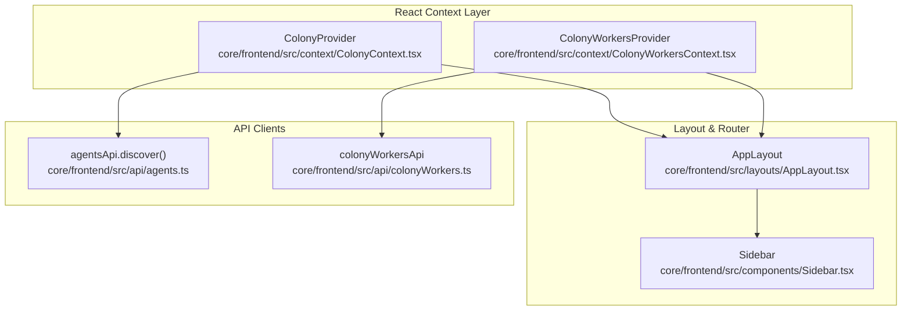
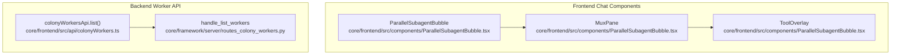
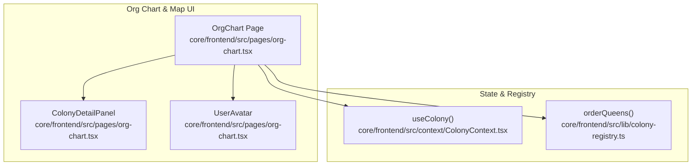
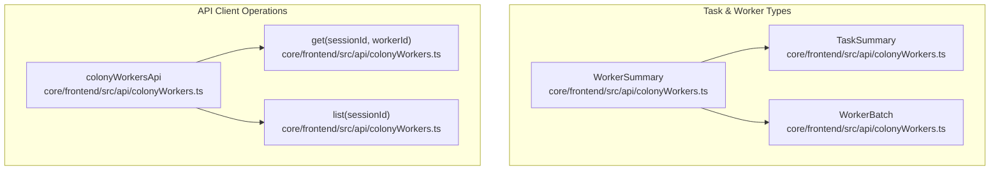
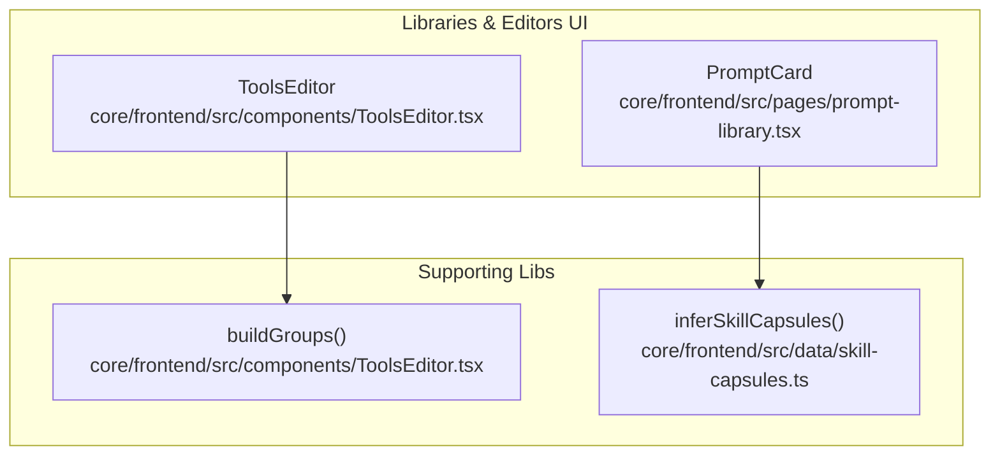

<!-- source: DeepWiki mcp.deepwiki.com · repo aden-hive/hive · extra page Colony, Worker and Library Views · fetched 2026-10-27 -->

# Colony, Worker and Library Views

Relevant source files

The following files were used as context for generating this wiki page:

- [core/framework/agent_loop/internals/compaction.py](core/framework/agent_loop/internals/compaction.py)
- [core/framework/orchestrator/orchestrator.py](core/framework/orchestrator/orchestrator.py)
- [core/framework/server/routes_colony_workers.py](core/framework/server/routes_colony_workers.py)
- [core/framework/skills/overrides.py](core/framework/skills/overrides.py)
- [core/frontend/src/api/colonyWorkers.ts](core/frontend/src/api/colonyWorkers.ts)
- [core/frontend/src/api/skills.ts](core/frontend/src/api/skills.ts)
- [core/frontend/src/components/MessageAttachments.tsx](core/frontend/src/components/MessageAttachments.tsx)
- [core/frontend/src/components/ParallelSubagentBubble.tsx](core/frontend/src/components/ParallelSubagentBubble.tsx)
- [core/frontend/src/components/QueenProfilePanel.tsx](core/frontend/src/components/QueenProfilePanel.tsx)
- [core/frontend/src/components/QueenToolsSection.tsx](core/frontend/src/components/QueenToolsSection.tsx)
- [core/frontend/src/components/Sidebar.tsx](core/frontend/src/components/Sidebar.tsx)
- [core/frontend/src/components/SidebarColonyItem.tsx](core/frontend/src/components/SidebarColonyItem.tsx)
- [core/frontend/src/components/SidebarQueenItem.tsx](core/frontend/src/components/SidebarQueenItem.tsx)
- [core/frontend/src/components/TaskListPanel.tsx](core/frontend/src/components/TaskListPanel.tsx)
- [core/frontend/src/components/ToolsEditor.tsx](core/frontend/src/components/ToolsEditor.tsx)
- [core/frontend/src/components/WorkerRunBubble.tsx](core/frontend/src/components/WorkerRunBubble.tsx)
- [core/frontend/src/context/ColonyContext.tsx](core/frontend/src/context/ColonyContext.tsx)
- [core/frontend/src/context/ColonyWorkersContext.tsx](core/frontend/src/context/ColonyWorkersContext.tsx)
- [core/frontend/src/context/QueenProfileContext.tsx](core/frontend/src/context/QueenProfileContext.tsx)
- [core/frontend/src/context/ThemeContext.tsx](core/frontend/src/context/ThemeContext.tsx)
- [core/frontend/src/data/prompts.ts](core/frontend/src/data/prompts.ts)
- [core/frontend/src/layouts/AppLayout.tsx](core/frontend/src/layouts/AppLayout.tsx)
- [core/frontend/src/lib/colony-registry.ts](core/frontend/src/lib/colony-registry.ts)
- [core/frontend/src/lib/graphUtils.ts](core/frontend/src/lib/graphUtils.ts)
- [core/frontend/src/pages/credentials.tsx](core/frontend/src/pages/credentials.tsx)
- [core/frontend/src/pages/org-chart.tsx](core/frontend/src/pages/org-chart.tsx)
- [core/frontend/src/pages/prompt-library.tsx](core/frontend/src/pages/prompt-library.tsx)
- [core/frontend/src/pages/skills-library.tsx](core/frontend/src/pages/skills-library.tsx)
- [core/frontend/src/pages/tool-library.tsx](core/frontend/src/pages/tool-library.tsx)
- [core/frontend/src/types/colony.ts](core/frontend/src/types/colony.ts)

This page documents the frontend architecture and UI components responsible for colony chat management, live worker execution monitoring via `ParallelSubagentBubble`, org-chart layout visualization (`HiveMap`), task list panels, and the prompt, skills, and tools libraries.

---

## 1. Colony Chat and Runtime Context

The colony chat and live state management rely on top-level React context providers (`ColonyProvider`, `ColonyWorkersProvider`) that synchronize active session status, discovery payloads, and user profiles with the backend server.

`ColonyProvider` initializes state by querying discovery endpoints and managing active session registries [core/frontend/src/context/ColonyContext.tsx:77-126](). It tracks sidebar state, user avatars, and per-queen metadata caches, serving as the core data harness for colony views. `AppLayout` coordinates structural layout, global SSE event handling (such as provider connection notifications), and side-panel drawers [core/frontend/src/layouts/AppLayout.tsx:46-102]().

Sources: [core/frontend/src/context/ColonyContext.tsx:77-126](), [core/frontend/src/layouts/AppLayout.tsx:46-102]()

---

## 2. Worker Bubbles and `ParallelSubagentBubble`

During parallel branch execution or subagent fan-out, the UI renders live execution progress using tmux-style multiplexer views. `ParallelSubagentBubble` manages multiple subagent message streams concurrently inside a unified chat card [core/frontend/src/components/ParallelSubagentBubble.tsx:103-106]().

Each subagent runs within an isolated `MuxPane` component that handles auto-scrolling, live tool-execution overlays (`ToolOverlay`), and a context-usage thermometer on its right edge [core/frontend/src/components/ParallelSubagentBubble.tsx:152-214]().

Sources: [core/frontend/src/components/ParallelSubagentBubble.tsx:103-214](), [core/framework/server/routes_colony_workers.py:117-140]()

---

## 3. Graph Utilities and Org-Chart Visualization (`HiveMap`)

The organization chart (`org-chart.tsx`) visualizes colonies, queen profiles, and user hierarchical relationships on a fixed-coordinate canvas [core/frontend/src/pages/org-chart.tsx:35-51](). 

Queen nodes and user avatars are positioned absolutely within a `2200x1500` canvas space (`CANVAS_W`, `CANVAS_H`), preserving custom dragged positions via user preference storage [core/frontend/src/pages/org-chart.tsx:35-64](). Hexagonal portrait clipping (`HEX_CLIP`) enforces the bee-themed visual language across all nodes.

Sources: [core/frontend/src/pages/org-chart.tsx:35-82](), [core/frontend/src/lib/colony-registry.ts:1-35]()

---

## 4. Task List Panel

Worker sessions maintain task lists tracked by the backend database and exposed through the worker API client (`colonyWorkersApi`) [core/frontend/src/api/colonyWorkers.ts:11-38](). 

The task subsystem tracks completion counts (`total`, `completed`, `in_progress`, `pending`) alongside individual worker results and batch coordinates (`WorkerBatch`) [core/frontend/src/api/colonyWorkers.ts:11-53]().

Sources: [core/frontend/src/api/colonyWorkers.ts:11-64]()

---

## 5. Prompt, Skills and Tools Libraries UI

The library interfaces include the prompt library (`prompt-library.tsx`), skills index, and tools editor (`ToolsEditor.tsx`). 

`ToolsEditor` organizes tools into rendering groups based on categories and MCP servers [core/frontend/src/components/ToolsEditor.tsx:128-183](). Categories are mapped to friendly user-facing labels (`CATEGORY_LABELS`) while maintaining direct linkage to backend tool metadata and credential checks [core/frontend/src/components/ToolsEditor.tsx:89-124]().

Sources: [core/frontend/src/components/ToolsEditor.tsx:89-183](), [core/frontend/src/pages/prompt-library.tsx:81-178]()

---

