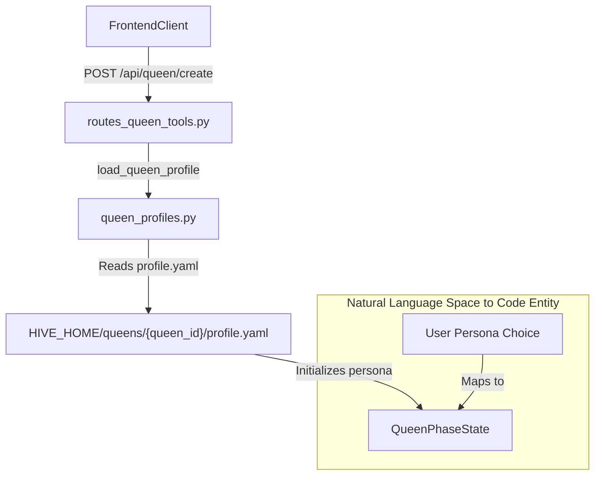
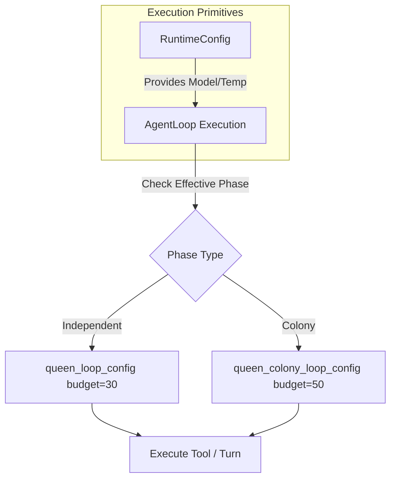

<!-- source: DeepWiki mcp.deepwiki.com · repo aden-hive/hive · extra page Queen Profiles, Selection and Tools · fetched 2026-10-27 -->

# Queen Profiles, Selection and Tools

Relevant source files

The following files were used as context for generating this wiki page:

- [core/framework/agents/queen/__init__.py](core/framework/agents/queen/__init__.py)
- [core/framework/agents/queen/agent.py](core/framework/agents/queen/agent.py)
- [core/framework/agents/queen/config.py](core/framework/agents/queen/config.py)
- [core/framework/agents/queen/queen_tools_defaults.py](core/framework/agents/queen/queen_tools_defaults.py)
- [core/framework/agents/queen/tests/conftest.py](core/framework/agents/queen/tests/conftest.py)
- [core/framework/host/colony_metadata.py](core/framework/host/colony_metadata.py)
- [core/framework/host/colony_tools_config.py](core/framework/host/colony_tools_config.py)
- [core/framework/host/worker_profiles.py](core/framework/host/worker_profiles.py)
- [core/framework/server/queen_models.py](core/framework/server/queen_models.py)
- [core/framework/server/routes_colony_tools.py](core/framework/server/routes_colony_tools.py)
- [core/framework/server/routes_queen_tools.py](core/framework/server/routes_queen_tools.py)
- [core/framework/server/tests/test_colony_tools.py](core/framework/server/tests/test_colony_tools.py)
- [core/framework/server/tests/test_mcp_routes.py](core/framework/server/tests/test_mcp_routes.py)
- [core/framework/server/tests/test_queen_models.py](core/framework/server/tests/test_queen_models.py)
- [core/framework/server/tests/test_queen_tools.py](core/framework/server/tests/test_queen_tools.py)
- [core/frontend/src/api/queens.ts](core/frontend/src/api/queens.ts)
- [core/frontend/src/components/QueenModelSection.test.tsx](core/frontend/src/components/QueenModelSection.test.tsx)
- [core/frontend/src/components/QueenModelSection.tsx](core/frontend/src/components/QueenModelSection.tsx)

## Purpose and Scope
This page covers the architecture of Queen agents in Hive, detailing how role-based YAML personas are loaded (`queen_profiles.py`), how queens are selected and routed (`select_queen` / `select_queen_and_colony`), queen-specific loop configurations (`agent.py`), default and customized tool allowlists via category mappings (`queen_tools_defaults.py`, `routes_queen_tools.py`, `QueenPhaseState`), and dedicated LLM model overrides (`queen_models.py`).

---

## 1. Queen Personas and YAML Definitions
Queens are persistent orchestration agents equipped with domain-specific personas. Each queen is defined by a profile containing descriptive metadata, experience history, skills, achievements, and optional visual descriptors (`PortraitDescriptor`) [core/frontend/src/api/queens.ts:22-31]().

Queen profiles are loaded from disk or bootstrap configurations via helper functions such as `load_queen_profile` and `ensure_default_queens` [core/framework/server/routes_queen_tools.py:28-31](). Custom queens can be instantiated dynamically via the REST endpoint `/queen/create`, which provisions a new profile directory and `profile.yaml` under the user's workspace [core/frontend/src/api/queens.ts:133-149]().

*Figure 1: Queen Persona Loading Pipeline mapping user selections to `QueenPhaseState`.*

**Sources:**
- `core/frontend/src/api/queens.ts:22-149`
- `core/framework/server/routes_queen_tools.py:28-44`

---

## 2. Queen Selection and Routing
Session initialization binds a user interaction to a specific queen through endpoints such as `/queen/{queen_id}/session` [core/frontend/src/api/queens.ts:182-186](). 

When a session is created or resumed, the runtime evaluates whether the queen operates in an independent phase or a colony phase (`QueenPhaseState`) [core/framework/server/tests/test_queen_tools.py:38-48](). If a queen pivots to orchestrate sub-agents, she transitions into colony routing where synthetic orchestration tools like `suggest_colony` are gated or disabled to prevent recursive nesting conflicts [core/framework/server/tests/test_queen_tools.py:102-135]().

**Sources:**
- `core/frontend/src/api/queens.ts:182-192`
- `core/framework/server/tests/test_queen_tools.py:38-135`

---

## 3. Queen Agent Configuration and Loop Budgets
Queen execution parameters are defined in `core/framework/agents/queen/agent.py` and `core/framework/agents/queen/config.py`. The agent uses two distinct loop configurations depending on its operating mode:

1. **Independent Queen Config (`queen_loop_config`)**: Designed for direct user collaboration with a lower tool call budget (`tool_call_budget: 30`, max iterations `999_999`, max context tokens `180_000`) [core/framework/agents/queen/agent.py:20-26]().
2. **Colony Queen Config (`queen_colony_loop_config`)**: Designed for long-horizon orchestration, scaling the tool call budget to `50` with a hard multiple of `10` (permitting up to 500 tool calls before intervention) [core/framework/agents/queen/agent.py:31-36]().

`RuntimeConfig` and `AgentMetadata` govern default model loading from `$HIVE_HOME/configuration.json` and system prompt strings [core/framework/agents/queen/config.py:7-51]().

*Figure 2: Loop Budget Dispatch mapping phase states to `queen_loop_config` parameters.*

**Sources:**
- `core/framework/agents/queen/agent.py:11-38`
- `core/framework/agents/queen/config.py:7-51`

---

## 4. Tool Systems: Default Allowlist and Per-Queen Customizations
Every queen inherits the full MCP server catalog, but exposing all tools creates prompt token bloat. The framework uses role-based default allowlists defined in `core/framework/agents/queen/queen_tools_defaults.py` [core/framework/agents/queen/queen_tools_defaults.py:1-18]().

### Tool Categories and Shorthands
Categories act as reusable bundles of tool names. Shorthands like `@server:NAME` automatically expand to all tools registered under that MCP server [core/framework/agents/queen/queen_tools_defaults.py:42-50](). Categories include `file_ops`, `terminal_basic`, `spreadsheet_advanced`, and `browser_basic` [core/framework/agents/queen/queen_tools_defaults.py:58-122]().

### Persistence and Sidecars
Allowlists are overridden via the `/api/queen/{queen_id}/tools` route and persisted to a `tools.json` sidecar at `~/.hive/agents/queens/{queen_id}/tools.json` [core/framework/server/routes_queen_tools.py:10-19](). 
- `null` or missing file: Allow every MCP tool (default).
- `[]`: Explicitly disable all MCP tools.
- `[...]`: Only allow specified tools.

`QueenPhaseState.rebuild_independent_filter()` handles runtime filtering, maintaining memoized identities for LLM prompt-cache stability across conversation turns [core/framework/server/tests/test_queen_tools.py:82-101]().

**Sources:**
- `core/framework/agents/queen/queen_tools_defaults.py:1-122`
- `core/framework/server/routes_queen_tools.py:1-47`
- `core/framework/server/tests/test_queen_tools.py:38-101`

---

## 5. Queen Model Overrides
Queens can be configured with dedicated LLM models independent of the main system setting (`queen_llm` in `configuration.json`) [core/framework/server/queen_models.py:1-14]().

`queen_models.build(queen_id)` constructs a specialized `LiteLLMProvider` instance using the queen's specific API key, base URL, and `extra_body` parameters (such as reasoning effort controls) [core/framework/server/queen_models.py:36-53](). `queen_models.apply(llm, queen_id)` dynamically reconfigures running sessions in-place when a user modifies model assignments via the dashboard API [core/framework/server/queen_models.py:55-82]().

**Sources:**
- `core/framework/server/queen_models.py:1-86`
- `core/framework/server/tests/test_queen_models.py:46-143`

---

