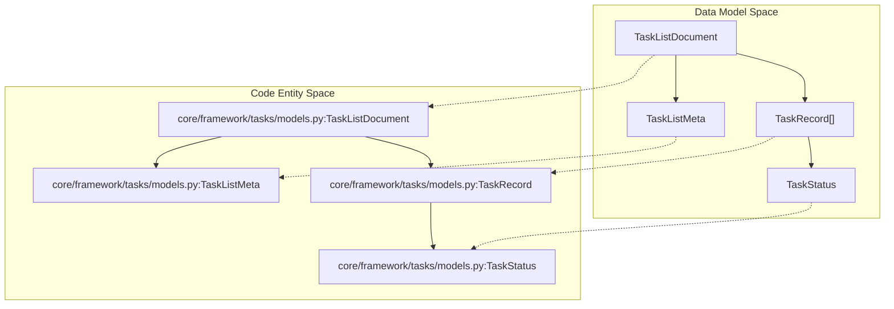
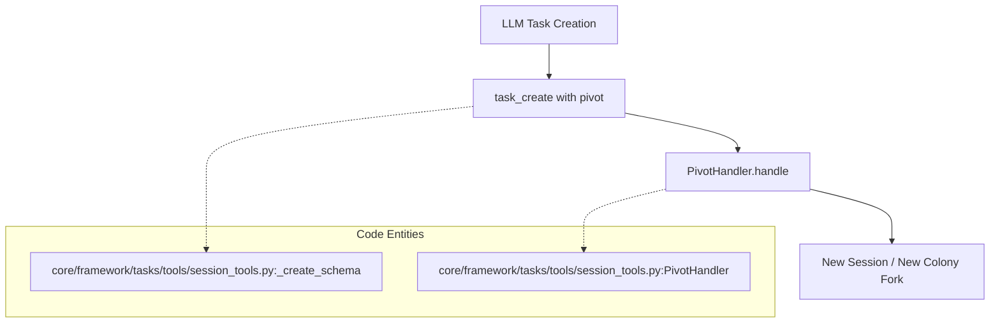
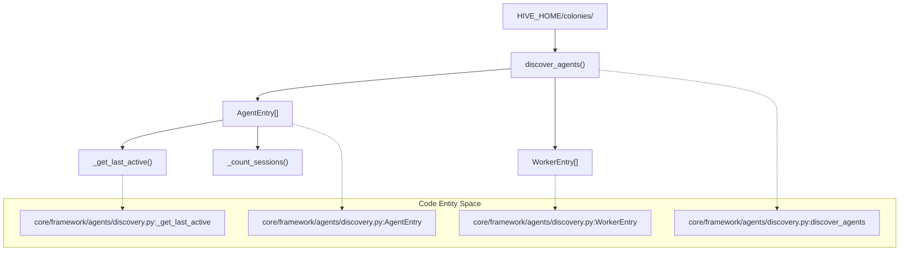

<!-- source: DeepWiki mcp.deepwiki.com · repo aden-hive/hive · extra page Tasks, Tracker and Sentinel · fetched 2026-10-27 -->

# Tasks, Tracker and Sentinel

Relevant source files

The following files were used as context for generating this wiki page:

- [core/framework/agent_loop/visible_error.py](core/framework/agent_loop/visible_error.py)
- [core/framework/agents/discovery.py](core/framework/agents/discovery.py)
- [core/framework/server/channels.py](core/framework/server/channels.py)
- [core/framework/server/judge.py](core/framework/server/judge.py)
- [core/framework/server/routes_tasks.py](core/framework/server/routes_tasks.py)
- [core/framework/server/stall_check.py](core/framework/server/stall_check.py)
- [core/framework/server/tests/test_channels.py](core/framework/server/tests/test_channels.py)
- [core/framework/server/tests/test_judge.py](core/framework/server/tests/test_judge.py)
- [core/framework/server/tests/test_stall_check.py](core/framework/server/tests/test_stall_check.py)
- [core/framework/tasks/__init__.py](core/framework/tasks/__init__.py)
- [core/framework/tasks/models.py](core/framework/tasks/models.py)
- [core/framework/tasks/reminders.py](core/framework/tasks/reminders.py)
- [core/framework/tasks/scoping.py](core/framework/tasks/scoping.py)
- [core/framework/tasks/store.py](core/framework/tasks/store.py)
- [core/framework/tasks/tests/test_e2e.py](core/framework/tasks/tests/test_e2e.py)
- [core/framework/tasks/tests/test_integration.py](core/framework/tasks/tests/test_integration.py)
- [core/framework/tasks/tests/test_store.py](core/framework/tasks/tests/test_store.py)
- [core/framework/tasks/tests/test_tools.py](core/framework/tasks/tests/test_tools.py)
- [core/framework/tasks/tools/session_tools.py](core/framework/tasks/tools/session_tools.py)
- [core/framework/tools/tracker_tools.py](core/framework/tools/tracker_tools.py)
- [core/tests/test_queen_prompt_crm_gate.py](core/tests/test_queen_prompt_crm_gate.py)

## Purpose and Scope
This document details the task management subsystem, the tracking utilities (`tracker.db`), agent discovery scanning, and the Sentinel/stall-detection autopilot for task-driven AI agent colonies. It covers the core storage schemas, session task tools, reminder policies, agent indexing, and external communication channels.

---

## 1. Task Store and Data Models
The task subsystem relies on a file-backed store located under session directories (`core/framework/tasks/store.py`). Each session maintains a single JSON task document (`tasks.json`) containing task records, metadata, and a monotonic high-water mark ID tracker.

### Storage Architecture and Concurrency
`TaskStore` provides asynchronous wrappers around file operations, utilizing `asyncio.to_thread` for non-blocking disk I/O `[core/framework/tasks/store.py:176-]`. Because each session is owned by a single primary agent, cross-process file locks are unnecessary; instead, writes are synchronized using in-process `threading.Lock` instances keyed by `session_id` `[core/framework/tasks/store.py:48-61]`.

The canonical session directories are resolved by scanning three known layouts via `_find_session_dir`:
* Queen DM: `queens/<queen>/sessions/<session_id>/` `[core/framework/tasks/store.py:97]`
* Queen Overseer: `colonies/<c>/queens/<queen>/sessions/<session_id>/` `[core/framework/tasks/store.py:98]`
* Worker: `colonies/<c>/workers/<session_id>/` `[core/framework/tasks/store.py:99]`

### Task Models (`TaskRecord`, `TaskListDocument`)
Tasks are represented by Pydantic models in `core/framework/tasks/models.py`. Each record maintains an integer ID, subject, active form, owner, status, and dependency links (`blocks` / `blocked_by`) `[core/framework/tasks/models.py:60-74]`.

*Sources: `[core/framework/tasks/models.py:1-139]`, `[core/framework/tasks/store.py:1-180]()`*

---

## 2. Task Tools and Pivot Handlers
Agents manage tasks through standardized tools exposed via `ToolRegistry` (`core/framework/tasks/tools/session_tools.py`). 

### Session Task Tools
* `task_create`: Atomically creates one or more tasks within the calling session `[core/framework/tasks/tools/session_tools.py:6-7]`. Requires a top-level `goal` on the first invocation to anchor the session `[core/framework/tasks/tools/session_tools.py:169-181]`.
* `task_update`: Modifies task properties such as status (`pending`, `in_progress`, `completed`, `archived`, `deleted`), ownership, and dependency blocks `[core/framework/tasks/tools/session_tools.py:98-140]`.
* `task_list`: Retrieves active tasks (excluding archived or deleted items unless requested) `[core/framework/tasks/tools/session_tools.py:143-156]`.
* `task_get`: Fetches a single task by its integer ID `[core/framework/tasks/tools/session_tools.py:159-165]`.

### Pivot Handlers
When an agent determines that work has drifted from the initial goal or requires scoping up, `PivotHandler` dictates forking behavior into a `new_session` or `new_colony` `[core/framework/tasks/tools/session_tools.py:61-88]`.

*Sources: `[core/framework/tasks/tools/session_tools.py:1-185]()`*

---

## 3. Task Reminders and Drift Management
`core/framework/tasks/reminders.py` manages proactive reminders to prevent agent drift and ensure task plans remain synchronized with ongoing work.

### Reminder States and Cadence
The `ReminderState` class tracks turn counters and staleness metrics `[core/framework/tasks/reminders.py:110-130]`:
* **Untracked Nudge**: Triggers if an agent has executed multiple turns (`UNTRACKED_TURNS`) without ever creating a task `[core/framework/tasks/reminders.py:59]`.
* **Stale Tracking Nudge**: Triggers when open tasks exist but no mutating task tool (`task_create` / `task_update`) has been called for `REMINDER_THRESHOLD_TURNS` `[core/framework/tasks/reminders.py:55]`.
* **Snapshot Heartbeat**: Re-injects the current task list snapshot into the conversation context periodically or when fingerprint hashes change `[core/framework/tasks/reminders.py:72,99-106]`.

*Sources: `[core/framework/tasks/reminders.py:1-151]()`*

---

## 4. Tracker and Tracker Tools (`tracker.db`)
The tracker subsystem provides relational tracking across colonies, maintaining state persistence via SQLite (`tracker.db`) and exposing specialized helper tools for agent inspection.

*Sources: `[core/framework/tools/tracker_tools.py:1-100]()`*

---

## 5. Agent Discovery
Agent and colony discovery scanning is implemented in `core/framework/agents/discovery.py`. It inspects `HIVE_HOME/colonies/` and related directories to build metadata listings.

### Discovery Structures
* `WorkerEntry`: Represents an individual worker clone inside a colony, including its tool count, config path, and assigned task `[core/framework/agents/discovery.py:12-34]`.
* `AgentEntry`: Summarizes agent metadata, run counts, node counts, and aggregated worker states `[core/framework/agents/discovery.py:38-54]`.

*Sources: `[core/framework/agents/discovery.py:1-200]()`*

---

## 6. Sentinel, Stall Detection and Channel Routing
Autonomous error recovery and external inbound message routing are coordinated through sentinel heuristics and channel hosts.

### Stall Check Subsystem
`core/framework/server/stall_check.py` monitors queen turns to catch instances where a model announces an action (e.g., calling a tool or running a command) but ends the turn without executing it `[core/framework/server/stall_check.py:1-10]`.
* `subscribe_stall_check`: Listens to `EventBus` telemetry events (`CLIENT_INPUT_RECEIVED`, `CLIENT_REASONING`, `CLIENT_OUTPUT_DELTA`, `TOOL_CALL_STARTED`, `CLIENT_INPUT_REQUESTED`) `[core/framework/server/stall_check.py:49-120]`.
* **Judge Evaluation**: When a turn finishes without expected tool calls, the stall detector queries the model configured in the `judge` slot `[core/framework/server/stall_check.py:42-47,72]`. If the assigned probability meets or exceeds the threshold (default `0.5`), a system reminder is injected into the queen node to prompt action `[core/framework/server/stall_check.py:8-9,33-38,75-83]`.

### External Channels (`ChannelHost`)
`core/framework/server/channels.py` routes external messaging apps (e.g., Telegram, Discord, custom chat integrations) to queen sessions `[core/framework/server/channels.py:1-21]`.
* `ChannelHost`: Manages channel-specific configuration, isolated storage directories (`$HIVE_HOME/channels/<name>`), and active session bindings `[core/framework/server/channels.py:93-113]`.
* `QueenOutput`: Standardized data structure representing outputs emitted by the queen in a channel session, categorized as `message`, `question`, `error`, or `files` `[core/framework/server/channels.py:57-83]`.

*Sources: `[core/framework/server/stall_check.py:1-119]()`, `[core/framework/server/channels.py:1-161]()`*

---

