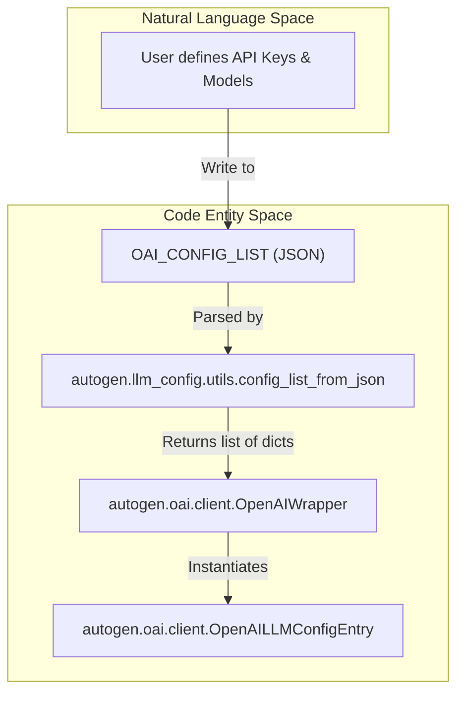
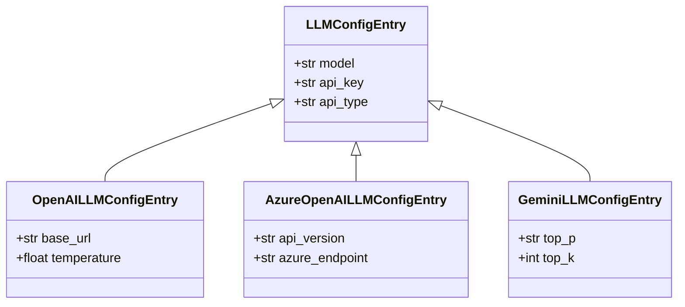

<!-- source: DeepWiki mcp.deepwiki.com · repo ag2ai/ag2 · page 1.2 Installation and Configuration · fetched 2026-10-27 -->

# Installation and Configuration

<details>
<summary>Relevant source files</summary>

The following files were used as context for generating this wiki page:

- [OAI_CONFIG_LIST_sample](OAI_CONFIG_LIST_sample)
- [autogen/coding/__init__.py](autogen/coding/__init__.py)
- [autogen/coding/base.py](autogen/coding/base.py)
- [autogen/coding/daytona_code_executor.py](autogen/coding/daytona_code_executor.py)
- [autogen/coding/factory.py](autogen/coding/factory.py)
- [autogen/oai/__init__.py](autogen/oai/__init__.py)
- [autogen/oai/openai_utils.py](autogen/oai/openai_utils.py)
- [autogen/token_count_utils.py](autogen/token_count_utils.py)
- [autogen/tools/experimental/shell/__init__.py](autogen/tools/experimental/shell/__init__.py)
- [autogen/tools/experimental/shell/shell_tool.py](autogen/tools/experimental/shell/shell_tool.py)
- [notebook/agentchat_daytona_executor.ipynb](notebook/agentchat_daytona_executor.ipynb)
- [notebook/agentchat_gpt5.1_in_built_tools_example.ipynb](notebook/agentchat_gpt5.1_in_built_tools_example.ipynb)
- [notebook/agentchat_gpt5.1_shell_tool_example.ipynb](notebook/agentchat_gpt5.1_shell_tool_example.ipynb)
- [test/coding/test_daytona_code_executor.py](test/coding/test_daytona_code_executor.py)
- [test/coding/test_daytona_code_executor_integration.py](test/coding/test_daytona_code_executor_integration.py)
- [test/oai/test_utils.py](test/oai/test_utils.py)
- [test/test_notebook.py](test/test_notebook.py)
- [test/tools/experimental/shell/test_shell_tool.py](test/tools/experimental/shell/test_shell_tool.py)
- [website/docs/installation/Installation.mdx](website/docs/installation/Installation.mdx)
- [website/docs/installation/Optional-Dependencies.mdx](website/docs/installation/Optional-Dependencies.mdx)
- [website/docs/user-guide/advanced-concepts/code-execution.mdx](website/docs/user-guide/advanced-concepts/code-execution.mdx)
- [website/docs/user-guide/getting-started/Getting-Started.mdx](website/docs/user-guide/getting-started/Getting-Started.mdx)

</details>


This page covers installing AG2, configuring LLM API keys, understanding the configuration system, and setting up optional features. AG2 provides a modular installation system and a robust configuration layer to manage multiple LLM providers, caching, and cost tracking.

---

## Installation

### Python Requirements

AG2 requires **Python version >= 3.10, <= 3.14** [website/docs/installation/Installation.mdx:68-68](). It is recommended to use a virtual environment (venv, Conda, or Poetry) to isolate dependencies [website/docs/installation/Installation.mdx:6-64]().

### Basic Installation

The framework is distributed via PyPI. The packages `ag2` and `autogen` are aliases for the same library [website/docs/installation/Installation.mdx:74-83]().

**Install with OpenAI support:**
```bash
pip install ag2[openai]
```

**Upgrade existing installation:**
```bash
pip install -U ag2[openai]
```

**Sources:** [website/docs/installation/Installation.mdx:66-83]()

### Optional Dependencies

AG2 uses a modular architecture where specific features are enabled via extras.

| Feature | Installation Command | Description |
|---------|---------------------|-------------|
| **LLMs** | `pip install ag2[gemini,anthropic,mistral,groq,cohere]` | Support for non-OpenAI providers [website/docs/installation/Optional-Dependencies.mdx:1-7]() |
| **Code Execution** | `pip install ag2[ipython]` | Enables `EmbeddedIPythonCodeExecutor` [website/docs/installation/Optional-Dependencies.mdx:35-42]() |
| **RAG** | `pip install ag2[retrievechat]` | Support for Retrieval-Augmented Generation with ChromaDB [website/docs/installation/Optional-Dependencies.mdx:192-198]() |
| **Cloud Sandbox** | `pip install ag2[daytona]` | Enables `DaytonaCodeExecutor` for secure sandboxed execution [website/docs/installation/Optional-Dependencies.mdx:142-150]() |
| **Caching** | `pip install ag2[redis]` | Enables Redis-based LLM caching [website/docs/installation/Optional-Dependencies.mdx:24-31]() |

**Sources:** [website/docs/installation/Optional-Dependencies.mdx:1-218](), [autogen/coding/factory.py:46-74]()

---

## API Key Configuration

### Configuration File Format

AG2 typically uses a JSON file (standard name: `OAI_CONFIG_LIST`) to manage multiple LLM configurations.

**Example `OAI_CONFIG_LIST`:**
```json
[
    {
        "model": "gpt-4o",
        "api_key": "sk-...",
        "tags": ["vision", "tool"]
    },
    {
        "model": "my-azure-deployment",
        "api_key": "...",
        "base_url": "https://example.openai.azure.com/",
        "api_type": "azure",
        "api_version": "2024-02-01"
    }
]
```
**Sources:** [OAI_CONFIG_LIST_sample:5-18](), [test/oai/test_utils.py:54-94]()

### Loading and Filtering Configurations

The `autogen.oai.openai_utils` module provides utilities to load these configurations.

*   `get_config_list`: Generates a list of configs from provided keys and URLs [autogen/oai/openai_utils.py:187-202]().
*   `config_list_from_json`: Loads configs from a file and applies filters [autogen/llm_config/utils.py:100-112]().

**Filtering Example:**
```python
from autogen import config_list_from_json

# Filter for specific models or tags
config_list = config_list_from_json(
    "OAI_CONFIG_LIST",
    filter_dict={"tags": ["gpt4"], "model": ["gpt-4"]}
)
```
**Sources:** [test/oai/test_utils.py:211-222](), [autogen/oai/openai_utils.py:187-202]()

---

## Configuration System Architecture

### Configuration Logic Flow

The following diagram bridges the natural language requirement of "setting up a model" to the code entities that handle the configuration data.


**Sources:** [autogen/oai/client.py:11-18](), [autogen/llm_config/utils.py:100-112](), [OAI_CONFIG_LIST_sample:5-18]()

### LLM Config Entry Hierarchy

AG2 uses specialized classes for different provider configurations, ensuring type safety and validation.


**Sources:** [autogen/oai/client.py:248-340](), [autogen/oai/__init__.py:8-32]()

---

## Code Execution Setup

### Docker Execution (Recommended)

To mitigate security risks, AG2 supports executing LLM-generated code inside Docker containers [website/docs/user-guide/advanced-concepts/code-execution.mdx:119-126]().

```python
from autogen.coding import DockerCommandLineCodeExecutor

executor = DockerCommandLineCodeExecutor(
    image="python:3.12-slim",
    timeout=10,
    work_dir="coding_dir"
)
```
**Sources:** [website/docs/user-guide/advanced-concepts/code-execution.mdx:142-153](), [autogen/coding/docker_commandline_code_executor.py]()

### Code Executor Factory

The `CodeExecutorFactory` is the central point for creating executors based on the `CodeExecutionConfig` dictionary [autogen/coding/factory.py:14-18]().

| Executor Key | Class | Required Extra |
|--------------|-------|----------------|
| `commandline-local` | `LocalCommandLineCodeExecutor` | None |
| `ipython-embedded` | `EmbeddedIPythonCodeExecutor` | `ag2[ipython]` |
| `yepcode` | `YepCodeCodeExecutor` | `ag2[yepcode]` |
| `daytona` | `DaytonaCodeExecutor` | `ag2[daytona]` |

**Sources:** [autogen/coding/factory.py:34-77](), [autogen/coding/base.py:98-113]()

---

## Token Counting and Cost Tracking

AG2 includes built-in utilities for managing API usage.

### Token Counting
The `autogen.token_count_utils` module provides functions to calculate token usage for various OpenAI models using `tiktoken` [autogen/token_count_utils.py:127-143]().

*   `count_token(input, model)`: Counts tokens in strings or message lists [autogen/token_count_utils.py:127-136]().
*   `get_max_token_limit(model)`: Returns the context window limit for a model (e.g., 128k for `gpt-4o`) [autogen/token_count_utils.py:34-107]().

### Pricing
Pricing is tracked via the `OAI_PRICE1K` dictionary in `openai_utils.py`, which maps model names to `(input_price, output_price)` tuples per 1,000 tokens [autogen/oai/openai_utils.py:46-151]().

**Sources:** [autogen/token_count_utils.py:34-152](), [autogen/oai/openai_utils.py:46-151]()

---

