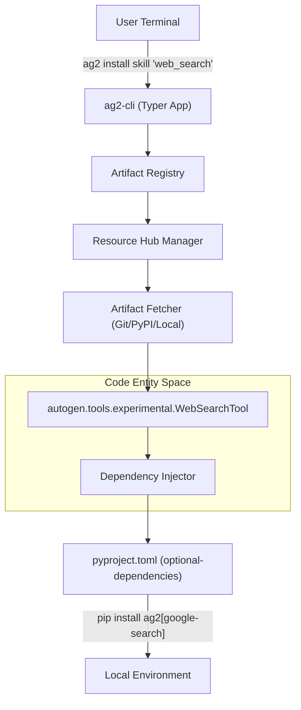
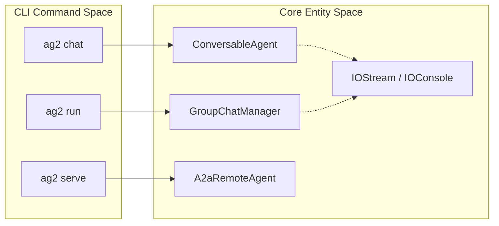

<!-- source: DeepWiki mcp.deepwiki.com · repo ag2ai/ag2 · page 10.2 CLI Architecture and Extension · fetched 2026-10-27 -->

# CLI Architecture and Extension

Relevant source files

The following files were used as context for generating this wiki page:

- [.github/workflows/python-package.yml](.github/workflows/python-package.yml)
- [README.md](README.md)
- [autogen/beta/agent.py](autogen/beta/agent.py)
- [autogen/coding/jupyter/import_utils.py](autogen/coding/jupyter/import_utils.py)
- [autogen/import_utils.py](autogen/import_utils.py)
- [autogen/tools/experimental/__init__.py](autogen/tools/experimental/__init__.py)
- [autogen/version.py](autogen/version.py)
- [pyproject.toml](pyproject.toml)
- [setup_autogen.py](setup_autogen.py)
- [test/agentchat/realtime_agent/clients/test_gemini_realtime_client.py](test/agentchat/realtime_agent/clients/test_gemini_realtime_client.py)
- [test/agentchat/realtime_agent/clients/test_oai_realtime_client.py](test/agentchat/realtime_agent/clients/test_oai_realtime_client.py)
- [test/test_import_utils.py](test/test_import_utils.py)
- [website/docs/user-guide/reference-tools/index.mdx](website/docs/user-guide/reference-tools/index.mdx)
- [website/docusaurus.config.js](website/docusaurus.config.js)
- [website/mint-json-template.json.jinja](website/mint-json-template.json.jinja)

The AG2 CLI (`ag2-cli`) provides a unified terminal interface for building, running, and managing multi-agent systems. It is designed with a modular architecture that separates command definitions, the execution subsystem, and the UI layer. This page details the internal implementation of the CLI, its extension points, and the resource-hub artifact system.

## 1. Core Architecture and Typer Structure

The CLI is built using the **Typer** library, which provides a hierarchical command structure. The entry point typically initializes a main `Typer` application, which then mounts various command modules as sub-commands (e.g., `install`, `run`, `chat`).

### Command Dispatch Flow
When a user executes a command like `ag2 install skills`, the following flow occurs:
1. **Typer Entry Point**: The main app parses the top-level command.
2. **Sub-command Routing**: Execution is routed to the specific module (e.g., `install.py`).
3. **Context Injection**: Shared configurations (like verbosity or config paths) are passed through Typer's context.
4. **Execution**: The command logic interacts with the AG2 core libraries or the resource-hub.

### UI and Feedback Layer
AG2 CLI utilizes the **Rich** library to provide a modern terminal experience.
- **Rich UI Components**: Tables, progress bars, and syntax-highlighted panels are used to display agent logs and installation progress.
- **IO Abstraction**: The CLI often hooks into the `IOStream` abstraction [autogen/io/base.py:1-50]() to capture and format agent communication for terminal display.

**Sources:** [pyproject.toml:249-249](), [README.md:129-130]()

---

## 2. Install Subsystem and Registry

The `install` command is one of the most complex parts of the CLI architecture. It manages the lifecycle of "artifacts" (skills, tools, agents, and templates).

### Artifact Registry
The CLI maintains a registry of available components. This registry maps logical names (e.g., `google-search`) to their implementation details and required dependencies.

| Component Type | Purpose | Implementation Reference |
| :--- | :--- | :--- |
| **Skills** | Reusable Python functions or logic blocks. | `autogen.tools` |
| **Tools** | External integrations (Search, Browsing). | [autogen/tools/experimental/__init__.py:5-28]() |
| **Agents** | Pre-configured agent definitions. | `autogen.AssistantAgent` |
| **Templates** | Boilerplate for new projects. | `templates/` |

### IDE Targets and Integration
The install subsystem includes specialized targets for AI-native IDEs and coding assistants. This allows the CLI to "install" AG2 capabilities directly into environments like:
- **Cursor**: Exporting tool definitions to `.cursorrules`.
- **Claude Code**: Formatting tools for the Claude desktop integration.
- **Copilot**: Providing context for GitHub Copilot Extensions.

**Sources:** [autogen/tools/experimental/__init__.py:1-58](), [pyproject.toml:16-18]()

---

## 3. Resource-Hub and Artifact System

The "Resource-Hub" is the backend logic that manages the retrieval and local deployment of AG2 artifacts.

### Data Flow: Natural Language to Code Entity
The following diagram illustrates how a user request for a "skill" is translated into a functional code entity within the AG2 framework.

**Skill Retrieval and Installation Flow**

**Sources:** [autogen/tools/experimental/__init__.py:11-11](), [pyproject.toml:224-224]()

---

## 4. Internal Component Interaction

The CLI acts as a bridge between the user's intent and the internal classes of the AG2 framework.

**CLI to Core Class Mapping**

### Key Functions and Classes
- **`ConversableAgent`**: The primary entity instantiated by the `chat` command to handle user interaction [README.md:151-155]().
- **`IOStream`**: Used by the CLI to redirect agent outputs to the terminal with Rich formatting [README.md:162-163]().
- **`optional_import_block`**: Extensively used in CLI commands to check for provider-specific dependencies (e.g., `openai`, `gemini`) before execution [autogen/import_utils.py:165-188]().

**Sources:** [README.md:151-163](), [autogen/import_utils.py:165-188]()

---

## 5. Extension Points

Developers can extend the CLI by:
1. **Adding Command Modules**: Creating new files in the CLI's command directory and registering them with the main Typer app.
2. **Registering Experimental Tools**: Adding new tools to `autogen.tools.experimental` which are then automatically discoverable by the `install` subsystem [autogen/tools/experimental/__init__.py:30-58]().
3. **Custom Templates**: Adding new project structures to the `templates/` directory, which are included in the package build [pyproject.toml:16-18]().

### Versioning and Build System
The CLI's versioning is tied to the core package version defined in `autogen/version.py` [autogen/version.py:7-7](). The build system (`hatchling`) ensures that the CLI entry points and templates are correctly packaged into the wheel [pyproject.toml:1-25]().

**Sources:** [autogen/version.py:7-7](), [pyproject.toml:1-25](), [autogen/tools/experimental/__init__.py:30-58]()

---

