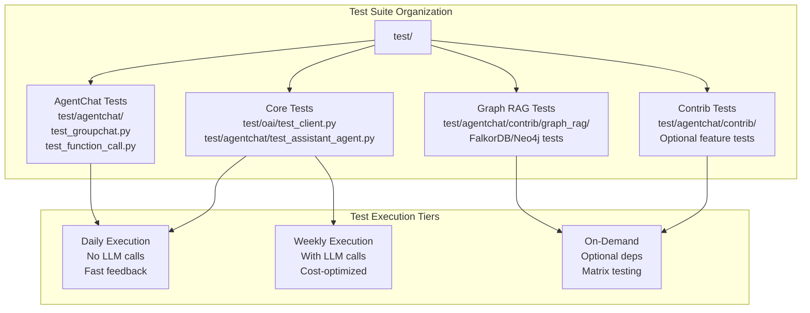
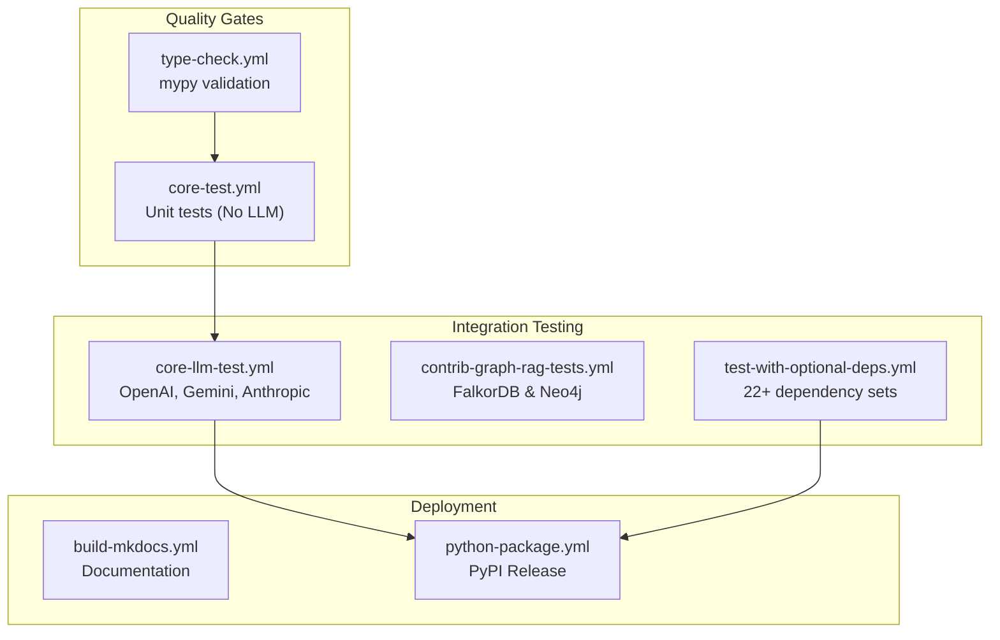
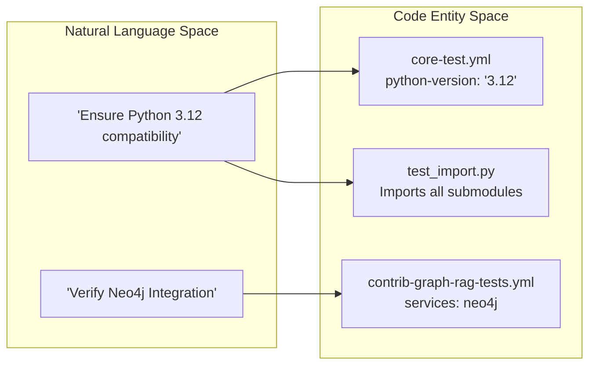

<!-- source: DeepWiki mcp.deepwiki.com · repo ag2ai/ag2 · page 11 Testing and CI/CD · fetched 2026-10-27 -->

# Testing and CI/CD

Relevant source files

The following files were used as context for generating this wiki page:

- [.github/workflows/build-mkdocs.yml](.github/workflows/build-mkdocs.yml)
- [.github/workflows/contrib-graph-rag-tests.yml](.github/workflows/contrib-graph-rag-tests.yml)
- [.github/workflows/contrib-llm-test.yml](.github/workflows/contrib-llm-test.yml)
- [.github/workflows/contrib-test.yml](.github/workflows/contrib-test.yml)
- [.github/workflows/core-llm-test.yml](.github/workflows/core-llm-test.yml)
- [.github/workflows/core-test.yml](.github/workflows/core-test.yml)
- [.github/workflows/integration-test.yml](.github/workflows/integration-test.yml)
- [.github/workflows/pr-checks.yml](.github/workflows/pr-checks.yml)
- [.github/workflows/test-with-optional-deps.yml](.github/workflows/test-with-optional-deps.yml)
- [.github/workflows/type-check.yml](.github/workflows/type-check.yml)
- [autogen/oai/client.py](autogen/oai/client.py)
- [test/agentchat/test_agent_logging.py](test/agentchat/test_agent_logging.py)
- [test/agentchat/test_agent_usage.py](test/agentchat/test_agent_usage.py)
- [test/agentchat/test_assistant_agent.py](test/agentchat/test_assistant_agent.py)
- [test/agentchat/test_async.py](test/agentchat/test_async.py)
- [test/agentchat/test_async_chats.py](test/agentchat/test_async_chats.py)
- [test/agentchat/test_async_get_human_input.py](test/agentchat/test_async_get_human_input.py)
- [test/agentchat/test_cache_agent.py](test/agentchat/test_cache_agent.py)
- [test/agentchat/test_chats.py](test/agentchat/test_chats.py)
- [test/agentchat/test_function_call.py](test/agentchat/test_function_call.py)
- [test/agentchat/test_function_call_groupchat.py](test/agentchat/test_function_call_groupchat.py)
- [test/agentchat/test_human_input.py](test/agentchat/test_human_input.py)
- [test/agentchat/test_math_user_proxy_agent.py](test/agentchat/test_math_user_proxy_agent.py)
- [test/agentchat/test_nested.py](test/agentchat/test_nested.py)
- [test/agentchat/test_tool_calls.py](test/agentchat/test_tool_calls.py)
- [test/conftest.py](test/conftest.py)
- [test/oai/test_client.py](test/oai/test_client.py)
- [test/oai/test_client_stream.py](test/oai/test_client_stream.py)
- [test/test_conftest.py](test/test_conftest.py)

## Purpose and Scope

This document covers the testing infrastructure, continuous integration (CI), and continuous deployment (CD) systems in the AG2 repository. It explains how tests are organized, the GitHub Actions workflows that run them, and the strategies used to balance comprehensive testing with cost optimization.

This is a **PARENT** page. For detailed technical information, please refer to the following child pages:
- [Testing Framework and Strategies](#11.1) — Detailed test suite organization, mocking patterns, and component coverage.
- [CI/CD Workflows](#11.2) — Deep dive into specific GitHub Actions YAML configurations and release pipelines.

---

## Test Organization and Architecture

AG2 uses a multi-tiered test organization strategy that separates tests by scope, cost, and dependencies. The suite is powered by `pytest` and orchestrated to run across multiple Python versions (3.10 through 3.14) [ .github/workflows/core-test.yml:61-61]().

### Test Directory Structure

**Sources:** [test/oai/test_client.py:1-40](), [test/agentchat/test_function_call.py:1-20](), [.github/workflows/core-test.yml:1-10]()

### Test Categories and Frequencies

| Test Category | Purpose | Execution Frequency | LLM Calls | Key Workflows |
|--------------|---------|---------------------|-----------|---------------|
| **Core (No LLM)** | Framework fundamentals, logic, and local execution | Daily & on PR | No | `core-test.yml` |
| **Core (With LLM)** | Integration with OpenAI, Gemini, Anthropic, etc. | Weekly | Yes | `core-llm-test.yml` |
| **Contrib** | Specialized agents and experimental features | Daily | No | `contrib-test.yml` |
| **Graph RAG** | Database integrations (FalkorDB, Neo4j) | Weekly | Yes | `contrib-graph-rag-tests.yml` |
| **Optional Deps** | Validation of 22+ dependency sets (RAG, Interop, etc.) | Daily | No | `test-with-optional-deps.yml` |

---

## Testing Framework and Strategies

The testing strategy relies heavily on mocking LLM responses to ensure fast, deterministic, and cost-free local testing.

### Mocking and Client Testing
AG2 implements a `MockModelClient` [test/oai/test_client.py:46-51]() to simulate LLM responses without network calls. This allows testing of complex logic like routing methods:
- **Fixed Order:** Tests ensure the first available client is used [test/oai/test_client.py:142-148]().
- **Round Robin:** Validates that requests cycle through available clients [test/oai/test_client.py:150-165]().

### Credential Management
Tests use a unified `Credentials` system [test/credentials.py]() and `OAI_CONFIG_LIST` [test/conftest.py:15-15]() to manage API keys. The `get_credentials` utility [test/conftest.py:186-192]() abstracts whether keys are sourced from environment variables (CI) or local files.

For details, see [Testing Framework and Strategies](#11.1).

**Sources:** [test/oai/test_client.py:46-91](), [test/conftest.py:115-160]()

---

## CI/CD Workflows

The CI/CD pipeline is implemented via GitHub Actions, covering everything from linting to multi-platform deployment.

### Workflow Hierarchy

### Dependency Matrix
The `test-with-optional-deps.yml` workflow [ .github/workflows/test-with-optional-deps.yml:60-85]() runs a massive matrix across:
- **OS:** Ubuntu, macOS, Windows.
- **Python:** 3.10 through 3.14.
- **Feature Sets:** `browser-use`, `rag`, `retrievechat`, `mcp`, `interop`, and more.

### Service Orchestration
For complex integrations like Graph RAG, workflows spin up sidecar services:
- **FalkorDB:** `falkordb/falkordb:edge` [ .github/workflows/contrib-graph-rag-tests.yml:37-40]().
- **Neo4j:** `neo4j:latest` with APOC plugins [ .github/workflows/contrib-graph-rag-tests.yml:106-116]().
- **Redis:** Used for state and caching tests [ .github/workflows/core-llm-test.yml:38-42]().

For details, see [CI/CD Workflows](#11.2).

**Sources:** [.github/workflows/core-test.yml:57-61](), [.github/workflows/contrib-graph-rag-tests.yml:29-40](), [.github/workflows/test-with-optional-deps.yml:58-87]()

---

## Type Checking and Quality

Static analysis is a core part of the pipeline. The `type-check.yml` workflow runs `mypy` against various dependency combinations to ensure type safety across the framework [ .github/workflows/type-check.yml:22-55]().

### Bridging Code to CI

**Sources:** [.github/workflows/core-test.yml:61-61](), [.github/workflows/contrib-graph-rag-tests.yml:106-116](), [.github/workflows/test-with-optional-deps.yml:150-150]()

---

