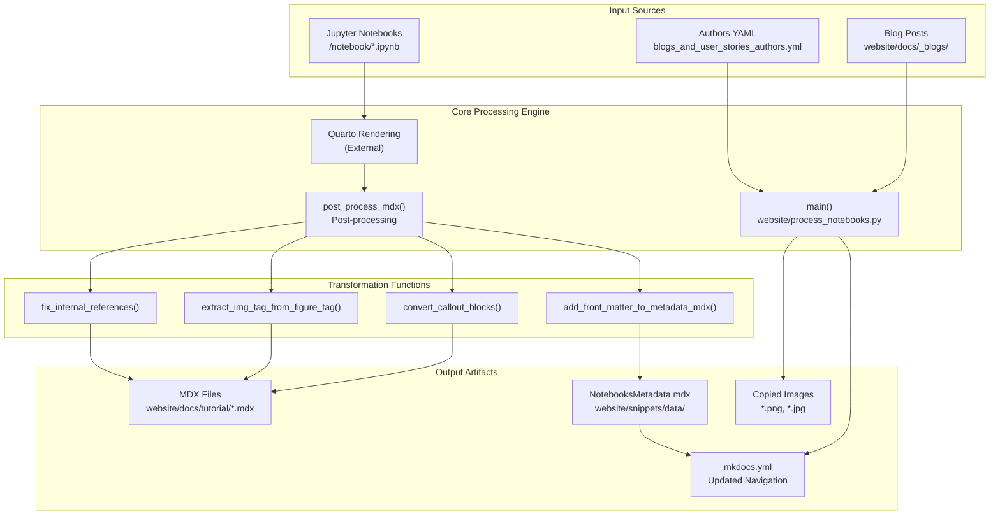
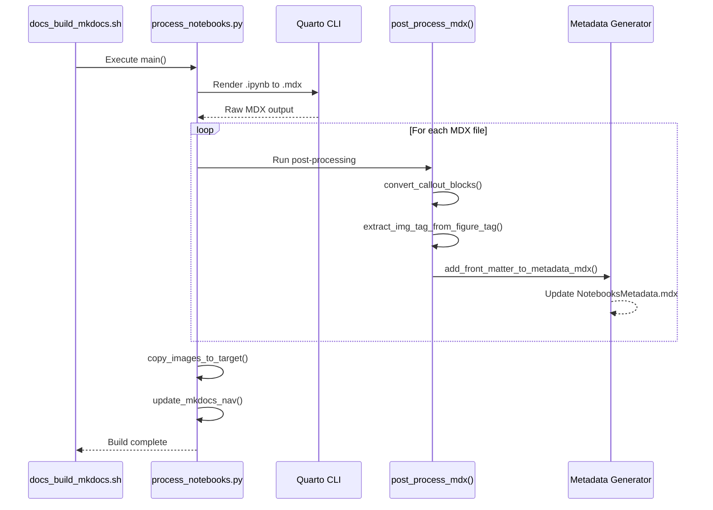
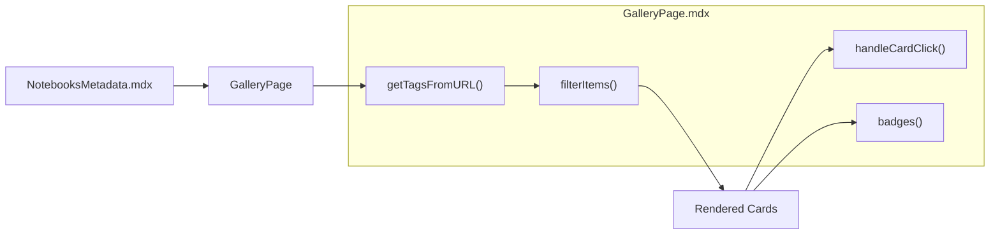
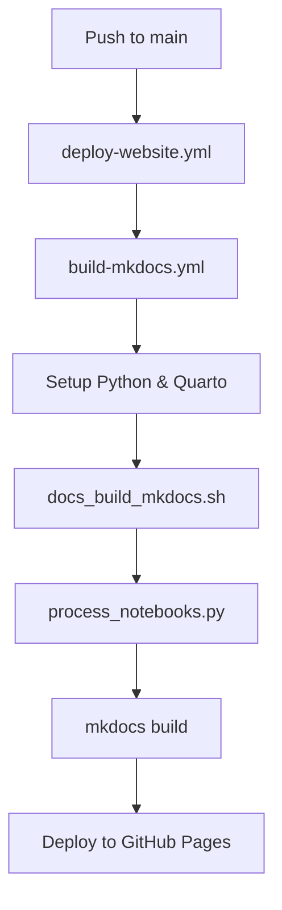

<!-- source: DeepWiki mcp.deepwiki.com · repo ag2ai/ag2 · page 12.1 Notebook Processing Pipeline · fetched 2026-10-27 -->

# Notebook Processing Pipeline

<details>
<summary>Relevant source files</summary>

The following files were used as context for generating this wiki page:

- [.devcontainer/Dockerfile](.devcontainer/Dockerfile)
- [.devcontainer/README.md](.devcontainer/README.md)
- [.github/PULL_REQUEST_TEMPLATE.md](.github/PULL_REQUEST_TEMPLATE.md)
- [.github/workflows/deploy-website.yml](.github/workflows/deploy-website.yml)
- [website/.gitignore](website/.gitignore)
- [website/README.md](website/README.md)
- [website/blogs_and_user_stories_authors.yml](website/blogs_and_user_stories_authors.yml)
- [website/docs/_blogs/2025-04-28-0.9-Release-Announcement/index.mdx](website/docs/_blogs/2025-04-28-0.9-Release-Announcement/index.mdx)
- [website/docs/_blogs/2026-03-19-Arcade/img/ag2-arcade-banner.webp](website/docs/_blogs/2026-03-19-Arcade/img/ag2-arcade-banner.webp)
- [website/docs/_blogs/2026-03-19-Arcade/img/ag2-arcade-diagram.png](website/docs/_blogs/2026-03-19-Arcade/img/ag2-arcade-diagram.png)
- [website/docs/_blogs/2026-03-19-Arcade/index.mdx](website/docs/_blogs/2026-03-19-Arcade/index.mdx)
- [website/docs/contributor-guide/documentation.mdx](website/docs/contributor-guide/documentation.mdx)
- [website/docs/user-stories/2025-04-11-Productionizing-OSS-Agents/img/banner.png](website/docs/user-stories/2025-04-11-Productionizing-OSS-Agents/img/banner.png)
- [website/docs/user-stories/2025-04-11-Productionizing-OSS-Agents/index.mdx](website/docs/user-stories/2025-04-11-Productionizing-OSS-Agents/index.mdx)
- [website/mkdocs/docs/javascripts/extra.js](website/mkdocs/docs/javascripts/extra.js)
- [website/mkdocs/docs/stylesheets/extra.css](website/mkdocs/docs/stylesheets/extra.css)
- [website/mkdocs/mkdocs.yml](website/mkdocs/mkdocs.yml)
- [website/mkdocs/overrides/home.html](website/mkdocs/overrides/home.html)
- [website/process_notebooks.py](website/process_notebooks.py)
- [website/snippets/components/GalleryPage.mdx](website/snippets/components/GalleryPage.mdx)

</details>


## Purpose and Scope

The Notebook Processing Pipeline transforms Jupyter notebooks (`.ipynb` files) from the repository into documentation pages compatible with the website's static site generator. This system handles conversion from notebook format to MDX, post-processing for platform compatibility, metadata extraction, navigation generation, and image asset management. The pipeline is executed as part of the documentation build process, typically triggered by CI/CD workflows or local build scripts.

The pipeline ensures that interactive examples are accurately represented as static documentation while maintaining links to live environments like Google Colab and the source GitHub repository.

---

## High-Level Architecture

The pipeline is primarily driven by `process_notebooks.py`, which acts as an orchestrator for several sub-processes including Quarto rendering and MDX post-processing.



**Pipeline Architecture**: The pipeline takes notebooks and blogs as input, processes them through Quarto and specialized post-processing functions, and outputs MDX files and metadata used by the documentation site.

Sources: [website/process_notebooks.py:11-14](), [website/mkdocs/mkdocs.yml:136-137](), [website/README.md:102-107]()

---

## Core Processing Flow

The build process is managed by shell scripts that coordinate environment setup and the execution of Python processing logic.

### Build Sequence



**Processing Sequence**: The pipeline uses Quarto for the heavy lifting of notebook conversion, followed by a series of Python-based filters to clean up the output and generate metadata for the website gallery.

Sources: [website/process_notebooks.py:11-14](), [website/README.md:25-31](), [website/docs/contributor-guide/documentation.mdx:32-35]()

---

## Post-Processing Transformations

### Callout Block Conversion

Notebooks often contain Quarto-style callouts (e.g., `:::note`) which must be converted to standard Markdown or MDX components supported by the documentation theme.

**Supported Callout Types**:
- `tip` → `<Tip>`
- `note` → `<Note>`
- `warning` → `<Warning>`
- `info` → `<Info>`

Sources: [website/docs/contributor-guide/documentation.mdx:9-11](), [website/docs/contributor-guide/documentation.mdx:96-105]()

### Figure to Image Extraction

Quarto often wraps images in `<figure>` tags with `<figcaption>`. The pipeline extracts the `` tag and resolves local image paths to ensure they render correctly in the final site structure.

Sources: [website/.gitignore:25-25](), [website/mkdocs/mkdocs.yml:85-86]()

---

## Metadata and Gallery Integration

### NotebooksMetadata.mdx

The pipeline generates a centralized metadata file, `NotebooksMetadata.mdx`, which stores information about every processed notebook. This file is used by the `GalleryPage` component to render the filterable examples gallery.

| Field | Description | Source |
|-------|-------------|--------|
| `title` | The title of the notebook | Notebook front matter or first H1 |
| `description` | A short summary | Notebook front matter |
| `tags` | Category tags for filtering | Notebook front matter |
| `source` | Path to the original `.ipynb` | File system path |
| `image` | Preview image for the gallery | Front matter or default |

Sources: [website/snippets/components/GalleryPage.mdx:1-15](), [website/.gitignore:14-14]()

### Gallery Component Logic

The `GalleryPage` component handles the rendering and filtering of notebooks based on the metadata generated during the pipeline.



**Gallery Data Flow**: The component consumes the generated metadata, manages URL-based filtering state, and provides direct links to Google Colab and GitHub for each example.

Sources: [website/snippets/components/GalleryPage.mdx:7-13](), [website/snippets/components/GalleryPage.mdx:89-99](), [website/snippets/components/GalleryPage.mdx:127-139]()

---

## Environment and Dependencies

The pipeline requires specific tools to be installed in the build environment, notably Quarto and the documentation dependencies specified in `pyproject.toml`.

### Prerequisites
- **Quarto**: Version `1.5.23` or higher is required for rendering notebooks.
- **Python Dependencies**: Installed via `pip install -e ".[docs]"`.

### Dev Container Support
The repository provides a `.devcontainer` configuration that pre-installs all necessary tools, including Quarto, to ensure a consistent build environment.

```dockerfile
# website/.devcontainer/Dockerfile
RUN arch=$(arch | sed s/aarch64/arm64/ | sed s/x86_64/amd64/) \
   && wget https://github.com/quarto-dev/quarto-cli/releases/download/v1.5.23/quarto-1.5.23-linux-${arch}.deb \
   && dpkg -i quarto-1.5.23-linux-${arch}.deb
```

Sources: [website/README.md:12-16](), [.devcontainer/Dockerfile:27-30](), [website/docs/contributor-guide/documentation.mdx:15-18]()

---

## Deployment Integration

The notebook processing pipeline is integrated into the GitHub Actions deployment workflow. When changes are pushed to the `main` branch, the `deploy-website.yml` workflow triggers the documentation build.



**Deployment Flow**: The pipeline is a critical step in the automated deployment process, ensuring that the latest notebooks are always reflected in the live documentation.

Sources: [.github/workflows/deploy-website.yml:1-26](), [website/README.md:30-31](), [website/docs/contributor-guide/documentation.mdx:32-35]()

---

