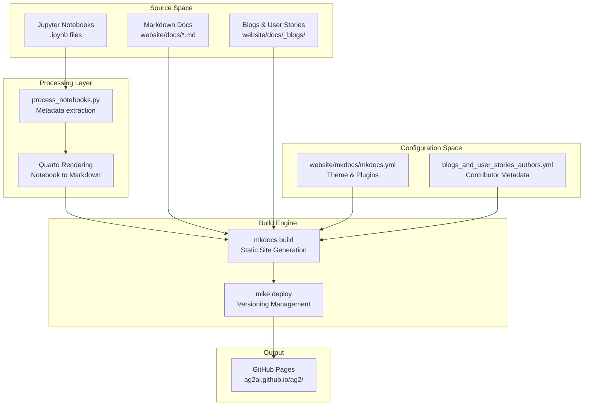
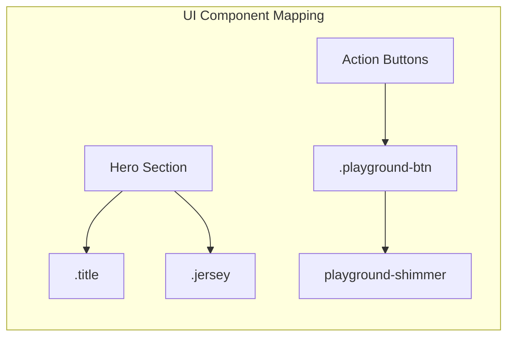

<!-- source: DeepWiki mcp.deepwiki.com · repo ag2ai/ag2 · page 12.2 Documentation Build Configuration · fetched 2026-10-27 -->

# Documentation Build Configuration

Relevant source files

The following files were used as context for generating this wiki page:

- [.devcontainer/Dockerfile](.devcontainer/Dockerfile)
- [.devcontainer/README.md](.devcontainer/README.md)
- [.github/PULL_REQUEST_TEMPLATE.md](.github/PULL_REQUEST_TEMPLATE.md)
- [.github/workflows/build-mkdocs.yml](.github/workflows/build-mkdocs.yml)
- [.github/workflows/contrib-graph-rag-tests.yml](.github/workflows/contrib-graph-rag-tests.yml)
- [.github/workflows/contrib-llm-test.yml](.github/workflows/contrib-llm-test.yml)
- [.github/workflows/contrib-test.yml](.github/workflows/contrib-test.yml)
- [.github/workflows/core-llm-test.yml](.github/workflows/core-llm-test.yml)
- [.github/workflows/core-test.yml](.github/workflows/core-test.yml)
- [.github/workflows/deploy-website.yml](.github/workflows/deploy-website.yml)
- [.github/workflows/integration-test.yml](.github/workflows/integration-test.yml)
- [.github/workflows/pr-checks.yml](.github/workflows/pr-checks.yml)
- [.github/workflows/test-with-optional-deps.yml](.github/workflows/test-with-optional-deps.yml)
- [.github/workflows/type-check.yml](.github/workflows/type-check.yml)
- [website/.gitignore](website/.gitignore)
- [website/README.md](website/README.md)
- [website/blogs_and_user_stories_authors.yml](website/blogs_and_user_stories_authors.yml)
- [website/docs/_blogs/2025-04-28-0.9-Release-Announcement/index.mdx](website/docs/_blogs/2025-04-28-0.9-Release-Announcement/index.mdx)
- [website/docs/_blogs/2026-03-19-Arcade/img/ag2-arcade-banner.webp](website/docs/_blogs/2026-03-19-Arcade/img/ag2-arcade-banner.webp)
- [website/docs/_blogs/2026-03-19-Arcade/img/ag2-arcade-diagram.png](website/docs/_blogs/2026-03-19-Arcade/img/ag2-arcade-diagram.png)
- [website/docs/_blogs/2026-03-19-Arcade/index.mdx](website/docs/_blogs/2026-03-19-Arcade/index.mdx)
- [website/docs/contributor-guide/documentation.mdx](website/docs/contributor-guide/documentation.mdx)
- [website/docs/user-stories/2025-04-11-Productionizing-OSS-Agents/img/banner.png](website/docs/user-stories/2025-04-11-Productionizing-OSS-Agents/img/banner.png)
- [website/docs/user-stories/2025-04-11-Productionizing-OSS-Agents/index.mdx](website/docs/user-stories/2025-04-11-Productionizing-OSS-Agents/index.mdx)
- [website/mkdocs/docs/javascripts/extra.js](website/mkdocs/docs/javascripts/extra.js)
- [website/mkdocs/docs/stylesheets/extra.css](website/mkdocs/docs/stylesheets/extra.css)
- [website/mkdocs/mkdocs.yml](website/mkdocs/mkdocs.yml)
- [website/mkdocs/overrides/home.html](website/mkdocs/overrides/home.html)
- [website/process_notebooks.py](website/process_notebooks.py)
- [website/snippets/components/GalleryPage.mdx](website/snippets/components/GalleryPage.mdx)

## Purpose and Scope

This document details the documentation build system for AG2, focusing on the transition to a **MkDocs** and **Quarto** based pipeline. It covers the configuration files, navigation structure, versioning with `mike`, and the automated deployment workflows via GitHub Actions.

The system is designed to transform technical source material—primarily Jupyter notebooks and Markdown files—into a searchable, versioned, and responsive static website.

---

## Build System Architecture

The AG2 documentation uses a multi-stage pipeline. Quarto handles the execution and rendering of Jupyter notebooks, while MkDocs (using the Material theme) assembles the final site.

### Documentation Data Flow

**Sources:** [website/process_notebooks.py:1-15](), [website/README.md:1-107]()

---

## MkDocs and Quarto Integration

The documentation core resides in the `website/` directory. The primary engine is **Material for MkDocs**, supplemented by **Quarto** for high-fidelity notebook rendering.

### Prerequisites and Installation
To build the documentation locally, the environment requires Quarto (version `1.5.23` or higher) and the Python documentation dependencies defined in `pyproject.toml`.

- **Installation Command:** `pip install -e ".[docs]"` [website/README.md:22-22]()
- **Quarto Requirement:** Version `1.5.23+` is mandatory for correct rendering of notebook outputs [website/README.md:12-15]().

### Local Build Commands
The repository provides shell scripts to abstract the build complexity:

| Script | Command | Description |
| :--- | :--- | :--- |
| **Build** | `./scripts/docs_build_mkdocs.sh` | Runs Quarto and MkDocs to generate static files [website/README.md:30-30](). |
| **Clean Build** | `./scripts/docs_build_mkdocs.sh --force` | Clears caches and rebuilds from scratch [website/README.md:36-36](). |
| **Serve** | `./scripts/docs_serve_mkdocs.sh` | Launches a local server at `http://localhost:8000` [website/README.md:44-47](). |

**Sources:** [website/README.md:1-107]()

---

## Configuration and Customization

### MkDocs Configuration (`mkdocs.yml`)
The main configuration file is located at `website/mkdocs/mkdocs.yml`. It defines:
- **Theme:** Uses `material` with custom overrides in `website/mkdocs/overrides/` [website/mkdocs/overrides/home.html:1-3]().
- **Plugins:** Includes search, minify, and custom AG2 plugins for notebook integration.
- **Extensions:** Custom CSS (`extra.css`) and JavaScript (`extra.js`) for interactive components like the Gallery [website/snippets/components/GalleryPage.mdx:1-169]().

### Home Page Overrides
The home page uses a custom template (`home.html`) to implement a high-impact "Hero" section with a "Jersey 10" font style and animated "playground" buttons [website/mkdocs/overrides/home.html:154-197]().

**Sources:** [website/mkdocs/overrides/home.html:107-232]()

---

## Deployment and Versioning Workflow

AG2 uses `mike` to manage multiple versions of the documentation (e.g., `main`, `v0.2`, `v0.4`).

### GitHub Actions Deployment
The deployment is automated via the `deploy-website.yml` workflow.

1. **Trigger:** Pushes to the `main` branch or manual dispatch [.github/workflows/deploy-website.yml:3-17]().
2. **Environment:** Runs on `ubuntu-latest` using Python `3.10` [.github/workflows/deploy-website.yml:25-25]().
3. **Execution:** Calls the reusable `build-mkdocs.yml` workflow to perform the actual build [.github/workflows/deploy-website.yml:22-23]().

### Reusable Build Workflow (`build-mkdocs.yml`)
This workflow handles the heavy lifting:
- **Dependency Setup:** Installs `graphviz` (for `ReasoningAgent` diagrams) and documentation dependencies [.github/workflows/core-test.yml:74-87]().
- **Notebook Processing:** Executes `website/process_notebooks.py` to prepare content [.github/workflows/deploy-website.yml:8-11]().
- **Site Generation:** Runs the MkDocs build process.
- **Versioning:** Uses `mike` to deploy the built site to the `gh-pages` branch, maintaining version history.

**Sources:** [.github/workflows/deploy-website.yml:1-26](), [.github/workflows/core-test.yml:74-87](), [website/process_notebooks.py:1-15]()

---

## Gallery and Metadata Generation

The documentation features an interactive gallery for notebooks and user stories. This is powered by `GalleryPage.mdx` and metadata generated during the build.

### Metadata Extraction
The `website/process_notebooks.py` script (calling `mkdocs._website.process_notebooks.main`) scans the `notebook/` directory to:
1. Extract titles, descriptions, and tags from notebook cells.
2. Generate `NotebooksMetadata.mdx`.
3. Link source notebooks to Google Colab and GitHub badges [website/snippets/components/GalleryPage.mdx:131-139]().

### Gallery Logic
The `GalleryPage` component provides client-side filtering based on URL parameters and a "tag-filter" dropdown [website/snippets/components/GalleryPage.mdx:7-13]().

| Component Feature | Implementation Detail |
| :--- | :--- |
| **Tag Filtering** | Uses `URLSearchParams` to persist filters in the URL [website/snippets/components/GalleryPage.mdx:27-37](). |
| **Image Handling** | Fallback to a default image if no specific thumbnail is provided [website/snippets/components/GalleryPage.mdx:56-81](). |
| **Badges** | Dynamic generation of "Open in Colab" and "Open on GitHub" links [website/snippets/components/GalleryPage.mdx:131-139](). |

**Sources:** [website/process_notebooks.py:1-15](), [website/snippets/components/GalleryPage.mdx:1-169]()

---

