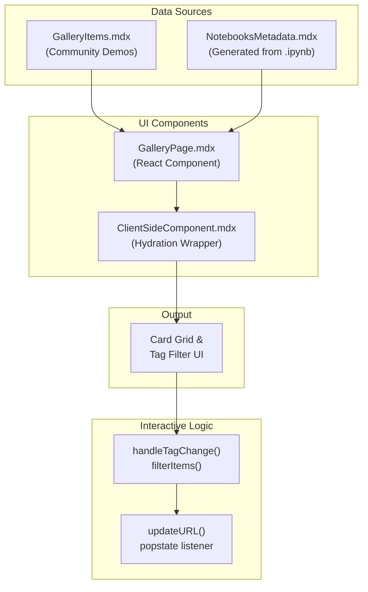
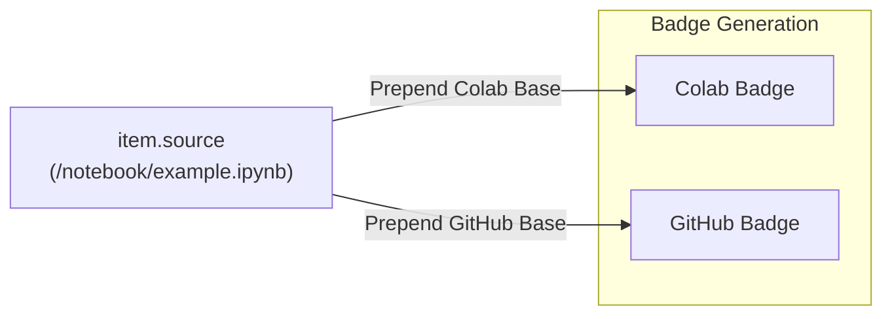

<!-- source: DeepWiki mcp.deepwiki.com · repo ag2ai/ag2 · page 12.3 Gallery and Interactive Components · fetched 2026-10-27 -->

# Gallery and Interactive Components

Relevant source files

The following files were used as context for generating this wiki page:

- [.devcontainer/Dockerfile](.devcontainer/Dockerfile)
- [.devcontainer/README.md](.devcontainer/README.md)
- [.github/PULL_REQUEST_TEMPLATE.md](.github/PULL_REQUEST_TEMPLATE.md)
- [.github/workflows/deploy-website.yml](.github/workflows/deploy-website.yml)
- [scripts/docs_build_mkdocs.sh](scripts/docs_build_mkdocs.sh)
- [website/.gitignore](website/.gitignore)
- [website/README.md](website/README.md)
- [website/docs/contributor-guide/documentation.mdx](website/docs/contributor-guide/documentation.mdx)
- [website/docs/use-cases/community-gallery/community-gallery.mdx](website/docs/use-cases/community-gallery/community-gallery.mdx)
- [website/docs/use-cases/notebooks/Notebooks.mdx](website/docs/use-cases/notebooks/Notebooks.mdx)
- [website/mkdocs/.gitignore](website/mkdocs/.gitignore)
- [website/mkdocs/data/gallery_items.yml](website/mkdocs/data/gallery_items.yml)
- [website/process_notebooks.py](website/process_notebooks.py)
- [website/snippets/components/ClientSideComponent.mdx](website/snippets/components/ClientSideComponent.mdx)
- [website/snippets/components/GalleryPage.mdx](website/snippets/components/GalleryPage.mdx)
- [website/snippets/data/GalleryItems.mdx](website/snippets/data/GalleryItems.mdx)
- [website/static/img/gallery/agent-e.png](website/static/img/gallery/agent-e.png)

## Purpose and Scope

This page documents the interactive gallery system used to display AG2 examples, community projects, and notebooks within the documentation website. The gallery provides a filterable, card-based interface with tag-based search, URL state management, and direct links to source code and interactive environments like Google Colab.

The system is designed to handle both static data (community contributions) and dynamically generated metadata (from Jupyter notebooks).

## Gallery System Architecture

The gallery system consists of data providers, a React-based UI component, and client-side filtering logic.

**Sources:** [website/snippets/components/GalleryPage.mdx:1-169](), [website/docs/use-cases/community-gallery/community-gallery.mdx:1-30](), [website/snippets/data/GalleryItems.mdx:1-100]()

## GalleryPage Component

The `GalleryPage` component is the primary React functional component responsible for rendering the gallery interface. It is defined in `website/snippets/components/GalleryPage.mdx` and accepts a list of items to display.

### Data Structure (GalleryItem)

Each item in the gallery is represented by an object with the following properties:

| Property | Type | Description |
| :--- | :--- | :--- |
| `title` | `string` | The display name of the project or notebook. |
| `link` | `string` | The primary destination URL. |
| `description`| `string` | A brief summary (defaults to title if missing). |
| `image` | `string` | Filename in `static/img/gallery` or a full URL. |
| `tags` | `string[]`| List of categories (e.g., `ui`, `tools`, `app`). |
| `source` | `string` | (Optional) Path to the `.ipynb` file for badge generation. |

**Sources:** [website/snippets/components/GalleryPage.mdx:155-165](), [website/snippets/data/GalleryItems.mdx:1-49]()

### Image Handling and Static Assets

The component uses a helper function `imageFunc` to resolve image paths. It supports both local assets and remote URLs.

- **Remote URLs**: If the `image` string includes "http", it is used as-is [website/snippets/components/GalleryPage.mdx:63-64]().
- **Local Assets**: Filenames are prefixed with a standard S3 bucket path: `https://mintlify.s3.us-west-1.amazonaws.com/ag2ai/static/img/gallery/` [website/snippets/components/GalleryPage.mdx:65]().
- **Default Fallback**: If no image is provided, it defaults to `default.png` [website/snippets/components/GalleryPage.mdx:66]().

**Sources:** [website/snippets/components/GalleryPage.mdx:56-81]()

## Tag Filtering and URL State

The gallery features a multi-select filter that synchronizes with the browser's URL query parameters. This allows users to share specific filtered views of the gallery.

### URL Synchronization Logic

The component manages state through the URL to ensure persistence across refreshes and browser navigation.

1.  **Reading State**: On load, `getTagsFromURL` parses `window.location.search` for the `tags` parameter [website/snippets/components/GalleryPage.mdx:7-11]().
2.  **Updating State**: When a user selects a tag, `updateURL` uses `window.history.pushState` to modify the URL without a full page reload [website/snippets/components/GalleryPage.mdx:27-37]().
3.  **Browser Navigation**: A `popstate` event listener ensures the UI stays in sync when the user clicks the Back or Forward buttons [website/snippets/components/GalleryPage.mdx:39-47]().

### DOM-based Filtering

Instead of re-rendering the entire React tree for every filter change, the component performs direct DOM manipulation for performance. The `filterItems` function iterates through all `.card` elements and toggles their `display` style based on whether their tags match the `selectedTags` [website/snippets/components/GalleryPage.mdx:89-99]().

**Sources:** [website/snippets/components/GalleryPage.mdx:7-99]()

## Badge System

For items that include a `source` property (typically notebooks), the gallery automatically generates interactive badges.

- **Open in Colab**: Links to `https://colab.research.google.com/github/ag2ai/ag2/blob/main/${source}` [website/snippets/components/GalleryPage.mdx:132]().
- **Open on GitHub**: Links to `https://github.com/ag2ai/ag2/blob/main/${source}` [website/snippets/components/GalleryPage.mdx:133]().

**Sources:** [website/snippets/components/GalleryPage.mdx:127-139]()

## Build and Deployment Integration

The gallery data is managed across several files and integrated into the MkDocs build process.

### Community Contributions

Community members can add their projects by updating `website/snippets/data/GalleryItems.mdx`. This file exports a constant `galleryItems` array consumed by the `Community Gallery` page [website/docs/use-cases/community-gallery/community-gallery.mdx:9-22]().

### Build Pipeline

The website build is orchestrated via GitHub Actions and local shell scripts.

1.  **Environment Setup**: The project uses a Dev Container (Python 3.10) with Quarto and Node.js installed to handle documentation rendering [.devcontainer/Dockerfile:12-34]().
2.  **Notebook Processing**: The `website/process_notebooks.py` script (which calls `mkdocs._website.process_notebooks.main`) is responsible for converting notebooks into the MDX format used by the gallery [website/process_notebooks.py:11-14]().
3.  **Deployment**: The `deploy-website.yml` workflow triggers on pushes to the `main` branch, executing `scripts/docs_build_mkdocs.sh` to generate the final static site [.github/workflows/deploy-website.yml:3-13]().

**Sources:** [website/README.md:12-37](), [.github/workflows/deploy-website.yml:1-26](), [website/process_notebooks.py:1-15]()

---

