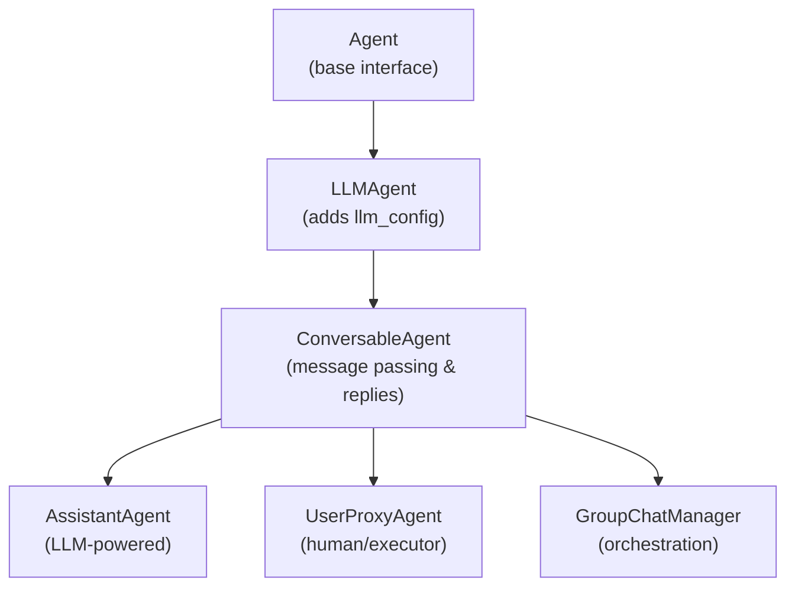
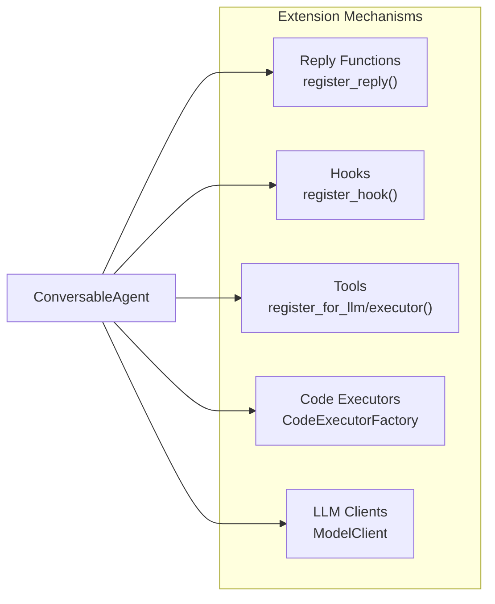
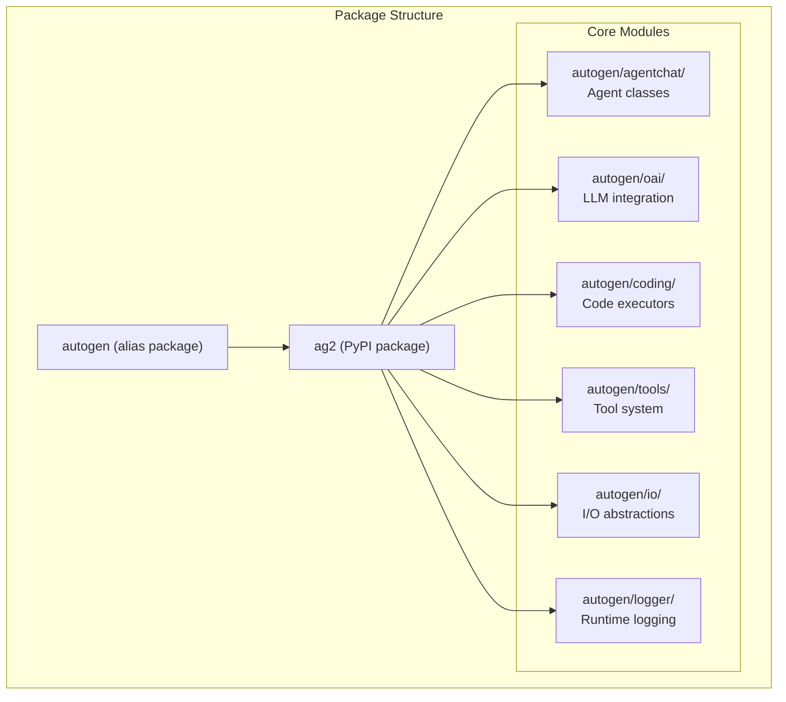
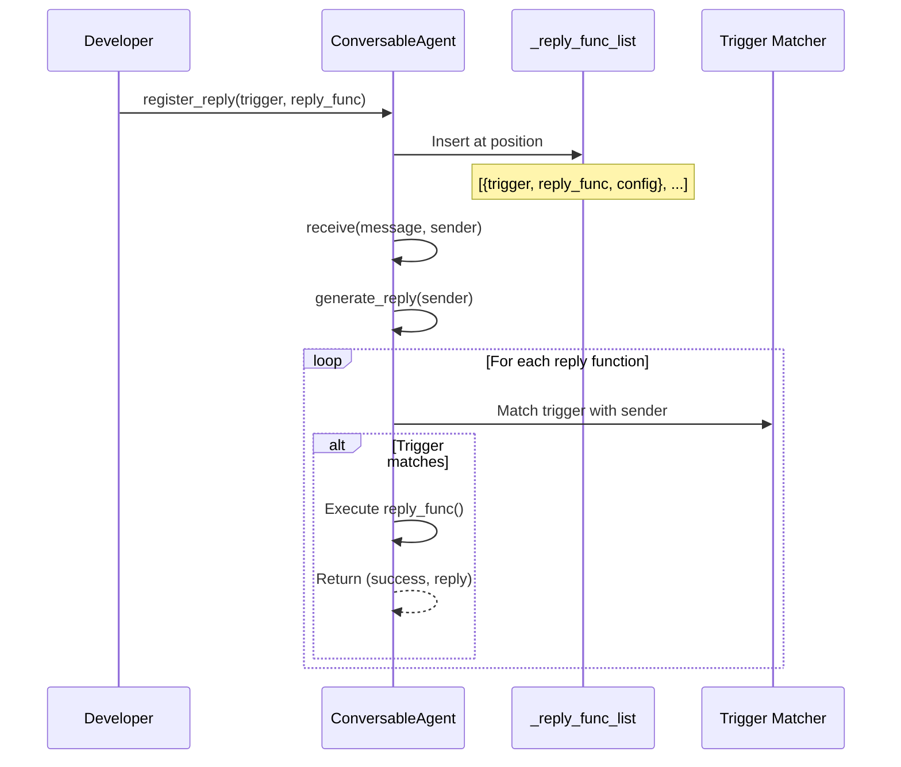
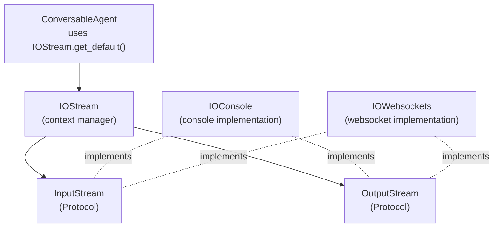
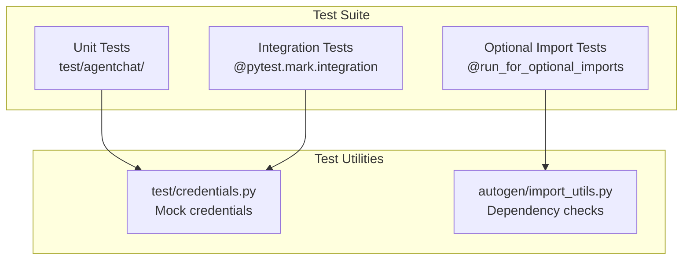

<!-- source: DeepWiki mcp.deepwiki.com · repo ag2ai/ag2 · page 13 Developer Guide · fetched 2026-10-27 -->

# Developer Guide

<details>
<summary>Relevant source files</summary>

The following files were used as context for generating this wiki page:

- [.github/workflows/python-package.yml](.github/workflows/python-package.yml)
- [README.md](README.md)
- [autogen/coding/jupyter/import_utils.py](autogen/coding/jupyter/import_utils.py)
- [autogen/import_utils.py](autogen/import_utils.py)
- [autogen/version.py](autogen/version.py)
- [test/agentchat/realtime_agent/clients/test_gemini_realtime_client.py](test/agentchat/realtime_agent/clients/test_gemini_realtime_client.py)
- [test/agentchat/realtime_agent/clients/test_oai_realtime_client.py](test/agentchat/realtime_agent/clients/test_oai_realtime_client.py)
- [test/test_import_utils.py](test/test_import_utils.py)
- [website/docs/_blogs/2024-07-25-AgentOps/index.mdx](website/docs/_blogs/2024-07-25-AgentOps/index.mdx)
- [website/docs/contributor-guide/contributing.mdx](website/docs/contributor-guide/contributing.mdx)
- [website/docs/contributor-guide/file-bug-report.mdx](website/docs/contributor-guide/file-bug-report.mdx)
- [website/docs/contributor-guide/maintainer.mdx](website/docs/contributor-guide/maintainer.mdx)
- [website/docs/contributor-guide/pre-commit.mdx](website/docs/contributor-guide/pre-commit.mdx)
- [website/docusaurus.config.js](website/docusaurus.config.js)
- [website/talks/2024-11-04/index.mdx](website/talks/2024-11-04/index.mdx)
- [website/talks/2024-11-11/index.mdx](website/talks/2024-11-11/index.mdx)
- [website/talks/2024-11-12/index.mdx](website/talks/2024-11-12/index.mdx)
- [website/talks/2024-11-18/index.mdx](website/talks/2024-11-18/index.mdx)
- [website/talks/2024-12-12/index.mdx](website/talks/2024-12-12/index.mdx)
- [website/talks/2024-12-19/index.mdx](website/talks/2024-12-19/index.mdx)
- [website/talks/future_talks/index.mdx](website/talks/future_talks/index.mdx)

</details>


This guide provides resources for developers who want to extend, customize, or contribute to AG2. It covers the framework's architecture, extension points, testing infrastructure, and development workflows.

For detailed architectural diagrams and design patterns, see [Architecture Overview](#13.1). For creating custom components, see [Extending AG2](#13.2). For understanding the modular dependency system, see [Optional Dependencies and Feature Sets](#13.3).

## Core Architecture Summary

AG2 is organized around several key abstractions that work together to enable multi-agent conversations with LLM integration and code execution capabilities.

### Primary Class Hierarchy



**Key Classes:**
- `Agent`: Base interface defining `name`, `send()`, and `receive()` methods.
- `LLMAgent`: Adds `llm_config` attribute for LLM configuration.
- `ConversableAgent`: Core implementation with message handling, reply functions, and tool execution [autogen/agentchat/conversable_agent.py:136-148]().
- `AssistantAgent`: Preconfigured for LLM-based responses.
- `UserProxyAgent`: Preconfigured for human input and code execution.

Sources: [autogen/agentchat/conversable_agent.py:136-148](), [README.md:149-152]()

### Extension Points

AG2 provides multiple extension mechanisms for customizing agent behavior:



Sources: [autogen/agentchat/conversable_agent.py:538-609](), [autogen/agentchat/conversable_agent.py:376-391]()

## Development Environment Setup

### Prerequisites

AG2 requires Python version >= 3.10, < 3.14 [README.md:85](). Install development dependencies:

```bash
pip install -e .
pip install pre-commit
pre-commit install
```

### Project Structure

AG2 is distributed as both `ag2` and an alias package `autogen` [README.md:85]().



Sources: [.github/workflows/python-package.yml:54-69](), [README.md:85-97]()

## Reply Function System

The reply function system is the primary mechanism for controlling agent responses. Each agent maintains an ordered list of reply functions checked sequentially.

### Reply Function Registration



**Built-in Reply Functions (registered in order):**
1. `generate_oai_reply` - LLM-based response
2. `generate_code_execution_reply` - Code execution
3. `generate_tool_calls_reply` - Tool execution
4. `generate_function_call_reply` - Function calls (deprecated)
5. `check_termination_and_human_reply` - Termination and human input

Sources: [autogen/agentchat/conversable_agent.py:538-609](), [autogen/agentchat/conversable_agent.py:299-372]()

## Hook System

Hooks allow injecting custom logic at specific points in the agent lifecycle.

### Available Hook Points

| Hook Name | Triggered When | Signature |
|-----------|----------------|-----------|
| `process_last_received_message` | After receiving a message | `(agent, messages) -> messages` |
| `process_all_messages_before_reply` | Before generating reply | `(agent, messages) -> messages` |
| `process_message_before_send` | Before sending message | `(agent, messages) -> messages` |
| `update_agent_state` | Before agent speaks | `(agent, messages) -> messages` |

Sources: [autogen/agentchat/conversable_agent.py:376-391](), [autogen/agentchat/conversable_agent.py:448-495]()

## I/O Abstraction System

The `IOStream` system decouples agents from specific I/O implementations, enabling console, websocket, or custom interfaces.

### IOStream Architecture



Sources: [autogen/io/base.py:93-152](), [autogen/io/console.py:18-57]()

## Testing Infrastructure

### Test Organization

AG2 uses `pytest` and provides utilities for handling optional dependencies and credentials.



**Key Test Patterns:**
- **Testing optional dependencies:** Use `run_for_optional_imports` to skip tests when dependencies like `websockets` are missing [test/agentchat/realtime_agent/clients/test_gemini_realtime_client.py:35-36]().
- **Dependency Guarding:** Use `optional_import_block` to suppress `ImportError` during dynamic loading [autogen/import_utils.py:166-188]().

Sources: [autogen/import_utils.py:32-152](), [test/agentchat/realtime_agent/clients/test_gemini_realtime_client.py:11-36]()

### CI/CD Workflow

The project uses GitHub Actions for continuous integration, specifically for building and publishing packages to PyPI [python-package.yml:1-70]().

| Workflow | Purpose | Trigger |
|----------|---------|---------|
| `python-package.yml` | Build and publish `ag2` and `autogen` to PyPI | Release published [python-package.yml:8-9]() |

Sources: [.github/workflows/python-package.yml:1-70]()

## Contributing Workflow

### Licensing

All new files must include the AG2 copyright header [website/docs/contributor-guide/contributing.mdx:113-116](). Portions derived from the original Microsoft AutoGen must include the extended header [website/docs/contributor-guide/contributing.mdx:121-127]().

```python
# Copyright (c) 2023 - 2026, AG2ai, Inc., AG2ai open-source projects maintainers and core contributors
#
# SPDX-License-Identifier: Apache-2.0
```

Sources: [website/docs/contributor-guide/contributing.mdx:108-130](), [autogen/version.py:1-3]()

### Resources for Contributors
- **Contributor Guide:** Detailed instructions on finding issues and submitting PRs [website/docs/contributor-guide/contributing.mdx:44-78]().
- **Roadmap:** AG2 is on the path to v1.0, where `autogen.beta` will become the official version [README.md:46-49]().

Sources: [README.md:37-55](), [website/docs/contributor-guide/contributing.mdx:1-132]()

---

