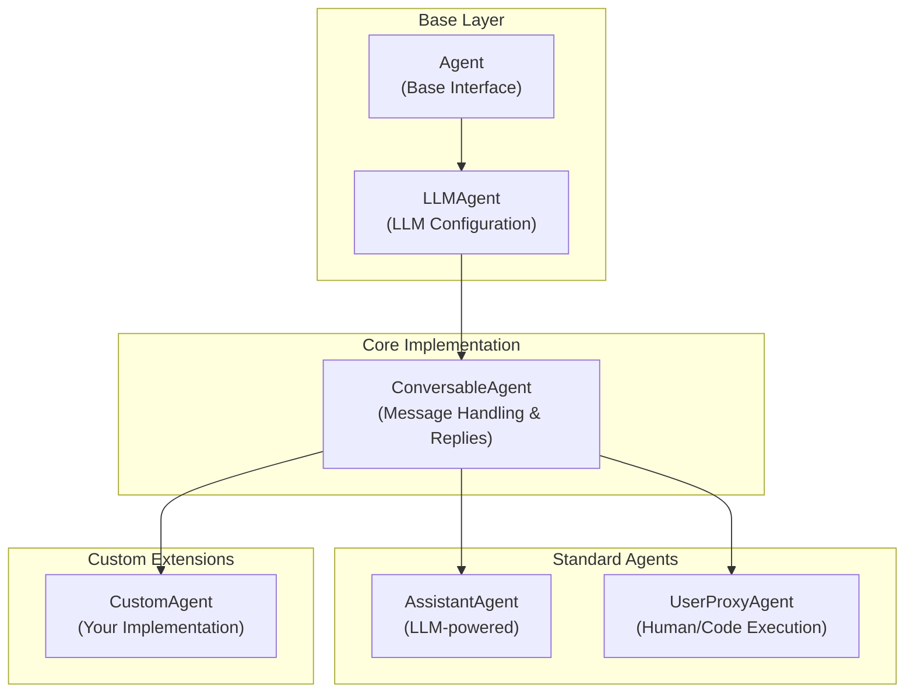
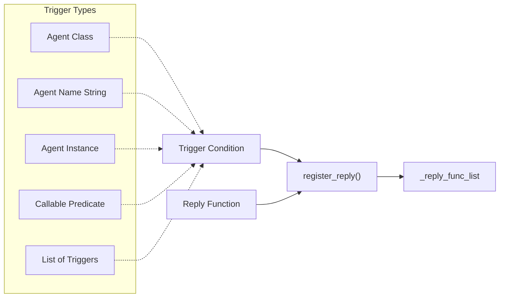
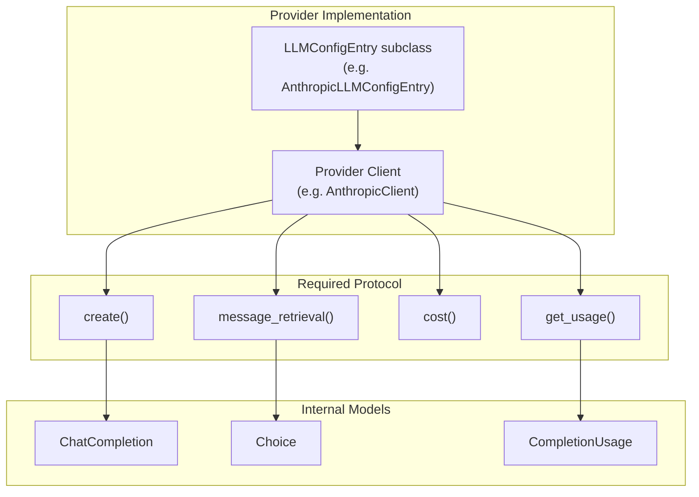
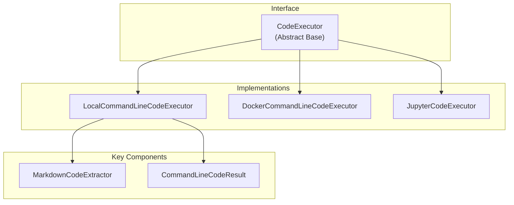
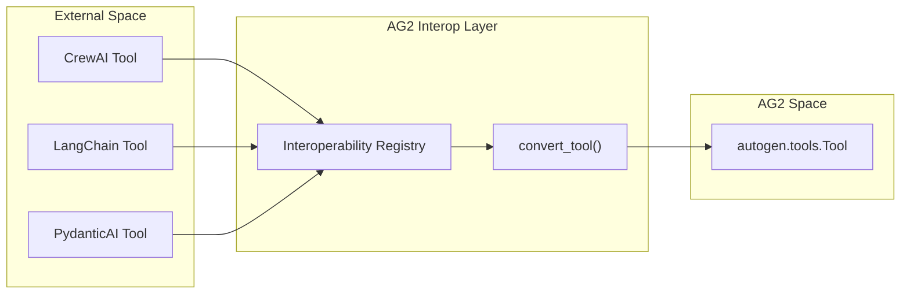

<!-- source: DeepWiki mcp.deepwiki.com · repo ag2ai/ag2 · page 13.2 Extending AG2 · fetched 2026-10-27 -->

# Extending AG2

Relevant source files

The following files were used as context for generating this wiki page:

- [.gitignore](.gitignore)
- [autogen/code_utils.py](autogen/code_utils.py)
- [autogen/coding/docker_commandline_code_executor.py](autogen/coding/docker_commandline_code_executor.py)
- [autogen/coding/func_with_reqs.py](autogen/coding/func_with_reqs.py)
- [autogen/coding/jupyter/base.py](autogen/coding/jupyter/base.py)
- [autogen/coding/jupyter/docker_jupyter_server.py](autogen/coding/jupyter/docker_jupyter_server.py)
- [autogen/coding/jupyter/embedded_ipython_code_executor.py](autogen/coding/jupyter/embedded_ipython_code_executor.py)
- [autogen/coding/jupyter/jupyter_client.py](autogen/coding/jupyter/jupyter_client.py)
- [autogen/coding/jupyter/jupyter_code_executor.py](autogen/coding/jupyter/jupyter_code_executor.py)
- [autogen/coding/jupyter/local_jupyter_server.py](autogen/coding/jupyter/local_jupyter_server.py)
- [autogen/coding/local_commandline_code_executor.py](autogen/coding/local_commandline_code_executor.py)
- [autogen/coding/utils.py](autogen/coding/utils.py)
- [autogen/interop/__init__.py](autogen/interop/__init__.py)
- [autogen/interop/crewai/__init__.py](autogen/interop/crewai/__init__.py)
- [autogen/interop/crewai/crewai.py](autogen/interop/crewai/crewai.py)
- [autogen/interop/interoperability.py](autogen/interop/interoperability.py)
- [autogen/interop/interoperable.py](autogen/interop/interoperable.py)
- [autogen/interop/langchain/__init__.py](autogen/interop/langchain/__init__.py)
- [autogen/interop/pydantic_ai/__init__.py](autogen/interop/pydantic_ai/__init__.py)
- [autogen/interop/pydantic_ai/pydantic_ai.py](autogen/interop/pydantic_ai/pydantic_ai.py)
- [autogen/llm_config/client.py](autogen/llm_config/client.py)
- [autogen/llm_config/entry.py](autogen/llm_config/entry.py)
- [autogen/oai/anthropic.py](autogen/oai/anthropic.py)
- [autogen/oai/bedrock.py](autogen/oai/bedrock.py)
- [autogen/oai/cerebras.py](autogen/oai/cerebras.py)
- [autogen/oai/cohere.py](autogen/oai/cohere.py)
- [autogen/oai/groq.py](autogen/oai/groq.py)
- [autogen/oai/mistral.py](autogen/oai/mistral.py)
- [autogen/oai/ollama.py](autogen/oai/ollama.py)
- [autogen/oai/together.py](autogen/oai/together.py)
- [autogen/tools/__init__.py](autogen/tools/__init__.py)
- [autogen/tools/tool.py](autogen/tools/tool.py)
- [notebook/agentchat_anthropic_structured_outputs.ipynb](notebook/agentchat_anthropic_structured_outputs.ipynb)
- [notebook/agentchat_bedrock_client_exponential_backoff_and_retry_config.ipynb](notebook/agentchat_bedrock_client_exponential_backoff_and_retry_config.ipynb)
- [notebook/agentchat_bedrock_client_structured_output.ipynb](notebook/agentchat_bedrock_client_structured_output.ipynb)
- [notebook/agentchat_remyx_executor.ipynb](notebook/agentchat_remyx_executor.ipynb)
- [test/agentchat/test_anthropic_structured_outputs.py](test/agentchat/test_anthropic_structured_outputs.py)
- [test/coding/__init__.py](test/coding/__init__.py)
- [test/coding/test_commandline_code_executor.py](test/coding/test_commandline_code_executor.py)
- [test/coding/test_embedded_ipython_code_executor.py](test/coding/test_embedded_ipython_code_executor.py)
- [test/coding/test_remyx_executor.py](test/coding/test_remyx_executor.py)
- [test/coding/test_remyx_executor_integration.py](test/coding/test_remyx_executor_integration.py)
- [test/coding/test_user_defined_functions.py](test/coding/test_user_defined_functions.py)
- [test/interop/crewai/test_crewai.py](test/interop/crewai/test_crewai.py)
- [test/interop/langchain/test_langchain.py](test/interop/langchain/test_langchain.py)
- [test/interop/pydantic_ai/test_pydantic_ai.py](test/interop/pydantic_ai/test_pydantic_ai.py)
- [test/interop/pydantic_ai/test_pydantic_ai_tool.py](test/interop/pydantic_ai/test_pydantic_ai_tool.py)
- [test/interop/test_interoperability.py](test/interop/test_interoperability.py)
- [test/oai/test_anthropic.py](test/oai/test_anthropic.py)
- [test/oai/test_bedrock.py](test/oai/test_bedrock.py)
- [test/oai/test_cerebras.py](test/oai/test_cerebras.py)
- [test/oai/test_cohere.py](test/oai/test_cohere.py)
- [test/oai/test_groq.py](test/oai/test_groq.py)
- [test/oai/test_mistral.py](test/oai/test_mistral.py)
- [test/oai/test_ollama.py](test/oai/test_ollama.py)
- [test/test_code_utils.py](test/test_code_utils.py)
- [test/test_llm_config.py](test/test_llm_config.py)
- [test/tools/test_tool.py](test/tools/test_tool.py)

## Purpose and Scope

This guide covers how to extend AG2's core functionality by:
- Creating custom agents with specialized behaviors.
- Adding support for new LLM providers.
- Implementing custom code executors for different execution environments.
- Building custom tools and capabilities using the interoperability layer.

For information about the core agent system and existing components, see [Core Agent System](#2). For details on existing tools and capabilities, see [Tools and Capabilities](#5).

---

## Creating Custom Agents

### Agent Inheritance Hierarchy

Custom agents typically inherit from `ConversableAgent`, which provides the foundation for message handling, reply generation, and tool execution.

**Sources:** [autogen/agentchat/conversable_agent.py:136-148](), [autogen/agentchat/agent.py:1-50]()

### Reply Function System

The reply function system allows agents to register custom response handlers that are triggered based on sender characteristics or message content.

#### Reply Function Registration

**Key methods:**
- `register_reply()`: Register a reply function with a trigger condition [autogen/agentchat/conversable_agent.py:538-608]()
- `replace_reply_func()`: Replace an existing reply function [autogen/agentchat/conversable_agent.py:610-619]()
- `generate_reply()`: Process reply functions in order [autogen/agentchat/conversable_agent.py:1388-1474]()

**Sources:** [autogen/agentchat/conversable_agent.py:538-608](), [autogen/agentchat/conversable_agent.py:1388-1474]()

### Hook System

Hooks allow you to inject custom behavior at specific points in an agent's lifecycle without overriding core methods.

| Hook Name | Purpose |
|-----------|---------|
| `process_last_received_message` | Process the most recent message [autogen/agentchat/conversable_agent.py:374-387]() |
| `process_message_before_send` | Modify messages before sending [autogen/agentchat/conversable_agent.py:448-494]() |

**Sources:** [autogen/agentchat/conversable_agent.py:374-494]()

---

## Adding New LLM Providers

AG2 uses a unified client architecture where each provider client converts between OpenAI-compatible formats and native APIs.

### LLM Client Architecture

**Sources:** [autogen/oai/anthropic.py:155-220](), [autogen/oai/bedrock.py:105-170](), [autogen/oai/ollama.py:80-120]()

### LLMConfigEntry Implementation

Define configuration parameters for your LLM provider using Pydantic. AG2 provides specific base classes for different providers:

- `AnthropicLLMConfigEntry` [autogen/oai/anthropic.py:155-220]()
- `BedrockLLMConfigEntry` [autogen/oai/bedrock.py:75-102]()
- `OllamaLLMConfigEntry` [autogen/oai/ollama.py:60-78]()

**Key implementation detail:** Every `LLMConfigEntry` must define its `api_type` and relevant credentials (e.g., `aws_access_key` for Bedrock [autogen/oai/bedrock.py:80-82]()).

### Client Implementation

#### Required Methods

| Method | Purpose |
|--------|---------|
| `create()` | Execute the request and return a `ChatCompletion` object [autogen/oai/anthropic.py:500-800]() |
| `message_retrieval()` | Extract choices from the response [autogen/oai/ollama.py:122-128]() |
| `cost()` | Calculate the cost of the transaction [autogen/oai/ollama.py:130-131]() |
| `get_usage()` | Return a dictionary of token usage [autogen/oai/ollama.py:133-143]() |

**Sources:** [autogen/oai/anthropic.py:500-800](), [autogen/oai/ollama.py:80-143]()

---

## Implementing Custom Code Executors

Custom code executors allow you to run generated code in specialized environments.

### Code Executor Architecture

**Sources:** [autogen/coding/base.py:24-30](), [autogen/coding/local_commandline_code_executor.py:40-144]()

### LocalCommandLineCodeExecutor

This executor runs code directly on the local machine. It supports multiple languages and execution policies.

- **Supported Languages**: `bash`, `shell`, `sh`, `pwsh`, `powershell`, `ps1`, `python`, `javascript`, `html`, `css` [autogen/coding/local_commandline_code_executor.py:41-52]().
- **Execution Policies**: Determines if a language is executed or just saved [autogen/coding/local_commandline_code_executor.py:53-64]().
- **Virtual Environments**: Supports execution within a Python virtual environment to avoid polluting the host [autogen/coding/local_commandline_code_executor.py:96-107]().

**Sources:** [autogen/coding/local_commandline_code_executor.py:40-107]()

---

## Extending Tools and Interoperability

AG2 provides a robust system for registering tools and inter-operating with other frameworks like CrewAI, LangChain, and Pydantic AI.

### Tool Registration

Tools are encapsulated in the `Tool` class, which handles schema generation and registration for both LLM and execution.

- `register_for_llm()`: Updates the agent's tool signature [autogen/tools/tool.py:89-102]().
- `register_for_execution()`: Registers the tool's function in the agent's function map [autogen/tools/tool.py:103-112]().

**Sources:** [autogen/tools/tool.py:20-112]()

### Framework Interoperability

The `Interoperability` class acts as a registry for converting tools from other frameworks into AG2-compatible `Tool` objects.

#### Supported Frameworks:
- **Pydantic AI**: Handled by `PydanticAIInteroperability`. It supports dependency injection via `RunContext` [autogen/interop/pydantic_ai/pydantic_ai.py:27-162]().
- **CrewAI**: Supported via `CrewAIInteroperability` [test/interop/test_interoperability.py:27]().
- **LangChain**: Supported via `LangChainInteroperability` [test/interop/test_interoperability.py:24]().

**Sources:** [autogen/interop/pydantic_ai/pydantic_ai.py:27-162](), [test/interop/test_interoperability.py:20-31]()

### Tool Dependency Injection

Tools can use the `Depends()` mechanism to inject context parameters like `ChatContext`. For example, `PydanticAIInteroperability.inject_params` wraps functions to handle `RunContext` and retries [autogen/interop/pydantic_ai/pydantic_ai.py:39-94]().

**Sources:** [autogen/interop/pydantic_ai/pydantic_ai.py:39-94](), [autogen/tools/tool.py:11-12]()

---

