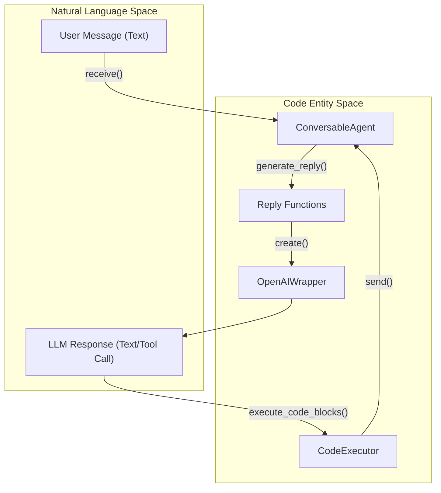
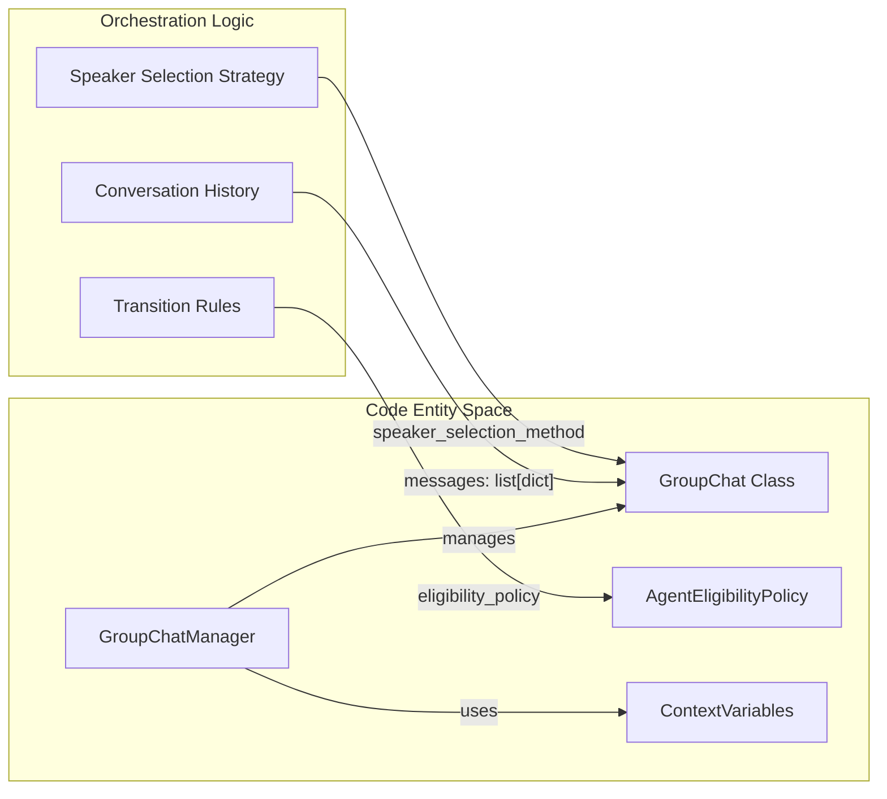

<!-- source: DeepWiki mcp.deepwiki.com · repo ag2ai/ag2 · page 14 Glossary · fetched 2026-10-27 -->

# Glossary

Relevant source files

The following files were used as context for generating this wiki page:

- [.github/workflows/python-package.yml](.github/workflows/python-package.yml)
- [.pre-commit-config.yaml](.pre-commit-config.yaml)
- [README.md](README.md)
- [autogen/agentchat/chat.py](autogen/agentchat/chat.py)
- [autogen/agentchat/contrib/swarm_agent.py](autogen/agentchat/contrib/swarm_agent.py)
- [autogen/agentchat/conversable_agent.py](autogen/agentchat/conversable_agent.py)
- [autogen/agentchat/groupchat.py](autogen/agentchat/groupchat.py)
- [autogen/beta/agent.py](autogen/beta/agent.py)
- [autogen/coding/jupyter/import_utils.py](autogen/coding/jupyter/import_utils.py)
- [autogen/coding/remyx_code_executor.py](autogen/coding/remyx_code_executor.py)
- [autogen/exception_utils.py](autogen/exception_utils.py)
- [autogen/import_utils.py](autogen/import_utils.py)
- [autogen/io/__init__.py](autogen/io/__init__.py)
- [autogen/io/base.py](autogen/io/base.py)
- [autogen/io/console.py](autogen/io/console.py)
- [autogen/io/websockets.py](autogen/io/websockets.py)
- [autogen/llm_config/entry.py](autogen/llm_config/entry.py)
- [autogen/messages/agent_messages.py](autogen/messages/agent_messages.py)
- [autogen/oai/anthropic.py](autogen/oai/anthropic.py)
- [autogen/oai/bedrock.py](autogen/oai/bedrock.py)
- [autogen/oai/cerebras.py](autogen/oai/cerebras.py)
- [autogen/oai/client.py](autogen/oai/client.py)
- [autogen/oai/cohere.py](autogen/oai/cohere.py)
- [autogen/oai/gemini.py](autogen/oai/gemini.py)
- [autogen/oai/groq.py](autogen/oai/groq.py)
- [autogen/oai/mistral.py](autogen/oai/mistral.py)
- [autogen/oai/ollama.py](autogen/oai/ollama.py)
- [autogen/oai/together.py](autogen/oai/together.py)
- [autogen/tools/dependency_injection.py](autogen/tools/dependency_injection.py)
- [autogen/tools/experimental/__init__.py](autogen/tools/experimental/__init__.py)
- [autogen/tools/function_utils.py](autogen/tools/function_utils.py)
- [autogen/version.py](autogen/version.py)
- [notebook/agentchat_anthropic_structured_outputs.ipynb](notebook/agentchat_anthropic_structured_outputs.ipynb)
- [notebook/agentchat_bedrock_client_exponential_backoff_and_retry_config.ipynb](notebook/agentchat_bedrock_client_exponential_backoff_and_retry_config.ipynb)
- [notebook/agentchat_bedrock_client_structured_output.ipynb](notebook/agentchat_bedrock_client_structured_output.ipynb)
- [notebook/agentchat_gemini_thinking_config_example.ipynb](notebook/agentchat_gemini_thinking_config_example.ipynb)
- [notebook/agentchat_websockets.ipynb](notebook/agentchat_websockets.ipynb)
- [notebook/tools_google_search.ipynb](notebook/tools_google_search.ipynb)
- [pyproject.toml](pyproject.toml)
- [scripts/pre-commit-mypy-run.sh](scripts/pre-commit-mypy-run.sh)
- [setup_autogen.py](setup_autogen.py)
- [test/agentchat/contrib/test_swarm.py](test/agentchat/contrib/test_swarm.py)
- [test/agentchat/realtime_agent/clients/test_gemini_realtime_client.py](test/agentchat/realtime_agent/clients/test_gemini_realtime_client.py)
- [test/agentchat/realtime_agent/clients/test_oai_realtime_client.py](test/agentchat/realtime_agent/clients/test_oai_realtime_client.py)
- [test/agentchat/test_agent_logging.py](test/agentchat/test_agent_logging.py)
- [test/agentchat/test_agent_usage.py](test/agentchat/test_agent_usage.py)
- [test/agentchat/test_anthropic_structured_outputs.py](test/agentchat/test_anthropic_structured_outputs.py)
- [test/agentchat/test_assistant_agent.py](test/agentchat/test_assistant_agent.py)
- [test/agentchat/test_async.py](test/agentchat/test_async.py)
- [test/agentchat/test_async_chats.py](test/agentchat/test_async_chats.py)
- [test/agentchat/test_async_get_human_input.py](test/agentchat/test_async_get_human_input.py)
- [test/agentchat/test_cache_agent.py](test/agentchat/test_cache_agent.py)
- [test/agentchat/test_chats.py](test/agentchat/test_chats.py)
- [test/agentchat/test_conversable_agent.py](test/agentchat/test_conversable_agent.py)
- [test/agentchat/test_function_call.py](test/agentchat/test_function_call.py)
- [test/agentchat/test_function_call_groupchat.py](test/agentchat/test_function_call_groupchat.py)
- [test/agentchat/test_groupchat.py](test/agentchat/test_groupchat.py)
- [test/agentchat/test_human_input.py](test/agentchat/test_human_input.py)
- [test/agentchat/test_math_user_proxy_agent.py](test/agentchat/test_math_user_proxy_agent.py)
- [test/agentchat/test_nested.py](test/agentchat/test_nested.py)
- [test/agentchat/test_tool_calls.py](test/agentchat/test_tool_calls.py)
- [test/conftest.py](test/conftest.py)
- [test/credentials.py](test/credentials.py)
- [test/io/test_base.py](test/io/test_base.py)
- [test/io/test_websockets.py](test/io/test_websockets.py)
- [test/messages/test_agent_messages.py](test/messages/test_agent_messages.py)
- [test/oai/test_anthropic.py](test/oai/test_anthropic.py)
- [test/oai/test_bedrock.py](test/oai/test_bedrock.py)
- [test/oai/test_cerebras.py](test/oai/test_cerebras.py)
- [test/oai/test_client.py](test/oai/test_client.py)
- [test/oai/test_client_stream.py](test/oai/test_client_stream.py)
- [test/oai/test_cohere.py](test/oai/test_cohere.py)
- [test/oai/test_gemini.py](test/oai/test_gemini.py)
- [test/oai/test_groq.py](test/oai/test_groq.py)
- [test/oai/test_mistral.py](test/oai/test_mistral.py)
- [test/oai/test_ollama.py](test/oai/test_ollama.py)
- [test/test_conftest.py](test/test_conftest.py)
- [test/test_import_utils.py](test/test_import_utils.py)
- [test/test_llm_config.py](test/test_llm_config.py)
- [test/tools/test_dependency_injection.py](test/tools/test_dependency_injection.py)
- [test/tools/test_function_utils.py](test/tools/test_function_utils.py)
- [website/docs/user-guide/advanced-concepts/tools/controlling-use.mdx](website/docs/user-guide/advanced-concepts/tools/controlling-use.mdx)
- [website/docs/user-guide/models/google-gemini.mdx](website/docs/user-guide/models/google-gemini.mdx)
- [website/docs/user-guide/reference-tools/google-api/google-search.mdx](website/docs/user-guide/reference-tools/google-api/google-search.mdx)
- [website/docs/user-guide/reference-tools/index.mdx](website/docs/user-guide/reference-tools/index.mdx)
- [website/docusaurus.config.js](website/docusaurus.config.js)
- [website/mint-json-template.json.jinja](website/mint-json-template.json.jinja)
- [website/snippets/python-examples/humanintheloop_financial.mdx](website/snippets/python-examples/humanintheloop_financial.mdx)

This page provides definitions and technical pointers for codebase-specific terms, jargon, and architectural concepts within the AG2 framework.

## Core Framework Concepts

### ConversableAgent
The foundational building block of AG2. It is a class designed to exchange messages with other agents, generate replies using LLMs, execute code, or solicit human input [autogen/agentchat/conversable_agent.py:136-148](). It maintains a local history of conversations with other agents [autogen/agentchat/conversable_agent.py:169]().

### LLMConfig
A configuration object or dictionary that defines the parameters for Large Language Model inference, including model names, API keys, and provider-specific settings [autogen/llm_config/__init__.py](). It is used by `OpenAIWrapper` to initialize clients [autogen/oai/client.py:33]().

### Reply Function
A pluggable mechanism within `ConversableAgent` that determines how an agent responds to a message. Agents maintain a list of registered reply functions that are processed in order until one returns a response [autogen/agentchat/conversable_agent.py:143-147]().

### GroupChat
A collection of agents participating in a shared conversation space. Orchestration is managed by a `GroupChatManager` which uses a `speaker_selection_method` (e.g., "auto", "round_robin", "random") to decide who speaks next [autogen/agentchat/groupchat.py:50-95]().

---

## Technical Terms and Jargon

| Term | Definition | Code Pointer |
| :--- | :--- | :--- |
| **Carryover** | Information from previous chats passed into a new chat context to provide continuity. | [autogen/agentchat/chat.py:81]() |
| **Handoff** | The process of transferring the conversation control from one agent to another, common in Swarm patterns. | [autogen/agentchat/group/handoffs.py]() |
| **Termination Message** | A message that triggers the end of a conversation, often checked via `is_termination_msg`. | [autogen/agentchat/conversable_agent.py:161]() |
| **Human Input Mode** | A setting (`ALWAYS`, `NEVER`, `TERMINATE`) determining when an agent requests user input. | [autogen/agentchat/conversable_agent.py:163]() |
| **Config List** | A list of dictionaries containing LLM configurations, often loaded from `OAI_CONFIG_LIST`. | [autogen/oai/client.py:37]() |

---

## Domain Concepts

### Swarm Orchestration
An orchestration pattern where agents dynamically hand off tasks to one another based on conditions (`OnCondition`) or after finishing work (`AfterWork`) [autogen/agentchat/contrib/swarm_agent.py:115-138](). It leverages `ContextVariables` to maintain state across different agents in the swarm [autogen/agentchat/contrib/swarm_agent.py:32]().

### Tool Registration
The process of making a Python function available for an LLM to call. This involves `register_for_llm` (to update the LLM's tool schema) and `register_for_execution` (to map the tool call to the actual function) [autogen/agentchat/conversable_agent.py:27]().

### Code Execution
The ability of an agent (typically `UserProxyAgent`) to run code blocks extracted from messages. Execution can happen locally or inside a Docker container [autogen/agentchat/conversable_agent.py:165]().

---

## Architecture Diagrams

### From Natural Language to Code Entities: Message Flow
This diagram bridges the conceptual "Conversation" to the underlying class structures and method calls.

Title: Message Processing Pipeline

Sources: [autogen/agentchat/conversable_agent.py:136-148](), [autogen/oai/client.py:75](), [autogen/coding/base.py:41]()

### From Orchestration Logic to Code Entities: GroupChat
This diagram shows how high-level multi-agent patterns map to the `GroupChat` and `GroupChatManager` implementation.

Title: GroupChat Orchestration Mapping

Sources: [autogen/agentchat/groupchat.py:50-104](), [autogen/agentchat/eligibility_policy.py:39](), [autogen/agentchat/group/context_variables.py:86]()

---

## System Events and Messages
AG2 uses an internal event system to track agent actions and logging.

*   **`BaseEvent`**: The root class for all internal events [autogen/events/base_event.py]().
*   **`ToolCallEvent`**: Triggered when an LLM suggests a tool be called [autogen/messages/agent_messages.py:209]().
*   **`TerminationEvent`**: Triggered when a conversation meets termination criteria [autogen/events/agent_events.py:57]().

Sources: [autogen/events/agent_events.py:13-60](), [autogen/messages/agent_messages.py:59-81]()