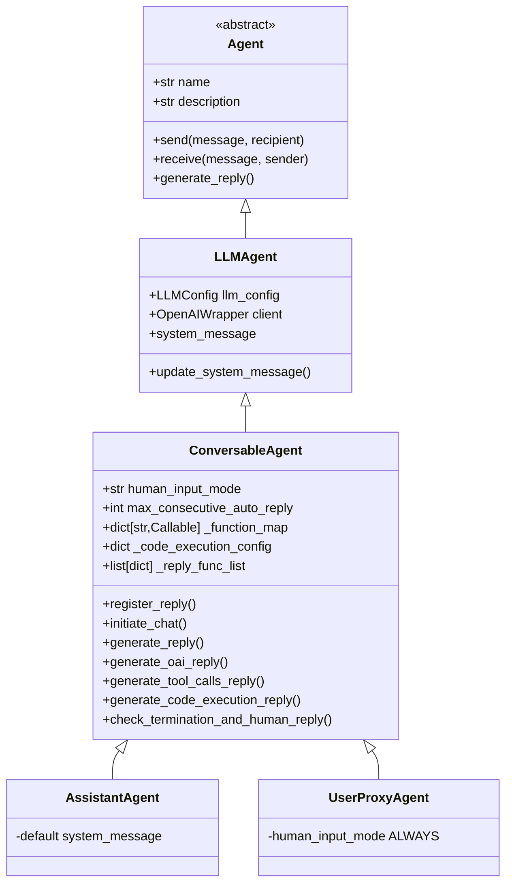
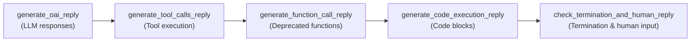
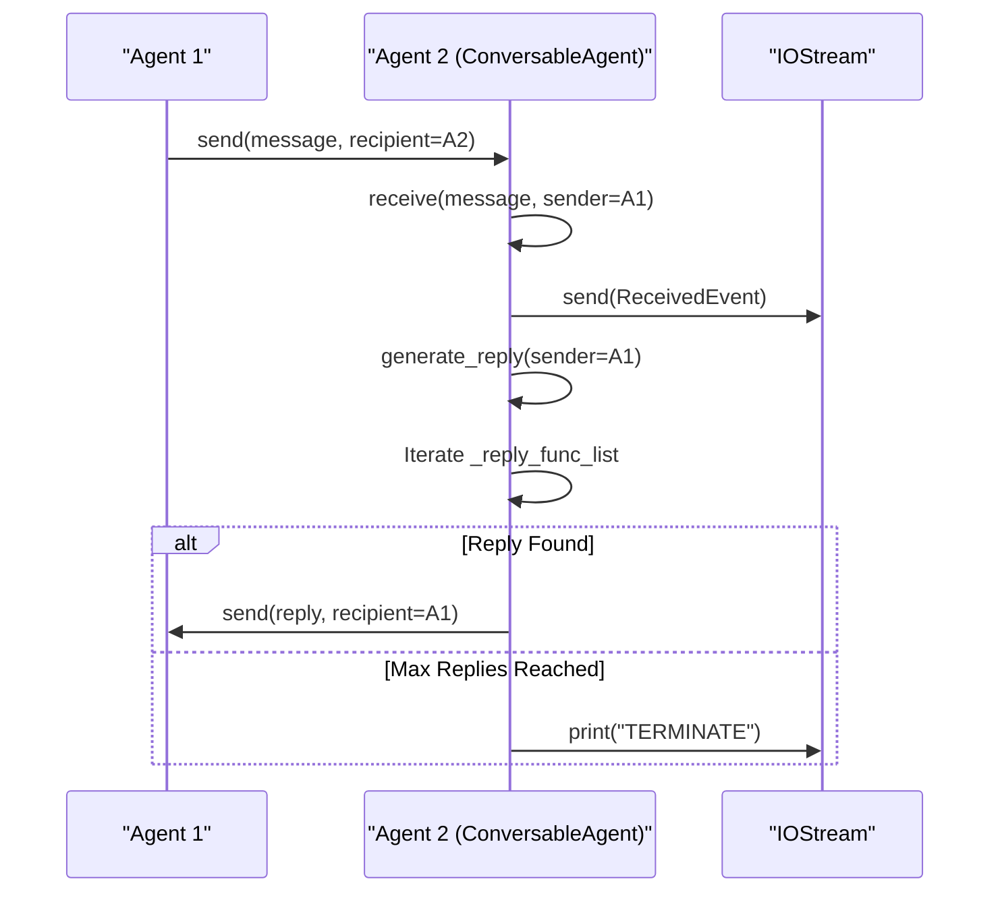

<!-- source: DeepWiki mcp.deepwiki.com · repo ag2ai/ag2 · page 2 Core Agent System · fetched 2026-10-27 -->

# Core Agent System

<details>
<summary>Relevant source files</summary>

The following files were used as context for generating this wiki page:

- [autogen/__init__.py](autogen/__init__.py)
- [autogen/agentchat/__init__.py](autogen/agentchat/__init__.py)
- [autogen/agentchat/agent.py](autogen/agentchat/agent.py)
- [autogen/agentchat/chat.py](autogen/agentchat/chat.py)
- [autogen/agentchat/conversable_agent.py](autogen/agentchat/conversable_agent.py)
- [autogen/agentchat/eligibility_policy.py](autogen/agentchat/eligibility_policy.py)
- [autogen/agentchat/groupchat.py](autogen/agentchat/groupchat.py)
- [autogen/exception_utils.py](autogen/exception_utils.py)
- [autogen/io/__init__.py](autogen/io/__init__.py)
- [autogen/io/base.py](autogen/io/base.py)
- [autogen/io/console.py](autogen/io/console.py)
- [autogen/io/websockets.py](autogen/io/websockets.py)
- [autogen/messages/agent_messages.py](autogen/messages/agent_messages.py)
- [autogen/tools/experimental/deep_research/deep_research.py](autogen/tools/experimental/deep_research/deep_research.py)
- [notebook/agentchat_groupchat_eligibility.ipynb](notebook/agentchat_groupchat_eligibility.ipynb)
- [notebook/agentchat_websockets.ipynb](notebook/agentchat_websockets.ipynb)
- [test/agentchat/test_conversable_agent.py](test/agentchat/test_conversable_agent.py)
- [test/agentchat/test_eligibility_policy.py](test/agentchat/test_eligibility_policy.py)
- [test/agentchat/test_groupchat.py](test/agentchat/test_groupchat.py)
- [test/agentchat/test_groupchat_eligibility.py](test/agentchat/test_groupchat_eligibility.py)
- [test/io/test_base.py](test/io/test_base.py)
- [test/io/test_websockets.py](test/io/test_websockets.py)
- [test/messages/test_agent_messages.py](test/messages/test_agent_messages.py)
- [test/tools/experimental/deep_research/test_deep_research.py](test/tools/experimental/deep_research/test_deep_research.py)

</details>


The AG2 framework is built around a foundational agent architecture centered on the `ConversableAgent` class. This class provides the essential capabilities for agent-to-agent communication, including message handling, LLM integration, reply generation, and execution of code and tools. Understanding the `ConversableAgent` and its core mechanisms is essential for building any AG2 application.

This page provides an overview of the agent system architecture. For detailed documentation, see:
- [ConversableAgent](#2.1) — Deep dive into `ConversableAgent`: initialization, core methods (`send`, `receive`, `generate_reply`), reply function chain, and extensibility.
- [Message Handling and Reply Functions](#2.2) — Explain the reply function system, message formats (`BaseEvent` hierarchy), trigger conditions, and reply generation pipeline.
- [AssistantAgent and UserProxyAgent](#2.3) — Cover the two primary agent types: `AssistantAgent` (LLM-powered) and `UserProxyAgent` (human-in-the-loop, code execution).
- [GroupChat and Multi-Agent Orchestration](#2.4) — Explain `GroupChat` system, `GroupChatManager`, speaker selection methods (auto, manual, round_robin), and conversation flow control.
- [IO System and Communication](#2.5) — Detail the `IOStream` abstraction, implementations (`IOConsole`, `IOWebsockets`), and how agents communicate through different interfaces.

For LLM configuration, see [LLM Integration](#3). For advanced agent types, see [Advanced Agent Types](#4). For tool capabilities, see [Tools and Capabilities](#5).

## ConversableAgent: The Foundation

The `ConversableAgent` class [autogen/agentchat/conversable_agent.py:136-178]() is the core building block of AG2. It inherits from `LLMAgent`, which in turn inherits from the base `Agent` class [autogen/agentchat/agent.py:47-155](). In practice, almost all AG2 agents are instances or subclasses of `ConversableAgent`.

### Agent Class Hierarchy

The following diagram maps the conceptual hierarchy to the specific classes defined in the codebase.

**Diagram: Agent Class Hierarchy**

**Sources:** [autogen/agentchat/agent.py:47-155](), [autogen/agentchat/conversable_agent.py:136-178](), [autogen/agentchat/assistant_agent.py:15-20](), [autogen/agentchat/user_proxy_agent.py:15-20]()

### Core Capabilities

The `ConversableAgent` provides these essential capabilities:

| Capability | Configuration | Description |
|------------|---------------|-------------|
| **LLM Integration** | `llm_config` | Connect to LLM providers via `OpenAIWrapper` [autogen/agentchat/conversable_agent.py:252-258]() |
| **Reply Functions** | `register_reply()` | Chain of functions to generate responses [autogen/agentchat/conversable_agent.py:1104-1165]() |
| **Code Execution** | `code_execution_config` | Execute code blocks via `CodeExecutor` [autogen/agentchat/conversable_agent.py:165-166]() |
| **Tool Calling** | `function_map` | Register and execute tools/functions [autogen/agentchat/conversable_agent.py:164]() |
| **Human Input** | `human_input_mode` | Control when to solicit human input ("ALWAYS", "NEVER", "TERMINATE") [autogen/agentchat/conversable_agent.py:163]() |
| **Auto-Reply** | `max_consecutive_auto_reply` | Limit automatic responses [autogen/agentchat/conversable_agent.py:162]() |
| **Message History** | `_oai_messages` | Track conversation history per agent [autogen/agentchat/conversable_agent.py:237-240]() |
| **Context Variables** | `context_variables` | Maintain shared state via `ContextVariables` [autogen/agentchat/conversable_agent.py:171]() |

**Sources:** [autogen/agentchat/conversable_agent.py:157-382]()

## Reply Function Chain

The `ConversableAgent` uses a reply function chain to process messages. During initialization, reply functions are registered in a specific order [autogen/agentchat/conversable_agent.py:289-364](). When `generate_reply()` is called, it iterates through `_reply_func_list` until a function returns a valid response [autogen/agentchat/conversable_agent.py:1343-1429]().

### Reply Function Registration Order

**Diagram: Default Reply Chain Logic**

**Sources:** [autogen/agentchat/conversable_agent.py:289-364](), [autogen/agentchat/conversable_agent.py:1343-1429]()

## Agent-to-Agent Communication

Agents communicate by passing messages through `send()` and `receive()` methods. The `IOStream` class abstracts the physical transport (e.g., Console or WebSockets) [autogen/io/base.py:94-151]().

### Communication Flow

**Diagram: Message Passing and IO Integration**

**Sources:** [autogen/agentchat/conversable_agent.py:1236-1298](), [autogen/agentchat/conversable_agent.py:1343-1429](), [autogen/io/base.py:122-134]()

### Conversation Initialization

The `initiate_chat()` method [autogen/agentchat/conversable_agent.py:1718-1882]() or the standalone `initiate_chats()` [autogen/agentchat/chat.py:157-252]() starts a conversation.

```python
# Example of multi-chat initiation
from autogen import initiate_chats

chat_results = initiate_chats([
    {
        "sender": user_proxy,
        "recipient": assistant,
        "message": "Hello!",
        "max_turns": 2
    }
])
```
**Sources:** [autogen/agentchat/conversable_agent.py:1718-1882](), [autogen/agentchat/chat.py:157-252]()

## Hooks and State Management

`ConversableAgent` provides a hook system to intercept lifecycle events [autogen/agentchat/conversable_agent.py:368-379]().

### Dynamic State Updates

The `UpdateSystemMessage` class [autogen/agentchat/conversable_agent.py:104-134]() allows agents to modify their `system_message` dynamically based on `ContextVariables` before generating a reply.

| Hook Point | Description |
|------------|-------------|
| `process_last_received_message` | Modify the incoming message before storage. |
| `process_all_messages_before_reply` | Filter or summarize history before LLM call. |
| `process_message_before_send` | Transform the generated reply before sending. |
| `update_agent_state` | Update internal state (like system message). |

**Sources:** [autogen/agentchat/conversable_agent.py:368-379](), [autogen/agentchat/conversable_agent.py:104-134]()

## Component Integration

| Component | Role | Code Reference |
|-----------|------|----------------|
| `Agent` | Minimal interface for communication. | [autogen/agentchat/agent.py:47-93]() |
| `LLMAgent` | Interface for LLM-backed agents. | [autogen/agentchat/agent.py:95-155]() |
| `ConversableAgent` | Feature-complete base class for most agents. | [autogen/agentchat/conversable_agent.py:136-178]() |
| `GroupChat` | Data structure for multi-agent state. | [autogen/agentchat/groupchat.py:50-104]() |
| `IOStream` | Unified interface for I/O operations. | [autogen/io/base.py:94-151]() |
| `ChatResult` | Encapsulates the outcome of a conversation. | [autogen/agentchat/chat.py:36-62]() |

**Sources:** [autogen/agentchat/agent.py:47-155](), [autogen/agentchat/conversable_agent.py:136-178](), [autogen/agentchat/groupchat.py:50-104](), [autogen/io/base.py:94-151](), [autogen/agentchat/chat.py:36-62]()

---

