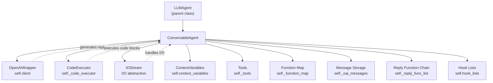
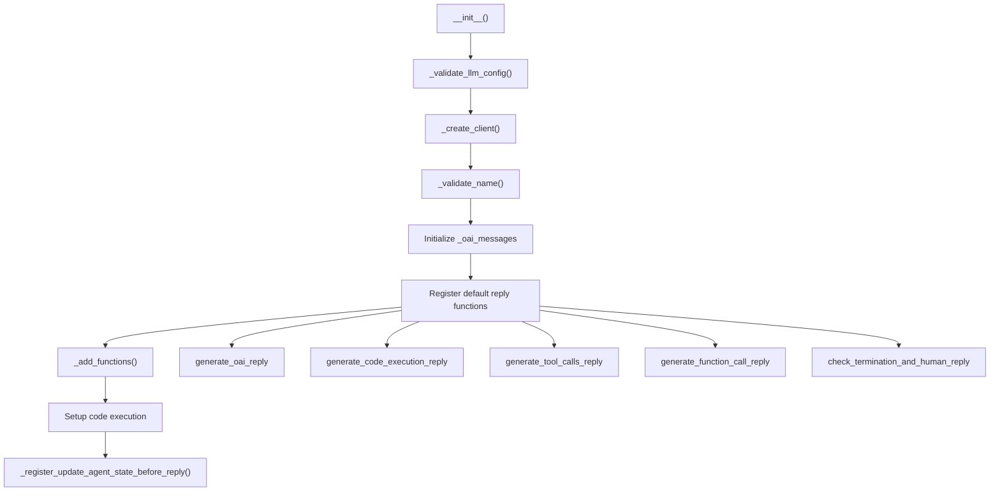
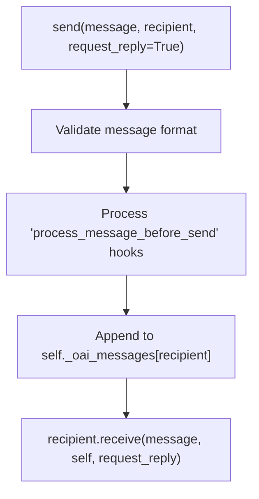
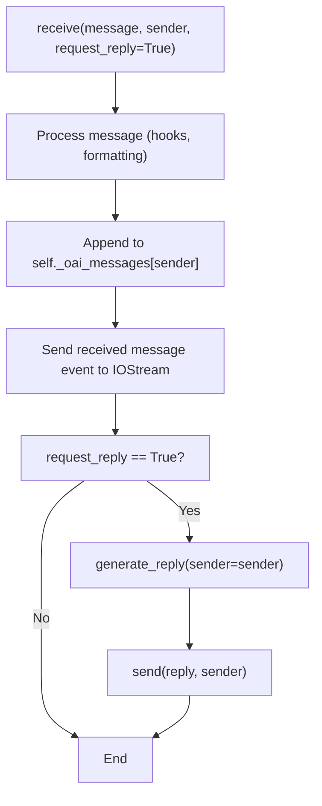
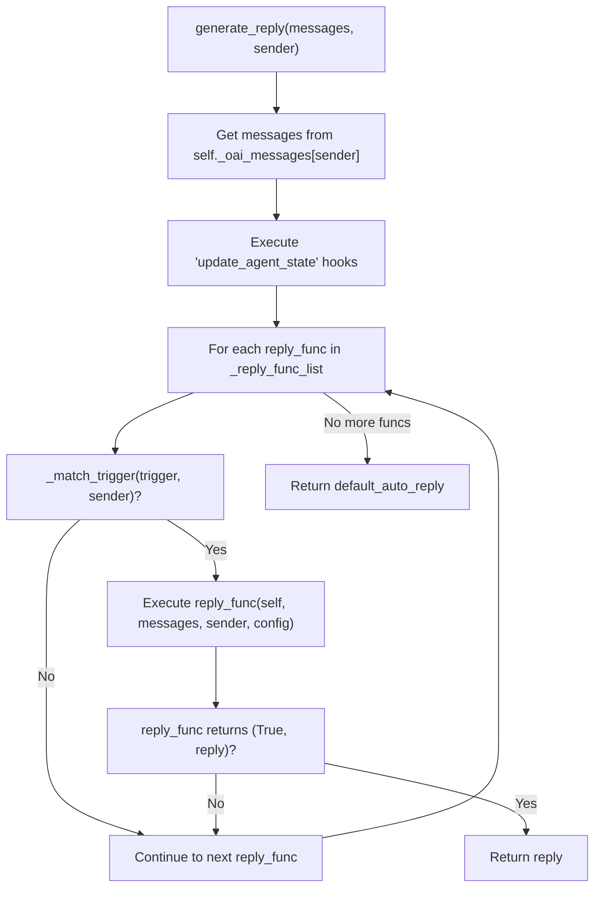
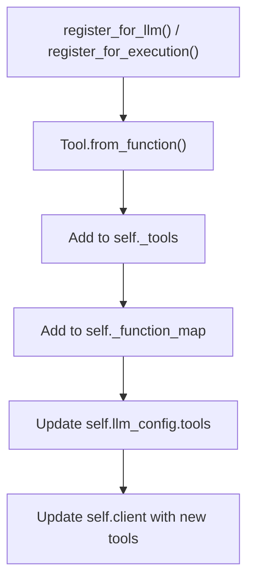
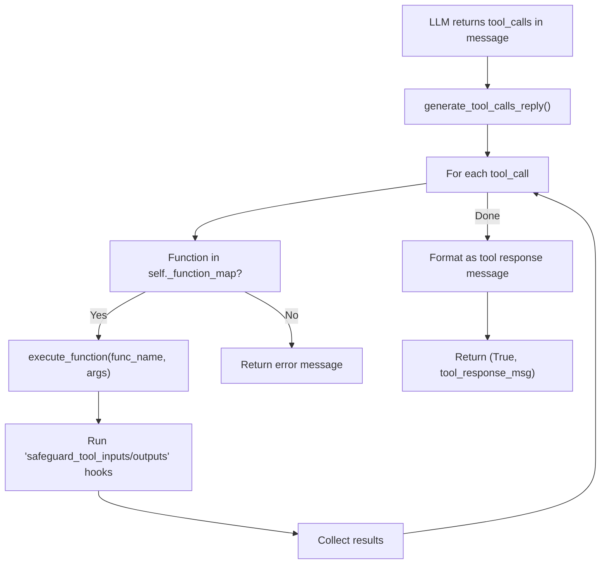
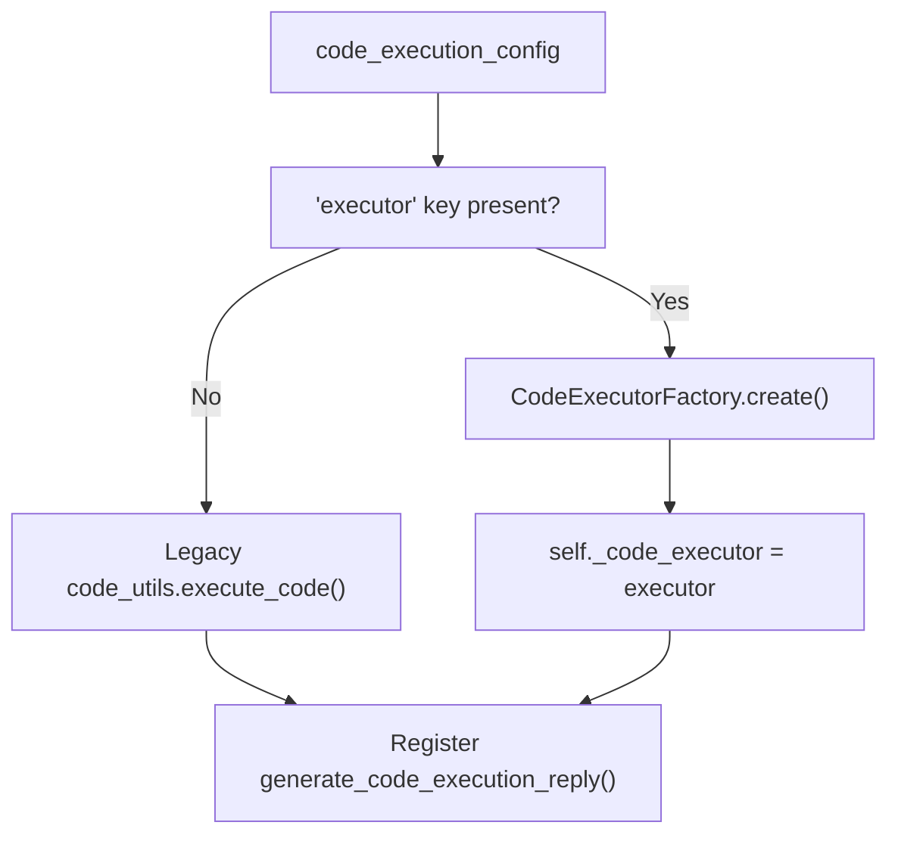
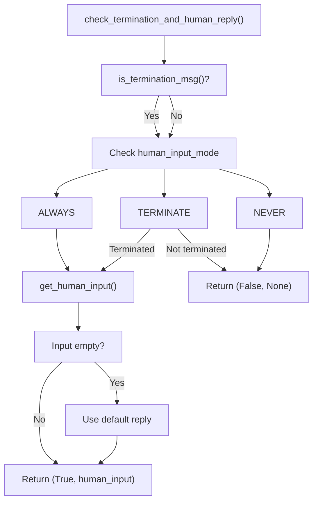
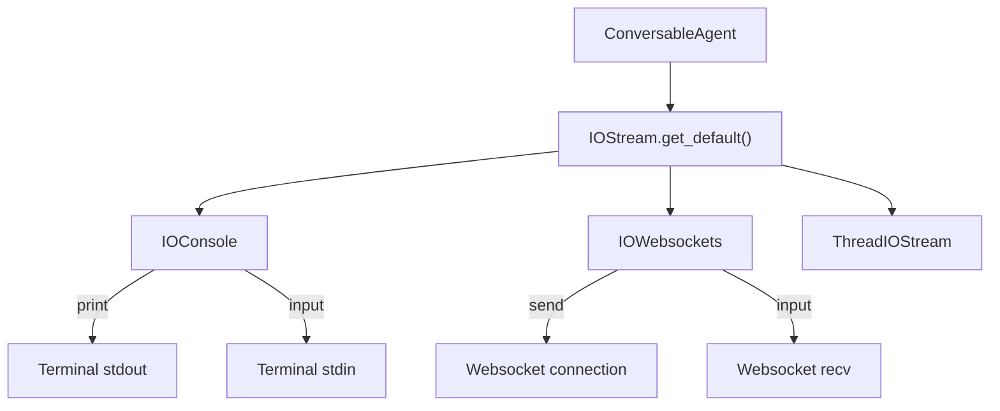

<!-- source: DeepWiki mcp.deepwiki.com · repo ag2ai/ag2 · page 2.1 ConversableAgent · fetched 2026-10-27 -->

# ConversableAgent

<details>
<summary>Relevant source files</summary>

The following files were used as context for generating this wiki page:

- [autogen/agentchat/assistant_agent.py](autogen/agentchat/assistant_agent.py)
- [autogen/agentchat/chat.py](autogen/agentchat/chat.py)
- [autogen/agentchat/contrib/agent_optimizer.py](autogen/agentchat/contrib/agent_optimizer.py)
- [autogen/agentchat/contrib/captainagent/agent_builder.py](autogen/agentchat/contrib/captainagent/agent_builder.py)
- [autogen/agentchat/contrib/captainagent/captainagent.py](autogen/agentchat/contrib/captainagent/captainagent.py)
- [autogen/agentchat/contrib/math_user_proxy_agent.py](autogen/agentchat/contrib/math_user_proxy_agent.py)
- [autogen/agentchat/contrib/text_analyzer_agent.py](autogen/agentchat/contrib/text_analyzer_agent.py)
- [autogen/agentchat/conversable_agent.py](autogen/agentchat/conversable_agent.py)
- [autogen/agentchat/groupchat.py](autogen/agentchat/groupchat.py)
- [autogen/agentchat/user_proxy_agent.py](autogen/agentchat/user_proxy_agent.py)
- [autogen/exception_utils.py](autogen/exception_utils.py)
- [autogen/io/__init__.py](autogen/io/__init__.py)
- [autogen/io/base.py](autogen/io/base.py)
- [autogen/io/console.py](autogen/io/console.py)
- [autogen/io/websockets.py](autogen/io/websockets.py)
- [autogen/messages/agent_messages.py](autogen/messages/agent_messages.py)
- [notebook/agentchat_agentoptimizer.ipynb](notebook/agentchat_agentoptimizer.ipynb)
- [notebook/agentchat_teachability.ipynb](notebook/agentchat_teachability.ipynb)
- [notebook/agentchat_teachable_oai_assistants.ipynb](notebook/agentchat_teachable_oai_assistants.ipynb)
- [notebook/agentchat_websockets.ipynb](notebook/agentchat_websockets.ipynb)
- [test/agentchat/contrib/test_agent_optimizer.py](test/agentchat/contrib/test_agent_optimizer.py)
- [test/agentchat/test_conversable_agent.py](test/agentchat/test_conversable_agent.py)
- [test/agentchat/test_groupchat.py](test/agentchat/test_groupchat.py)
- [test/io/test_base.py](test/io/test_base.py)
- [test/io/test_websockets.py](test/io/test_websockets.py)
- [test/messages/test_agent_messages.py](test/messages/test_agent_messages.py)

</details>


## Purpose and Scope

`ConversableAgent` is the foundational base class for all conversable agents in the AG2 framework. It provides core capabilities for message passing, reply generation, tool execution, and human interaction. All agent types in AG2 (such as `AssistantAgent` and `UserProxyAgent`) inherit from this class.

This page covers the internal architecture, initialization, core methods, and extensibility mechanisms of `ConversableAgent`. For information about specific agent types built on this base class, see [AssistantAgent and UserProxyAgent](#2.3). For multi-agent orchestration patterns, see [GroupChat and Multi-Agent Orchestration](#2.4).

**Sources:** [autogen/agentchat/conversable_agent.py:136-148]()

---

## Class Architecture

### Inheritance and Core Components

`ConversableAgent` inherits from `LLMAgent` and integrates with several key subsystems:



**ConversableAgent Architecture**

**Sources:** [autogen/agentchat/conversable_agent.py:136-233](), [autogen/agentchat/conversable_agent.py:270-372]()

---

## Initialization and Configuration

### Constructor Parameters

The `__init__` method accepts the following key parameters:

| Parameter | Type | Description |
|-----------|------|-------------|
| `name` | `str` | Unique identifier for the agent |
| `system_message` | `str \| list \| None` | System message for ChatCompletion inference |
| `is_termination_msg` | `Callable \| None` | Function to determine if a message terminates conversation |
| `max_consecutive_auto_reply` | `int \| None` | Maximum consecutive auto-replies (default: 100) |
| `human_input_mode` | `"ALWAYS" \| "NEVER" \| "TERMINATE"` | When to prompt for human input |
| `function_map` | `dict[str, Callable]` | Mapping of function names to executables |
| `code_execution_config` | `dict \| False` | Code execution configuration or False to disable |
| `llm_config` | `LLMConfig \| dict \| False \| None` | LLM inference configuration |
| `default_auto_reply` | `str \| dict` | Default reply when no other reply is generated |
| `description` | `str \| None` | Agent description for speaker selection |
| `context_variables` | `ContextVariables \| None` | Persistent context shared across agents |
| `functions` | `list[Callable] \| Callable` | Functions to register as tools |
| `update_agent_state_before_reply` | `list[Callable] \| Callable` | State update hooks before reply |
| `handoffs` | `Handoffs \| None` | Handoff transition conditions |

**Sources:** [autogen/agentchat/conversable_agent.py:157-233]()

### Initialization Flow



**ConversableAgent Initialization Flow**

**Sources:** [autogen/agentchat/conversable_agent.py:238-391](), [autogen/agentchat/conversable_agent.py:496-510]()

---

## Core Message Handling

### Message Storage

Each `ConversableAgent` maintains conversation history using `_oai_messages`, a `defaultdict(list)` that maps each conversation partner to their message history:

```python
# Structure: dict[Agent, list[dict[str, Any]]]
self._oai_messages = defaultdict(list)
```

**Sources:** [autogen/agentchat/conversable_agent.py:244-248]()

### Send and Receive Methods

#### `send()`

Sends a message to a recipient agent:



**Message Send Flow**

**Sources:** [autogen/agentchat/conversable_agent.py:968-1064]()

#### `receive()`

Receives a message from a sender and optionally generates a reply:



**Message Receive Flow**

**Sources:** [autogen/agentchat/conversable_agent.py:844-967]()

### Message Format

Messages follow the OpenAI message format with additional AG2-specific fields:

```python
{
    "content": str | list,  # Message content
    "role": "user" | "assistant" | "system" | "function" | "tool",
    "name": str,  # Agent name
    "function_call": {...},  # (Deprecated) Function call
    "tool_calls": [...],  # Tool calls
    "context": {...}  # AG2-specific context
}
```

**Sources:** [autogen/agentchat/conversable_agent.py:250-256](), [autogen/agentchat/conversable_agent.py:312-326]()

---

## Reply Generation System

### Reply Function Chain

`ConversableAgent` uses a chain-of-responsibility pattern for reply generation. Multiple reply functions are registered and checked in order until one returns `(True, reply)`:



**Reply Generation Chain**

**Sources:** [autogen/agentchat/conversable_agent.py:1352-1518]()

### Default Reply Functions

The following reply functions are registered by default (in order):

1. **`generate_oai_reply`** - Generates LLM-based replies using `OpenAIWrapper`
2. **`generate_code_execution_reply`** (if code execution enabled) - Executes code blocks
3. **`generate_tool_calls_reply`** - Handles tool calls from LLM
4. **`generate_function_call_reply`** - Handles deprecated function calls
5. **`check_termination_and_human_reply`** - Checks termination and solicits human input

**Sources:** [autogen/agentchat/conversable_agent.py:299-372]()

### Registering Custom Reply Functions

Use `register_reply()` to add custom reply functions:

```python
def my_reply_func(
    recipient: ConversableAgent,
    messages: list[dict] | None,
    sender: Agent | None,
    config: Any
) -> tuple[bool, str | dict | None]:
    # Return (True, reply) to use this reply
    # Return (False, None) to skip to next function
    return (True, "My custom reply")

agent.register_reply(
    trigger=ConversableAgent,  # or agent class, str, Agent instance, or callable
    reply_func=my_reply_func,
    position=0,  # Insert at beginning
    config={}
)
```

**Sources:** [autogen/agentchat/conversable_agent.py:538-608]()

### Trigger Matching

Reply functions are triggered based on the sender:

| Trigger Type | Matching Logic |
|--------------|----------------|
| `Agent` class | Sender is instance of that class |
| `str` | Sender's name matches the string |
| `Agent` instance | Sender is that specific agent |
| `Callable` | Callable returns `True` for sender |
| `list` | Any trigger in list matches |
| `None` | Sender is `None` |

**Sources:** [autogen/agentchat/conversable_agent.py:1673-1720]()

---

## Tool and Function Registration

### Tool Registration Flow



**Tool Registration Flow**

**Sources:** [autogen/agentchat/conversable_agent.py:2211-2395]()

### Registration Methods

#### `register_for_llm()`

Registers a function/tool for the LLM to call (adds to tool list):

```python
@agent.register_for_llm(name="calculator", description="Performs calculations")
def calculator(expression: str) -> float:
    return eval(expression)
```

**Sources:** [autogen/agentchat/conversable_agent.py:2211-2296]()

#### `register_for_execution()`

Registers a function for execution (adds to function map):

```python
@agent.register_for_execution(name="calculator")
def calculator(expression: str) -> float:
    return eval(expression)
```

**Sources:** [autogen/agentchat/conversable_agent.py:2298-2376]()

#### `register_function()`

Convenience function to register for both LLM and execution:

```python
autogen.register_function(
    calculator,
    caller=assistant,  # Agent that can call it
    executor=user_proxy,  # Agent that executes it
    name="calculator",
    description="Performs calculations"
)
```

**Sources:** [autogen/agentchat/conversable_agent.py:2682-2781]()

### Tool Execution Flow



**Tool Execution Flow**

**Sources:** [autogen/agentchat/conversable_agent.py:1936-2099]()

---

## Code Execution Integration

### Code Execution Configuration

Code execution is configured via `code_execution_config`:

```python
code_execution_config = {
    "executor": "commandline-local",  # or "commandline-docker", "ipython-embedded", etc.
    "work_dir": "/tmp/coding",
    "timeout": 60,
    "last_n_messages": "auto"  # or int
}
```

**Sources:** [autogen/agentchat/conversable_agent.py:316-362]()

### Executor Creation



**Code Executor Setup**

**Sources:** [autogen/agentchat/conversable_agent.py:333-361]()

### Code Execution Reply Generation

The `generate_code_execution_reply()` method:

1. Extracts code blocks from recent messages using `MarkdownCodeExtractor`
2. Determines which messages to scan based on `last_n_messages` config
3. Executes code blocks using the configured executor
4. Returns execution results

**Sources:** [autogen/agentchat/conversable_agent.py:1721-1934]()

---

## Human Input Modes

### Mode Behavior

| Mode | Behavior |
|------|----------|
| `"ALWAYS"` | Prompts for human input after every message |
| `"TERMINATE"` | Prompts only when termination condition is met |
| `"NEVER"` | Never prompts for human input |

**Sources:** [autogen/agentchat/conversable_agent.py:188-196]()

### Human Input Flow



**Human Input Flow**

**Sources:** [autogen/agentchat/conversable_agent.py:2101-2209]()

### Custom Input Methods

Override `get_human_input()` to customize input collection:

```python
def get_human_input(self, prompt: str) -> str:
    """Collect human input via IOStream."""
    iostream = IOStream.get_default()
    return iostream.input(prompt)
```

**Sources:** [autogen/agentchat/conversable_agent.py:1131-1160]()

---

## State Management and Hooks

### Hook System

`ConversableAgent` provides hookable methods for extending behavior:

```python
self.hook_lists = {
    "process_last_received_message": [],
    "process_all_messages_before_reply": [],
    "process_message_before_send": [],
    "update_agent_state": [],
    "safeguard_tool_inputs": [],
    "safeguard_tool_outputs": [],
    "safeguard_llm_inputs": [],
    "safeguard_llm_outputs": [],
    "safeguard_human_inputs": [],
}
```

**Sources:** [autogen/agentchat/conversable_agent.py:376-388]()

### Registering Hooks

Use `register_hook()` to add custom behavior:

```python
def my_message_processor(agent, messages):
    # Process messages
    return messages

agent.register_hook(
    hookable_method="process_all_messages_before_reply",
    hook=my_message_processor
)
```

**Sources:** [autogen/agentchat/conversable_agent.py:1066-1102]()

### Context Variables

`ConversableAgent` supports shared state via `ContextVariables`:

```python
agent.context_variables["user_id"] = "12345"
value = agent.context_variables["user_id"]
```

This is particularly useful in swarm patterns where multiple agents share state.

**Sources:** [autogen/agentchat/conversable_agent.py:302-303](), [autogen/agentchat/conversable_agent.py:227-229]()

### System Message Updates

Use `UpdateSystemMessage` to dynamically update the agent's system message:

```python
from autogen import UpdateSystemMessage

update_func = UpdateSystemMessage(
    content_updater="You are helping user {user_id}"  # Template string
)

agent = ConversableAgent(
    name="assistant",
    update_agent_state_before_reply=[update_func]
)
```

**Sources:** [autogen/agentchat/conversable_agent.py:102-133](), [autogen/agentchat/conversable_agent.py:448-495]()

---

## I/O System Integration

### IOStream Abstraction

`ConversableAgent` uses the `IOStream` abstraction for all input/output operations, enabling different I/O backends (console, websockets, etc.):



**IOStream Architecture**

**Sources:** [autogen/agentchat/conversable_agent.py:63-72](), [autogen/io/base.py:94-151]()

### Using Different I/O Backends

```python
# Console I/O (default)
from autogen.io import IOConsole
with IOStream.set_default(IOConsole()):
    agent.initiate_chat(other_agent, message="Hello")

# Websocket I/O
from autogen.io import IOWebsockets
def on_connect(iostream: IOWebsockets):
    with IOStream.set_default(iostream):
        agent.initiate_chat(other_agent, message="Hello")

IOWebsockets.run_server_in_thread(on_connect=on_connect, port=8765)
```

**Sources:** [autogen/io/console.py:18-57](), [autogen/io/websockets.py:84-215]()

---

## Key Methods Reference

### Message Methods

| Method | Description | Returns |
|--------|-------------|---------|
| `send(message, recipient, request_reply)` | Send message to recipient | None |
| `receive(message, sender, request_reply)` | Receive message from sender | None |
| `generate_reply(messages, sender)` | Generate reply using reply function chain | `dict \| str \| None` |
| `initiate_chat(recipient, message, max_turns)` | Start conversation with recipient | `ChatResult` |
| `a_initiate_chat()` | Async version of initiate_chat | `ChatResult` |

**Sources:** [autogen/agentchat/conversable_agent.py:844-1064](), [autogen/agentchat/conversable_agent.py:1352-1518]()

### State Methods

| Method | Description |
|--------|-------------|
| `reset()` | Clear conversation history and reset state |
| `clear_history(agent, nr_messages_to_preserve)` | Clear specific agent's history |
| `update_system_message(system_message)` | Update agent's system message |
| `update_max_consecutive_auto_reply(value, sender)` | Update auto-reply limit |

**Sources:** [autogen/agentchat/conversable_agent.py:2842-2934](), [autogen/agentchat/conversable_agent.py:3053-3084]()

### History and Summary Methods

| Method | Description | Returns |
|--------|-------------|---------|
| `last_message(agent)` | Get last message from agent | `dict \| None` |
| `chat_messages_for_summary(agent)` | Get messages for summary generation | `list[dict]` |
| `generate_init_message(message, carryover)` | Generate initial chat message | `str \| dict` |

**Sources:** [autogen/agentchat/conversable_agent.py:2936-2975](), [autogen/agentchat/conversable_agent.py:3018-3051]()

### Reply Function Management

| Method | Description |
|--------|-------------|
| `register_reply(trigger, reply_func, position, config)` | Register reply function |
| `replace_reply_func(old_func, new_func)` | Replace existing reply function |

**Sources:** [autogen/agentchat/conversable_agent.py:538-619]()

### Tool Registration Methods

| Method | Description |
|--------|-------------|
| `register_for_llm(name, description)` | Register function for LLM to call |
| `register_for_execution(name)` | Register function for execution |
| `execute_function(func_name, kwargs)` | Execute registered function |
| `can_execute_function(func_names)` | Check if can execute functions |

**Sources:** [autogen/agentchat/conversable_agent.py:2211-2395](), [autogen/agentchat/conversable_agent.py:2396-2504]()

---

## Key Properties

| Property | Type | Description |
|----------|------|-------------|
| `name` | `str` | Agent's name |
| `description` | `str` | Agent description for speaker selection |
| `system_message` | `list[dict]` | Current system message |
| `llm_config` | `LLMConfig \| False` | LLM configuration |
| `client` | `OpenAIWrapper \| None` | LLM client wrapper |
| `code_executor` | `CodeExecutor \| None` | Code executor instance |
| `context_variables` | `ContextVariables` | Shared state variables |
| `chat_messages` | `dict[Agent, list[dict]]` | Conversation history by agent |

**Sources:** [autogen/agentchat/conversable_agent.py:516-536]()

---

## Usage Examples

### Basic Agent Creation

```python
from autogen import ConversableAgent

agent = ConversableAgent(
    name="assistant",
    system_message="You are a helpful assistant.",
    llm_config={"config_list": [...], "temperature": 0.7},
    human_input_mode="NEVER",
    max_consecutive_auto_reply=10
)
```

### Custom Reply Function

```python
def custom_reply(recipient, messages, sender, config):
    last_msg = messages[-1]["content"] if messages else ""
    if "joke" in last_msg.lower():
        return (True, "Why did the programmer quit? They didn't get arrays!")
    return (False, None)

agent.register_reply(
    trigger=ConversableAgent,
    reply_func=custom_reply,
    position=0  # Check first
)
```

### Tool Registration

```python
@agent.register_for_llm(description="Get weather for a city")
@executor.register_for_execution()
def get_weather(city: str) -> str:
    return f"Weather in {city}: Sunny, 72°F"
```

**Sources:** Test examples from [test/agentchat/test_conversable_agent.py]()

---

