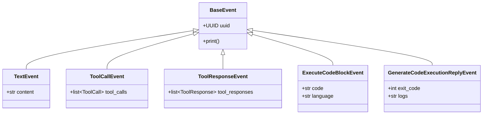
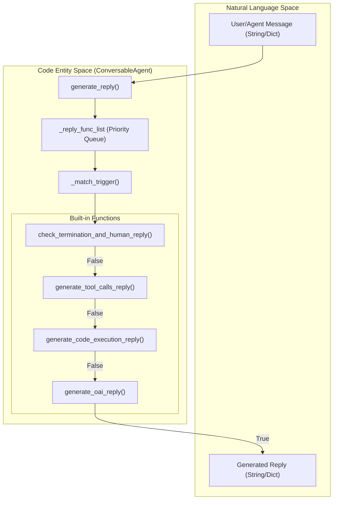
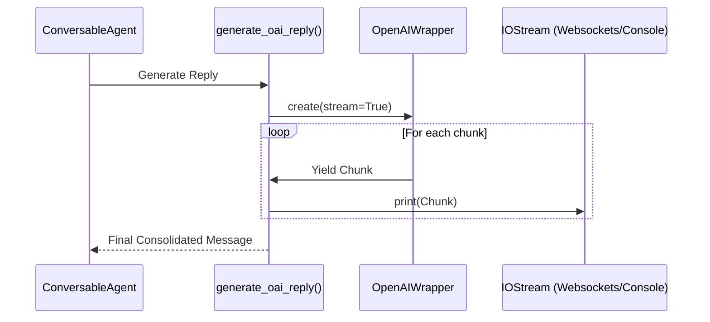

<!-- source: DeepWiki mcp.deepwiki.com · repo ag2ai/ag2 · page 2.2 Message Handling and Reply Functions · fetched 2026-10-27 -->

# Message Handling and Reply Functions

<details>
<summary>Relevant source files</summary>

The following files were used as context for generating this wiki page:

- [autogen/agentchat/chat.py](autogen/agentchat/chat.py)
- [autogen/agentchat/conversable_agent.py](autogen/agentchat/conversable_agent.py)
- [autogen/agentchat/group/safeguards/enforcer.py](autogen/agentchat/group/safeguards/enforcer.py)
- [autogen/agentchat/groupchat.py](autogen/agentchat/groupchat.py)
- [autogen/events/agent_events.py](autogen/events/agent_events.py)
- [autogen/events/base_event.py](autogen/events/base_event.py)
- [autogen/events/client_events.py](autogen/events/client_events.py)
- [autogen/events/helpers.py](autogen/events/helpers.py)
- [autogen/events/print_event.py](autogen/events/print_event.py)
- [autogen/exception_utils.py](autogen/exception_utils.py)
- [autogen/io/__init__.py](autogen/io/__init__.py)
- [autogen/io/base.py](autogen/io/base.py)
- [autogen/io/console.py](autogen/io/console.py)
- [autogen/io/websockets.py](autogen/io/websockets.py)
- [autogen/messages/__init__.py](autogen/messages/__init__.py)
- [autogen/messages/agent_messages.py](autogen/messages/agent_messages.py)
- [autogen/messages/base_message.py](autogen/messages/base_message.py)
- [autogen/messages/client_messages.py](autogen/messages/client_messages.py)
- [autogen/messages/print_message.py](autogen/messages/print_message.py)
- [autogen/oai/gemini_types.py](autogen/oai/gemini_types.py)
- [notebook/agentchat_websockets.ipynb](notebook/agentchat_websockets.ipynb)
- [test/agentchat/test_conversable_agent.py](test/agentchat/test_conversable_agent.py)
- [test/agentchat/test_groupchat.py](test/agentchat/test_groupchat.py)
- [test/events/test_agent_events.py](test/events/test_agent_events.py)
- [test/io/test_base.py](test/io/test_base.py)
- [test/io/test_console.py](test/io/test_console.py)
- [test/io/test_websockets.py](test/io/test_websockets.py)
- [test/messages/test_agent_messages.py](test/messages/test_agent_messages.py)
- [test/messages/test_base_message.py](test/messages/test_base_message.py)
- [test/messages/test_client_messages.py](test/messages/test_client_messages.py)
- [test/messages/test_print_message.py](test/messages/test_print_message.py)
- [test/oai/test_gemini_types.py](test/oai/test_gemini_types.py)
- [test/tools/test_tool_imports.py](test/tools/test_tool_imports.py)

</details>


This page details the reply function system in `ConversableAgent`, the core mechanism for generating responses to incoming messages. It covers the message format hierarchy, trigger conditions, and the execution pipeline that allows agents to choose between LLM generation, code execution, tool calling, and human interaction.

For information about agent initialization, see [ConversableAgent](2.1). For details about tool registration, see [Function Calling and Tool Registration](5.1).

## Overview

When a `ConversableAgent` receives a message, it processes it through an ordered list of reply functions (`_reply_func_list`). Each function is associated with a trigger condition. The first function that returns `(True, message)` provides the agent's response.

This architecture enables:
- **Prioritized Response Strategies**: Ordered execution from termination checks to LLM generation.
- **Extensibility**: Developers can inject custom logic at any point in the pipeline.
- **Contextual Logic**: Different behaviors based on the sender's identity or message content.
- **Async Support**: Native handling of asynchronous reply generation.

Sources: [autogen/agentchat/conversable_agent.py:136-148](), [autogen/agentchat/conversable_agent.py:532-540]()

## Message Formats and Event Hierarchy

AG2 uses a structured event system for internal messaging and logging. The `BaseEvent` hierarchy defines how different types of interactions (text, tool calls, execution results) are represented.

### Event Model Hierarchy



**Key Event Classes:**
- **`TextEvent`**: Standard text-based communication between agents. [autogen/events/agent_events.py:101-118]()
- **`ToolCallEvent`**: Represents a suggestion from an LLM to invoke one or more tools. [autogen/events/agent_events.py:120-143]()
- **`ToolResponseEvent`**: Contains the results of tool executions. [autogen/events/agent_events.py:145-168]()
- **`ExecuteCodeBlockEvent`**: Triggered when an agent attempts to run a code snippet. [autogen/events/agent_events.py:302-321]()

Sources: [autogen/events/agent_events.py:17-60](), [autogen/messages/agent_messages.py:86-144]()

## Reply Function Registration

The `register_reply` method manages the `_reply_func_list`.

### The `register_reply` Method

```python
def register_reply(
    self,
    trigger: type[Agent] | str | Agent | Callable[[Agent], bool] | list,
    reply_func: Callable,
    position: int = 0,
    config: Any | None = None,
    reset_config: Callable[..., Any] | None = None,
    *,
    ignore_async_in_sync_chat: bool = False,
    remove_other_reply_funcs: bool = False,
)
```

**Parameters:**
- **`trigger`**: Determines when the function applies. Can be a class, instance, name string, or callable. [autogen/agentchat/conversable_agent.py:541-543]()
- **`reply_func`**: The generation logic. Must return `(bool, message)`. [autogen/agentchat/conversable_agent.py:565-575]()
- **`position`**: Priority index. `0` (default) inserts at the front (highest priority). [autogen/agentchat/conversable_agent.py:544]()
- **`ignore_async_in_sync_chat`**: Prevents blocking errors by skipping async functions in sync contexts. [autogen/agentchat/conversable_agent.py:548-555]()

Sources: [autogen/agentchat/conversable_agent.py:532-602]()

### Trigger Matching Logic

The `_match_trigger` internal method evaluates if a sender satisfies the registered condition.

| Trigger Type | Matching Logic |
| :--- | :--- |
| **Agent Class** | `isinstance(sender, trigger)` |
| **Agent Instance** | `sender == trigger` |
| **String** | `sender.name == trigger` |
| **Callable** | `trigger(sender)` returns `True` |
| **List** | Any item in the list matches the sender |

Sources: [autogen/agentchat/conversable_agent.py:1193-1237](), [test/agentchat/test_conversable_agent.py:70-106]()

## Reply Generation Pipeline

The `generate_reply` method orchestrates the execution flow.

### Pipeline Data Flow



**Execution Steps:**
1. **Message Retrieval**: Retrieves the conversation history for the sender. [autogen/agentchat/conversable_agent.py:1247-1256]()
2. **State Hooks**: Executes `update_agent_state_before_reply` to refresh context or system messages. [autogen/agentchat/conversable_agent.py:1258-1267]()
3. **Trigger Evaluation**: Iterates through `_reply_func_list` checking `_match_trigger`. [autogen/agentchat/conversable_agent.py:1270-1271]()
4. **Execution**: Calls the first matching `reply_func`. If it returns `(True, ...)`, the process stops. [autogen/agentchat/conversable_agent.py:1285-1300]()
5. **Fallback**: If no function triggers or returns `True`, the `default_auto_reply` is used. [autogen/agentchat/conversable_agent.py:1302-1304]()

Sources: [autogen/agentchat/conversable_agent.py:1239-1307](), [autogen/agentchat/conversable_agent.py:173-178]()

## Built-in Reply Functions

`ConversableAgent` registers core behaviors in reverse priority order during initialization (since `position=0` prepends to the list).

| Function | Priority | Role |
| :--- | :--- | :--- |
| `check_termination_and_human_reply` | 1 | Checks `is_termination_msg` and handles `human_input_mode`. [autogen/agentchat/conversable_agent.py:1892-2014]() |
| `generate_function_call_reply` | 2 | Executes legacy OpenAI-style function calls. [autogen/agentchat/conversable_agent.py:1680-1767]() |
| `generate_tool_calls_reply` | 3 | Executes modern tool calls (multi-tool support). [autogen/agentchat/conversable_agent.py:1769-1890]() |
| `generate_code_execution_reply` | 4 | Extracts and runs code blocks via a `CodeExecutor`. [autogen/agentchat/conversable_agent.py:1444-1585]() |
| `generate_oai_reply` | 5 | Calls the LLM via `OpenAIWrapper`. [autogen/agentchat/conversable_agent.py:2134-2249]() |

Sources: [autogen/agentchat/conversable_agent.py:288-364]()

### Human-in-the-Loop and Termination
The `check_termination_and_human_reply` function is the first line of defense. It checks:
- **Termination**: If `is_termination_msg` is true, it may stop the chat or ask for human input. [autogen/agentchat/conversable_agent.py:1924-1934]()
- **Human Input Mode**: If set to `ALWAYS`, it bypasses auto-replies to prompt the user. [autogen/agentchat/conversable_agent.py:1963-1967]()
- **Auto-Reply Limits**: If `max_consecutive_auto_reply` is reached, it forces human intervention. [autogen/agentchat/conversable_agent.py:1945-1956]()

Sources: [autogen/agentchat/conversable_agent.py:1892-2014]()

## IO and Streaming Integration

The reply system interacts with `IOStream` to handle real-time feedback and streaming.



**Implementation Details:**
- **`IOWebsockets`**: Used to stream events and text to remote clients. [autogen/io/websockets.py:112-140]()
- **`GenerateCodeExecutionReplyEvent`**: Emitted when code is executed, allowing UIs to show terminal output in real-time. [autogen/agentchat/conversable_agent.py:1658-1662]()

Sources: [autogen/io/base.py:32-61](), [autogen/io/websockets.py:112-140](), [notebook/agentchat_websockets.ipynb:116-130]()

---

