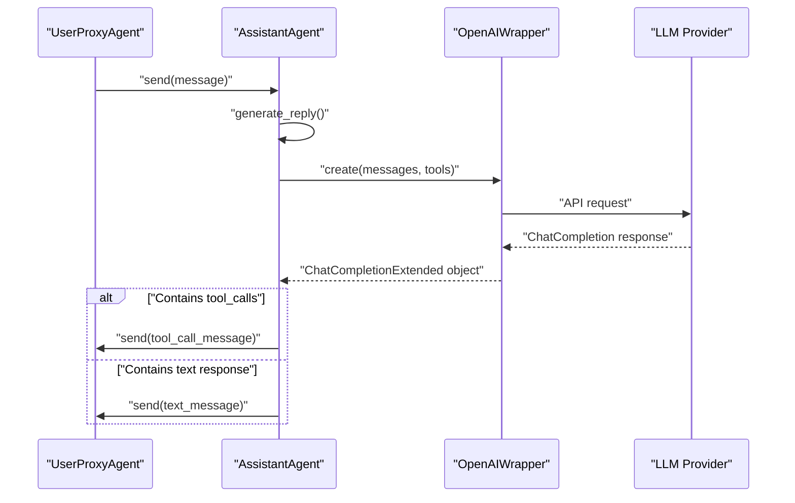
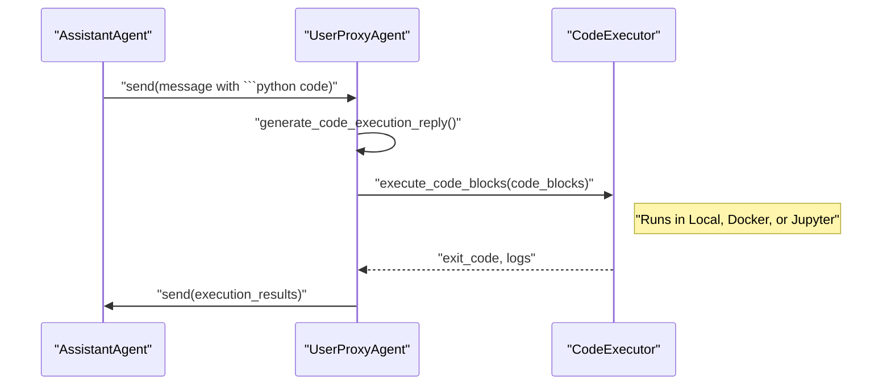
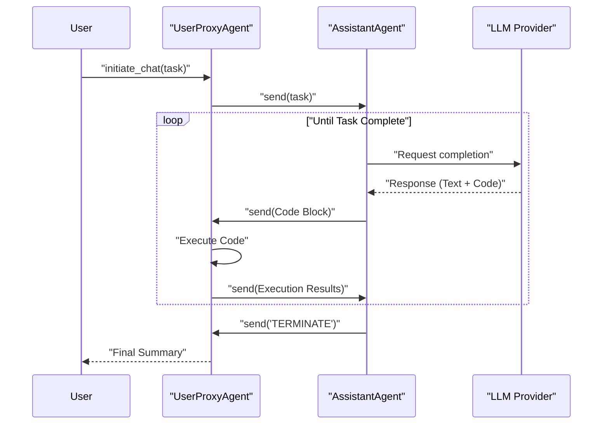

<!-- source: DeepWiki mcp.deepwiki.com · repo ag2ai/ag2 · page 2.3 AssistantAgent and UserProxyAgent · fetched 2026-10-27 -->

# AssistantAgent and UserProxyAgent

<details>
<summary>Relevant source files</summary>

The following files were used as context for generating this wiki page:

- [autogen/agentchat/assistant_agent.py](autogen/agentchat/assistant_agent.py)
- [autogen/agentchat/contrib/agent_optimizer.py](autogen/agentchat/contrib/agent_optimizer.py)
- [autogen/agentchat/contrib/captainagent/agent_builder.py](autogen/agentchat/contrib/captainagent/agent_builder.py)
- [autogen/agentchat/contrib/captainagent/captainagent.py](autogen/agentchat/contrib/captainagent/captainagent.py)
- [autogen/agentchat/contrib/math_user_proxy_agent.py](autogen/agentchat/contrib/math_user_proxy_agent.py)
- [autogen/agentchat/contrib/text_analyzer_agent.py](autogen/agentchat/contrib/text_analyzer_agent.py)
- [autogen/agentchat/user_proxy_agent.py](autogen/agentchat/user_proxy_agent.py)
- [autogen/oai/client.py](autogen/oai/client.py)
- [notebook/agentchat_agentoptimizer.ipynb](notebook/agentchat_agentoptimizer.ipynb)
- [notebook/agentchat_teachability.ipynb](notebook/agentchat_teachability.ipynb)
- [notebook/agentchat_teachable_oai_assistants.ipynb](notebook/agentchat_teachable_oai_assistants.ipynb)
- [test/agentchat/contrib/test_agent_optimizer.py](test/agentchat/contrib/test_agent_optimizer.py)
- [test/agentchat/test_agent_logging.py](test/agentchat/test_agent_logging.py)
- [test/agentchat/test_agent_usage.py](test/agentchat/test_agent_usage.py)
- [test/agentchat/test_assistant_agent.py](test/agentchat/test_assistant_agent.py)
- [test/agentchat/test_async.py](test/agentchat/test_async.py)
- [test/agentchat/test_async_chats.py](test/agentchat/test_async_chats.py)
- [test/agentchat/test_async_get_human_input.py](test/agentchat/test_async_get_human_input.py)
- [test/agentchat/test_cache_agent.py](test/agentchat/test_cache_agent.py)
- [test/agentchat/test_chats.py](test/agentchat/test_chats.py)
- [test/agentchat/test_function_call.py](test/agentchat/test_function_call.py)
- [test/agentchat/test_function_call_groupchat.py](test/agentchat/test_function_call_groupchat.py)
- [test/agentchat/test_human_input.py](test/agentchat/test_human_input.py)
- [test/agentchat/test_math_user_proxy_agent.py](test/agentchat/test_math_user_proxy_agent.py)
- [test/agentchat/test_nested.py](test/agentchat/test_nested.py)
- [test/agentchat/test_tool_calls.py](test/agentchat/test_tool_calls.py)
- [test/conftest.py](test/conftest.py)
- [test/oai/test_client.py](test/oai/test_client.py)
- [test/oai/test_client_stream.py](test/oai/test_client_stream.py)
- [test/test_conftest.py](test/test_conftest.py)
- [website/docs/user-guide/basic-concepts/assets/auto-termination-workflow.png](website/docs/user-guide/basic-concepts/assets/auto-termination-workflow.png)
- [website/docs/user-guide/basic-concepts/assets/enhanced-tool-workflow.png](website/docs/user-guide/basic-concepts/assets/enhanced-tool-workflow.png)
- [website/docs/user-guide/basic-concepts/assets/group-chat-workflow.png](website/docs/user-guide/basic-concepts/assets/group-chat-workflow.png)
- [website/docs/user-guide/basic-concepts/assets/human-in-the-loop-example.png](website/docs/user-guide/basic-concepts/assets/human-in-the-loop-example.png)
- [website/docs/user-guide/basic-concepts/assets/structured-output-workflow.png](website/docs/user-guide/basic-concepts/assets/structured-output-workflow.png)
- [website/docs/user-guide/basic-concepts/assets/tool-usage.png](website/docs/user-guide/basic-concepts/assets/tool-usage.png)
- [website/docs/user-guide/basic-concepts/human-in-the-loop.mdx](website/docs/user-guide/basic-concepts/human-in-the-loop.mdx)
- [website/docs/user-guide/basic-concepts/introducing-group-chat.mdx](website/docs/user-guide/basic-concepts/introducing-group-chat.mdx)
- [website/docs/user-guide/basic-concepts/introducing-tools.mdx](website/docs/user-guide/basic-concepts/introducing-tools.mdx)
- [website/docs/user-guide/basic-concepts/structured-outputs.mdx](website/docs/user-guide/basic-concepts/structured-outputs.mdx)

</details>


## Purpose and Scope

This document describes `AssistantAgent` and `UserProxyAgent`, the two primary specialized agent types in AG2 built on top of `ConversableAgent`. These agents represent the most common patterns in agentic workflows: an LLM-powered assistant that generates responses, and a user proxy that handles human interaction and code execution. For details on the base agent system and message handling, see [ConversableAgent](2.1). For multi-agent orchestration patterns, see [GroupChat and Multi-Agent Orchestration](2.4).

---

## Relationship to ConversableAgent

Both `AssistantAgent` and `UserProxyAgent` are subclasses of `ConversableAgent`, configured with different default settings to optimize for their specific roles. `ConversableAgent` provides the core message passing, reply generation, and extensibility infrastructure that both specialized agents inherit.

### Agent Hierarchy and Inheritance

```mermaid
graph TB
    ["ConversableAgent"] -- "inherits" --> ["AssistantAgent"]
    ["ConversableAgent"] -- "inherits" --> ["UserProxyAgent"]
    
    subgraph "autogen.agentchat.conversable_agent"
        ["ConversableAgent"]
    end
    
    subgraph "autogen.agentchat.assistant_agent"
        ["AssistantAgent"]
    end
    
    subgraph "autogen.agentchat.user_proxy_agent"
        ["UserProxyAgent"]
    end

    ["AssistantAgent"] -- "typically sends to" --> ["UserProxyAgent"]
    ["UserProxyAgent"] -- "typically sends to" --> ["AssistantAgent"]
```

**Sources:** [autogen/agentchat/user_proxy_agent.py:17-17](), [autogen/agentchat/assistant_agent.py:17-17](), [autogen/agentchat/conversable_agent.py:136-148]()

---

## AssistantAgent

### Overview

`AssistantAgent` is configured as an LLM-powered agent that generates responses using language models. It is designed to act as an intelligent assistant that can reason, generate code, call tools, and provide responses based on its system message and conversation history.

**Key Characteristics:**
- **LLM Integration:** Configured with `llm_config` by default to enable language model inference [autogen/agentchat/assistant_agent.py:29-37]().
- **System Message:** Typically given a system message defining its role and capabilities. Default: "You are a helpful AI assistant." [autogen/agentchat/assistant_agent.py:32-32]().
- **Tool Calling:** Can invoke tools and functions through the LLM's tool calling mechanism.
- **No Code Execution:** By default, it does not execute code directly; it relies on other agents (like `UserProxyAgent`) for execution.

### Basic Configuration

```python
from autogen import AssistantAgent

assistant = AssistantAgent(
    name="assistant",
    llm_config={
        "cache_seed": 42,
        "config_list": config_list,
    }
)
```

**Sources:** [autogen/agentchat/assistant_agent.py:29-54](), [test/agentchat/test_assistant_agent.py:29-37]()

### Assistant Agent Reply Flow

The `AssistantAgent` relies on the `OpenAIWrapper` to communicate with LLM providers.



**Sources:** [autogen/oai/client.py:23-23](), [autogen/agentchat/conversable_agent.py:1260-1280](), [test/agentchat/test_assistant_agent.py:111-135]()

---

## UserProxyAgent

### Overview

`UserProxyAgent` acts as a proxy for human users, enabling human-in-the-loop workflows and code execution. It is designed to receive tool/function calls from AI assistants, execute them (either through code execution or human input), and return results.

**Key Characteristics:**
- **Human Input Modes:** Configurable via `human_input_mode` ("ALWAYS", "TERMINATE", "NEVER") [autogen/agentchat/user_proxy_agent.py:41-41]().
- **Code Execution:** Can execute code blocks extracted from messages. Enabled by default [autogen/agentchat/user_proxy_agent.py:22-22]().
- **Tool Execution:** Serves as the executor for tools registered with `function_map` [autogen/agentchat/user_proxy_agent.py:42-42]().
- **Disabled LLM:** Typically configured with `llm_config=False` to avoid generating AI responses [autogen/agentchat/user_proxy_agent.py:45-45]().

### Human Input Modes

The `human_input_mode` parameter determines when the agent prompts the user:

| Mode | Behavior |
|------|----------|
| `"ALWAYS"` | Prompts for human input every time a message is received. Conversation stops if input is "exit" [autogen/agentchat/user_proxy_agent.py:62-64](). |
| `"TERMINATE"` | Prompts only when a termination message is received or `max_consecutive_auto_reply` is reached [autogen/agentchat/user_proxy_agent.py:65-67](). |
| `"NEVER"` | Never prompts for human input. Stops on termination or `max_consecutive_auto_reply` [autogen/agentchat/user_proxy_agent.py:68-69](). |

**Sources:** [autogen/agentchat/user_proxy_agent.py:60-69](), [test/agentchat/test_assistant_agent.py:82-97]()

### Code Execution Flow

`UserProxyAgent` uses a `CodeExecutor` (often configured via `code_execution_config`) to run code found in markdown blocks.



**Sources:** [autogen/agentchat/user_proxy_agent.py:70-83](), [test/agentchat/test_assistant_agent.py:87-91](), [test/agentchat/test_function_call.py:72-88]()

---

## Working Together: The Two-Agent Pattern

The most common pattern involves an `AssistantAgent` and a `UserProxyAgent` working together to solve tasks through iterative conversation.

### Interaction Example: Coding Task

```python
# 1. Setup Assistant
assistant = AssistantAgent("inner-assistant", llm_config=llm_config)

# 2. Setup UserProxy (The Executor)
user_proxy = UserProxyAgent(
    "inner-user-proxy",
    human_input_mode="NEVER",
    code_execution_config={"work_dir": "coding", "use_docker": False}
)

# 3. Start Chat
user_proxy.initiate_chat(assistant, message="Write a script to fetch stock prices.")
```

**Sources:** [test/agentchat/test_assistant_agent.py:39-56](), [test/agentchat/test_chats.py:77-104]()

### Complete Interaction Cycle



**Sources:** [test/agentchat/test_assistant_agent.py:132-158](), [test/agentchat/test_chats.py:150-163]()

---

## Configuration Comparison

| Feature | AssistantAgent | UserProxyAgent |
|---------|---------------|----------------|
| **LLM Config** | Enabled by default (required for reasoning) | Disabled by default (`False`) |
| **System Message** | Defines AI persona/role | Defines proxy behavior/instructions |
| **Code Execution** | Disabled | Enabled by default |
| **Human Input** | `"NEVER"` | `"ALWAYS"`, `"TERMINATE"`, or `"NEVER"` |
| **Tool Usage** | Suggests tool calls (via LLM) | Executes tool calls (via `function_map`) |

**Sources:** [autogen/agentchat/user_proxy_agent.py:36-49](), [autogen/agentchat/assistant_agent.py:29-54]()

---

## UserProxyAgent as Tool Executor

`UserProxyAgent` is the primary agent for executing functions. Functions are mapped via the `function_map` dictionary or registered using the `register_function` utility.

```python
def add_num(num_to_be_added):
    return str(num_to_be_added + 10)

user = UserProxyAgent(name="test", function_map={"add_num": add_num})

# When a tool call is received:
correct_args = {"name": "add_num", "arguments": '{ "num_to_be_added": 5 }'}
result = user.execute_function(func_call=correct_args)
# result[1]["content"] == "15"
```

**Sources:** [test/agentchat/test_function_call.py:94-102](), [autogen/agentchat/user_proxy_agent.py:42-42]()

---

## Runtime Logging

Both agent types support AG2's runtime logging system. When enabled, agent initialization, LLM calls, and message exchanges are recorded to a database (e.g., SQLite).

- `AssistantAgent` logs its LLM invocations in the `chat_completions` table [test/agentchat/test_agent_logging.py:33-34]().
- Both agents record their metadata in the `agents` table [test/agentchat/test_agent_logging.py:36-36]().

**Sources:** [test/agentchat/test_agent_logging.py:64-83](), [autogen/runtime_logging.py:12-12]()

---

