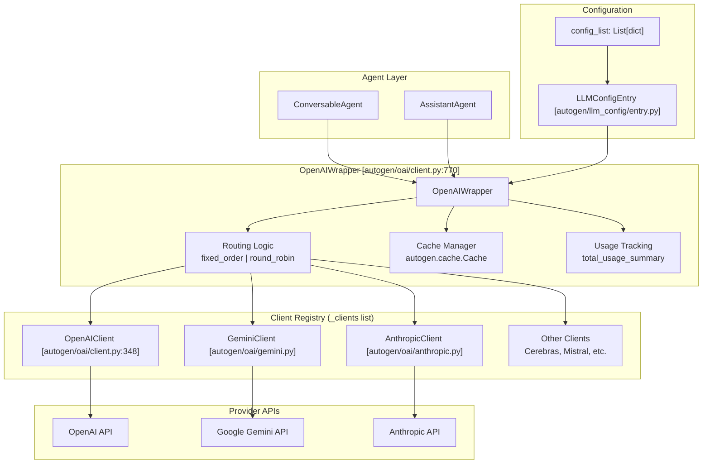
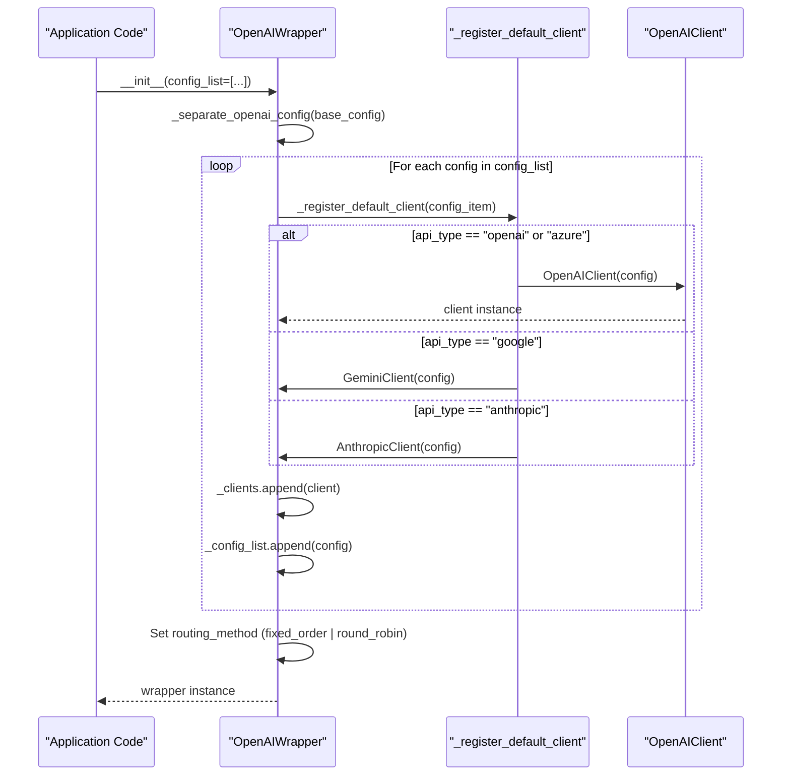
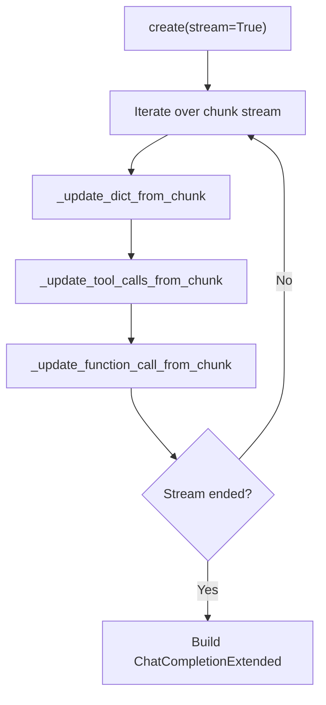
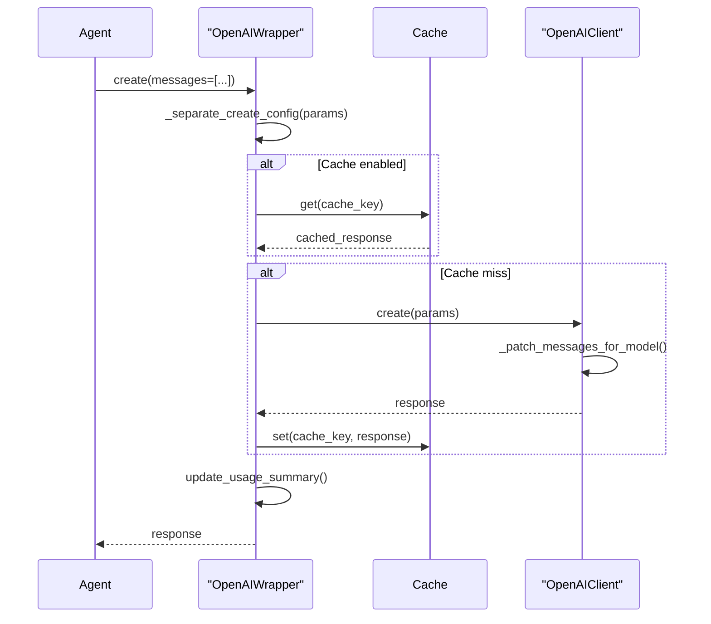

<!-- source: DeepWiki mcp.deepwiki.com · repo ag2ai/ag2 · page 3.1 OpenAIWrapper and Client Architecture · fetched 2026-10-27 -->

# OpenAIWrapper and Client Architecture

Relevant source files

The following files were used as context for generating this wiki page:

- [autogen/oai/__init__.py](autogen/oai/__init__.py)
- [autogen/oai/client.py](autogen/oai/client.py)
- [autogen/oai/openai_utils.py](autogen/oai/openai_utils.py)
- [autogen/token_count_utils.py](autogen/token_count_utils.py)
- [autogen/tools/experimental/shell/__init__.py](autogen/tools/experimental/shell/__init__.py)
- [autogen/tools/experimental/shell/shell_tool.py](autogen/tools/experimental/shell/shell_tool.py)
- [notebook/agentchat_gpt5.1_in_built_tools_example.ipynb](notebook/agentchat_gpt5.1_in_built_tools_example.ipynb)
- [notebook/agentchat_gpt5.1_shell_tool_example.ipynb](notebook/agentchat_gpt5.1_shell_tool_example.ipynb)
- [test/agentchat/test_agent_logging.py](test/agentchat/test_agent_logging.py)
- [test/agentchat/test_agent_usage.py](test/agentchat/test_agent_usage.py)
- [test/agentchat/test_assistant_agent.py](test/agentchat/test_assistant_agent.py)
- [test/agentchat/test_async.py](test/agentchat/test_async.py)
- [test/agentchat/test_async_chats.py](test/agentchat/test_async_chats.py)
- [test/agentchat/test_async_get_human_input.py](test/agentchat/test_async_get_human_input.py)
- [test/agentchat/test_cache_agent.py](test/agentchat/test_cache_agent.py)
- [test/agentchat/test_chats.py](test/agentchat/test_chats.py)
- [test/agentchat/test_function_call.py](test/agentchat/test_function_call.py)
- [test/agentchat/test_function_call_groupchat.py](test/agentchat/test_function_call_groupchat.py)
- [test/agentchat/test_human_input.py](test/agentchat/test_human_input.py)
- [test/agentchat/test_math_user_proxy_agent.py](test/agentchat/test_math_user_proxy_agent.py)
- [test/agentchat/test_nested.py](test/agentchat/test_nested.py)
- [test/agentchat/test_tool_calls.py](test/agentchat/test_tool_calls.py)
- [test/conftest.py](test/conftest.py)
- [test/oai/test_client.py](test/oai/test_client.py)
- [test/oai/test_client_stream.py](test/oai/test_client_stream.py)
- [test/oai/test_utils.py](test/oai/test_utils.py)
- [test/test_conftest.py](test/test_conftest.py)
- [test/test_notebook.py](test/test_notebook.py)
- [test/tools/experimental/shell/test_shell_tool.py](test/tools/experimental/shell/test_shell_tool.py)

## Purpose and Scope

This document details the LLM integration layer in AG2, specifically the `OpenAIWrapper` class and its client architecture. The `OpenAIWrapper` provides a unified interface for interacting with multiple LLM providers (OpenAI, Azure OpenAI, Gemini, Anthropic, etc.) through a consistent API. This abstraction allows agents to use different LLM providers interchangeably without code changes.

For information about how agents use the `OpenAIWrapper`, see [ConversableAgent (2.1)](). For details about LLM configuration, see [LLM Configuration System (3.2)](). For provider-specific client implementations, see [Provider-Specific Clients (3.3)](). For caching and cost tracking details, see [Caching and Cost Tracking (3.4)]().

## Architecture Overview

### System Components

The architecture bridges the high-level agent requests to low-level provider SDKs using a routing and management layer.

**Sources:** [autogen/oai/client.py:770-878](), [autogen/oai/client.py:348-768](), [autogen/llm_config/entry.py:12-45]()

### Key Classes and Interfaces

| Class | Location | Purpose |
|-------|----------|---------|
| `OpenAIWrapper` | [autogen/oai/client.py:770-878]() | Unified LLM interface, manages multiple clients and routing. |
| `OpenAIClient` | [autogen/oai/client.py:348-768]() | Wraps OpenAI/AzureOpenAI SDK clients; handles message patching. |
| `GeminiClient` | [autogen/oai/client.py:91]() | Google Gemini API integration. |
| `AnthropicClient` | [autogen/oai/client.py:105]() | Anthropic Claude API integration. |
| `ModelClient` | [autogen/oai/client.py:32]() | Protocol defining the client interface (create, cost, usage). |
| `LLMConfigEntry` | [autogen/oai/client.py:33]() | Base configuration model for Pydantic validation. |
| `OpenAILLMConfigEntry` | [autogen/oai/client.py:262-286]() | OpenAI-specific configuration model. |
| `AzureOpenAILLMConfigEntry` | [autogen/oai/client.py:301-316]() | Azure OpenAI configuration model. |

**Sources:** [autogen/oai/client.py:1-878]()

## OpenAIWrapper Class

### Initialization and Client Registration

The `OpenAIWrapper` class is the central component for LLM interactions. It accepts a `config_list` to initialize multiple clients.

**Sources:** [autogen/oai/client.py:799-877](), [autogen/oai/client.py:879-973](), [test/oai/test_client.py:96-137]()

### Routing Strategies

#### Fixed Order Routing (Default)
The wrapper attempts to use the first client in the `_clients` list. If it fails with a retriable error, it moves to the next client.

**Sources:** [autogen/oai/client.py:1109-1157](), [test/oai/test_client.py:139-148]()

#### Round Robin Routing
The wrapper maintains a `_round_robin_index` and cycles through available clients for each request.

**Sources:** [autogen/oai/client.py:1159-1189](), [test/oai/test_client.py:150-227]()

## Client Protocol and Implementations

### ModelClient Protocol
All LLM clients must implement the `ModelClient` protocol:
- `create(params: dict) -> ChatCompletion`: Execute LLM request.
- `message_retrieval(response) -> list`: Extract messages from response.
- `cost(response) -> float`: Calculate request cost.
- `get_usage(response) -> dict`: Extract usage statistics.

**Sources:** [autogen/oai/client.py:32]()

### OpenAIClient Implementation

The `OpenAIClient` class wraps the OpenAI SDK and provides special handling for model quirks.

#### Special Model Handling
- **O1/O3 Reasoning Models**: The client removes unsupported parameters like `temperature` or `top_p` and converts `max_tokens` to `max_completion_tokens`. [autogen/oai/client.py:704-737]()
- **DeepSeek Reasoner**: Patches messages to ensure the system message is at the beginning and roles alternate correctly. [autogen/oai/client.py:415-452]()
- **Mistral Models**: Automatically converts `system` roles to `user` roles to satisfy provider requirements. [autogen/oai/client.py:481-484]()

#### Streaming Implementation
Streaming is handled by iterating over `ChatCompletionChunk` objects and accumulating content and tool calls.

**Sources:** [autogen/oai/client.py:553-677](), [test/oai/test_client_stream.py:41-46]()

## Configuration System

### LLMConfigEntry Classes
Configuration entries are validated using Pydantic models to ensure type safety.

- **OpenAILLMConfigEntry**: Includes fields like `api_key`, `base_url`, `price`, and `reasoning_effort`. [autogen/oai/client.py:262-286]()
- **AzureOpenAILLMConfigEntry**: Includes `azure_ad_token_provider` and `api_version`. [autogen/oai/client.py:301-316]()

## Request/Response Flow

### Create Method Flow

**Sources:** [autogen/oai/client.py:1021-1157](), [autogen/oai/client.py:491-702]()

## Caching and Cost Tracking

### Caching System
The wrapper supports both legacy `cache_seed` (based on disk) and the new `autogen.cache.Cache` interface (supporting Disk and Redis).

**Sources:** [autogen/oai/client.py:1029-1058](), [test/oai/test_client.py:552-613]()

### Cost and Usage Tracking
The wrapper tracks usage across all calls in `total_usage_summary`. Cost calculation uses the `OAI_PRICE1K` mapping.

| Model | Input Price (1K) | Output Price (1K) |
|-------|------------------|-------------------|
| `gpt-4o` | 0.005 | 0.015 |
| `gpt-4o-mini` | 0.00015 | 0.0006 |
| `o1-preview` | 0.015 | 0.060 |

**Sources:** [autogen/oai/openai_utils.py:46-151](), [autogen/oai/client.py:739-757](), [test/oai/test_client.py:369-384]()

### Runtime Logging
When `logging_enabled` is true, the wrapper calls `log_chat_completion`, `log_new_client`, and `log_new_wrapper` to persist telemetry data to the active logger (e.g., `SqliteLogger`).

**Sources:** [autogen/oai/client.py:35](), [autogen/oai/client.py:836-837](), [autogen/oai/client.py:1076-1081]()

---

