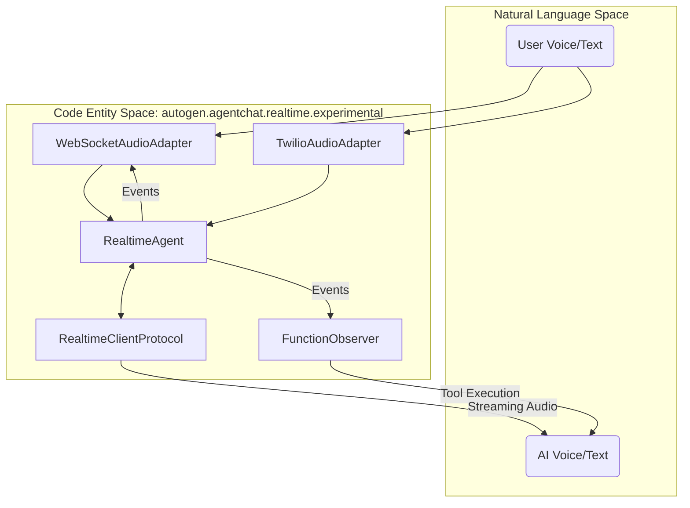
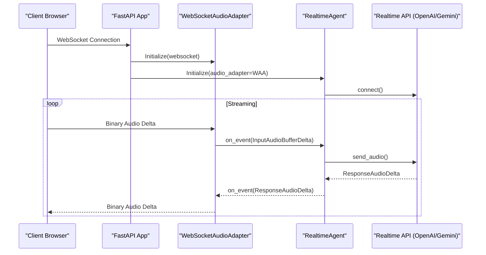
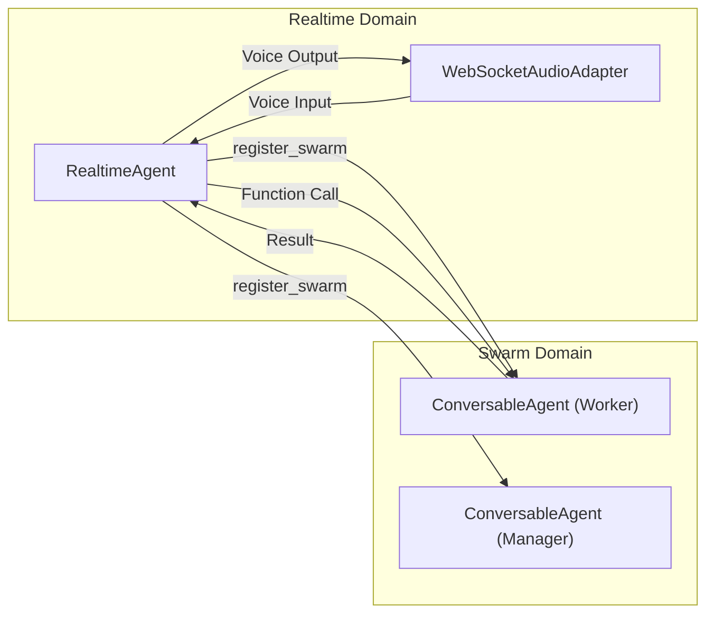

<!-- source: DeepWiki mcp.deepwiki.com · repo ag2ai/ag2 · page 4.2 Realtime Agents · fetched 2026-10-27 -->

# Realtime Agents

Relevant source files

The following files were used as context for generating this wiki page:

- [autogen/agentchat/realtime/experimental/__init__.py](autogen/agentchat/realtime/experimental/__init__.py)
- [autogen/agentchat/realtime/experimental/audio_observer.py](autogen/agentchat/realtime/experimental/audio_observer.py)
- [autogen/agentchat/realtime/experimental/clients/gemini/client.py](autogen/agentchat/realtime/experimental/clients/gemini/client.py)
- [autogen/agentchat/realtime/experimental/clients/oai/base_client.py](autogen/agentchat/realtime/experimental/clients/oai/base_client.py)
- [autogen/agentchat/realtime/experimental/clients/oai/rtc_client.py](autogen/agentchat/realtime/experimental/clients/oai/rtc_client.py)
- [autogen/agentchat/realtime/experimental/clients/oai/utils.py](autogen/agentchat/realtime/experimental/clients/oai/utils.py)
- [autogen/agentchat/realtime/experimental/clients/realtime_client.py](autogen/agentchat/realtime/experimental/clients/realtime_client.py)
- [autogen/agentchat/realtime/experimental/function_observer.py](autogen/agentchat/realtime/experimental/function_observer.py)
- [autogen/agentchat/realtime/experimental/realtime_agent.py](autogen/agentchat/realtime/experimental/realtime_agent.py)
- [autogen/agentchat/realtime/experimental/realtime_events.py](autogen/agentchat/realtime/experimental/realtime_events.py)
- [autogen/agentchat/realtime/experimental/realtime_observer.py](autogen/agentchat/realtime/experimental/realtime_observer.py)
- [autogen/agentchat/realtime_agent/__init__.py](autogen/agentchat/realtime_agent/__init__.py)
- [autogen/doc_utils.py](autogen/doc_utils.py)
- [autogen/environments/docker_python_environment.py](autogen/environments/docker_python_environment.py)
- [autogen/environments/system_python_environment.py](autogen/environments/system_python_environment.py)
- [autogen/environments/venv_python_environment.py](autogen/environments/venv_python_environment.py)
- [autogen/fast_depends/utils.py](autogen/fast_depends/utils.py)
- [autogen/oai/oai_models/_models.py](autogen/oai/oai_models/_models.py)
- [autogen/oai/oai_models/chat_completion_message.py](autogen/oai/oai_models/chat_completion_message.py)
- [notebook/agentchat_function_call_code_writing.ipynb](notebook/agentchat_function_call_code_writing.ipynb)
- [notebook/agentchat_image_generation_capability.ipynb](notebook/agentchat_image_generation_capability.ipynb)
- [notebook/agentchat_realtime_gemini_swarm_websocket.ipynb](notebook/agentchat_realtime_gemini_swarm_websocket.ipynb)
- [notebook/agentchat_realtime_gemini_websocket.ipynb](notebook/agentchat_realtime_gemini_websocket.ipynb)
- [notebook/agentchat_realtime_swarm.ipynb](notebook/agentchat_realtime_swarm.ipynb)
- [notebook/agentchat_realtime_swarm_webrtc.ipynb](notebook/agentchat_realtime_swarm_webrtc.ipynb)
- [notebook/agentchat_realtime_swarm_websocket.ipynb](notebook/agentchat_realtime_swarm_websocket.ipynb)
- [notebook/agentchat_realtime_webrtc.ipynb](notebook/agentchat_realtime_webrtc.ipynb)
- [notebook/agentchat_realtime_websocket.ipynb](notebook/agentchat_realtime_websocket.ipynb)
- [test/agentchat/realtime_agent/realtime_test_utils.py](test/agentchat/realtime_agent/realtime_test_utils.py)
- [test/agentchat/realtime_agent/test_e2e.py](test/agentchat/realtime_agent/test_e2e.py)
- [test/agentchat/realtime_agent/test_realtime_agent.py](test/agentchat/realtime_agent/test_realtime_agent.py)
- [test/agentchat/realtime_agent/test_realtime_observer.py](test/agentchat/realtime_agent/test_realtime_observer.py)
- [test/agentchat/realtime_agent/test_submodule.py](test/agentchat/realtime_agent/test_submodule.py)
- [test/agentchat/realtime_agent/test_swarm_start.py](test/agentchat/realtime_agent/test_swarm_start.py)
- [website/docs/contributor-guide/setup-development-environment.mdx](website/docs/contributor-guide/setup-development-environment.mdx)
- [website/generate_api_references.py](website/generate_api_references.py)

The Realtime Agent system is an experimental framework within AG2 designed for low-latency, multimodal interactions, primarily focusing on voice-to-voice and real-time streaming capabilities. It integrates with high-performance APIs such as OpenAI's Realtime API and Gemini's Multimodal Live API.

> [!WARNING]
> `RealtimeAgent` is deprecated as of v0.12 and scheduled for removal in v0.14. It relies on specific realtime API endpoints that are being transitioned to newer protocols [notebook/agentchat_realtime_swarm.ipynb:10-12]().

## System Architecture

The realtime system operates on an event-driven architecture where a central `RealtimeAgent` manages a connection to an LLM provider and broadcasts events to a collection of `RealtimeObserver` objects.

### Core Components and Data Flow

The following diagram illustrates the relationship between the agent, the transport adapters, and the underlying LLM clients.

**Realtime Agent Entity Map**

Sources: [autogen/agentchat/realtime/experimental/realtime_agent.py:36-85](), [autogen/agentchat/realtime_agent/__init__.py:5-12]()

### Implementation Details

The `RealtimeAgent` class is the primary orchestrator. Unlike `ConversableAgent`, which follows a turn-based `send`/`receive` pattern, `RealtimeAgent` maintains a persistent connection via a `RealtimeClientProtocol` implementation [autogen/agentchat/realtime/experimental/realtime_agent.py:75-77]().

Key methods and attributes:
*   **`run()`**: Initializes the task group, connects to the LLM, starts all registered observers, and enters a loop reading events from the client [autogen/agentchat/realtime/experimental/realtime_agent.py:125-139]().
*   **`register_realtime_function()`**: A decorator used to define tools that the agent can call during a live session [autogen/agentchat/realtime/experimental/realtime_agent.py:140-171]().
*   **`observers`**: A list of `RealtimeObserver` objects (like `FunctionObserver` or `AudioAdapter`) that react to events such as `InputAudioBufferDelta` or `ResponseDone` [autogen/agentchat/realtime/experimental/realtime_agent.py:80-84]().

Sources: [autogen/agentchat/realtime/experimental/realtime_agent.py:36-171]()

## Transports and Adapters

Realtime agents require specialized adapters to bridge external audio/data streams into the AG2 event system.

| Adapter | Use Case | File Path |
| :--- | :--- | :--- |
| `WebSocketAudioAdapter` | Browser-based voice interaction using FastAPI/WebSockets | [autogen/agentchat/realtime_agent/__init__.py:10]() |
| `TwilioAudioAdapter` | Integrating with Twilio Voice streams (Media Streams) | [autogen/agentchat/realtime_agent/__init__.py:9]() |
| `AudioObserver` | Local microphone and speaker interaction | [notebook/agentchat_realtime_websocket.ipynb:79]() |

### WebSocket Integration Flow
In a typical FastAPI implementation, the `WebSocketAudioAdapter` wraps the `fastapi.WebSocket` object to handle the bidirectional binary/JSON stream.

**WebSocket Data Flow**

Sources: [notebook/agentchat_realtime_websocket.ipynb:173-210](), [test/agentchat/realtime_agent/test_e2e.py:41-68]()

## LLM Client Implementations

The system supports multiple providers through the `RealtimeClientProtocol` [autogen/agentchat/realtime/experimental/clients/realtime_client.py:25]().

1.  **OpenAI Realtime**: Supports `gpt-4o-realtime-preview`. It handles complex session updates and VAD (Voice Activity Detection) [notebook/agentchat_realtime_swarm.ipynb:123-134]().
2.  **Gemini Multimodal Live**: Connects to `gemini-2.0-flash-exp` via Google's multimodal endpoints [notebook/agentchat_realtime_gemini_swarm_websocket.ipynb:142-155]().

Clients are instantiated via `get_client()` which uses a factory pattern based on the `llm_config` [autogen/agentchat/realtime/experimental/clients/realtime_client.py:173-191]().

Sources: [autogen/agentchat/realtime/experimental/clients/realtime_client.py:9-107]()

## Realtime Swarm Patterns

AG2 allows integrating `RealtimeAgent` into Swarm orchestrations. This enables a voice-based agent to act as the "entry point" or a participant in a swarm of specialized `ConversableAgent` instances.

### Swarm Registration
The `register_swarm` function connects a `RealtimeAgent` to a swarm. It enables the realtime agent to "handoff" the conversation to other agents by translating tool calls into swarm transitions [autogen/agentchat/realtime/experimental/realtime_swarm.py:17]().

**Swarm Integration Entity Map**

Sources: [test/agentchat/realtime_agent/test_swarm_start.py:62-73](), [notebook/agentchat_realtime_swarm.ipynb:16-20]()

### Example: Airline Customer Service
In a swarm configuration, the `RealtimeAgent` might handle the initial greeting. If the user asks about baggage, the `RealtimeAgent` invokes a tool that triggers a handoff to a `BaggageAgent` (a standard `ConversableAgent`). The results are then streamed back to the user as voice [notebook/agentchat_realtime_swarm.ipynb:151-185]().

Sources: [notebook/agentchat_realtime_swarm.ipynb:151-185](), [test/agentchat/realtime_agent/test_swarm_start.py:27-103]()

---

