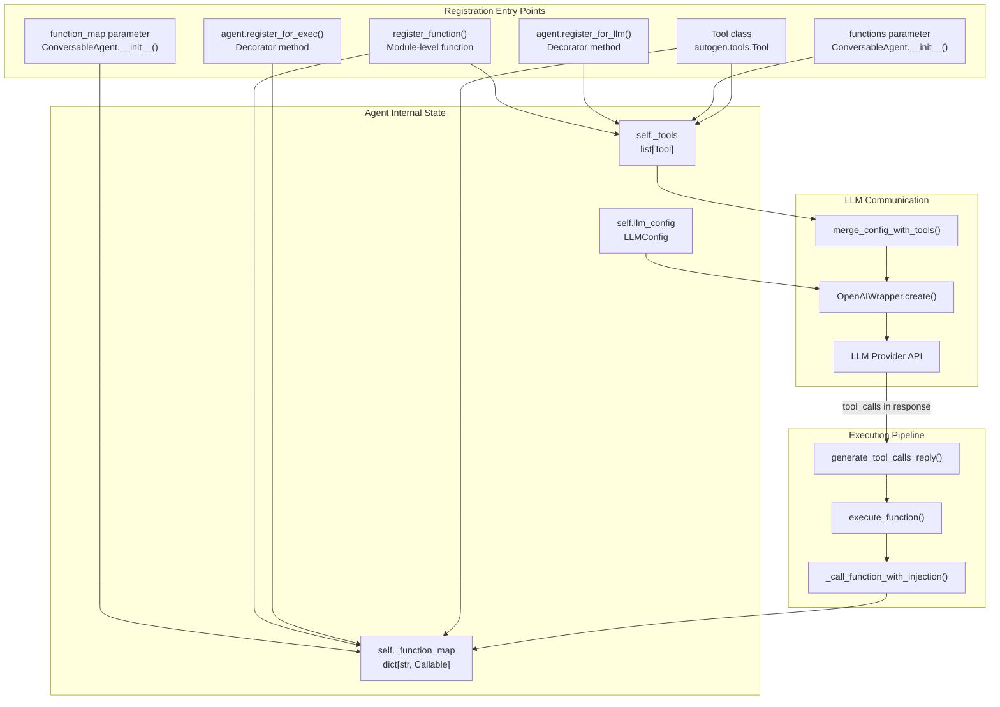
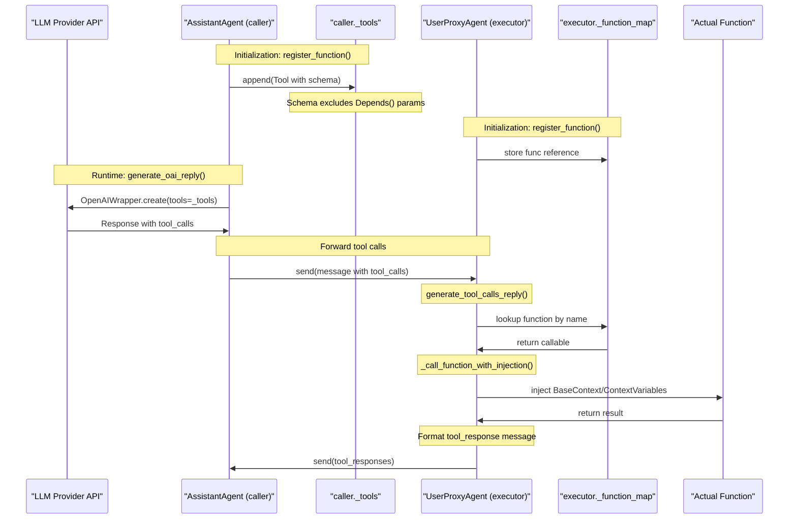

<!-- source: DeepWiki mcp.deepwiki.com · repo ag2ai/ag2 · page 5.1 Function Calling and Tool Registration · fetched 2026-10-27 -->

# Function Calling and Tool Registration

<details>
<summary>Relevant source files</summary>

The following files were used as context for generating this wiki page:

- [.pre-commit-config.yaml](.pre-commit-config.yaml)
- [autogen/agentchat/contrib/swarm_agent.py](autogen/agentchat/contrib/swarm_agent.py)
- [autogen/interop/__init__.py](autogen/interop/__init__.py)
- [autogen/interop/crewai/__init__.py](autogen/interop/crewai/__init__.py)
- [autogen/interop/crewai/crewai.py](autogen/interop/crewai/crewai.py)
- [autogen/interop/interoperability.py](autogen/interop/interoperability.py)
- [autogen/interop/interoperable.py](autogen/interop/interoperable.py)
- [autogen/interop/langchain/__init__.py](autogen/interop/langchain/__init__.py)
- [autogen/interop/pydantic_ai/__init__.py](autogen/interop/pydantic_ai/__init__.py)
- [autogen/interop/pydantic_ai/pydantic_ai.py](autogen/interop/pydantic_ai/pydantic_ai.py)
- [autogen/llm_config/client.py](autogen/llm_config/client.py)
- [autogen/oai/client.py](autogen/oai/client.py)
- [autogen/tools/__init__.py](autogen/tools/__init__.py)
- [autogen/tools/dependency_injection.py](autogen/tools/dependency_injection.py)
- [autogen/tools/function_utils.py](autogen/tools/function_utils.py)
- [autogen/tools/tool.py](autogen/tools/tool.py)
- [scripts/pre-commit-mypy-run.sh](scripts/pre-commit-mypy-run.sh)
- [test/agentchat/contrib/test_swarm.py](test/agentchat/contrib/test_swarm.py)
- [test/agentchat/test_agent_logging.py](test/agentchat/test_agent_logging.py)
- [test/agentchat/test_agent_usage.py](test/agentchat/test_agent_usage.py)
- [test/agentchat/test_assistant_agent.py](test/agentchat/test_assistant_agent.py)
- [test/agentchat/test_async.py](test/agentchat/test_async.py)
- [test/agentchat/test_async_chats.py](test/agentchat/test_async_chats.py)
- [test/agentchat/test_async_get_human_input.py](test/agentchat/test_async_get_human_input.py)
- [test/agentchat/test_cache_agent.py](test/agentchat/test_cache_agent.py)
- [test/agentchat/test_chats.py](test/agentchat/test_chats.py)
- [test/agentchat/test_function_call.py](test/agentchat/test_function_call.py)
- [test/agentchat/test_function_call_groupchat.py](test/agentchat/test_function_call_groupchat.py)
- [test/agentchat/test_human_input.py](test/agentchat/test_human_input.py)
- [test/agentchat/test_math_user_proxy_agent.py](test/agentchat/test_math_user_proxy_agent.py)
- [test/agentchat/test_nested.py](test/agentchat/test_nested.py)
- [test/agentchat/test_tool_calls.py](test/agentchat/test_tool_calls.py)
- [test/conftest.py](test/conftest.py)
- [test/interop/crewai/test_crewai.py](test/interop/crewai/test_crewai.py)
- [test/interop/langchain/test_langchain.py](test/interop/langchain/test_langchain.py)
- [test/interop/pydantic_ai/test_pydantic_ai.py](test/interop/pydantic_ai/test_pydantic_ai.py)
- [test/interop/pydantic_ai/test_pydantic_ai_tool.py](test/interop/pydantic_ai/test_pydantic_ai_tool.py)
- [test/interop/test_interoperability.py](test/interop/test_interoperability.py)
- [test/oai/test_client.py](test/oai/test_client.py)
- [test/oai/test_client_stream.py](test/oai/test_client_stream.py)
- [test/test_conftest.py](test/test_conftest.py)
- [test/tools/test_dependency_injection.py](test/tools/test_dependency_injection.py)
- [test/tools/test_function_utils.py](test/tools/test_function_utils.py)
- [test/tools/test_tool.py](test/tools/test_tool.py)

</details>


## Purpose and Scope

This document covers how agents in AG2 register and execute external functions and tools. It explains the registration mechanisms, the caller-executor separation pattern, dependency injection for secure parameter handling, and the tool execution pipeline. For information about code execution capabilities, see [Code Execution System](#5.3). For experimental pre-built tools, see [Experimental Tools](#5.4).

## Overview

AG2 agents can be extended with external capabilities through function calling. The framework provides a sophisticated dual-registration system that separates LLM-facing schemas from execution logic, enabling secure integration of external services, APIs, and custom code while preventing exposure of sensitive credentials to language models.

**Key Components:**
- **Function Map**: Simple dictionary mapping function names to callables.
- **Registration Decorators**: `@register_for_llm` and `@register_for_exec` for granular control.
- **Unified Registration**: `register_function()` for combined registration.
- **Dependency Injection**: `Depends()` mechanism for hiding sensitive parameters.
- **Caller-Executor Pattern**: Security boundary between decision-making and execution.

Sources: [autogen/agentchat/conversable_agent.py:1-600](), [autogen/tools/tool.py:20-88]()

## Registration Architecture

**Tool Registration System Overview**



**Registration Methods Comparison:**

| Method | Registers for LLM | Registers for Execution | Use Case |
|--------|------------------|------------------------|----------|
| `function_map` | No | Yes | Simple execution-only functions. |
| `register_function()` | Yes | Yes | Most common: complete registration. |
| `@register_for_llm` | Yes | No | Schema generation only. |
| `@register_for_exec` | No | Yes | Execution binding only. |
| `functions` parameter | Yes | No | Quick LLM-only registration. |
| `Tool.register_tool()`| Yes | Yes | Object-oriented registration approach. |

Sources: [autogen/agentchat/conversable_agent.py:282-306](), [autogen/agentchat/conversable_agent.py:1880-2034](), [autogen/tools/tool.py:114-126]()

## Basic Function Registration

### Function Map Initialization

The simplest registration method uses the `function_map` constructor parameter:

```python
def add_num(num_to_be_added):
    given_num = 10
    return str(num_to_be_added + given_num)

user = UserProxyAgent(name="test", function_map={"add_num": add_num})
```

**Internal Processing:**

At initialization, `ConversableAgent.__init__()` processes the `function_map`: [autogen/agentchat/conversable_agent.py:282-294](). The function map is stored in `self._function_map` as a dictionary mapping function names to callables. Name validation is performed using `_assert_valid_name()` to ensure compatibility with LLM provider requirements.

This registers the function for execution only. The LLM will not know about this function unless separately registered via `register_for_llm()` or the `functions` parameter.

Sources: [autogen/agentchat/conversable_agent.py:156-294](), [test/agentchat/test_function_call.py:90-131]()

### Unified Registration with register_function

The `register_function()` utility registers a tool for both LLM schema generation and execution across two agents:

```python
from autogen.agentchat.conversable_agent import register_function

register_function(
    get_weekday,
    caller=assistant,      # Agent that suggests the call
    executor=user_proxy,   # Agent that executes the call
    description="Get the day of the week"
)
```

**Implementation Details:** [autogen/agentchat/conversable_agent.py:2126-2270]().
The function performs these operations:
1. Calls `caller.register_for_llm()` to generate JSON schema and add to `caller._tools`.
2. Calls `executor.register_for_exec()` to bind function to `executor._function_map`.
3. Returns a tuple of the updated tool schema and function reference.

Sources: [autogen/agentchat/conversable_agent.py:2126-2270]()

## Decorator-Based Registration

### @register_for_llm Decorator

Registers a function for LLM schema generation only, without execution binding: [autogen/agentchat/conversable_agent.py:1880-1970]().

```python
@agent.register_for_llm(name="custom_name", description="Custom description")
def my_function(param1: str, param2: int) -> str:
    """Function docstring used if description not provided."""
    pass
```

The decorator's processing steps:
1. **Schema Generation**: Calls `get_function_schema()` from `autogen.tools.function_utils`.
2. **Parameter Filtering**: Uses `_filter_parameters_without_dependencies()` to exclude `Depends()` parameters.
3. **Storage**: Appends a `Tool` object to `self._tools`.

Sources: [autogen/agentchat/conversable_agent.py:1880-1970](), [autogen/tools/function_utils.py:1-100]()

### @register_for_exec Decorator

Registers a function for execution only, binding it to the function map: [autogen/agentchat/conversable_agent.py:1972-2034]().

```python
@agent.register_for_exec(name="custom_name")
def my_function(param1: str, param2: int) -> str:
    return f"Result: {param1} {param2}"
```

The decorator performs:
1. **Name Assignment**: Uses provided `name` or defaults to `func.__name__`.
2. **Storage**: Adds to `self._function_map[name] = func`.
3. **Validation**: Calls `_assert_valid_name()` to check name compatibility.

Sources: [autogen/agentchat/conversable_agent.py:1972-2034]()

## Caller-Executor Separation Pattern

**Secure Tool Execution Sequence**



**Security Boundary:**

The caller-executor pattern creates a trust boundary at the agent level:

1. **Caller Agent** (typically `AssistantAgent`):
   - Has `llm_config` configured.
   - `_tools` list sent to LLM contains sanitized schemas.
   - LLM sees only "safe" parameters (no `Depends()`).
   - Decides when to invoke tools via `generate_oai_reply()` [autogen/agentchat/conversable_agent.py:1519-1613]().

2. **Executor Agent** (typically `UserProxyAgent`):
   - `llm_config=False` (no LLM access).
   - `_function_map` contains actual executables.
   - Injects dependencies via `_call_function_with_injection()` [autogen/agentchat/conversable_agent.py:2036-2124]().
   - Executes via `execute_function()` method [autogen/agentchat/conversable_agent.py:2373-2448]().

Sources: [autogen/agentchat/conversable_agent.py:2126-2270](), [autogen/agentchat/conversable_agent.py:2373-2448]()

## Dependency Injection System

### Overview

The `Depends()` mechanism allows functions to receive runtime context and credentials without exposing them to the LLM: [autogen/tools/dependency_injection.py:91-104]().

```python
from autogen.tools import Depends, ChatContext

def secure_api_call(
    query: str,  # Visible to LLM
    context: Annotated[ChatContext, Depends()] = None  # Hidden from LLM
) -> str:
    # Use context to access agent state or history
    return f"Result for {query}"
```

### Injection Targets

**ChatContext Injection:**
- Provides access to `chat_messages` and `last_message` [autogen/tools/dependency_injection.py:47-78]().
- Injected when parameter type is `ChatContext` with `Depends()`.

**ContextVariables Injection:**
- Provides direct access to shared state dictionary, commonly used in Swarm patterns [autogen/agentchat/contrib/swarm_agent.py:32]().
- Injected when parameter type is `ContextVariables`.

### Implementation

The framework uses `inject_params` to wrap functions, ensuring that parameters marked with `Depends` are resolved from the environment or agent context rather than the LLM payload [autogen/tools/dependency_injection.py:29-32]().

Sources: [autogen/tools/dependency_injection.py:23-104](), [autogen/tools/tool.py:55-56]()

## Tool Execution Flow

### Pipeline Execution

Tool execution is triggered during the agent's reply generation cycle:

1. **LLM Decision**: `generate_oai_reply` uses `OpenAIWrapper` to get a response containing `tool_calls` [autogen/agentchat/conversable_agent.py:1519-1613]().
2. **Tool Processing**: `generate_tool_calls_reply` iterates over the `tool_calls` [autogen/agentchat/conversable_agent.py:2485-2585]().
3. **Execution**: `execute_function` retrieves the callable from `_function_map` and invokes it [autogen/agentchat/conversable_agent.py:2373-2448]().

### Error Handling

Tool execution includes comprehensive error handling: [autogen/agentchat/conversable_agent.py:2373-2448]().

- **Function Not Found**: Returns an error string indicating the function is not registered.
- **JSON Format Error**: Returns a message stating arguments must be in JSON format.
- **Runtime Exception**: Catches any exception during function execution and returns the error details to the LLM.

Sources: [autogen/agentchat/conversable_agent.py:2373-2585](), [test/agentchat/test_function_call.py:90-154]()

## Schema Generation

### JSON Schema Creation

Tool schemas are generated from Python type hints and docstrings via `get_function_schema()` [autogen/tools/function_utils.py]().

The `Tool` class provides properties to retrieve these schemas:
- `tool_schema`: Returns the full schema including the `type: function` wrapper [autogen/tools/tool.py:141-147]().
- `function_schema`: Returns only the function definition block [autogen/tools/tool.py:150-158]().
- `realtime_tool_schema`: Optimized for Realtime API usage [autogen/tools/tool.py:161-171]().

### Dynamic Tool Management

Agents can dynamically update their available tools using `update_tool_signature()`: [autogen/agentchat/conversable_agent.py:2272-2337]().

```python
# Remove a tool at runtime
agent.update_tool_signature("get_weather", is_remove=True)
```

Sources: [autogen/agentchat/conversable_agent.py:2272-2337](), [autogen/tools/tool.py:89-102]()

## Interoperability

AG2 provides an `Interoperability` layer to convert tools from other frameworks like `CrewAI`, `LangChain`, and `PydanticAI` into AG2 `Tool` objects: [autogen/interop/interoperability.py]().

```python
from autogen.interop import Interoperability

ag2_tool = Interoperability.convert_tool(type="crewai", tool=crewai_tool)
ag2_tool.register_tool(agent)
```

Sources: [autogen/interop/interoperability.py:1-50](), [test/interop/test_interoperability.py:19-55]()

---

