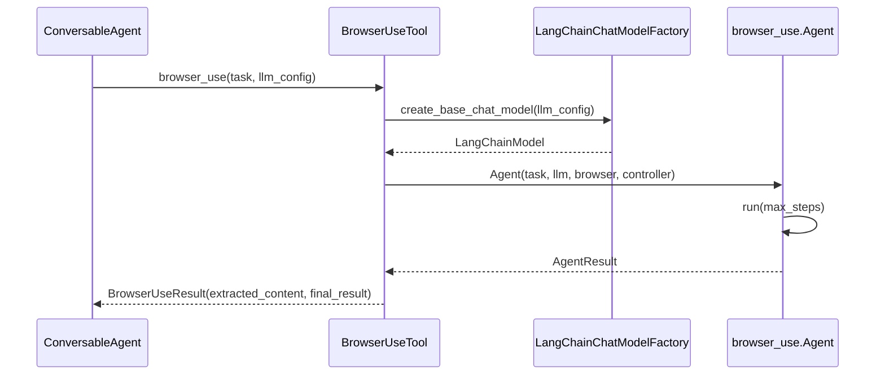
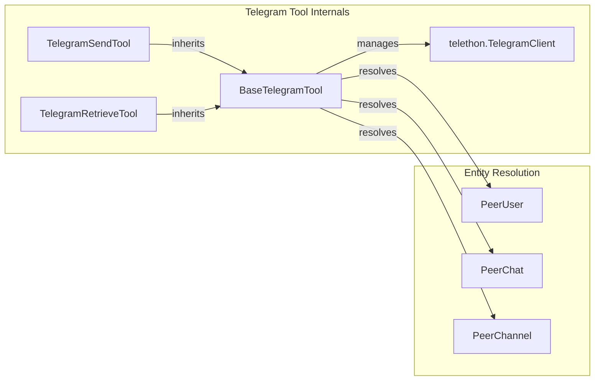

<!-- source: DeepWiki mcp.deepwiki.com · repo ag2ai/ag2 · page 5.4 Experimental Tools · fetched 2026-10-27 -->

# Experimental Tools

Relevant source files

The following files were used as context for generating this wiki page:

- [autogen/beta/agent.py](autogen/beta/agent.py)
- [autogen/interop/langchain/langchain_chat_model_factory.py](autogen/interop/langchain/langchain_chat_model_factory.py)
- [autogen/interop/langchain/langchain_tool.py](autogen/interop/langchain/langchain_tool.py)
- [autogen/interop/litellm/__init__.py](autogen/interop/litellm/__init__.py)
- [autogen/interop/litellm/litellm_config_factory.py](autogen/interop/litellm/litellm_config_factory.py)
- [autogen/oai/__init__.py](autogen/oai/__init__.py)
- [autogen/oai/openai_utils.py](autogen/oai/openai_utils.py)
- [autogen/token_count_utils.py](autogen/token_count_utils.py)
- [autogen/tools/experimental/__init__.py](autogen/tools/experimental/__init__.py)
- [autogen/tools/experimental/browser_use/__init__.py](autogen/tools/experimental/browser_use/__init__.py)
- [autogen/tools/experimental/browser_use/browser_use.py](autogen/tools/experimental/browser_use/browser_use.py)
- [autogen/tools/experimental/crawl4ai/crawl4ai.py](autogen/tools/experimental/crawl4ai/crawl4ai.py)
- [autogen/tools/experimental/messageplatform/__init__.py](autogen/tools/experimental/messageplatform/__init__.py)
- [autogen/tools/experimental/messageplatform/discord/__init__.py](autogen/tools/experimental/messageplatform/discord/__init__.py)
- [autogen/tools/experimental/messageplatform/discord/discord.py](autogen/tools/experimental/messageplatform/discord/discord.py)
- [autogen/tools/experimental/messageplatform/slack/__init__.py](autogen/tools/experimental/messageplatform/slack/__init__.py)
- [autogen/tools/experimental/messageplatform/slack/slack.py](autogen/tools/experimental/messageplatform/slack/slack.py)
- [autogen/tools/experimental/messageplatform/telegram/__init__.py](autogen/tools/experimental/messageplatform/telegram/__init__.py)
- [autogen/tools/experimental/messageplatform/telegram/telegram.py](autogen/tools/experimental/messageplatform/telegram/telegram.py)
- [autogen/tools/experimental/shell/__init__.py](autogen/tools/experimental/shell/__init__.py)
- [autogen/tools/experimental/shell/shell_tool.py](autogen/tools/experimental/shell/shell_tool.py)
- [notebook/agentchat_gpt5.1_in_built_tools_example.ipynb](notebook/agentchat_gpt5.1_in_built_tools_example.ipynb)
- [notebook/agentchat_gpt5.1_shell_tool_example.ipynb](notebook/agentchat_gpt5.1_shell_tool_example.ipynb)
- [pyproject.toml](pyproject.toml)
- [setup_autogen.py](setup_autogen.py)
- [test/interop/litellm/test_litellm_config_factory.py](test/interop/litellm/test_litellm_config_factory.py)
- [test/oai/test_utils.py](test/oai/test_utils.py)
- [test/test_notebook.py](test/test_notebook.py)
- [test/tools/experimental/__init__.py](test/tools/experimental/__init__.py)
- [test/tools/experimental/browser_use/__init__.py](test/tools/experimental/browser_use/__init__.py)
- [test/tools/experimental/browser_use/test_browser_use.py](test/tools/experimental/browser_use/test_browser_use.py)
- [test/tools/experimental/browser_use/test_langchain_factory.py](test/tools/experimental/browser_use/test_langchain_factory.py)
- [test/tools/experimental/crawl4ai/test_crawl4ai.py](test/tools/experimental/crawl4ai/test_crawl4ai.py)
- [test/tools/experimental/messageplatform/discord_test/__init__.py](test/tools/experimental/messageplatform/discord_test/__init__.py)
- [test/tools/experimental/messageplatform/discord_test/test_discord.py](test/tools/experimental/messageplatform/discord_test/test_discord.py)
- [test/tools/experimental/messageplatform/slack/test_slack.py](test/tools/experimental/messageplatform/slack/test_slack.py)
- [test/tools/experimental/messageplatform/telegram/__init__.py](test/tools/experimental/messageplatform/telegram/__init__.py)
- [test/tools/experimental/messageplatform/telegram/test_telegram.py](test/tools/experimental/messageplatform/telegram/test_telegram.py)
- [test/tools/experimental/shell/test_shell_tool.py](test/tools/experimental/shell/test_shell_tool.py)
- [website/docs/_blogs/2025-01-31-WebSurferAgent/index.mdx](website/docs/_blogs/2025-01-31-WebSurferAgent/index.mdx)
- [website/docs/_blogs/2025-01-31-Websurfing-Tools/index.mdx](website/docs/_blogs/2025-01-31-Websurfing-Tools/index.mdx)
- [website/docs/user-guide/reference-tools/browser-use.mdx](website/docs/user-guide/reference-tools/browser-use.mdx)
- [website/docs/user-guide/reference-tools/code-execution.mdx](website/docs/user-guide/reference-tools/code-execution.mdx)
- [website/docs/user-guide/reference-tools/crawl4ai.mdx](website/docs/user-guide/reference-tools/crawl4ai.mdx)
- [website/docs/user-guide/reference-tools/deep-research.mdx](website/docs/user-guide/reference-tools/deep-research.mdx)
- [website/docs/user-guide/reference-tools/index.mdx](website/docs/user-guide/reference-tools/index.mdx)
- [website/docs/user-guide/reference-tools/perplexity-search.mdx](website/docs/user-guide/reference-tools/perplexity-search.mdx)
- [website/docs/user-guide/reference-tools/searxng-search.mdx](website/docs/user-guide/reference-tools/searxng-search.mdx)
- [website/docs/user-guide/reference-tools/tavily-search.mdx](website/docs/user-guide/reference-tools/tavily-search.mdx)
- [website/docs/user-guide/reference-tools/wikipedia-search.mdx](website/docs/user-guide/reference-tools/wikipedia-search.mdx)
- [website/mint-json-template.json.jinja](website/mint-json-template.json.jinja)
- [website/snippets/reference-tools/browser-use.mdx](website/snippets/reference-tools/browser-use.mdx)
- [website/snippets/reference-tools/crawl4ai.mdx](website/snippets/reference-tools/crawl4ai.mdx)
- [website/snippets/reference-tools/deep-research.mdx](website/snippets/reference-tools/deep-research.mdx)

The Experimental Tools system provides a collection of advanced, specialized tools that extend AG2 agents with capabilities for web interaction, messaging platform integration, and advanced research workflows. These tools are designed to be modular, optional, and easily integrated into agent workflows while maintaining the framework's flexibility and extensibility.

For information about core tool registration and execution, see [Function Calling and Tool Registration](#5.1). For code execution capabilities, see [Code Execution System](#5.3).

## Architecture Overview

The experimental tools are organized into several categories, each serving specific use cases for agent enhancement. The system follows a modular design where tools can be installed and used independently through optional dependencies.

### Code Entity to System Mapping

This diagram maps high-level system categories to the specific classes and file structures found in `autogen.tools.experimental`.

```mermaid
graph TB
    subgraph "autogen.tools.experimental"
        ET["__init__.py"]
        
        subgraph "Web Surfing & Search"
            BU["BrowserUseTool"]
            C4["Crawl4AITool"]
            GS["GoogleSearchTool"]
            YS["YoutubeSearchTool"]
            DDG["DuckDuckGoSearchTool"]
            PS["PerplexitySearchTool"]
            TS["TavilySearchTool"]
            WP["WikipediaQueryRunTool"]
        end
        
        subgraph "Messaging Platforms"
            DT["DiscordRetrieveTool"]
            DS["DiscordSendTool"]
            ST["SlackRetrieveTool"]
            SS["SlackSendTool"]
            TR["TelegramRetrieveTool"]
            TS_MSG["TelegramSendTool"]
        end
        
        subgraph "Utilities & Research"
            DRT["DeepResearchTool"]
            QRT["QuickResearchTool"]
            RT["ReliableTool"]
            PCE["PythonCodeExecutionTool"]
        end
    end
    
    subgraph "Base Classes"
        TOOL["autogen.tools.Tool"]
    end
    
    BU -- "inherits" --> TOOL
    GS -- "inherits" --> TOOL
    DS -- "inherits" --> TOOL
    TS_MSG -- "inherits" --> TOOL
    
    ET -- "exports" --> BU
    ET -- "exports" --> C4
    ET -- "exports" --> GS
    ET -- "exports" --> DT
    ET -- "exports" --> DRT
```

**Sources:** [autogen/tools/experimental/__init__.py:1-58](), [autogen/tools/experimental/browser_use/browser_use.py:74-74](), [autogen/tools/experimental/messageplatform/telegram/telegram.py:91-91]()

## Web Surfing Tools

Web surfing tools enable agents to interact with the internet, retrieve real-time information, and process web content. These tools support various approaches from simple search APIs to full browser automation.

### Search Tools

The framework provides multiple search tool implementations, each with different strengths and API requirements:

| Tool | Class Name | API Key Required | File Path |
|------|------------|------------------|-----------|
| **Google Search** | `GoogleSearchTool` | Yes | [autogen/tools/experimental/google_search.py]() |
| **DuckDuckGo** | `DuckDuckGoSearchTool` | No | [autogen/tools/experimental/duckduckgo.py]() |
| **Perplexity** | `PerplexitySearchTool` | Yes | [autogen/tools/experimental/perplexity.py]() |
| **Tavily** | `TavilySearchTool` | Yes | [autogen/tools/experimental/tavily.py]() |
| **Wikipedia** | `WikipediaQueryRunTool` | No | [autogen/tools/experimental/wikipedia.py]() |

**Sources:** [autogen/tools/experimental/__init__.py:9-28](), [website/docs/user-guide/reference-tools/index.mdx:13-52]()

### Browser Automation: BrowserUseTool

The `BrowserUseTool` leverages the `browser-use` library to perform complex, multi-step tasks in a live browser environment. It uses `LangChainChatModelFactory` to bridge AG2's `LLMConfig` with LangChain-based browser agents.

**Sources:** [autogen/tools/experimental/browser_use/browser_use.py:74-144](), [autogen/tools/experimental/browser_use/browser_use.py:121-130]()

## Messaging Platform Tools

Messaging platform tools add social and professional communication capabilities to agents. They typically consist of a `SendTool` and a `RetrieveTool` for each platform.

### Telegram Integration

The Telegram tools use the `telethon` library and require `api_id` and `api_hash` from the Telegram apps dashboard.

- **`TelegramSendTool`**: Sends messages to users, groups, or channels. It handles message chunking automatically if the content exceeds the `MAX_MESSAGE_LENGTH` (4096 characters) [autogen/tools/experimental/messageplatform/telegram/telegram.py:19-122]().
- **`TelegramRetrieveTool`**: Fetches message history from a specified `chat_id`.

**Sources:** [autogen/tools/experimental/messageplatform/telegram/telegram.py:24-91](), [autogen/tools/experimental/messageplatform/telegram/telegram.py:37-58]()

## Advanced Research Tools

### Deep Research and Quick Research

- **`DeepResearchTool`**: Designed for complex, multi-step research tasks, synthesizing insights from diverse online sources [website/docs/user-guide/reference-tools/index.mdx:66-69]().
- **`QuickResearchTool`**: A lightweight alternative that performs parallel web research across multiple queries using Tavily and Crawl4AI [website/docs/user-guide/reference-tools/index.mdx:71-74]().

### ReliableTool Framework

The `ReliableTool` provides a wrapper for executing tools with enhanced error handling and validation. It uses `SuccessfulExecutionParameters` to define what constitutes a "success" for a tool call.

**Sources:** [autogen/tools/experimental/__init__.py:23-23]()

## Installation and Dependencies

Experimental tools are heavily reliant on optional dependencies defined in `pyproject.toml`.

| Feature | Installation Command | Key Packages |
|---------|----------------------|--------------|
| **Browser Use** | `pip install ag2[browser-use]` | `browser-use`, `langchain-openai` |
| **Crawl4AI** | `pip install ag2[crawl4ai]` | `crawl4ai` |
| **Telegram** | `pip install ag2[commsagent-telegram]` | `telethon` |
| **Discord** | `pip install ag2[commsagent-discord]` | `discord.py` |
| **Slack** | `pip install ag2[commsagent-slack]` | `slack_sdk` |
| **Research** | `pip install ag2[quick-research]` | `tavily-python`, `crawl4ai` |

**Sources:** [pyproject.toml:200-214](), [pyproject.toml:238-243](), [setup_autogen.py:57-92]()

---

