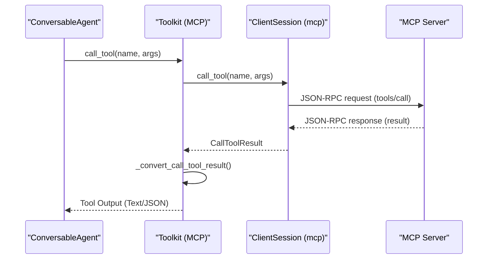
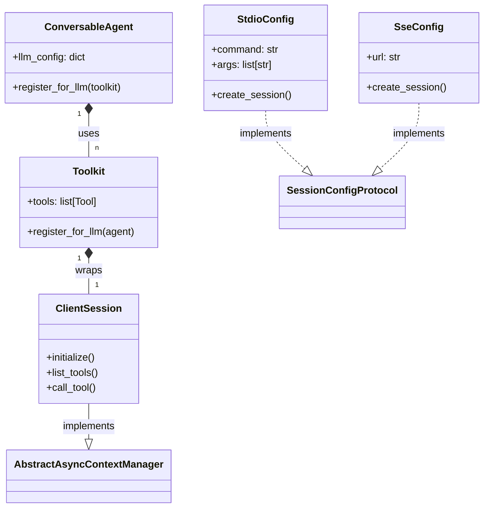

<!-- source: DeepWiki mcp.deepwiki.com · repo ag2ai/ag2 · page 5.5 MCP Integration · fetched 2026-10-27 -->

# MCP Integration

<details>
<summary>Relevant source files</summary>

The following files were used as context for generating this wiki page:

- [autogen/fast_depends/core/build.py](autogen/fast_depends/core/build.py)
- [autogen/mcp/helpers.py](autogen/mcp/helpers.py)
- [autogen/mcp/mcp_client.py](autogen/mcp/mcp_client.py)
- [autogen/mcp/mcp_proxy/mcp_proxy.py](autogen/mcp/mcp_proxy/mcp_proxy.py)
- [notebook/mcp/mcp_proxy_PokeAPI.ipynb](notebook/mcp/mcp_proxy_PokeAPI.ipynb)
- [notebook/mcp/mcp_proxy_general.ipynb](notebook/mcp/mcp_proxy_general.ipynb)
- [templates/client_template/main.jinja2](templates/client_template/main.jinja2)
- [test/mcp/math_server.py](test/mcp/math_server.py)
- [test/mcp/test_mcp.py](test/mcp/test_mcp.py)
- [test/mcp/test_resource_path_traversal.py](test/mcp/test_resource_path_traversal.py)
- [website/docs/user-guide/advanced-concepts/orchestration/two-agent-chat.mdx](website/docs/user-guide/advanced-concepts/orchestration/two-agent-chat.mdx)
- [website/docs/user-guide/advanced-concepts/pattern-cookbook/escalation.mdx](website/docs/user-guide/advanced-concepts/pattern-cookbook/escalation.mdx)
- [website/docs/user-guide/advanced-concepts/tools/mcp/mcp_client_session_manager.mdx](website/docs/user-guide/advanced-concepts/tools/mcp/mcp_client_session_manager.mdx)
- [website/snippets/mcp/client.mdx](website/snippets/mcp/client.mdx)

</details>


The Model Context Protocol (MCP) integration in AG2 provides a standardized way for agents to access external tools and data resources. By implementing the MCP specification, AG2 allows agents to connect to any MCP-compliant server to consume tools, read resources, and utilize specialized computational capabilities in real-time.

## Overview and Architecture

The integration centers around transforming MCP server capabilities into AG2 `Toolkit` and `Tool` objects. This allows `ConversableAgent` instances to interact with MCP servers using the same tool-calling mechanisms used for standard Python functions.

### Data Flow and Interaction

The following diagram illustrates how an AG2 Agent interacts with an MCP Server through the client infrastructure.

**MCP Tool Execution Flow**

Sources: [autogen/mcp/mcp_client.py:164-180](), [website/snippets/mcp/client.mdx:131-150]()

## Key Components

### MCPClient and Toolkit Creation

The `create_toolkit` function is the primary entry point for integrating MCP servers. it inspects an active `ClientSession` to discover available tools and resources, wrapping them into an AG2-compatible `Toolkit`.

*   **Tool Discovery**: It calls `session.list_tools()` to retrieve the server's tool definitions [autogen/mcp/mcp_client.py:27]().
*   **Resource Discovery**: It identifies resource templates and endpoints exposed by the server [autogen/mcp/mcp_client.py:26]().
*   **Registration**: Once created, `toolkit.register_for_llm(agent)` populates the agent's `llm_config` with the appropriate JSON schemas for tool calling [test/mcp/test_mcp.py:63-68]().

### MCPClientSessionManager

The `MCPClientSessionManager` provides high-level management for MCP sessions, supporting on-demand connection creation and automatic resource cleanup via async context managers.

| Class | Purpose | Key Attributes |
| :--- | :--- | :--- |
| `StdioConfig` | Configures local process servers communicating via stdin/stdout. | `command`, `args`, `env` |
| `SseConfig` | Configures remote servers using Server-Sent Events over HTTP. | `url`, `headers`, `timeout` |
| `MCPConfig` | A container for multiple server configurations. | `servers: list[SseConfig \| StdioConfig]` |

Sources: [autogen/mcp/mcp_client.py:96-163](), [website/docs/user-guide/advanced-concepts/tools/mcp/mcp_client_session_manager.mdx:33-73]()

### MCPProxy

`MCPProxy` is a specialized component used to generate client code from OpenAPI schemas, effectively acting as a bridge between REST APIs and the MCP protocol. It uses `FastMCP` internally to register tools derived from API endpoints [autogen/mcp/mcp_proxy/mcp_proxy.py:117-126]().

*   **Security Management**: It handles authentication via `BaseSecurityParameters` and `BaseSecurity` implementations [autogen/mcp/mcp_proxy/mcp_proxy.py:157-179]().
*   **Code Generation**: It can generate full MCP server implementations from `openapi.yml` files using Jinja2 templates [autogen/mcp/mcp_proxy/mcp_proxy.py:35-37](), [templates/client_template/main.jinja2:12-21]().

## Implementation Detail: Resource Handling

AG2 handles MCP resources (data exposed by servers) by converting them into tool calls or direct reads.

1.  **Sanitization**: To prevent path traversal attacks when servers provide file-based resources, AG2 uses `_sanitize_resource_filename` to ensure URIs are converted into safe local filenames [autogen/mcp/mcp_client.py:43-56]().
2.  **Conversion**: `_convert_call_tool_result` processes the `CallToolResult` from the MCP SDK, extracting `TextContent` and handling non-text content types [autogen/mcp/mcp_client.py:165-180]().

**System Mapping: MCP Client to Code Entities**

Sources: [autogen/mcp/mcp_client.py:58-120](), [test/mcp/test_mcp.py:63-68]()

## Multi-MCP Session Management

For complex workflows, AG2 supports managing multiple MCP servers simultaneously. This allows an agent to dynamically select the appropriate server based on the user's query.

```python
# Example of Multi-MCP setup
mcp_config = MCPConfig(
    servers=[
        StdioConfig(server_name="Arxiv", command="python", args=["arxiv_mcp.py"]),
        SseConfig(server_name="Wiki", url="http://localhost:8080/sse")
    ]
)

async with MCPClientSessionManager().open_session(mcp_config.servers[0]) as session:
    toolkit = await create_toolkit(session=session)
    # Use toolkit...
```
Sources: [website/docs/user-guide/advanced-concepts/tools/mcp/mcp_client_session_manager.mdx:99-124](), [autogen/mcp/mcp_client.py:157-161]()

## Summary of Transport Protocols

AG2 supports three primary transport protocols for MCP:

1.  **stdio**: Communication via standard input and output. Ideal for local scripts and CLI tools [autogen/mcp/mcp_client.py:120-132]().
2.  **SSE (Server-Sent Events)**: One-way streaming from server to client over HTTP. Used for remote web-based MCP servers [autogen/mcp/mcp_client.py:96-103]().
3.  **streamable-http**: High-performance HTTP-based transport for modern MCP implementations [website/snippets/mcp/client.mdx:11]().

Sources: [autogen/mcp/mcp_client.py:96-156](), [website/snippets/mcp/client.mdx:3-11]()

---

