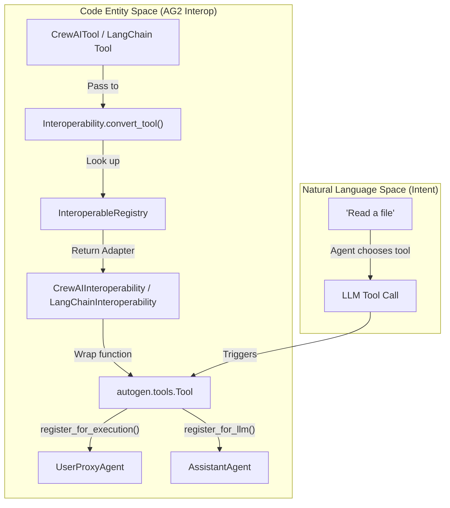
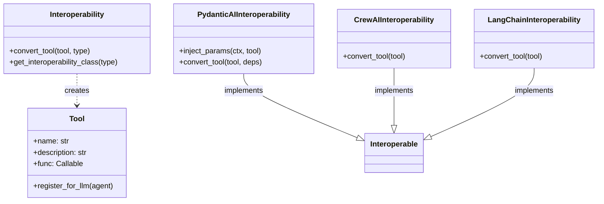

<!-- source: DeepWiki mcp.deepwiki.com · repo ag2ai/ag2 · page 5.6 Framework Interoperability · fetched 2026-10-27 -->

# Framework Interoperability

Relevant source files

The following files were used as context for generating this wiki page:

- [.muffet-excluded-links.txt](.muffet-excluded-links.txt)
- [autogen/interop/__init__.py](autogen/interop/__init__.py)
- [autogen/interop/crewai/__init__.py](autogen/interop/crewai/__init__.py)
- [autogen/interop/crewai/crewai.py](autogen/interop/crewai/crewai.py)
- [autogen/interop/interoperability.py](autogen/interop/interoperability.py)
- [autogen/interop/interoperable.py](autogen/interop/interoperable.py)
- [autogen/interop/langchain/__init__.py](autogen/interop/langchain/__init__.py)
- [autogen/interop/pydantic_ai/__init__.py](autogen/interop/pydantic_ai/__init__.py)
- [autogen/interop/pydantic_ai/pydantic_ai.py](autogen/interop/pydantic_ai/pydantic_ai.py)
- [autogen/llm_config/client.py](autogen/llm_config/client.py)
- [autogen/tools/__init__.py](autogen/tools/__init__.py)
- [autogen/tools/tool.py](autogen/tools/tool.py)
- [notebook/agentchat_RetrieveChat_couchbase.ipynb](notebook/agentchat_RetrieveChat_couchbase.ipynb)
- [notebook/tools_interoperability.ipynb](notebook/tools_interoperability.ipynb)
- [scripts/broken-links-check.sh](scripts/broken-links-check.sh)
- [test/interop/crewai/test_crewai.py](test/interop/crewai/test_crewai.py)
- [test/interop/langchain/test_langchain.py](test/interop/langchain/test_langchain.py)
- [test/interop/pydantic_ai/test_pydantic_ai.py](test/interop/pydantic_ai/test_pydantic_ai.py)
- [test/interop/pydantic_ai/test_pydantic_ai_tool.py](test/interop/pydantic_ai/test_pydantic_ai_tool.py)
- [test/interop/test_interoperability.py](test/interop/test_interoperability.py)
- [test/tools/test_tool.py](test/tools/test_tool.py)
- [website/docs/_blogs/2024-12-20-Tools-interoperability/index.mdx](website/docs/_blogs/2024-12-20-Tools-interoperability/index.mdx)
- [website/snippets/interop/crewai.mdx](website/snippets/interop/crewai.mdx)
- [website/snippets/interop/langchain.mdx](website/snippets/interop/langchain.mdx)
- [website/snippets/interop/pydanticai.mdx](website/snippets/interop/pydanticai.mdx)

The AG2 framework provides an interoperability layer designed to bridge the gap between different AI agent ecosystems. This layer allows developers to reuse tools and configurations from frameworks such as **CrewAI**, **LangChain**, **PydanticAI**, and **LiteLLM** within AG2 agents. By utilizing a standardized adapter pattern and the `Interoperable` protocol, AG2 enables seamless integration of external toolsets into its native `ConversableAgent` workflows.

## Architecture and Interoperability Protocol

The interoperability system is built around a central registry and a protocol-based adapter pattern. This ensures that regardless of the source framework, the resulting object conforms to the AG2 `Tool` class.

### Key Components

- **`Interoperable` Protocol**: A base protocol that defines the interface for framework-specific adapters. Every adapter must implement `convert_tool` and `get_unsupported_reason` [autogen/interop/interoperable.py:1-20]().
- **`InteroperableRegistry`**: A singleton that manages the registration and retrieval of framework adapters [autogen/interop/registry.py:1-40]().
- **`Interoperability` Class**: The primary entry point for users to convert tools using a unified API [autogen/interop/interoperability.py:15-72]().

### Tool Conversion Data Flow

The following diagram illustrates how an external tool (e.g., from CrewAI) is transformed into an AG2-compatible `Tool` entity.

**Tool Conversion Pipeline**

Sources: [autogen/interop/interoperability.py:25-40](), [autogen/tools/tool.py:20-88](), [autogen/interop/registry.py:15-25]()

## Framework Adapters

AG2 implements specific adapters for major frameworks, handling the nuances of their internal schemas and execution models.

### PydanticAI Integration
The `PydanticAIInteroperability` adapter converts `PydanticAITool` instances. A significant feature of this integration is the support for **Dependency Injection** via `RunContext`.

- **Context Injection**: The `inject_params` method wraps the original tool function to handle `RunContext`, injecting dependencies (`deps`) and managing retries [autogen/interop/pydantic_ai/pydantic_ai.py:39-94]().
- **Schema Mapping**: It maps the PydanticAI `function_schema.json_schema` to the AG2 tool schema [autogen/interop/pydantic_ai/pydantic_ai.py:157-162]().

Sources: [autogen/interop/pydantic_ai/pydantic_ai.py:27-162](), [test/interop/pydantic_ai/test_pydantic_ai.py:65-91]()

### LangChain Integration
The `LangChainInteroperability` adapter allows LangChain tools to be used by AG2 agents.
- **Input Schema**: It extracts the input schema using LangChain's `get_input_schema()` and ensures it is compatible with AG2's function calling mechanism [test/interop/langchain/test_langchain.py:48-56]().
- **Execution**: The adapter wraps the LangChain tool's execution logic, typically requiring a `tool_input` dictionary [test/interop/langchain/test_langchain.py:98-101]().

Sources: [autogen/interop/langchain/langchain.py:1-50](), [test/interop/langchain/test_langchain.py:23-40]()

### CrewAI Integration
The `CrewAIInteroperability` adapter (deprecated in v0.14) bridges `CrewAITool` (or `BaseTool`) [autogen/interop/crewai/crewai.py:28-33]().
- **Name Sanitization**: Uses `_sanitize_name` to ensure tool names comply with AG2/OpenAI requirements (e.g., replacing spaces with underscores) [autogen/interop/crewai/crewai.py:18-19](), [autogen/interop/crewai/crewai.py:68]().
- **Argument Handling**: Automatically appends instructions to the tool description regarding the use of an `args` dictionary [autogen/interop/crewai/crewai.py:69-72]().

Sources: [autogen/interop/crewai/crewai.py:37-81](), [test/interop/crewai/test_crewai.py:53-68]()

## LiteLLM Configuration Adapter

Beyond tools, AG2 supports interoperability at the configuration level for LLMs through LiteLLM.

- **`LiteLLmConfigAdapter`**: Provides methods to convert AG2's `config_list` format into a format compatible with LiteLLM and vice-versa [autogen/interop/litellm/litellm.py:1-50]().
- **`LiteLLmConfigFactory`**: Simplifies the creation of LLM configurations that leverage LiteLLM's unified proxy capabilities [autogen/interop/litellm/litellm.py:55-80]().

Sources: [autogen/interop/litellm/__init__.py:1-15]()

## Implementation Detail: The `Tool` Wrapper

The core of the interop layer is the `autogen.tools.Tool` class. When a framework-specific tool is converted, it is encapsulated in this class, which provides standardized properties for AG2 agents.

| Property | Description | Source |
| :--- | :--- | :--- |
| `name` | The sanitized identifier for the tool. | [autogen/tools/tool.py:77-79]() |
| `description` | The natural language description used by the LLM for tool selection. | [autogen/tools/tool.py:81-83]() |
| `func` | The executable Python function (often a wrapped version of the original). | [autogen/tools/tool.py:85-87]() |
| `tool_schema` | The JSON schema for OpenAI-compatible tool calling. | [autogen/tools/tool.py:141-147]() |

### Code Entity Association

This diagram maps the internal AG2 classes to the external concepts they represent during interoperability.

**Interop Class Mapping**

Sources: [autogen/interop/interoperability.py:15-22](), [autogen/tools/tool.py:20-40](), [autogen/interop/pydantic_ai/pydantic_ai.py:27-35](), [autogen/interop/crewai/crewai.py:28-33]()

## Usage Example

To use a tool from another framework, the `Interoperability` class is used to perform the conversion before registering it with an AG2 agent.

1. **Conversion**: `ag2_tool = Interoperability.convert_tool(tool=external_tool, type="langchain")` [autogen/interop/interoperability.py:25-40]().
2. **Registration**: `ag2_tool.register_for_llm(assistant_agent)` and `ag2_tool.register_for_execution(user_proxy_agent)` [autogen/tools/tool.py:89-112]().

This allows the `AssistantAgent` to suggest the tool and the `UserProxyAgent` to execute the original framework's logic seamlessly [test/interop/pydantic_ai/test_pydantic_ai.py:47-53]().

Sources: [autogen/interop/interoperability.py:25-40](), [autogen/tools/tool.py:89-112](), [test/interop/pydantic_ai/test_pydantic_ai.py:47-53]()

---

