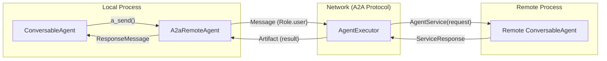
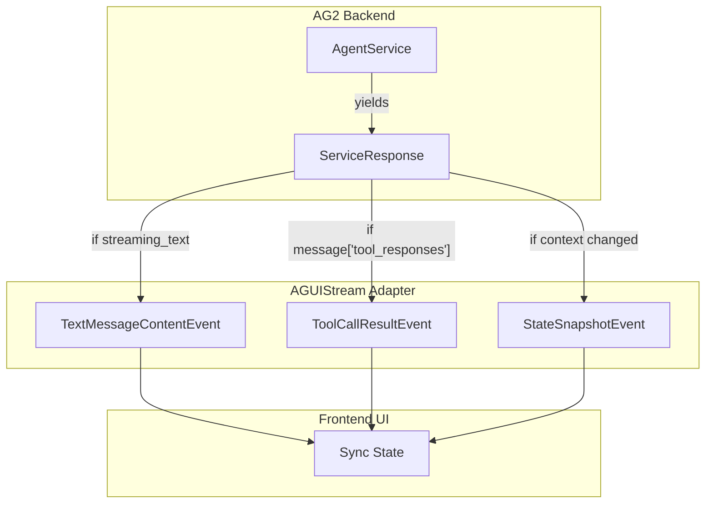

<!-- source: DeepWiki mcp.deepwiki.com · repo ag2ai/ag2 · page 7 A2A Protocol and AG-UI · fetched 2026-10-27 -->

# A2A Protocol and AG-UI

Relevant source files

The following files were used as context for generating this wiki page:

- [autogen/a2a/agent_executor.py](autogen/a2a/agent_executor.py)
- [autogen/a2a/client.py](autogen/a2a/client.py)
- [autogen/a2a/server.py](autogen/a2a/server.py)
- [autogen/a2a/utils.py](autogen/a2a/utils.py)
- [autogen/ag_ui/adapter.py](autogen/ag_ui/adapter.py)
- [autogen/agentchat/remote/agent_service.py](autogen/agentchat/remote/agent_service.py)
- [autogen/agentchat/remote/protocol.py](autogen/agentchat/remote/protocol.py)
- [autogen/oai/client_utils.py](autogen/oai/client_utils.py)
- [autogen/testing/test_agent.py](autogen/testing/test_agent.py)
- [test/a2a/chats/test_chat.py](test/a2a/chats/test_chat.py)
- [test/a2a/chats/test_streaming.py](test/a2a/chats/test_streaming.py)
- [test/a2a/test_client.py](test/a2a/test_client.py)
- [test/a2a/test_parsing.py](test/a2a/test_parsing.py)
- [test/ag_ui/test_adapter.py](test/ag_ui/test_adapter.py)
- [test/ag_ui/test_asgi.py](test/ag_ui/test_asgi.py)
- [test/oai/test_client_utils.py](test/oai/test_client_utils.py)
- [website/docs/user-guide/a2a/client.mdx](website/docs/user-guide/a2a/client.mdx)
- [website/docs/user-guide/a2a/index.mdx](website/docs/user-guide/a2a/index.mdx)
- [website/docs/user-guide/a2a/server.mdx](website/docs/user-guide/a2a/server.mdx)
- [website/docs/user-guide/advanced-concepts/groupchat/resuming-group-chat.mdx](website/docs/user-guide/advanced-concepts/groupchat/resuming-group-chat.mdx)
- [website/docs/user-guide/advanced-concepts/realtime-agent/index.mdx](website/docs/user-guide/advanced-concepts/realtime-agent/index.mdx)
- [website/docs/user-guide/advanced-concepts/realtime-agent/twilio.mdx](website/docs/user-guide/advanced-concepts/realtime-agent/twilio.mdx)
- [website/docs/user-guide/advanced-concepts/realtime-agent/webrtc.mdx](website/docs/user-guide/advanced-concepts/realtime-agent/webrtc.mdx)
- [website/docs/user-guide/advanced-concepts/realtime-agent/websocket.mdx](website/docs/user-guide/advanced-concepts/realtime-agent/websocket.mdx)
- [website/docs/user-guide/ag-ui/index.mdx](website/docs/user-guide/ag-ui/index.mdx)
- [website/docs/user-guide/reference-agents/docagent/docagent-performance.mdx](website/docs/user-guide/reference-agents/docagent/docagent-performance.mdx)
- [website/docs/user-guide/reference-agents/docagent/index.mdx](website/docs/user-guide/reference-agents/docagent/index.mdx)
- [website/docs/user-guide/reference-agents/index.mdx](website/docs/user-guide/reference-agents/index.mdx)
- [website/talks/2024-11-25/index.mdx](website/talks/2024-11-25/index.mdx)
- [website/talks/2024-11-28/index.mdx](website/talks/2024-11-28/index.mdx)

The **Agent-to-Agent (A2A)** protocol and **AG-UI** adapter provide the communication layer for AG2 agents to operate across distributed environments and interactive frontend applications. While AG2 agents typically communicate within a single process, these components enable them to bridge the gap to other machines, frameworks, and modern web interfaces.

## Agent-to-Agent (A2A) Protocol

The A2A system enables `ConversableAgent` instances to communicate across different processes, machines, or even different agent frameworks (such as PydanticAI) using a standardized protocol [website/docs/user-guide/a2a/index.mdx:7-14](). It is built upon the official A2A Python SDK [website/docs/user-guide/a2a/index.mdx:18-20]().

### Core Components
*   **A2aRemoteAgent**: A client-side implementation of `ConversableAgent` that proxies calls to a remote A2A server [autogen/a2a/client.py:39-44]().
*   **A2aAgentServer**: A server-side wrapper that exposes a local AG2 agent as an A2A-compliant endpoint [website/docs/user-guide/a2a/index.mdx:28-41]().
*   **AutogenAgentExecutor**: The internal execution logic that bridges AG2's message handling with the A2A task lifecycle, managing states like `submitted`, `working`, and `input_required` [autogen/a2a/agent_executor.py:27-74]().

### A2A Communication Flow
The following diagram illustrates how a local agent interacts with a remote agent via the A2A protocol.

**A2A Request/Response Mapping**

**Sources:** [autogen/a2a/client.py:171-180](), [autogen/a2a/agent_executor.py:37-63](), [autogen/a2a/utils.py:25-46]()

For more details on implementation, task lifecycles, and agent discovery, see **[A2A Client and Server](#7.1)**.

## AG-UI Frontend Adapter

The AG-UI integration provides a protocol-compliant bridge between AG2 agents and modern frontend frameworks. It standardizes how streaming text, tool calls, and state snapshots are delivered to a UI [website/docs/user-guide/ag-ui/index.mdx:9-17]().

### Key Features
*   **AGUIStream**: Manages the transformation of agent execution into a stream of AG-UI events such as `TextMessageStartEvent`, `ToolCallStartEvent`, and `StateSnapshotEvent` [autogen/ag_ui/adapter.py:50-59](), [autogen/ag_ui/adapter.py:157-183]().
*   **ASGI Integration**: Provides a `build_asgi()` method to easily mount the agent as a FastAPI or Starlette endpoint [autogen/ag_ui/adapter.py:95-100]().
*   **State Synchronization**: Automatically emits `StateSnapshotEvent` when `ContextVariables` or agent states change, allowing the frontend to stay in sync with the backend [autogen/ag_ui/adapter.py:144-149]().

### AG-UI Event Translation
This diagram shows how internal AG2 responses are translated into AG-UI protocol events for frontend consumption.

**AG2 to AG-UI Event Mapping**

**Sources:** [autogen/ag_ui/adapter.py:152-183](), [autogen/ag_ui/adapter.py:185-199]()

For details on the AG-UI protocol adapter, event translation, and building interactive frontends with CopilotKit, see **[AG-UI Adapter](#7.2)**.

## Summary Table

| Component | Purpose | Key Class |
| :--- | :--- | :--- |
| **A2A Client** | Connect to remote agents over HTTP/WebSockets | `A2aRemoteAgent` [autogen/a2a/client.py:39]() |
| **A2A Server** | Host a local agent for remote access | `A2aAgentServer` [autogen/a2a/server.py:14]() |
| **AG-UI Adapter** | Bridge agents to frontend event streams | `AGUIStream` [autogen/ag_ui/adapter.py:50]() |
| **Execution Bridge** | Execute AG2 logic within A2A tasks | `AutogenAgentExecutor` [autogen/a2a/agent_executor.py:27]() |

**Sources:** [autogen/a2a/client.py:38-44](), [autogen/ag_ui/adapter.py:49-59](), [autogen/a2a/agent_executor.py:26-35]()

---

