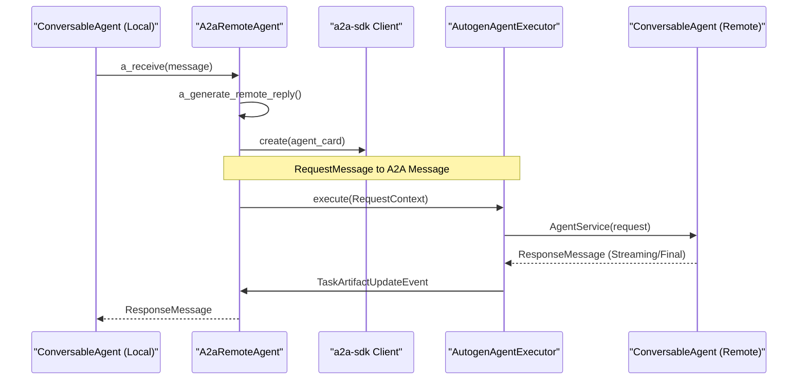
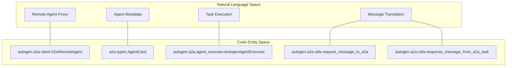

<!-- source: DeepWiki mcp.deepwiki.com · repo ag2ai/ag2 · page 7.1 A2A Client and Server · fetched 2026-10-27 -->

# A2A Client and Server

Relevant source files

The following files were used as context for generating this wiki page:

- [autogen/a2a/agent_executor.py](autogen/a2a/agent_executor.py)
- [autogen/a2a/client.py](autogen/a2a/client.py)
- [autogen/a2a/constants.py](autogen/a2a/constants.py)
- [autogen/a2a/server.py](autogen/a2a/server.py)
- [autogen/a2a/utils.py](autogen/a2a/utils.py)
- [autogen/ag_ui/adapter.py](autogen/ag_ui/adapter.py)
- [autogen/agentchat/remote/agent_service.py](autogen/agentchat/remote/agent_service.py)
- [autogen/agentchat/remote/protocol.py](autogen/agentchat/remote/protocol.py)
- [autogen/agents/experimental/__init__.py](autogen/agents/experimental/__init__.py)
- [autogen/agents/experimental/a2ui/__init__.py](autogen/agents/experimental/a2ui/__init__.py)
- [autogen/agents/experimental/a2ui/a2a_executor.py](autogen/agents/experimental/a2ui/a2a_executor.py)
- [autogen/agents/experimental/a2ui/a2a_helpers.py](autogen/agents/experimental/a2ui/a2a_helpers.py)
- [autogen/agents/experimental/a2ui/a2ui_agent.py](autogen/agents/experimental/a2ui/a2ui_agent.py)
- [autogen/oai/client_utils.py](autogen/oai/client_utils.py)
- [autogen/testing/test_agent.py](autogen/testing/test_agent.py)
- [test/a2a/chats/test_chat.py](test/a2a/chats/test_chat.py)
- [test/a2a/chats/test_streaming.py](test/a2a/chats/test_streaming.py)
- [test/a2a/test_client.py](test/a2a/test_client.py)
- [test/a2a/test_parsing.py](test/a2a/test_parsing.py)
- [test/ag_ui/test_adapter.py](test/ag_ui/test_adapter.py)
- [test/ag_ui/test_asgi.py](test/ag_ui/test_asgi.py)
- [test/agents/experimental/a2ui/__init__.py](test/agents/experimental/a2ui/__init__.py)
- [test/oai/test_client_utils.py](test/oai/test_client_utils.py)

The Agent-to-Agent (A2A) protocol implementation in AG2 provides a standardized, asynchronous communication layer between agents. It enables agents to interact across network boundaries, supporting complex task lifecycles, streaming responses, and automated agent discovery through agent cards.

## Overview

The A2A system consists of two primary components:
1.  **`A2aRemoteAgent`**: A client-side proxy that implements the `ConversableAgent` interface, allowing remote agents to be used in local workflows [autogen/a2a/client.py:39-43]().
2.  **`AutogenAgentExecutor`**: A server-side wrapper that executes local agents in response to A2A protocol requests [autogen/a2a/agent_executor.py:27-32]().

The protocol uses a task-based lifecycle where a request initiates a `Task`, which transitions through states like `submitted`, `working`, and `completed` [autogen/a2a/agent_executor.py:44-58]().

## Implementation Architecture

The following diagram illustrates the flow from a local `ConversableAgent` (acting as a sender) through the `A2aRemoteAgent` client to the `AutogenAgentExecutor` on the server.

### A2A Communication Flow

**Sources:** [autogen/a2a/client.py:39-95](), [autogen/a2a/agent_executor.py:27-35](), [autogen/a2a/utils.py:25-46](), [autogen/agentchat/remote/agent_service.py:1-20]()

## Client: A2aRemoteAgent

The `A2aRemoteAgent` bridges the gap between the local agent environment and the remote A2A server. It inherits from `ConversableAgent` and overrides the reply generation logic to delegate to the remote service [autogen/a2a/client.py:39-95]().

### Key Features
*   **Protocol Compatibility**: Replaces `generate_oai_reply` and `a_generate_oai_reply` with `generate_remote_reply` and `a_generate_remote_reply` respectively [autogen/a2a/client.py:87-94]().
*   **Discovery**: Uses `A2ACardResolver` to fetch agent metadata (Agent Cards) from the server's `.well-known` paths [autogen/a2a/client.py:71-74](), [autogen/a2a/client.py:159-161]().
*   **Polling & Streaming**: Supports both real-time streaming (if the server capability exists) and fallback polling intervals [autogen/a2a/client.py:65-67]().

### Agent Card Discovery
Agents are discovered via an `AgentCard`, which contains metadata like `name`, `capabilities` (e.g., streaming support), and `url` [autogen/a2a/client.py:128-140]().

| Function | Description |
| :--- | :--- |
| `from_card` | Class method to instantiate an agent directly from a pre-fetched `AgentCard` [autogen/a2a/client.py:97-107](). |
| `_get_agent_card` | Internal method to resolve a card from a URL using `A2ACardResolver` [autogen/a2a/client.py:159-161](). |

**Sources:** [autogen/a2a/client.py:39-140](), [test/a2a/test_client.py:129-146]()

## Server: AutogenAgentExecutor

The `AutogenAgentExecutor` implements the `AgentExecutor` interface from the `a2a-sdk`. It wraps a local `ConversableAgent` using `AgentService` to handle incoming requests [autogen/a2a/agent_executor.py:27-35]().

### Task Lifecycle Management
The executor manages the lifecycle of a request through a `Task` object:
1.  **Submission**: If no task exists, one is created with a unique `task_id` and `context_id` [autogen/a2a/agent_executor.py:41-54]().
2.  **Execution**: The state is updated to `TaskState.working` [autogen/a2a/agent_executor.py:57]().
3.  **Artifact Generation**: Responses from the agent are converted into `Artifact` parts [autogen/a2a/agent_executor.py:59-98]().
4.  **Completion**: Once the agent finishes, the task is marked as completed [autogen/a2a/agent_executor.py:113]().

### Request and Response Mapping
The system uses utility functions to translate between AG2 internal types and A2A protocol types:

| From | To | Utility Function |
| :--- | :--- | :--- |
| `RequestMessage` | `a2a.types.Message` | `request_message_to_a2a` [autogen/a2a/utils.py:25-29]() |
| `a2a.types.Message` | `RequestMessage` | `request_message_from_a2a` [autogen/a2a/utils.py:49-55]() |
| `a2a.types.Task` | `ResponseMessage` | `response_message_from_a2a_task` [autogen/a2a/utils.py:58-60]() |

**Sources:** [autogen/a2a/agent_executor.py:37-114](), [autogen/a2a/utils.py:25-85]()

## Data Flow and Streaming

Streaming is handled via `TaskArtifactUpdateEvent`. When the server-side agent produces a stream, the `AutogenAgentExecutor` updates the task artifact with `last_chunk=False` [autogen/a2a/agent_executor.py:76-91](). On the client side, `A2aRemoteAgent` consumes these events to yield `StreamEvent` objects [autogen/a2a/utils.py:147-155]().

### Entity Mapping: Natural Language to Code

**Sources:** [autogen/a2a/client.py:39](), [autogen/a2a/agent_executor.py:27](), [autogen/a2a/utils.py:25-85]()

## Specialized Integration: A2UI

The A2A protocol also supports `A2UIAgent`, which allows agents to send structured UI data (e.g., for AG-UI) using a specific MIME type: `application/vnd.ag2.a2ui.v1+json` [autogen/a2a/constants.py:8-10]().

When `A2UIAgent` is used, the utilities merge text content and data parts into a single response dictionary if the `A2UI_MIME_TYPE` is detected [autogen/a2a/utils.py:123-133](), [autogen/a2a/utils.py:176-183]().

**Sources:** [autogen/a2a/utils.py:109-133](), [autogen/agents/experimental/a2ui/__init__.py:8-25]()

---

