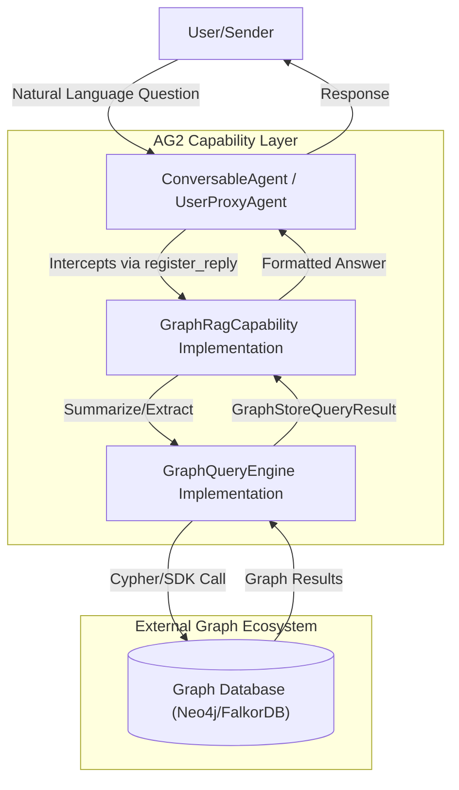
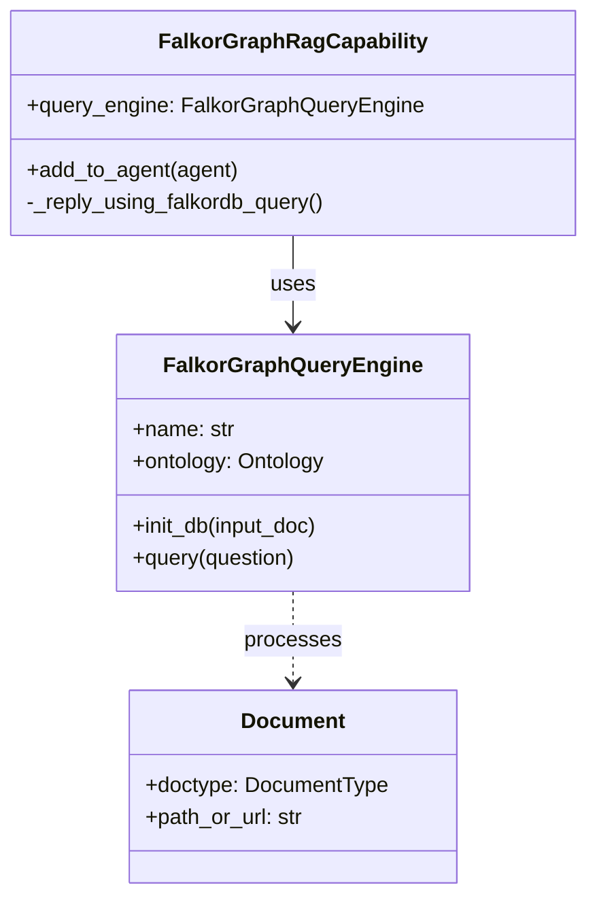
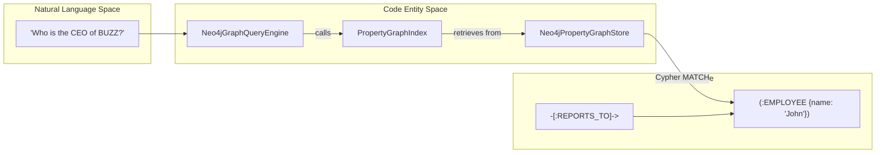

<!-- source: DeepWiki mcp.deepwiki.com · repo ag2ai/ag2 · page 9.2 Graph RAG · fetched 2026-10-27 -->

# Graph RAG

Relevant source files

The following files were used as context for generating this wiki page:

- [autogen/agentchat/contrib/captainagent/tool_retriever.py](autogen/agentchat/contrib/captainagent/tool_retriever.py)
- [autogen/agentchat/contrib/graph_rag/document.py](autogen/agentchat/contrib/graph_rag/document.py)
- [autogen/agentchat/contrib/graph_rag/falkor_graph_query_engine.py](autogen/agentchat/contrib/graph_rag/falkor_graph_query_engine.py)
- [autogen/agentchat/contrib/graph_rag/falkor_graph_rag_capability.py](autogen/agentchat/contrib/graph_rag/falkor_graph_rag_capability.py)
- [autogen/agentchat/contrib/graph_rag/graph_query_engine.py](autogen/agentchat/contrib/graph_rag/graph_query_engine.py)
- [autogen/agentchat/contrib/graph_rag/graph_rag_capability.py](autogen/agentchat/contrib/graph_rag/graph_rag_capability.py)
- [autogen/agentchat/contrib/graph_rag/neo4j_graph_query_engine.py](autogen/agentchat/contrib/graph_rag/neo4j_graph_query_engine.py)
- [autogen/agentchat/contrib/graph_rag/neo4j_graph_rag_capability.py](autogen/agentchat/contrib/graph_rag/neo4j_graph_rag_capability.py)
- [autogen/agentchat/contrib/graph_rag/neo4j_native_graph_query_engine.py](autogen/agentchat/contrib/graph_rag/neo4j_native_graph_query_engine.py)
- [autogen/agentchat/contrib/graph_rag/neo4j_native_graph_rag_capability.py](autogen/agentchat/contrib/graph_rag/neo4j_native_graph_rag_capability.py)
- [autogen/agentchat/realtime/experimental/realtime_swarm.py](autogen/agentchat/realtime/experimental/realtime_swarm.py)
- [notebook/agentchat_graph_rag_falkordb.ipynb](notebook/agentchat_graph_rag_falkordb.ipynb)
- [notebook/agentchat_graph_rag_neo4j.ipynb](notebook/agentchat_graph_rag_neo4j.ipynb)
- [notebook/agentchat_graph_rag_neo4j_native.ipynb](notebook/agentchat_graph_rag_neo4j_native.ipynb)
- [notebook/neo4j_property_graph_1.png](notebook/neo4j_property_graph_1.png)
- [notebook/neo4j_property_graph_2.png](notebook/neo4j_property_graph_2.png)
- [notebook/neo4j_property_graph_3.png](notebook/neo4j_property_graph_3.png)
- [test/agentchat/contrib/graph_rag/BUZZ_Employee_Handbook.docx](test/agentchat/contrib/graph_rag/BUZZ_Employee_Handbook.docx)
- [test/agentchat/contrib/graph_rag/BUZZ_Equal-Employment-Opportunity-Policy-Detailed.docx](test/agentchat/contrib/graph_rag/BUZZ_Equal-Employment-Opportunity-Policy-Detailed.docx)
- [test/agentchat/contrib/graph_rag/Toast_financial_report.pdf](test/agentchat/contrib/graph_rag/Toast_financial_report.pdf)
- [test/agentchat/contrib/graph_rag/layout_parser_paper_parsed_elements.json](test/agentchat/contrib/graph_rag/layout_parser_paper_parsed_elements.json)
- [test/agentchat/contrib/graph_rag/test_falkor_graph_rag.py](test/agentchat/contrib/graph_rag/test_falkor_graph_rag.py)
- [test/agentchat/contrib/graph_rag/test_graph_rag_basic.py](test/agentchat/contrib/graph_rag/test_graph_rag_basic.py)
- [test/agentchat/contrib/graph_rag/test_native_neo4j_graph_rag.py](test/agentchat/contrib/graph_rag/test_native_neo4j_graph_rag.py)
- [test/agentchat/contrib/graph_rag/test_neo4j_graph_rag.py](test/agentchat/contrib/graph_rag/test_neo4j_graph_rag.py)

Graph Retrieval-Augmented Generation (Graph RAG) in AG2 extends traditional vector-based RAG by leveraging structured Knowledge Graphs. This approach allows agents to understand complex relationships between entities, perform multi-hop reasoning, and traverse structured data schemas that flat vector databases might miss.

## Overview and Architecture

The Graph RAG implementation in AG2 is built around a provider-agnostic interface that allows agents to interact with different graph databases like **FalkorDB** and **Neo4j**. The system separates the concerns of graph storage, query execution, and agent capability.

### Core Components

1.  **`GraphQueryEngine` (Protocol)**: An abstract interface defining methods for database initialization (`init_db`), record insertion (`add_records`), and natural language querying (`query`) [autogen/agentchat/contrib/graph_rag/graph_query_engine.py:28-54]().
2.  **`GraphRagCapability`**: A base class used to inject graph-querying logic into standard AG2 agents [autogen/agentchat/contrib/graph_rag/graph_rag_capability.py:9-10]().
3.  **`GraphStoreQueryResult`**: A data structure that encapsulates the final answer and any intermediate graph results (like nodes or edges) [autogen/agentchat/contrib/graph_rag/graph_query_engine.py:16-24]().

### Data Flow Diagram

The following diagram illustrates how a natural language question is transformed into a graph query and resolved through the AG2 capability system.

**Graph RAG Query Pipeline**

Sources: [autogen/agentchat/contrib/graph_rag/graph_rag_capability.py:9-10](), [autogen/agentchat/contrib/graph_rag/graph_query_engine.py:28-54](), [autogen/agentchat/contrib/graph_rag/falkor_graph_rag_capability.py:46-48]().

---

## FalkorDB Integration

FalkorDB integration utilizes the `FalkorGraphQueryEngine` and `FalkorGraphRagCapability`. It relies on the `graphrag_sdk` to manage ontologies and graph construction.

### Knowledge Graph Construction
FalkorDB supports two modes of construction:
*   **Auto-generation**: The engine automatically detects entities and relationships from the source documents [autogen/agentchat/contrib/graph_rag/falkor_graph_query_engine.py:98-102]().
*   **Explicit Ontology**: Users can define a strict `Ontology` using `Entity`, `Attribute`, and `Relation` objects to guide the graph building [autogen/agentchat/contrib/graph_rag/falkor_graph_query_engine.py:48-50]().

### Implementation Details
The `FalkorGraphRagCapability` is typically added to a `ConversableAgent`. It removes all other reply functions to ensure the agent only answers based on the graph [autogen/agentchat/contrib/graph_rag/falkor_graph_rag_capability.py:46-48]().

**FalkorDB Class Association**

Sources: [autogen/agentchat/contrib/graph_rag/falkor_graph_query_engine.py:23-35](), [autogen/agentchat/contrib/graph_rag/falkor_graph_rag_capability.py:13-22](), [autogen/agentchat/contrib/graph_rag/document.py:11-13]().

---

## Neo4j Integration

AG2 provides two pathways for Neo4j: a LlamaIndex-based engine and a native Neo4j GraphRAG SDK engine.

### 1. Neo4j with LlamaIndex (`Neo4jGraphQueryEngine`)
This engine uses LlamaIndex's `PropertyGraphIndex` to extract triplets ([entity] -> [relationship] -> [entity]) [autogen/agentchat/contrib/graph_rag/neo4j_graph_query_engine.py:32-41]().
*   **Schema Enforcement**: Supports a `strict` mode where extractions must follow a predefined schema [autogen/agentchat/contrib/graph_rag/neo4j_graph_query_engine.py:63-64]().
*   **Chat Mode**: Uses `condense_plus_context` to handle multi-turn conversations [autogen/agentchat/contrib/graph_rag/neo4j_graph_query_engine.py:168-171]().

### 2. Neo4j Native SDK (`Neo4jNativeGraphQueryEngine`)
This implementation uses the `neo4j-graphrag` Python package directly [autogen/agentchat/contrib/graph_rag/neo4j_native_graph_query_engine.py:30-33]().
*   **Pipeline**: Uses `SimpleKGPipeline` for graph construction [autogen/agentchat/contrib/graph_rag/neo4j_native_graph_query_engine.py:170-171]().
*   **Vector Integration**: Automatically creates a vector index on the graph nodes to support hybrid search [autogen/agentchat/contrib/graph_rag/neo4j_native_graph_query_engine.py:104-106]().

**Neo4j Entity Mapping**

Sources: [autogen/agentchat/contrib/graph_rag/neo4j_graph_query_engine.py:98-103](), [autogen/agentchat/contrib/graph_rag/neo4j_graph_query_engine.py:111-118](), [notebook/agentchat_graph_rag_neo4j.ipynb:175-188]().

---

## Querying Patterns

### Message Summarization
For `FalkorGraphRagCapability`, the system summarizes the conversation history into a context string before querying the engine. This ensures the graph query has access to the full intent of the dialogue [autogen/agentchat/contrib/graph_rag/falkor_graph_rag_capability.py:79-100]().

### Document Handling
The system uses a `Document` abstraction to handle various input formats [autogen/agentchat/contrib/graph_rag/document.py:11-13]().
*   **TEXT**: Standard unstructured text files.
*   **JSON**: Structured data for node/edge mapping.
*   **PDF/DOCX**: Processed via `SimpleDirectoryReader` (in Neo4j/LlamaIndex) [autogen/agentchat/contrib/graph_rag/neo4j_graph_query_engine.py:156-159]().

### Key Function Reference

| Class/Method | Role | Source |
| :--- | :--- | :--- |
| `init_db` | Orchestrates graph construction from `Document` objects. | [autogen/agentchat/contrib/graph_rag/graph_query_engine.py:34]() |
| `add_records` | Incrementally updates the graph with new data. | [autogen/agentchat/contrib/graph_rag/neo4j_graph_query_engine.py:139]() |
| `register_reply` | Hooks the capability into the agent's message processing loop. | [autogen/agentchat/contrib/graph_rag/falkor_graph_rag_capability.py:46]() |
| `_create_kg_extractors` | Defines how entities/relations are parsed from text. | [autogen/agentchat/contrib/graph_rag/neo4j_graph_query_engine.py:109]() |

Sources: [autogen/agentchat/contrib/graph_rag/graph_query_engine.py:34-54](), [autogen/agentchat/contrib/graph_rag/neo4j_graph_query_engine.py:139-165](), [autogen/agentchat/contrib/graph_rag/falkor_graph_rag_capability.py:46-49]().

---

