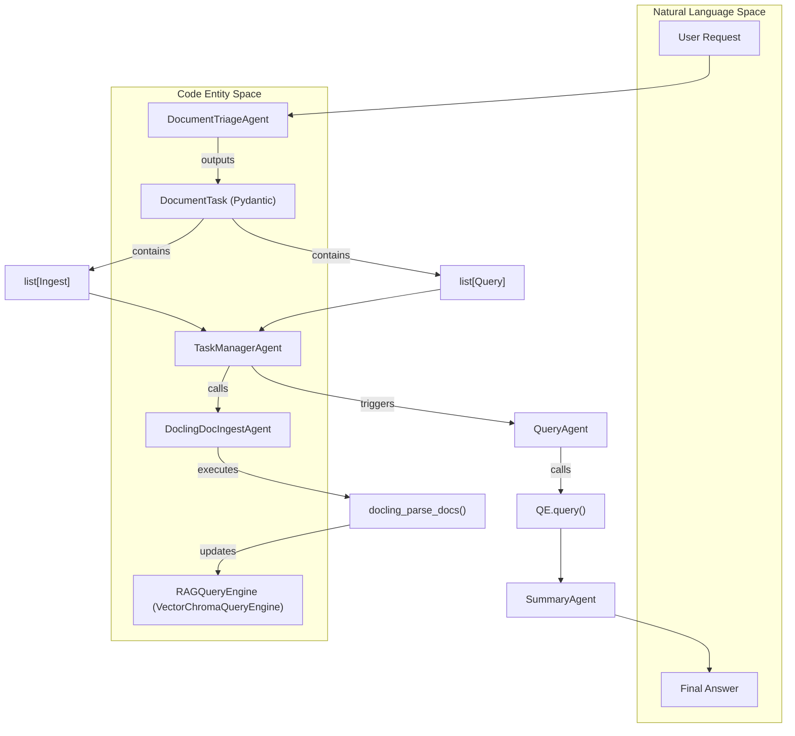
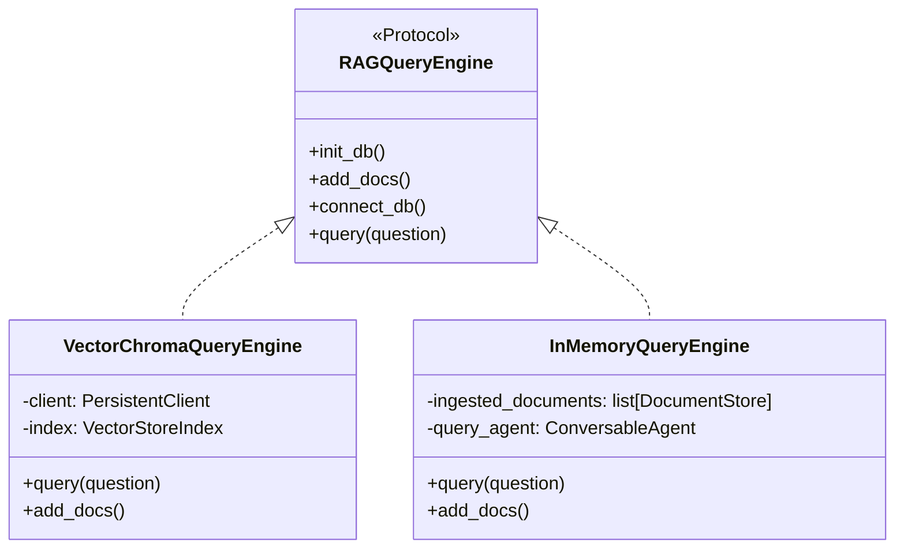

<!-- source: DeepWiki mcp.deepwiki.com · repo ag2ai/ag2 · page 9.3 Document Agent · fetched 2026-10-27 -->

# Document Agent

Relevant source files

The following files were used as context for generating this wiki page:

- [autogen/agentchat/contrib/rag/__init__.py](autogen/agentchat/contrib/rag/__init__.py)
- [autogen/agentchat/contrib/rag/query_engine.py](autogen/agentchat/contrib/rag/query_engine.py)
- [autogen/agents/experimental/document_agent/__init__.py](autogen/agents/experimental/document_agent/__init__.py)
- [autogen/agents/experimental/document_agent/chroma_query_engine.py](autogen/agents/experimental/document_agent/chroma_query_engine.py)
- [autogen/agents/experimental/document_agent/docling_doc_ingest_agent.py](autogen/agents/experimental/document_agent/docling_doc_ingest_agent.py)
- [autogen/agents/experimental/document_agent/document_agent.py](autogen/agents/experimental/document_agent/document_agent.py)
- [autogen/agents/experimental/document_agent/document_utils.py](autogen/agents/experimental/document_agent/document_utils.py)
- [autogen/agents/experimental/document_agent/inmemory_query_engine.py](autogen/agents/experimental/document_agent/inmemory_query_engine.py)
- [autogen/agents/experimental/document_agent/parser_utils.py](autogen/agents/experimental/document_agent/parser_utils.py)
- [autogen/agents/experimental/document_agent/url_utils.py](autogen/agents/experimental/document_agent/url_utils.py)
- [test/agents/experimental/document_agent/test_docagent.py](test/agents/experimental/document_agent/test_docagent.py)
- [test/agents/experimental/document_agent/test_document_utils.py](test/agents/experimental/document_agent/test_document_utils.py)
- [test/agents/experimental/document_agent/test_parser_utils.py](test/agents/experimental/document_agent/test_parser_utils.py)

The `DocAgent` is an experimental, high-level agent designed to automate the end-to-end lifecycle of document management: ingestion, multi-format parsing, vector indexing, and natural language querying. It abstracts the complexity of Retrieval-Augmented Generation (RAG) by orchestrating a specialized swarm of agents that handle different stages of the document pipeline.

## Overview and Architecture

`DocAgent` functions by generating an internal group chat [autogen/agents/experimental/document_agent/document_agent.py:150-151](). It coordinates several specialized sub-agents to process user requests involving local files or remote URLs.

### Internal Agent Roles
- **DocumentTriageAgent**: Analyzes user input to determine if the task requires document ingestion, querying, or both. It outputs a structured `DocumentTask` [autogen/agents/experimental/document_agent/document_agent.py:123-143]().
- **TaskManagerAgent**: Acts as the orchestrator. it manages the flow between ingestion and querying, ensuring tools are called in the correct sequence [autogen/agents/experimental/document_agent/document_agent.py:42-77]().
- **DoclingDocIngestAgent**: Specifically handles the ingestion of documents using the `Docling` library for parsing and a `RAGQueryEngine` for storage [autogen/agents/experimental/document_agent/docling_doc_ingest_agent.py:32-44]().
- **QueryAgent**: A `ConversableAgent` dedicated to performing RAG queries against the indexed data [autogen/agents/experimental/document_agent/document_agent.py:207-211]().
- **SummaryAgent**: Consolidates findings and provides the final response to the user [autogen/agents/experimental/document_agent/document_agent.py:214-218]().

### System Data Flow
The following diagram illustrates how a natural language request is transformed into code entities and processed through the system.

**Document Agent Task Flow**

Sources: [autogen/agents/experimental/document_agent/document_agent.py:123-220](), [autogen/agents/experimental/document_agent/docling_doc_ingest_agent.py:63-107]()

## Document Ingestion and Parsing

The ingestion process utilizes the `docling_parse_docs` utility, which leverages the `Docling` library to convert various formats into structured Markdown or JSON [autogen/agents/experimental/document_agent/parser_utils.py:33-60]().

### Supported Formats
The parser supports a wide array of document types:
- **Documents**: PDF, DOCX, PPTX, HTML, ASCIIDOC, MD [autogen/agents/experimental/document_agent/parser_utils.py:43-51]().
- **Images**: Supported via OCR capabilities [autogen/agents/experimental/document_agent/parser_utils.py:79-81]().
- **Web Content**: URLs are handled by `download_url`, which uses `selenium` for rendered HTML or `requests` for binary files [autogen/agents/experimental/document_agent/document_utils.py:58-91](), [autogen/agents/experimental/document_agent/document_utils.py:94-105]().

### Parsing Implementation
The `docling_parse_docs` function configures a `DocumentConverter` with `PdfPipelineOptions`. It specifically disables GPU acceleration by default to ensure compatibility across environments [autogen/agents/experimental/document_agent/parser_utils.py:79-88]().

Sources: [autogen/agents/experimental/document_agent/parser_utils.py:33-134](), [autogen/agents/experimental/document_agent/document_utils.py:94-200]()

## Query Engines

AG2 provides two primary implementations for the `RAGQueryEngine` protocol used by the `DocAgent`.

### 1. VectorChromaQueryEngine
This engine uses `ChromaDB` for persistent vector storage and `LlamaIndex` for retrieval logic [autogen/agents/experimental/document_agent/chroma_query_engine.py:43-50]().

- **Storage**: Uses `chromadb.PersistentClient` [autogen/agents/experimental/document_agent/chroma_query_engine.py:81]().
- **Indexing**: Documents are converted into a `VectorStoreIndex` [autogen/agents/experimental/document_agent/chroma_query_engine.py:101]().
- **Retrieval**: Executes queries via `index.as_query_engine()` [autogen/agents/experimental/document_agent/chroma_query_engine.py:115]().

### 2. InMemoryQueryEngine
A lightweight alternative that stores document content directly in memory and injects it into the system message of an internal agent [autogen/agents/experimental/document_agent/inmemory_query_engine.py:41-45]().

- **Mechanism**: It maintains a `list[DocumentStore]` [autogen/agents/experimental/document_agent/inmemory_query_engine.py:64]().
- **Querying**: When a query is made, it builds a large system message containing all ingested document text and asks an internal `ConversableAgent` to answer based on that context [autogen/agents/experimental/document_agent/inmemory_query_engine.py:73-91]().

**Query Engine Implementation Class Diagram**

Sources: [autogen/agentchat/contrib/rag/query_engine.py:16-76](), [autogen/agents/experimental/document_agent/chroma_query_engine.py:43-121](), [autogen/agents/experimental/document_agent/inmemory_query_engine.py:41-114]()

## Implementation Details

### Task Decisions and Swarm Patterns
The `DocAgent` relies on `ContextVariables` to maintain state across the swarm, such as `DocumentsToIngest`, `DocumentsIngested`, and `QueriesToPerform` [autogen/agents/experimental/document_agent/document_agent.py:182-187]().

Transitions between agents are managed using `OnCondition` and `OnContextCondition` patterns:
- **Summary Transition**: Uses `SummaryTaskAvailableCondition` to check if all ingestion and query tasks are finished before moving to the `SummaryAgent` [autogen/agents/experimental/document_agent/document_agent.py:270-273]().
- **Error Handling**: An `ErrorManagerAgent` is triggered if any step in the pipeline fails [autogen/agents/experimental/document_agent/document_agent.py:83-89]().

### Utility Functions
- `handle_input`: Resolves a string path or URL into a list of `Path` objects [autogen/agents/experimental/document_agent/document_utils.py:231-255]().
- `URLAnalyzer`: Analyzes headers and content to determine the `InputFormat` of a remote resource [autogen/agents/experimental/document_agent/url_utils.py:155-175]().

Sources: [autogen/agents/experimental/document_agent/document_agent.py:171-285](), [autogen/agents/experimental/document_agent/document_utils.py:231-255]()

---

