# Page: Overview

# Overview

<details>
<summary>Relevant source files</summary>

The following files were used as context for generating this wiki page:

- [.github/workflows/python-package.yml](.github/workflows/python-package.yml)
- [README.md](README.md)
- [autogen/__init__.py](autogen/__init__.py)
- [autogen/agentchat/__init__.py](autogen/agentchat/__init__.py)
- [autogen/agentchat/agent.py](autogen/agentchat/agent.py)
- [autogen/agentchat/eligibility_policy.py](autogen/agentchat/eligibility_policy.py)
- [autogen/coding/jupyter/import_utils.py](autogen/coding/jupyter/import_utils.py)
- [autogen/import_utils.py](autogen/import_utils.py)
- [autogen/tools/experimental/deep_research/deep_research.py](autogen/tools/experimental/deep_research/deep_research.py)
- [autogen/version.py](autogen/version.py)
- [notebook/agentchat_groupchat_eligibility.ipynb](notebook/agentchat_groupchat_eligibility.ipynb)
- [test/agentchat/realtime_agent/clients/test_gemini_realtime_client.py](test/agentchat/realtime_agent/clients/test_gemini_realtime_client.py)
- [test/agentchat/realtime_agent/clients/test_oai_realtime_client.py](test/agentchat/realtime_agent/clients/test_oai_realtime_client.py)
- [test/agentchat/test_eligibility_policy.py](test/agentchat/test_eligibility_policy.py)
- [test/agentchat/test_groupchat_eligibility.py](test/agentchat/test_groupchat_eligibility.py)
- [test/test_import_utils.py](test/test_import_utils.py)
- [test/tools/experimental/deep_research/test_deep_research.py](test/tools/experimental/deep_research/test_deep_research.py)
- [website/docs/community-talks/2025-04-10-NOVA/index.mdx](website/docs/community-talks/2025-04-10-NOVA/index.mdx)
- [website/docs/home/quickstart.mdx](website/docs/home/quickstart.mdx)
- [website/docs/quick-start.mdx](website/docs/quick-start.mdx)
- [website/docs/user-guide/advanced-concepts/llm-configuration-deep-dive.mdx](website/docs/user-guide/advanced-concepts/llm-configuration-deep-dive.mdx)
- [website/docs/user-guide/advanced-concepts/orchestration/group-chat.mdx](website/docs/user-guide/advanced-concepts/orchestration/group-chat.mdx)
- [website/docs/user-guide/advanced-concepts/orchestration/group-chat/context-variables.mdx](website/docs/user-guide/advanced-concepts/orchestration/group-chat/context-variables.mdx)
- [website/docs/user-guide/advanced-concepts/orchestration/group-chat/handoffs.mdx](website/docs/user-guide/advanced-concepts/orchestration/group-chat/handoffs.mdx)
- [website/docs/user-guide/advanced-concepts/orchestration/group-chat/introduction.mdx](website/docs/user-guide/advanced-concepts/orchestration/group-chat/introduction.mdx)
- [website/docs/user-guide/advanced-concepts/orchestration/group-chat/patterns.mdx](website/docs/user-guide/advanced-concepts/orchestration/group-chat/patterns.mdx)
- [website/docs/user-guide/advanced-concepts/orchestration/nested-chat.mdx](website/docs/user-guide/advanced-concepts/orchestration/nested-chat.mdx)
- [website/docs/user-guide/advanced-concepts/orchestration/sequential-chat.mdx](website/docs/user-guide/advanced-concepts/orchestration/sequential-chat.mdx)
- [website/docs/user-guide/advanced-concepts/pattern-cookbook/context_aware_routing.mdx](website/docs/user-guide/advanced-concepts/pattern-cookbook/context_aware_routing.mdx)
- [website/docs/user-guide/advanced-concepts/tools/tools-with-secrets.mdx](website/docs/user-guide/advanced-concepts/tools/tools-with-secrets.mdx)
- [website/docs/user-guide/basic-concepts/conversable-agent.mdx](website/docs/user-guide/basic-concepts/conversable-agent.mdx)
- [website/docs/user-guide/basic-concepts/installing-ag2.mdx](website/docs/user-guide/basic-concepts/installing-ag2.mdx)
- [website/docs/user-guide/basic-concepts/introducing-swarm-orchestration.mdx](website/docs/user-guide/basic-concepts/introducing-swarm-orchestration.mdx)
- [website/docusaurus.config.js](website/docusaurus.config.js)

</details>


## Purpose and Scope

This document provides a high-level introduction to the AG2 (formerly AutoGen) framework, its architecture, and core capabilities. It explains what AG2 is, how its components fit together, and the fundamental concepts needed to understand the system. For detailed information about specific subsystems, refer to their dedicated pages: [Core Agent System](#2), [LLM Integration](#3), [Advanced Agent Types](#4), [Tools and Capabilities](#5), and [Developer Guide](#13).

## What is AG2?

AG2 is an open-source programming framework for building AI agents and facilitating multi-agent collaboration. The framework provides:

- **Agent-based architecture** built on the `ConversableAgent` base class [autogen/agentchat/conversable_agent.py:1]()
- **LLM abstraction layer** supporting 10+ providers through `OpenAIWrapper` [autogen/oai/client.py:1]()
- **Tool integration system** with secure execution and dependency injection [autogen/agentchat/conversable_agent.py:17]()
- **Multi-agent orchestration** via `GroupChat`, swarms, and nested chat patterns [autogen/agentchat/groupchat.py:28]()
- **Code execution capabilities** through Docker or local executors [autogen/agentchat/user_proxy_agent.py:29]()
- **Extensible design** allowing custom agents, providers, and tools [autogen/agentchat/agent.py:22-27]()

The project evolved from Microsoft's AutoGen and is now moving towards a v1.0 release where the beta framework (`autogen.beta`) will become the official version [README.md:46-49]().

**Sources:** [README.md:46-55](), [README.md:139-148](), [autogen/agentchat/__init__.py:7-30]()

## Core Architecture

### Agent System Foundation

The framework is built around a hierarchical agent class structure with `ConversableAgent` as the foundation:

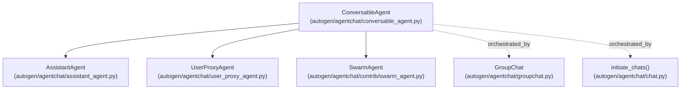

**Agent Class Hierarchy**

| Agent Type | Purpose | Key Methods |
|------------|---------|-------------|
| `ConversableAgent` | Base class for all agents | `send()`, `receive()`, `generate_reply()` [autogen/agentchat/agent.py:41-108]() |
| `AssistantAgent` | LLM-powered AI assistant | Inherits base, configured for LLM responses [autogen/agentchat/assistant_agent.py:8]() |
| `UserProxyAgent` | Human input + code execution | `initiate_chat()`, `run()`, code executor integration [autogen/agentchat/user_proxy_agent.py:29]() |
| `SwarmAgent` | Dynamic agent transitions | `run_swarm()`, handoff conditions [autogen/agentchat/contrib/swarm_agent.py:12-16]() |

**Sources:** [README.md:149-155](), [autogen/agentchat/__init__.py:7-30](), [autogen/agentchat/agent.py:22-158]()

### System Component Diagram

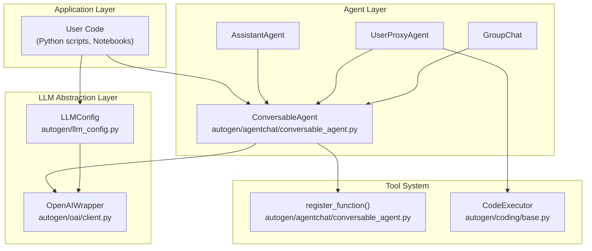

This diagram shows how user code interacts with agents, which delegate to the LLM abstraction layer and utilize tools.

**Sources:** [README.md:115-130](), [autogen/__init__.py:9-46](), [autogen/agentchat/__init__.py:7-30]()

## Package Structure and Distribution

AG2 is distributed on PyPI under two package names for backward compatibility:

| Package | PyPI Name | Description |
|---------|-----------|-------------|
| Primary | `ag2` | New branding (v0.3+) [README.md:85]() |
| Legacy | `autogen` | Alias for backward compatibility [README.md:85]() |

**Installation Commands**

```bash
# Standard installation
pip install ag2[openai]

# Or using legacy name
pip install autogen[openai]
```

**Version Information**

Current version is defined in [autogen/version.py:7]():

```python
__version__ = "0.11.5"
```

**Optional Dependencies**

AG2 uses a minimal core with optional feature sets installed via extras like `[openai]`, `[gemini]`, `[anthropic]`, etc. [website/docs/user-guide/basic-concepts/installing-ag2.mdx:24-32]().

For details, see [Package Structure and Distribution](#1.1).

**Sources:** [README.md:83-98](), [autogen/version.py:1-8](), [.github/workflows/python-package.yml:58-69](), [website/docs/user-guide/basic-concepts/installing-ag2.mdx:7-23]()

## LLM Integration Architecture

AG2 abstracts LLM interactions through a unified interface:

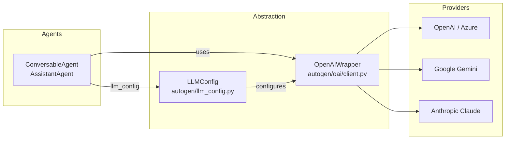

**Example Configuration** ([README.md:107-114]()):

```json
[
  {
    "model": "gpt-5",
    "api_key": "<your OpenAI API key here>"
  }
]
```

For detailed information on LLM integration, see [LLM Integration](#3).

**Sources:** [README.md:99-114](), [autogen/llm_config.py:37](), [autogen/oai/__init__.py:38-46]()

## Multi-Agent Orchestration

AG2 supports multiple orchestration patterns:

| Pattern | Implementation | Use Case |
|---------|----------------|----------|
| Two-agent chat | `initiate_chat()` | Simple request-response [website/docs/home/quickstart.mdx:145]() |
| Group chat | `GroupChat`, `GroupChatManager` | Multiple agents with speaker selection [autogen/agentchat/groupchat.py:28]() |
| Swarm | `run_swarm()` | Dynamic agent handoffs [autogen/agentchat/contrib/swarm_agent.py:15]() |

**Sources:** [README.md:143-146](), [autogen/agentchat/__init__.py:20-28](), [website/docs/user-guide/advanced-concepts/orchestration/group-chat/handoffs.mdx:8-42]()

## Getting Started

**Minimal Example** ([website/docs/quick-start.mdx:42-66]()):

```python
from autogen import ConversableAgent, LLMConfig
import os

llm_config = LLMConfig(
    {"api_type": "openai", "model": "gpt-5-nano", "api_key": os.environ["OPENAI_API_KEY"]}
)

my_agent = ConversableAgent(
    name="helpful_agent",
    system_message="You are a poetic AI assistant, respond in rhyme.",
    llm_config=llm_config,
)

response = my_agent.run(
    message="In one sentence, what's the big deal about AI?",
    max_turns=3,
)
response.process()
```

For comprehensive setup instructions, see [Installation and Configuration](#1.2).

**Sources:** [README.md:115-130](), [website/docs/quick-start.mdx:6-100]()

---

# Page: Package Structure and Distribution

# Package Structure and Distribution

<details>
<summary>Relevant source files</summary>

The following files were used as context for generating this wiki page:

- [.github/CODEOWNERS](.github/CODEOWNERS)
- [.github/workflows/python-package.yml](.github/workflows/python-package.yml)
- [LICENSE](LICENSE)
- [MAINTAINERS.md](MAINTAINERS.md)
- [NOTICE.md](NOTICE.md)
- [README.md](README.md)
- [TRANSPARENCY_FAQS.md](TRANSPARENCY_FAQS.md)
- [autogen/beta/agent.py](autogen/beta/agent.py)
- [autogen/coding/jupyter/import_utils.py](autogen/coding/jupyter/import_utils.py)
- [autogen/import_utils.py](autogen/import_utils.py)
- [autogen/oai/openai_responses.py](autogen/oai/openai_responses.py)
- [autogen/tools/experimental/__init__.py](autogen/tools/experimental/__init__.py)
- [autogen/version.py](autogen/version.py)
- [notebook/agentchat_gpt5.1_apply_patch_example.ipynb](notebook/agentchat_gpt5.1_apply_patch_example.ipynb)
- [pyproject.toml](pyproject.toml)
- [setup_autogen.py](setup_autogen.py)
- [test/agentchat/realtime_agent/clients/test_gemini_realtime_client.py](test/agentchat/realtime_agent/clients/test_gemini_realtime_client.py)
- [test/agentchat/realtime_agent/clients/test_oai_realtime_client.py](test/agentchat/realtime_agent/clients/test_oai_realtime_client.py)
- [test/oai/test_responses_client.py](test/oai/test_responses_client.py)
- [test/test_import_utils.py](test/test_import_utils.py)
- [website/docs/user-guide/FAQ.mdx](website/docs/user-guide/FAQ.mdx)
- [website/docs/user-guide/observability/logging_events.mdx](website/docs/user-guide/observability/logging_events.mdx)
- [website/docs/user-guide/reference-tools/index.mdx](website/docs/user-guide/reference-tools/index.mdx)
- [website/docusaurus.config.js](website/docusaurus.config.js)
- [website/mint-json-template.json.jinja](website/mint-json-template.json.jinja)

</details>


This document details AG2's package structure, distribution mechanism, optional dependencies system, and build/release pipeline. For information about installation and configuration steps, see [Installation and Configuration](#1.2). For details on how optional features integrate into the codebase, see [Optional Dependencies and Feature Sets](#13.3).

---

## Package Architecture Overview

AG2 is distributed as two PyPI packages with a specific relationship: `ag2` is the primary package containing all source code, while `autogen` serves as a backward-compatible alias that depends on `ag2`. This architecture allows users to install either package name while maintaining a single codebase.

### Package Relationship Diagram

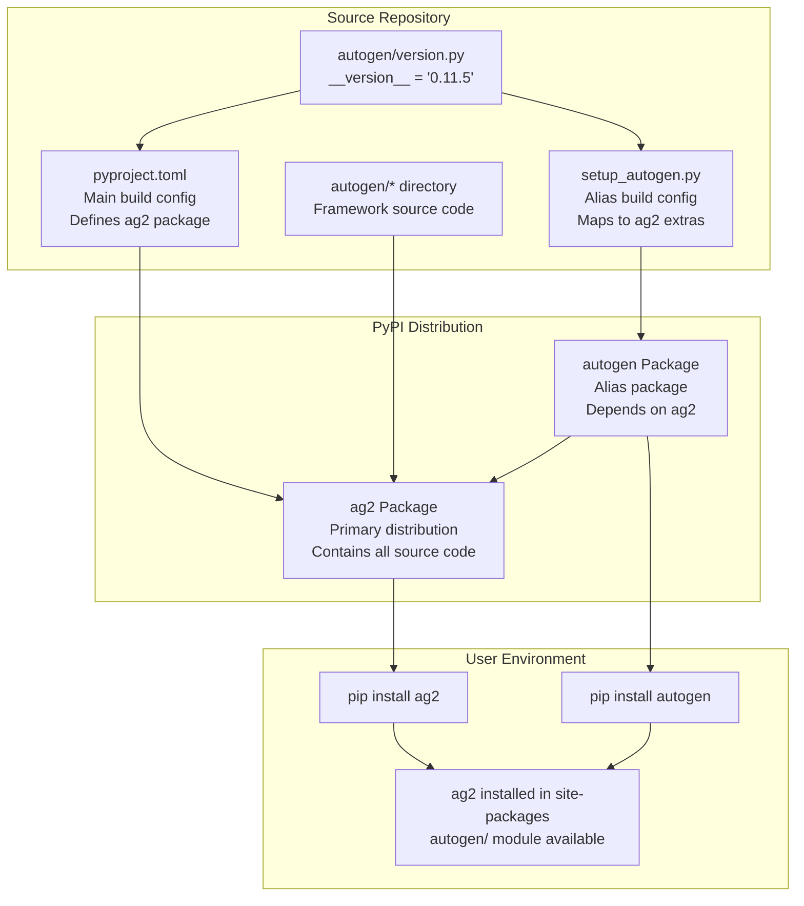

**Sources:** [pyproject.toml:34-36](), [pyproject.toml:12-13](), [setup_autogen.py:24-29](), [autogen/version.py:7](), [README.md:85-90]()

---

## Core Package Configuration

The `pyproject.toml` file defines the `ag2` package using the `hatchling` build backend. The package structure is optimized for modularity with minimal required dependencies and extensive optional features.

### Package Metadata

The core package metadata defines basic information and Python version requirements:

| Property | Value | Location |
|----------|-------|----------|
| Package Name | `ag2` | [pyproject.toml:34]() |
| Build System | `hatchling` | [pyproject.toml:1-3]() |
| Python Version | `>=3.10` | [pyproject.toml:51]() |
| License | Apache-2.0 | [pyproject.toml:37]() |
| Version Source | `autogen/version.py` | [pyproject.toml:5-6]() |

The version is dynamically read from [autogen/version.py:7](), which contains:

```python
__version__ = "0.11.5"
```

This version string is used by both `ag2` and `autogen` packages to ensure synchronization.

### Minimal Dependencies

The core package installs with minimal dependencies to keep the base installation lightweight:

```toml
dependencies = [
    "termcolor",
    "python-dotenv",
    "tiktoken",
    "pydantic>=2.6.1,<3",
    "pyyaml>=6.0.2",
    "docker",
    "packaging",
    "httpx>=0.28.1,<1",
    "anyio>=4.0.0,<5.0.0",
    "fast-depends[pydantic]>=3.0.8,<4.0.0"
]
```

These dependencies provide:
- **termcolor**: Terminal output formatting [pyproject.toml:79]()
- **python-dotenv**: Environment variable management [pyproject.toml:80]()
- **tiktoken**: Token counting for LLMs [pyproject.toml:81]()
- **pydantic**: Data validation and configuration [pyproject.toml:82]()
- **pyyaml**: YAML parsing for configuration [pyproject.toml:83]()
- **docker**: Container execution support [pyproject.toml:84]()
- **packaging**: Version parsing utilities [pyproject.toml:85]()
- **httpx**: HTTP client for API calls [pyproject.toml:86]()
- **anyio**: Async I/O support [pyproject.toml:87]()
- **fast-depends**: Dependency injection for tools [pyproject.toml:89]()

**Sources:** [pyproject.toml:78-90](), [pyproject.toml:51]()

---

## Optional Dependencies System

AG2's optional dependencies are organized into functional groups that users install based on their needs. This modular approach reduces installation size and dependency conflicts.

### Dependency Group Architecture

```mermaid
graph TB
    BASE["ag2 Base Package<br/>Minimal dependencies"]
    
    subgraph "LLM Providers"
        OPENAI["openai<br/>OpenAI API"]
        ANTHROPIC["anthropic<br/>Claude/Bedrock"]
        GEMINI["gemini<br/>Google Gemini/Vertex"]
        MISTRAL["mistral<br/>Mistral AI"]
        COHERE["cohere<br/>Cohere API"]
        OLLAMA["ollama<br/>Local models"]
        CEREBRAS["cerebras<br/>Cerebras Cloud"]
        GROQ["groq<br/>Groq API"]
        DEEPSEEK["deepseek<br/>DeepSeek API"]
    end
    
    subgraph "Code Execution"
        JUPYTER["jupyter-executor<br/>Jupyter kernels"]
        REMYX["remyx<br/>Research paper envs"]
        YEPCODE["yepcode<br/>Serverless execution"]
    end
    
    subgraph "RAG & Search"
        RETRIEVE["retrievechat<br/>ChromaDB RAG"]
        PGVECTOR["retrievechat-pgvector<br/>PostgreSQL vector"]
        QDRANT["retrievechat-qdrant<br/>Qdrant vector"]
        RAG["rag<br/>Advanced RAG with docling"]
        FALKOR["graph-rag-falkor-db<br/>Graph RAG"]
    end
    
    subgraph "Tools & Integrations"
        CRAWL["crawl4ai<br/>Web scraping"]
        BROWSER["browser-use<br/>Browser automation"]
        DUCKDUCKGO["duckduckgo<br/>Search"]
        TAVILY["tavily<br/>Search API"]
        MCP["mcp<br/>Model Context Protocol"]
        INTEROP["interop<br/>CrewAI/LangChain"]
    end
    
    BASE --> OPENAI
    BASE --> ANTHROPIC
    BASE --> GEMINI
    BASE --> MISTRAL
    BASE --> COHERE
    BASE --> OLLAMA
    BASE --> CEREBRAS
    BASE --> GROQ
    BASE --> DEEPSEEK
    
    BASE --> JUPYTER
    BASE --> REMYX
    BASE --> YEPCODE
    
    BASE --> RETRIEVE
    BASE --> PGVECTOR
    BASE --> QDRANT
    BASE --> RAG
    BASE --> FALKOR
    
    BASE --> CRAWL
    BASE --> BROWSER
    BASE --> DUCKDUCKGO
    BASE --> TAVILY
    BASE --> MCP
    BASE --> INTEROP
```

**Sources:** [pyproject.toml:92-287]()

### LLM Provider Dependencies

AG2 supports multiple LLM providers through optional dependencies:

| Group | Packages | Purpose |
|-------|----------|---------|
| `openai` | `openai>=1.99.3,<2` | OpenAI API including GPT models [pyproject.toml:109]() |
| `openai-realtime` | `ag2[openai]`, `openai[realtime]` | Real-time audio API support [pyproject.toml:110]() |
| `anthropic` | `anthropic[vertex]>=0.79.0,<1` | Claude models via Anthropic/Bedrock/Vertex [pyproject.toml:114]() |
| `gemini` | `google-genai>=1.20.0,<2.0`, `google-cloud-aiplatform` | Google Gemini/Vertex AI [pyproject.toml:116-126]() |
| `gemini-realtime` | `ag2[gemini]`, `ag2[websockets]` | Real-time Gemini API [pyproject.toml:127]() |
| `mistral` | `mistralai>=2.0.0` | Mistral AI models [pyproject.toml:135]() |
| `cohere` | `cohere>=5.13.5` | Cohere language models [setup_autogen.py:89]() |
| `ollama` | `ollama>=0.4.7`, `fix_busted_json>=0.0.18` | Local model execution [pyproject.toml:131]() |
| `cerebras` | `cerebras_cloud_sdk>=1.0.0` | Cerebras Cloud API [setup_autogen.py:85]() |
| `groq` | `groq>=0.9.0` | Groq inference API [pyproject.toml:129]() |
| `together` | `together>=1.2` | Together AI API [setup_autogen.py:80]() |
| `bedrock` | `boto3>=1.34.149` | AWS Bedrock [pyproject.toml:133]() |
| `deepseek` | `ag2[openai]` | DeepSeek API (OpenAI-compatible) [pyproject.toml:112]() |

**Sources:** [pyproject.toml:109-138](), [setup_autogen.py:80-94]()

### Code Execution Dependencies

Code execution environments require specific dependencies:

| Group | Key Packages | Executor Type |
|-------|-------------|---------------|
| `jupyter-executor` | `jupyter-kernel-gateway`, `jupyter-client>=8.6.0`, `ipykernel>=6.29.0` | Interactive Jupyter kernels [pyproject.toml:150-156]() |
| `remyx` | `remyxai>=0.2.0` | Research paper environment [setup_autogen.py:87]() |
| `yepcode` | `yepcode-run>=1.6.1` | Serverless cloud execution [setup_autogen.py:86]() |
| `daytona` | `daytona-sdk` | Daytona remote workspace [setup_autogen.py:88]() |

**Sources:** [pyproject.toml:150-156](), [setup_autogen.py:86-88]()

### RAG and Vector Store Dependencies

Retrieval-Augmented Generation support includes multiple vector store backends:

| Group | Key Packages | Backend |
|-------|-------------|---------|
| `retrievechat` | `chromadb>=1.4.1,<1.5`, `sentence_transformers>=5.2.2`, `pypdf` | ChromaDB vector store [pyproject.toml:158-166]() |
| `retrievechat-pgvector` | `ag2[retrievechat]`, `pgvector>=0.2.5`, `psycopg` | PostgreSQL with pgvector [pyproject.toml:168-173]() |
| `retrievechat-mongodb` | `ag2[retrievechat]`, `pymongo>=4.0.0` | MongoDB vector search [pyproject.toml:175]() |
| `retrievechat-qdrant` | `ag2[retrievechat]`, `qdrant_client`, `fastembed>=0.3.1` | Qdrant vector database [pyproject.toml:177]() |
| `rag` | `docling>=2.15.1,<3`, `chromadb>=0.5,<2`, `llama-index>=0.14.13` | Advanced RAG with document parsing [pyproject.toml:183-197]() |
| `graph-rag-falkor-db` | `graphrag_sdk==0.8.2`, `falkordb>=1.0.10` | Graph-based RAG [pyproject.toml:181]() |

**Sources:** [pyproject.toml:158-197]()

### Tool and Integration Dependencies

External tools and framework integrations:

| Group | Packages | Purpose |
|-------|----------|---------|
| `crawl4ai` | `crawl4ai>=0.5.0,<0.9` | Web crawling and scraping [pyproject.toml:200]() |
| `browser-use` | `browser-use>=0.3.1,<1.0` | Browser automation [pyproject.toml:212]() |
| `duckduckgo` | `duckduckgo_search` | DuckDuckGo search [setup_autogen.py:93]() |
| `tavily` | `tavily-python` | Tavily search API [setup_autogen.py:94]() |
| `google-search` | `ag2[google-client]` | Google search integration [pyproject.toml:224]() |
| `wikipedia` | `wikipedia-api>=0.8.1, <1.0` | Wikipedia queries [pyproject.toml:226]() |
| `mcp` | `mcp>=1.11.0` | Model Context Protocol [pyproject.toml:240]() |
| `mcp-proxy-gen` | `fastapi-code-generator>=0.5.4`, `fastapi>=0.112` | MCP proxy generation [pyproject.toml:245-251]() |
| `interop-crewai` | `crewai[tools]>=0.76,<1`, `litellm<=1.76.3` | CrewAI integration [pyproject.toml:253-259]() |
| `interop-langchain` | `langchain-community>=0.3.12` | LangChain integration [pyproject.toml:260]() |
| `interop-pydantic-ai` | `pydantic-ai>=0.0.12` | Pydantic AI integration [pyproject.toml:261]() |

The experimental tools system is exposed via [autogen/tools/experimental/__init__.py:30-58]() with classes like `BrowserUseTool`, `Crawl4AITool`, `DuckDuckGoSearchTool`, `TavilySearchTool`, etc.

**Sources:** [pyproject.toml:200-261](), [autogen/tools/experimental/__init__.py:30-58]()

### Development Dependencies

Development, testing, and documentation dependencies are also organized as optional groups:

| Group | Purpose | Key Packages |
|-------|---------|-------------|
| `test` | Testing infrastructure | `pytest>=8.3.4`, `pytest-cov`, `pytest-asyncio` [pyproject.toml:311-320]() |
| `docs` | Documentation generation | `mkdocs-material`, `mkdocstrings`, `pdoc3` [pyproject.toml:322-337]() |
| `types` | Type checking | `mypy==1.15.0`, type stubs [pyproject.toml:339-346]() |
| `lint` | Code quality | `ruff==0.9.6`, `codespell` [pyproject.toml:348-352]() |
| `dev` | Complete dev environment | Combines all dev dependencies [pyproject.toml:354-361]() |

**Sources:** [pyproject.toml:311-361]()

---

## Build System Configuration

AG2 uses the `hatchling` build backend with specific configurations for package assembly and distribution.

### Build Configuration Structure

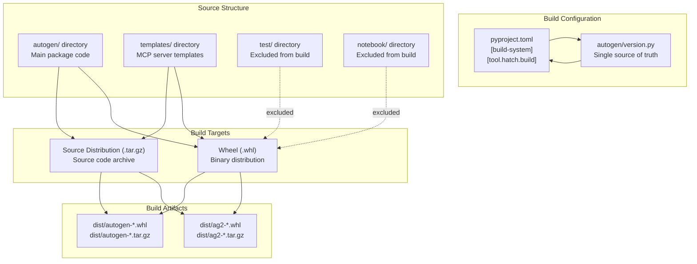

**Sources:** [pyproject.toml:1-10](), [pyproject.toml:12-25]()

### Build System Definition

The build system is configured in [pyproject.toml:1-6]():

```toml
[build-system]
requires = ["hatchling"]
build-backend = "hatchling.build"

[tool.hatch.version]
path = "autogen/version.py"
```

This configuration:
- Uses `hatchling` as the PEP 517 build backend [pyproject.toml:2-3]()
- Dynamically reads version from `autogen/version.py` [pyproject.toml:6]()
- Supports both wheel and sdist generation [pyproject.toml:12-20]()

### Package Contents

The build configuration specifies what to include in distributions:

```toml
[tool.hatch.build]
skip-excluded-dirs = true
exclude = ["/test", "/notebook"]

[tool.hatch.build.targets.wheel]
packages = ["autogen"]
only-include = [
    "autogen",
    "templates",
]
```

The `autogen/` directory contains all framework code. The `templates/` directory is included specifically for the generation of MCP Servers from OpenAPI specifications [pyproject.toml:16-18]().

**Sources:** [pyproject.toml:8-18]()

---

## Autogen Alias Package

The `autogen` package is built separately using `setup_autogen.py` and serves as a pure alias to `ag2`.

### Alias Package Structure

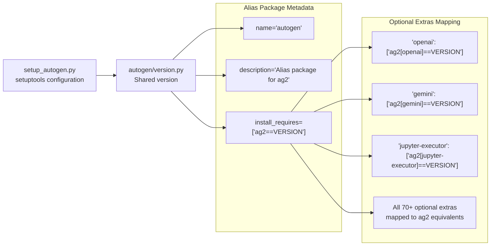

**Sources:** [setup_autogen.py:23-103]()

### Setup Script Structure

The [setup_autogen.py:23-114]() script creates the alias package:

```python
setuptools.setup(
    name="autogen",
    version=__version__,
    description="Alias package for ag2",
    long_description=long_description,
    long_description_content_type="text/markdown",
    install_requires=["ag2==" + __version__],
    extras_require={
        "openai": ["ag2[openai]==" + __version__],
        "gemini": ["ag2[gemini]==" + __version__],
        "jupyter-executor": ["ag2[jupyter-executor]==" + __version__],
        # ... all other extras mapped similarly
    },
    python_requires=">=3.10,<3.14",
)
```

This setup ensures:
1. `pip install autogen` installs the same version of `ag2` [setup_autogen.py:29]()
2. All optional extras are passed through to `ag2` equivalents [setup_autogen.py:30-103]()
3. Version numbers stay synchronized [setup_autogen.py:25]()
4. Users can use either package name interchangeably [setup_autogen.py:26]()

**Sources:** [setup_autogen.py:17-114]()

---

## Distribution Pipeline

AG2 uses GitHub Actions for automated building and publishing to PyPI when releases are created.

### CI/CD Workflow Architecture

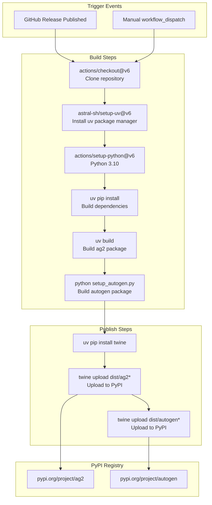

**Sources:** [.github/workflows/python-package.yml:1-70]()

### Workflow Configuration

The GitHub Actions workflow [.github/workflows/python-package.yml:5-70]() runs on:
- Release published events [github/workflows/python-package.yml:8-9]()
- Manual trigger via `workflow_dispatch` [github/workflows/python-package.yml:10]()

Build process:
1. **Environment Setup**: Ubuntu with Python 3.10 and `uv` package manager [.github/workflows/python-package.yml:21-31]()
2. **Build ag2**: `uv build` generates wheel and source distributions [.github/workflows/python-package.yml:47]()
3. **Build autogen**: `python setup_autogen.py sdist bdist_wheel` creates alias package [.github/workflows/python-package.yml:57]()
4. **Publish**: Twine uploads both packages to PyPI with credentials from GitHub secrets [.github/workflows/python-package.yml:63-69]()

**Sources:** [.github/workflows/python-package.yml:1-70]()

---

## Version Management

Version management ensures both `ag2` and `autogen` packages remain synchronized through a single source of truth.

### Version Synchronization

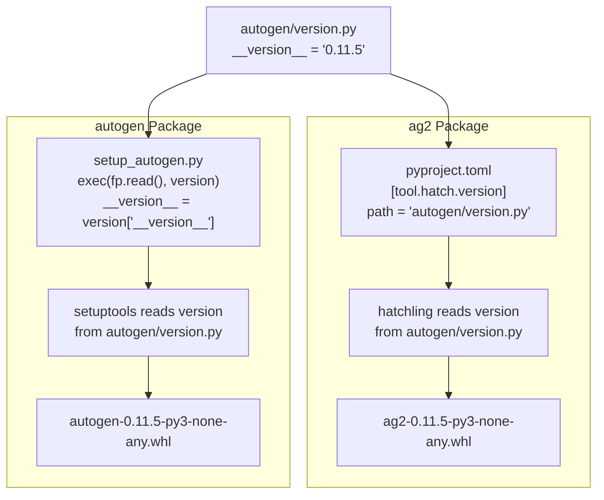

**Sources:** [autogen/version.py:7](), [pyproject.toml:5-6](), [setup_autogen.py:17-21]()

### Version File

The version is defined in [autogen/version.py:1-8]():

```python
# Copyright (c) 2023 - 2026, AG2ai, Inc., AG2ai open-source projects maintainers and core contributors
#
# SPDX-License-Identifier: Apache-2.0

__all__ = ("__version__",)

__version__ = "0.11.5"
```

### Version Resolution

**For ag2 package** [pyproject.toml:53](), [pyproject.toml:5-6]():
- Build system declares `dynamic = ["version"]` [pyproject.toml:53]()
- Hatchling reads from `path = "autogen/version.py"` [pyproject.toml:6]()

**For autogen package** [setup_autogen.py:17-21]():
- Script executes `version.py` and extracts `__version__` [setup_autogen.py:20-21]()
- Uses same value for package version and dependency constraint [setup_autogen.py:25,29]()

**Sources:** [autogen/version.py:1-8](), [pyproject.toml:5-6,53](), [setup_autogen.py:17-21]()

---

## Installation Patterns

Users can install AG2 using several patterns depending on their needs.

### Basic Installation

The simplest installations use the base package with optional LLM provider:

```bash
# Install ag2 with OpenAI support
pip install ag2[openai]

# Install via autogen alias (equivalent)
pip install autogen[openai]
```

On macOS, quotes are required due to shell interpretation:

```bash
# macOS/Zsh requires quotes
pip install 'ag2[openai]'
```

**Sources:** [README.md:85-95]()

### Multiple Optional Dependencies

Users can install multiple optional dependency groups. The package resolver handles transitive dependencies automatically.

```bash
# Install with multiple LLM providers
pip install ag2[openai,gemini,anthropic]

# Install with LLM provider and tools
pip install ag2[openai,browser-use,crawl4ai]
```

### Feature-Complete Installation

For development or comprehensive feature usage, the `dev` extra [pyproject.toml:354-361]() includes `lint`, `test`, `types`, and `docs` groups.

```bash
# Install with dev dependencies
pip install ag2[dev]

# Install with all interoperability features
pip install ag2[interop]  # Includes crewai, langchain, pydantic-ai
```

**Sources:** [pyproject.toml:354-361](), [pyproject.toml:272]()

---

## Package Import Structure

Despite being distributed as two packages, both install the same `autogen` module in Python environments.

### Import Resolution

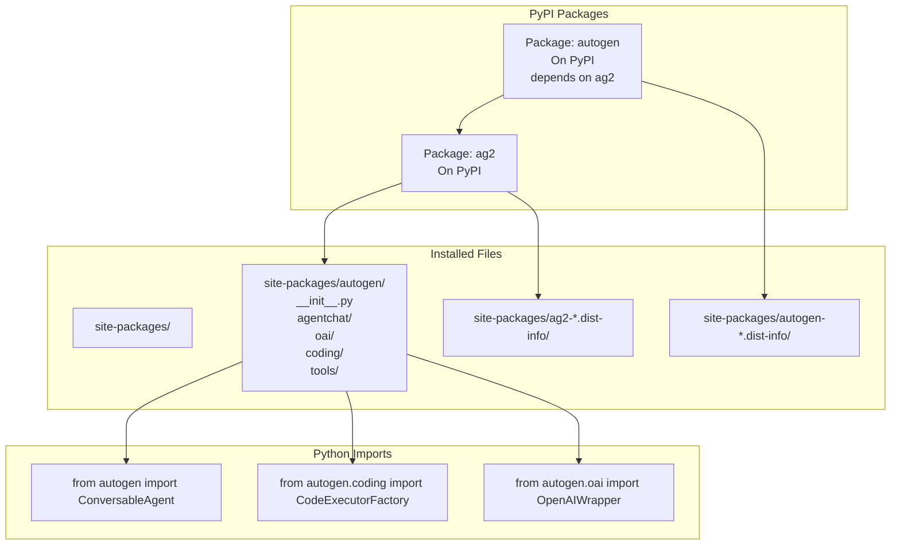

Both `pip install ag2` and `pip install autogen` result in the `autogen/` directory in site-packages [pyproject.toml:13](). All code imports use the `autogen` module name [README.md:121]().

**Sources:** [README.md:121](), [pyproject.toml:13](), [setup_autogen.py:24,29]()

---

# Page: Installation and Configuration

# Installation and Configuration

<details>
<summary>Relevant source files</summary>

The following files were used as context for generating this wiki page:

- [OAI_CONFIG_LIST_sample](OAI_CONFIG_LIST_sample)
- [autogen/coding/__init__.py](autogen/coding/__init__.py)
- [autogen/coding/base.py](autogen/coding/base.py)
- [autogen/coding/daytona_code_executor.py](autogen/coding/daytona_code_executor.py)
- [autogen/coding/factory.py](autogen/coding/factory.py)
- [autogen/oai/__init__.py](autogen/oai/__init__.py)
- [autogen/oai/openai_utils.py](autogen/oai/openai_utils.py)
- [autogen/token_count_utils.py](autogen/token_count_utils.py)
- [autogen/tools/experimental/shell/__init__.py](autogen/tools/experimental/shell/__init__.py)
- [autogen/tools/experimental/shell/shell_tool.py](autogen/tools/experimental/shell/shell_tool.py)
- [notebook/agentchat_daytona_executor.ipynb](notebook/agentchat_daytona_executor.ipynb)
- [notebook/agentchat_gpt5.1_in_built_tools_example.ipynb](notebook/agentchat_gpt5.1_in_built_tools_example.ipynb)
- [notebook/agentchat_gpt5.1_shell_tool_example.ipynb](notebook/agentchat_gpt5.1_shell_tool_example.ipynb)
- [test/coding/test_daytona_code_executor.py](test/coding/test_daytona_code_executor.py)
- [test/coding/test_daytona_code_executor_integration.py](test/coding/test_daytona_code_executor_integration.py)
- [test/oai/test_utils.py](test/oai/test_utils.py)
- [test/test_notebook.py](test/test_notebook.py)
- [test/tools/experimental/shell/test_shell_tool.py](test/tools/experimental/shell/test_shell_tool.py)
- [website/docs/installation/Installation.mdx](website/docs/installation/Installation.mdx)
- [website/docs/installation/Optional-Dependencies.mdx](website/docs/installation/Optional-Dependencies.mdx)
- [website/docs/user-guide/advanced-concepts/code-execution.mdx](website/docs/user-guide/advanced-concepts/code-execution.mdx)
- [website/docs/user-guide/getting-started/Getting-Started.mdx](website/docs/user-guide/getting-started/Getting-Started.mdx)

</details>


This page covers installing AG2, configuring LLM API keys, understanding the configuration system, and setting up optional features. AG2 provides a modular installation system and a robust configuration layer to manage multiple LLM providers, caching, and cost tracking.

---

## Installation

### Python Requirements

AG2 requires **Python version >= 3.10, <= 3.14** [website/docs/installation/Installation.mdx:68-68](). It is recommended to use a virtual environment (venv, Conda, or Poetry) to isolate dependencies [website/docs/installation/Installation.mdx:6-64]().

### Basic Installation

The framework is distributed via PyPI. The packages `ag2` and `autogen` are aliases for the same library [website/docs/installation/Installation.mdx:74-83]().

**Install with OpenAI support:**
```bash
pip install ag2[openai]
```

**Upgrade existing installation:**
```bash
pip install -U ag2[openai]
```

**Sources:** [website/docs/installation/Installation.mdx:66-83]()

### Optional Dependencies

AG2 uses a modular architecture where specific features are enabled via extras.

| Feature | Installation Command | Description |
|---------|---------------------|-------------|
| **LLMs** | `pip install ag2[gemini,anthropic,mistral,groq,cohere]` | Support for non-OpenAI providers [website/docs/installation/Optional-Dependencies.mdx:1-7]() |
| **Code Execution** | `pip install ag2[ipython]` | Enables `EmbeddedIPythonCodeExecutor` [website/docs/installation/Optional-Dependencies.mdx:35-42]() |
| **RAG** | `pip install ag2[retrievechat]` | Support for Retrieval-Augmented Generation with ChromaDB [website/docs/installation/Optional-Dependencies.mdx:192-198]() |
| **Cloud Sandbox** | `pip install ag2[daytona]` | Enables `DaytonaCodeExecutor` for secure sandboxed execution [website/docs/installation/Optional-Dependencies.mdx:142-150]() |
| **Caching** | `pip install ag2[redis]` | Enables Redis-based LLM caching [website/docs/installation/Optional-Dependencies.mdx:24-31]() |

**Sources:** [website/docs/installation/Optional-Dependencies.mdx:1-218](), [autogen/coding/factory.py:46-74]()

---

## API Key Configuration

### Configuration File Format

AG2 typically uses a JSON file (standard name: `OAI_CONFIG_LIST`) to manage multiple LLM configurations.

**Example `OAI_CONFIG_LIST`:**
```json
[
    {
        "model": "gpt-4o",
        "api_key": "sk-...",
        "tags": ["vision", "tool"]
    },
    {
        "model": "my-azure-deployment",
        "api_key": "...",
        "base_url": "https://example.openai.azure.com/",
        "api_type": "azure",
        "api_version": "2024-02-01"
    }
]
```
**Sources:** [OAI_CONFIG_LIST_sample:5-18](), [test/oai/test_utils.py:54-94]()

### Loading and Filtering Configurations

The `autogen.oai.openai_utils` module provides utilities to load these configurations.

*   `get_config_list`: Generates a list of configs from provided keys and URLs [autogen/oai/openai_utils.py:187-202]().
*   `config_list_from_json`: Loads configs from a file and applies filters [autogen/llm_config/utils.py:100-112]().

**Filtering Example:**
```python
from autogen import config_list_from_json

# Filter for specific models or tags
config_list = config_list_from_json(
    "OAI_CONFIG_LIST",
    filter_dict={"tags": ["gpt4"], "model": ["gpt-4"]}
)
```
**Sources:** [test/oai/test_utils.py:211-222](), [autogen/oai/openai_utils.py:187-202]()

---

## Configuration System Architecture

### Configuration Logic Flow

The following diagram bridges the natural language requirement of "setting up a model" to the code entities that handle the configuration data.

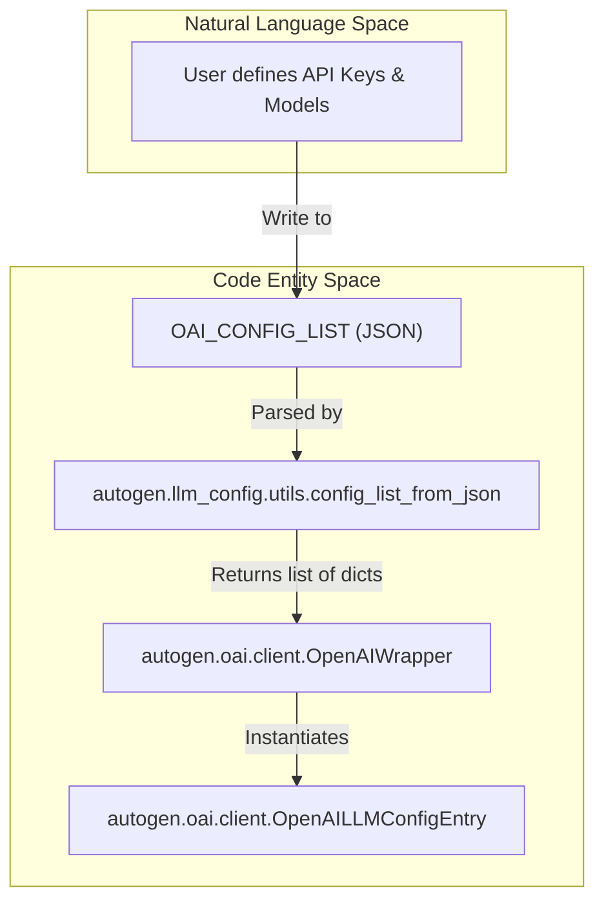
**Sources:** [autogen/oai/client.py:11-18](), [autogen/llm_config/utils.py:100-112](), [OAI_CONFIG_LIST_sample:5-18]()

### LLM Config Entry Hierarchy

AG2 uses specialized classes for different provider configurations, ensuring type safety and validation.

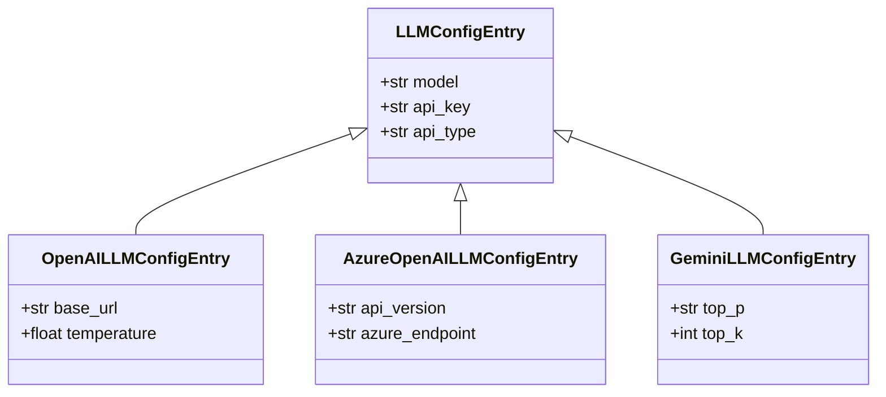
**Sources:** [autogen/oai/client.py:248-340](), [autogen/oai/__init__.py:8-32]()

---

## Code Execution Setup

### Docker Execution (Recommended)

To mitigate security risks, AG2 supports executing LLM-generated code inside Docker containers [website/docs/user-guide/advanced-concepts/code-execution.mdx:119-126]().

```python
from autogen.coding import DockerCommandLineCodeExecutor

executor = DockerCommandLineCodeExecutor(
    image="python:3.12-slim",
    timeout=10,
    work_dir="coding_dir"
)
```
**Sources:** [website/docs/user-guide/advanced-concepts/code-execution.mdx:142-153](), [autogen/coding/docker_commandline_code_executor.py]()

### Code Executor Factory

The `CodeExecutorFactory` is the central point for creating executors based on the `CodeExecutionConfig` dictionary [autogen/coding/factory.py:14-18]().

| Executor Key | Class | Required Extra |
|--------------|-------|----------------|
| `commandline-local` | `LocalCommandLineCodeExecutor` | None |
| `ipython-embedded` | `EmbeddedIPythonCodeExecutor` | `ag2[ipython]` |
| `yepcode` | `YepCodeCodeExecutor` | `ag2[yepcode]` |
| `daytona` | `DaytonaCodeExecutor` | `ag2[daytona]` |

**Sources:** [autogen/coding/factory.py:34-77](), [autogen/coding/base.py:98-113]()

---

## Token Counting and Cost Tracking

AG2 includes built-in utilities for managing API usage.

### Token Counting
The `autogen.token_count_utils` module provides functions to calculate token usage for various OpenAI models using `tiktoken` [autogen/token_count_utils.py:127-143]().

*   `count_token(input, model)`: Counts tokens in strings or message lists [autogen/token_count_utils.py:127-136]().
*   `get_max_token_limit(model)`: Returns the context window limit for a model (e.g., 128k for `gpt-4o`) [autogen/token_count_utils.py:34-107]().

### Pricing
Pricing is tracked via the `OAI_PRICE1K` dictionary in `openai_utils.py`, which maps model names to `(input_price, output_price)` tuples per 1,000 tokens [autogen/oai/openai_utils.py:46-151]().

**Sources:** [autogen/token_count_utils.py:34-152](), [autogen/oai/openai_utils.py:46-151]()

---

# Page: Core Agent System

# Core Agent System

<details>
<summary>Relevant source files</summary>

The following files were used as context for generating this wiki page:

- [autogen/__init__.py](autogen/__init__.py)
- [autogen/agentchat/__init__.py](autogen/agentchat/__init__.py)
- [autogen/agentchat/agent.py](autogen/agentchat/agent.py)
- [autogen/agentchat/chat.py](autogen/agentchat/chat.py)
- [autogen/agentchat/conversable_agent.py](autogen/agentchat/conversable_agent.py)
- [autogen/agentchat/eligibility_policy.py](autogen/agentchat/eligibility_policy.py)
- [autogen/agentchat/groupchat.py](autogen/agentchat/groupchat.py)
- [autogen/exception_utils.py](autogen/exception_utils.py)
- [autogen/io/__init__.py](autogen/io/__init__.py)
- [autogen/io/base.py](autogen/io/base.py)
- [autogen/io/console.py](autogen/io/console.py)
- [autogen/io/websockets.py](autogen/io/websockets.py)
- [autogen/messages/agent_messages.py](autogen/messages/agent_messages.py)
- [autogen/tools/experimental/deep_research/deep_research.py](autogen/tools/experimental/deep_research/deep_research.py)
- [notebook/agentchat_groupchat_eligibility.ipynb](notebook/agentchat_groupchat_eligibility.ipynb)
- [notebook/agentchat_websockets.ipynb](notebook/agentchat_websockets.ipynb)
- [test/agentchat/test_conversable_agent.py](test/agentchat/test_conversable_agent.py)
- [test/agentchat/test_eligibility_policy.py](test/agentchat/test_eligibility_policy.py)
- [test/agentchat/test_groupchat.py](test/agentchat/test_groupchat.py)
- [test/agentchat/test_groupchat_eligibility.py](test/agentchat/test_groupchat_eligibility.py)
- [test/io/test_base.py](test/io/test_base.py)
- [test/io/test_websockets.py](test/io/test_websockets.py)
- [test/messages/test_agent_messages.py](test/messages/test_agent_messages.py)
- [test/tools/experimental/deep_research/test_deep_research.py](test/tools/experimental/deep_research/test_deep_research.py)

</details>


The AG2 framework is built around a foundational agent architecture centered on the `ConversableAgent` class. This class provides the essential capabilities for agent-to-agent communication, including message handling, LLM integration, reply generation, and execution of code and tools. Understanding the `ConversableAgent` and its core mechanisms is essential for building any AG2 application.

This page provides an overview of the agent system architecture. For detailed documentation, see:
- [ConversableAgent](#2.1) — Deep dive into `ConversableAgent`: initialization, core methods (`send`, `receive`, `generate_reply`), reply function chain, and extensibility.
- [Message Handling and Reply Functions](#2.2) — Explain the reply function system, message formats (`BaseEvent` hierarchy), trigger conditions, and reply generation pipeline.
- [AssistantAgent and UserProxyAgent](#2.3) — Cover the two primary agent types: `AssistantAgent` (LLM-powered) and `UserProxyAgent` (human-in-the-loop, code execution).
- [GroupChat and Multi-Agent Orchestration](#2.4) — Explain `GroupChat` system, `GroupChatManager`, speaker selection methods (auto, manual, round_robin), and conversation flow control.
- [IO System and Communication](#2.5) — Detail the `IOStream` abstraction, implementations (`IOConsole`, `IOWebsockets`), and how agents communicate through different interfaces.

For LLM configuration, see [LLM Integration](#3). For advanced agent types, see [Advanced Agent Types](#4). For tool capabilities, see [Tools and Capabilities](#5).

## ConversableAgent: The Foundation

The `ConversableAgent` class [autogen/agentchat/conversable_agent.py:136-178]() is the core building block of AG2. It inherits from `LLMAgent`, which in turn inherits from the base `Agent` class [autogen/agentchat/agent.py:47-155](). In practice, almost all AG2 agents are instances or subclasses of `ConversableAgent`.

### Agent Class Hierarchy

The following diagram maps the conceptual hierarchy to the specific classes defined in the codebase.

**Diagram: Agent Class Hierarchy**
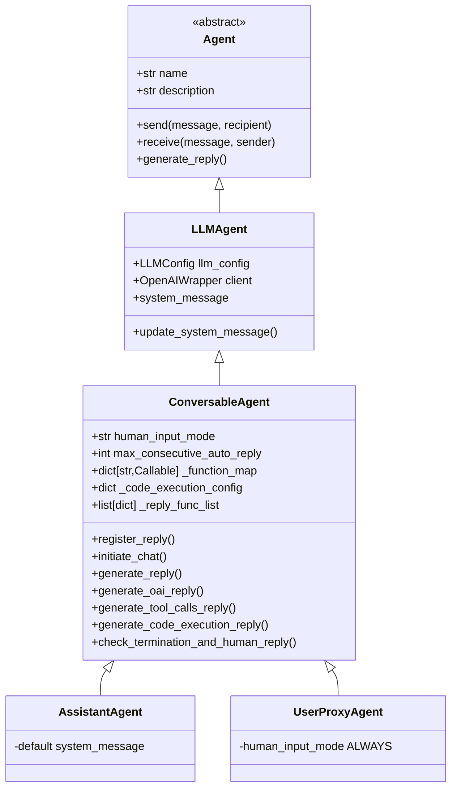
**Sources:** [autogen/agentchat/agent.py:47-155](), [autogen/agentchat/conversable_agent.py:136-178](), [autogen/agentchat/assistant_agent.py:15-20](), [autogen/agentchat/user_proxy_agent.py:15-20]()

### Core Capabilities

The `ConversableAgent` provides these essential capabilities:

| Capability | Configuration | Description |
|------------|---------------|-------------|
| **LLM Integration** | `llm_config` | Connect to LLM providers via `OpenAIWrapper` [autogen/agentchat/conversable_agent.py:252-258]() |
| **Reply Functions** | `register_reply()` | Chain of functions to generate responses [autogen/agentchat/conversable_agent.py:1104-1165]() |
| **Code Execution** | `code_execution_config` | Execute code blocks via `CodeExecutor` [autogen/agentchat/conversable_agent.py:165-166]() |
| **Tool Calling** | `function_map` | Register and execute tools/functions [autogen/agentchat/conversable_agent.py:164]() |
| **Human Input** | `human_input_mode` | Control when to solicit human input ("ALWAYS", "NEVER", "TERMINATE") [autogen/agentchat/conversable_agent.py:163]() |
| **Auto-Reply** | `max_consecutive_auto_reply` | Limit automatic responses [autogen/agentchat/conversable_agent.py:162]() |
| **Message History** | `_oai_messages` | Track conversation history per agent [autogen/agentchat/conversable_agent.py:237-240]() |
| **Context Variables** | `context_variables` | Maintain shared state via `ContextVariables` [autogen/agentchat/conversable_agent.py:171]() |

**Sources:** [autogen/agentchat/conversable_agent.py:157-382]()

## Reply Function Chain

The `ConversableAgent` uses a reply function chain to process messages. During initialization, reply functions are registered in a specific order [autogen/agentchat/conversable_agent.py:289-364](). When `generate_reply()` is called, it iterates through `_reply_func_list` until a function returns a valid response [autogen/agentchat/conversable_agent.py:1343-1429]().

### Reply Function Registration Order

**Diagram: Default Reply Chain Logic**
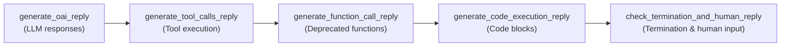
**Sources:** [autogen/agentchat/conversable_agent.py:289-364](), [autogen/agentchat/conversable_agent.py:1343-1429]()

## Agent-to-Agent Communication

Agents communicate by passing messages through `send()` and `receive()` methods. The `IOStream` class abstracts the physical transport (e.g., Console or WebSockets) [autogen/io/base.py:94-151]().

### Communication Flow

**Diagram: Message Passing and IO Integration**
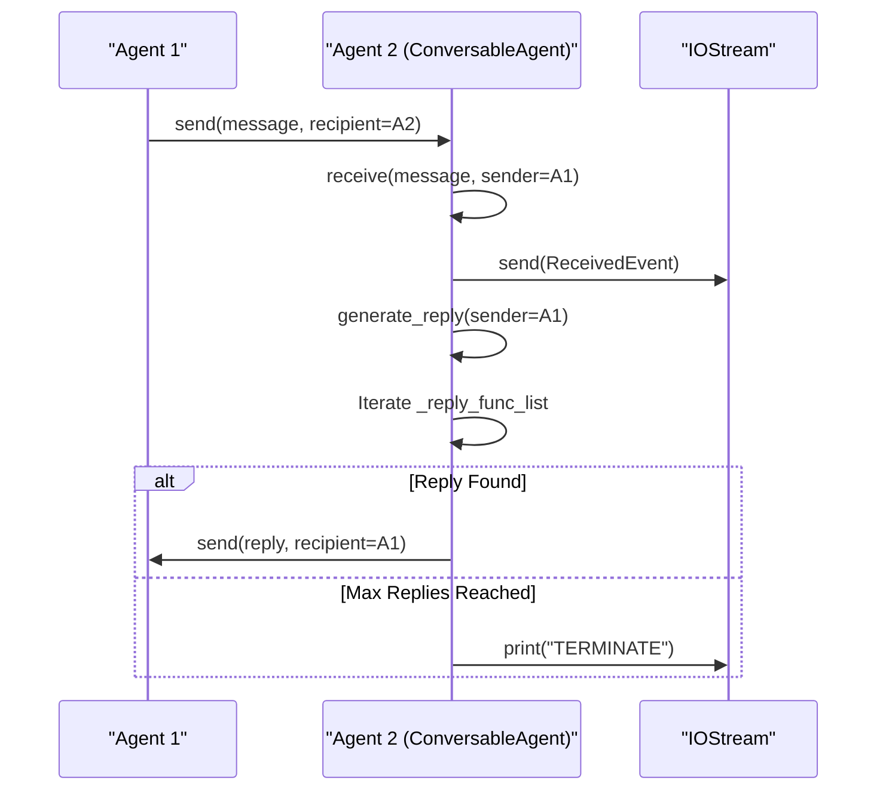
**Sources:** [autogen/agentchat/conversable_agent.py:1236-1298](), [autogen/agentchat/conversable_agent.py:1343-1429](), [autogen/io/base.py:122-134]()

### Conversation Initialization

The `initiate_chat()` method [autogen/agentchat/conversable_agent.py:1718-1882]() or the standalone `initiate_chats()` [autogen/agentchat/chat.py:157-252]() starts a conversation.

```python
# Example of multi-chat initiation
from autogen import initiate_chats

chat_results = initiate_chats([
    {
        "sender": user_proxy,
        "recipient": assistant,
        "message": "Hello!",
        "max_turns": 2
    }
])
```
**Sources:** [autogen/agentchat/conversable_agent.py:1718-1882](), [autogen/agentchat/chat.py:157-252]()

## Hooks and State Management

`ConversableAgent` provides a hook system to intercept lifecycle events [autogen/agentchat/conversable_agent.py:368-379]().

### Dynamic State Updates

The `UpdateSystemMessage` class [autogen/agentchat/conversable_agent.py:104-134]() allows agents to modify their `system_message` dynamically based on `ContextVariables` before generating a reply.

| Hook Point | Description |
|------------|-------------|
| `process_last_received_message` | Modify the incoming message before storage. |
| `process_all_messages_before_reply` | Filter or summarize history before LLM call. |
| `process_message_before_send` | Transform the generated reply before sending. |
| `update_agent_state` | Update internal state (like system message). |

**Sources:** [autogen/agentchat/conversable_agent.py:368-379](), [autogen/agentchat/conversable_agent.py:104-134]()

## Component Integration

| Component | Role | Code Reference |
|-----------|------|----------------|
| `Agent` | Minimal interface for communication. | [autogen/agentchat/agent.py:47-93]() |
| `LLMAgent` | Interface for LLM-backed agents. | [autogen/agentchat/agent.py:95-155]() |
| `ConversableAgent` | Feature-complete base class for most agents. | [autogen/agentchat/conversable_agent.py:136-178]() |
| `GroupChat` | Data structure for multi-agent state. | [autogen/agentchat/groupchat.py:50-104]() |
| `IOStream` | Unified interface for I/O operations. | [autogen/io/base.py:94-151]() |
| `ChatResult` | Encapsulates the outcome of a conversation. | [autogen/agentchat/chat.py:36-62]() |

**Sources:** [autogen/agentchat/agent.py:47-155](), [autogen/agentchat/conversable_agent.py:136-178](), [autogen/agentchat/groupchat.py:50-104](), [autogen/io/base.py:94-151](), [autogen/agentchat/chat.py:36-62]()

---

# Page: ConversableAgent

# ConversableAgent

<details>
<summary>Relevant source files</summary>

The following files were used as context for generating this wiki page:

- [autogen/agentchat/assistant_agent.py](autogen/agentchat/assistant_agent.py)
- [autogen/agentchat/chat.py](autogen/agentchat/chat.py)
- [autogen/agentchat/contrib/agent_optimizer.py](autogen/agentchat/contrib/agent_optimizer.py)
- [autogen/agentchat/contrib/captainagent/agent_builder.py](autogen/agentchat/contrib/captainagent/agent_builder.py)
- [autogen/agentchat/contrib/captainagent/captainagent.py](autogen/agentchat/contrib/captainagent/captainagent.py)
- [autogen/agentchat/contrib/math_user_proxy_agent.py](autogen/agentchat/contrib/math_user_proxy_agent.py)
- [autogen/agentchat/contrib/text_analyzer_agent.py](autogen/agentchat/contrib/text_analyzer_agent.py)
- [autogen/agentchat/conversable_agent.py](autogen/agentchat/conversable_agent.py)
- [autogen/agentchat/groupchat.py](autogen/agentchat/groupchat.py)
- [autogen/agentchat/user_proxy_agent.py](autogen/agentchat/user_proxy_agent.py)
- [autogen/exception_utils.py](autogen/exception_utils.py)
- [autogen/io/__init__.py](autogen/io/__init__.py)
- [autogen/io/base.py](autogen/io/base.py)
- [autogen/io/console.py](autogen/io/console.py)
- [autogen/io/websockets.py](autogen/io/websockets.py)
- [autogen/messages/agent_messages.py](autogen/messages/agent_messages.py)
- [notebook/agentchat_agentoptimizer.ipynb](notebook/agentchat_agentoptimizer.ipynb)
- [notebook/agentchat_teachability.ipynb](notebook/agentchat_teachability.ipynb)
- [notebook/agentchat_teachable_oai_assistants.ipynb](notebook/agentchat_teachable_oai_assistants.ipynb)
- [notebook/agentchat_websockets.ipynb](notebook/agentchat_websockets.ipynb)
- [test/agentchat/contrib/test_agent_optimizer.py](test/agentchat/contrib/test_agent_optimizer.py)
- [test/agentchat/test_conversable_agent.py](test/agentchat/test_conversable_agent.py)
- [test/agentchat/test_groupchat.py](test/agentchat/test_groupchat.py)
- [test/io/test_base.py](test/io/test_base.py)
- [test/io/test_websockets.py](test/io/test_websockets.py)
- [test/messages/test_agent_messages.py](test/messages/test_agent_messages.py)

</details>


## Purpose and Scope

`ConversableAgent` is the foundational base class for all conversable agents in the AG2 framework. It provides core capabilities for message passing, reply generation, tool execution, and human interaction. All agent types in AG2 (such as `AssistantAgent` and `UserProxyAgent`) inherit from this class.

This page covers the internal architecture, initialization, core methods, and extensibility mechanisms of `ConversableAgent`. For information about specific agent types built on this base class, see [AssistantAgent and UserProxyAgent](#2.3). For multi-agent orchestration patterns, see [GroupChat and Multi-Agent Orchestration](#2.4).

**Sources:** [autogen/agentchat/conversable_agent.py:136-148]()

---

## Class Architecture

### Inheritance and Core Components

`ConversableAgent` inherits from `LLMAgent` and integrates with several key subsystems:

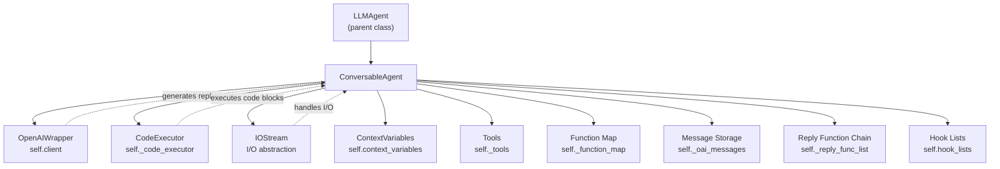

**ConversableAgent Architecture**

**Sources:** [autogen/agentchat/conversable_agent.py:136-233](), [autogen/agentchat/conversable_agent.py:270-372]()

---

## Initialization and Configuration

### Constructor Parameters

The `__init__` method accepts the following key parameters:

| Parameter | Type | Description |
|-----------|------|-------------|
| `name` | `str` | Unique identifier for the agent |
| `system_message` | `str \| list \| None` | System message for ChatCompletion inference |
| `is_termination_msg` | `Callable \| None` | Function to determine if a message terminates conversation |
| `max_consecutive_auto_reply` | `int \| None` | Maximum consecutive auto-replies (default: 100) |
| `human_input_mode` | `"ALWAYS" \| "NEVER" \| "TERMINATE"` | When to prompt for human input |
| `function_map` | `dict[str, Callable]` | Mapping of function names to executables |
| `code_execution_config` | `dict \| False` | Code execution configuration or False to disable |
| `llm_config` | `LLMConfig \| dict \| False \| None` | LLM inference configuration |
| `default_auto_reply` | `str \| dict` | Default reply when no other reply is generated |
| `description` | `str \| None` | Agent description for speaker selection |
| `context_variables` | `ContextVariables \| None` | Persistent context shared across agents |
| `functions` | `list[Callable] \| Callable` | Functions to register as tools |
| `update_agent_state_before_reply` | `list[Callable] \| Callable` | State update hooks before reply |
| `handoffs` | `Handoffs \| None` | Handoff transition conditions |

**Sources:** [autogen/agentchat/conversable_agent.py:157-233]()

### Initialization Flow

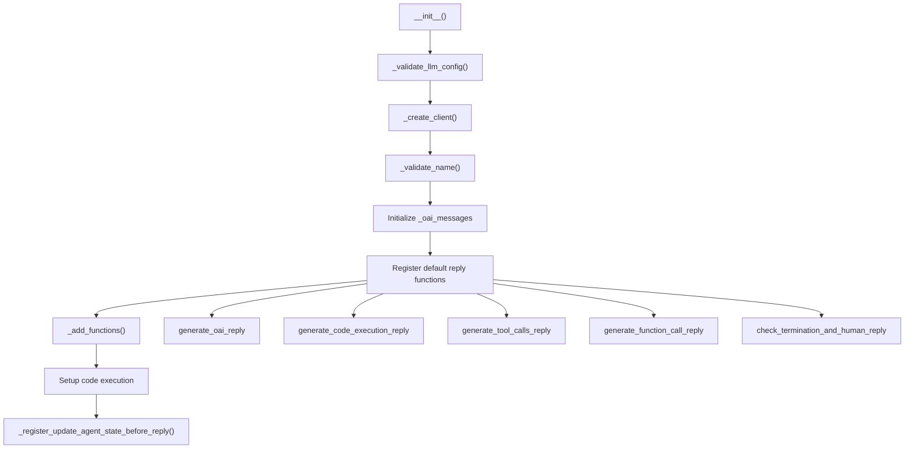

**ConversableAgent Initialization Flow**

**Sources:** [autogen/agentchat/conversable_agent.py:238-391](), [autogen/agentchat/conversable_agent.py:496-510]()

---

## Core Message Handling

### Message Storage

Each `ConversableAgent` maintains conversation history using `_oai_messages`, a `defaultdict(list)` that maps each conversation partner to their message history:

```python
# Structure: dict[Agent, list[dict[str, Any]]]
self._oai_messages = defaultdict(list)
```

**Sources:** [autogen/agentchat/conversable_agent.py:244-248]()

### Send and Receive Methods

#### `send()`

Sends a message to a recipient agent:

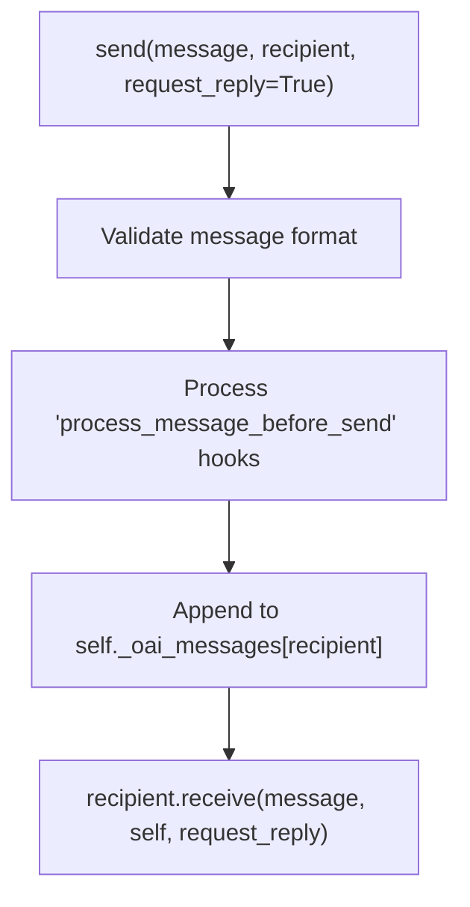

**Message Send Flow**

**Sources:** [autogen/agentchat/conversable_agent.py:968-1064]()

#### `receive()`

Receives a message from a sender and optionally generates a reply:

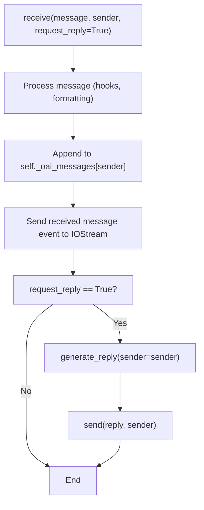

**Message Receive Flow**

**Sources:** [autogen/agentchat/conversable_agent.py:844-967]()

### Message Format

Messages follow the OpenAI message format with additional AG2-specific fields:

```python
{
    "content": str | list,  # Message content
    "role": "user" | "assistant" | "system" | "function" | "tool",
    "name": str,  # Agent name
    "function_call": {...},  # (Deprecated) Function call
    "tool_calls": [...],  # Tool calls
    "context": {...}  # AG2-specific context
}
```

**Sources:** [autogen/agentchat/conversable_agent.py:250-256](), [autogen/agentchat/conversable_agent.py:312-326]()

---

## Reply Generation System

### Reply Function Chain

`ConversableAgent` uses a chain-of-responsibility pattern for reply generation. Multiple reply functions are registered and checked in order until one returns `(True, reply)`:

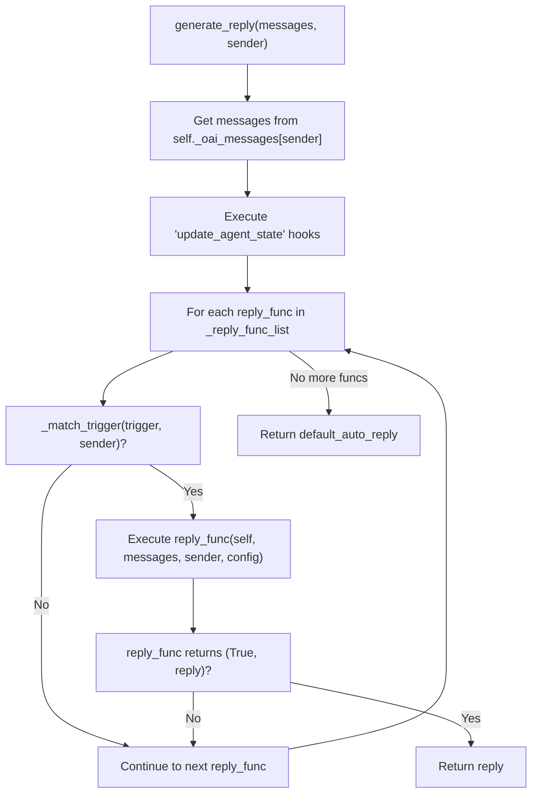

**Reply Generation Chain**

**Sources:** [autogen/agentchat/conversable_agent.py:1352-1518]()

### Default Reply Functions

The following reply functions are registered by default (in order):

1. **`generate_oai_reply`** - Generates LLM-based replies using `OpenAIWrapper`
2. **`generate_code_execution_reply`** (if code execution enabled) - Executes code blocks
3. **`generate_tool_calls_reply`** - Handles tool calls from LLM
4. **`generate_function_call_reply`** - Handles deprecated function calls
5. **`check_termination_and_human_reply`** - Checks termination and solicits human input

**Sources:** [autogen/agentchat/conversable_agent.py:299-372]()

### Registering Custom Reply Functions

Use `register_reply()` to add custom reply functions:

```python
def my_reply_func(
    recipient: ConversableAgent,
    messages: list[dict] | None,
    sender: Agent | None,
    config: Any
) -> tuple[bool, str | dict | None]:
    # Return (True, reply) to use this reply
    # Return (False, None) to skip to next function
    return (True, "My custom reply")

agent.register_reply(
    trigger=ConversableAgent,  # or agent class, str, Agent instance, or callable
    reply_func=my_reply_func,
    position=0,  # Insert at beginning
    config={}
)
```

**Sources:** [autogen/agentchat/conversable_agent.py:538-608]()

### Trigger Matching

Reply functions are triggered based on the sender:

| Trigger Type | Matching Logic |
|--------------|----------------|
| `Agent` class | Sender is instance of that class |
| `str` | Sender's name matches the string |
| `Agent` instance | Sender is that specific agent |
| `Callable` | Callable returns `True` for sender |
| `list` | Any trigger in list matches |
| `None` | Sender is `None` |

**Sources:** [autogen/agentchat/conversable_agent.py:1673-1720]()

---

## Tool and Function Registration

### Tool Registration Flow

```mermaid
graph TB
    Register["register_for_llm() / register_for_execution()"]
    CreateTool["Tool.from_function()"]
    AddToTools["Add to self._tools"]
    AddToFuncMap["Add to self._function_map"]
    UpdateLLMConfig["Update self.llm_config.tools"]
    UpdateClient["Update self.client with new tools"]
    
    Register --> CreateTool
    CreateTool --> AddToTools
    AddToTools --> AddToFuncMap
    AddToFuncMap --> UpdateLLMConfig
    UpdateLLMConfig --> UpdateClient
```

**Tool Registration Flow**

**Sources:** [autogen/agentchat/conversable_agent.py:2211-2395]()

### Registration Methods

#### `register_for_llm()`

Registers a function/tool for the LLM to call (adds to tool list):

```python
@agent.register_for_llm(name="calculator", description="Performs calculations")
def calculator(expression: str) -> float:
    return eval(expression)
```

**Sources:** [autogen/agentchat/conversable_agent.py:2211-2296]()

#### `register_for_execution()`

Registers a function for execution (adds to function map):

```python
@agent.register_for_execution(name="calculator")
def calculator(expression: str) -> float:
    return eval(expression)
```

**Sources:** [autogen/agentchat/conversable_agent.py:2298-2376]()

#### `register_function()`

Convenience function to register for both LLM and execution:

```python
autogen.register_function(
    calculator,
    caller=assistant,  # Agent that can call it
    executor=user_proxy,  # Agent that executes it
    name="calculator",
    description="Performs calculations"
)
```

**Sources:** [autogen/agentchat/conversable_agent.py:2682-2781]()

### Tool Execution Flow

```mermaid
graph TB
    ToolCall["LLM returns tool_calls in message"]
    GenToolReply["generate_tool_calls_reply()"]
    Loop["For each tool_call"]
    CheckMap["Function in self._function_map?"]
    Execute["execute_function(func_name, args)"]
    Safeguard["Run 'safeguard_tool_inputs/outputs' hooks"]
    Result["Collect results"]
    FormatReply["Format as tool response message"]
    Return["Return (True, tool_response_msg)"]
    
    ToolCall --> GenToolReply
    GenToolReply --> Loop
    Loop --> CheckMap
    CheckMap -->|Yes| Execute
    CheckMap -->|No| Error["Return error message"]
    Execute --> Safeguard
    Safeguard --> Result
    Result --> Loop
    Loop -->|Done| FormatReply
    FormatReply --> Return
```

**Tool Execution Flow**

**Sources:** [autogen/agentchat/conversable_agent.py:1936-2099]()

---

## Code Execution Integration

### Code Execution Configuration

Code execution is configured via `code_execution_config`:

```python
code_execution_config = {
    "executor": "commandline-local",  # or "commandline-docker", "ipython-embedded", etc.
    "work_dir": "/tmp/coding",
    "timeout": 60,
    "last_n_messages": "auto"  # or int
}
```

**Sources:** [autogen/agentchat/conversable_agent.py:316-362]()

### Executor Creation

```mermaid
graph TB
    Config["code_execution_config"]
    Check["'executor' key present?"]
    Factory["CodeExecutorFactory.create()"]
    Legacy["Legacy code_utils.execute_code()"]
    Assign["self._code_executor = executor"]
    RegisterReply["Register generate_code_execution_reply()"]
    
    Config --> Check
    Check -->|Yes| Factory
    Check -->|No| Legacy
    Factory --> Assign
    Legacy --> RegisterReply
    Assign --> RegisterReply
```

**Code Executor Setup**

**Sources:** [autogen/agentchat/conversable_agent.py:333-361]()

### Code Execution Reply Generation

The `generate_code_execution_reply()` method:

1. Extracts code blocks from recent messages using `MarkdownCodeExtractor`
2. Determines which messages to scan based on `last_n_messages` config
3. Executes code blocks using the configured executor
4. Returns execution results

**Sources:** [autogen/agentchat/conversable_agent.py:1721-1934]()

---

## Human Input Modes

### Mode Behavior

| Mode | Behavior |
|------|----------|
| `"ALWAYS"` | Prompts for human input after every message |
| `"TERMINATE"` | Prompts only when termination condition is met |
| `"NEVER"` | Never prompts for human input |

**Sources:** [autogen/agentchat/conversable_agent.py:188-196]()

### Human Input Flow

```mermaid
graph TB
    CheckTerm["check_termination_and_human_reply()"]
    IsTerm["is_termination_msg()?"]
    Mode["Check human_input_mode"]
    ModeAlways["ALWAYS"]
    ModeTerm["TERMINATE"]
    ModeNever["NEVER"]
    GetInput["get_human_input()"]
    CheckEmpty["Input empty?"]
    UseDefault["Use default reply"]
    ReturnInput["Return (True, human_input)"]
    ReturnFalse["Return (False, None)"]
    
    CheckTerm --> IsTerm
    IsTerm -->|Yes| Mode
    IsTerm -->|No| Mode
    Mode --> ModeAlways
    Mode --> ModeTerm
    Mode --> ModeNever
    ModeAlways --> GetInput
    ModeTerm -->|Terminated| GetInput
    ModeTerm -->|Not terminated| ReturnFalse
    ModeNever --> ReturnFalse
    GetInput --> CheckEmpty
    CheckEmpty -->|Yes| UseDefault
    CheckEmpty -->|No| ReturnInput
    UseDefault --> ReturnInput
```

**Human Input Flow**

**Sources:** [autogen/agentchat/conversable_agent.py:2101-2209]()

### Custom Input Methods

Override `get_human_input()` to customize input collection:

```python
def get_human_input(self, prompt: str) -> str:
    """Collect human input via IOStream."""
    iostream = IOStream.get_default()
    return iostream.input(prompt)
```

**Sources:** [autogen/agentchat/conversable_agent.py:1131-1160]()

---

## State Management and Hooks

### Hook System

`ConversableAgent` provides hookable methods for extending behavior:

```python
self.hook_lists = {
    "process_last_received_message": [],
    "process_all_messages_before_reply": [],
    "process_message_before_send": [],
    "update_agent_state": [],
    "safeguard_tool_inputs": [],
    "safeguard_tool_outputs": [],
    "safeguard_llm_inputs": [],
    "safeguard_llm_outputs": [],
    "safeguard_human_inputs": [],
}
```

**Sources:** [autogen/agentchat/conversable_agent.py:376-388]()

### Registering Hooks

Use `register_hook()` to add custom behavior:

```python
def my_message_processor(agent, messages):
    # Process messages
    return messages

agent.register_hook(
    hookable_method="process_all_messages_before_reply",
    hook=my_message_processor
)
```

**Sources:** [autogen/agentchat/conversable_agent.py:1066-1102]()

### Context Variables

`ConversableAgent` supports shared state via `ContextVariables`:

```python
agent.context_variables["user_id"] = "12345"
value = agent.context_variables["user_id"]
```

This is particularly useful in swarm patterns where multiple agents share state.

**Sources:** [autogen/agentchat/conversable_agent.py:302-303](), [autogen/agentchat/conversable_agent.py:227-229]()

### System Message Updates

Use `UpdateSystemMessage` to dynamically update the agent's system message:

```python
from autogen import UpdateSystemMessage

update_func = UpdateSystemMessage(
    content_updater="You are helping user {user_id}"  # Template string
)

agent = ConversableAgent(
    name="assistant",
    update_agent_state_before_reply=[update_func]
)
```

**Sources:** [autogen/agentchat/conversable_agent.py:102-133](), [autogen/agentchat/conversable_agent.py:448-495]()

---

## I/O System Integration

### IOStream Abstraction

`ConversableAgent` uses the `IOStream` abstraction for all input/output operations, enabling different I/O backends (console, websockets, etc.):

```mermaid
graph TB
    Agent["ConversableAgent"]
    GetDefault["IOStream.get_default()"]
    IOConsole["IOConsole"]
    IOWebsockets["IOWebsockets"]
    ThreadIO["ThreadIOStream"]
    
    Agent --> GetDefault
    GetDefault --> IOConsole
    GetDefault --> IOWebsockets
    GetDefault --> ThreadIO
    
    IOConsole -->|print| Console["Terminal stdout"]
    IOConsole -->|input| ConsoleIn["Terminal stdin"]
    IOWebsockets -->|send| WS["Websocket connection"]
    IOWebsockets -->|input| WSIn["Websocket recv"]
```

**IOStream Architecture**

**Sources:** [autogen/agentchat/conversable_agent.py:63-72](), [autogen/io/base.py:94-151]()

### Using Different I/O Backends

```python
# Console I/O (default)
from autogen.io import IOConsole
with IOStream.set_default(IOConsole()):
    agent.initiate_chat(other_agent, message="Hello")

# Websocket I/O
from autogen.io import IOWebsockets
def on_connect(iostream: IOWebsockets):
    with IOStream.set_default(iostream):
        agent.initiate_chat(other_agent, message="Hello")

IOWebsockets.run_server_in_thread(on_connect=on_connect, port=8765)
```

**Sources:** [autogen/io/console.py:18-57](), [autogen/io/websockets.py:84-215]()

---

## Key Methods Reference

### Message Methods

| Method | Description | Returns |
|--------|-------------|---------|
| `send(message, recipient, request_reply)` | Send message to recipient | None |
| `receive(message, sender, request_reply)` | Receive message from sender | None |
| `generate_reply(messages, sender)` | Generate reply using reply function chain | `dict \| str \| None` |
| `initiate_chat(recipient, message, max_turns)` | Start conversation with recipient | `ChatResult` |
| `a_initiate_chat()` | Async version of initiate_chat | `ChatResult` |

**Sources:** [autogen/agentchat/conversable_agent.py:844-1064](), [autogen/agentchat/conversable_agent.py:1352-1518]()

### State Methods

| Method | Description |
|--------|-------------|
| `reset()` | Clear conversation history and reset state |
| `clear_history(agent, nr_messages_to_preserve)` | Clear specific agent's history |
| `update_system_message(system_message)` | Update agent's system message |
| `update_max_consecutive_auto_reply(value, sender)` | Update auto-reply limit |

**Sources:** [autogen/agentchat/conversable_agent.py:2842-2934](), [autogen/agentchat/conversable_agent.py:3053-3084]()

### History and Summary Methods

| Method | Description | Returns |
|--------|-------------|---------|
| `last_message(agent)` | Get last message from agent | `dict \| None` |
| `chat_messages_for_summary(agent)` | Get messages for summary generation | `list[dict]` |
| `generate_init_message(message, carryover)` | Generate initial chat message | `str \| dict` |

**Sources:** [autogen/agentchat/conversable_agent.py:2936-2975](), [autogen/agentchat/conversable_agent.py:3018-3051]()

### Reply Function Management

| Method | Description |
|--------|-------------|
| `register_reply(trigger, reply_func, position, config)` | Register reply function |
| `replace_reply_func(old_func, new_func)` | Replace existing reply function |

**Sources:** [autogen/agentchat/conversable_agent.py:538-619]()

### Tool Registration Methods

| Method | Description |
|--------|-------------|
| `register_for_llm(name, description)` | Register function for LLM to call |
| `register_for_execution(name)` | Register function for execution |
| `execute_function(func_name, kwargs)` | Execute registered function |
| `can_execute_function(func_names)` | Check if can execute functions |

**Sources:** [autogen/agentchat/conversable_agent.py:2211-2395](), [autogen/agentchat/conversable_agent.py:2396-2504]()

---

## Key Properties

| Property | Type | Description |
|----------|------|-------------|
| `name` | `str` | Agent's name |
| `description` | `str` | Agent description for speaker selection |
| `system_message` | `list[dict]` | Current system message |
| `llm_config` | `LLMConfig \| False` | LLM configuration |
| `client` | `OpenAIWrapper \| None` | LLM client wrapper |
| `code_executor` | `CodeExecutor \| None` | Code executor instance |
| `context_variables` | `ContextVariables` | Shared state variables |
| `chat_messages` | `dict[Agent, list[dict]]` | Conversation history by agent |

**Sources:** [autogen/agentchat/conversable_agent.py:516-536]()

---

## Usage Examples

### Basic Agent Creation

```python
from autogen import ConversableAgent

agent = ConversableAgent(
    name="assistant",
    system_message="You are a helpful assistant.",
    llm_config={"config_list": [...], "temperature": 0.7},
    human_input_mode="NEVER",
    max_consecutive_auto_reply=10
)
```

### Custom Reply Function

```python
def custom_reply(recipient, messages, sender, config):
    last_msg = messages[-1]["content"] if messages else ""
    if "joke" in last_msg.lower():
        return (True, "Why did the programmer quit? They didn't get arrays!")
    return (False, None)

agent.register_reply(
    trigger=ConversableAgent,
    reply_func=custom_reply,
    position=0  # Check first
)
```

### Tool Registration

```python
@agent.register_for_llm(description="Get weather for a city")
@executor.register_for_execution()
def get_weather(city: str) -> str:
    return f"Weather in {city}: Sunny, 72°F"
```

**Sources:** Test examples from [test/agentchat/test_conversable_agent.py]()

---

# Page: Message Handling and Reply Functions

# Message Handling and Reply Functions

<details>
<summary>Relevant source files</summary>

The following files were used as context for generating this wiki page:

- [autogen/agentchat/chat.py](autogen/agentchat/chat.py)
- [autogen/agentchat/conversable_agent.py](autogen/agentchat/conversable_agent.py)
- [autogen/agentchat/group/safeguards/enforcer.py](autogen/agentchat/group/safeguards/enforcer.py)
- [autogen/agentchat/groupchat.py](autogen/agentchat/groupchat.py)
- [autogen/events/agent_events.py](autogen/events/agent_events.py)
- [autogen/events/base_event.py](autogen/events/base_event.py)
- [autogen/events/client_events.py](autogen/events/client_events.py)
- [autogen/events/helpers.py](autogen/events/helpers.py)
- [autogen/events/print_event.py](autogen/events/print_event.py)
- [autogen/exception_utils.py](autogen/exception_utils.py)
- [autogen/io/__init__.py](autogen/io/__init__.py)
- [autogen/io/base.py](autogen/io/base.py)
- [autogen/io/console.py](autogen/io/console.py)
- [autogen/io/websockets.py](autogen/io/websockets.py)
- [autogen/messages/__init__.py](autogen/messages/__init__.py)
- [autogen/messages/agent_messages.py](autogen/messages/agent_messages.py)
- [autogen/messages/base_message.py](autogen/messages/base_message.py)
- [autogen/messages/client_messages.py](autogen/messages/client_messages.py)
- [autogen/messages/print_message.py](autogen/messages/print_message.py)
- [autogen/oai/gemini_types.py](autogen/oai/gemini_types.py)
- [notebook/agentchat_websockets.ipynb](notebook/agentchat_websockets.ipynb)
- [test/agentchat/test_conversable_agent.py](test/agentchat/test_conversable_agent.py)
- [test/agentchat/test_groupchat.py](test/agentchat/test_groupchat.py)
- [test/events/test_agent_events.py](test/events/test_agent_events.py)
- [test/io/test_base.py](test/io/test_base.py)
- [test/io/test_console.py](test/io/test_console.py)
- [test/io/test_websockets.py](test/io/test_websockets.py)
- [test/messages/test_agent_messages.py](test/messages/test_agent_messages.py)
- [test/messages/test_base_message.py](test/messages/test_base_message.py)
- [test/messages/test_client_messages.py](test/messages/test_client_messages.py)
- [test/messages/test_print_message.py](test/messages/test_print_message.py)
- [test/oai/test_gemini_types.py](test/oai/test_gemini_types.py)
- [test/tools/test_tool_imports.py](test/tools/test_tool_imports.py)

</details>


This page details the reply function system in `ConversableAgent`, the core mechanism for generating responses to incoming messages. It covers the message format hierarchy, trigger conditions, and the execution pipeline that allows agents to choose between LLM generation, code execution, tool calling, and human interaction.

For information about agent initialization, see [ConversableAgent](2.1). For details about tool registration, see [Function Calling and Tool Registration](5.1).

## Overview

When a `ConversableAgent` receives a message, it processes it through an ordered list of reply functions (`_reply_func_list`). Each function is associated with a trigger condition. The first function that returns `(True, message)` provides the agent's response.

This architecture enables:
- **Prioritized Response Strategies**: Ordered execution from termination checks to LLM generation.
- **Extensibility**: Developers can inject custom logic at any point in the pipeline.
- **Contextual Logic**: Different behaviors based on the sender's identity or message content.
- **Async Support**: Native handling of asynchronous reply generation.

Sources: [autogen/agentchat/conversable_agent.py:136-148](), [autogen/agentchat/conversable_agent.py:532-540]()

## Message Formats and Event Hierarchy

AG2 uses a structured event system for internal messaging and logging. The `BaseEvent` hierarchy defines how different types of interactions (text, tool calls, execution results) are represented.

### Event Model Hierarchy

```mermaid
classDiagram
    class BaseEvent {
        +UUID uuid
        +print()
    }
    class TextEvent {
        +str content
    }
    class ToolCallEvent {
        +list~ToolCall~ tool_calls
    }
    class ToolResponseEvent {
        +list~ToolResponse~ tool_responses
    }
    class ExecuteCodeBlockEvent {
        +str code
        +str language
    }
    class GenerateCodeExecutionReplyEvent {
        +int exit_code
        +str logs
    }

    BaseEvent <|-- TextEvent
    BaseEvent <|-- ToolCallEvent
    BaseEvent <|-- ToolResponseEvent
    BaseEvent <|-- ExecuteCodeBlockEvent
    BaseEvent <|-- GenerateCodeExecutionReplyEvent
```

**Key Event Classes:**
- **`TextEvent`**: Standard text-based communication between agents. [autogen/events/agent_events.py:101-118]()
- **`ToolCallEvent`**: Represents a suggestion from an LLM to invoke one or more tools. [autogen/events/agent_events.py:120-143]()
- **`ToolResponseEvent`**: Contains the results of tool executions. [autogen/events/agent_events.py:145-168]()
- **`ExecuteCodeBlockEvent`**: Triggered when an agent attempts to run a code snippet. [autogen/events/agent_events.py:302-321]()

Sources: [autogen/events/agent_events.py:17-60](), [autogen/messages/agent_messages.py:86-144]()

## Reply Function Registration

The `register_reply` method manages the `_reply_func_list`.

### The `register_reply` Method

```python
def register_reply(
    self,
    trigger: type[Agent] | str | Agent | Callable[[Agent], bool] | list,
    reply_func: Callable,
    position: int = 0,
    config: Any | None = None,
    reset_config: Callable[..., Any] | None = None,
    *,
    ignore_async_in_sync_chat: bool = False,
    remove_other_reply_funcs: bool = False,
)
```

**Parameters:**
- **`trigger`**: Determines when the function applies. Can be a class, instance, name string, or callable. [autogen/agentchat/conversable_agent.py:541-543]()
- **`reply_func`**: The generation logic. Must return `(bool, message)`. [autogen/agentchat/conversable_agent.py:565-575]()
- **`position`**: Priority index. `0` (default) inserts at the front (highest priority). [autogen/agentchat/conversable_agent.py:544]()
- **`ignore_async_in_sync_chat`**: Prevents blocking errors by skipping async functions in sync contexts. [autogen/agentchat/conversable_agent.py:548-555]()

Sources: [autogen/agentchat/conversable_agent.py:532-602]()

### Trigger Matching Logic

The `_match_trigger` internal method evaluates if a sender satisfies the registered condition.

| Trigger Type | Matching Logic |
| :--- | :--- |
| **Agent Class** | `isinstance(sender, trigger)` |
| **Agent Instance** | `sender == trigger` |
| **String** | `sender.name == trigger` |
| **Callable** | `trigger(sender)` returns `True` |
| **List** | Any item in the list matches the sender |

Sources: [autogen/agentchat/conversable_agent.py:1193-1237](), [test/agentchat/test_conversable_agent.py:70-106]()

## Reply Generation Pipeline

The `generate_reply` method orchestrates the execution flow.

### Pipeline Data Flow

```mermaid
flowchart TD
    subgraph "Natural Language Space"
        InputMsg["User/Agent Message (String/Dict)"]
        FinalReply["Generated Reply (String/Dict)"]
    end

    subgraph "Code Entity Space (ConversableAgent)"
        GenReply["generate_reply()"]
        MatchTrigger["_match_trigger()"]
        FuncList["_reply_func_list (Priority Queue)"]
        
        subgraph "Built-in Functions"
            Human["check_termination_and_human_reply()"]
            Tools["generate_tool_calls_reply()"]
            Code["generate_code_execution_reply()"]
            LLM["generate_oai_reply()"]
        end
    end

    InputMsg --> GenReply
    GenReply --> FuncList
    FuncList --> MatchTrigger
    MatchTrigger --> Human
    Human -- "False" --> Tools
    Tools -- "False" --> Code
    Code -- "False" --> LLM
    LLM -- "True" --> FinalReply
```

**Execution Steps:**
1. **Message Retrieval**: Retrieves the conversation history for the sender. [autogen/agentchat/conversable_agent.py:1247-1256]()
2. **State Hooks**: Executes `update_agent_state_before_reply` to refresh context or system messages. [autogen/agentchat/conversable_agent.py:1258-1267]()
3. **Trigger Evaluation**: Iterates through `_reply_func_list` checking `_match_trigger`. [autogen/agentchat/conversable_agent.py:1270-1271]()
4. **Execution**: Calls the first matching `reply_func`. If it returns `(True, ...)`, the process stops. [autogen/agentchat/conversable_agent.py:1285-1300]()
5. **Fallback**: If no function triggers or returns `True`, the `default_auto_reply` is used. [autogen/agentchat/conversable_agent.py:1302-1304]()

Sources: [autogen/agentchat/conversable_agent.py:1239-1307](), [autogen/agentchat/conversable_agent.py:173-178]()

## Built-in Reply Functions

`ConversableAgent` registers core behaviors in reverse priority order during initialization (since `position=0` prepends to the list).

| Function | Priority | Role |
| :--- | :--- | :--- |
| `check_termination_and_human_reply` | 1 | Checks `is_termination_msg` and handles `human_input_mode`. [autogen/agentchat/conversable_agent.py:1892-2014]() |
| `generate_function_call_reply` | 2 | Executes legacy OpenAI-style function calls. [autogen/agentchat/conversable_agent.py:1680-1767]() |
| `generate_tool_calls_reply` | 3 | Executes modern tool calls (multi-tool support). [autogen/agentchat/conversable_agent.py:1769-1890]() |
| `generate_code_execution_reply` | 4 | Extracts and runs code blocks via a `CodeExecutor`. [autogen/agentchat/conversable_agent.py:1444-1585]() |
| `generate_oai_reply` | 5 | Calls the LLM via `OpenAIWrapper`. [autogen/agentchat/conversable_agent.py:2134-2249]() |

Sources: [autogen/agentchat/conversable_agent.py:288-364]()

### Human-in-the-Loop and Termination
The `check_termination_and_human_reply` function is the first line of defense. It checks:
- **Termination**: If `is_termination_msg` is true, it may stop the chat or ask for human input. [autogen/agentchat/conversable_agent.py:1924-1934]()
- **Human Input Mode**: If set to `ALWAYS`, it bypasses auto-replies to prompt the user. [autogen/agentchat/conversable_agent.py:1963-1967]()
- **Auto-Reply Limits**: If `max_consecutive_auto_reply` is reached, it forces human intervention. [autogen/agentchat/conversable_agent.py:1945-1956]()

Sources: [autogen/agentchat/conversable_agent.py:1892-2014]()

## IO and Streaming Integration

The reply system interacts with `IOStream` to handle real-time feedback and streaming.

```mermaid
sequenceDiagram
    participant Agent as ConversableAgent
    participant Reply as generate_oai_reply()
    participant Client as OpenAIWrapper
    participant IO as IOStream (Websockets/Console)

    Agent->>Reply: Generate Reply
    Reply->>Client: create(stream=True)
    loop For each chunk
        Client->>Reply: Yield Chunk
        Reply->>IO: print(Chunk)
    end
    Reply-->>Agent: Final Consolidated Message
```

**Implementation Details:**
- **`IOWebsockets`**: Used to stream events and text to remote clients. [autogen/io/websockets.py:112-140]()
- **`GenerateCodeExecutionReplyEvent`**: Emitted when code is executed, allowing UIs to show terminal output in real-time. [autogen/agentchat/conversable_agent.py:1658-1662]()

Sources: [autogen/io/base.py:32-61](), [autogen/io/websockets.py:112-140](), [notebook/agentchat_websockets.ipynb:116-130]()

---

# Page: AssistantAgent and UserProxyAgent

# AssistantAgent and UserProxyAgent

<details>
<summary>Relevant source files</summary>

The following files were used as context for generating this wiki page:

- [autogen/agentchat/assistant_agent.py](autogen/agentchat/assistant_agent.py)
- [autogen/agentchat/contrib/agent_optimizer.py](autogen/agentchat/contrib/agent_optimizer.py)
- [autogen/agentchat/contrib/captainagent/agent_builder.py](autogen/agentchat/contrib/captainagent/agent_builder.py)
- [autogen/agentchat/contrib/captainagent/captainagent.py](autogen/agentchat/contrib/captainagent/captainagent.py)
- [autogen/agentchat/contrib/math_user_proxy_agent.py](autogen/agentchat/contrib/math_user_proxy_agent.py)
- [autogen/agentchat/contrib/text_analyzer_agent.py](autogen/agentchat/contrib/text_analyzer_agent.py)
- [autogen/agentchat/user_proxy_agent.py](autogen/agentchat/user_proxy_agent.py)
- [autogen/oai/client.py](autogen/oai/client.py)
- [notebook/agentchat_agentoptimizer.ipynb](notebook/agentchat_agentoptimizer.ipynb)
- [notebook/agentchat_teachability.ipynb](notebook/agentchat_teachability.ipynb)
- [notebook/agentchat_teachable_oai_assistants.ipynb](notebook/agentchat_teachable_oai_assistants.ipynb)
- [test/agentchat/contrib/test_agent_optimizer.py](test/agentchat/contrib/test_agent_optimizer.py)
- [test/agentchat/test_agent_logging.py](test/agentchat/test_agent_logging.py)
- [test/agentchat/test_agent_usage.py](test/agentchat/test_agent_usage.py)
- [test/agentchat/test_assistant_agent.py](test/agentchat/test_assistant_agent.py)
- [test/agentchat/test_async.py](test/agentchat/test_async.py)
- [test/agentchat/test_async_chats.py](test/agentchat/test_async_chats.py)
- [test/agentchat/test_async_get_human_input.py](test/agentchat/test_async_get_human_input.py)
- [test/agentchat/test_cache_agent.py](test/agentchat/test_cache_agent.py)
- [test/agentchat/test_chats.py](test/agentchat/test_chats.py)
- [test/agentchat/test_function_call.py](test/agentchat/test_function_call.py)
- [test/agentchat/test_function_call_groupchat.py](test/agentchat/test_function_call_groupchat.py)
- [test/agentchat/test_human_input.py](test/agentchat/test_human_input.py)
- [test/agentchat/test_math_user_proxy_agent.py](test/agentchat/test_math_user_proxy_agent.py)
- [test/agentchat/test_nested.py](test/agentchat/test_nested.py)
- [test/agentchat/test_tool_calls.py](test/agentchat/test_tool_calls.py)
- [test/conftest.py](test/conftest.py)
- [test/oai/test_client.py](test/oai/test_client.py)
- [test/oai/test_client_stream.py](test/oai/test_client_stream.py)
- [test/test_conftest.py](test/test_conftest.py)
- [website/docs/user-guide/basic-concepts/assets/auto-termination-workflow.png](website/docs/user-guide/basic-concepts/assets/auto-termination-workflow.png)
- [website/docs/user-guide/basic-concepts/assets/enhanced-tool-workflow.png](website/docs/user-guide/basic-concepts/assets/enhanced-tool-workflow.png)
- [website/docs/user-guide/basic-concepts/assets/group-chat-workflow.png](website/docs/user-guide/basic-concepts/assets/group-chat-workflow.png)
- [website/docs/user-guide/basic-concepts/assets/human-in-the-loop-example.png](website/docs/user-guide/basic-concepts/assets/human-in-the-loop-example.png)
- [website/docs/user-guide/basic-concepts/assets/structured-output-workflow.png](website/docs/user-guide/basic-concepts/assets/structured-output-workflow.png)
- [website/docs/user-guide/basic-concepts/assets/tool-usage.png](website/docs/user-guide/basic-concepts/assets/tool-usage.png)
- [website/docs/user-guide/basic-concepts/human-in-the-loop.mdx](website/docs/user-guide/basic-concepts/human-in-the-loop.mdx)
- [website/docs/user-guide/basic-concepts/introducing-group-chat.mdx](website/docs/user-guide/basic-concepts/introducing-group-chat.mdx)
- [website/docs/user-guide/basic-concepts/introducing-tools.mdx](website/docs/user-guide/basic-concepts/introducing-tools.mdx)
- [website/docs/user-guide/basic-concepts/structured-outputs.mdx](website/docs/user-guide/basic-concepts/structured-outputs.mdx)

</details>


## Purpose and Scope

This document describes `AssistantAgent` and `UserProxyAgent`, the two primary specialized agent types in AG2 built on top of `ConversableAgent`. These agents represent the most common patterns in agentic workflows: an LLM-powered assistant that generates responses, and a user proxy that handles human interaction and code execution. For details on the base agent system and message handling, see [ConversableAgent](2.1). For multi-agent orchestration patterns, see [GroupChat and Multi-Agent Orchestration](2.4).

---

## Relationship to ConversableAgent

Both `AssistantAgent` and `UserProxyAgent` are subclasses of `ConversableAgent`, configured with different default settings to optimize for their specific roles. `ConversableAgent` provides the core message passing, reply generation, and extensibility infrastructure that both specialized agents inherit.

### Agent Hierarchy and Inheritance

```mermaid
graph TB
    ["ConversableAgent"] -- "inherits" --> ["AssistantAgent"]
    ["ConversableAgent"] -- "inherits" --> ["UserProxyAgent"]
    
    subgraph "autogen.agentchat.conversable_agent"
        ["ConversableAgent"]
    end
    
    subgraph "autogen.agentchat.assistant_agent"
        ["AssistantAgent"]
    end
    
    subgraph "autogen.agentchat.user_proxy_agent"
        ["UserProxyAgent"]
    end

    ["AssistantAgent"] -- "typically sends to" --> ["UserProxyAgent"]
    ["UserProxyAgent"] -- "typically sends to" --> ["AssistantAgent"]
```

**Sources:** [autogen/agentchat/user_proxy_agent.py:17-17](), [autogen/agentchat/assistant_agent.py:17-17](), [autogen/agentchat/conversable_agent.py:136-148]()

---

## AssistantAgent

### Overview

`AssistantAgent` is configured as an LLM-powered agent that generates responses using language models. It is designed to act as an intelligent assistant that can reason, generate code, call tools, and provide responses based on its system message and conversation history.

**Key Characteristics:**
- **LLM Integration:** Configured with `llm_config` by default to enable language model inference [autogen/agentchat/assistant_agent.py:29-37]().
- **System Message:** Typically given a system message defining its role and capabilities. Default: "You are a helpful AI assistant." [autogen/agentchat/assistant_agent.py:32-32]().
- **Tool Calling:** Can invoke tools and functions through the LLM's tool calling mechanism.
- **No Code Execution:** By default, it does not execute code directly; it relies on other agents (like `UserProxyAgent`) for execution.

### Basic Configuration

```python
from autogen import AssistantAgent

assistant = AssistantAgent(
    name="assistant",
    llm_config={
        "cache_seed": 42,
        "config_list": config_list,
    }
)
```

**Sources:** [autogen/agentchat/assistant_agent.py:29-54](), [test/agentchat/test_assistant_agent.py:29-37]()

### Assistant Agent Reply Flow

The `AssistantAgent` relies on the `OpenAIWrapper` to communicate with LLM providers.

```mermaid
sequenceDiagram
    participant U as "UserProxyAgent"
    participant A as "AssistantAgent"
    participant OAI as "OpenAIWrapper"
    participant LLM as "LLM Provider"
    
    U->>A: "send(message)"
    A->>A: "generate_reply()"
    A->>OAI: "create(messages, tools)"
    OAI->>LLM: "API request"
    LLM-->>OAI: "ChatCompletion response"
    OAI-->>A: "ChatCompletionExtended object"
    
    alt "Contains tool_calls"
        A->>U: "send(tool_call_message)"
    else "Contains text response"
        A->>U: "send(text_message)"
    end
```

**Sources:** [autogen/oai/client.py:23-23](), [autogen/agentchat/conversable_agent.py:1260-1280](), [test/agentchat/test_assistant_agent.py:111-135]()

---

## UserProxyAgent

### Overview

`UserProxyAgent` acts as a proxy for human users, enabling human-in-the-loop workflows and code execution. It is designed to receive tool/function calls from AI assistants, execute them (either through code execution or human input), and return results.

**Key Characteristics:**
- **Human Input Modes:** Configurable via `human_input_mode` ("ALWAYS", "TERMINATE", "NEVER") [autogen/agentchat/user_proxy_agent.py:41-41]().
- **Code Execution:** Can execute code blocks extracted from messages. Enabled by default [autogen/agentchat/user_proxy_agent.py:22-22]().
- **Tool Execution:** Serves as the executor for tools registered with `function_map` [autogen/agentchat/user_proxy_agent.py:42-42]().
- **Disabled LLM:** Typically configured with `llm_config=False` to avoid generating AI responses [autogen/agentchat/user_proxy_agent.py:45-45]().

### Human Input Modes

The `human_input_mode` parameter determines when the agent prompts the user:

| Mode | Behavior |
|------|----------|
| `"ALWAYS"` | Prompts for human input every time a message is received. Conversation stops if input is "exit" [autogen/agentchat/user_proxy_agent.py:62-64](). |
| `"TERMINATE"` | Prompts only when a termination message is received or `max_consecutive_auto_reply` is reached [autogen/agentchat/user_proxy_agent.py:65-67](). |
| `"NEVER"` | Never prompts for human input. Stops on termination or `max_consecutive_auto_reply` [autogen/agentchat/user_proxy_agent.py:68-69](). |

**Sources:** [autogen/agentchat/user_proxy_agent.py:60-69](), [test/agentchat/test_assistant_agent.py:82-97]()

### Code Execution Flow

`UserProxyAgent` uses a `CodeExecutor` (often configured via `code_execution_config`) to run code found in markdown blocks.

```mermaid
sequenceDiagram
    participant A as "AssistantAgent"
    participant U as "UserProxyAgent"
    participant EXEC as "CodeExecutor"
    
    A->>U: "send(message with ```python code)"
    U->>U: "generate_code_execution_reply()"
    U->>EXEC: "execute_code_blocks(code_blocks)"
    Note right of EXEC: "Runs in Local, Docker, or Jupyter"
    EXEC-->>U: "exit_code, logs"
    U->>A: "send(execution_results)"
```

**Sources:** [autogen/agentchat/user_proxy_agent.py:70-83](), [test/agentchat/test_assistant_agent.py:87-91](), [test/agentchat/test_function_call.py:72-88]()

---

## Working Together: The Two-Agent Pattern

The most common pattern involves an `AssistantAgent` and a `UserProxyAgent` working together to solve tasks through iterative conversation.

### Interaction Example: Coding Task

```python
# 1. Setup Assistant
assistant = AssistantAgent("inner-assistant", llm_config=llm_config)

# 2. Setup UserProxy (The Executor)
user_proxy = UserProxyAgent(
    "inner-user-proxy",
    human_input_mode="NEVER",
    code_execution_config={"work_dir": "coding", "use_docker": False}
)

# 3. Start Chat
user_proxy.initiate_chat(assistant, message="Write a script to fetch stock prices.")
```

**Sources:** [test/agentchat/test_assistant_agent.py:39-56](), [test/agentchat/test_chats.py:77-104]()

### Complete Interaction Cycle

```mermaid
sequenceDiagram
    participant User
    participant UserProxy as "UserProxyAgent"
    participant Assistant as "AssistantAgent"
    participant LLM as "LLM Provider"
    
    User->>UserProxy: "initiate_chat(task)"
    UserProxy->>Assistant: "send(task)"
    
    loop "Until Task Complete"
        Assistant->>LLM: "Request completion"
        LLM-->>Assistant: "Response (Text + Code)"
        Assistant->>UserProxy: "send(Code Block)"
        UserProxy->>UserProxy: "Execute Code"
        UserProxy->>Assistant: "send(Execution Results)"
    end
    
    Assistant->>UserProxy: "send('TERMINATE')"
    UserProxy-->>User: "Final Summary"
```

**Sources:** [test/agentchat/test_assistant_agent.py:132-158](), [test/agentchat/test_chats.py:150-163]()

---

## Configuration Comparison

| Feature | AssistantAgent | UserProxyAgent |
|---------|---------------|----------------|
| **LLM Config** | Enabled by default (required for reasoning) | Disabled by default (`False`) |
| **System Message** | Defines AI persona/role | Defines proxy behavior/instructions |
| **Code Execution** | Disabled | Enabled by default |
| **Human Input** | `"NEVER"` | `"ALWAYS"`, `"TERMINATE"`, or `"NEVER"` |
| **Tool Usage** | Suggests tool calls (via LLM) | Executes tool calls (via `function_map`) |

**Sources:** [autogen/agentchat/user_proxy_agent.py:36-49](), [autogen/agentchat/assistant_agent.py:29-54]()

---

## UserProxyAgent as Tool Executor

`UserProxyAgent` is the primary agent for executing functions. Functions are mapped via the `function_map` dictionary or registered using the `register_function` utility.

```python
def add_num(num_to_be_added):
    return str(num_to_be_added + 10)

user = UserProxyAgent(name="test", function_map={"add_num": add_num})

# When a tool call is received:
correct_args = {"name": "add_num", "arguments": '{ "num_to_be_added": 5 }'}
result = user.execute_function(func_call=correct_args)
# result[1]["content"] == "15"
```

**Sources:** [test/agentchat/test_function_call.py:94-102](), [autogen/agentchat/user_proxy_agent.py:42-42]()

---

## Runtime Logging

Both agent types support AG2's runtime logging system. When enabled, agent initialization, LLM calls, and message exchanges are recorded to a database (e.g., SQLite).

- `AssistantAgent` logs its LLM invocations in the `chat_completions` table [test/agentchat/test_agent_logging.py:33-34]().
- Both agents record their metadata in the `agents` table [test/agentchat/test_agent_logging.py:36-36]().

**Sources:** [test/agentchat/test_agent_logging.py:64-83](), [autogen/runtime_logging.py:12-12]()

---

# Page: GroupChat and Multi-Agent Orchestration

# GroupChat and Multi-Agent Orchestration

<details>
<summary>Relevant source files</summary>

The following files were used as context for generating this wiki page:

- [autogen/agentchat/chat.py](autogen/agentchat/chat.py)
- [autogen/agentchat/conversable_agent.py](autogen/agentchat/conversable_agent.py)
- [autogen/agentchat/group/events/transition_events.py](autogen/agentchat/group/events/transition_events.py)
- [autogen/agentchat/group/group_tool_executor.py](autogen/agentchat/group/group_tool_executor.py)
- [autogen/agentchat/group/group_utils.py](autogen/agentchat/group/group_utils.py)
- [autogen/agentchat/group/guardrails.py](autogen/agentchat/group/guardrails.py)
- [autogen/agentchat/group/multi_agent_chat.py](autogen/agentchat/group/multi_agent_chat.py)
- [autogen/agentchat/group/patterns/pattern.py](autogen/agentchat/group/patterns/pattern.py)
- [autogen/agentchat/group/targets/transition_target.py](autogen/agentchat/group/targets/transition_target.py)
- [autogen/agentchat/groupchat.py](autogen/agentchat/groupchat.py)
- [autogen/exception_utils.py](autogen/exception_utils.py)
- [autogen/io/__init__.py](autogen/io/__init__.py)
- [autogen/io/base.py](autogen/io/base.py)
- [autogen/io/console.py](autogen/io/console.py)
- [autogen/io/run_response.py](autogen/io/run_response.py)
- [autogen/io/step_controller.py](autogen/io/step_controller.py)
- [autogen/io/thread_io_stream.py](autogen/io/thread_io_stream.py)
- [autogen/io/websockets.py](autogen/io/websockets.py)
- [autogen/messages/agent_messages.py](autogen/messages/agent_messages.py)
- [notebook/agentchat_custom_events.ipynb](notebook/agentchat_custom_events.ipynb)
- [notebook/agentchat_groupchat_finite_state_machine.ipynb](notebook/agentchat_groupchat_finite_state_machine.ipynb)
- [notebook/agentchat_groupchat_stateflow.ipynb](notebook/agentchat_groupchat_stateflow.ipynb)
- [notebook/agentchat_iterating_runs.ipynb](notebook/agentchat_iterating_runs.ipynb)
- [notebook/agentchat_swarm.ipynb](notebook/agentchat_swarm.ipynb)
- [notebook/agentchat_swarm_enhanced.ipynb](notebook/agentchat_swarm_enhanced.ipynb)
- [notebook/agentchat_swarm_graphrag_telemetry_trip_planner.ipynb](notebook/agentchat_swarm_graphrag_telemetry_trip_planner.ipynb)
- [notebook/agentchat_swarm_w_groupchat_legacy.ipynb](notebook/agentchat_swarm_w_groupchat_legacy.ipynb)
- [notebook/agentchat_websockets.ipynb](notebook/agentchat_websockets.ipynb)
- [notebook/contributing.md](notebook/contributing.md)
- [test/agentchat/group/targets/test_transition_target.py](test/agentchat/group/targets/test_transition_target.py)
- [test/agentchat/group/test_group_chat_cost.py](test/agentchat/group/test_group_chat_cost.py)
- [test/agentchat/group/test_group_tool_executor.py](test/agentchat/group/test_group_tool_executor.py)
- [test/agentchat/group/test_group_utils.py](test/agentchat/group/test_group_utils.py)
- [test/agentchat/group/test_guardrails.py](test/agentchat/group/test_guardrails.py)
- [test/agentchat/group/test_multi_agent_chat.py](test/agentchat/group/test_multi_agent_chat.py)
- [test/agentchat/group/test_transition_events.py](test/agentchat/group/test_transition_events.py)
- [test/agentchat/test_conversable_agent.py](test/agentchat/test_conversable_agent.py)
- [test/agentchat/test_event_streaming.py](test/agentchat/test_event_streaming.py)
- [test/agentchat/test_groupchat.py](test/agentchat/test_groupchat.py)
- [test/io/test_base.py](test/io/test_base.py)
- [test/io/test_run_response.py](test/io/test_run_response.py)
- [test/io/test_step_controller.py](test/io/test_step_controller.py)
- [test/io/test_websockets.py](test/io/test_websockets.py)
- [test/messages/test_agent_messages.py](test/messages/test_agent_messages.py)
- [test/oai/test_openai_streaming_structured_output.py](test/oai/test_openai_streaming_structured_output.py)
- [website/docs/user-guide/advanced-concepts/iterating-runs.mdx](website/docs/user-guide/advanced-concepts/iterating-runs.mdx)
- [website/docs/user-guide/advanced-concepts/orchestration/group-chat/guardrails.mdx](website/docs/user-guide/advanced-concepts/orchestration/group-chat/guardrails.mdx)
- [website/docs/user-guide/advanced-concepts/tools/index.mdx](website/docs/user-guide/advanced-concepts/tools/index.mdx)

</details>


This document explains how multiple agents collaborate in group conversations using `GroupChat`, `GroupChatManager`, and sequential chat orchestration via `initiate_chats`. These components enable multi-agent conversations with configurable speaker selection strategies, message routing, and carryover of context between sequential chats.

For information about the base agent capabilities, see [ConversableAgent](2.1). For more advanced orchestration patterns, see [SwarmAgent and Dynamic Orchestration](4.1).

## Overview

AG2 provides two main patterns for multi-agent orchestration:

1.  **GroupChat/GroupChatManager**: Multiple agents participate in a single conversation with dynamic speaker selection.
2.  **initiate_chats**: Sequential conversations between agent pairs with context carryover.

The `GroupChat` class [[autogen/agentchat/groupchat.py:50-166]]() defines conversation configuration including participating agents and speaker selection rules. The `GroupChatManager` class [[autogen/agentchat/groupchat.py:707-1116]]() coordinates message flow and speaker selection during execution.

**Diagram: GroupChat Architecture**

```mermaid
graph TB
    subgraph "GroupChat Configuration"
        GC["GroupChat\n(dataclass)"]
        GC --> agents["agents: list[Agent]"]
        GC --> messages["messages: list[dict]"]
        GC --> max_round["max_round: int"]
        GC --> speaker_selection_method["speaker_selection_method:\nstr | Callable"]
        GC --> allowed_speaker_transitions_dict["allowed_speaker_transitions_dict:\ndict[Agent, list[Agent]]"]
    end

    subgraph "GroupChatManager Execution"
        GCM["GroupChatManager\n(extends ConversableAgent)"]
        GCM --> run_chat["run_chat()"]
        GCM --> select_speaker["_select_speaker()"]
        run_chat --> select_speaker
        select_speaker --> next_speaker["next speaker: Agent"]
        next_speaker --> generate_reply["agent.generate_reply()"]
    end

    subgraph "Speaker Selection Methods"
        select_speaker --> auto["_auto_select_speaker()"]
        select_speaker --> manual["manual_select_speaker()"]
        select_speaker --> random["random_select_speaker()"]
        select_speaker --> round_robin["next_agent()"]
        select_speaker --> custom["Custom Callable"]
    end

    GC -.config.-> GCM
```

**Sources:**
*   [[autogen/agentchat/groupchat.py:50-166]](): `GroupChat` dataclass definition and fields.
*   [[autogen/agentchat/groupchat.py:707-1116]](): `GroupChatManager` class implementation.
*   [[autogen/agentchat/groupchat.py:178-293]](): `GroupChat` validation logic in `__post_init__`.

---

## GroupChat Class

The `GroupChat` class serves as a container that defines the structure and rules for a multi-agent conversation.

### Key Attributes

*   `agents`: List of participating agents in the conversation.
*   `messages`: List of messages exchanged during the conversation.
*   `max_round`: Maximum number of conversation rounds allowed.
*   `speaker_selection_method`: Method to determine which agent speaks next.
*   `allowed_speaker_transitions`: Rules about which agent can speak after another.

**Diagram: GroupChat Class Structure**

```mermaid
classDiagram
    class GroupChat {
        +agents: list[Agent]
        +messages: list[dict[str, Any]]
        +max_round: int
        +admin_name: str
        +func_call_filter: bool
        +speaker_selection_method: str | Callable
        +max_retries_for_selecting_speaker: int
        +allow_repeat_speaker: bool | list[Agent] | None
        +allowed_or_disallowed_speaker_transitions: dict | None
        +speaker_transitions_type: Literal["allowed", "disallowed", None]
        +allowed_speaker_transitions_dict: dict[Agent, list[Agent]]
        +select_speaker_message_template: str
        +select_speaker_prompt_template: str
        +select_speaker_auto_verbose: bool
        +send_introductions: bool
        
        +reset() void
        +append(message, speaker) void
        +agent_by_name(name, recursive) Agent | None
        +nested_agents() list[Agent]
        +next_agent(agent, agents) Agent
        +select_speaker_msg(agents) str
        +select_speaker_prompt(agents) str
        +introductions_msg(agents) str
        +manual_select_speaker(agents) Agent | None
        +random_select_speaker(agents) Agent | None
        +_prepare_and_select_agents(last_speaker) tuple
    }
```

**Sources:**
*   [[autogen/agentchat/groupchat.py:50-166]](): `GroupChat` dataclass attributes.
*   [[autogen/agentchat/groupchat.py:302-318]](): Implementation of `reset()` and `append()`.
*   [[autogen/agentchat/groupchat.py:320-337]](): Implementation of `agent_by_name()` and `nested_agents()`.
*   [[autogen/agentchat/groupchat.py:339-361]](): Implementation of `next_agent()`.
*   [[autogen/agentchat/groupchat.py:401-436]](): Implementation of `manual_select_speaker()` and `random_select_speaker()`.

### Speaker Selection Methods

`GroupChat` supports multiple speaker selection methods defined in `speaker_selection_method` [[autogen/agentchat/groupchat.py:85-101]]():

| Method | Implementation | Description |
| :--- | :--- | :--- |
| `"auto"` | `_auto_select_speaker()` | Uses LLM with `select_speaker_message_template` to decide next speaker. |
| `"manual"` | `manual_select_speaker()` | Prompts user via `IOStream.input()` to select next speaker. |
| `"random"` | `random_select_speaker()` | Calls `random.choice()` on eligible agents. |
| `"round_robin"` | `next_agent()` | Cycles through agents sequentially by index. |
| **Custom Callable** | User function | Signature: `(last_speaker: Agent, groupchat: GroupChat) -> Agent | str | None`. |

**Diagram: Speaker Selection Flow**

```mermaid
flowchart TD
    _prepare_and_select_agents["_prepare_and_select_agents()"] --> check_callable{"speaker_selection_method\nis Callable?"}
    check_callable -->|Yes| call_custom["Call custom function\nwith (last_speaker, groupchat)"]
    call_custom --> custom_result{"Return type?"}
    custom_result -->|Agent| return_agent["Return Agent"]
    custom_result -->|str| set_method["Set method = returned string"]
    custom_result -->|None| terminate["Raise NoEligibleSpeakerError"]
    
    check_callable -->|No| check_method{"Check\nspeaker_selection_method"}
    set_method --> check_method
    
    check_method -->|"auto"| _auto_select_speaker["_auto_select_speaker()\nUses LLM with agents list"]
    check_method -->|"manual"| manual_select_speaker["manual_select_speaker()\nIOStream.input() for user choice"]
    check_method -->|"random"| random_select_speaker["random_select_speaker()\nrandom.choice(agents)"]
    check_method -->|"round_robin"| next_agent["next_agent(current_agent)\n(idx + 1) % len(agents)"]
    
    _auto_select_speaker --> apply_transitions["Apply allowed_speaker_transitions_dict"]
    manual_select_speaker --> apply_transitions
    random_select_speaker --> apply_transitions
    next_agent --> apply_transitions
    
    apply_transitions --> filter_func_call{"func_call_filter\nand message has function_call?"}
    filter_func_call -->|Yes| filter_by_function["Filter to agents with\nfunction in function_map"]
    filter_func_call -->|No| final_agent["Return selected agent"]
    filter_by_function --> final_agent
```

**Sources:**
*   [[autogen/agentchat/groupchat.py:85-101]](): Speaker selection method documentation.
*   [[autogen/agentchat/groupchat.py:438-521]](): `_prepare_and_select_agents()` logic.
*   [[autogen/agentchat/groupchat.py:532-687]](): `_auto_select_speaker()` implementation.

### Speaker Transition Rules

`GroupChat` provides two ways to control which agent can speak after another [[autogen/agentchat/groupchat.py:112-132]]():

1.  **Allow Repeat Speaker**: Controls whether an agent can speak multiple times consecutively.
    *   `true`: All agents can speak consecutively.
    *   `false`: No agent can speak twice in a row.
    *   `[agent1, agent2]`: Only specified agents can speak consecutively.
2.  **Allowed/Disallowed Speaker Transitions**: Explicitly defines which agents can speak after a particular agent.
    *   `allowed`: Dictionary specifies agents that CAN follow each agent.
    *   `disallowed`: Dictionary specifies agents that CANNOT follow each agent.

**Sources:**
*   [[autogen/agentchat/groupchat.py:112-132]](): Documentation of speaker transition rules.
*   [[autogen/agentchat/groupchat.py:181-236]](): Implementation of speaker transition validation.
*   [[autogen/graph_utils.py:9-48]](): Logic for checking graph validity of transitions.

### Function Call Filtering

`GroupChat` can automatically route function calls to appropriate agents [[autogen/agentchat/groupchat.py:58-61]]():

*   When a message contains a function call or tool call, `GroupChat` can select the next speaker based on which agent has the appropriate function in their `function_map`.
*   This feature is controlled by the `func_call_filter` parameter (default: `True`).

**Sources:**
*   [[autogen/agentchat/groupchat.py:494-521]](): Implementation of function call filtering.
*   [[test/agentchat/test_groupchat.py:96-146]](): Tests for function call routing in `GroupChat`.

---

## GroupChatManager Class

`GroupChatManager` extends `ConversableAgent` [[autogen/agentchat/groupchat.py:707]]() to coordinate multi-agent conversations. It registers a reply function `run_chat` that handles speaker selection and message routing.

### Key Methods

| Method | Description |
| :--- | :--- |
| `run_chat(message, sender, config)` | Main conversation loop - registered as reply function [[autogen/agentchat/groupchat.py:897-1073]](). |
| `_select_speaker(last_speaker, selector)` | Delegates to `GroupChat` speaker selection methods [[autogen/agentchat/groupchat.py:803-895]](). |
| `resume(messages)` | Resume conversation from saved messages [[autogen/agentchat/groupchat.py:1075-1116]](). |
| `reset()` | Calls `groupchat.reset()` to clear conversation state [[autogen/agentchat/groupchat.py:794-801]](). |

**Diagram: GroupChatManager.run_chat() Execution Flow**

```mermaid
flowchart TD
    initiate_chat["agent.initiate_chat(\ngroupchat_manager, message)"] --> run_chat["GroupChatManager.run_chat()"]
    
    run_chat --> append_initial["groupchat.append(\nmessage, sender)"]
    
    append_initial --> loop_start{"i < groupchat.max_round\nand not terminated?"}
    
    loop_start -->|Yes| select_speaker["_select_speaker(\nlast_speaker, groupchat)"]
    
    select_speaker --> check_speaker{"speaker is None?"}
    check_speaker -->|Yes| terminate["Break loop"]
    check_speaker -->|No| prepare_messages["Prepare message history\nfor selected agent"]
    
    prepare_messages --> send_message["groupchat_manager.send(\nmessages, speaker)"]
    
    send_message --> agent_reply["speaker.generate_reply(\nmessages, sender=manager)"]
    
    agent_reply --> append_reply["groupchat.append(\nreply, speaker)"]
    
    append_reply --> check_term{"is_termination_msg(\nreply)?"}
    check_term -->|Yes| terminate
    check_term -->|No| increment["i += 1"]
    increment --> loop_start
    
    loop_start -->|No| terminate
    terminate --> return_result["Return True, None"]
```

**Sources:**
*   [[autogen/agentchat/groupchat.py:897-1073]](): `run_chat()` implementation.
*   [[autogen/agentchat/groupchat.py:803-895]](): `_select_speaker()` method.
*   [[autogen/agentchat/groupchat.py:1075-1116]](): `resume()` method.

---

## Sequential Chat Orchestration with initiate_chats

The `initiate_chats` function [[autogen/agentchat/chat.py:157-216]]() orchestrates a sequence of two-agent conversations with automatic context carryover between chats.

### Carryover Mechanism

Chat results are automatically passed to subsequent chats via the `carryover` parameter:

1.  Each chat produces a `ChatResult` [[autogen/agentchat/chat.py:36-62]]() with a `summary` field.
2.  Summaries from completed chats are appended to the next chat's initial message [[autogen/agentchat/chat.py:186-200]]().
3.  The `summary_method` parameter controls how chat history is summarized.

**Diagram: initiate_chats Sequential Flow**

```mermaid
flowchart TD
    start["initiate_chats(chat_queue)"] --> validate["_validate_recipients(chat_queue)"]
    validate --> loop_start{"More chats\nin queue?"}
    
    loop_start -->|Yes| pop["chat_info = chat_queue.pop(0)"]
    pop --> get_carryover["_chat_carryover = chat_info.get('carryover', [])"]
    get_carryover --> append_summaries["Append summaries from finished_chats\nto carryover list"]
    
    append_summaries --> check_verbose{"chat_info.get('silent')\n== False?"}
    check_verbose -->|Yes| post_process["__post_carryover_processing()\nSends PostCarryoverProcessingEvent"]
    check_verbose -->|No| initiate
    post_process --> initiate["sender.initiate_chat(**chat_info)"]
    
    initiate --> add_result["finished_chats.append(chat_res)"]
    add_result --> loop_start
    
    loop_start -->|No| return_results["Return finished_chats"]
```

**Sources:**
*   [[autogen/agentchat/chat.py:157-216]](): `initiate_chats()` implementation.
*   [[autogen/agentchat/chat.py:64-75]](): `_validate_recipients()` logic.
*   [[autogen/agentchat/chat.py:144-154]](): `__post_carryover_processing()` logic.

---

## Group Tool Executor

For group chats initiated with `initiate_group_chat`, a specialized `GroupToolExecutor` [[autogen/agentchat/group/group_tool_executor.py:28]]() handles tool execution across multiple agents.

*   It manages `TransitionTarget` [[autogen/agentchat/group/targets/transition_target.py:14]]() returns from tools.
*   It automatically modifies tool functions to inject `ContextVariables` [[autogen/agentchat/group/context_variables.py:18]]() using dependency injection [[autogen/agentchat/group/group_tool_executor.py:86-128]]().
*   It tracks the `_tool_call_originator` to maintain security safeguards [[autogen/agentchat/group/group_tool_executor.py:43]]().

**Sources:**
*   [[autogen/agentchat/group/group_tool_executor.py:28-85]](): `GroupToolExecutor` class and state management.
*   [[autogen/agentchat/group/group_tool_executor.py:86-128]](): Context variable injection logic.
*   [[autogen/agentchat/group/group_tool_executor.py:157-172]](): Registration of agent functions for group execution.

---

## Troubleshooting

### Common Issues and Solutions

| Issue | Cause | Solution |
| :--- | :--- | :--- |
| `NoEligibleSpeakerError` | No agents match transition rules. | Review `allowed_speaker_transitions_dict` [[autogen/exception_utils.py:31]](). |
| `UndefinedNextAgentError` | Invalid agent in `next_agent()` call. | Ensure agent is in `groupchat.agents` [[autogen/exception_utils.py:31]](). |
| `AgentNameConflictError` | Multiple agents with same name. | Use unique names [[autogen/exception_utils.py:31]](). |
| Function calls not routed | `func_call_filter` misconfigured. | Set `func_call_filter=True` [[autogen/agentchat/groupchat.py:58]](). |
| Auto selection fails | LLM returns invalid agent name. | Increase `max_retries_for_selecting_speaker` [[autogen/agentchat/groupchat.py:102]](). |

**Sources:**
*   [[autogen/exception_utils.py:31]](): Multi-agent orchestration exceptions.
*   [[autogen/agentchat/groupchat.py:58-102]](): `GroupChat` configuration parameters.

---

# Page: IO System and Communication

# IO System and Communication

<details>
<summary>Relevant source files</summary>

The following files were used as context for generating this wiki page:

- [autogen/agentchat/chat.py](autogen/agentchat/chat.py)
- [autogen/agentchat/conversable_agent.py](autogen/agentchat/conversable_agent.py)
- [autogen/agentchat/group/multi_agent_chat.py](autogen/agentchat/group/multi_agent_chat.py)
- [autogen/agentchat/groupchat.py](autogen/agentchat/groupchat.py)
- [autogen/exception_utils.py](autogen/exception_utils.py)
- [autogen/io/__init__.py](autogen/io/__init__.py)
- [autogen/io/base.py](autogen/io/base.py)
- [autogen/io/console.py](autogen/io/console.py)
- [autogen/io/run_response.py](autogen/io/run_response.py)
- [autogen/io/step_controller.py](autogen/io/step_controller.py)
- [autogen/io/thread_io_stream.py](autogen/io/thread_io_stream.py)
- [autogen/io/websockets.py](autogen/io/websockets.py)
- [autogen/messages/agent_messages.py](autogen/messages/agent_messages.py)
- [notebook/agentchat_custom_events.ipynb](notebook/agentchat_custom_events.ipynb)
- [notebook/agentchat_iterating_runs.ipynb](notebook/agentchat_iterating_runs.ipynb)
- [notebook/agentchat_websockets.ipynb](notebook/agentchat_websockets.ipynb)
- [test/agentchat/group/test_group_chat_cost.py](test/agentchat/group/test_group_chat_cost.py)
- [test/agentchat/group/test_multi_agent_chat.py](test/agentchat/group/test_multi_agent_chat.py)
- [test/agentchat/test_conversable_agent.py](test/agentchat/test_conversable_agent.py)
- [test/agentchat/test_event_streaming.py](test/agentchat/test_event_streaming.py)
- [test/agentchat/test_groupchat.py](test/agentchat/test_groupchat.py)
- [test/io/test_base.py](test/io/test_base.py)
- [test/io/test_run_response.py](test/io/test_run_response.py)
- [test/io/test_step_controller.py](test/io/test_step_controller.py)
- [test/io/test_websockets.py](test/io/test_websockets.py)
- [test/messages/test_agent_messages.py](test/messages/test_agent_messages.py)
- [website/docs/user-guide/advanced-concepts/iterating-runs.mdx](website/docs/user-guide/advanced-concepts/iterating-runs.mdx)

</details>


The IO System provides a unified abstraction layer for input and output operations across the AG2 framework. It enables agents to communicate through various channels including console, websockets, and custom implementations while maintaining consistent interfaces and event-driven communication patterns.

## Architecture Overview

The IO System is built around protocol-based abstractions that support multiple implementation backends and context-aware stream management using `ContextVar` for thread and coroutine safety [autogen/io/base.py:97-100]().

**Core IO Protocol Hierarchy**

```mermaid
graph TB
    subgraph "Core Protocols"
        InputStream["InputStream"]
        OutputStream["OutputStream"] 
        AsyncInputStream["AsyncInputStream"]
        IOStreamProtocol["IOStreamProtocol"]
        AsyncIOStreamProtocol["AsyncIOStreamProtocol"]
    end
    
    subgraph "Implementations"
        IOConsole["IOConsole"]
        IOWebsockets["IOWebsockets"]
        ThreadIOStream["ThreadIOStream"]
        AsyncThreadIOStream["AsyncThreadIOStream"]
    end
    
    subgraph "Management Layer"
        IOStream["IOStream"]
        ContextVar["_default_io_stream: ContextVar"]
        GlobalDefault["_global_default"]
    end
    
    IOStreamProtocol -.->|inherits| InputStream
    IOStreamProtocol -.->|inherits| OutputStream
    AsyncIOStreamProtocol -.->|inherits| AsyncInputStream
    AsyncIOStreamProtocol -.->|inherits| OutputStream
    
    IOConsole -.->|implements| IOStreamProtocol
    IOWebsockets -.->|implements| IOStreamProtocol
    ThreadIOStream -.->|implements| IOStreamProtocol
    AsyncThreadIOStream -.->|implements| AsyncIOStreamProtocol
    
    IOStream -->|manages| ContextVar
    IOStream -->|manages| GlobalDefault
```

Sources: [autogen/io/base.py:21-91](), [autogen/io/console.py:18-56](), [autogen/io/websockets.py:82-214](), [autogen/io/thread_io_stream.py:18-25]()

## Protocol Definitions

The system defines several protocols in `autogen.io` that establish contracts for input/output operations:

### Core Protocols

| Protocol | Methods | Purpose |
|----------|---------|---------|
| `InputStream` | `input(prompt, password)` | Synchronous input operations [autogen/io/base.py:46-59]() |
| `OutputStream` | `print(*objects, ...)`, `send(message)` | Output and event messaging [autogen/io/base.py:23-42]() |
| `AsyncInputStream` | `async input(prompt, password)` | Asynchronous input operations [autogen/io/base.py:61-76]() |
| `IOStreamProtocol` | Combines `InputStream` + `OutputStream` | Complete synchronous IO interface [autogen/io/base.py:78-82]() |
| `AsyncIOStreamProtocol` | Combines `AsyncInputStream` + `OutputStream` | Complete asynchronous IO interface [autogen/io/base.py:84-88]() |

### Event Integration

The `OutputStream` protocol requires a `send(message: BaseEvent)` method [autogen/io/base.py:35-42](). This integrates the IO system with AG2's event-driven architecture, where messages like `TextEvent`, `ToolCallEvent`, or `TerminationEvent` are routed through the active stream [autogen/messages/agent_messages.py:17-43]().

Sources: [autogen/io/base.py:23-88](), [autogen/messages/agent_messages.py:17-43]()

## Stream Management

The `IOStream` class manages the default IO stream for the current execution context.

**Stream Context Management**

```mermaid
graph TD
    GlobalDefault["IOStream._global_default"]
    ContextVar["IOStream._default_io_stream"]
    GetDefault["IOStream.get_default()"]
    SetDefault["IOStream.set_default(stream)"]
    
    GetDefault -->|checks| ContextVar
    ContextVar -->|if None| GlobalDefault
    GlobalDefault -->|fallback| GetDefault
    
    SetDefault -->|contextmanager| ContextVar
    SetDefault -->|token = set(stream)| ContextVar
    
    subgraph "Execution Contexts"
        ThreadA["Thread/Task A"]
        ThreadB["Thread/Task B"]
    end
    
    ContextVar -.->|isolated via ContextVar| ThreadA
    ContextVar -.->|isolated via ContextVar| ThreadB
```

Sources: [autogen/io/base.py:94-152]()

### Context Variable Usage

The system uses `ContextVar` to ensure that in multi-threaded or async environments, agents use the correct stream [autogen/io/base.py:97-100]():

- **Global Default**: Set via `set_global_default(stream)` [autogen/io/base.py:102-110]().
- **Context Default**: Set using the `set_default(stream)` context manager, which uses `token = _default_io_stream.set(stream)` and ensures cleanup via `_default_io_stream.reset(token)` [autogen/io/base.py:137-151]().
- **Retrieval**: `get_default()` first checks the context-specific stream before falling back to the global default [autogen/io/base.py:123-135]().

Sources: [autogen/io/base.py:97-151]()

## Implementation Backends

### Console Implementation (`IOConsole`)

`IOConsole` provides standard terminal-based IO using Python's built-ins [autogen/io/console.py:18-20]().

- **Input**: Uses `builtins.input()` or `getpass.getpass()` if `password=True` [autogen/io/console.py:43-56]().
- **Output**: The `print()` method creates a `PrintEvent` and passes it to `send()` [autogen/io/console.py:22-33]().
- **Events**: `send(message)` calls `message.print()` to render the event to the terminal [autogen/io/console.py:35-41]().

Sources: [autogen/io/console.py:18-56]()

### WebSocket Implementation (`IOWebsockets`)

`IOWebsockets` enables real-time communication with remote clients using the `websockets` library [autogen/io/websockets.py:83-84]().

**WebSocket Server Architecture**

```mermaid
graph TB
    subgraph "Server Lifecycle"
        RunServer["IOWebsockets.run_server_in_thread()"]
        WSServe["websockets.sync.server.serve()"]
        Handler["IOWebsockets._handler()"]
    end
    
    subgraph "Communication"
        IOSend["IOWebsockets.send(message)"]
        IOInput["IOWebsockets.input(prompt)"]
        WSConn["ServerConnection.send/recv"]
    end
    
    RunServer -->|"starts thread"| WSServe
    WSServe -->|"on connect"| Handler
    Handler -->|"IOStream.set_default"| OnConnect["User's on_connect(iostream)"]
    
    IOSend -->|"message.model_dump_json()"| WSConn
    IOInput -->|"if prompt: send(PrintEvent)"| WSConn
    WSConn -->|"recv()"| IOInput
```

Sources: [autogen/io/websockets.py:83-214]()

### Thread-Based Streams

`ThreadIOStream` and `AsyncThreadIOStream` use internal queues (`queue.Queue` or `asyncio.Queue`) to bridge between agent execution and external responders [autogen/io/thread_io_stream.py:18-25](). This is heavily used in testing to simulate human input [test/agentchat/test_conversable_agent.py:646-665,669-690]().

## Integration with Agent System

Agents interact with the IO system primarily through `ConversableAgent` methods that retrieve the current stream via `IOStream.get_default()`.

**Natural Language to Code Entity Mapping: Agent Communication**

```mermaid
graph LR
    subgraph "Natural Language Concepts"
        HumanInput["Human-in-the-loop Input"]
        AgentOutput["Agent Message Output"]
        GroupSelect["Speaker Selection"]
    end
    
    subgraph "Code Entities"
        CA_Input["ConversableAgent.get_human_input()"]
        CA_AInput["ConversableAgent.a_get_human_input()"]
        CA_Send["ConversableAgent.send()"]
        GC_Manual["GroupChat.manual_select_speaker()"]
        IOS_Input["IOStreamProtocol.input()"]
        IOS_Send["OutputStream.send()"]
    end
    
    HumanInput --> CA_Input
    HumanInput --> CA_AInput
    AgentOutput --> CA_Send
    GroupSelect --> GC_Manual
    
    CA_Input --> IOS_Input
    CA_AInput --> IOS_Input
    CA_Send --> IOS_Send
    GC_Manual --> IOS_Send
    GC_Manual --> IOS_Input
```

Sources: [autogen/agentchat/conversable_agent.py:1357-1411](), [autogen/agentchat/groupchat.py:408-436]()

### ConversableAgent Input/Output Flow

When an agent needs human input (e.g., `human_input_mode="ALWAYS"`), it calls `get_human_input(prompt)` [autogen/agentchat/conversable_agent.py:1357-1384](). This method:
1. Retrieves the current stream: `iostream = IOStream.get_default()` [autogen/agentchat/conversable_agent.py:1376]().
2. Calls `iostream.input(prompt)` [autogen/agentchat/conversable_agent.py:1377]().
3. Appends the result to `self._human_input` [autogen/agentchat/conversable_agent.py:1378]().

Similarly, `ConversableAgent.send()` and `receive()` methods trigger events that are dispatched to the current `IOStream` via `iostream.send(event)` [autogen/agentchat/conversable_agent.py:63-72]().

### GroupChat Integration

In `GroupChat`, if `speaker_selection_method="manual"`, the `manual_select_speaker` method uses the IO system to present choices and receive input [autogen/agentchat/groupchat.py:408-436]():
- It sends a `SelectSpeakerEvent` to the stream [autogen/agentchat/groupchat.py:414]().
- It loops using `iostream.input()` to get the user's choice [autogen/agentchat/groupchat.py:421]().
- It handles invalid inputs by sending a `SelectSpeakerInvalidInputEvent` [autogen/agentchat/groupchat.py:431]().

Sources: [autogen/agentchat/conversable_agent.py:1357-1411](), [autogen/agentchat/groupchat.py:408-436]()

## Communication Data Flow

**Data Flow: From Agent to WebSocket Client**

```mermaid
sequenceDiagram
    participant Agent as ConversableAgent
    participant IOS as IOWebsockets
    participant WS as WebSocket Connection
    participant Client as Remote Client
    
    Agent->>Agent: generate_reply()
    Agent->>IOS: send(TextEvent(content="Hello"))
    Note over IOS: IOStream.get_default()
    IOS->>IOS: message.model_dump_json()
    IOS->>WS: websocket.send(json_string)
    WS->>Client: TCP/WebSocket Frame
    Client->>WS: websocket.send("User Reply")
    WS->>IOS: websocket.recv()
    IOS->>Agent: return "User Reply"
```

Sources: [autogen/io/websockets.py:190-214](), [autogen/agentchat/conversable_agent.py:1376-1378]()

---

# Page: LLM Integration

# LLM Integration

<details>
<summary>Relevant source files</summary>

The following files were used as context for generating this wiki page:

- [autogen/llm_config/entry.py](autogen/llm_config/entry.py)
- [autogen/oai/anthropic.py](autogen/oai/anthropic.py)
- [autogen/oai/bedrock.py](autogen/oai/bedrock.py)
- [autogen/oai/cerebras.py](autogen/oai/cerebras.py)
- [autogen/oai/client.py](autogen/oai/client.py)
- [autogen/oai/cohere.py](autogen/oai/cohere.py)
- [autogen/oai/groq.py](autogen/oai/groq.py)
- [autogen/oai/mistral.py](autogen/oai/mistral.py)
- [autogen/oai/ollama.py](autogen/oai/ollama.py)
- [autogen/oai/together.py](autogen/oai/together.py)
- [notebook/agentchat_anthropic_structured_outputs.ipynb](notebook/agentchat_anthropic_structured_outputs.ipynb)
- [notebook/agentchat_bedrock_client_exponential_backoff_and_retry_config.ipynb](notebook/agentchat_bedrock_client_exponential_backoff_and_retry_config.ipynb)
- [notebook/agentchat_bedrock_client_structured_output.ipynb](notebook/agentchat_bedrock_client_structured_output.ipynb)
- [test/agentchat/test_agent_logging.py](test/agentchat/test_agent_logging.py)
- [test/agentchat/test_agent_usage.py](test/agentchat/test_agent_usage.py)
- [test/agentchat/test_anthropic_structured_outputs.py](test/agentchat/test_anthropic_structured_outputs.py)
- [test/agentchat/test_assistant_agent.py](test/agentchat/test_assistant_agent.py)
- [test/agentchat/test_async.py](test/agentchat/test_async.py)
- [test/agentchat/test_async_chats.py](test/agentchat/test_async_chats.py)
- [test/agentchat/test_async_get_human_input.py](test/agentchat/test_async_get_human_input.py)
- [test/agentchat/test_cache_agent.py](test/agentchat/test_cache_agent.py)
- [test/agentchat/test_chats.py](test/agentchat/test_chats.py)
- [test/agentchat/test_function_call.py](test/agentchat/test_function_call.py)
- [test/agentchat/test_function_call_groupchat.py](test/agentchat/test_function_call_groupchat.py)
- [test/agentchat/test_human_input.py](test/agentchat/test_human_input.py)
- [test/agentchat/test_math_user_proxy_agent.py](test/agentchat/test_math_user_proxy_agent.py)
- [test/agentchat/test_nested.py](test/agentchat/test_nested.py)
- [test/agentchat/test_tool_calls.py](test/agentchat/test_tool_calls.py)
- [test/conftest.py](test/conftest.py)
- [test/oai/test_anthropic.py](test/oai/test_anthropic.py)
- [test/oai/test_bedrock.py](test/oai/test_bedrock.py)
- [test/oai/test_cerebras.py](test/oai/test_cerebras.py)
- [test/oai/test_client.py](test/oai/test_client.py)
- [test/oai/test_client_stream.py](test/oai/test_client_stream.py)
- [test/oai/test_cohere.py](test/oai/test_cohere.py)
- [test/oai/test_groq.py](test/oai/test_groq.py)
- [test/oai/test_mistral.py](test/oai/test_mistral.py)
- [test/oai/test_ollama.py](test/oai/test_ollama.py)
- [test/test_conftest.py](test/test_conftest.py)
- [test/test_llm_config.py](test/test_llm_config.py)

</details>


## Purpose and Scope

This document describes AG2's LLM integration system, which provides a unified interface for interacting with multiple Large Language Model providers (OpenAI, Azure OpenAI, Google Gemini, Anthropic Claude, Ollama, Cohere, Cerebras, Mistral AI, Together AI, Groq, and AWS Bedrock). The system abstracts provider-specific APIs behind a common interface, handles request routing, response caching, cost tracking, and automatic retry logic.

For agent-level LLM configuration, see [Core Agent System](#2). For runtime logging of LLM calls, see [Runtime Logging System](#6.2).

## Architecture Overview

The LLM integration system uses a multi-layered architecture to provide a unified interface across diverse providers:

```mermaid
graph TB
    subgraph "Application Layer"
        AGENT["ConversableAgent"]
        ASSISTANT["AssistantAgent"]
    end
    
    subgraph "Unified Interface Layer"
        WRAPPER["OpenAIWrapper"]
        ROUTING["Routing Logic<br/>fixed_order | round_robin"]
    end
    
    subgraph "Client Adapter Layer"
        OPENAI["OpenAIClient"]
        GEMINI["GeminiClient"]
        ANTHROPIC["AnthropicClient"]
        OLLAMA["OllamaClient"]
        COHERE["CohereClient"]
        CEREBRAS["CerebrasClient"]
        MISTRAL["MistralAIClient"]
        TOGETHER["TogetherClient"]
        GROQ["GroqClient"]
        BEDROCK["BedrockClient"]
    end
    
    subgraph "Provider API Layer"
        OPENAI_API["OpenAI API"]
        AZURE_API["Azure OpenAI API"]
        GEMINI_API["Google GenAI API"]
        ANTHROPIC_API["Anthropic API"]
        OLLAMA_API["Ollama API"]
        OTHER_APIS["Other Provider APIs"]
    end
    
    subgraph "Cross-Cutting Concerns"
        CACHE["Cache<br/>DiskCache | RedisCache"]
        COST["Cost Tracking<br/>OAI_PRICE1K"]
        LOGGER["RuntimeLogging"]
    end
    
    AGENT --> WRAPPER
    ASSISTANT --> WRAPPER
    
    WRAPPER --> ROUTING
    WRAPPER --> CACHE
    WRAPPER --> COST
    WRAPPER --> LOGGER
    
    ROUTING --> OPENAI
    ROUTING --> GEMINI
    ROUTING --> ANTHROPIC
    ROUTING --> OLLAMA
    ROUTING --> COHERE
    ROUTING --> CEREBRAS
    ROUTING --> MISTRAL
    ROUTING --> TOGETHER
    ROUTING --> GROQ
    ROUTING --> BEDROCK
    
    OPENAI --> OPENAI_API
    OPENAI --> AZURE_API
    GEMINI --> GEMINI_API
    ANTHROPIC --> ANTHROPIC_API
    OLLAMA --> OLLAMA_API
    COHERE --> OTHER_APIS
    CEREBRAS --> OTHER_APIS
    MISTRAL --> OTHER_APIS
    TOGETHER --> OTHER_APIS
    GROQ --> OTHER_APIS
    BEDROCK --> OTHER_APIS
```

**Sources:** [autogen/oai/client.py:770-878](), [autogen/oai/gemini.py:151-222](), [autogen/oai/anthropic.py:381-433](), [autogen/oai/ollama.py:80-144]()

### Key Design Principles

1. **Provider Independence**: Applications interact only with `OpenAIWrapper`, never directly with provider-specific clients.
2. **Transparent Failover**: Routing methods (`fixed_order`, `round_robin`) automatically retry failed requests with alternative providers [autogen/oai/client.py:1173-1210]().
3. **Standardized Response Format**: All providers return responses conforming to OpenAI's `ChatCompletion` schema [autogen/oai/client.py:23-57]().
4. **Configuration-Driven**: Provider selection and behavior controlled through `config_list` dictionaries or `LLMConfig` objects [autogen/llm_config/entry.py:1-50]().

## OpenAIWrapper: The Unified Interface

`OpenAIWrapper` serves as the single entry point for all LLM interactions in AG2. It manages client registration, request routing, response caching, and usage tracking [autogen/oai/client.py:770-878]().

For deep architectural details, see [OpenAIWrapper and Client Architecture](#3.1).

### Request Flow with Routing

```mermaid
sequenceDiagram
    participant Agent
    participant Wrapper as OpenAIWrapper
    participant Router as Routing Logic
    participant Client1 as Client[0]
    participant Client2 as Client[1]
    participant Cache
    participant Logger
    
    Agent->>Wrapper: create(messages, tools, ...)
    Wrapper->>Cache: Check cache (if enabled)
    
    alt Cache Hit
        Cache-->>Wrapper: Cached response
        Wrapper->>Logger: log_chat_completion()
        Wrapper-->>Agent: Return response
    else Cache Miss
        Wrapper->>Router: Select client
        
        alt fixed_order routing
            Router->>Client1: create(params)
            alt Client1 Success
                Client1-->>Wrapper: Response
            else Client1 Fails
                Router->>Client2: create(params)
                Client2-->>Wrapper: Response
            end
        else round_robin routing
            Router->>Client1: create(params) [round 1]
            Router->>Client2: create(params) [round 2]
        end
        
        Wrapper->>Cache: Store response
        Wrapper->>Logger: log_chat_completion()
        Wrapper->>Wrapper: Update usage_summary
        Wrapper-->>Agent: Return response
    end
```

**Sources:** [autogen/oai/client.py:1108-1313](), [test/oai/test_client.py:142-227]()

## LLM Configuration System

AG2 uses a type-safe configuration system built on Pydantic. It allows users to define a list of model configurations (`config_list`) and load them from various sources like environment variables or JSON files [autogen/llm_config/entry.py:1-100]().

For details on how to set up and manage these configurations, see [LLM Configuration System](#3.2).

## Provider-Specific Clients

Each provider (Anthropic, Gemini, Ollama, etc.) has a dedicated client implementation that translates the unified AG2 request into the provider's specific API format and maps the response back to the standard `ChatCompletion` format.

| Provider | Client Class | Key Feature |
| :--- | :--- | :--- |
| **Anthropic** | `AnthropicClient` | Native structured outputs and extended thinking [autogen/oai/anthropic.py:124-205]() |
| **Gemini** | `GeminiClient` | Native tool calling and Vertex AI support [autogen/oai/gemini.py:151-222]() |
| **Ollama** | `OllamaClient` | Local model support with manual or native tool calling [autogen/oai/ollama.py:80-144]() |
| **Bedrock** | `BedrockClient` | AWS Bedrock Converse API integration [autogen/oai/bedrock.py:105-168]() |

For implementation details of each provider, see [Provider-Specific Clients](#3.3).

## Caching and Cost Tracking

AG2 includes a robust caching layer (supporting Disk and Redis) to minimize API costs and latency. It also tracks token usage and calculates costs based on provider-specific pricing tables [autogen/oai/openai_utils.py:1-50]().

For details on cache configuration and usage tracking, see [Caching and Cost Tracking](#3.4).

## GPT Assistant Agent

The `GPTAssistantAgent` is a specialized agent that wraps OpenAI's Assistant API, providing high-level management for threads, files, and stateful interactions [autogen/agentchat/assistant_agent.py:1-50]().

For more information, see [GPT Assistant Agent](#3.5).

## ModelClient V2 and UnifiedResponse

AG2 is transitioning to a more robust protocol-based architecture. `ModelClientV2` and `UnifiedResponse` introduce typed content blocks, including reasoning (thinking) and citations, to better support advanced model capabilities like those found in Claude 3.7 and o1/o3 [autogen/oai/anthropic.py:124-153]().

For the new architecture and migration guide, see [ModelClient V2 and UnifiedResponse](#3.6).

**Sources:** [autogen/oai/client.py:770-878](), [autogen/oai/anthropic.py:124-205](), [autogen/oai/ollama.py:80-144](), [autogen/oai/bedrock.py:105-168](), [autogen/llm_config/entry.py:1-100]()

---

# Page: OpenAIWrapper and Client Architecture

# OpenAIWrapper and Client Architecture

<details>
<summary>Relevant source files</summary>

The following files were used as context for generating this wiki page:

- [autogen/oai/__init__.py](autogen/oai/__init__.py)
- [autogen/oai/client.py](autogen/oai/client.py)
- [autogen/oai/openai_utils.py](autogen/oai/openai_utils.py)
- [autogen/token_count_utils.py](autogen/token_count_utils.py)
- [autogen/tools/experimental/shell/__init__.py](autogen/tools/experimental/shell/__init__.py)
- [autogen/tools/experimental/shell/shell_tool.py](autogen/tools/experimental/shell/shell_tool.py)
- [notebook/agentchat_gpt5.1_in_built_tools_example.ipynb](notebook/agentchat_gpt5.1_in_built_tools_example.ipynb)
- [notebook/agentchat_gpt5.1_shell_tool_example.ipynb](notebook/agentchat_gpt5.1_shell_tool_example.ipynb)
- [test/agentchat/test_agent_logging.py](test/agentchat/test_agent_logging.py)
- [test/agentchat/test_agent_usage.py](test/agentchat/test_agent_usage.py)
- [test/agentchat/test_assistant_agent.py](test/agentchat/test_assistant_agent.py)
- [test/agentchat/test_async.py](test/agentchat/test_async.py)
- [test/agentchat/test_async_chats.py](test/agentchat/test_async_chats.py)
- [test/agentchat/test_async_get_human_input.py](test/agentchat/test_async_get_human_input.py)
- [test/agentchat/test_cache_agent.py](test/agentchat/test_cache_agent.py)
- [test/agentchat/test_chats.py](test/agentchat/test_chats.py)
- [test/agentchat/test_function_call.py](test/agentchat/test_function_call.py)
- [test/agentchat/test_function_call_groupchat.py](test/agentchat/test_function_call_groupchat.py)
- [test/agentchat/test_human_input.py](test/agentchat/test_human_input.py)
- [test/agentchat/test_math_user_proxy_agent.py](test/agentchat/test_math_user_proxy_agent.py)
- [test/agentchat/test_nested.py](test/agentchat/test_nested.py)
- [test/agentchat/test_tool_calls.py](test/agentchat/test_tool_calls.py)
- [test/conftest.py](test/conftest.py)
- [test/oai/test_client.py](test/oai/test_client.py)
- [test/oai/test_client_stream.py](test/oai/test_client_stream.py)
- [test/oai/test_utils.py](test/oai/test_utils.py)
- [test/test_conftest.py](test/test_conftest.py)
- [test/test_notebook.py](test/test_notebook.py)
- [test/tools/experimental/shell/test_shell_tool.py](test/tools/experimental/shell/test_shell_tool.py)

</details>


## Purpose and Scope

This document details the LLM integration layer in AG2, specifically the `OpenAIWrapper` class and its client architecture. The `OpenAIWrapper` provides a unified interface for interacting with multiple LLM providers (OpenAI, Azure OpenAI, Gemini, Anthropic, etc.) through a consistent API. This abstraction allows agents to use different LLM providers interchangeably without code changes.

For information about how agents use the `OpenAIWrapper`, see [ConversableAgent (2.1)](). For details about LLM configuration, see [LLM Configuration System (3.2)](). For provider-specific client implementations, see [Provider-Specific Clients (3.3)](). For caching and cost tracking details, see [Caching and Cost Tracking (3.4)]().

## Architecture Overview

### System Components

The architecture bridges the high-level agent requests to low-level provider SDKs using a routing and management layer.

```mermaid
graph TB
    subgraph "Agent Layer"
        AGENT["ConversableAgent"]
        ASSISTANT["AssistantAgent"]
    end
    
    subgraph "OpenAIWrapper [autogen/oai/client.py:770]"
        WRAPPER["OpenAIWrapper"]
        ROUTING["Routing Logic<br/>fixed_order | round_robin"]
        CACHE_MGR["Cache Manager<br/>autogen.cache.Cache"]
        USAGE["Usage Tracking<br/>total_usage_summary"]
    end
    
    subgraph "Client Registry (_clients list)"
        OAI_CLIENT["OpenAIClient [autogen/oai/client.py:348]"]
        GEMINI["GeminiClient [autogen/oai/gemini.py]"]
        ANTHROPIC["AnthropicClient [autogen/oai/anthropic.py]"]
        OTHER["Other Clients<br/>Cerebras, Mistral, etc."]
    end
    
    subgraph "Configuration"
        CONFIG_LIST["config_list: List[dict]"]
        ENTRY_CLASSES["LLMConfigEntry [autogen/llm_config/entry.py]"]
    end
    
    subgraph "Provider APIs"
        OPENAI_API["OpenAI API"]
        GEMINI_API["Google Gemini API"]
        ANTHROPIC_API["Anthropic API"]
    end
    
    AGENT --> WRAPPER
    ASSISTANT --> WRAPPER
    WRAPPER --> ROUTING
    WRAPPER --> CACHE_MGR
    WRAPPER --> USAGE
    
    ROUTING --> OAI_CLIENT
    ROUTING --> GEMINI
    ROUTING --> ANTHROPIC
    ROUTING --> OTHER
    
    CONFIG_LIST --> ENTRY_CLASSES
    ENTRY_CLASSES --> WRAPPER
    
    OAI_CLIENT --> OPENAI_API
    GEMINI --> GEMINI_API
    ANTHROPIC --> ANTHROPIC_API
```

**Sources:** [autogen/oai/client.py:770-878](), [autogen/oai/client.py:348-768](), [autogen/llm_config/entry.py:12-45]()

### Key Classes and Interfaces

| Class | Location | Purpose |
|-------|----------|---------|
| `OpenAIWrapper` | [autogen/oai/client.py:770-878]() | Unified LLM interface, manages multiple clients and routing. |
| `OpenAIClient` | [autogen/oai/client.py:348-768]() | Wraps OpenAI/AzureOpenAI SDK clients; handles message patching. |
| `GeminiClient` | [autogen/oai/client.py:91]() | Google Gemini API integration. |
| `AnthropicClient` | [autogen/oai/client.py:105]() | Anthropic Claude API integration. |
| `ModelClient` | [autogen/oai/client.py:32]() | Protocol defining the client interface (create, cost, usage). |
| `LLMConfigEntry` | [autogen/oai/client.py:33]() | Base configuration model for Pydantic validation. |
| `OpenAILLMConfigEntry` | [autogen/oai/client.py:262-286]() | OpenAI-specific configuration model. |
| `AzureOpenAILLMConfigEntry` | [autogen/oai/client.py:301-316]() | Azure OpenAI configuration model. |

**Sources:** [autogen/oai/client.py:1-878]()

## OpenAIWrapper Class

### Initialization and Client Registration

The `OpenAIWrapper` class is the central component for LLM interactions. It accepts a `config_list` to initialize multiple clients.

```mermaid
sequenceDiagram
    participant App as "Application Code"
    participant Wrapper as "OpenAIWrapper"
    participant Factory as "_register_default_client"
    participant Client as "OpenAIClient"
    
    App->>Wrapper: __init__(config_list=[...])
    Wrapper->>Wrapper: _separate_openai_config(base_config)
    
    loop For each config in config_list
        Wrapper->>Factory: _register_default_client(config_item)
        
        alt api_type == "openai" or "azure"
            Factory->>Client: OpenAIClient(config)
            Client-->>Wrapper: client instance
        else api_type == "google"
            Factory->>Wrapper: GeminiClient(config)
        else api_type == "anthropic"
            Factory->>Wrapper: AnthropicClient(config)
        end
        
        Wrapper->>Wrapper: _clients.append(client)
        Wrapper->>Wrapper: _config_list.append(config)
    end
    
    Wrapper->>Wrapper: Set routing_method (fixed_order | round_robin)
    Wrapper-->>App: wrapper instance
```

**Sources:** [autogen/oai/client.py:799-877](), [autogen/oai/client.py:879-973](), [test/oai/test_client.py:96-137]()

### Routing Strategies

#### Fixed Order Routing (Default)
The wrapper attempts to use the first client in the `_clients` list. If it fails with a retriable error, it moves to the next client.

**Sources:** [autogen/oai/client.py:1109-1157](), [test/oai/test_client.py:139-148]()

#### Round Robin Routing
The wrapper maintains a `_round_robin_index` and cycles through available clients for each request.

**Sources:** [autogen/oai/client.py:1159-1189](), [test/oai/test_client.py:150-227]()

## Client Protocol and Implementations

### ModelClient Protocol
All LLM clients must implement the `ModelClient` protocol:
- `create(params: dict) -> ChatCompletion`: Execute LLM request.
- `message_retrieval(response) -> list`: Extract messages from response.
- `cost(response) -> float`: Calculate request cost.
- `get_usage(response) -> dict`: Extract usage statistics.

**Sources:** [autogen/oai/client.py:32]()

### OpenAIClient Implementation

The `OpenAIClient` class wraps the OpenAI SDK and provides special handling for model quirks.

#### Special Model Handling
- **O1/O3 Reasoning Models**: The client removes unsupported parameters like `temperature` or `top_p` and converts `max_tokens` to `max_completion_tokens`. [autogen/oai/client.py:704-737]()
- **DeepSeek Reasoner**: Patches messages to ensure the system message is at the beginning and roles alternate correctly. [autogen/oai/client.py:415-452]()
- **Mistral Models**: Automatically converts `system` roles to `user` roles to satisfy provider requirements. [autogen/oai/client.py:481-484]()

#### Streaming Implementation
Streaming is handled by iterating over `ChatCompletionChunk` objects and accumulating content and tool calls.

```mermaid
graph TB
    START["create(stream=True)"] --> ITER["Iterate over chunk stream"]
    ITER --> PROCESS["_update_dict_from_chunk"]
    PROCESS --> TOOLS["_update_tool_calls_from_chunk"]
    TOOLS --> FUNC["_update_function_call_from_chunk"]
    FUNC --> DONE{Stream ended?}
    DONE -->|No| ITER
    DONE -->|Yes| BUILD["Build ChatCompletionExtended"]
```

**Sources:** [autogen/oai/client.py:553-677](), [test/oai/test_client_stream.py:41-46]()

## Configuration System

### LLMConfigEntry Classes
Configuration entries are validated using Pydantic models to ensure type safety.

- **OpenAILLMConfigEntry**: Includes fields like `api_key`, `base_url`, `price`, and `reasoning_effort`. [autogen/oai/client.py:262-286]()
- **AzureOpenAILLMConfigEntry**: Includes `azure_ad_token_provider` and `api_version`. [autogen/oai/client.py:301-316]()

## Request/Response Flow

### Create Method Flow

```mermaid
sequenceDiagram
    participant Agent
    participant Wrapper as "OpenAIWrapper"
    participant Cache
    participant Client as "OpenAIClient"
    
    Agent->>Wrapper: create(messages=[...])
    Wrapper->>Wrapper: _separate_create_config(params)
    
    alt Cache enabled
        Wrapper->>Cache: get(cache_key)
        Cache-->>Wrapper: cached_response
    end
    
    alt Cache miss
        Wrapper->>Client: create(params)
        Client->>Client: _patch_messages_for_model()
        Client-->>Wrapper: response
        Wrapper->>Cache: set(cache_key, response)
    end
    
    Wrapper->>Wrapper: update_usage_summary()
    Wrapper-->>Agent: response
```

**Sources:** [autogen/oai/client.py:1021-1157](), [autogen/oai/client.py:491-702]()

## Caching and Cost Tracking

### Caching System
The wrapper supports both legacy `cache_seed` (based on disk) and the new `autogen.cache.Cache` interface (supporting Disk and Redis).

**Sources:** [autogen/oai/client.py:1029-1058](), [test/oai/test_client.py:552-613]()

### Cost and Usage Tracking
The wrapper tracks usage across all calls in `total_usage_summary`. Cost calculation uses the `OAI_PRICE1K` mapping.

| Model | Input Price (1K) | Output Price (1K) |
|-------|------------------|-------------------|
| `gpt-4o` | 0.005 | 0.015 |
| `gpt-4o-mini` | 0.00015 | 0.0006 |
| `o1-preview` | 0.015 | 0.060 |

**Sources:** [autogen/oai/openai_utils.py:46-151](), [autogen/oai/client.py:739-757](), [test/oai/test_client.py:369-384]()

### Runtime Logging
When `logging_enabled` is true, the wrapper calls `log_chat_completion`, `log_new_client`, and `log_new_wrapper` to persist telemetry data to the active logger (e.g., `SqliteLogger`).

**Sources:** [autogen/oai/client.py:35](), [autogen/oai/client.py:836-837](), [autogen/oai/client.py:1076-1081]()

---

# Page: LLM Configuration System

# LLM Configuration System

<details>
<summary>Relevant source files</summary>

The following files were used as context for generating this wiki page:

- [OAI_CONFIG_LIST_sample](OAI_CONFIG_LIST_sample)
- [autogen/llm_config/entry.py](autogen/llm_config/entry.py)
- [autogen/oai/__init__.py](autogen/oai/__init__.py)
- [autogen/oai/anthropic.py](autogen/oai/anthropic.py)
- [autogen/oai/bedrock.py](autogen/oai/bedrock.py)
- [autogen/oai/cerebras.py](autogen/oai/cerebras.py)
- [autogen/oai/cohere.py](autogen/oai/cohere.py)
- [autogen/oai/groq.py](autogen/oai/groq.py)
- [autogen/oai/mistral.py](autogen/oai/mistral.py)
- [autogen/oai/ollama.py](autogen/oai/ollama.py)
- [autogen/oai/openai_utils.py](autogen/oai/openai_utils.py)
- [autogen/oai/together.py](autogen/oai/together.py)
- [autogen/token_count_utils.py](autogen/token_count_utils.py)
- [autogen/tools/experimental/shell/__init__.py](autogen/tools/experimental/shell/__init__.py)
- [autogen/tools/experimental/shell/shell_tool.py](autogen/tools/experimental/shell/shell_tool.py)
- [notebook/agentchat_anthropic_structured_outputs.ipynb](notebook/agentchat_anthropic_structured_outputs.ipynb)
- [notebook/agentchat_bedrock_client_exponential_backoff_and_retry_config.ipynb](notebook/agentchat_bedrock_client_exponential_backoff_and_retry_config.ipynb)
- [notebook/agentchat_bedrock_client_structured_output.ipynb](notebook/agentchat_bedrock_client_structured_output.ipynb)
- [notebook/agentchat_gpt5.1_in_built_tools_example.ipynb](notebook/agentchat_gpt5.1_in_built_tools_example.ipynb)
- [notebook/agentchat_gpt5.1_shell_tool_example.ipynb](notebook/agentchat_gpt5.1_shell_tool_example.ipynb)
- [test/agentchat/test_anthropic_structured_outputs.py](test/agentchat/test_anthropic_structured_outputs.py)
- [test/oai/test_anthropic.py](test/oai/test_anthropic.py)
- [test/oai/test_bedrock.py](test/oai/test_bedrock.py)
- [test/oai/test_cerebras.py](test/oai/test_cerebras.py)
- [test/oai/test_cohere.py](test/oai/test_cohere.py)
- [test/oai/test_groq.py](test/oai/test_groq.py)
- [test/oai/test_mistral.py](test/oai/test_mistral.py)
- [test/oai/test_ollama.py](test/oai/test_ollama.py)
- [test/oai/test_utils.py](test/oai/test_utils.py)
- [test/test_llm_config.py](test/test_llm_config.py)
- [test/test_notebook.py](test/test_notebook.py)
- [test/tools/experimental/shell/test_shell_tool.py](test/tools/experimental/shell/test_shell_tool.py)

</details>


## Purpose and Scope

The LLM Configuration System provides a flexible, type-safe mechanism for configuring connections to multiple LLM providers (OpenAI, Azure OpenAI, Anthropic, Gemini, Bedrock, Ollama, etc.). This system handles API key management, model selection, configuration validation, and provider-specific parameter handling through a unified interface.

This page covers configuration entry types, loading methods, and filtering mechanisms. For information about how configurations are used to instantiate clients, see [OpenAIWrapper and Client Architecture](3.1). For provider-specific implementation details, see [Provider-Specific Clients](3.3).

## Configuration Architecture

The system transitions from raw configuration sources (JSON, Env, Files) to structured `LLMConfigEntry` objects, which are then bundled into an `LLMConfig` for use by agents.

```mermaid
graph TB
    subgraph "Configuration Entry Types (Code Entities)"
        LLMCE["LLMConfigEntry<br/>(Base Class)"]
        OAICE["OpenAILLMConfigEntry<br/>api_type='openai'"]
        AOAICE["AzureOpenAILLMConfigEntry<br/>api_type='azure'"]
        ANTCE["AnthropicLLMConfigEntry<br/>api_type='anthropic'"]
        BEDCE["BedrockLLMConfigEntry<br/>api_type='bedrock'"]
        OLLCE["OllamaLLMConfigEntry<br/>api_type='ollama'"]
    end
    
    subgraph "Loading Logic (Functions)"
        FROMJSON["config_list_from_json()<br/>Load from JSON/Env"]
        FROMDOTENV["config_list_from_dotenv()<br/>Load from .env file"]
        OPENAIAOAI["config_list_openai_aoai()<br/>Load from text files"]
        GETCONFIG["get_config_list()<br/>Build from API keys"]
    end
    
    subgraph "Configuration Sources (Natural Language Space)"
        ENVVARS["Environment Variables<br/>OPENAI_API_KEY<br/>ANTHROPIC_API_KEY"]
        FILES["Text Files<br/>key_openai.txt<br/>base_openai.txt"]
        DOTENV[".env Files<br/>Model mappings"]
        JSON["JSON Files<br/>OAI_CONFIG_LIST"]
    end
    
    subgraph "Final Code Entities"
        CONFIGLIST["config_list<br/>list[dict]"]
        LLMCONFIG["LLMConfig<br/>Typed wrapper"]
    end
    
    LLMCE --> OAICE
    LLMCE --> AOAICE
    LLMCE --> ANTCE
    LLMCE --> BEDCE
    LLMCE --> OLLCE
    
    FROMJSON --> ENVVARS
    FROMJSON --> JSON
    FROMDOTENV --> DOTENV
    OPENAIAOAI --> FILES
    
    FROMJSON --> CONFIGLIST
    FROMDOTENV --> CONFIGLIST
    OPENAIAOAI --> CONFIGLIST
    GETCONFIG --> CONFIGLIST
    
    CONFIGLIST --> LLMCONFIG
    OAICE --> CONFIGLIST
    AOAICE --> CONFIGLIST
    ANTCE --> CONFIGLIST
```

**Sources:** [autogen/oai/openai_utils.py:187-203](), [autogen/llm_config/entry.py:1-50](), [autogen/oai/anthropic.py:89-139](), [autogen/oai/bedrock.py:75-102]()

## Configuration Entry Types

AG2 uses Pydantic models to provide type-safe configuration entries. Each provider has a specific `LLMConfigEntry` subclass that defines valid parameters and default values.

### Provider-Specific Entry Models

| Class Name | `api_type` | Key Specific Parameters | File Reference |
|-----------|------------|-------------------------|----------------|
| `OpenAILLMConfigEntry` | `openai` | `model`, `api_key`, `base_url`, `reasoning_effort` | [test/test_llm_config.py:27-27]() |
| `AzureOpenAILLMConfigEntry` | `azure` | `api_version`, `azure_endpoint`, `azure_ad_token` | [test/test_llm_config.py:18-18]() |
| `AnthropicLLMConfigEntry` | `anthropic` | `model`, `api_key`, `max_tokens` | [autogen/oai/anthropic.py:124-139]() |
| `BedrockLLMConfigEntry` | `bedrock` | `aws_region`, `aws_access_key`, `aws_secret_key` | [autogen/oai/bedrock.py:75-94]() |
| `OllamaLLMConfigEntry` | `ollama` | `client_host`, `num_ctx`, `native_tool_calls` | [autogen/oai/ollama.py:60-75]() |
| `CohereLLMConfigEntry` | `cohere` | `k`, `strict_tools`, `client_name` | [autogen/oai/cohere.py:83-94]() |

### Data Flow for Entry Validation

When a configuration dictionary is passed to `LLMConfig`, it is validated against the appropriate Pydantic model based on the `api_type`.

```mermaid
graph LR
    RAW["Raw Dict<br/>{api_type: 'anthropic', ...}"] --> VALIDATE["LLMConfig Initialization"]
    VALIDATE --> SELECT{"Match api_type"}
    SELECT -->|'anthropic'| ANT["AnthropicLLMConfigEntry"]
    SELECT -->|'bedrock'| BED["BedrockLLMConfigEntry"]
    SELECT -->|'ollama'| OLL["OllamaLLMConfigEntry"]
    
    ANT --> DUMP["model_dump()"]
    BED --> DUMP
    OLL --> DUMP
    
    DUMP --> FINAL["Validated config_list"]
```

**Sources:** [test/test_llm_config.py:156-210](), [autogen/oai/anthropic.py:89-91](), [autogen/oai/bedrock.py:46-53]()

## Configuration Loading Methods

### Loading from JSON or Environment Variables
The `config_list_from_json()` function is the primary entry point for loading complex configurations. It can read from a file path or an environment variable containing a JSON string.

**Sources:** [autogen/oai/openai_utils.py:23-23](), [test/oai/test_utils.py:54-95]()

### Loading from .env Files
`config_list_from_dotenv()` uses a mapping to associate specific models with environment variable keys.

```python
# Example mapping used in autogen/oai/openai_utils.py
MODEL_API_KEY_MAP = {
    "gpt-4": "OPENAI_API_KEY",
    "claude-3-5-sonnet": "ANTHROPIC_API_KEY"
}
```

**Sources:** [autogen/oai/openai_utils.py:533-632]()

### Building from Key Lists
`get_config_list()` programmatically generates a list of configuration dictionaries from lists of keys and URLs.

**Sources:** [autogen/oai/openai_utils.py:187-203]()

## API Key and Credential Management

### Validation Logic
OpenAI API keys are validated using a regex pattern to ensure they follow the `sk-` prefix convention and meet minimum length requirements.

**Sources:** [autogen/oai/openai_utils.py:171-183]()

### Provider-Specific Credentials
Different providers require different credential sets, which are handled by their respective `Client` classes during initialization:

*   **Anthropic:** Requires `api_key` or AWS/GCP credentials for Bedrock/Vertex variants. [autogen/oai/anthropic.py:97-118]()
*   **Bedrock:** Requires `aws_region` and optionally `aws_access_key`, `aws_secret_key`, and `aws_session_token`. [autogen/oai/bedrock.py:112-130]()
*   **Ollama:** Typically requires no API key but supports `client_host` for remote instances. [autogen/oai/ollama.py:117-120]()
*   **Cohere:** Requires `api_key` or `COHERE_API_KEY` environment variable. [autogen/oai/cohere.py:110-118]()

### Security: Non-Cacheable Keys
To maintain security and prevent sensitive data from leaking into cache keys (e.g., when using disk caching), the system identifies specific keys to exclude during cache key generation.

**Excluded Keys:** `api_key`, `base_url`, `api_type`, `api_version`, `azure_ad_token`, `credentials`.

**Sources:** [autogen/oai/openai_utils.py:33-41](), [autogen/oai/openai_utils.py:154-169]()

## Configuration Filtering

The `filter_config()` function allows users to select a subset of configurations from a `config_list` based on specific criteria like tags or model names.

```mermaid
graph TB
    subgraph "filter_config(config_list, filter_dict, exclude)"
        START["Iterate Configs"] --> MATCH{"Does config match<br/>filter_dict?"}
        MATCH -->|Yes| EX{exclude == True?}
        MATCH -->|No| NEX{exclude == True?}
        
        EX -->|Yes| DROP["Discard Config"]
        EX -->|No| KEEP["Keep Config"]
        
        NEX -->|Yes| KEEP
        NEX -->|No| DROP
    end
```

**Example Filter Dictionary:**
```python
# Select only models tagged as 'gpt-4o' or 'tool'
filter_dict = {"tags": ["gpt-4o", "tool"]}
```

**Sources:** [autogen/llm_config/utils.py:20-20](), [test/oai/test_utils.py:100-136]()

## Token and Cost Utilities

The configuration system is tightly coupled with token counting and cost estimation utilities.

### Token Counting
`count_token()` and `get_max_token_limit()` provide model-specific context window information and usage tracking.

**Sources:** [autogen/token_count_utils.py:34-107](), [autogen/token_count_utils.py:127-143]()

### Pricing Database
The `OAI_PRICE1K` and `ANTHROPIC_PRICING_1k` dictionaries store the input/output costs for various models to enable real-time cost tracking.

| Model | Input Cost (per 1k) | Output Cost (per 1k) |
|-------|---------------------|----------------------|
| `o1-preview` | 0.0015 | 0.0060 |
| `gpt-4o` | 0.005 | 0.015 |
| `claude-3-haiku` | 0.00025 | 0.00125 |
| `command-r-plus` | 0.003 | 0.015 |

**Sources:** [autogen/oai/openai_utils.py:46-151](), [autogen/oai/anthropic.py:124-139](), [autogen/oai/cohere.py:60-67]()

## Summary of Helper Functions

| Function | Purpose | File Reference |
|----------|---------|----------------|
| `get_config_list` | Generates config list from key arrays | [autogen/oai/openai_utils.py:187-203]() |
| `config_list_from_json` | Loads and filters JSON-based configs | [autogen/oai/openai_utils.py:23-23]() |
| `get_first_llm_config` | Extracts the first entry for quick access | [autogen/oai/openai_utils.py:240-264]() |
| `is_valid_api_key` | Validates OpenAI key string format | [autogen/oai/openai_utils.py:171-183]() |
| `get_key` | Generates a cache-safe unique identifier | [autogen/oai/openai_utils.py:154-169]() |

**Sources:** [autogen/oai/openai_utils.py:1-264]()

---

# Page: Provider-Specific Clients

# Provider-Specific Clients

<details>
<summary>Relevant source files</summary>

The following files were used as context for generating this wiki page:

- [autogen/coding/remyx_code_executor.py](autogen/coding/remyx_code_executor.py)
- [autogen/llm_clients/models/unified_response.py](autogen/llm_clients/models/unified_response.py)
- [autogen/llm_clients/openai_responses_v2.py](autogen/llm_clients/openai_responses_v2.py)
- [autogen/llm_config/entry.py](autogen/llm_config/entry.py)
- [autogen/llm_config/types.py](autogen/llm_config/types.py)
- [autogen/oai/anthropic.py](autogen/oai/anthropic.py)
- [autogen/oai/bedrock.py](autogen/oai/bedrock.py)
- [autogen/oai/cerebras.py](autogen/oai/cerebras.py)
- [autogen/oai/cohere.py](autogen/oai/cohere.py)
- [autogen/oai/gemini.py](autogen/oai/gemini.py)
- [autogen/oai/groq.py](autogen/oai/groq.py)
- [autogen/oai/mistral.py](autogen/oai/mistral.py)
- [autogen/oai/ollama.py](autogen/oai/ollama.py)
- [autogen/oai/together.py](autogen/oai/together.py)
- [autogen/tools/experimental/apply_patch/README.md](autogen/tools/experimental/apply_patch/README.md)
- [autogen/tools/experimental/apply_patch/apply_patch_tool.py](autogen/tools/experimental/apply_patch/apply_patch_tool.py)
- [autogen/tools/experimental/shell/README.md](autogen/tools/experimental/shell/README.md)
- [notebook/agentchat_anthropic_structured_outputs.ipynb](notebook/agentchat_anthropic_structured_outputs.ipynb)
- [notebook/agentchat_bedrock_client_exponential_backoff_and_retry_config.ipynb](notebook/agentchat_bedrock_client_exponential_backoff_and_retry_config.ipynb)
- [notebook/agentchat_bedrock_client_structured_output.ipynb](notebook/agentchat_bedrock_client_structured_output.ipynb)
- [notebook/agentchat_gemini_thinking_config_example.ipynb](notebook/agentchat_gemini_thinking_config_example.ipynb)
- [notebook/agentchat_v2_responses_client.ipynb](notebook/agentchat_v2_responses_client.ipynb)
- [notebook/tools_google_search.ipynb](notebook/tools_google_search.ipynb)
- [test/agentchat/test_anthropic_structured_outputs.py](test/agentchat/test_anthropic_structured_outputs.py)
- [test/credentials.py](test/credentials.py)
- [test/llm_clients/test_openai_responses_v2_client.py](test/llm_clients/test_openai_responses_v2_client.py)
- [test/llm_clients/test_openai_responses_v2_client_integration.py](test/llm_clients/test_openai_responses_v2_client_integration.py)
- [test/oai/test_anthropic.py](test/oai/test_anthropic.py)
- [test/oai/test_bedrock.py](test/oai/test_bedrock.py)
- [test/oai/test_cerebras.py](test/oai/test_cerebras.py)
- [test/oai/test_cohere.py](test/oai/test_cohere.py)
- [test/oai/test_gemini.py](test/oai/test_gemini.py)
- [test/oai/test_groq.py](test/oai/test_groq.py)
- [test/oai/test_mistral.py](test/oai/test_mistral.py)
- [test/oai/test_ollama.py](test/oai/test_ollama.py)
- [test/test_llm_config.py](test/test_llm_config.py)
- [website/docs/user-guide/advanced-concepts/tools/basics.mdx](website/docs/user-guide/advanced-concepts/tools/basics.mdx)
- [website/docs/user-guide/advanced-concepts/tools/controlling-use.mdx](website/docs/user-guide/advanced-concepts/tools/controlling-use.mdx)
- [website/docs/user-guide/models/amazon-bedrock.mdx](website/docs/user-guide/models/amazon-bedrock.mdx)
- [website/docs/user-guide/models/anthropic.mdx](website/docs/user-guide/models/anthropic.mdx)
- [website/docs/user-guide/models/cerebras.mdx](website/docs/user-guide/models/cerebras.mdx)
- [website/docs/user-guide/models/cohere.mdx](website/docs/user-guide/models/cohere.mdx)
- [website/docs/user-guide/models/deepseek-v3.mdx](website/docs/user-guide/models/deepseek-v3.mdx)
- [website/docs/user-guide/models/google-gemini.mdx](website/docs/user-guide/models/google-gemini.mdx)
- [website/docs/user-guide/models/google-vertexai.mdx](website/docs/user-guide/models/google-vertexai.mdx)
- [website/docs/user-guide/models/grok-and-oai-compatible-models.mdx](website/docs/user-guide/models/grok-and-oai-compatible-models.mdx)
- [website/docs/user-guide/models/groq.mdx](website/docs/user-guide/models/groq.mdx)
- [website/docs/user-guide/models/mistralai.mdx](website/docs/user-guide/models/mistralai.mdx)
- [website/docs/user-guide/models/ollama.mdx](website/docs/user-guide/models/ollama.mdx)
- [website/docs/user-guide/models/openai.mdx](website/docs/user-guide/models/openai.mdx)
- [website/docs/user-guide/models/openai_responses.mdx](website/docs/user-guide/models/openai_responses.mdx)
- [website/docs/user-guide/models/togetherai.mdx](website/docs/user-guide/models/togetherai.mdx)
- [website/docs/user-guide/models/vLLM.mdx](website/docs/user-guide/models/vLLM.mdx)
- [website/docs/user-guide/reference-tools/google-api/google-search.mdx](website/docs/user-guide/reference-tools/google-api/google-search.mdx)
- [website/mkdocs/overrides/main.html](website/mkdocs/overrides/main.html)
- [website/snippets/python-examples/humanintheloop_financial.mdx](website/snippets/python-examples/humanintheloop_financial.mdx)

</details>


## Purpose and Scope

This document covers the implementation details of provider-specific LLM clients in AG2. These clients act as adapters that translate AG2's OpenAI-compatible message format to each provider's native API format, enabling seamless integration with multiple LLM providers through a unified interface.

For information about the unified LLM interface and routing mechanisms, see [OpenAIWrapper and Client Architecture](). For configuration of these clients, see [LLM Configuration System]().

## Client Architecture Overview

All provider-specific clients implement a common interface that allows `OpenAIWrapper` to interact with different LLM providers uniformly. Each client is responsible for:

1.  **Message Translation**: Converting AG2's OpenAI-compatible messages to provider-specific formats.
2.  **Tool Calling**: Translating function/tool definitions and handling tool execution flows.
3.  **Response Mapping**: Converting provider responses back to OpenAI-compatible format.
4.  **Cost Calculation**: Computing usage costs based on token counts.
5.  **Error Handling**: Managing provider-specific errors and retries.

### Common Client Interface

The diagram below illustrates the relationship between the base protocol and the specialized implementations.

**Provider Client Hierarchy**
```mermaid
classDiagram
    class "ModelClient" {
        <<interface>>
        +create(params) ChatCompletion
        +message_retrieval(response) list
        +cost(response) float
        +get_usage(response) dict
    }
    
    class "OpenAIClient" {
        +RESPONSE_USAGE_KEYS list
        +create(params) ChatCompletion
    }
    
    class "GeminiClient" {
        +RESPONSE_USAGE_KEYS list
        +use_vertexai bool
        +create(params) ChatCompletion
        +_oai_messages_to_gemini_messages() list
        +_tools_to_gemini_tools() list
    }
    
    class "AnthropicClient" {
        +RESPONSE_USAGE_KEYS list
        +_client Anthropic|AnthropicBedrock|AnthropicVertex
        +create(params) ChatCompletion
        +_oai_messages_to_anthropic_messages() list
    }
    
    class "OllamaClient" {
        +RESPONSE_USAGE_KEYS list
        +TOOL_CALL_MANUAL_INSTRUCTION str
        +create(params) ChatCompletion
    }
    
    class "CohereClient" {
        +RESPONSE_USAGE_KEYS list
        +_client ClientV2
        +create(params) ChatCompletion
    }
    
    "ModelClient" <|.. "OpenAIClient"
    "ModelClient" <|.. "GeminiClient"
    "ModelClient" <|.. "AnthropicClient"
    "ModelClient" <|.. "OllamaClient"
    "ModelClient" <|.. "CohereClient"
```
Sources: [autogen/oai/gemini.py:153-245](), [autogen/oai/anthropic.py:381-438](), [autogen/oai/ollama.py:80-144](), [autogen/oai/cohere.py:99-158]()

## GeminiClient

`GeminiClient` provides integration with Google's Gemini API, supporting both direct API access and Vertex AI.

### Key Features

| Feature | Support | Notes |
| :--- | :--- | :--- |
| **Authentication** | API Key or Vertex AI | Can use `api_key`, or Google Cloud credentials via `project_id` and `location` [autogen/oai/gemini.py:170-186]() |
| **Streaming** | Yes | Supported via `stream=True` in config [autogen/oai/gemini.py:130-134]() |
| **Tool Calling** | Native | Full support for function calls [autogen/oai/gemini.py:732-750]() |
| **Structured Outputs** | Yes | Via `response_format` with JSON schema [autogen/oai/gemini.py:333-349]() |
| **Thinking Config** | Yes | Supports `include_thoughts`, `thinking_budget`, and `thinking_level` [autogen/oai/gemini.py:135-145]() |

### Message Translation

Gemini requires alternating user/model roles and specific message ordering. The translation process handles the conversion from OpenAI format to Google GenAI `Content` objects.

**Gemini Message Flow**
```mermaid
flowchart TD
    A["OpenAI_Messages"] --> B["_extract_system_instruction()"]
    B --> C{"System_message_found?"}
    C -->|Yes| D["Set_system_instruction"]
    C -->|No| E["Standard_flow"]
    
    D --> F["_oai_messages_to_gemini_messages()"]
    E --> F
    
    F --> G["Iterate_Messages"]
    G --> H{"Role?"}
    
    H -->|"user"| I["Part(text=...)"]
    H -->|"assistant"| J["Part(text=...)"]
    H -->|"tool"| K["Part(function_response=...)"]
    
    I --> L["Merge_into_Content_objects"]
    J --> L
    K --> L
    
    L --> M["Ensure_alternating_roles"]
    M --> N["Gemini_Content_List"]
```
Sources: [autogen/oai/gemini.py:493-518](), [autogen/oai/gemini.py:632-725](), [test/oai/test_gemini.py:148-174]()

### Thinking Configuration
Gemini 2.0+ models support "thinking" capabilities. `GeminiClient` exposes these through `GeminiLLMConfigEntry`:
- `include_thoughts`: Boolean to include reasoning in the response [autogen/oai/gemini.py:135-138]().
- `thinking_budget`: Token limit for reasoning [autogen/oai/gemini.py:139-142]().
- `thinking_level`: Presets like "High", "Medium", "Low" [autogen/oai/gemini.py:143-145]().

## AnthropicClient

`AnthropicClient` integrates with Anthropic's Claude models, supporting the Anthropic API, AWS Bedrock, and Google Cloud Vertex AI.

### Key Features

| Feature | Support | Notes |
| :--- | :--- | :--- |
| **Auth Modes** | 3 Modes | `Anthropic`, `AnthropicBedrock`, `AnthropicVertex` [autogen/oai/anthropic.py:384-432]() |
| **Structured Outputs** | Native | Supported on Sonnet 3.5+, Opus 4.1+, Haiku 4.5+ [autogen/oai/anthropic.py:156-205]() |
| **Extended Thinking** | Yes | Via `thinking` block in messages [autogen/oai/anthropic.py:355-377]() |

### Structured Output Support
The client automatically detects if a model supports native structured outputs (constrained decoding) using `supports_native_structured_outputs` [autogen/oai/anthropic.py:156-205](). If supported, it uses the `messages.parse()` API [autogen/oai/anthropic.py:612-625]().

**Anthropic Client Initialization**
```mermaid
flowchart LR
    A["AnthropicClient"] -- "api_key" --> B["anthropic.Anthropic"]
    A -- "aws_region" --> C["anthropic.AnthropicBedrock"]
    A -- "gcp_region" --> D["anthropic.AnthropicVertex"]
    
    B --> E["_client"]
    C --> E
    D --> E
```
Sources: [autogen/oai/anthropic.py:384-432](), [test/oai/test_anthropic.py:148-195]()

## OllamaClient

`OllamaClient` provides integration with locally-hosted Ollama models. It is unique in offering both **Native** and **Manual** tool calling.

### Tool Calling Modes
1.  **Native**: Uses Ollama's built-in tool calling support [autogen/oai/ollama.py:74-75]().
2.  **Manual**: Injects a strict two-step process instruction into the system message [autogen/oai/ollama.py:92-107](). This is useful for models that do not natively support tool calling.

**Ollama Parameter Mapping**
Ollama parameters are mapped to the `options` dictionary in the API request:
- `num_predict` -> `max_tokens` [autogen/oai/ollama.py:65-68]()
- `num_ctx` -> Context window size [autogen/oai/ollama.py:69]()
- `repeat_penalty` [autogen/oai/ollama.py:70]()

Sources: [autogen/oai/ollama.py:145-180](), [test/oai/test_ollama.py:101-128]()

## Amazon Bedrock (Converse API)

`BedrockClient` utilizes the Amazon Bedrock Converse API to interact with models like Llama, Claude, and Mistral hosted on AWS.

### Message Translation
The utility `oai_messages_to_bedrock_messages` converts standard OpenAI-formatted messages into the Bedrock structure:
- Roles are mapped to `user` or `assistant` [autogen/oai/bedrock.py:284-288]().
- Tool calls are translated to `toolUse` blocks [autogen/oai/bedrock.py:330-344]().
- Tool results are translated to `toolResult` blocks [autogen/oai/bedrock.py:302-316]().

Sources: [autogen/oai/bedrock.py:280-360](), [test/oai/test_bedrock.py:123-174]()

## CohereClient

`CohereClient` leverages the `ClientV2` from the Cohere SDK.

### Implementation Details
- **Message Retrieval**: Extracts messages from the `choices` field of the Cohere response [autogen/oai/cohere.py:122-128]().
- **Parameter Validation**: Validates parameters like `k`, `seed`, `frequency_penalty`, and `presence_penalty` [autogen/oai/cohere.py:83-93]().
- **Structured Outputs**: Supports Pydantic models by converting them to JSON schemas via `model_json_schema()` [autogen/oai/cohere.py:163-165]().

Sources: [autogen/oai/cohere.py:145-195](), [test/oai/test_cohere.py:1-100]()

## Cost and Usage Tracking

Every client must implement `get_usage` and `cost` methods to provide a unified interface for token and expense tracking.

| Client | Pricing Source | Calculation Method |
| :--- | :--- | :--- |
| **Anthropic** | `ANTHROPIC_PRICING_1k` | `(input * rate_in + output * rate_out) / 1000` [autogen/oai/anthropic.py:124-139]() |
| **Cohere** | `COHERE_PRICING_1K` | Model-specific lookup [autogen/oai/cohere.py:60-67]() |
| **Gemini** | `calculate_gemini_cost` | Handles Vertex vs. Google AI differences [autogen/oai/gemini.py:1253-1255]() |
| **Ollama** | N/A | Typically returns 0.0 for local execution [autogen/oai/ollama.py:130-131]() |

Sources: [autogen/oai/anthropic.py:1084-1096](), [autogen/oai/gemini.py:1253-1308](), [autogen/oai/cohere.py:297-317]()

---

# Page: Caching and Cost Tracking

# Caching and Cost Tracking

<details>
<summary>Relevant source files</summary>

The following files were used as context for generating this wiki page:

- [autogen/cache/__init__.py](autogen/cache/__init__.py)
- [autogen/cache/abstract_cache_base.py](autogen/cache/abstract_cache_base.py)
- [autogen/cache/cache.py](autogen/cache/cache.py)
- [autogen/cache/cache_factory.py](autogen/cache/cache_factory.py)
- [autogen/cache/cosmos_db_cache.py](autogen/cache/cosmos_db_cache.py)
- [autogen/cache/disk_cache.py](autogen/cache/disk_cache.py)
- [autogen/cache/in_memory_cache.py](autogen/cache/in_memory_cache.py)
- [autogen/cache/redis_cache.py](autogen/cache/redis_cache.py)
- [autogen/oai/__init__.py](autogen/oai/__init__.py)
- [autogen/oai/client.py](autogen/oai/client.py)
- [autogen/oai/openai_utils.py](autogen/oai/openai_utils.py)
- [autogen/token_count_utils.py](autogen/token_count_utils.py)
- [autogen/tools/experimental/shell/__init__.py](autogen/tools/experimental/shell/__init__.py)
- [autogen/tools/experimental/shell/shell_tool.py](autogen/tools/experimental/shell/shell_tool.py)
- [notebook/agentchat_gpt5.1_in_built_tools_example.ipynb](notebook/agentchat_gpt5.1_in_built_tools_example.ipynb)
- [notebook/agentchat_gpt5.1_shell_tool_example.ipynb](notebook/agentchat_gpt5.1_shell_tool_example.ipynb)
- [test/agentchat/test_agent_logging.py](test/agentchat/test_agent_logging.py)
- [test/agentchat/test_agent_usage.py](test/agentchat/test_agent_usage.py)
- [test/agentchat/test_assistant_agent.py](test/agentchat/test_assistant_agent.py)
- [test/agentchat/test_async.py](test/agentchat/test_async.py)
- [test/agentchat/test_async_chats.py](test/agentchat/test_async_chats.py)
- [test/agentchat/test_async_get_human_input.py](test/agentchat/test_async_get_human_input.py)
- [test/agentchat/test_cache_agent.py](test/agentchat/test_cache_agent.py)
- [test/agentchat/test_chats.py](test/agentchat/test_chats.py)
- [test/agentchat/test_function_call.py](test/agentchat/test_function_call.py)
- [test/agentchat/test_function_call_groupchat.py](test/agentchat/test_function_call_groupchat.py)
- [test/agentchat/test_human_input.py](test/agentchat/test_human_input.py)
- [test/agentchat/test_math_user_proxy_agent.py](test/agentchat/test_math_user_proxy_agent.py)
- [test/agentchat/test_nested.py](test/agentchat/test_nested.py)
- [test/agentchat/test_tool_calls.py](test/agentchat/test_tool_calls.py)
- [test/cache/test_cache.py](test/cache/test_cache.py)
- [test/cache/test_cosmos_db_cache.py](test/cache/test_cosmos_db_cache.py)
- [test/cache/test_in_memory_cache.py](test/cache/test_in_memory_cache.py)
- [test/conftest.py](test/conftest.py)
- [test/oai/test_client.py](test/oai/test_client.py)
- [test/oai/test_client_stream.py](test/oai/test_client_stream.py)
- [test/oai/test_together.py](test/oai/test_together.py)
- [test/oai/test_utils.py](test/oai/test_utils.py)
- [test/test_conftest.py](test/test_conftest.py)
- [test/test_notebook.py](test/test_notebook.py)
- [test/tools/experimental/shell/test_shell_tool.py](test/tools/experimental/shell/test_shell_tool.py)

</details>


## Purpose and Scope

This document explains how AG2 implements response caching and cost tracking for LLM API calls through the `OpenAIWrapper` class. Caching reduces API costs by storing and reusing responses for identical requests, while cost tracking provides visibility into LLM usage across conversations. This page covers cache key generation, cache storage strategies, pricing databases, and token counting utilities.

For information about the `OpenAIWrapper` client architecture and model routing, see [3.1 OpenAIWrapper and Client Architecture](). For runtime logging of conversations and function calls, see [6.2 Runtime Logging System]().

## Cache System Architecture

The caching system uses a key-value store to save LLM responses. Cache keys are generated from request parameters (excluding sensitive data like API keys), and responses are retrieved from cache when available, bypassing expensive API calls.

### Data Flow and Code Entities

The following diagram maps the logical request flow to specific code entities within `autogen.oai.client` and `autogen.cache`.

```mermaid
flowchart TB
    subgraph "Request Entry"
        REQ["OpenAIWrapper.create()<br/>[autogen/oai/client.py]"]
    end
    
    subgraph "Cache Logic"
        CACHE_CHECK{"Cache enabled?<br/>(cache_seed or cache)"}
        KEY_GEN["get_key()<br/>[autogen/oai/openai_utils.py]"]
        CACHE_LOOKUP["AbstractCacheBase.get()<br/>[autogen/cache/abstract_cache_base.py]"]
    end

    subgraph "API Execution"
        CLIENT_CALL["ModelClient.create()<br/>[autogen/llm_config/entry.py]"]
        CALC_COST["OpenAIClient.cost()<br/>[autogen/oai/client.py]"]
        CACHE_STORE["AbstractCacheBase.set()<br/>[autogen/cache/abstract_cache_base.py]"]
    end
    
    subgraph "Storage Backends"
        DISK["DiskCache<br/>[autogen/cache/disk_cache.py]"]
        REDIS["RedisCache<br/>[autogen/cache/redis_cache.py]"]
        MEM["InMemoryCache<br/>[autogen/cache/in_memory_cache.py]"]
    end
    
    REQ --> CACHE_CHECK
    CACHE_CHECK -->|Yes| KEY_GEN
    KEY_GEN --> CACHE_LOOKUP
    CACHE_LOOKUP -->|Hit| REQ
    CACHE_LOOKUP -->|Miss| CLIENT_CALL
    CACHE_CHECK -->|No| CLIENT_CALL
    
    CLIENT_CALL --> CALC_COST
    CALC_COST --> CACHE_STORE
    CACHE_STORE --> REQ
    
    CACHE_LOOKUP -.-> DISK
    CACHE_LOOKUP -.-> REDIS
    CACHE_LOOKUP -.-> MEM
```

**Sources:** [autogen/oai/client.py:1092-1197](), [autogen/oai/openai_utils.py:154-169](), [autogen/cache/abstract_cache_base.py:14-45]()

### Cache Key Generation

The `get_key()` function in `autogen/oai/openai_utils.py` uniquely identifies requests while excluding sensitive and non-deterministic parameters. It removes parameters listed in `NON_CACHE_KEY` [autogen/oai/openai_utils.py:33-41]() before generating the cache identifier.

| Parameter | Included in Cache Key | Reason |
|-----------|----------------------|--------|
| `messages` | ✓ | Core request content |
| `model` | ✓ | Different models produce different responses |
| `temperature` | ✓ | Affects response variability |
| `max_tokens` | ✓ | Affects response length |
| `api_key` | ✗ | Sensitive credential |
| `base_url` | ✗ | Infrastructure detail |
| `api_type` | ✗ | Provider-specific |
| `api_version` | ✗ | API versioning detail |

**Sources:** [autogen/oai/openai_utils.py:33-41](), [autogen/oai/openai_utils.py:154-169]()

## Cache Configuration

AG2 provides two caching mechanisms: legacy caching via `cache_seed` (backward compatible) and modern caching via the `Cache` factory and context manager.

### Legacy Caching with cache_seed

Legacy caching uses a numeric seed to determine the cache directory. When `cache_seed` is provided, responses are cached in `.cache/{cache_seed}/` subdirectories [autogen/oai/client.py:203-204]().

**Cache Seed Priority:**
1. `cache_seed` parameter in `create()` method (highest priority) [autogen/oai/client.py:1092]()
2. `cache_seed` parameter in `OpenAIWrapper()` constructor [autogen/oai/client.py:203]()
3. No caching if both are `None` (default behavior).

**Legacy Constants:**
- `LEGACY_DEFAULT_CACHE_SEED = 41` [autogen/oai/client.py:204]()
- `LEGACY_CACHE_DIR = ".cache"` [autogen/oai/client.py:203]()

**Sources:** [autogen/oai/client.py:203-204](), [autogen/oai/client.py:1092-1197]()

### Modern Caching Abstractions

The modern caching approach uses the `Cache` class [autogen/cache/cache.py:16-17]() and the `CacheFactory` [autogen/cache/cache_factory.py:15-16]() to instantiate specific backends.

| Class | File Path | Description |
|-------|-----------|-------------|
| `DiskCache` | `autogen/cache/disk_cache.py` | Stores responses in a local directory using `diskcache` library. |
| `RedisCache` | `autogen/cache/redis_cache.py` | Stores responses in a Redis instance for distributed caching. |
| `InMemoryCache` | `autogen/cache/in_memory_cache.py` | Volatile cache stored in a Python dictionary. |
| `CosmosDbCache` | `autogen/cache/cosmos_db_cache.py` | Stores responses in Azure Cosmos DB. |

**Sources:** [autogen/cache/cache_factory.py:15-55](), [autogen/cache/disk_cache.py:15-20](), [autogen/cache/redis_cache.py:15-20]()

## Token Counting Utilities

AG2 provides utilities in `autogen/token_count_utils.py` for estimating token usage before making API calls. This is crucial for context window management.

### Key Functions
- `count_token(input, model)`: Counts tokens for strings, lists, or dicts [autogen/token_count_utils.py:127-142]().
- `get_max_token_limit(model)`: Returns the context window size for a specific model (e.g., `gpt-4o` is 128,000) [autogen/token_count_utils.py:34-107]().
- `token_left(input, model)`: Calculates remaining space in the context window [autogen/token_count_utils.py:114-124]().

### Model-Specific Logic
The utility includes specific logic for OpenAI's `tiktoken` encoding [autogen/token_count_utils.py:145-152]() and accounts for message overhead (e.g., 3 tokens per message for newer GPT models) [autogen/token_count_utils.py:203-204](). It also handles image token counting via `num_tokens_from_gpt_image` if PIL is installed [autogen/token_count_utils.py:15-28]().

**Sources:** [autogen/token_count_utils.py:34-107](), [autogen/token_count_utils.py:127-142](), [autogen/token_count_utils.py:203-204]()

## Cost Tracking System

Cost tracking distinguishes between **actual usage** (new API calls) and **total usage** (including cached responses). This separation helps understand true costs versus total request volume.

### Pricing Database

The `OAI_PRICE1K` dictionary in `autogen/oai/openai_utils.py` stores pricing per 1,000 tokens. Prices are tuples of `(input_price, output_price)`.

```python
# Example from autogen/oai/openai_utils.py
OAI_PRICE1K = {
    "o1-preview": (0.0015, 0.0060),
    "gpt-4o": (0.005, 0.015),
    "gpt-4o-mini": (0.000150, 0.000600),
    "gpt-3.5-turbo": (0.0005, 0.0015),
}
```

**Sources:** [autogen/oai/openai_utils.py:46-151]()

### Cost Calculation Implementation

The `OpenAIClient.cost()` method calculates costs based on the response's model and token usage [autogen/oai/client.py:698-726]().

```mermaid
graph TB
    subgraph "Cost Tracking Components"
        WRAPPER["OpenAIWrapper<br/>[autogen/oai/client.py]"]
        CLIENT["OpenAIClient<br/>[autogen/oai/client.py]"]
        DB["OAI_PRICE1K<br/>[autogen/oai/openai_utils.py]"]
    end
    
    subgraph "Usage Tracking"
        ACTUAL["actual_usage_summary"]
        TOTAL["total_usage_summary"]
    end
    
    WRAPPER -- "Calls" --> CLIENT
    CLIENT -- "Lookups" --> DB
    CLIENT -- "Returns" --> USAGE["Usage Summary Event"]
    USAGE -- "Updates" --> ACTUAL
    USAGE -- "Updates" --> TOTAL
```

**Usage Summary Structure:**
Both `actual_usage_summary` and `total_usage_summary` in `OpenAIWrapper` aggregate the following fields [autogen/oai/client.py:755-756]():
- `prompt_tokens`: Input tokens.
- `completion_tokens`: Output tokens.
- `total_tokens`: Sum of tokens.
- `cost`: Total USD cost.
- `model`: Model name.

**Sources:** [autogen/oai/client.py:698-726](), [autogen/oai/client.py:755-756](), [autogen/oai/openai_utils.py:46-151]()

### Custom Pricing
Models not in `OAI_PRICE1K` can specify pricing via the `price` field in config entries (e.g., `{"price": [prompt_price_per_1k, completion_price_per_1k]}`) [autogen/oai/client.py:713-716](). If no pricing is found, a warning is issued and cost is logged as 0 [autogen/oai/client.py:706-711]().

**Sources:** [autogen/oai/client.py:706-716]()

## Usage Tracking Methods

The `OpenAIWrapper` class provides methods to inspect and manage usage summaries:

- `print_usage_summary()`: Outputs formatted usage statistics to the console, showing both actual and total usage if they differ [autogen/oai/client.py:755-816]().
- `clear_usage_summary()`: Resets both usage summaries to `None` [autogen/oai/client.py:749-753]().

**Sources:** [autogen/oai/client.py:749-816]()

---

# Page: GPT Assistant Agent

# GPT Assistant Agent

<details>
<summary>Relevant source files</summary>

The following files were used as context for generating this wiki page:

- [autogen/agentchat/contrib/gpt_assistant_agent.py](autogen/agentchat/contrib/gpt_assistant_agent.py)
- [notebook/agentchat_oai_assistant_function_call.ipynb](notebook/agentchat_oai_assistant_function_call.ipynb)
- [notebook/agentchat_oai_assistant_groupchat.ipynb](notebook/agentchat_oai_assistant_groupchat.ipynb)
- [notebook/agentchat_oai_assistant_retrieval.ipynb](notebook/agentchat_oai_assistant_retrieval.ipynb)
- [notebook/agentchat_oai_assistant_twoagents_basic.ipynb](notebook/agentchat_oai_assistant_twoagents_basic.ipynb)
- [notebook/agentchat_oai_code_interpreter.ipynb](notebook/agentchat_oai_code_interpreter.ipynb)
- [test/agentchat/contrib/test_gpt_assistant.py](test/agentchat/contrib/test_gpt_assistant.py)

</details>


The GPT Assistant Agent is a specialized agent implementation that wraps OpenAI's Assistant API for conversational capabilities. Unlike standard AG2 agents like `AssistantAgent` which manage conversation state locally, `GPTAssistantAgent` delegates state management to OpenAI's Assistant API, including thread management, message history, and tool execution coordination.

> [!WARNING]
> `GPTAssistantAgent` is deprecated as of v0.12 and will be removed in v0.14. Users are encouraged to use `ConversableAgent` instead.
> **Sources**: [autogen/agentchat/contrib/gpt_assistant_agent.py:27-35](), [notebook/agentchat_oai_code_interpreter.ipynb:9-13]()

**Scope**: This document covers the `GPTAssistantAgent` class implementation, its integration with OpenAI's Assistant API (v1 and v2), thread management, tool execution, and assistant lifecycle.

## Architecture Overview

`GPTAssistantAgent` extends `ConversableAgent` but deviates from the standard agent pattern by outsourcing conversation state to OpenAI's cloud-based Assistant API. This architectural choice provides access to OpenAI-hosted tools (Code Interpreter, File Search) and persistent conversation threads managed by OpenAI.

**Core Components and Their Relationships**

```mermaid
graph TB
    subgraph "AG2_Agent_Layer"
        GPTAssistantAgent["GPTAssistantAgent<br/>(ConversableAgent)"]
    end
    
    subgraph "OpenAI_Client_Layer"
        OpenAIWrapper["OpenAIWrapper"]
        OpenAI_Client["openai.OpenAI<br/>(_oai_client)"]
    end
    
    subgraph "OpenAI_Assistant_API"
        Assistant["beta.assistants<br/>(Assistant object)"]
        Thread["beta.threads<br/>(Thread per sender)"]
        Messages["beta.threads.messages"]
        Runs["beta.threads.runs"]
    end
    
    subgraph "Utility_Layer"
        create_gpt_assistant["create_gpt_assistant()"]
        update_gpt_assistant["update_gpt_assistant()"]
        retrieve_assistants_by_name["retrieve_assistants_by_name()"]
        detect_gpt_assistant_api_version["detect_gpt_assistant_api_version()"]
    end
    
    GPTAssistantAgent --> OpenAIWrapper
    OpenAIWrapper --> OpenAI_Client
    GPTAssistantAgent --> create_gpt_assistant
    GPTAssistantAgent --> update_gpt_assistant
    GPTAssistantAgent --> retrieve_assistants_by_name
    
    OpenAI_Client --> Assistant
    OpenAI_Client --> Thread
    OpenAI_Client --> Messages
    OpenAI_Client --> Runs
    
    create_gpt_assistant --> detect_gpt_assistant_api_version
    create_gpt_assistant --> OpenAI_Client
    update_gpt_assistant --> OpenAI_Client
    retrieve_assistants_by_name --> OpenAI_Client
```

**Sources**: [autogen/agentchat/contrib/gpt_assistant_agent.py:28-105](), [autogen/oai/openai_utils.py:635-741]()

## Initialization and Configuration

The `GPTAssistantAgent.__init__()` method processes configuration through two distinct paths: creating a new assistant or retrieving an existing one. Configuration is split into `llm_config` (client configuration) and `assistant_config` (assistant-specific settings).

**Configuration Processing Flow**

```mermaid
graph TB
    Init["GPTAssistantAgent.__init__()"]
    ProcessConfig["_process_assistant_config()"]
    OpenAIWrapperInit["OpenAIWrapper creation"]
    CheckAssistantID{"assistant_id<br/>specified?"}
    
    RetrieveByName["retrieve_assistants_by_name()"]
    FindMatching["find_matching_assistant()"]
    HasCandidates{"matching<br/>assistants<br/>found?"}
    
    CreateNew["create_gpt_assistant()"]
    RetrieveExisting["beta.assistants.retrieve()"]
    
    CheckInstructions{"instructions<br/>provided?"}
    CheckOverwrite{"overwrite_<br/>instructions?"}
    UpdateAssistant["update_gpt_assistant()"]
    
    ThreadsInit["_openai_threads = {}"]
    RegisterReply["register_reply()"]
    
    Init --> ProcessConfig
    ProcessConfig --> OpenAIWrapperInit
    OpenAIWrapperInit --> CheckAssistantID
    
    CheckAssistantID -->|No| RetrieveByName
    RetrieveByName --> FindMatching
    FindMatching --> HasCandidates
    HasCandidates -->|No| CreateNew
    HasCandidates -->|Yes| RetrieveExisting
    
    CheckAssistantID -->|Yes| RetrieveExisting
    RetrieveExisting --> CheckInstructions
    CheckInstructions -->|Yes| CheckOverwrite
    CheckOverwrite -->|True| UpdateAssistant
    CheckOverwrite -->|False| ThreadsInit
    CheckInstructions -->|No| ThreadsInit
    
    CreateNew --> ThreadsInit
    UpdateAssistant --> ThreadsInit
    ThreadsInit --> RegisterReply
```

**Sources**: [autogen/agentchat/contrib/gpt_assistant_agent.py:39-181](), [autogen/agentchat/contrib/gpt_assistant_agent.py:509-526]()

### Configuration Parameters

The initialization accepts the following key parameters:

| Parameter | Type | Description |
|-----------|------|-------------|
| `name` | `str` | Agent name; used to find existing assistants by name |
| `instructions` | `str \| None` | System instructions for the assistant |
| `llm_config` | `LLMConfig \| dict \| bool \| None` | OpenAI client configuration (API keys, model) |
| `assistant_config` | `dict \| None` | Assistant-specific settings (tools, files, tool_resources) |
| `overwrite_instructions` | `bool` | Whether to update existing assistant instructions |
| `overwrite_tools` | `bool` | Whether to update existing assistant tools |

**Assistant Configuration Keys**:
- `assistant_id`: Existing assistant ID to retrieve [autogen/agentchat/contrib/gpt_assistant_agent.py:65]()
- `tools`: List of tool definitions (function, code_interpreter, file_search) [autogen/agentchat/contrib/gpt_assistant_agent.py:67-68]()
- `file_ids`: (Deprecated in v2) File IDs for retrieval tool [autogen/agentchat/contrib/gpt_assistant_agent.py:69]()
- `tool_resources`: (v2 only) Resources for tools (file_search, code_interpreter) [autogen/agentchat/contrib/gpt_assistant_agent.py:70]()
- `check_every_ms`: Polling interval for run status checks [autogen/agentchat/contrib/gpt_assistant_agent.py:66]()

**Sources**: [autogen/agentchat/contrib/gpt_assistant_agent.py:41-82](), [autogen/agentchat/contrib/gpt_assistant_agent.py:509-526]()

## Thread Management and State

`GPTAssistantAgent` maintains one OpenAI thread per conversation partner. Threads are stored in `_openai_threads` dictionary keyed by sender agent, enabling concurrent conversations with multiple agents.

**Thread Lifecycle**

```mermaid
sequenceDiagram
    participant Agent as GPTAssistantAgent
    participant ThreadDict as _openai_threads
    participant API as OpenAI beta.threads
    participant UnreadIdx as _unread_index
    
    Agent->>ThreadDict: Check sender in dict?
    alt Thread exists
        ThreadDict-->>Agent: Return existing thread
    else No thread
        Agent->>API: create(messages=[])
        API-->>Agent: Thread object
        Agent->>ThreadDict: Store thread[sender]
        Agent->>UnreadIdx: Set _unread_index[sender] = 0
    end
    
    Note over Agent: Process messages
    
    Agent->>UnreadIdx: Update _unread_index[sender]
    
    Note over Agent,API: On reset() or clear_history()
    
    Agent->>API: delete(thread_id)
    Agent->>ThreadDict: Remove thread[sender]
    Agent->>UnreadIdx: Clear _unread_index[sender]
```

**Sources**: [autogen/agentchat/contrib/gpt_assistant_agent.py:178-181](), [autogen/agentchat/contrib/gpt_assistant_agent.py:204-209](), [autogen/agentchat/contrib/gpt_assistant_agent.py:385-408]()

### Thread State Properties

The class maintains thread state through:

- `_openai_threads`: `dict[Agent, Any]` - Maps sender agents to OpenAI thread objects [autogen/agentchat/contrib/gpt_assistant_agent.py:179]()
- `_unread_index`: `defaultdict(int)` - Tracks the index of unread messages per sender [autogen/agentchat/contrib/gpt_assistant_agent.py:180]()
- `oai_threads` property: Public read-only access to thread dictionary [autogen/agentchat/contrib/gpt_assistant_agent.py:434-437]()

## Message Processing and Invocation

The `_invoke_assistant()` method orchestrates the complete message processing flow, from sending pending messages to executing tool calls and retrieving responses.

**Message Invocation Flow**

```mermaid
graph TB
    InvokeStart["_invoke_assistant(messages, sender)"]
    GetUnread["Get pending_messages<br/>from _unread_index"]
    CheckThread{"Thread exists<br/>for sender?"}
    CreateThread["beta.threads.create(messages=[])"]
    
    LoopMessages["For each pending_message"]
    MapRole["_map_role_for_api(message['role'])"]
    CreateMessage["beta.threads.messages.create()"]
    
    CreateRun["beta.threads.runs.create()<br/>(with instructions)"]
    GetRunResponse["_get_run_response(thread, run)"]
    
    BuildResponse["Build response dict<br/>(role, content)"]
    UpdateUnread["_unread_index[sender] += 1"]
    Return["Return (True, response)"]
    
    InvokeStart --> GetUnread
    GetUnread --> CheckThread
    CheckThread -->|No| CreateThread
    CheckThread -->|Yes| LoopMessages
    CreateThread --> LoopMessages
    
    LoopMessages --> MapRole
    MapRole --> CreateMessage
    CreateMessage --> LoopMessages
    LoopMessages -->|Done| CreateRun
    
    CreateRun --> GetRunResponse
    GetRunResponse --> BuildResponse
    BuildResponse --> UpdateUnread
    UpdateUnread --> Return
```

**Sources**: [autogen/agentchat/contrib/gpt_assistant_agent.py:183-245]()

### Role Mapping for API Compatibility

OpenAI's Assistant API only accepts specific roles: `user`, `assistant`, and `system`. The `_map_role_for_api()` method translates AG2 internal roles to API-compatible roles:

| Internal Role | Mapped API Role |
|--------------|----------------|
| `function` | `assistant` |
| `tool` | `assistant` |
| `system` | `system` |
| `user` | `user` |
| `assistant` | `assistant` |
| Other | `assistant` (default) |

**Sources**: [autogen/agentchat/contrib/gpt_assistant_agent.py:247-266](), [test/agentchat/contrib/test_gpt_assistant.py:590-653]()

## Run Execution and Tool Handling

The `_get_run_response()` method manages the run lifecycle, polling for completion and handling tool execution requests.

**Run Execution State Machine**

```mermaid
stateDiagram-v2
    [*] --> Polling: Create run
    
    Polling --> InProgress: _wait_for_run()
    InProgress --> Polling: status in_progress/queued
    
    Polling --> Completed: status completed
    Polling --> RequiresAction: status requires_action
    
    RequiresAction --> ExecuteTools: Iterate tool_calls
    ExecuteTools --> SubmitOutputs: All tools executed
    SubmitOutputs --> Polling: submit_tool_outputs()
    
    Completed --> FormatMessages: Extract new messages
    FormatMessages --> [*]: Return formatted messages
    
    Polling --> Error: Unexpected status
    Error --> [*]: Raise ValueError
```

**Sources**: [autogen/agentchat/contrib/gpt_assistant_agent.py:268-332](), [autogen/agentchat/contrib/gpt_assistant_agent.py:334-350]()

### Tool Execution Details

When a run requires action (tool calls), the agent executes each tool and submits results:

```mermaid
sequenceDiagram
    participant Run as _get_run_response()
    participant ToolLoop as Tool call loop
    participant Execute as execute_function()
    participant Submit as beta.threads.runs.submit_tool_outputs()
    
    Run->>Run: run.status == requires_action
    Run->>ToolLoop: For each tool_call in run.required_action
    
    loop Each tool call
        ToolLoop->>Execute: execute_function(function.dict(), call_id)
        Execute-->>ToolLoop: (is_success, tool_response)
        Note over ToolLoop: Add metadata:<br/>tool_call_id, run_id, thread_id
    end
    
    ToolLoop->>Submit: submit_tool_outputs(<br/>tool_outputs, run_id, thread_id)
    Submit-->>Run: Updated run object
    Run->>Run: Continue polling
```

**Sources**: [autogen/agentchat/contrib/gpt_assistant_agent.py:298-329]()

The `tool_response` dictionary includes:
- `name`: Function name [autogen/agentchat/contrib/gpt_assistant_agent.py:303]()
- `content`: Execution result [autogen/agentchat/contrib/gpt_assistant_agent.py:303]()
- `metadata`: Tracking information (tool_call_id, run_id, thread_id) [autogen/agentchat/contrib/gpt_assistant_agent.py:304-307]()

## Assistant Lifecycle Management

`GPTAssistantAgent` provides methods for managing the assistant resource on OpenAI's platform.

**Assistant Lifecycle Operations**

```mermaid
graph LR
    Create["create_gpt_assistant()<br/>Create new assistant"]
    Retrieve["retrieve_assistants_by_name()<br/>Find existing by name"]
    Update["update_gpt_assistant()<br/>Modify configuration"]
    Delete["delete_assistant()<br/>Permanent deletion"]
    
    Match["find_matching_assistant()<br/>Filter by config"]
    
    Retrieve --> Match
    Match -->|Found| Update
    Match -->|Not found| Create
    
    Update -.->|Changes persisted| Update
    Delete -.->|Cannot undo| Delete
```

**Sources**: [autogen/oai/openai_utils.py:635-741](), [autogen/agentchat/contrib/gpt_assistant_agent.py:456-507]()

### Key Methods

| Method | Purpose | API Call |
|--------|---------|----------|
| `get_assistant_instructions()` | Retrieve current instructions | Returns `_openai_assistant.instructions` [autogen/agentchat/contrib/gpt_assistant_agent.py:452-459]() |
| `delete_assistant()` | Permanently delete assistant | `beta.assistants.delete(assistant_id)` [autogen/agentchat/contrib/gpt_assistant_agent.py:444-450]() |
| `find_matching_assistant()` | Filter candidates by config | Compares instructions, tools, function names [autogen/agentchat/contrib/gpt_assistant_agent.py:461-507]() |
| `reset()` | Clear threads and state | Deletes all threads via `beta.threads.delete()` [autogen/agentchat/contrib/gpt_assistant_agent.py:385-401]() |
| `clear_history()` | Clear specific conversation | Deletes thread for one sender [autogen/agentchat/contrib/gpt_assistant_agent.py:403-409]() |

## API Version Compatibility

OpenAI's Assistant API has two major versions with significant differences in file handling and tool configuration.

**API Version Detection and Handling**

```mermaid
graph TB
    Detect["detect_gpt_assistant_api_version()"]
    CheckVersion{"openai version<br/>< 1.21?"}
    V1["Return 'v1'"]
    V2["Return 'v2'"]
    
    CreateAssistant["create_gpt_assistant()"]
    CheckAPIVer{"api_version<br/>== 'v2'?"}
    
    V2Flow["Process v2 config:<br/>- tool_resources<br/>- file_search<br/>- vector stores"]
    V1Flow["Process v1 config:<br/>- file_ids<br/>- retrieval tool"]
    
    Detect --> CheckVersion
    CheckVersion -->|Yes| V1
    CheckVersion -->|No| V2
    
    CreateAssistant --> CheckAPIVer
    CheckAPIVer -->|Yes| V2Flow
    CheckAPIVer -->|No| V1Flow
```

**Sources**: [autogen/oai/openai_utils.py:645-648](), [autogen/oai/openai_utils.py:672-719]()

### Key Differences Between v1 and v2

| Feature | v1 API | v2 API |
|---------|--------|--------|
| File attachment | `file_ids` parameter | `tool_resources` object [autogen/oai/openai_utils.py:680-706]() |
| Retrieval tool | `retrieval` type | `file_search` type [autogen/oai/openai_utils.py:680-681]() |
| File storage | Assistant-level files | Vector stores [autogen/oai/openai_utils.py:689-702]() |

**Sources**: [autogen/oai/openai_utils.py:680-719]()

## Message Formatting and Annotations

The `_format_assistant_message()` method processes OpenAI's response content to include file citations and annotations.

**Annotation Processing**

```mermaid
graph TB
    FormatStart["_format_assistant_message(message_content)"]
    GetAnnotations["Extract annotations from message"]
    LoopAnnotations["For each annotation"]
    
    ReplaceText["Replace annotation.text with [index]"]
    CheckType{"annotation<br/>type?"}
    
    FileCitation["file_citation:<br/>Retrieve file, add citation"]
    FilePath["file_path:<br/>Retrieve file, add download link"]
    
    AppendCitations["Append all citations to message"]
    ReturnFormatted["Return formatted message.value"]
    
    FormatStart --> GetAnnotations
    GetAnnotations --> LoopAnnotations
    LoopAnnotations --> ReplaceText
    ReplaceText --> CheckType
    
    CheckType -->|file_citation| FileCitation
    CheckType -->|file_path| FilePath
    
    FileCitation --> LoopAnnotations
    FilePath --> LoopAnnotations
    LoopAnnotations -->|Done| AppendCitations
    AppendCitations --> ReturnFormatted
```

**Sources**: [autogen/agentchat/contrib/gpt_assistant_agent.py:352-379]()

**Citation Format**:
- File citation: `[{index}] {filename}: {quote}` [autogen/agentchat/contrib/gpt_assistant_agent.py:363-368]()
- File path: `[{index}] Click <here> to download {filename}` [autogen/agentchat/contrib/gpt_assistant_agent.py:370-374]()

## Usage Example

The following example demonstrates how to enable `GPTAssistantAgent` with a code interpreter, as seen in the framework's notebooks.

```python
from autogen.agentchat.contrib.gpt_assistant_agent import GPTAssistantAgent
from autogen.agentchat import UserProxyAgent

# Initiate an agent equipped with code interpreter
gpt_assistant = GPTAssistantAgent(
    name="CoderAssistant",
    llm_config={
        "config_list": config_list,
    },
    assistant_config={
        "tools": [{"type": "code_interpreter"}],
    },
    instructions="You are an expert at solving math questions. Write code and run it to solve math problems.",
)

user_proxy = UserProxyAgent(
    name="user_proxy",
    code_execution_config={"work_dir": "coding", "use_docker": False},
)

user_proxy.initiate_chat(
    gpt_assistant, 
    message="If $725x + 727y = 1500$ and $729x+ 731y = 1508$, what is the value of $x - y$ ?"
)
gpt_assistant.delete_assistant()
```

**Sources**: [notebook/agentchat_oai_code_interpreter.ipynb:101-127](), [test/agentchat/contrib/test_gpt_assistant.py:39-101]()

---

# Page: ModelClient V2 and UnifiedResponse

# ModelClient V2 and UnifiedResponse

<details>
<summary>Relevant source files</summary>

The following files were used as context for generating this wiki page:

- [autogen/agentchat/group/__init__.py](autogen/agentchat/group/__init__.py)
- [autogen/agentchat/group/targets/function_target.py](autogen/agentchat/group/targets/function_target.py)
- [autogen/llm_clients/MIGRATION_TO_V2.md](autogen/llm_clients/MIGRATION_TO_V2.md)
- [autogen/llm_clients/__init__.py](autogen/llm_clients/__init__.py)
- [autogen/llm_clients/client_v2.py](autogen/llm_clients/client_v2.py)
- [autogen/llm_clients/models/__init__.py](autogen/llm_clients/models/__init__.py)
- [autogen/llm_clients/models/content_blocks.py](autogen/llm_clients/models/content_blocks.py)
- [autogen/llm_clients/models/unified_message.py](autogen/llm_clients/models/unified_message.py)
- [autogen/llm_clients/models/unified_response.py](autogen/llm_clients/models/unified_response.py)
- [autogen/llm_clients/openai_completions_client.py](autogen/llm_clients/openai_completions_client.py)
- [autogen/llm_clients/openai_responses_v2.py](autogen/llm_clients/openai_responses_v2.py)
- [autogen/llm_config/types.py](autogen/llm_config/types.py)
- [autogen/tools/experimental/apply_patch/README.md](autogen/tools/experimental/apply_patch/README.md)
- [autogen/tools/experimental/apply_patch/apply_patch_tool.py](autogen/tools/experimental/apply_patch/apply_patch_tool.py)
- [autogen/tools/experimental/shell/README.md](autogen/tools/experimental/shell/README.md)
- [notebook/agentchat_function_target_example.ipynb](notebook/agentchat_function_target_example.ipynb)
- [notebook/agentchat_v2_responses_client.ipynb](notebook/agentchat_v2_responses_client.ipynb)
- [test/agentchat/test_agent_with_openai_v2_client.py](test/agentchat/test_agent_with_openai_v2_client.py)
- [test/agentchat/test_function_targets.py](test/agentchat/test_function_targets.py)
- [test/agentchat/test_multimodal_integration.py](test/agentchat/test_multimodal_integration.py)
- [test/llm_clients/fixtures/openai_responses/multimodal_vision_response.json](test/llm_clients/fixtures/openai_responses/multimodal_vision_response.json)
- [test/llm_clients/fixtures/openai_responses/multiple_images_response.json](test/llm_clients/fixtures/openai_responses/multiple_images_response.json)
- [test/llm_clients/test_openai_completions_client.py](test/llm_clients/test_openai_completions_client.py)
- [test/llm_clients/test_openai_completions_client_integration.py](test/llm_clients/test_openai_completions_client_integration.py)
- [test/llm_clients/test_openai_completions_client_with_fixtures.py](test/llm_clients/test_openai_completions_client_with_fixtures.py)
- [test/llm_clients/test_openai_responses_v2_client.py](test/llm_clients/test_openai_responses_v2_client.py)
- [test/llm_clients/test_openai_responses_v2_client_integration.py](test/llm_clients/test_openai_responses_v2_client_integration.py)
- [test/llm_clients/test_openai_v2_response_capture.py](test/llm_clients/test_openai_v2_response_capture.py)
- [website/docs/user-guide/advanced-concepts/tools/basics.mdx](website/docs/user-guide/advanced-concepts/tools/basics.mdx)
- [website/docs/user-guide/models/deepseek-v3.mdx](website/docs/user-guide/models/deepseek-v3.mdx)
- [website/docs/user-guide/models/grok-and-oai-compatible-models.mdx](website/docs/user-guide/models/grok-and-oai-compatible-models.mdx)
- [website/docs/user-guide/models/openai.mdx](website/docs/user-guide/models/openai.mdx)
- [website/docs/user-guide/models/openai_responses.mdx](website/docs/user-guide/models/openai_responses.mdx)
- [website/mkdocs/overrides/main.html](website/mkdocs/overrides/main.html)

</details>


The ModelClient V2 architecture represents a modernization of AG2's LLM integration layer. It introduces the `ModelClientV2` protocol and the `UnifiedResponse` format, designed to handle the increasing complexity of modern LLM outputs—such as reasoning chains, multimodal content, and stateful conversation IDs—while maintaining backward compatibility with the existing agent infrastructure.

## Overview of ModelClient V2

The V2 architecture shifts from simple string-based or dictionary-based responses to structured, typed objects. This allows AG2 to preserve provider-specific features (like OpenAI's reasoning tokens or citations) without losing them during the translation to the standard agent message format.

### Key Components

| Component | Description |
| :--- | :--- |
| **`ModelClientV2`** | A protocol defining the standard interface for LLM clients, requiring a `create` method that returns a `UnifiedResponse`. |
| **`UnifiedResponse`** | A standardized container for LLM outputs, including content blocks, usage metrics, and cost tracking. |
| **Content Blocks** | Typed objects (e.g., `TextContent`, `ReasoningContent`) that represent different parts of an LLM's response. |
| **`llm_clients` Module** | The new home for provider-specific V2 implementations like `OpenAICompletionsClient` and `OpenAIResponsesV2Client`. |

**Sources:** [autogen/llm_clients/client_v2.py:1-20](), [autogen/llm_clients/models/unified_response.py:1-30](), [autogen/llm_clients/openai_completions_client.py:53-81]()

---

## UnifiedResponse and Content Blocks

The `UnifiedResponse` object is the core data structure returned by V2 clients. It aggregates all information from an LLM call into a single, navigable entity.

### Content Block Hierarchy

Instead of a single "content" string, a response contains a list of `UnifiedMessage` objects, which in turn contain specific content blocks:

*   **`TextContent`**: Standard text output from the model.
*   **`ReasoningContent`**: Thinking process or "Chain of Thought" (e.g., from OpenAI `o1`/`o3` models).
*   **`CitationContent`**: References and URLs provided by models with search capabilities.
*   **`ImageContent`**: Generated images or image metadata.
*   **`ToolCallContent`**: Structured data for function or tool execution.

### Data Flow: API to Agent
This diagram illustrates how a raw provider response is transformed into a `UnifiedResponse` and eventually consumed by a `ConversableAgent`.

**Provider Response Transformation**
```mermaid
graph TD
    subgraph "Provider Space"
        A["Raw JSON Response"]
    end

    subgraph "Code Entity Space: autogen.llm_clients"
        B["OpenAICompletionsClient.create()"]
        C["_transform_response()"]
        D["UnifiedResponse"]
        E["UnifiedMessage"]
    end

    subgraph "Agent Space"
        F["ConversableAgent.generate_reply()"]
        G["OpenAIWrapper"]
    end

    A --> B
    B --> C
    C --> D
    D --> E
    E -- "duck typing / .text" --> G
    G --> F
```
**Sources:** [autogen/llm_clients/openai_completions_client.py:128-174](), [autogen/llm_clients/models/content_blocks.py:1-100](), [autogen/llm_clients/models/unified_response.py:35-80]()

---

## OpenAI V2 Clients

AG2 provides two primary implementations of the V2 protocol for OpenAI, catering to different API paradigms.

### 1. OpenAICompletionsClient
This client wraps the standard Chat Completions API (`/chat/completions`). It is the primary client for `gpt-4o`, `o1`, and `o3` models.

*   **Reasoning Extraction**: Automatically identifies and extracts reasoning tokens into `ReasoningContent` blocks [autogen/llm_clients/openai_completions_client.py:157-159]().
*   **Cost Calculation**: Includes a built-in pricing table for accurate USD cost tracking per request [autogen/llm_clients/openai_completions_client.py:108-126]().

### 2. OpenAIResponsesV2Client
This client wraps the newer, stateful Responses API (`/responses`). It is designed for complex workflows involving built-in tools.

*   **Stateful Context**: Automatically manages `previous_response_id` to maintain conversation state without manually passing history [autogen/llm_clients/openai_responses_v2.py:9-15]().
*   **Built-in Tools**: Supports native `web_search`, `image_generation`, and `shell` tools directly through the API [autogen/llm_clients/openai_responses_v2.py:54-58]().

**Sources:** [autogen/llm_clients/openai_completions_client.py:53-81](), [autogen/llm_clients/openai_responses_v2.py:6-20]()

---

## Migration from V1 to V2

The V2 architecture is designed to be a drop-in replacement for V1 clients. AG2 uses "duck typing" to ensure that `UnifiedResponse` objects work with existing `OpenAIWrapper` logic.

### Configuration Changes
To use a V2 client, update the `api_type` in your `LLMConfig`:

```python
# V1 Style (Legacy)
config_v1 = {"api_type": "openai", "model": "gpt-4o"}

# V2 Style (New)
config_v2 = {"api_type": "openai_v2", "model": "gpt-4o"}
```

### V1 Compatibility Layer
Every `ModelClientV2` provides a `create_v1_compatible()` method. This method returns a response that mimics the legacy `ChatCompletion` object structure (having `.choices`, `.usage`, etc.), allowing older code to function without modification.

**Client Interaction Pattern**
```mermaid
graph LR
    subgraph "Client Interface"
        V2["OpenAICompletionsClient"]
    end

    subgraph "Methods"
        M1["create() -> UnifiedResponse"]
        M2["create_v1_compatible() -> ChatCompletionExtended"]
    end

    subgraph "Consumers"
        A1["New V2 Logic (Typed)"]
        A2["Legacy OpenAIWrapper"]
    end

    V2 --> M1
    V2 --> M2
    M1 --> A1
    M2 --> A2
```

**Sources:** [autogen/llm_clients/openai_completions_client.py:128-135](), [autogen/llm_clients/openai_responses_v2.py:239-245](), [website/docs/user-guide/models/openai_responses.mdx:44-58]()

---

## Advanced Usage: Function Targets

The V2 architecture facilitates advanced orchestration patterns like `FunctionTarget`. This allows a group chat to transition to a specific function execution based on the LLM's output, using the rich metadata available in the `UnifiedResponse`.

### Implementation Details
*   **`FunctionTarget`**: A transition target in a `GroupChat` that invokes a Python function [autogen/agentchat/group/targets/function_target.py:162-171]().
*   **`FunctionTargetResult`**: The return type of these functions, allowing the update of `ContextVariables` and the selection of the next agent [autogen/agentchat/group/targets/function_target.py:40-53]().

**Sources:** [autogen/agentchat/group/targets/function_target.py:162-185](), [test/agentchat/test_function_targets.py:67-72]()

---

## Cost and Usage Tracking

V2 clients implement robust cost tracking. Unlike V1, which often relied on external calculation, V2 clients maintain internal state for both per-request and cumulative costs.

| Metric | Access Method |
| :--- | :--- |
| **Per-Request Cost** | `response.cost` (float in USD) |
| **Token Usage** | `response.usage` (dict with prompt/completion/total) |
| **Cumulative Cost** | `client.get_cumulative_usage()` |

**Sources:** [autogen/llm_clients/openai_completions_client.py:83-84](), [website/docs/user-guide/models/openai_responses.mdx:225-237]()

---

# Page: Advanced Agent Types

# Advanced Agent Types

<details>
<summary>Relevant source files</summary>

The following files were used as context for generating this wiki page:

- [.pre-commit-config.yaml](.pre-commit-config.yaml)
- [autogen/agentchat/assistant_agent.py](autogen/agentchat/assistant_agent.py)
- [autogen/agentchat/contrib/agent_optimizer.py](autogen/agentchat/contrib/agent_optimizer.py)
- [autogen/agentchat/contrib/captainagent/agent_builder.py](autogen/agentchat/contrib/captainagent/agent_builder.py)
- [autogen/agentchat/contrib/captainagent/captainagent.py](autogen/agentchat/contrib/captainagent/captainagent.py)
- [autogen/agentchat/contrib/math_user_proxy_agent.py](autogen/agentchat/contrib/math_user_proxy_agent.py)
- [autogen/agentchat/contrib/swarm_agent.py](autogen/agentchat/contrib/swarm_agent.py)
- [autogen/agentchat/contrib/text_analyzer_agent.py](autogen/agentchat/contrib/text_analyzer_agent.py)
- [autogen/agentchat/user_proxy_agent.py](autogen/agentchat/user_proxy_agent.py)
- [autogen/tools/dependency_injection.py](autogen/tools/dependency_injection.py)
- [autogen/tools/function_utils.py](autogen/tools/function_utils.py)
- [notebook/agentchat_agentoptimizer.ipynb](notebook/agentchat_agentoptimizer.ipynb)
- [notebook/agentchat_teachability.ipynb](notebook/agentchat_teachability.ipynb)
- [notebook/agentchat_teachable_oai_assistants.ipynb](notebook/agentchat_teachable_oai_assistants.ipynb)
- [scripts/pre-commit-mypy-run.sh](scripts/pre-commit-mypy-run.sh)
- [test/agentchat/contrib/test_agent_optimizer.py](test/agentchat/contrib/test_agent_optimizer.py)
- [test/agentchat/contrib/test_swarm.py](test/agentchat/contrib/test_swarm.py)
- [test/tools/test_dependency_injection.py](test/tools/test_dependency_injection.py)
- [test/tools/test_function_utils.py](test/tools/test_function_utils.py)

</details>


## Overview

AG2 provides specialized agent types that extend `ConversableAgent` with advanced capabilities for complex workflows, dynamic orchestration, and enhanced reasoning. These agent types implement sophisticated patterns for multi-agent coordination, tree-of-thought reasoning, and autonomous task execution.

This page introduces the primary advanced agent types in AG2:
- **SwarmAgent**: Dynamic multi-agent orchestration with conditional handoffs and context management. [autogen/agentchat/contrib/swarm_agent.py:43-49]()
- **RealtimeAgent**: Experimental agents for low-latency voice and multimodal interaction using WebSocket/WebRTC. [autogen/agentchat/realtime/realtime_agent.py:1-50]()
- **Specialized Contrib Agents**: A collection of community-contributed agents for specific domains like reasoning, web surfing, and teaching. [autogen/agentchat/contrib/captainagent/captainagent.py:21-23]()

Each type builds on `ConversableAgent` while adding domain-specific functionality. Detailed documentation for each category is available in the respective sub-pages.

Sources: [autogen/agentchat/conversable_agent.py:17-30](), [autogen/agentchat/contrib/swarm_agent.py:1-49](), [autogen/agentchat/realtime/realtime_agent.py:1-50]()

## Advanced Agent Type Hierarchy

The advanced agent types extend the core AG2 classes to provide specialized orchestration and execution patterns.

**Agent Class Hierarchy and Relationships**
```mermaid
graph TB
    Agent["Agent (Protocol)"]
    ConversableAgent["ConversableAgent"]
    AssistantAgent["AssistantAgent"]
    UserProxyAgent["UserProxyAgent"]
    
    SwarmAgent["SwarmAgent (Pattern)"]
    RealtimeAgent["RealtimeAgent"]
    CaptainAgent["CaptainAgent"]
    ReasoningAgent["ReasoningAgent"]
    WebSurferAgent["WebSurferAgent"]
    
    Agent -->|implements| ConversableAgent
    ConversableAgent -->|extends| AssistantAgent
    ConversableAgent -->|extends| UserProxyAgent
    
    AssistantAgent -->|base for| CaptainAgent
    AssistantAgent -->|base for| ReasoningAgent
    
    ConversableAgent -.->|orchestrated as| SwarmAgent
    ConversableAgent -.->|specialized as| RealtimeAgent
    ConversableAgent -.->|specialized as| WebSurferAgent

    class ConversableAgent,SwarmAgent,RealtimeAgent,ReasoningAgent,CaptainAgent emphasis
```

Sources: [autogen/agentchat/agent.py:13-27](), [autogen/agentchat/conversable_agent.py:29-40](), [autogen/agentchat/assistant_agent.py:17-26](), [autogen/agentchat/user_proxy_agent.py:17-27](), [autogen/agentchat/contrib/swarm_agent.py:43-49]()

## SwarmAgent and Dynamic Orchestration

The Swarm system enables dynamic multi-agent orchestration where agents can "hand off" the conversation to one another based on logic or LLM decisions. Unlike static `GroupChat`, Swarm transitions are fluid and state-aware.

**Key Components:**
- **Handoff Conditions**: Use `OnCondition` for LLM-driven transitions [autogen/agentchat/contrib/swarm_agent.py:115-138]() or `OnContextCondition` for state-driven transitions [autogen/agentchat/contrib/swarm_agent.py:157-175]().
- **After-Work Policies**: `AfterWork` defines what happens when an agent finishes a task (e.g., `TERMINATE`, `REVERT_TO_USER`, or `STAY`) [autogen/agentchat/contrib/swarm_agent.py:57-80]().
- **Context Management**: `ContextVariables` allow sharing of structured state across the swarm [autogen/agentchat/group/context_variables.py:1-50]().
- **Initiation**: Swarm chats are started using `initiate_swarm_chat` or its async counterpart `a_initiate_swarm_chat` [autogen/agentchat/contrib/swarm_agent.py:46-47]().

For details, see [SwarmAgent and Dynamic Orchestration](#4.1).

Sources: [autogen/agentchat/contrib/swarm_agent.py:57-175](), [test/agentchat/contrib/test_swarm.py:108-143]()

## Realtime Agents

The `RealtimeAgent` system is an experimental framework designed for low-latency, multimodal interactions, specifically targeting the OpenAI and Gemini Realtime APIs.

**Core Architecture:**
- **Transports**: Supports `WebSocket` and `WebRTC` for streaming audio and video data.
- **Clients**: Specialized clients for different providers (e.g., `OpenAIRealtimeClient`, `GeminiRealtimeClient`).
- **Swarm Integration**: Realtime agents can participate in swarm-like handoffs while maintaining a live connection.
- **Event-Driven**: Uses a streaming event model to handle partial transcripts and tool calls in real-time.

For details, see [Realtime Agents](#4.2).

Sources: [autogen/agentchat/realtime/realtime_agent.py:1-100]()

## Specialized Contrib Agents

The `autogen.agentchat.contrib` package contains several high-level agents designed for complex reasoning and specific environment interactions.

| Agent Class | Purpose | Key Feature |
| :--- | :--- | :--- |
| `CaptainAgent` | Autonomous task solver | Builds and manages its own nested group chats of experts. [autogen/agentchat/contrib/captainagent/captainagent.py:21-23]() |
| `ReasoningAgent` | Complex problem solving | Implements Tree-of-Thought reasoning with Beam Search or MCTS. |
| `WebSurferAgent` | Web interaction | Navigates the web, clicks buttons, and extracts information autonomously. |
| `TeachableAgent` | Persistent learning | Remembers user preferences and facts across different chat sessions. |
| `SocietyOfMindAgent` | Encapsulation | Wraps a whole `GroupChat` as a single agent for higher-level orchestration. |

**CaptainAgent Logic Flow**
```mermaid
graph LR
    User["User"] --> Captain["CaptainAgent"]
    Captain -->|seek_experts_help| Builder["AgentBuilder"]
    Builder -->|creates| Group["GroupChat (Experts)"]
    Group -->|summarizes| Captain
    Captain -->|final_reply| User
```

For details, see [Specialized Contrib Agents](#4.3).

Sources: [autogen/agentchat/contrib/captainagent/captainagent.py:24-65](), [autogen/agentchat/contrib/agent_optimizer.py:90-108](), [autogen/agentchat/contrib/math_user_proxy_agent.py:148-158]()

## Integration with Dependency Injection

Advanced agents frequently utilize AG2's dependency injection system to access conversation context or shared state without polluting tool signatures.

- **BaseContext & ChatContext**: Provide structured access to agent state [autogen/tools/dependency_injection.py:36-79]().
- **Depends()**: Used in tool definitions to automatically inject `ContextVariables` or `ChatContext` [autogen/tools/dependency_injection.py:91-105]().
- **inject_params**: A decorator that resolves these dependencies at runtime [autogen/tools/dependency_injection.py:29]().

Sources: [autogen/tools/dependency_injection.py:23-105](), [test/tools/test_dependency_injection.py:158-171]()

---
*For more information on the foundational agent classes, refer to the [Core Agent System](2.-Core-Agent-System) section.*

---

# Page: SwarmAgent and Dynamic Orchestration

# SwarmAgent and Dynamic Orchestration

<details>
<summary>Relevant source files</summary>

The following files were used as context for generating this wiki page:

- [.pre-commit-config.yaml](.pre-commit-config.yaml)
- [autogen/agentchat/contrib/swarm_agent.py](autogen/agentchat/contrib/swarm_agent.py)
- [autogen/agentchat/group/events/transition_events.py](autogen/agentchat/group/events/transition_events.py)
- [autogen/agentchat/group/group_tool_executor.py](autogen/agentchat/group/group_tool_executor.py)
- [autogen/agentchat/group/group_utils.py](autogen/agentchat/group/group_utils.py)
- [autogen/agentchat/group/guardrails.py](autogen/agentchat/group/guardrails.py)
- [autogen/agentchat/group/patterns/pattern.py](autogen/agentchat/group/patterns/pattern.py)
- [autogen/agentchat/group/targets/transition_target.py](autogen/agentchat/group/targets/transition_target.py)
- [autogen/tools/dependency_injection.py](autogen/tools/dependency_injection.py)
- [autogen/tools/function_utils.py](autogen/tools/function_utils.py)
- [notebook/agentchat_groupchat_finite_state_machine.ipynb](notebook/agentchat_groupchat_finite_state_machine.ipynb)
- [notebook/agentchat_groupchat_stateflow.ipynb](notebook/agentchat_groupchat_stateflow.ipynb)
- [notebook/agentchat_swarm.ipynb](notebook/agentchat_swarm.ipynb)
- [notebook/agentchat_swarm_enhanced.ipynb](notebook/agentchat_swarm_enhanced.ipynb)
- [notebook/agentchat_swarm_graphrag_telemetry_trip_planner.ipynb](notebook/agentchat_swarm_graphrag_telemetry_trip_planner.ipynb)
- [notebook/agentchat_swarm_w_groupchat_legacy.ipynb](notebook/agentchat_swarm_w_groupchat_legacy.ipynb)
- [notebook/contributing.md](notebook/contributing.md)
- [scripts/pre-commit-mypy-run.sh](scripts/pre-commit-mypy-run.sh)
- [test/agentchat/contrib/test_swarm.py](test/agentchat/contrib/test_swarm.py)
- [test/agentchat/group/targets/test_transition_target.py](test/agentchat/group/targets/test_transition_target.py)
- [test/agentchat/group/test_group_tool_executor.py](test/agentchat/group/test_group_tool_executor.py)
- [test/agentchat/group/test_group_utils.py](test/agentchat/group/test_group_utils.py)
- [test/agentchat/group/test_guardrails.py](test/agentchat/group/test_guardrails.py)
- [test/agentchat/group/test_transition_events.py](test/agentchat/group/test_transition_events.py)
- [test/oai/test_openai_streaming_structured_output.py](test/oai/test_openai_streaming_structured_output.py)
- [test/tools/test_dependency_injection.py](test/tools/test_dependency_injection.py)
- [test/tools/test_function_utils.py](test/tools/test_function_utils.py)
- [website/docs/user-guide/advanced-concepts/orchestration/group-chat/guardrails.mdx](website/docs/user-guide/advanced-concepts/orchestration/group-chat/guardrails.mdx)
- [website/docs/user-guide/advanced-concepts/tools/index.mdx](website/docs/user-guide/advanced-concepts/tools/index.mdx)

</details>


## Purpose and Scope

This document provides a technical deep dive into the SwarmAgent orchestration system within AG2. The Swarm pattern enables dynamic, context-aware agent collaboration through conditional handoffs (`OnCondition`, `OnContextCondition`), fallback mechanisms (`AfterWork`), and shared state (`ContextVariables`). Unlike the standard `GroupChat` (see [#2.4]()) which often relies on a central manager for speaker selection, Swarms allow agents to autonomously transfer control based on LLM reasoning, programmatic conditions, or tool outputs.

The Swarm system is built on top of `ConversableAgent` (see [#2.1]()) and utilizes a specialized internal `GroupChat` configuration for execution.

## Overview of the Swarm Pattern

The Swarm orchestration pattern focuses on lightweight agent coordination. Agents in a Swarm explicitly hand off control to each other through three primary mechanisms defined in `autogen/agentchat/contrib/swarm_agent.py`:

1.  **OnContextCondition**: Programmatic transitions based on `ContextVariables` evaluation (no LLM call required).
2.  **OnCondition**: LLM-evaluated transitions where conditions are translated into tools.
3.  **AfterWork**: Fallback behavior when an agent completes its turn without an explicit handoff.

```mermaid
graph TB
    subgraph "Natural Language Space"
        UserIntent["'Transfer to Sales if user wants to buy'"]
        StateRule["'If logged_in is True, go to Dashboard'"]
    end

    subgraph "Code Entity Space (autogen/agentchat/contrib/swarm_agent.py)"
        OC["OnCondition"]
        OCC["OnContextCondition"]
        AW["AfterWork"]
        CV["ContextVariables"]
        
        OC_Target["target: ConversableAgent"]
        OC_Cond["condition: str | ContextStr"]
        
        OCC_Expr["condition: ContextExpression"]
        
        AW_Opt["agent: AfterWorkOption"]
    end

    UserIntent --> OC
    OC --> OC_Target
    OC --> OC_Cond
    
    StateRule --> OCC
    OCC --> OCC_Expr
    
    CV -.->|"evaluated by"| OCC
    CV -.->|"injected into"| OC
```

**Sources:** [autogen/agentchat/contrib/swarm_agent.py:36-49](), [autogen/agentchat/contrib/swarm_agent.py:113-143](), [autogen/agentchat/contrib/swarm_agent.py:175-201]()

## Core Components and Data Structures

### AfterWork and AfterWorkOption

The `AfterWork` class handles the next step when an agent provides a response without suggesting a tool call or a handoff.

| Option (`AfterWorkOption`) | Behavior |
| :--- | :--- |
| `TERMINATE` | Ends the swarm conversation immediately. |
| `REVERT_TO_USER` | Hands control back to the `user_agent` if provided. |
| `STAY` | The current agent stays active for the next turn. |
| `SWARM_MANAGER` | Hands control to an internal `GroupChatManager` for speaker selection. |

**Sources:** [autogen/agentchat/contrib/swarm_agent.py:57-61](), [autogen/agentchat/contrib/swarm_agent.py:64-81]()

### OnCondition: LLM-Based Handoffs

`OnCondition` defines transitions that the LLM evaluates. These are translated into tool definitions and attached to the agent. When the LLM decides the condition is met, it calls a generated "transfer" function.

*   **Implementation**: The function `_create_transfer_function` generates a callable that returns a `SwarmResult` containing the target agent.
*   **Tool Registration**: These functions are registered for the LLM using `agent.register_for_llm` and for execution via `agent.register_for_execution`.

**Sources:** [autogen/agentchat/contrib/swarm_agent.py:113-143](), [autogen/agentchat/contrib/swarm_agent.py:1326-1425]()

### OnContextCondition: Programmatic Handoffs

`OnContextCondition` provides immediate transitions based on the state of `ContextVariables`.

*   **Evaluation**: These are evaluated *before* the LLM is called, using a reply function `_run_oncontextconditions` registered at position 0.
*   **Logic**: It uses `ContextExpression` to evaluate logical strings like `"${attempts} >= 3"`.

**Sources:** [autogen/agentchat/contrib/swarm_agent.py:175-201](), [autogen/agentchat/contrib/swarm_agent.py:277-312]()

## Swarm Architecture and Data Flow

The Swarm system establishes a specialized architecture where a hidden agent, `_Swarm_Tool_Executor`, manages all tool executions for the group.

```mermaid
graph TD
    subgraph "Orchestration Layer"
        ISC["initiate_swarm_chat()"]
        GCM["GroupChatManager"]
        GC["GroupChat"]
    end

    subgraph "Agent Layer"
        SA["SwarmAgent (ConversableAgent)"]
        STE["_Swarm_Tool_Executor"]
    end

    subgraph "State Layer"
        CV["ContextVariables"]
    end

    ISC -->|"Initializes"| GC
    GC -->|"Managed by"| GCM
    GCM -->|"Selects"| SA
    
    SA -->|"Generates tool_call"| STE
    STE -->|"Updates"| CV
    STE -->|"Returns SwarmResult"| GCM
    
    GCM -->|"Determines next agent"| SA
```

### Tool Execution Logic

1.  **Aggregation**: `_prepare_swarm_agents` collects all tools from all participating agents and registers them with the `_Swarm_Tool_Executor`.
2.  **Context Injection**: Tools that require `ContextVariables` are wrapped using `_change_tool_context_variables_to_depends`, which uses the AG2 dependency injection system (`autogen/tools/dependency_injection.py`) to provide the shared state.
3.  **Result Handling**: Tools return a `SwarmResult`. If the result includes a new agent, the `_Swarm_Tool_Executor` sets a hidden attribute `_swarm_next_agent` which the `GroupChatManager` uses to perform the transition.

**Sources:** [autogen/agentchat/contrib/swarm_agent.py:52-53](), [autogen/agentchat/contrib/swarm_agent.py:314-332](), [autogen/agentchat/contrib/swarm_agent.py:402-430](), [autogen/agentchat/contrib/swarm_agent.py:640-673]()

## Handoff Evaluation Order

When an agent finishes its turn, the system determines the next speaker in the following strict order:

1.  **Immediate Context Check**: `_run_oncontextconditions` checks if any `OnContextCondition` is met. If so, transition occurs immediately.
2.  **Tool Call Detection**: If the agent's message contains `tool_calls`, the next speaker is automatically set to `_Swarm_Tool_Executor`.
3.  **SwarmResult Agent**: If a tool was just executed and returned a `SwarmResult` with an `agent` field, that agent is selected.
4.  **AfterWork Fallback**: If no other conditions met, the agent's `_swarm_after_work` or the global `after_work` policy is applied.

**Sources:** [autogen/agentchat/contrib/swarm_agent.py:277-312](), [autogen/agentchat/contrib/swarm_agent.py:640-743]()

## Nested Chats in Swarms

Swarms support handoffs to nested chats, allowing a group of agents to be treated as a single "target" in a transition.

*   **Registration**: `register_hand_off` can take a dictionary as a `target`, which is interpreted as a nested chat configuration.
*   **Agent Creation**: `_create_nested_chats` dynamically creates a `ConversableAgent` (named `nested_chat_agent_N`) that initiates the nested conversation when triggered.
*   **State Propagation**: The nested chat can return a summary that is then passed back to the parent Swarm context.

**Sources:** [autogen/agentchat/contrib/swarm_agent.py:445-503](), [autogen/agentchat/contrib/swarm_agent.py:1264-1323]()

## Context Variables and Dependency Injection

Shared state is managed via the `ContextVariables` class. The Swarm system ensures that tools can access and modify this state seamlessly.

*   **Injection**: The function `_modify_context_variables_param` in `autogen/agentchat/group/group_tool_executor.py` (and similar logic in `swarm_agent.py`) replaces standard `ContextVariables` parameters with `Annotated[ContextVariables, Depends(on(shared_context))]`.
*   **SwarmResult**: Tools are encouraged to return a `SwarmResult` object, which allows updating `ContextVariables` and suggesting the next agent simultaneously.

**Sources:** [autogen/agentchat/contrib/swarm_agent.py:314-365](), [autogen/agentchat/group/group_tool_executor.py:86-128](), [autogen/tools/dependency_injection.py:91-105]()

## Key API Functions

### initiate_swarm_chat
The main entry point for starting a Swarm. It sets up the internal `GroupChat` and `GroupChatManager` with a custom transition function.
**Sources:** [autogen/agentchat/contrib/swarm_agent.py:874-1024]()

### register_hand_off
The utility used to define transitions between agents. It handles the logic of creating transfer functions for `OnCondition` and storing `AfterWork` preferences.
**Sources:** [autogen/agentchat/contrib/swarm_agent.py:1226-1323]()

### create_swarm_transition
Creates the `speaker_selection_method` used by the internal `GroupChat`. This function encapsulates the logic for `_determine_next_agent`.
**Sources:** [autogen/agentchat/contrib/swarm_agent.py:745-782]()

---

# Page: Realtime Agents

# Realtime Agents

<details>
<summary>Relevant source files</summary>

The following files were used as context for generating this wiki page:

- [autogen/agentchat/realtime/experimental/__init__.py](autogen/agentchat/realtime/experimental/__init__.py)
- [autogen/agentchat/realtime/experimental/audio_observer.py](autogen/agentchat/realtime/experimental/audio_observer.py)
- [autogen/agentchat/realtime/experimental/clients/gemini/client.py](autogen/agentchat/realtime/experimental/clients/gemini/client.py)
- [autogen/agentchat/realtime/experimental/clients/oai/base_client.py](autogen/agentchat/realtime/experimental/clients/oai/base_client.py)
- [autogen/agentchat/realtime/experimental/clients/oai/rtc_client.py](autogen/agentchat/realtime/experimental/clients/oai/rtc_client.py)
- [autogen/agentchat/realtime/experimental/clients/oai/utils.py](autogen/agentchat/realtime/experimental/clients/oai/utils.py)
- [autogen/agentchat/realtime/experimental/clients/realtime_client.py](autogen/agentchat/realtime/experimental/clients/realtime_client.py)
- [autogen/agentchat/realtime/experimental/function_observer.py](autogen/agentchat/realtime/experimental/function_observer.py)
- [autogen/agentchat/realtime/experimental/realtime_agent.py](autogen/agentchat/realtime/experimental/realtime_agent.py)
- [autogen/agentchat/realtime/experimental/realtime_events.py](autogen/agentchat/realtime/experimental/realtime_events.py)
- [autogen/agentchat/realtime/experimental/realtime_observer.py](autogen/agentchat/realtime/experimental/realtime_observer.py)
- [autogen/agentchat/realtime_agent/__init__.py](autogen/agentchat/realtime_agent/__init__.py)
- [autogen/doc_utils.py](autogen/doc_utils.py)
- [autogen/environments/docker_python_environment.py](autogen/environments/docker_python_environment.py)
- [autogen/environments/system_python_environment.py](autogen/environments/system_python_environment.py)
- [autogen/environments/venv_python_environment.py](autogen/environments/venv_python_environment.py)
- [autogen/fast_depends/utils.py](autogen/fast_depends/utils.py)
- [autogen/oai/oai_models/_models.py](autogen/oai/oai_models/_models.py)
- [autogen/oai/oai_models/chat_completion_message.py](autogen/oai/oai_models/chat_completion_message.py)
- [notebook/agentchat_function_call_code_writing.ipynb](notebook/agentchat_function_call_code_writing.ipynb)
- [notebook/agentchat_image_generation_capability.ipynb](notebook/agentchat_image_generation_capability.ipynb)
- [notebook/agentchat_realtime_gemini_swarm_websocket.ipynb](notebook/agentchat_realtime_gemini_swarm_websocket.ipynb)
- [notebook/agentchat_realtime_gemini_websocket.ipynb](notebook/agentchat_realtime_gemini_websocket.ipynb)
- [notebook/agentchat_realtime_swarm.ipynb](notebook/agentchat_realtime_swarm.ipynb)
- [notebook/agentchat_realtime_swarm_webrtc.ipynb](notebook/agentchat_realtime_swarm_webrtc.ipynb)
- [notebook/agentchat_realtime_swarm_websocket.ipynb](notebook/agentchat_realtime_swarm_websocket.ipynb)
- [notebook/agentchat_realtime_webrtc.ipynb](notebook/agentchat_realtime_webrtc.ipynb)
- [notebook/agentchat_realtime_websocket.ipynb](notebook/agentchat_realtime_websocket.ipynb)
- [test/agentchat/realtime_agent/realtime_test_utils.py](test/agentchat/realtime_agent/realtime_test_utils.py)
- [test/agentchat/realtime_agent/test_e2e.py](test/agentchat/realtime_agent/test_e2e.py)
- [test/agentchat/realtime_agent/test_realtime_agent.py](test/agentchat/realtime_agent/test_realtime_agent.py)
- [test/agentchat/realtime_agent/test_realtime_observer.py](test/agentchat/realtime_agent/test_realtime_observer.py)
- [test/agentchat/realtime_agent/test_submodule.py](test/agentchat/realtime_agent/test_submodule.py)
- [test/agentchat/realtime_agent/test_swarm_start.py](test/agentchat/realtime_agent/test_swarm_start.py)
- [website/docs/contributor-guide/setup-development-environment.mdx](website/docs/contributor-guide/setup-development-environment.mdx)
- [website/generate_api_references.py](website/generate_api_references.py)

</details>


The Realtime Agent system is an experimental framework within AG2 designed for low-latency, multimodal interactions, primarily focusing on voice-to-voice and real-time streaming capabilities. It integrates with high-performance APIs such as OpenAI's Realtime API and Gemini's Multimodal Live API.

> [!WARNING]
> `RealtimeAgent` is deprecated as of v0.12 and scheduled for removal in v0.14. It relies on specific realtime API endpoints that are being transitioned to newer protocols [notebook/agentchat_realtime_swarm.ipynb:10-12]().

## System Architecture

The realtime system operates on an event-driven architecture where a central `RealtimeAgent` manages a connection to an LLM provider and broadcasts events to a collection of `RealtimeObserver` objects.

### Core Components and Data Flow

The following diagram illustrates the relationship between the agent, the transport adapters, and the underlying LLM clients.

**Realtime Agent Entity Map**
```mermaid
graph TD
    subgraph "Natural Language Space"
        User("User Voice/Text")
        Response("AI Voice/Text")
    end

    subgraph "Code Entity Space: autogen.agentchat.realtime.experimental"
        RA["RealtimeAgent"]
        WAA["WebSocketAudioAdapter"]
        TAA["TwilioAudioAdapter"]
        FO["FunctionObserver"]
        RC["RealtimeClientProtocol"]
    end

    User --> WAA
    User --> TAA
    WAA --> RA
    TAA --> RA
    RA <--> RC
    RA -- "Events" --> FO
    RA -- "Events" --> WAA
    FO -- "Tool Execution" --> Response
    RC -- "Streaming Audio" --> Response
```
Sources: [autogen/agentchat/realtime/experimental/realtime_agent.py:36-85](), [autogen/agentchat/realtime_agent/__init__.py:5-12]()

### Implementation Details

The `RealtimeAgent` class is the primary orchestrator. Unlike `ConversableAgent`, which follows a turn-based `send`/`receive` pattern, `RealtimeAgent` maintains a persistent connection via a `RealtimeClientProtocol` implementation [autogen/agentchat/realtime/experimental/realtime_agent.py:75-77]().

Key methods and attributes:
*   **`run()`**: Initializes the task group, connects to the LLM, starts all registered observers, and enters a loop reading events from the client [autogen/agentchat/realtime/experimental/realtime_agent.py:125-139]().
*   **`register_realtime_function()`**: A decorator used to define tools that the agent can call during a live session [autogen/agentchat/realtime/experimental/realtime_agent.py:140-171]().
*   **`observers`**: A list of `RealtimeObserver` objects (like `FunctionObserver` or `AudioAdapter`) that react to events such as `InputAudioBufferDelta` or `ResponseDone` [autogen/agentchat/realtime/experimental/realtime_agent.py:80-84]().

Sources: [autogen/agentchat/realtime/experimental/realtime_agent.py:36-171]()

## Transports and Adapters

Realtime agents require specialized adapters to bridge external audio/data streams into the AG2 event system.

| Adapter | Use Case | File Path |
| :--- | :--- | :--- |
| `WebSocketAudioAdapter` | Browser-based voice interaction using FastAPI/WebSockets | [autogen/agentchat/realtime_agent/__init__.py:10]() |
| `TwilioAudioAdapter` | Integrating with Twilio Voice streams (Media Streams) | [autogen/agentchat/realtime_agent/__init__.py:9]() |
| `AudioObserver` | Local microphone and speaker interaction | [notebook/agentchat_realtime_websocket.ipynb:79]() |

### WebSocket Integration Flow
In a typical FastAPI implementation, the `WebSocketAudioAdapter` wraps the `fastapi.WebSocket` object to handle the bidirectional binary/JSON stream.

**WebSocket Data Flow**
```mermaid
sequenceDiagram
    participant Browser as "Client Browser"
    participant App as "FastAPI App"
    participant WAA as "WebSocketAudioAdapter"
    participant RA as "RealtimeAgent"
    participant LLM as "Realtime API (OpenAI/Gemini)"

    Browser->>App: WebSocket Connection
    App->>WAA: Initialize(websocket)
    App->>RA: Initialize(audio_adapter=WAA)
    RA->>LLM: connect()
    
    loop Streaming
        Browser->>WAA: Binary Audio Delta
        WAA->>RA: on_event(InputAudioBufferDelta)
        RA->>LLM: send_audio()
        LLM-->>RA: ResponseAudioDelta
        RA-->>WAA: on_event(ResponseAudioDelta)
        WAA-->>Browser: Binary Audio Delta
    end
```
Sources: [notebook/agentchat_realtime_websocket.ipynb:173-210](), [test/agentchat/realtime_agent/test_e2e.py:41-68]()

## LLM Client Implementations

The system supports multiple providers through the `RealtimeClientProtocol` [autogen/agentchat/realtime/experimental/clients/realtime_client.py:25]().

1.  **OpenAI Realtime**: Supports `gpt-4o-realtime-preview`. It handles complex session updates and VAD (Voice Activity Detection) [notebook/agentchat_realtime_swarm.ipynb:123-134]().
2.  **Gemini Multimodal Live**: Connects to `gemini-2.0-flash-exp` via Google's multimodal endpoints [notebook/agentchat_realtime_gemini_swarm_websocket.ipynb:142-155]().

Clients are instantiated via `get_client()` which uses a factory pattern based on the `llm_config` [autogen/agentchat/realtime/experimental/clients/realtime_client.py:173-191]().

Sources: [autogen/agentchat/realtime/experimental/clients/realtime_client.py:9-107]()

## Realtime Swarm Patterns

AG2 allows integrating `RealtimeAgent` into Swarm orchestrations. This enables a voice-based agent to act as the "entry point" or a participant in a swarm of specialized `ConversableAgent` instances.

### Swarm Registration
The `register_swarm` function connects a `RealtimeAgent` to a swarm. It enables the realtime agent to "handoff" the conversation to other agents by translating tool calls into swarm transitions [autogen/agentchat/realtime/experimental/realtime_swarm.py:17]().

**Swarm Integration Entity Map**
```mermaid
graph LR
    subgraph "Realtime Domain"
        RA["RealtimeAgent"]
        WAA["WebSocketAudioAdapter"]
    end

    subgraph "Swarm Domain"
        CA1["ConversableAgent (Worker)"]
        CA2["ConversableAgent (Manager)"]
    end

    RA -- "register_swarm" --> CA1
    RA -- "register_swarm" --> CA2
    
    WAA -- "Voice Input" --> RA
    RA -- "Function Call" --> CA1
    CA1 -- "Result" --> RA
    RA -- "Voice Output" --> WAA
```
Sources: [test/agentchat/realtime_agent/test_swarm_start.py:62-73](), [notebook/agentchat_realtime_swarm.ipynb:16-20]()

### Example: Airline Customer Service
In a swarm configuration, the `RealtimeAgent` might handle the initial greeting. If the user asks about baggage, the `RealtimeAgent` invokes a tool that triggers a handoff to a `BaggageAgent` (a standard `ConversableAgent`). The results are then streamed back to the user as voice [notebook/agentchat_realtime_swarm.ipynb:151-185]().

Sources: [notebook/agentchat_realtime_swarm.ipynb:151-185](), [test/agentchat/realtime_agent/test_swarm_start.py:27-103]()

---

# Page: Specialized Contrib Agents

# Specialized Contrib Agents

<details>
<summary>Relevant source files</summary>

The following files were used as context for generating this wiki page:

- [autogen/agentchat/assistant_agent.py](autogen/agentchat/assistant_agent.py)
- [autogen/agentchat/contrib/agent_optimizer.py](autogen/agentchat/contrib/agent_optimizer.py)
- [autogen/agentchat/contrib/captainagent/agent_builder.py](autogen/agentchat/contrib/captainagent/agent_builder.py)
- [autogen/agentchat/contrib/captainagent/captainagent.py](autogen/agentchat/contrib/captainagent/captainagent.py)
- [autogen/agentchat/contrib/math_user_proxy_agent.py](autogen/agentchat/contrib/math_user_proxy_agent.py)
- [autogen/agentchat/contrib/society_of_mind_agent.py](autogen/agentchat/contrib/society_of_mind_agent.py)
- [autogen/agentchat/contrib/text_analyzer_agent.py](autogen/agentchat/contrib/text_analyzer_agent.py)
- [autogen/agentchat/contrib/web_surfer.py](autogen/agentchat/contrib/web_surfer.py)
- [autogen/agentchat/user_proxy_agent.py](autogen/agentchat/user_proxy_agent.py)
- [autogen/agents/experimental/deep_research/deep_research.py](autogen/agents/experimental/deep_research/deep_research.py)
- [autogen/agents/experimental/discord/discord.py](autogen/agents/experimental/discord/discord.py)
- [autogen/agents/experimental/reasoning/__init__.py](autogen/agents/experimental/reasoning/__init__.py)
- [autogen/agents/experimental/reasoning/reasoning_agent.py](autogen/agents/experimental/reasoning/reasoning_agent.py)
- [autogen/agents/experimental/slack/slack.py](autogen/agents/experimental/slack/slack.py)
- [autogen/agents/experimental/telegram/telegram.py](autogen/agents/experimental/telegram/telegram.py)
- [autogen/agents/experimental/websurfer/websurfer.py](autogen/agents/experimental/websurfer/websurfer.py)
- [autogen/browser_utils.py](autogen/browser_utils.py)
- [autogen/tools/experimental/firecrawl/__init__.py](autogen/tools/experimental/firecrawl/__init__.py)
- [notebook/agentchat_agentoptimizer.ipynb](notebook/agentchat_agentoptimizer.ipynb)
- [notebook/agentchat_reasoning_agent.ipynb](notebook/agentchat_reasoning_agent.ipynb)
- [notebook/agentchat_teachability.ipynb](notebook/agentchat_teachability.ipynb)
- [notebook/agentchat_teachable_oai_assistants.ipynb](notebook/agentchat_teachable_oai_assistants.ipynb)
- [notebook/tree_of_thoughts.png](notebook/tree_of_thoughts.png)
- [test/agentchat/contrib/agent_eval/test_agent_eval.py](test/agentchat/contrib/agent_eval/test_agent_eval.py)
- [test/agentchat/contrib/agent_eval/test_criterion.py](test/agentchat/contrib/agent_eval/test_criterion.py)
- [test/agentchat/contrib/example_test_captainagent.json](test/agentchat/contrib/example_test_captainagent.json)
- [test/agentchat/contrib/test_agent_builder.py](test/agentchat/contrib/test_agent_builder.py)
- [test/agentchat/contrib/test_agent_optimizer.py](test/agentchat/contrib/test_agent_optimizer.py)
- [test/agentchat/contrib/test_captainagent.py](test/agentchat/contrib/test_captainagent.py)
- [test/agentchat/contrib/test_society_of_mind_agent.py](test/agentchat/contrib/test_society_of_mind_agent.py)
- [test/agentchat/contrib/vectordb/test_mongodb.py](test/agentchat/contrib/vectordb/test_mongodb.py)
- [test/agents/experimental/deep_research/test_deep_research.py](test/agents/experimental/deep_research/test_deep_research.py)
- [test/agents/experimental/messageplatform/discord/test_discord.py](test/agents/experimental/messageplatform/discord/test_discord.py)
- [test/agents/experimental/messageplatform/slack/test_slack.py](test/agents/experimental/messageplatform/slack/test_slack.py)
- [test/agents/experimental/messageplatform/telegram/test_telegram.py](test/agents/experimental/messageplatform/telegram/test_telegram.py)
- [test/agents/experimental/reasoning/__init__.py](test/agents/experimental/reasoning/__init__.py)
- [test/agents/experimental/reasoning/test_reasoning_agent.py](test/agents/experimental/reasoning/test_reasoning_agent.py)
- [test/agents/experimental/websurfer/test_websurfer.py](test/agents/experimental/websurfer/test_websurfer.py)
- [test/tools/experimental/firecrawl/test_firecrawl.py](test/tools/experimental/firecrawl/test_firecrawl.py)
- [website/docs/_blogs/2024-12-02-ReasoningAgent2/index.mdx](website/docs/_blogs/2024-12-02-ReasoningAgent2/index.mdx)
- [website/docs/_blogs/2024-12-20-Reasoning-Update/index.mdx](website/docs/_blogs/2024-12-20-Reasoning-Update/index.mdx)
- [website/docs/user-guide/reference-agents/captainagent.mdx](website/docs/user-guide/reference-agents/captainagent.mdx)
- [website/docs/user-guide/reference-agents/communication-platforms/discordagent.mdx](website/docs/user-guide/reference-agents/communication-platforms/discordagent.mdx)
- [website/docs/user-guide/reference-agents/communication-platforms/slackagent.mdx](website/docs/user-guide/reference-agents/communication-platforms/slackagent.mdx)
- [website/docs/user-guide/reference-agents/communication-platforms/telegramagent.mdx](website/docs/user-guide/reference-agents/communication-platforms/telegramagent.mdx)
- [website/docs/user-guide/reference-agents/reasoningagent.mdx](website/docs/user-guide/reference-agents/reasoningagent.mdx)
- [website/docs/user-guide/reference-agents/websurferagent.mdx](website/docs/user-guide/reference-agents/websurferagent.mdx)
- [website/docs/user-guide/reference-tools/communication-platforms/discord.mdx](website/docs/user-guide/reference-tools/communication-platforms/discord.mdx)
- [website/docs/user-guide/reference-tools/communication-platforms/slack.mdx](website/docs/user-guide/reference-tools/communication-platforms/slack.mdx)
- [website/docs/user-guide/reference-tools/communication-platforms/telegram.mdx](website/docs/user-guide/reference-tools/communication-platforms/telegram.mdx)
- [website/docs/user-guide/reference-tools/firecrawl.mdx](website/docs/user-guide/reference-tools/firecrawl.mdx)

</details>


This page surveys the specialized agents found in the `contrib` and `experimental` namespaces of the AG2 framework. These agents extend the base `ConversableAgent` with specific orchestration patterns, reasoning strategies, or interface capabilities for external platforms.

## ReasoningAgent

The `ReasoningAgent` is designed to enhance LLM problem-solving by implementing the Tree of Thoughts (ToT) framework [autogen/agents/experimental/reasoning/reasoning_agent.py:6-12](). It allows the model to explore multiple reasoning paths, evaluate them, and backtrack when necessary.

### Search Strategies
The agent supports several search algorithms configured via the `reason_config` dictionary [autogen/agents/experimental/reasoning/reasoning_agent.py:162-170]():
*   **Beam Search**: Maintains the top `k` most promising paths at each step [notebook/agentchat_reasoning_agent.ipynb:20-23]().
*   **DFS (Depth-First Search)**: A special case of beam search (size=1) for linear, step-by-step reasoning [notebook/agentchat_reasoning_agent.ipynb:141-147]().
*   **MCTS (Monte Carlo Tree Search)**: Balances exploration and exploitation using the UCT formula [notebook/agentchat_reasoning_agent.ipynb:26-30]().
*   **LATS (Language Agent Tree Search)**: Incorporates reflection feedback to identify poor paths early [notebook/agentchat_reasoning_agent.ipynb:32-35]().

### Internal Architecture
The `ReasoningAgent` utilizes a tree structure of `ThinkNode` objects to manage the state of the reasoning process [autogen/agents/experimental/reasoning/reasoning_agent.py:85-112]().

| Component | Class/Entity | Responsibility |
| :--- | :--- | :--- |
| **Thinker** | `AssistantAgent` | Generates potential next steps/options [notebook/agentchat_reasoning_agent.ipynb:39-39](). |
| **Grader** | `AssistantAgent` | Evaluates the quality of reasoning steps [notebook/agentchat_reasoning_agent.ipynb:40-40](). |
| **Node** | `ThinkNode` | Stores content, value, and parent/child relationships [autogen/agents/experimental/reasoning/reasoning_agent.py:113-124](). |

**Reasoning Data Flow**
```mermaid
graph TD
    "User_Input" --> "ReasoningAgent"
    subgraph "Reasoning Loop"
        "ReasoningAgent" --> "Thinker_Agent"
        "Thinker_Agent" -- "Generate Options" --> "ThinkNode"
        "ThinkNode" --> "Grader_Agent"
        "Grader_Agent" -- "Score" --> "Search_Strategy"
        "Search_Strategy" -- "Select Best" --> "ReasoningAgent"
    end
    "ReasoningAgent" --> "Final_Answer"
```
Sources: [autogen/agents/experimental/reasoning/reasoning_agent.py:113-138](), [notebook/agentchat_reasoning_agent.ipynb:12-46]().

---

## CaptainAgent

`CaptainAgent` acts as a meta-manager that can dynamically build and orchestrate a group of agents to solve a task [autogen/agentchat/contrib/captainagent/captainagent.py:21-22]().

### Key Features
*   **Dynamic Building**: Uses `AgentBuilder` to create specialized experts based on the task description [autogen/agentchat/contrib/captainagent/captainagent.py:16-17]().
*   **Expert Delegation**: Employs the `seek_experts_help` tool to initiate inner group chats [autogen/agentchat/contrib/captainagent/captainagent.py:45-65]().
*   **Verification**: Performs backward reasoning and verification of expert conclusions [autogen/agentchat/contrib/captainagent/captainagent.py:112-114]().

### Implementation Detail
The agent uses a `nested_config` to define how the `AgentBuilder` should initialize the sub-agents [autogen/agentchat/contrib/captainagent/captainagent.py:24-43](). It generates a system message that instructs the LLM to function as a "perfect manager" [autogen/agentchat/contrib/captainagent/captainagent.py:67-68]().

Sources: [autogen/agentchat/contrib/captainagent/captainagent.py:21-129](), [autogen/agentchat/contrib/captainagent/agent_builder.py:53-56]().

---

## SocietyOfMindAgent

> **Note**: `SocietyOfMindAgent` is deprecated and will be removed in v0.14 [autogen/agentchat/contrib/society_of_mind_agent.py:21-24]().

The `SocietyOfMindAgent` wraps a `GroupChat` inside a single agent interface. It treats the multi-agent conversation as an "inner monologue" and uses a `response_preparer` to extract a final answer from the transcript [autogen/agentchat/contrib/society_of_mind_agent.py:25-30]().

### Components
*   **chat_manager**: A `GroupChatManager` that runs the internal conversation [autogen/agentchat/contrib/society_of_mind_agent.py:49-49]().
*   **response_preparer**: A callable or string prompt used to summarize the internal discussion [autogen/agentchat/contrib/society_of_mind_agent.py:82-94]().

**SocietyOfMind Encapsulation**
```mermaid
graph LR
    subgraph "SocietyOfMindAgent (Outer)"
        "Incoming_Message" --> "generate_inner_monologue_reply"
        subgraph "Inner Monologue (GroupChat)"
            "Agent_A" <--> "GroupChatManager"
            "Agent_B" <--> "GroupChatManager"
        end
        "generate_inner_monologue_reply" --> "GroupChatManager"
        "GroupChatManager" -- "Transcript" --> "response_preparer"
        "response_preparer" --> "Final_Reply"
    end
```
Sources: [autogen/agentchat/contrib/society_of_mind_agent.py:25-101]().

---

## WebSurferAgent

The `WebSurferAgent` is a specialized agent equipped with tools for web browsing and information retrieval. It utilizes `browser_utils` to navigate pages, click elements, and extract text.

### Capabilities
*   **Navigation**: Can visit URLs and handle multi-page navigation.
*   **Search**: Integrates with search engines to find relevant information.
*   **Interaction**: Can perform actions like clicking buttons or filling forms.

Sources: [autogen/agentchat/contrib/web_surfer.py](), [autogen/browser_utils.py]().

---

## TeachableAgent

`TeachableAgent` implements long-term memory by storing and retrieving user-provided facts and preferences across different chat sessions. It uses a vector database to persist "teachings" which are then retrieved during relevant context to influence the agent's response.

Sources: [notebook/agentchat_teachability.ipynb](), [notebook/agentchat_teachable_oai_assistants.ipynb]().

---

## Communication Platform Agents

AG2 provides experimental agents tailored for specific messaging platforms. These agents handle platform-specific authentication and message formatting.

| Agent Class | Platform | File Path |
| :--- | :--- | :--- |
| `SlackAgent` | Slack | [autogen/agents/experimental/slack/slack.py]() |
| `DiscordAgent` | Discord | [autogen/agents/experimental/discord/discord.py]() |
| `TelegramAgent` | Telegram | [autogen/agents/experimental/telegram/telegram.py]() |

These agents typically inherit from platform-specific base classes that manage the connection lifecycle and event loops for their respective APIs.

Sources: [autogen/agents/experimental/slack/slack.py](), [autogen/agents/experimental/discord/discord.py](), [autogen/agents/experimental/telegram/telegram.py]().

---

## AgentOptimizer

> **Note**: `AgentOptimizer` is deprecated as of v0.12 [notebook/agentchat_agentoptimizer.ipynb:11-13]().

The `AgentOptimizer` is a specialized class that improves the performance of an `AssistantAgent`/`UserProxyAgent` pair by analyzing historical conversation logs and updating the available functions/skills [autogen/agentchat/contrib/agent_optimizer.py:90-95]().

### Optimization Actions
1.  **add_function**: Adds a new Python function to the agent's toolset [autogen/agentchat/contrib/agent_optimizer.py:19-23]().
2.  **revise_function**: Updates an existing function to fix bugs or improve generality [autogen/agentchat/contrib/agent_optimizer.py:47-51]().
3.  **remove_function**: Deletes functions that are no longer useful [autogen/agentchat/contrib/agent_optimizer.py:75-79]().

Sources: [autogen/agentchat/contrib/agent_optimizer.py:19-120](), [notebook/agentchat_agentoptimizer.ipynb:16-28]().

---

# Page: Tools and Capabilities

# Tools and Capabilities

<details>
<summary>Relevant source files</summary>

The following files were used as context for generating this wiki page:

- [autogen/agentchat/contrib/capabilities/transform_messages.py](autogen/agentchat/contrib/capabilities/transform_messages.py)
- [autogen/agentchat/contrib/capabilities/transforms.py](autogen/agentchat/contrib/capabilities/transforms.py)
- [autogen/agentchat/contrib/capabilities/transforms_util.py](autogen/agentchat/contrib/capabilities/transforms_util.py)
- [autogen/formatting_utils.py](autogen/formatting_utils.py)
- [autogen/interop/__init__.py](autogen/interop/__init__.py)
- [autogen/interop/crewai/__init__.py](autogen/interop/crewai/__init__.py)
- [autogen/interop/crewai/crewai.py](autogen/interop/crewai/crewai.py)
- [autogen/interop/interoperability.py](autogen/interop/interoperability.py)
- [autogen/interop/interoperable.py](autogen/interop/interoperable.py)
- [autogen/interop/langchain/__init__.py](autogen/interop/langchain/__init__.py)
- [autogen/interop/pydantic_ai/__init__.py](autogen/interop/pydantic_ai/__init__.py)
- [autogen/interop/pydantic_ai/pydantic_ai.py](autogen/interop/pydantic_ai/pydantic_ai.py)
- [autogen/llm_config/client.py](autogen/llm_config/client.py)
- [autogen/tools/__init__.py](autogen/tools/__init__.py)
- [autogen/tools/tool.py](autogen/tools/tool.py)
- [autogen/types.py](autogen/types.py)
- [test/agentchat/contrib/capabilities/test_transform_messages.py](test/agentchat/contrib/capabilities/test_transform_messages.py)
- [test/agentchat/contrib/capabilities/test_transforms.py](test/agentchat/contrib/capabilities/test_transforms.py)
- [test/agentchat/contrib/capabilities/test_transforms_util.py](test/agentchat/contrib/capabilities/test_transforms_util.py)
- [test/interop/crewai/test_crewai.py](test/interop/crewai/test_crewai.py)
- [test/interop/langchain/test_langchain.py](test/interop/langchain/test_langchain.py)
- [test/interop/pydantic_ai/test_pydantic_ai.py](test/interop/pydantic_ai/test_pydantic_ai.py)
- [test/interop/pydantic_ai/test_pydantic_ai_tool.py](test/interop/pydantic_ai/test_pydantic_ai_tool.py)
- [test/interop/test_interoperability.py](test/interop/test_interoperability.py)
- [test/tools/test_tool.py](test/tools/test_tool.py)

</details>


This document provides an overview of AG2's tool system, which enables agents to extend their capabilities beyond language generation by interacting with external services, executing code, and performing specialized tasks. Tools transform agents from pure conversational entities into active problem-solvers that can retrieve data, manipulate information, and interact with the outside world.

**Scope**: This page introduces the architecture and types of tools available in AG2. For detailed implementation information:
- Function registration and decorators: see [Function Calling and Tool Registration](#5.1)
- Dependency injection and context management: see [Dependency Injection for Tools](#5.2)  
- Code execution specifics: see [Code Execution System](#5.3)
- Individual tool documentation: see [Experimental Tools](#5.4)
- Model Context Protocol integration: see [MCP Integration](#5.5)
- Third-party framework bridging: see [Framework Interoperability](#5.6)

## Tool Types and Categories

AG2 supports several categories of tools that agents can use:

| Category | Description | Examples |
|----------|-------------|----------|
| **Python Functions** | Type-annotated functions wrapped in the `Tool` class | Custom business logic, data processing |
| **Code Execution** | Dynamic code generation and execution | Python scripts in Docker or local environment |
| **Experimental Tools** | Pre-built tool classes for common tasks | Web scraping, search, browser automation |
| **Interoperable Tools** | Tools imported from other frameworks | CrewAI, LangChain, PydanticAI tools |
| **MCP Tools** | Tools provided via Model Context Protocol | External MCP servers |

Tools are represented by the `Tool` class [autogen/tools/tool.py:20-31](), which encapsulates a name, description, and executable function.

Sources: [autogen/tools/tool.py:20-31](), [autogen/interop/interoperability.py:15-20]()

## Tool Registration Architecture

The `Tool` class acts as a bridge between a raw Python function and an agent's internal registries. It handles schema generation for LLMs and provides methods to bind execution logic to specific agents.

```mermaid
graph TB
    subgraph "Tool Definition Space"
        PY_FUNC["Python Function<br/>(with type hints)"]
        DECORATOR["@tool decorator"]
        TOOL_INSTANCE["Tool Class Instance"]
    end
    
    subgraph "Registration Logic (tool.py)"
        REG_LLM["register_for_llm()"]
        REG_EXEC["register_for_execution()"]
        REG_BOTH["register_tool()"]
    end
    
    subgraph "ConversableAgent (Code Entity Space)"
        AGENT_SIG["update_tool_signature()"]
        AGENT_EXEC_REG["register_for_execution() decorator"]
        LLM_CONFIG["llm_config['tools']"]
        FUNCTION_MAP["_function_map"]
    end
    
    PY_FUNC --> DECORATOR
    DECORATOR --> TOOL_INSTANCE
    TOOL_INSTANCE --> REG_BOTH
    
    REG_LLM --> AGENT_SIG
    AGENT_SIG --> LLM_CONFIG
    
    REG_EXEC --> AGENT_EXEC_REG
    AGENT_EXEC_REG --> FUNCTION_MAP
```

**Key Registration Methods**
- `register_for_llm`: Registers the tool's JSON schema so the LLM knows how to call it [autogen/tools/tool.py:89-102]().
- `register_for_execution`: Binds the actual function to the agent's execution map [autogen/tools/tool.py:103-112]().
- `register_tool`: Performs both of the above steps [autogen/tools/tool.py:114-127]().

Sources: [autogen/tools/tool.py:89-127](), [autogen/tools/tool.py:174-183]()

## Framework Interoperability

AG2 provides a robust interoperability layer that allows using tools from other popular AI frameworks within the AG2 ecosystem. This is managed by the `Interoperability` class [autogen/interop/interoperability.py:15-20]() and specialized adapters.

```mermaid
graph LR
    subgraph "External Tool Space"
        CREW_TOOL["CrewAI Tool<br/>(BaseTool)"]
        LC_TOOL["LangChain Tool<br/>(@tool)"]
        PAI_TOOL["PydanticAI Tool<br/>(Tool)"]
    end

    subgraph "AG2 Interop Layer"
        INTEROP_REG["InteroperableRegistry"]
        CREW_ADAPTER["CrewAIInteroperability"]
        LC_ADAPTER["LangChainInteroperability"]
        PAI_ADAPTER["PydanticAIInteroperability"]
    end

    subgraph "AG2 Native Space"
        AG2_TOOL["autogen.tools.Tool"]
    end

    CREW_TOOL --> CREW_ADAPTER
    LC_TOOL --> LC_ADAPTER
    PAI_TOOL --> PAI_ADAPTER
    
    CREW_ADAPTER --> INTEROP_REG
    LC_ADAPTER --> INTEROP_REG
    PAI_ADAPTER --> INTEROP_REG
    
    INTEROP_REG --> AG2_TOOL
```

**Supported Frameworks**
- **CrewAI**: Converts `BaseTool` instances, sanitizing names and formatting descriptions [autogen/interop/crewai/crewai.py:28-81]().
- **LangChain**: Supports LangChain tools and chat model factories [autogen/interop/langchain/langchain.py:8-13]().
- **PydanticAI**: Handles `RunContext` and dependency injection for PydanticAI tools [autogen/interop/pydantic_ai/pydantic_ai.py:27-35]().

Sources: [autogen/interop/interoperability.py:25-40](), [autogen/interop/crewai/crewai.py:37-81](), [autogen/interop/pydantic_ai/pydantic_ai.py:98-162]()

## Dependency Injection and Context

Tools often require access to runtime information (like the current user's ID or a database connection) that shouldn't be part of the LLM's prompt. AG2 uses a dependency injection system to handle this.

- **ChatContext**: A base class for context objects that are automatically resolved during tool execution [autogen/tools/tool.py:11-12]().
- **Parameter Injection**: The `Tool` class uses `inject_params` to wrap functions, stripping out context parameters from the schema while ensuring they are passed during the actual call [autogen/tools/tool.py:54-58]().

For details, see [Dependency Injection for Tools](#5.2).

Sources: [autogen/tools/tool.py:49-62](), [autogen/interop/pydantic_ai/pydantic_ai.py:39-57]()

## Message Transformation and Context Handling

AG2 includes a "capabilities" system that allows transforming message history before it is sent to the LLM. This is useful for managing token limits and long conversations.

| Transform Class | Purpose | Key Parameters |
|-----------------|---------|----------------|
| `MessageHistoryLimiter` | Keeps only the most recent N messages | `max_messages`, `keep_first_message` |
| `MessageTokenLimiter` | Truncates messages to fit token budgets | `max_tokens`, `max_tokens_per_message` |
| `TextMessageCompressor` | Uses LLMs to compress text content | `text_compressor` (e.g., LLMLingua) |

These transforms implement the `MessageTransform` protocol [autogen/agentchat/contrib/capabilities/transforms.py:21-37]().

Sources: [autogen/agentchat/contrib/capabilities/transforms.py:56-80](), [autogen/agentchat/contrib/capabilities/transforms.py:143-164](), [autogen/agentchat/contrib/capabilities/transform_messages.py:10-11]()

## Code Execution System

Code execution allows agents to perform complex computations or environment interactions by writing and running scripts.

- **Executors**: AG2 supports multiple execution environments including Local, Docker, and Jupyter.
- **Factory Pattern**: The `CodeExecutorFactory` (referenced in [autogen/agentchat/conversable_agent.py:342-343]()) creates appropriate executors based on the agent's `code_execution_config`.
- **Security**: By default, code execution is often performed in isolated environments like Docker to prevent unauthorized access to the host system.

For details, see [Code Execution System](#5.3).

Sources: [autogen/agentchat/conversable_agent.py:308-354](), [test/agentchat/contrib/capabilities/test_transform_messages.py:33-39]()

## Summary of Tool Capabilities

| Feature | Description | Reference |
|---------|-------------|-----------|
| **Function Calling** | Standardized schema generation and execution map binding | [Function Calling and Tool Registration](#5.1) |
| **Interop** | Use tools from CrewAI, LangChain, and PydanticAI | [Framework Interoperability](#5.6) |
| **DI** | Inject runtime dependencies into tool functions | [Dependency Injection for Tools](#5.2) |
| **Transforms** | Manage message history and token usage | [autogen/agentchat/contrib/capabilities/transforms.py:21-37]() |
| **MCP** | Consume tools from Model Context Protocol servers | [MCP Integration](#5.5) |

Sources: [autogen/tools/tool.py:1-183](), [autogen/interop/interoperability.py:1-72](), [autogen/agentchat/contrib/capabilities/transforms.py:1-164]()

---

# Page: Function Calling and Tool Registration

# Function Calling and Tool Registration

<details>
<summary>Relevant source files</summary>

The following files were used as context for generating this wiki page:

- [.pre-commit-config.yaml](.pre-commit-config.yaml)
- [autogen/agentchat/contrib/swarm_agent.py](autogen/agentchat/contrib/swarm_agent.py)
- [autogen/interop/__init__.py](autogen/interop/__init__.py)
- [autogen/interop/crewai/__init__.py](autogen/interop/crewai/__init__.py)
- [autogen/interop/crewai/crewai.py](autogen/interop/crewai/crewai.py)
- [autogen/interop/interoperability.py](autogen/interop/interoperability.py)
- [autogen/interop/interoperable.py](autogen/interop/interoperable.py)
- [autogen/interop/langchain/__init__.py](autogen/interop/langchain/__init__.py)
- [autogen/interop/pydantic_ai/__init__.py](autogen/interop/pydantic_ai/__init__.py)
- [autogen/interop/pydantic_ai/pydantic_ai.py](autogen/interop/pydantic_ai/pydantic_ai.py)
- [autogen/llm_config/client.py](autogen/llm_config/client.py)
- [autogen/oai/client.py](autogen/oai/client.py)
- [autogen/tools/__init__.py](autogen/tools/__init__.py)
- [autogen/tools/dependency_injection.py](autogen/tools/dependency_injection.py)
- [autogen/tools/function_utils.py](autogen/tools/function_utils.py)
- [autogen/tools/tool.py](autogen/tools/tool.py)
- [scripts/pre-commit-mypy-run.sh](scripts/pre-commit-mypy-run.sh)
- [test/agentchat/contrib/test_swarm.py](test/agentchat/contrib/test_swarm.py)
- [test/agentchat/test_agent_logging.py](test/agentchat/test_agent_logging.py)
- [test/agentchat/test_agent_usage.py](test/agentchat/test_agent_usage.py)
- [test/agentchat/test_assistant_agent.py](test/agentchat/test_assistant_agent.py)
- [test/agentchat/test_async.py](test/agentchat/test_async.py)
- [test/agentchat/test_async_chats.py](test/agentchat/test_async_chats.py)
- [test/agentchat/test_async_get_human_input.py](test/agentchat/test_async_get_human_input.py)
- [test/agentchat/test_cache_agent.py](test/agentchat/test_cache_agent.py)
- [test/agentchat/test_chats.py](test/agentchat/test_chats.py)
- [test/agentchat/test_function_call.py](test/agentchat/test_function_call.py)
- [test/agentchat/test_function_call_groupchat.py](test/agentchat/test_function_call_groupchat.py)
- [test/agentchat/test_human_input.py](test/agentchat/test_human_input.py)
- [test/agentchat/test_math_user_proxy_agent.py](test/agentchat/test_math_user_proxy_agent.py)
- [test/agentchat/test_nested.py](test/agentchat/test_nested.py)
- [test/agentchat/test_tool_calls.py](test/agentchat/test_tool_calls.py)
- [test/conftest.py](test/conftest.py)
- [test/interop/crewai/test_crewai.py](test/interop/crewai/test_crewai.py)
- [test/interop/langchain/test_langchain.py](test/interop/langchain/test_langchain.py)
- [test/interop/pydantic_ai/test_pydantic_ai.py](test/interop/pydantic_ai/test_pydantic_ai.py)
- [test/interop/pydantic_ai/test_pydantic_ai_tool.py](test/interop/pydantic_ai/test_pydantic_ai_tool.py)
- [test/interop/test_interoperability.py](test/interop/test_interoperability.py)
- [test/oai/test_client.py](test/oai/test_client.py)
- [test/oai/test_client_stream.py](test/oai/test_client_stream.py)
- [test/test_conftest.py](test/test_conftest.py)
- [test/tools/test_dependency_injection.py](test/tools/test_dependency_injection.py)
- [test/tools/test_function_utils.py](test/tools/test_function_utils.py)
- [test/tools/test_tool.py](test/tools/test_tool.py)

</details>


## Purpose and Scope

This document covers how agents in AG2 register and execute external functions and tools. It explains the registration mechanisms, the caller-executor separation pattern, dependency injection for secure parameter handling, and the tool execution pipeline. For information about code execution capabilities, see [Code Execution System](#5.3). For experimental pre-built tools, see [Experimental Tools](#5.4).

## Overview

AG2 agents can be extended with external capabilities through function calling. The framework provides a sophisticated dual-registration system that separates LLM-facing schemas from execution logic, enabling secure integration of external services, APIs, and custom code while preventing exposure of sensitive credentials to language models.

**Key Components:**
- **Function Map**: Simple dictionary mapping function names to callables.
- **Registration Decorators**: `@register_for_llm` and `@register_for_exec` for granular control.
- **Unified Registration**: `register_function()` for combined registration.
- **Dependency Injection**: `Depends()` mechanism for hiding sensitive parameters.
- **Caller-Executor Pattern**: Security boundary between decision-making and execution.

Sources: [autogen/agentchat/conversable_agent.py:1-600](), [autogen/tools/tool.py:20-88]()

## Registration Architecture

**Tool Registration System Overview**

```mermaid
graph TB
    subgraph "Registration Entry Points"
        FM["function_map parameter<br/>ConversableAgent.__init__()"]
        RF["register_function()<br/>Module-level function"]
        RLLM["agent.register_for_llm()<br/>Decorator method"]
        REXEC["agent.register_for_exec()<br/>Decorator method"]
        FUNCS["functions parameter<br/>ConversableAgent.__init__()"]
        TOOL_CLS["Tool class<br/>autogen.tools.Tool"]
    end
    
    subgraph "Agent Internal State"
        FMAP["self._function_map<br/>dict[str, Callable]"]
        TOOLS["self._tools<br/>list[Tool]"]
        LLMCFG["self.llm_config<br/>LLMConfig"]
    end
    
    subgraph "LLM Communication"
        WRAP["OpenAIWrapper.create()"]
        MERGE["merge_config_with_tools()"]
        LLM["LLM Provider API"]
    end
    
    subgraph "Execution Pipeline"
        TOOLGEN["generate_tool_calls_reply()"]
        EXEC["execute_function()"]
        INJECT["_call_function_with_injection()"]
    end
    
    FM --> FMAP
    RF --> FMAP
    RF --> TOOLS
    RLLM --> TOOLS
    REXEC --> FMAP
    FUNCS --> TOOLS
    TOOL_CLS --> TOOLS
    TOOL_CLS --> FMAP
    
    TOOLS --> MERGE
    LLMCFG --> WRAP
    MERGE --> WRAP
    WRAP --> LLM
    LLM -->|"tool_calls in response"| TOOLGEN
    TOOLGEN --> EXEC
    EXEC --> INJECT
    INJECT --> FMAP
```

**Registration Methods Comparison:**

| Method | Registers for LLM | Registers for Execution | Use Case |
|--------|------------------|------------------------|----------|
| `function_map` | No | Yes | Simple execution-only functions. |
| `register_function()` | Yes | Yes | Most common: complete registration. |
| `@register_for_llm` | Yes | No | Schema generation only. |
| `@register_for_exec` | No | Yes | Execution binding only. |
| `functions` parameter | Yes | No | Quick LLM-only registration. |
| `Tool.register_tool()`| Yes | Yes | Object-oriented registration approach. |

Sources: [autogen/agentchat/conversable_agent.py:282-306](), [autogen/agentchat/conversable_agent.py:1880-2034](), [autogen/tools/tool.py:114-126]()

## Basic Function Registration

### Function Map Initialization

The simplest registration method uses the `function_map` constructor parameter:

```python
def add_num(num_to_be_added):
    given_num = 10
    return str(num_to_be_added + given_num)

user = UserProxyAgent(name="test", function_map={"add_num": add_num})
```

**Internal Processing:**

At initialization, `ConversableAgent.__init__()` processes the `function_map`: [autogen/agentchat/conversable_agent.py:282-294](). The function map is stored in `self._function_map` as a dictionary mapping function names to callables. Name validation is performed using `_assert_valid_name()` to ensure compatibility with LLM provider requirements.

This registers the function for execution only. The LLM will not know about this function unless separately registered via `register_for_llm()` or the `functions` parameter.

Sources: [autogen/agentchat/conversable_agent.py:156-294](), [test/agentchat/test_function_call.py:90-131]()

### Unified Registration with register_function

The `register_function()` utility registers a tool for both LLM schema generation and execution across two agents:

```python
from autogen.agentchat.conversable_agent import register_function

register_function(
    get_weekday,
    caller=assistant,      # Agent that suggests the call
    executor=user_proxy,   # Agent that executes the call
    description="Get the day of the week"
)
```

**Implementation Details:** [autogen/agentchat/conversable_agent.py:2126-2270]().
The function performs these operations:
1. Calls `caller.register_for_llm()` to generate JSON schema and add to `caller._tools`.
2. Calls `executor.register_for_exec()` to bind function to `executor._function_map`.
3. Returns a tuple of the updated tool schema and function reference.

Sources: [autogen/agentchat/conversable_agent.py:2126-2270]()

## Decorator-Based Registration

### @register_for_llm Decorator

Registers a function for LLM schema generation only, without execution binding: [autogen/agentchat/conversable_agent.py:1880-1970]().

```python
@agent.register_for_llm(name="custom_name", description="Custom description")
def my_function(param1: str, param2: int) -> str:
    """Function docstring used if description not provided."""
    pass
```

The decorator's processing steps:
1. **Schema Generation**: Calls `get_function_schema()` from `autogen.tools.function_utils`.
2. **Parameter Filtering**: Uses `_filter_parameters_without_dependencies()` to exclude `Depends()` parameters.
3. **Storage**: Appends a `Tool` object to `self._tools`.

Sources: [autogen/agentchat/conversable_agent.py:1880-1970](), [autogen/tools/function_utils.py:1-100]()

### @register_for_exec Decorator

Registers a function for execution only, binding it to the function map: [autogen/agentchat/conversable_agent.py:1972-2034]().

```python
@agent.register_for_exec(name="custom_name")
def my_function(param1: str, param2: int) -> str:
    return f"Result: {param1} {param2}"
```

The decorator performs:
1. **Name Assignment**: Uses provided `name` or defaults to `func.__name__`.
2. **Storage**: Adds to `self._function_map[name] = func`.
3. **Validation**: Calls `_assert_valid_name()` to check name compatibility.

Sources: [autogen/agentchat/conversable_agent.py:1972-2034]()

## Caller-Executor Separation Pattern

**Secure Tool Execution Sequence**

```mermaid
sequenceDiagram
    participant LLM as "LLM Provider API"
    participant Caller as "AssistantAgent (caller)"
    participant CallerTools as "caller._tools"
    participant Executor as "UserProxyAgent (executor)"
    participant ExecMap as "executor._function_map"
    participant Func as "Actual Function"
    
    Note over Caller,CallerTools: Initialization: register_function()
    Caller->>CallerTools: append(Tool with schema)
    Note over CallerTools: Schema excludes Depends() params
    
    Note over Executor,ExecMap: Initialization: register_function()
    Executor->>ExecMap: store func reference
    
    Note over Caller,LLM: Runtime: generate_oai_reply()
    Caller->>LLM: OpenAIWrapper.create(tools=_tools)
    LLM->>Caller: Response with tool_calls
    
    Note over Caller,Executor: Forward tool calls
    Caller->>Executor: send(message with tool_calls)
    
    Note over Executor: generate_tool_calls_reply()
    Executor->>ExecMap: lookup function by name
    ExecMap->>Executor: return callable
    
    Note over Executor: _call_function_with_injection()
    Executor->>Func: inject BaseContext/ContextVariables
    Func->>Executor: return result
    
    Note over Executor: Format tool_response message
    Executor->>Caller: send(tool_responses)
```

**Security Boundary:**

The caller-executor pattern creates a trust boundary at the agent level:

1. **Caller Agent** (typically `AssistantAgent`):
   - Has `llm_config` configured.
   - `_tools` list sent to LLM contains sanitized schemas.
   - LLM sees only "safe" parameters (no `Depends()`).
   - Decides when to invoke tools via `generate_oai_reply()` [autogen/agentchat/conversable_agent.py:1519-1613]().

2. **Executor Agent** (typically `UserProxyAgent`):
   - `llm_config=False` (no LLM access).
   - `_function_map` contains actual executables.
   - Injects dependencies via `_call_function_with_injection()` [autogen/agentchat/conversable_agent.py:2036-2124]().
   - Executes via `execute_function()` method [autogen/agentchat/conversable_agent.py:2373-2448]().

Sources: [autogen/agentchat/conversable_agent.py:2126-2270](), [autogen/agentchat/conversable_agent.py:2373-2448]()

## Dependency Injection System

### Overview

The `Depends()` mechanism allows functions to receive runtime context and credentials without exposing them to the LLM: [autogen/tools/dependency_injection.py:91-104]().

```python
from autogen.tools import Depends, ChatContext

def secure_api_call(
    query: str,  # Visible to LLM
    context: Annotated[ChatContext, Depends()] = None  # Hidden from LLM
) -> str:
    # Use context to access agent state or history
    return f"Result for {query}"
```

### Injection Targets

**ChatContext Injection:**
- Provides access to `chat_messages` and `last_message` [autogen/tools/dependency_injection.py:47-78]().
- Injected when parameter type is `ChatContext` with `Depends()`.

**ContextVariables Injection:**
- Provides direct access to shared state dictionary, commonly used in Swarm patterns [autogen/agentchat/contrib/swarm_agent.py:32]().
- Injected when parameter type is `ContextVariables`.

### Implementation

The framework uses `inject_params` to wrap functions, ensuring that parameters marked with `Depends` are resolved from the environment or agent context rather than the LLM payload [autogen/tools/dependency_injection.py:29-32]().

Sources: [autogen/tools/dependency_injection.py:23-104](), [autogen/tools/tool.py:55-56]()

## Tool Execution Flow

### Pipeline Execution

Tool execution is triggered during the agent's reply generation cycle:

1. **LLM Decision**: `generate_oai_reply` uses `OpenAIWrapper` to get a response containing `tool_calls` [autogen/agentchat/conversable_agent.py:1519-1613]().
2. **Tool Processing**: `generate_tool_calls_reply` iterates over the `tool_calls` [autogen/agentchat/conversable_agent.py:2485-2585]().
3. **Execution**: `execute_function` retrieves the callable from `_function_map` and invokes it [autogen/agentchat/conversable_agent.py:2373-2448]().

### Error Handling

Tool execution includes comprehensive error handling: [autogen/agentchat/conversable_agent.py:2373-2448]().

- **Function Not Found**: Returns an error string indicating the function is not registered.
- **JSON Format Error**: Returns a message stating arguments must be in JSON format.
- **Runtime Exception**: Catches any exception during function execution and returns the error details to the LLM.

Sources: [autogen/agentchat/conversable_agent.py:2373-2585](), [test/agentchat/test_function_call.py:90-154]()

## Schema Generation

### JSON Schema Creation

Tool schemas are generated from Python type hints and docstrings via `get_function_schema()` [autogen/tools/function_utils.py]().

The `Tool` class provides properties to retrieve these schemas:
- `tool_schema`: Returns the full schema including the `type: function` wrapper [autogen/tools/tool.py:141-147]().
- `function_schema`: Returns only the function definition block [autogen/tools/tool.py:150-158]().
- `realtime_tool_schema`: Optimized for Realtime API usage [autogen/tools/tool.py:161-171]().

### Dynamic Tool Management

Agents can dynamically update their available tools using `update_tool_signature()`: [autogen/agentchat/conversable_agent.py:2272-2337]().

```python
# Remove a tool at runtime
agent.update_tool_signature("get_weather", is_remove=True)
```

Sources: [autogen/agentchat/conversable_agent.py:2272-2337](), [autogen/tools/tool.py:89-102]()

## Interoperability

AG2 provides an `Interoperability` layer to convert tools from other frameworks like `CrewAI`, `LangChain`, and `PydanticAI` into AG2 `Tool` objects: [autogen/interop/interoperability.py]().

```python
from autogen.interop import Interoperability

ag2_tool = Interoperability.convert_tool(type="crewai", tool=crewai_tool)
ag2_tool.register_tool(agent)
```

Sources: [autogen/interop/interoperability.py:1-50](), [test/interop/test_interoperability.py:19-55]()

---

# Page: Dependency Injection for Tools

# Dependency Injection for Tools

<details>
<summary>Relevant source files</summary>

The following files were used as context for generating this wiki page:

- [.pre-commit-config.yaml](.pre-commit-config.yaml)
- [autogen/agentchat/contrib/swarm_agent.py](autogen/agentchat/contrib/swarm_agent.py)
- [autogen/interop/__init__.py](autogen/interop/__init__.py)
- [autogen/interop/crewai/__init__.py](autogen/interop/crewai/__init__.py)
- [autogen/interop/crewai/crewai.py](autogen/interop/crewai/crewai.py)
- [autogen/interop/interoperability.py](autogen/interop/interoperability.py)
- [autogen/interop/interoperable.py](autogen/interop/interoperable.py)
- [autogen/interop/langchain/__init__.py](autogen/interop/langchain/__init__.py)
- [autogen/interop/pydantic_ai/__init__.py](autogen/interop/pydantic_ai/__init__.py)
- [autogen/interop/pydantic_ai/pydantic_ai.py](autogen/interop/pydantic_ai/pydantic_ai.py)
- [autogen/llm_config/client.py](autogen/llm_config/client.py)
- [autogen/tools/__init__.py](autogen/tools/__init__.py)
- [autogen/tools/dependency_injection.py](autogen/tools/dependency_injection.py)
- [autogen/tools/function_utils.py](autogen/tools/function_utils.py)
- [autogen/tools/tool.py](autogen/tools/tool.py)
- [scripts/pre-commit-mypy-run.sh](scripts/pre-commit-mypy-run.sh)
- [test/agentchat/contrib/test_swarm.py](test/agentchat/contrib/test_swarm.py)
- [test/interop/crewai/test_crewai.py](test/interop/crewai/test_crewai.py)
- [test/interop/langchain/test_langchain.py](test/interop/langchain/test_langchain.py)
- [test/interop/pydantic_ai/test_pydantic_ai.py](test/interop/pydantic_ai/test_pydantic_ai.py)
- [test/interop/pydantic_ai/test_pydantic_ai_tool.py](test/interop/pydantic_ai/test_pydantic_ai_tool.py)
- [test/interop/test_interoperability.py](test/interop/test_interoperability.py)
- [test/tools/test_dependency_injection.py](test/tools/test_dependency_injection.py)
- [test/tools/test_function_utils.py](test/tools/test_function_utils.py)
- [test/tools/test_tool.py](test/tools/test_tool.py)

</details>


## Purpose and Scope

This document details AG2's dependency injection (DI) system for tools. The DI system enables the secure passing of sensitive data—such as credentials, API keys, and user contexts—to tool functions without exposing these parameters to Large Language Models (LLMs). It automates parameter resolution at runtime, ensuring that "injected" parameters are excluded from the tool's JSON schema while remaining available during execution.

For basic tool registration, see [Function Calling and Tool Registration](#5.1). For execution environments, see [Code Execution System](#5.3).

## Overview

Dependency injection in AG2 creates a functional boundary between the LLM's view of a tool and the actual execution environment. The system utilizes Python type hints and the `Depends()` marker to differentiate between parameters the LLM should provide and parameters the framework should provide.

Key features include:
- **Automatic Schema Filtering**: Parameters marked for injection are automatically removed from the JSON schema sent to the LLM.
- **Context Awareness**: Tools can access the current chat history or agent state via `ChatContext`.
- **Flexible Resolution**: Dependencies can be resolved from static instances, class definitions, or dynamic callables.

Sources: [autogen/tools/dependency_injection.py:1-32](), [autogen/tools/tool.py:54-62]()

## Core Components

### BaseContext and ChatContext
`BaseContext` is an abstract base class used to identify types that should be injected. `ChatContext` is a specialized implementation that provides tools with access to the conversation state.

| Class | Purpose | Key Properties/Methods |
| :--- | :--- | :--- |
| `BaseContext` | Base marker for all injectable context objects. | N/A |
| `ChatContext` | Provides access to the agent's message history. | `chat_messages`, `last_message` |

`ChatContext` is initialized with a `ConversableAgent` instance and allows a tool to inspect the conversation flow without the LLM needing to pass the history as a parameter.

Sources: [autogen/tools/dependency_injection.py:35-79]()

### The Depends() Function
The `Depends` function wraps a dependency provider. It is used within `Annotated` type hints to signal the `inject_params` logic to handle the parameter.

```python
from autogen.tools import Depends, ChatContext
from typing import Annotated

def my_tool(ctx: Annotated[ChatContext, Depends(ChatContext)]):
    messages = ctx.chat_messages
    # ...
```

Sources: [autogen/tools/dependency_injection.py:91-105]()

### Internal Resolution Logic
The system relies on several key internal functions in `autogen.tools.dependency_injection`:
- `get_context_params`: Inspects a function signature to find parameters that are subclasses of `BaseContext` or `ChatContext`. [autogen/tools/dependency_injection.py:107-119]()
- `inject_params`: Wraps the tool function with `fast_depends.inject`, enabling the actual runtime resolution. [autogen/tools/dependency_injection.py:221-228]()
- `_remove_injected_params_from_signature`: Cleans the function signature so that `get_function_schema` generates a schema containing only the parameters the LLM is expected to provide. [autogen/tools/dependency_injection.py:143-149]()

## Architecture and Data Flow

The following diagram illustrates how a tool definition in the "Code Space" is transformed into a "Natural Language Space" representation for the LLM, and how parameters are reunited during execution.

### Tool Transformation Flow

```mermaid
graph TD
    subgraph "Code Entity Space (Developer)"
        FUNC["Function Definition<br/>(with Annotated & Depends)"]
        TOOL_OBJ["autogen.tools.Tool Instance"]
    end

    subgraph "Framework Logic (autogen.tools.dependency_injection)"
        INJECT_PARAMS["inject_params()"]
        REMOVE_SIG["_remove_injected_params_from_signature()"]
        SCHEMA_GEN["get_function_schema()"]
    end

    subgraph "Natural Language Space (LLM)"
        JSON_SCHEMA["JSON Schema<br/>(Injected params hidden)"]
        LLM_CALL["Tool Call Request<br/>(Visible params only)"]
    end

    FUNC --> TOOL_OBJ
    TOOL_OBJ --> INJECT_PARAMS
    TOOL_OBJ --> REMOVE_SIG
    REMOVE_SIG --> SCHEMA_GEN
    SCHEMA_GEN --> JSON_SCHEMA
    JSON_SCHEMA --> LLM_CALL
    LLM_CALL -->|Execution| INJECT_PARAMS
```
**Diagram: Mapping Code Entities to LLM Visibility**

Sources: [autogen/tools/tool.py:54-62](), [autogen/tools/dependency_injection.py:143-149](), [autogen/tools/dependency_injection.py:221-228]()

### Runtime Execution Sequence

When an agent receives a tool call from an LLM, the `Tool` object manages the resolution.

```mermaid
sequenceDiagram
    participant Agent as ConversableAgent
    participant Tool as autogen.tools.Tool
    participant DI as dependency_injection.inject_params
    participant FD as fast_depends.inject
    participant Target as Original Function

    Agent->>Tool: __call__(visible_args)
    Tool->>DI: Wrapped Function Call
    DI->>FD: Resolve Dependencies
    Note over FD: Fetches ChatContext<br/>or BaseContext instances
    FD->>Target: Execute(visible_args + injected_args)
    Target-->>Agent: Return Result
```
**Diagram: Runtime Dependency Resolution Sequence**

Sources: [autogen/tools/tool.py:128-138](), [autogen/tools/dependency_injection.py:221-228]()

## Usage Patterns

### Pattern 1: Automatic Chat History Access
By using `ChatContext`, a tool can automatically receive the message history of the agent executing it.

```python
from autogen.tools import ChatContext, Depends
from typing import Annotated

def analyze_history(
    query: str, 
    context: Annotated[ChatContext, Depends(ChatContext)]
) -> str:
    # 'context' is injected automatically by the framework
    last_msg = context.last_message
    return f"Analyzing '{query}' given last message: {last_msg}"
```
Sources: [autogen/tools/dependency_injection.py:47-79](), [autogen/tools/tool.py:55-57]()

### Pattern 2: Swarm Agent Context Variables
In the Swarm system, context variables are managed via a specific dependency injection pattern. The `SwarmAgent` uses `ContextVariables` to maintain state across handoffs.

- `__CONTEXT_VARIABLES_PARAM_NAME__`: The reserved name (`context_variables`) used for injecting swarm state. [autogen/agentchat/contrib/swarm_agent.py:32]()
- `_change_tool_context_variables_to_depends`: An internal utility that converts standard `context_variables` parameters into `Depends` parameters during swarm initialization. [autogen/agentchat/contrib/swarm_agent.py:1135-1153]()

Sources: [autogen/agentchat/contrib/swarm_agent.py:32](), [autogen/agentchat/contrib/swarm_agent.py:1135-1153]()

### Pattern 3: Interoperability Injection
The `Interoperability` layer uses DI to bridge tools from other frameworks (like PydanticAI or CrewAI).
- `PydanticAIInteroperability.inject_params`: Wraps foreign tools to inject `RunContext` and handle retries before execution by an AG2 agent. [autogen/interop/pydantic_ai/pydantic_ai.py:39-94]()

Sources: [autogen/interop/pydantic_ai/pydantic_ai.py:39-94](), [autogen/interop/interoperability.py:25-40]()

## Implementation Details

### Parameter Filtering
The core of the security model is `_is_context_param` and `_is_depends_param`.
- `_is_context_param`: Checks if a parameter's type annotation is a subclass of `BaseContext`. [autogen/tools/dependency_injection.py:121-128]()
- `_is_depends_param`: Checks if the parameter has a default value of `Depends()` or an `Annotated` metadata containing `Depends`. [autogen/tools/dependency_injection.py:130-135]()

### Schema Generation
When `Tool.tool_schema` is called, it invokes `get_function_schema`. Before this happens, `Tool.__init__` calls `inject_params`, which internally calls `_remove_injected_params_from_signature`. This ensures the `inspect.signature` used for JSON schema generation does not contain the injected fields.

Sources: [autogen/tools/tool.py:54-62](), [autogen/tools/tool.py:141-147](), [autogen/tools/dependency_injection.py:143-149]()

### Field Metadata
The `Field` class and `_string_metadata_to_description_field` utility handle documentation. They convert simple string metadata in `Annotated` types into formal `Field` objects with descriptions, which are then parsed into the JSON schema "description" fields for the LLM.

Sources: [autogen/tools/dependency_injection.py:151-188]()

## Summary of Key Functions

| Function | File | Description |
| :--- | :--- | :--- |
| `inject_params` | `dependency_injection.py` | Wraps a function to enable runtime DI via `fast_depends`. |
| `on(x)` | `dependency_injection.py` | Helper to create a callable that returns `x`, often used with `Depends`. |
| `get_function_schema` | `function_utils.py` | Generates the LLM-compatible JSON schema from a function signature. |
| `register_for_llm` | `tool.py` | Registers the sanitized tool schema with an agent. |

Sources: [autogen/tools/dependency_injection.py:84-88](), [autogen/tools/dependency_injection.py:221-228](), [autogen/tools/function_utils.py:184-198](), [autogen/tools/tool.py:89-101]()

---

# Page: Code Execution System

# Code Execution System

<details>
<summary>Relevant source files</summary>

The following files were used as context for generating this wiki page:

- [.gitignore](.gitignore)
- [autogen/code_utils.py](autogen/code_utils.py)
- [autogen/coding/__init__.py](autogen/coding/__init__.py)
- [autogen/coding/base.py](autogen/coding/base.py)
- [autogen/coding/daytona_code_executor.py](autogen/coding/daytona_code_executor.py)
- [autogen/coding/docker_commandline_code_executor.py](autogen/coding/docker_commandline_code_executor.py)
- [autogen/coding/factory.py](autogen/coding/factory.py)
- [autogen/coding/func_with_reqs.py](autogen/coding/func_with_reqs.py)
- [autogen/coding/jupyter/base.py](autogen/coding/jupyter/base.py)
- [autogen/coding/jupyter/docker_jupyter_server.py](autogen/coding/jupyter/docker_jupyter_server.py)
- [autogen/coding/jupyter/embedded_ipython_code_executor.py](autogen/coding/jupyter/embedded_ipython_code_executor.py)
- [autogen/coding/jupyter/jupyter_client.py](autogen/coding/jupyter/jupyter_client.py)
- [autogen/coding/jupyter/jupyter_code_executor.py](autogen/coding/jupyter/jupyter_code_executor.py)
- [autogen/coding/jupyter/local_jupyter_server.py](autogen/coding/jupyter/local_jupyter_server.py)
- [autogen/coding/local_commandline_code_executor.py](autogen/coding/local_commandline_code_executor.py)
- [autogen/coding/remyx_code_executor.py](autogen/coding/remyx_code_executor.py)
- [autogen/coding/utils.py](autogen/coding/utils.py)
- [autogen/oai/gemini.py](autogen/oai/gemini.py)
- [notebook/agentchat_daytona_executor.ipynb](notebook/agentchat_daytona_executor.ipynb)
- [notebook/agentchat_gemini_thinking_config_example.ipynb](notebook/agentchat_gemini_thinking_config_example.ipynb)
- [notebook/agentchat_remyx_executor.ipynb](notebook/agentchat_remyx_executor.ipynb)
- [notebook/tools_google_search.ipynb](notebook/tools_google_search.ipynb)
- [test/coding/__init__.py](test/coding/__init__.py)
- [test/coding/test_commandline_code_executor.py](test/coding/test_commandline_code_executor.py)
- [test/coding/test_daytona_code_executor.py](test/coding/test_daytona_code_executor.py)
- [test/coding/test_daytona_code_executor_integration.py](test/coding/test_daytona_code_executor_integration.py)
- [test/coding/test_embedded_ipython_code_executor.py](test/coding/test_embedded_ipython_code_executor.py)
- [test/coding/test_remyx_executor.py](test/coding/test_remyx_executor.py)
- [test/coding/test_remyx_executor_integration.py](test/coding/test_remyx_executor_integration.py)
- [test/coding/test_user_defined_functions.py](test/coding/test_user_defined_functions.py)
- [test/credentials.py](test/credentials.py)
- [test/oai/test_gemini.py](test/oai/test_gemini.py)
- [test/test_code_utils.py](test/test_code_utils.py)
- [website/docs/installation/Optional-Dependencies.mdx](website/docs/installation/Optional-Dependencies.mdx)
- [website/docs/user-guide/advanced-concepts/code-execution.mdx](website/docs/user-guide/advanced-concepts/code-execution.mdx)
- [website/docs/user-guide/advanced-concepts/tools/controlling-use.mdx](website/docs/user-guide/advanced-concepts/tools/controlling-use.mdx)
- [website/docs/user-guide/getting-started/Getting-Started.mdx](website/docs/user-guide/getting-started/Getting-Started.mdx)
- [website/docs/user-guide/models/google-gemini.mdx](website/docs/user-guide/models/google-gemini.mdx)
- [website/docs/user-guide/reference-tools/google-api/google-search.mdx](website/docs/user-guide/reference-tools/google-api/google-search.mdx)
- [website/snippets/python-examples/humanintheloop_financial.mdx](website/snippets/python-examples/humanintheloop_financial.mdx)

</details>


The Code Execution System is a comprehensive framework within AG2 that enables conversable agents to execute code blocks in various environments safely and efficiently. This system provides a unified interface for code execution while supporting multiple backends including local command line, Docker containers, and IPython kernels, as well as third-party cloud executors like Remyx, YepCode, and Daytona.

For information about function calling and tool registration, see [Function Calling and Tool Registration](#5.1).

## Architecture Overview

The code execution system is built around a protocol-based architecture that separates code extraction, execution, and result handling into distinct, composable components.

### Core Architecture

The following diagram illustrates the relationship between the high-level `ConversableAgent` and the underlying execution entities.

Title: Code Execution Architecture
```mermaid
graph TB
    subgraph "Agent Layer"
        CA["ConversableAgent"]
        CEC["CodeExecutionConfig"]
    end
    
    subgraph "Extraction Layer"
        CE["CodeExtractor Protocol"]
        MCE["MarkdownCodeExtractor"]
        CB["CodeBlock"]
    end
    
    subgraph "Execution Layer"
        CEX["CodeExecutor Protocol"]
        CEF["CodeExecutorFactory"]
    end
    
    subgraph "Local & Containerized"
        LCE["LocalCommandLineCodeExecutor"]
        DCE["DockerCommandLineCodeExecutor"]
    end
    
    subgraph "IPython & Jupyter"
        EICE["EmbeddedIPythonCodeExecutor"]
        JCE["JupyterCodeExecutor"]
    end

    subgraph "Cloud Sandboxes"
        RCE["RemyxCodeExecutor"]
        YCE["YepCodeCodeExecutor"]
        DYCE["DaytonaCodeExecutor"]
    end
    
    CA --> CEC
    CEC --> CEF
    CEF --> CEX
    
    CEX <|-- LCE
    CEX <|-- DCE
    CEX <|-- EICE
    CEX <|-- JCE
    CEX <|-- RCE
    CEX <|-- YCE
    CEX <|-- DYCE
    
    CE <|-- MCE
    MCE --> CB
    
    style CEX fill:none,stroke-width:2px
    style CEF fill:none,stroke-width:2px
    style CB fill:none,stroke-width:2px
```

**Sources:** [autogen/coding/base.py:58-87](), [autogen/coding/factory.py:14-47](), [autogen/coding/local_commandline_code_executor.py:39-143](), [autogen/coding/docker_commandline_code_executor.py:44-107](), [autogen/coding/daytona_code_executor.py:23-45]()

## Core Components

### Base Protocols and Data Structures

The system defines several key protocols and data structures in `autogen.coding.base` that form the foundation of code execution:

| Component | Purpose | Key Fields/Methods |
|-----------|---------|----------------------|
| `CodeBlock` | Represents executable code | `code: str`, `language: str` |
| `CodeExecutor` | Protocol for code execution | `execute_code_blocks()`, `restart()`, `code_extractor` |
| `CodeExtractor` | Protocol for code extraction | `extract_code_blocks()` |
| `CodeResult` | Base execution result | `exit_code: int`, `output: str` |
| `CommandLineCodeResult` | Result with file path | `code_file: str | None` |

**Sources:** [autogen/coding/base.py:21-37](), [autogen/coding/base.py:58-87](), [autogen/coding/base.py:116-123]()

### Code Extraction

The `MarkdownCodeExtractor` is the primary implementation for extracting code blocks from agent messages using the `CODE_BLOCK_PATTERN` regex ` ```[ \t]*(\w+)?[ \t]*\r?\n(.*?)\r?\n[ \t]*``` `.

Title: Code Extraction Logic
```mermaid
graph LR
    subgraph "autogen.code_utils"
        CONTENT["content_str()"]
        INFER["infer_lang()"]
        PATTERN["CODE_BLOCK_PATTERN"]
    end
    
    subgraph "autogen.coding.markdown_code_extractor"
        MCE["MarkdownCodeExtractor"]
        EXTRACT["extract_code_blocks()"]
    end
    
    MCE --> EXTRACT
    EXTRACT --> CONTENT
    CONTENT --> PATTERN
    EXTRACT --> INFER
    INFER --> CB["CodeBlock[]"]
```

**Sources:** [autogen/coding/markdown_code_extractor.py:19-46](), [autogen/code_utils.py:29-37](), [autogen/code_utils.py:106-120]()

## Execution Environments

### Local Command Line Executor

The `LocalCommandLineCodeExecutor` executes code directly on the local machine. It supports a `virtual_env_context` to run code within a specific Python virtual environment, preventing pollution of the base environment.

- **Execution Policies**: Determines if a language is executed or just saved to a file. By default, `python`, `bash`, and `sh` are enabled, while `javascript`, `html`, and `css` are set to `False` (save only).
- **Function Support**: Can inject user-defined functions into the execution environment by creating a functions module (default name `"functions"`).

**Sources:** [autogen/coding/local_commandline_code_executor.py:40-82](), [autogen/coding/local_commandline_code_executor.py:145-162](), [autogen/coding/local_commandline_code_executor.py:212-234]()

### Docker Command Line Executor

The `DockerCommandLineCodeExecutor` provides isolation by running code inside a Docker container. It uses the `docker` Python library to manage container lifecycles.

- **Container Management**: It pulls the specified `image` (default `python:3-slim`), creates a container with a `/workspace` volume mount, and executes commands using `container.exec_run()`.
- **Advanced Configuration**: Users can pass `container_create_kwargs` to configure environment variables, GPU access, or other Docker-specific settings.

**Sources:** [autogen/coding/docker_commandline_code_executor.py:59-107](), [autogen/coding/docker_commandline_code_executor.py:144-168](), [autogen/coding/docker_commandline_code_executor.py:216-240]()

### IPython and Jupyter Executors

AG2 supports stateful execution through `EmbeddedIPythonCodeExecutor` and `JupyterCodeExecutor`. These are ideal for data science tasks where variables must persist across multiple messages.

- **EmbeddedIPythonCodeExecutor**: Uses `ipykernel.KernelManager` to run an in-process or subprocess kernel.
- **JupyterCodeExecutor**: Connects to a `JupyterServer` (either `LocalJupyterServer` or `DockerJupyterServer`) and interacts with it via a `JupyterClient`.

**Sources:** [autogen/coding/jupyter/embedded_ipython_code_executor.py:34-70](), [autogen/coding/jupyter/jupyter_code_executor.py:31-60](), [autogen/coding/jupyter/local_jupyter_server.py:32-50]()

### Third-Party Cloud Executors

The system integrates with several cloud-based sandbox environments for secure, serverless code execution:

| Executor | Class | Use Case |
|----------|-------|----------|
| **Remyx** | `RemyxCodeExecutor` | Pre-built Docker environments in Remyx Cloud |
| **YepCode** | `YepCodeCodeExecutor` | Serverless execution in YepCode Cloud |
| **Daytona** | `DaytonaCodeExecutor` | Sandbox environments in Daytona Cloud |

**Sources:** [autogen/coding/remyx_code_executor.py:19-35](), [autogen/coding/daytona_code_executor.py:23-45](), [website/docs/user-guide/advanced-concepts/code-execution.mdx:11-18]()

## Security and Safety

### Command Sanitization

The `LocalCommandLineCodeExecutor` implements a `_cmd` utility (internally using `autogen.code_utils.execute_code` patterns) to sanitize and execute commands. However, executing LLM-generated code locally is inherently risky. AG2 recommends:
1. Using `DockerCommandLineCodeExecutor` for isolation.
2. Setting `human_input_mode="ALWAYS"` in the agent to manually review code before execution.

**Sources:** [autogen/coding/local_commandline_code_executor.py:83-86](), [website/docs/user-guide/advanced-concepts/code-execution.mdx:25-27](), [website/docs/user-guide/advanced-concepts/code-execution.mdx:65-66]()

### Environment Decision Flow

The system uses utility functions to decide whether to use Docker based on the environment and user configuration.

Title: Docker Usage Decision Flow
```mermaid
graph TD
    START["Agent Initialization"]
    DOCKER_RUNNING{"is_docker_running()?"}
    USER_PREF{"use_docker in Config?"}
    IN_CONTAINER{"in_docker_container()?"}
    
    START --> USER_PREF
    USER_PREF -- "None" --> IN_CONTAINER
    IN_CONTAINER -- "Yes" --> LOCAL["Local Execution (Avoid Docker-in-Docker)"]
    IN_CONTAINER -- "No" --> DOCKER_RUNNING
    
    DOCKER_RUNNING -- "Yes" --> DOCKER_EXEC["DockerCommandLineCodeExecutor"]
    DOCKER_RUNNING -- "No" --> WARN["Warning / Fallback to Local"]
    
    USER_PREF -- "True" --> VALIDATE["check_can_use_docker_or_throw()"]
    VALIDATE --> DOCKER_EXEC
```

**Sources:** [autogen/code_utils.py:217-254](), [autogen/code_utils.py:194-215](), [autogen/code_utils.py:242-254]()

## Configuration and Factory Pattern

### CodeExecutorFactory

The `CodeExecutorFactory` provides a centralized way to instantiate executors from a `CodeExecutionConfig` dictionary.

```python
# Example Factory Usage
config = {"executor": "commandline-local", "timeout": 30}
executor = CodeExecutorFactory.create(config)
```

**Sources:** [autogen/coding/factory.py:14-47](), [autogen/coding/base.py:98-113]()

### Language Support and Policies

Executors use a mapping to determine which languages are supported and how they should be handled.

| Language | `LocalCommandLineCodeExecutor` | `DockerCommandLineCodeExecutor` |
|----------|-------------------------------|---------------------------------|
| `python` | Supported (Execute) | Supported (Execute) |
| `bash/sh`| Supported (Execute) | Supported (Execute) |
| `javascript`| Supported (Save Only) | Not Default |
| `powershell`| Supported (Execute on Win) | Supported |

**Sources:** [autogen/coding/local_commandline_code_executor.py:41-64](), [autogen/coding/docker_commandline_code_executor.py:45-56]()

## Integration with Agents

Agents use the `code_execution_config` parameter to enable this system. When `ConversableAgent.generate_reply` is called, it triggers the following sequence:

1. **Extraction**: `MarkdownCodeExtractor` parses the message for `CodeBlock` objects.
2. **Review**: If `human_input_mode` is set, the user can intercept.
3. **Execution**: The chosen `CodeExecutor` runs the blocks.
4. **Reporting**: The `CodeResult` (exit code and output) is formatted into a message and sent back to the assistant.

**Sources:** [autogen/agentchat/conversable_agent.py:611-666](), [website/docs/user-guide/advanced-concepts/code-execution.mdx:31-33](), [website/docs/user-guide/advanced-concepts/code-execution.mdx:96-100]()

---

# Page: Experimental Tools

# Experimental Tools

<details>
<summary>Relevant source files</summary>

The following files were used as context for generating this wiki page:

- [autogen/beta/agent.py](autogen/beta/agent.py)
- [autogen/interop/langchain/langchain_chat_model_factory.py](autogen/interop/langchain/langchain_chat_model_factory.py)
- [autogen/interop/langchain/langchain_tool.py](autogen/interop/langchain/langchain_tool.py)
- [autogen/interop/litellm/__init__.py](autogen/interop/litellm/__init__.py)
- [autogen/interop/litellm/litellm_config_factory.py](autogen/interop/litellm/litellm_config_factory.py)
- [autogen/oai/__init__.py](autogen/oai/__init__.py)
- [autogen/oai/openai_utils.py](autogen/oai/openai_utils.py)
- [autogen/token_count_utils.py](autogen/token_count_utils.py)
- [autogen/tools/experimental/__init__.py](autogen/tools/experimental/__init__.py)
- [autogen/tools/experimental/browser_use/__init__.py](autogen/tools/experimental/browser_use/__init__.py)
- [autogen/tools/experimental/browser_use/browser_use.py](autogen/tools/experimental/browser_use/browser_use.py)
- [autogen/tools/experimental/crawl4ai/crawl4ai.py](autogen/tools/experimental/crawl4ai/crawl4ai.py)
- [autogen/tools/experimental/messageplatform/__init__.py](autogen/tools/experimental/messageplatform/__init__.py)
- [autogen/tools/experimental/messageplatform/discord/__init__.py](autogen/tools/experimental/messageplatform/discord/__init__.py)
- [autogen/tools/experimental/messageplatform/discord/discord.py](autogen/tools/experimental/messageplatform/discord/discord.py)
- [autogen/tools/experimental/messageplatform/slack/__init__.py](autogen/tools/experimental/messageplatform/slack/__init__.py)
- [autogen/tools/experimental/messageplatform/slack/slack.py](autogen/tools/experimental/messageplatform/slack/slack.py)
- [autogen/tools/experimental/messageplatform/telegram/__init__.py](autogen/tools/experimental/messageplatform/telegram/__init__.py)
- [autogen/tools/experimental/messageplatform/telegram/telegram.py](autogen/tools/experimental/messageplatform/telegram/telegram.py)
- [autogen/tools/experimental/shell/__init__.py](autogen/tools/experimental/shell/__init__.py)
- [autogen/tools/experimental/shell/shell_tool.py](autogen/tools/experimental/shell/shell_tool.py)
- [notebook/agentchat_gpt5.1_in_built_tools_example.ipynb](notebook/agentchat_gpt5.1_in_built_tools_example.ipynb)
- [notebook/agentchat_gpt5.1_shell_tool_example.ipynb](notebook/agentchat_gpt5.1_shell_tool_example.ipynb)
- [pyproject.toml](pyproject.toml)
- [setup_autogen.py](setup_autogen.py)
- [test/interop/litellm/test_litellm_config_factory.py](test/interop/litellm/test_litellm_config_factory.py)
- [test/oai/test_utils.py](test/oai/test_utils.py)
- [test/test_notebook.py](test/test_notebook.py)
- [test/tools/experimental/__init__.py](test/tools/experimental/__init__.py)
- [test/tools/experimental/browser_use/__init__.py](test/tools/experimental/browser_use/__init__.py)
- [test/tools/experimental/browser_use/test_browser_use.py](test/tools/experimental/browser_use/test_browser_use.py)
- [test/tools/experimental/browser_use/test_langchain_factory.py](test/tools/experimental/browser_use/test_langchain_factory.py)
- [test/tools/experimental/crawl4ai/test_crawl4ai.py](test/tools/experimental/crawl4ai/test_crawl4ai.py)
- [test/tools/experimental/messageplatform/discord_test/__init__.py](test/tools/experimental/messageplatform/discord_test/__init__.py)
- [test/tools/experimental/messageplatform/discord_test/test_discord.py](test/tools/experimental/messageplatform/discord_test/test_discord.py)
- [test/tools/experimental/messageplatform/slack/test_slack.py](test/tools/experimental/messageplatform/slack/test_slack.py)
- [test/tools/experimental/messageplatform/telegram/__init__.py](test/tools/experimental/messageplatform/telegram/__init__.py)
- [test/tools/experimental/messageplatform/telegram/test_telegram.py](test/tools/experimental/messageplatform/telegram/test_telegram.py)
- [test/tools/experimental/shell/test_shell_tool.py](test/tools/experimental/shell/test_shell_tool.py)
- [website/docs/_blogs/2025-01-31-WebSurferAgent/index.mdx](website/docs/_blogs/2025-01-31-WebSurferAgent/index.mdx)
- [website/docs/_blogs/2025-01-31-Websurfing-Tools/index.mdx](website/docs/_blogs/2025-01-31-Websurfing-Tools/index.mdx)
- [website/docs/user-guide/reference-tools/browser-use.mdx](website/docs/user-guide/reference-tools/browser-use.mdx)
- [website/docs/user-guide/reference-tools/code-execution.mdx](website/docs/user-guide/reference-tools/code-execution.mdx)
- [website/docs/user-guide/reference-tools/crawl4ai.mdx](website/docs/user-guide/reference-tools/crawl4ai.mdx)
- [website/docs/user-guide/reference-tools/deep-research.mdx](website/docs/user-guide/reference-tools/deep-research.mdx)
- [website/docs/user-guide/reference-tools/index.mdx](website/docs/user-guide/reference-tools/index.mdx)
- [website/docs/user-guide/reference-tools/perplexity-search.mdx](website/docs/user-guide/reference-tools/perplexity-search.mdx)
- [website/docs/user-guide/reference-tools/searxng-search.mdx](website/docs/user-guide/reference-tools/searxng-search.mdx)
- [website/docs/user-guide/reference-tools/tavily-search.mdx](website/docs/user-guide/reference-tools/tavily-search.mdx)
- [website/docs/user-guide/reference-tools/wikipedia-search.mdx](website/docs/user-guide/reference-tools/wikipedia-search.mdx)
- [website/mint-json-template.json.jinja](website/mint-json-template.json.jinja)
- [website/snippets/reference-tools/browser-use.mdx](website/snippets/reference-tools/browser-use.mdx)
- [website/snippets/reference-tools/crawl4ai.mdx](website/snippets/reference-tools/crawl4ai.mdx)
- [website/snippets/reference-tools/deep-research.mdx](website/snippets/reference-tools/deep-research.mdx)

</details>


The Experimental Tools system provides a collection of advanced, specialized tools that extend AG2 agents with capabilities for web interaction, messaging platform integration, and advanced research workflows. These tools are designed to be modular, optional, and easily integrated into agent workflows while maintaining the framework's flexibility and extensibility.

For information about core tool registration and execution, see [Function Calling and Tool Registration](#5.1). For code execution capabilities, see [Code Execution System](#5.3).

## Architecture Overview

The experimental tools are organized into several categories, each serving specific use cases for agent enhancement. The system follows a modular design where tools can be installed and used independently through optional dependencies.

### Code Entity to System Mapping

This diagram maps high-level system categories to the specific classes and file structures found in `autogen.tools.experimental`.

```mermaid
graph TB
    subgraph "autogen.tools.experimental"
        ET["__init__.py"]
        
        subgraph "Web Surfing & Search"
            BU["BrowserUseTool"]
            C4["Crawl4AITool"]
            GS["GoogleSearchTool"]
            YS["YoutubeSearchTool"]
            DDG["DuckDuckGoSearchTool"]
            PS["PerplexitySearchTool"]
            TS["TavilySearchTool"]
            WP["WikipediaQueryRunTool"]
        end
        
        subgraph "Messaging Platforms"
            DT["DiscordRetrieveTool"]
            DS["DiscordSendTool"]
            ST["SlackRetrieveTool"]
            SS["SlackSendTool"]
            TR["TelegramRetrieveTool"]
            TS_MSG["TelegramSendTool"]
        end
        
        subgraph "Utilities & Research"
            DRT["DeepResearchTool"]
            QRT["QuickResearchTool"]
            RT["ReliableTool"]
            PCE["PythonCodeExecutionTool"]
        end
    end
    
    subgraph "Base Classes"
        TOOL["autogen.tools.Tool"]
    end
    
    BU -- "inherits" --> TOOL
    GS -- "inherits" --> TOOL
    DS -- "inherits" --> TOOL
    TS_MSG -- "inherits" --> TOOL
    
    ET -- "exports" --> BU
    ET -- "exports" --> C4
    ET -- "exports" --> GS
    ET -- "exports" --> DT
    ET -- "exports" --> DRT
```

**Sources:** [autogen/tools/experimental/__init__.py:1-58](), [autogen/tools/experimental/browser_use/browser_use.py:74-74](), [autogen/tools/experimental/messageplatform/telegram/telegram.py:91-91]()

## Web Surfing Tools

Web surfing tools enable agents to interact with the internet, retrieve real-time information, and process web content. These tools support various approaches from simple search APIs to full browser automation.

### Search Tools

The framework provides multiple search tool implementations, each with different strengths and API requirements:

| Tool | Class Name | API Key Required | File Path |
|------|------------|------------------|-----------|
| **Google Search** | `GoogleSearchTool` | Yes | [autogen/tools/experimental/google_search.py]() |
| **DuckDuckGo** | `DuckDuckGoSearchTool` | No | [autogen/tools/experimental/duckduckgo.py]() |
| **Perplexity** | `PerplexitySearchTool` | Yes | [autogen/tools/experimental/perplexity.py]() |
| **Tavily** | `TavilySearchTool` | Yes | [autogen/tools/experimental/tavily.py]() |
| **Wikipedia** | `WikipediaQueryRunTool` | No | [autogen/tools/experimental/wikipedia.py]() |

**Sources:** [autogen/tools/experimental/__init__.py:9-28](), [website/docs/user-guide/reference-tools/index.mdx:13-52]()

### Browser Automation: BrowserUseTool

The `BrowserUseTool` leverages the `browser-use` library to perform complex, multi-step tasks in a live browser environment. It uses `LangChainChatModelFactory` to bridge AG2's `LLMConfig` with LangChain-based browser agents.

```mermaid
sequenceDiagram
    participant Agent as ConversableAgent
    participant BUT as BrowserUseTool
    participant LCF as LangChainChatModelFactory
    participant BU_Lib as browser_use.Agent
    
    Agent->>BUT: browser_use(task, llm_config)
    BUT->>LCF: create_base_chat_model(llm_config)
    LCF-->>BUT: LangChainModel
    BUT->>BU_Lib: Agent(task, llm, browser, controller)
    BU_Lib->>BU_Lib: run(max_steps)
    BU_Lib-->>BUT: AgentResult
    BUT-->>Agent: BrowserUseResult(extracted_content, final_result)
```

**Sources:** [autogen/tools/experimental/browser_use/browser_use.py:74-144](), [autogen/tools/experimental/browser_use/browser_use.py:121-130]()

## Messaging Platform Tools

Messaging platform tools add social and professional communication capabilities to agents. They typically consist of a `SendTool` and a `RetrieveTool` for each platform.

### Telegram Integration

The Telegram tools use the `telethon` library and require `api_id` and `api_hash` from the Telegram apps dashboard.

- **`TelegramSendTool`**: Sends messages to users, groups, or channels. It handles message chunking automatically if the content exceeds the `MAX_MESSAGE_LENGTH` (4096 characters) [autogen/tools/experimental/messageplatform/telegram/telegram.py:19-122]().
- **`TelegramRetrieveTool`**: Fetches message history from a specified `chat_id`.

```mermaid
graph LR
    subgraph "Telegram Tool Internals"
        BTT["BaseTelegramTool"]
        TST["TelegramSendTool"]
        TRT["TelegramRetrieveTool"]
        TC["telethon.TelegramClient"]
    end
    
    subgraph "Entity Resolution"
        PU["PeerUser"]
        PC["PeerChat"]
        PCH["PeerChannel"]
    end
    
    TST -- "inherits" --> BTT
    TRT -- "inherits" --> BTT
    BTT -- "manages" --> TC
    BTT -- "resolves" --> PU
    BTT -- "resolves" --> PC
    BTT -- "resolves" --> PCH
```

**Sources:** [autogen/tools/experimental/messageplatform/telegram/telegram.py:24-91](), [autogen/tools/experimental/messageplatform/telegram/telegram.py:37-58]()

## Advanced Research Tools

### Deep Research and Quick Research

- **`DeepResearchTool`**: Designed for complex, multi-step research tasks, synthesizing insights from diverse online sources [website/docs/user-guide/reference-tools/index.mdx:66-69]().
- **`QuickResearchTool`**: A lightweight alternative that performs parallel web research across multiple queries using Tavily and Crawl4AI [website/docs/user-guide/reference-tools/index.mdx:71-74]().

### ReliableTool Framework

The `ReliableTool` provides a wrapper for executing tools with enhanced error handling and validation. It uses `SuccessfulExecutionParameters` to define what constitutes a "success" for a tool call.

**Sources:** [autogen/tools/experimental/__init__.py:23-23]()

## Installation and Dependencies

Experimental tools are heavily reliant on optional dependencies defined in `pyproject.toml`.

| Feature | Installation Command | Key Packages |
|---------|----------------------|--------------|
| **Browser Use** | `pip install ag2[browser-use]` | `browser-use`, `langchain-openai` |
| **Crawl4AI** | `pip install ag2[crawl4ai]` | `crawl4ai` |
| **Telegram** | `pip install ag2[commsagent-telegram]` | `telethon` |
| **Discord** | `pip install ag2[commsagent-discord]` | `discord.py` |
| **Slack** | `pip install ag2[commsagent-slack]` | `slack_sdk` |
| **Research** | `pip install ag2[quick-research]` | `tavily-python`, `crawl4ai` |

**Sources:** [pyproject.toml:200-214](), [pyproject.toml:238-243](), [setup_autogen.py:57-92]()

---

# Page: MCP Integration

# MCP Integration

<details>
<summary>Relevant source files</summary>

The following files were used as context for generating this wiki page:

- [autogen/fast_depends/core/build.py](autogen/fast_depends/core/build.py)
- [autogen/mcp/helpers.py](autogen/mcp/helpers.py)
- [autogen/mcp/mcp_client.py](autogen/mcp/mcp_client.py)
- [autogen/mcp/mcp_proxy/mcp_proxy.py](autogen/mcp/mcp_proxy/mcp_proxy.py)
- [notebook/mcp/mcp_proxy_PokeAPI.ipynb](notebook/mcp/mcp_proxy_PokeAPI.ipynb)
- [notebook/mcp/mcp_proxy_general.ipynb](notebook/mcp/mcp_proxy_general.ipynb)
- [templates/client_template/main.jinja2](templates/client_template/main.jinja2)
- [test/mcp/math_server.py](test/mcp/math_server.py)
- [test/mcp/test_mcp.py](test/mcp/test_mcp.py)
- [test/mcp/test_resource_path_traversal.py](test/mcp/test_resource_path_traversal.py)
- [website/docs/user-guide/advanced-concepts/orchestration/two-agent-chat.mdx](website/docs/user-guide/advanced-concepts/orchestration/two-agent-chat.mdx)
- [website/docs/user-guide/advanced-concepts/pattern-cookbook/escalation.mdx](website/docs/user-guide/advanced-concepts/pattern-cookbook/escalation.mdx)
- [website/docs/user-guide/advanced-concepts/tools/mcp/mcp_client_session_manager.mdx](website/docs/user-guide/advanced-concepts/tools/mcp/mcp_client_session_manager.mdx)
- [website/snippets/mcp/client.mdx](website/snippets/mcp/client.mdx)

</details>


The Model Context Protocol (MCP) integration in AG2 provides a standardized way for agents to access external tools and data resources. By implementing the MCP specification, AG2 allows agents to connect to any MCP-compliant server to consume tools, read resources, and utilize specialized computational capabilities in real-time.

## Overview and Architecture

The integration centers around transforming MCP server capabilities into AG2 `Toolkit` and `Tool` objects. This allows `ConversableAgent` instances to interact with MCP servers using the same tool-calling mechanisms used for standard Python functions.

### Data Flow and Interaction

The following diagram illustrates how an AG2 Agent interacts with an MCP Server through the client infrastructure.

**MCP Tool Execution Flow**
```mermaid
sequenceDiagram
    participant Agent as "ConversableAgent"
    participant Toolkit as "Toolkit (MCP)"
    participant Session as "ClientSession (mcp)"
    participant Server as "MCP Server"

    Agent->>Toolkit: call_tool(name, args)
    Toolkit->>Session: call_tool(name, args)
    Session->>Server: JSON-RPC request (tools/call)
    Server-->>Session: JSON-RPC response (result)
    Session-->>Toolkit: CallToolResult
    Toolkit->>Toolkit: _convert_call_tool_result()
    Toolkit-->>Agent: Tool Output (Text/JSON)
```
Sources: [autogen/mcp/mcp_client.py:164-180](), [website/snippets/mcp/client.mdx:131-150]()

## Key Components

### MCPClient and Toolkit Creation

The `create_toolkit` function is the primary entry point for integrating MCP servers. it inspects an active `ClientSession` to discover available tools and resources, wrapping them into an AG2-compatible `Toolkit`.

*   **Tool Discovery**: It calls `session.list_tools()` to retrieve the server's tool definitions [autogen/mcp/mcp_client.py:27]().
*   **Resource Discovery**: It identifies resource templates and endpoints exposed by the server [autogen/mcp/mcp_client.py:26]().
*   **Registration**: Once created, `toolkit.register_for_llm(agent)` populates the agent's `llm_config` with the appropriate JSON schemas for tool calling [test/mcp/test_mcp.py:63-68]().

### MCPClientSessionManager

The `MCPClientSessionManager` provides high-level management for MCP sessions, supporting on-demand connection creation and automatic resource cleanup via async context managers.

| Class | Purpose | Key Attributes |
| :--- | :--- | :--- |
| `StdioConfig` | Configures local process servers communicating via stdin/stdout. | `command`, `args`, `env` |
| `SseConfig` | Configures remote servers using Server-Sent Events over HTTP. | `url`, `headers`, `timeout` |
| `MCPConfig` | A container for multiple server configurations. | `servers: list[SseConfig \| StdioConfig]` |

Sources: [autogen/mcp/mcp_client.py:96-163](), [website/docs/user-guide/advanced-concepts/tools/mcp/mcp_client_session_manager.mdx:33-73]()

### MCPProxy

`MCPProxy` is a specialized component used to generate client code from OpenAPI schemas, effectively acting as a bridge between REST APIs and the MCP protocol. It uses `FastMCP` internally to register tools derived from API endpoints [autogen/mcp/mcp_proxy/mcp_proxy.py:117-126]().

*   **Security Management**: It handles authentication via `BaseSecurityParameters` and `BaseSecurity` implementations [autogen/mcp/mcp_proxy/mcp_proxy.py:157-179]().
*   **Code Generation**: It can generate full MCP server implementations from `openapi.yml` files using Jinja2 templates [autogen/mcp/mcp_proxy/mcp_proxy.py:35-37](), [templates/client_template/main.jinja2:12-21]().

## Implementation Detail: Resource Handling

AG2 handles MCP resources (data exposed by servers) by converting them into tool calls or direct reads.

1.  **Sanitization**: To prevent path traversal attacks when servers provide file-based resources, AG2 uses `_sanitize_resource_filename` to ensure URIs are converted into safe local filenames [autogen/mcp/mcp_client.py:43-56]().
2.  **Conversion**: `_convert_call_tool_result` processes the `CallToolResult` from the MCP SDK, extracting `TextContent` and handling non-text content types [autogen/mcp/mcp_client.py:165-180]().

**System Mapping: MCP Client to Code Entities**
```mermaid
classDiagram
    class ConversableAgent {
        +llm_config: dict
        +register_for_llm(toolkit)
    }
    class Toolkit {
        +tools: list[Tool]
        +register_for_llm(agent)
    }
    class ClientSession {
        +initialize()
        +list_tools()
        +call_tool()
    }
    class StdioConfig {
        +command: str
        +args: list[str]
        +create_session()
    }
    class SseConfig {
        +url: str
        +create_session()
    }

    ConversableAgent "1" *-- "n" Toolkit : uses
    Toolkit "1" *-- "1" ClientSession : wraps
    StdioConfig ..|> SessionConfigProtocol : implements
    SseConfig ..|> SessionConfigProtocol : implements
    ClientSession --|> AbstractAsyncContextManager : implements
```
Sources: [autogen/mcp/mcp_client.py:58-120](), [test/mcp/test_mcp.py:63-68]()

## Multi-MCP Session Management

For complex workflows, AG2 supports managing multiple MCP servers simultaneously. This allows an agent to dynamically select the appropriate server based on the user's query.

```python
# Example of Multi-MCP setup
mcp_config = MCPConfig(
    servers=[
        StdioConfig(server_name="Arxiv", command="python", args=["arxiv_mcp.py"]),
        SseConfig(server_name="Wiki", url="http://localhost:8080/sse")
    ]
)

async with MCPClientSessionManager().open_session(mcp_config.servers[0]) as session:
    toolkit = await create_toolkit(session=session)
    # Use toolkit...
```
Sources: [website/docs/user-guide/advanced-concepts/tools/mcp/mcp_client_session_manager.mdx:99-124](), [autogen/mcp/mcp_client.py:157-161]()

## Summary of Transport Protocols

AG2 supports three primary transport protocols for MCP:

1.  **stdio**: Communication via standard input and output. Ideal for local scripts and CLI tools [autogen/mcp/mcp_client.py:120-132]().
2.  **SSE (Server-Sent Events)**: One-way streaming from server to client over HTTP. Used for remote web-based MCP servers [autogen/mcp/mcp_client.py:96-103]().
3.  **streamable-http**: High-performance HTTP-based transport for modern MCP implementations [website/snippets/mcp/client.mdx:11]().

Sources: [autogen/mcp/mcp_client.py:96-156](), [website/snippets/mcp/client.mdx:3-11]()

---

# Page: Framework Interoperability

# Framework Interoperability

<details>
<summary>Relevant source files</summary>

The following files were used as context for generating this wiki page:

- [.muffet-excluded-links.txt](.muffet-excluded-links.txt)
- [autogen/interop/__init__.py](autogen/interop/__init__.py)
- [autogen/interop/crewai/__init__.py](autogen/interop/crewai/__init__.py)
- [autogen/interop/crewai/crewai.py](autogen/interop/crewai/crewai.py)
- [autogen/interop/interoperability.py](autogen/interop/interoperability.py)
- [autogen/interop/interoperable.py](autogen/interop/interoperable.py)
- [autogen/interop/langchain/__init__.py](autogen/interop/langchain/__init__.py)
- [autogen/interop/pydantic_ai/__init__.py](autogen/interop/pydantic_ai/__init__.py)
- [autogen/interop/pydantic_ai/pydantic_ai.py](autogen/interop/pydantic_ai/pydantic_ai.py)
- [autogen/llm_config/client.py](autogen/llm_config/client.py)
- [autogen/tools/__init__.py](autogen/tools/__init__.py)
- [autogen/tools/tool.py](autogen/tools/tool.py)
- [notebook/agentchat_RetrieveChat_couchbase.ipynb](notebook/agentchat_RetrieveChat_couchbase.ipynb)
- [notebook/tools_interoperability.ipynb](notebook/tools_interoperability.ipynb)
- [scripts/broken-links-check.sh](scripts/broken-links-check.sh)
- [test/interop/crewai/test_crewai.py](test/interop/crewai/test_crewai.py)
- [test/interop/langchain/test_langchain.py](test/interop/langchain/test_langchain.py)
- [test/interop/pydantic_ai/test_pydantic_ai.py](test/interop/pydantic_ai/test_pydantic_ai.py)
- [test/interop/pydantic_ai/test_pydantic_ai_tool.py](test/interop/pydantic_ai/test_pydantic_ai_tool.py)
- [test/interop/test_interoperability.py](test/interop/test_interoperability.py)
- [test/tools/test_tool.py](test/tools/test_tool.py)
- [website/docs/_blogs/2024-12-20-Tools-interoperability/index.mdx](website/docs/_blogs/2024-12-20-Tools-interoperability/index.mdx)
- [website/snippets/interop/crewai.mdx](website/snippets/interop/crewai.mdx)
- [website/snippets/interop/langchain.mdx](website/snippets/interop/langchain.mdx)
- [website/snippets/interop/pydanticai.mdx](website/snippets/interop/pydanticai.mdx)

</details>


The AG2 framework provides an interoperability layer designed to bridge the gap between different AI agent ecosystems. This layer allows developers to reuse tools and configurations from frameworks such as **CrewAI**, **LangChain**, **PydanticAI**, and **LiteLLM** within AG2 agents. By utilizing a standardized adapter pattern and the `Interoperable` protocol, AG2 enables seamless integration of external toolsets into its native `ConversableAgent` workflows.

## Architecture and Interoperability Protocol

The interoperability system is built around a central registry and a protocol-based adapter pattern. This ensures that regardless of the source framework, the resulting object conforms to the AG2 `Tool` class.

### Key Components

- **`Interoperable` Protocol**: A base protocol that defines the interface for framework-specific adapters. Every adapter must implement `convert_tool` and `get_unsupported_reason` [autogen/interop/interoperable.py:1-20]().
- **`InteroperableRegistry`**: A singleton that manages the registration and retrieval of framework adapters [autogen/interop/registry.py:1-40]().
- **`Interoperability` Class**: The primary entry point for users to convert tools using a unified API [autogen/interop/interoperability.py:15-72]().

### Tool Conversion Data Flow

The following diagram illustrates how an external tool (e.g., from CrewAI) is transformed into an AG2-compatible `Tool` entity.

**Tool Conversion Pipeline**
```mermaid
graph TD
    subgraph "Natural Language Space (Intent)"
        UserIntent["'Read a file'"] -- "Agent chooses tool" --> LLMCall["LLM Tool Call"]
    end

    subgraph "Code Entity Space (AG2 Interop)"
        ExternalTool["CrewAITool / LangChain Tool"] -- "Pass to" --> InteropConvert["Interoperability.convert_tool()"]
        InteropConvert -- "Look up" --> Registry["InteroperableRegistry"]
        Registry -- "Return Adapter" --> Adapter["CrewAIInteroperability / LangChainInteroperability"]
        Adapter -- "Wrap function" --> AG2Tool["autogen.tools.Tool"]
        AG2Tool -- "register_for_execution()" --> UserProxy["UserProxyAgent"]
        AG2Tool -- "register_for_llm()" --> Assistant["AssistantAgent"]
    end

    LLMCall -- "Triggers" --> AG2Tool
```
Sources: [autogen/interop/interoperability.py:25-40](), [autogen/tools/tool.py:20-88](), [autogen/interop/registry.py:15-25]()

## Framework Adapters

AG2 implements specific adapters for major frameworks, handling the nuances of their internal schemas and execution models.

### PydanticAI Integration
The `PydanticAIInteroperability` adapter converts `PydanticAITool` instances. A significant feature of this integration is the support for **Dependency Injection** via `RunContext`.

- **Context Injection**: The `inject_params` method wraps the original tool function to handle `RunContext`, injecting dependencies (`deps`) and managing retries [autogen/interop/pydantic_ai/pydantic_ai.py:39-94]().
- **Schema Mapping**: It maps the PydanticAI `function_schema.json_schema` to the AG2 tool schema [autogen/interop/pydantic_ai/pydantic_ai.py:157-162]().

Sources: [autogen/interop/pydantic_ai/pydantic_ai.py:27-162](), [test/interop/pydantic_ai/test_pydantic_ai.py:65-91]()

### LangChain Integration
The `LangChainInteroperability` adapter allows LangChain tools to be used by AG2 agents.
- **Input Schema**: It extracts the input schema using LangChain's `get_input_schema()` and ensures it is compatible with AG2's function calling mechanism [test/interop/langchain/test_langchain.py:48-56]().
- **Execution**: The adapter wraps the LangChain tool's execution logic, typically requiring a `tool_input` dictionary [test/interop/langchain/test_langchain.py:98-101]().

Sources: [autogen/interop/langchain/langchain.py:1-50](), [test/interop/langchain/test_langchain.py:23-40]()

### CrewAI Integration
The `CrewAIInteroperability` adapter (deprecated in v0.14) bridges `CrewAITool` (or `BaseTool`) [autogen/interop/crewai/crewai.py:28-33]().
- **Name Sanitization**: Uses `_sanitize_name` to ensure tool names comply with AG2/OpenAI requirements (e.g., replacing spaces with underscores) [autogen/interop/crewai/crewai.py:18-19](), [autogen/interop/crewai/crewai.py:68]().
- **Argument Handling**: Automatically appends instructions to the tool description regarding the use of an `args` dictionary [autogen/interop/crewai/crewai.py:69-72]().

Sources: [autogen/interop/crewai/crewai.py:37-81](), [test/interop/crewai/test_crewai.py:53-68]()

## LiteLLM Configuration Adapter

Beyond tools, AG2 supports interoperability at the configuration level for LLMs through LiteLLM.

- **`LiteLLmConfigAdapter`**: Provides methods to convert AG2's `config_list` format into a format compatible with LiteLLM and vice-versa [autogen/interop/litellm/litellm.py:1-50]().
- **`LiteLLmConfigFactory`**: Simplifies the creation of LLM configurations that leverage LiteLLM's unified proxy capabilities [autogen/interop/litellm/litellm.py:55-80]().

Sources: [autogen/interop/litellm/__init__.py:1-15]()

## Implementation Detail: The `Tool` Wrapper

The core of the interop layer is the `autogen.tools.Tool` class. When a framework-specific tool is converted, it is encapsulated in this class, which provides standardized properties for AG2 agents.

| Property | Description | Source |
| :--- | :--- | :--- |
| `name` | The sanitized identifier for the tool. | [autogen/tools/tool.py:77-79]() |
| `description` | The natural language description used by the LLM for tool selection. | [autogen/tools/tool.py:81-83]() |
| `func` | The executable Python function (often a wrapped version of the original). | [autogen/tools/tool.py:85-87]() |
| `tool_schema` | The JSON schema for OpenAI-compatible tool calling. | [autogen/tools/tool.py:141-147]() |

### Code Entity Association

This diagram maps the internal AG2 classes to the external concepts they represent during interoperability.

**Interop Class Mapping**
```mermaid
classDiagram
    class Interoperability {
        +convert_tool(tool, type)
        +get_interoperability_class(type)
    }
    class Tool {
        +name: str
        +description: str
        +func: Callable
        +register_for_llm(agent)
    }
    class PydanticAIInteroperability {
        +inject_params(ctx, tool)
        +convert_tool(tool, deps)
    }
    class CrewAIInteroperability {
        +convert_tool(tool)
    }
    class LangChainInteroperability {
        +convert_tool(tool)
    }

    Interoperability ..> Tool : creates
    PydanticAIInteroperability --|> Interoperable : implements
    CrewAIInteroperability --|> Interoperable : implements
    LangChainInteroperability --|> Interoperable : implements
```
Sources: [autogen/interop/interoperability.py:15-22](), [autogen/tools/tool.py:20-40](), [autogen/interop/pydantic_ai/pydantic_ai.py:27-35](), [autogen/interop/crewai/crewai.py:28-33]()

## Usage Example

To use a tool from another framework, the `Interoperability` class is used to perform the conversion before registering it with an AG2 agent.

1. **Conversion**: `ag2_tool = Interoperability.convert_tool(tool=external_tool, type="langchain")` [autogen/interop/interoperability.py:25-40]().
2. **Registration**: `ag2_tool.register_for_llm(assistant_agent)` and `ag2_tool.register_for_execution(user_proxy_agent)` [autogen/tools/tool.py:89-112]().

This allows the `AssistantAgent` to suggest the tool and the `UserProxyAgent` to execute the original framework's logic seamlessly [test/interop/pydantic_ai/test_pydantic_ai.py:47-53]().

Sources: [autogen/interop/interoperability.py:25-40](), [autogen/tools/tool.py:89-112](), [test/interop/pydantic_ai/test_pydantic_ai.py:47-53]()

---

# Page: State Management and Logging

# State Management and Logging

<details>
<summary>Relevant source files</summary>

The following files were used as context for generating this wiki page:

- [.pre-commit-config.yaml](.pre-commit-config.yaml)
- [autogen/agentchat/contrib/swarm_agent.py](autogen/agentchat/contrib/swarm_agent.py)
- [autogen/logger/base_logger.py](autogen/logger/base_logger.py)
- [autogen/logger/file_logger.py](autogen/logger/file_logger.py)
- [autogen/logger/logger_factory.py](autogen/logger/logger_factory.py)
- [autogen/logger/logger_utils.py](autogen/logger/logger_utils.py)
- [autogen/logger/sqlite_logger.py](autogen/logger/sqlite_logger.py)
- [autogen/runtime_logging.py](autogen/runtime_logging.py)
- [autogen/tools/dependency_injection.py](autogen/tools/dependency_injection.py)
- [autogen/tools/function_utils.py](autogen/tools/function_utils.py)
- [notebook/agentchat_logging.ipynb](notebook/agentchat_logging.ipynb)
- [scripts/pre-commit-mypy-run.sh](scripts/pre-commit-mypy-run.sh)
- [test/agentchat/contrib/test_swarm.py](test/agentchat/contrib/test_swarm.py)
- [test/agentchat/test_agent_file_logging.py](test/agentchat/test_agent_file_logging.py)
- [test/logger/__init__.py](test/logger/__init__.py)
- [test/logger/test_file_logger_redaction.py](test/logger/test_file_logger_redaction.py)
- [test/test_logging.py](test/test_logging.py)
- [test/tools/test_dependency_injection.py](test/tools/test_dependency_injection.py)
- [test/tools/test_function_utils.py](test/tools/test_function_utils.py)

</details>


This page provides an overview of AG2's systems for managing agent state, tracking runtime behavior, and responding to lifecycle events. These capabilities enable agents to share contextual information, persist execution history for analysis, and react to changes in their environment.

For details on specific state management patterns in SwarmAgent, see [ContextVariables and Shared State](#6.1). For comprehensive logging system documentation, see [Runtime Logging System](#6.2). For hook registration and lifecycle events, see [Hooks and Lifecycle Management](#6.3).

## Core State and Logging Systems

AG2 provides three interconnected systems for managing agent state and tracking execution:

**System Architecture Overview**
```mermaid
graph TB
    subgraph "State Management"
        CV["ContextVariables<br/>Shared state dictionary"]
        SWARM["SwarmAgent<br/>context_variables attribute"]
        TOOLS["Tool Functions<br/>Depends injection"]
    end
    
    subgraph "Runtime Logging"
        RL_MODULE["runtime_logging module<br/>start/stop/log_* functions"]
        LOGGER_FACTORY["LoggerFactory<br/>get_logger"]
        SQLITE["SqliteLogger<br/>logs.db tables"]
        FILE["FileLogger<br/>runtime.log"]
    end
    
    subgraph "Lifecycle Hooks"
        REGISTER["ConversableAgent.register_hook"]
        HOOKS["Hook Functions<br/>update_agent_state<br/>process_all_messages_before_reply"]
        UPDATE["UpdateSystemMessage<br/>Dynamic system message"]
    end
    
    CV -->|injected into| TOOLS
    SWARM -->|maintains| CV
    TOOLS -->|update| CV
    
    RL_MODULE -->|creates| LOGGER_FACTORY
    LOGGER_FACTORY -->|sqlite type| SQLITE
    LOGGER_FACTORY -->|file type| FILE
    
    REGISTER -->|registers| HOOKS
    HOOKS -->|triggered by| SWARM
    UPDATE -->|uses| CV
    
    SWARM -->|logs to| RL_MODULE
    HOOKS -->|logs to| RL_MODULE
```

**ContextVariables**: A dictionary-like container for sharing state across agents in a swarm. Tools can read and modify context variables through dependency injection, enabling stateful multi-agent workflows. Defined in [autogen/agentchat/group/context_variables.py]().

**Runtime Logging**: A pluggable logging system that captures chat completions, agent creation, function calls, and custom events. Supports SQLite and file-based backends for post-execution analysis. Managed via [autogen/runtime_logging.py:1-162]().

**Lifecycle Hooks**: Callback functions registered to execute at specific points in an agent's lifecycle, such as before generating a reply or when the agent state updates.

Sources: [autogen/agentchat/contrib/swarm_agent.py:1-100](), [autogen/runtime_logging.py:1-162](), [autogen/logger/base_logger.py:1-130]()

## ContextVariables in SwarmAgent

`ContextVariables` provides a shared state mechanism for `SwarmAgent` workflows. Each agent in a swarm maintains a reference to the same `ContextVariables` instance, enabling state coordination across agent transitions.

**Context Flow in SwarmChat**
```mermaid
graph LR
    INIT["initiate_swarm_chat"]
    CV_PARAM["ContextVariables instance"]
    AGENT1["SwarmAgent 1<br/>agent.context_variables"]
    AGENT2["SwarmAgent 2<br/>agent.context_variables"]
    TOOL_EXEC["Tool Executor<br/>_Swarm_Tool_Executor"]
    MANAGER["GroupChatManager<br/>manager.context_variables"]
    
    TOOL1["Tool Function<br/>with context_variables param"]
    INJECT["Depends injection<br/>on context_variables"]
    
    INIT -->|creates or receives| CV_PARAM
    CV_PARAM -->|assigned to| AGENT1
    CV_PARAM -->|assigned to| AGENT2
    CV_PARAM -->|assigned to| TOOL_EXEC
    CV_PARAM -->|assigned to| MANAGER
    
    TOOL1 -->|modified with| INJECT
    INJECT -->|injects| CV_PARAM
    TOOL1 -->|updates| CV_PARAM
```

Key implementation details:

- **Initialization**: Created at swarm startup in `_setup_context_variables` [autogen/agentchat/contrib/swarm_agent.py:2901-2917]().
- **Assignment**: All agents receive the same reference during swarm preparation [autogen/agentchat/contrib/swarm_agent.py:2915-2916]().
- **Tool Integration**: Functions with `context_variables` parameters get dependency injection via `_change_tool_context_variables_to_depends` [autogen/agentchat/contrib/swarm_agent.py:2661-2689]().
- **Parameter Hiding**: The `context_variables` parameter is removed from tool schemas sent to LLMs to prevent agents from attempting to pass it manually [autogen/agentchat/contrib/swarm_agent.py:2691-2712]().

Sources: [autogen/agentchat/contrib/swarm_agent.py:2661-2917](), [test/agentchat/contrib/test_swarm.py:370-498]()

## Runtime Logging Architecture

The runtime logging system provides a unified interface for capturing agent interactions and LLM calls. The system uses a factory pattern to support multiple backend implementations.

**Logging Data Flow**
```mermaid
graph TB
    subgraph "Public API"
        START["runtime_logging.start()<br/>logger_type, config"]
        STOP["runtime_logging.stop()"]
        LOG_CHAT["runtime_logging.log_chat_completion()"]
        LOG_AGENT["runtime_logging.log_new_agent()"]
        LOG_EVENT["runtime_logging.log_event()"]
        LOG_FUNC["runtime_logging.log_function_use()"]
    end
    
    subgraph "Logger Factory"
        FACTORY["LoggerFactory.get_logger()<br/>Returns BaseLogger"]
    end
    
    subgraph "Logger Implementations"
        BASE["BaseLogger<br/>Abstract interface"]
        SQLITE_IMPL["SqliteLogger<br/>session_id, con, cur"]
        FILE_IMPL["FileLogger<br/>session_id, log_file"]
    end
    
    subgraph "Storage Backends"
        SQLITE_DB["SQLite Database<br/>logs.db<br/>Tables: chat_completions<br/>agents, oai_wrappers<br/>oai_clients, events<br/>function_calls"]
        LOG_FILE["Log File<br/>runtime.log<br/>JSON lines format"]
    end
    
    START -->|creates| FACTORY
    FACTORY -->|implements| BASE
    BASE -.->|extends| SQLITE_IMPL
    BASE -.->|extends| FILE_IMPL
    
    LOG_CHAT -->|delegates to| SQLITE_IMPL
    LOG_CHAT -->|delegates to| FILE_IMPL
    LOG_AGENT -->|delegates to| SQLITE_IMPL
    LOG_EVENT -->|delegates to| SQLITE_IMPL
    LOG_FUNC -->|delegates to| SQLITE_IMPL
    
    SQLITE_IMPL -->|writes to| SQLITE_DB
    FILE_IMPL -->|writes to| LOG_FILE
    
    STOP -->|closes| SQLITE_IMPL
    STOP -->|closes| FILE_IMPL
```

### Logging Workflow

| Step | Function | Purpose |
|------|----------|---------|
| 1 | `runtime_logging.start()` | Initialize logger, create session_id, set up storage [autogen/runtime_logging.py:41-66]() |
| 2 | Agent operations | Framework automatically logs via wrapper methods |
| 3 | `runtime_logging.log_*()` | Manual logging of custom events or function calls [autogen/runtime_logging.py:97-110]() |
| 4 | `runtime_logging.stop()` | Close connections, flush buffers [autogen/runtime_logging.py:145-150]() |
| 5 | Query logs | Use `get_connection()` to access the underlying SQLite connection [autogen/runtime_logging.py:152-158]() |

### Logged Information

The logging system captures:

- **Chat Completions**: Every LLM call with request, response, cost, and caching status [autogen/logger/base_logger.py:37-66]().
- **Agent Creation**: Agent initialization with configuration (excluding API keys) [autogen/logger/base_logger.py:68-76]().
- **Events**: Custom events with arbitrary key-value data [autogen/logger/base_logger.py:78-87]().
- **Function Calls**: Tool/function executions with arguments and return values [autogen/logger/base_logger.py:110-120]().
- **Wrappers and Clients**: `OpenAIWrapper` and LLM client instantiation [autogen/logger/base_logger.py:89-108]().

Sources: [autogen/runtime_logging.py:1-162](), [autogen/logger/base_logger.py:1-130](), [autogen/logger/sqlite_logger.py:1-525](), [autogen/logger/file_logger.py:1-263]()

## SQLite Logger Schema

The `SqliteLogger` stores data in a relational schema designed for traceability across sessions.

**Database Schema (SqliteLogger)**
```mermaid
erDiagram
    chat_completions {
        INTEGER id PK
        TEXT invocation_id
        INTEGER client_id
        INTEGER wrapper_id
        TEXT session_id
        TEXT source_name
        TEXT request
        TEXT response
        INTEGER is_cached
        REAL cost
        DATETIME start_time
        DATETIME end_time
    }
    
    agents {
        INTEGER id PK
        INTEGER agent_id
        INTEGER wrapper_id
        TEXT session_id
        TEXT name
        TEXT class
        TEXT init_args
        DATETIME timestamp
    }
    
    oai_wrappers {
        INTEGER id PK
        INTEGER wrapper_id
        TEXT session_id
        TEXT init_args
        DATETIME timestamp
    }
    
    oai_clients {
        INTEGER id PK
        INTEGER client_id
        INTEGER wrapper_id
        TEXT session_id
        TEXT class
        TEXT init_args
        DATETIME timestamp
    }
    
    events {
        INTEGER id PK
        TEXT event_name
        INTEGER source_id
        TEXT source_name
        TEXT agent_module
        TEXT agent_class_name
        TEXT json_state
        DATETIME timestamp
    }
    
    function_calls {
        INTEGER source_id
        TEXT source_name
        TEXT function_name
        TEXT args
        TEXT returns
        DATETIME timestamp
    }
    
    version {
        INTEGER id PK
        INTEGER version_number
    }
    
    chat_completions }o--|| agents : "source_name"
    chat_completions }o--|| oai_wrappers : "wrapper_id"
    chat_completions }o--|| oai_clients : "client_id"
    agents }o--|| oai_wrappers : "wrapper_id"
    oai_clients }o--|| oai_wrappers : "wrapper_id"
```

**Key Fields:**
- `session_id`: UUID linking all records from a single `start()` call [autogen/logger/sqlite_logger.py:82]().
- `invocation_id`: UUID for a single `OpenAIWrapper.create()` invocation [autogen/logger/sqlite_logger.py:91]().
- `is_cached`: 1 if response came from cache, 0 otherwise [autogen/logger/sqlite_logger.py:98]().
- `cost`: Calculated token cost for the completion [autogen/logger/sqlite_logger.py:99]().

The schema includes a versioning system to manage database migrations [autogen/logger/sqlite_logger.py:144-150]().

Sources: [autogen/logger/sqlite_logger.py:86-176](), [test/test_logging.py:88-243]()

## Hook System Integration

Hooks enable custom logic at specific agent lifecycle points. SwarmAgent uses hooks for conditional transitions and state updates.

**Hook Execution Sequence**
```mermaid
sequenceDiagram
    participant Agent as ConversableAgent
    participant Hook as Registered Hook
    participant State as Context/State
    
    Note over Agent: register_hook("update_agent_state", func)
    
    Agent->>Agent: generate_reply() called
    Agent->>Hook: Trigger "update_agent_state"
    Hook->>State: Read context_variables
    Hook->>Hook: Execute conditional logic
    Hook->>Agent: Update function map
    Agent->>Agent: Continue reply generation
    
    Note over Agent: Hook can modify:<br/>- agent._function_map<br/>- tool availability<br/>- state variables
```

### SwarmAgent Hook Usage

SwarmAgent registers two key hooks during initialization:

1. **`update_agent_state` Hook**: Updates conditional function availability based on the current context [autogen/agentchat/contrib/swarm_agent.py:251]().
   - Implementation: `_update_conditional_functions` [autogen/agentchat/contrib/swarm_agent.py:1843-1859]().
2. **Context Condition Reply Function**: Evaluates `OnContextCondition` transitions before standard LLM reply generation [autogen/agentchat/contrib/swarm_agent.py:257]().
   - Implementation: `_run_oncontextconditions` [autogen/agentchat/contrib/swarm_agent.py:277-312]().

### UpdateSystemMessage Hook

`UpdateSystemMessage` is a specialized hook for dynamically updating agent system messages based on context. It can be a string template or a callable [autogen/agentchat/conversable_agent.py]().

| Property | Description |
|----------|-------------|
| Creation | `UpdateSystemMessage(message_or_callable)` |
| Execution Time | Before each reply generation |
| Variable Substitution | Uses `context_variables` for template rendering |

Sources: [autogen/agentchat/contrib/swarm_agent.py:229-312](), [autogen/agentchat/contrib/swarm_agent.py:1843-1859](), [test/agentchat/contrib/test_swarm.py:632-716]()

## Integration: State, Logging, and Hooks

The three systems work together in agent workflows:

**Integrated Execution Flow**
```mermaid
graph TB
    subgraph "Agent Lifecycle Event"
        EVENT["Agent generates reply"]
    end
    
    subgraph "Hook Execution"
        HOOK1["update_agent_state hook"]
        HOOK2["UpdateSystemMessage hook"]
        READ_CV["Read ContextVariables"]
        UPDATE_AGENT["Modify agent state"]
    end
    
    subgraph "State Management"
        CV_UPDATE["Update ContextVariables<br/>via tool execution"]
        CV_EVAL["Evaluate OnContextCondition"]
    end
    
    subgraph "Logging Capture"
        LOG1["log_new_agent on creation"]
        LOG2["log_chat_completion on LLM call"]
        LOG3["log_function_use on tool call"]
        LOG4["log_event for custom events"]
    end
    
    subgraph "Storage"
        PERSIST["Persist to SQLite/File"]
    end
    
    EVENT -->|triggers| HOOK1
    EVENT -->|triggers| HOOK2
    
    HOOK1 -->|reads| READ_CV
    HOOK2 -->|reads| READ_CV
    READ_CV -->|provides| CV_EVAL
    READ_CV -->|provides| UPDATE_AGENT
    
    UPDATE_AGENT -->|modifies| CV_UPDATE
    CV_EVAL -->|controls| CV_UPDATE
    
    EVENT -->|logs| LOG1
    EVENT -->|logs| LOG2
    CV_UPDATE -->|logs| LOG3
    HOOK1 -->|logs| LOG4
    
    LOG1 -->|writes| PERSIST
    LOG2 -->|writes| PERSIST
    LOG3 -->|writes| PERSIST
    LOG4 -->|writes| PERSIST
```

This integration enables:
- **Stateful multi-agent workflows** with shared context via `ContextVariables`.
- **Complete execution traces** for debugging and analysis via `runtime_logging`.
- **Dynamic agent behavior** based on runtime state using lifecycle hooks.

Sources: [autogen/agentchat/contrib/swarm_agent.py:229-570](), [autogen/runtime_logging.py:41-162](), [autogen/logger/logger_utils.py:1-163]()

---

# Page: ContextVariables and Shared State

# ContextVariables and Shared State

<details>
<summary>Relevant source files</summary>

The following files were used as context for generating this wiki page:

- [.pre-commit-config.yaml](.pre-commit-config.yaml)
- [autogen/agentchat/contrib/swarm_agent.py](autogen/agentchat/contrib/swarm_agent.py)
- [autogen/tools/dependency_injection.py](autogen/tools/dependency_injection.py)
- [autogen/tools/function_utils.py](autogen/tools/function_utils.py)
- [scripts/pre-commit-mypy-run.sh](scripts/pre-commit-mypy-run.sh)
- [test/agentchat/contrib/test_swarm.py](test/agentchat/contrib/test_swarm.py)
- [test/tools/test_dependency_injection.py](test/tools/test_dependency_injection.py)
- [test/tools/test_function_utils.py](test/tools/test_function_utils.py)
- [website/docs/quick-start.mdx](website/docs/quick-start.mdx)
- [website/docs/user-guide/advanced-concepts/orchestration/group-chat/context-variables.mdx](website/docs/user-guide/advanced-concepts/orchestration/group-chat/context-variables.mdx)
- [website/docs/user-guide/advanced-concepts/orchestration/group-chat/handoffs.mdx](website/docs/user-guide/advanced-concepts/orchestration/group-chat/handoffs.mdx)
- [website/docs/user-guide/advanced-concepts/orchestration/group-chat/introduction.mdx](website/docs/user-guide/advanced-concepts/orchestration/group-chat/introduction.mdx)
- [website/docs/user-guide/advanced-concepts/orchestration/group-chat/patterns.mdx](website/docs/user-guide/advanced-concepts/orchestration/group-chat/patterns.mdx)
- [website/docs/user-guide/advanced-concepts/orchestration/nested-chat.mdx](website/docs/user-guide/advanced-concepts/orchestration/nested-chat.mdx)
- [website/docs/user-guide/advanced-concepts/orchestration/sequential-chat.mdx](website/docs/user-guide/advanced-concepts/orchestration/sequential-chat.mdx)
- [website/docs/user-guide/advanced-concepts/pattern-cookbook/context_aware_routing.mdx](website/docs/user-guide/advanced-concepts/pattern-cookbook/context_aware_routing.mdx)
- [website/docs/user-guide/basic-concepts/conversable-agent.mdx](website/docs/user-guide/basic-concepts/conversable-agent.mdx)
- [website/docs/user-guide/basic-concepts/installing-ag2.mdx](website/docs/user-guide/basic-concepts/installing-ag2.mdx)
- [website/docs/user-guide/basic-concepts/introducing-swarm-orchestration.mdx](website/docs/user-guide/basic-concepts/introducing-swarm-orchestration.mdx)

</details>


## Purpose and Scope

This page documents the `ContextVariables` system in AG2, which provides shared state management across multiple agents in a swarm. ContextVariables enables agents to maintain, access, and modify common data throughout a conversation, supporting dynamic orchestration patterns and context-aware tool execution.

For information about SwarmAgent orchestration patterns, see [SwarmAgent and Dynamic Orchestration](#4.1). For details on tool dependency injection mechanisms, see [Dependency Injection for Tools](#5.2).

---

## ContextVariables Data Structure

### Class Definition

`ContextVariables` is a dictionary-like container that stores shared state accessible to all agents in a swarm. It supports arbitrary Python objects as values and provides a unified reference across the agent system.

**Key characteristics:**
- Acts as a shared mutable dictionary.
- Passed by reference to all agents in a swarm.
- Supports any JSON-serializable data types.
- Can contain Pydantic models and complex objects.
- Thread-safe when used within a single swarm conversation.

**Basic Usage:**

```python
from autogen.agentchat.group.context_variables import ContextVariables

# Create with initial data
context = ContextVariables(data={"user_id": "123", "preferences": {"theme": "dark"}})

# Access and modify like a dictionary
context["user_id"]  # "123"
context["counter"] = 0
context["counter"] += 1
```

Sources: [autogen/agentchat/group/context_variables.py:32](), [test/agentchat/contrib/test_swarm.py:68-71]()

---

## ContextVariables in SwarmAgent

### Shared State Architecture

The following diagram illustrates how `ContextVariables` bridges the gap between the natural language logic of agents and the underlying code state.

**Shared State Bridge Diagram**

```mermaid
graph TB
    subgraph "Natural Language Space (Agent Logic)"
        A1["SwarmAgent 1<br/>'Who is the user?'"]
        A2["SwarmAgent 2<br/>'What is the current tier?'"]
        GCM["GroupChatManager<br/>'Which agent handles gold tier?'"]
    end
    
    subgraph "Code Entity Space (Implementation)"
        CV["ContextVariables<br/>autogen.agentchat.group.context_variables"]
        TE["_Swarm_Tool_Executor<br/>autogen.agentchat.contrib.swarm_agent"]
        T1["Tool Function<br/>@inject_params"]
    end
    
    A1 -- "reads 'user_name'" --> CV
    A2 -- "reads 'tier'" --> CV
    GCM -- "evaluates ContextExpression" --> CV
    
    TE -- "injects into" --> T1
    T1 -- "updates data" --> CV
    CV -- "provides state to" --> TE
    
    style CV fill:#f9f9f9,stroke:#333,stroke-width:3px
```

When `initiate_swarm_chat()` is called, a single `ContextVariables` instance is created (or provided) and assigned to all agents in the swarm, including the tool executor and group chat manager. This ensures all agents share the same state reference.

**Assignment Process:**

The `_setup_context_variables()` function [autogen/agentchat/contrib/swarm_agent.py:554-570]() assigns the context to all agents:

```python
def _setup_context_variables(
    tool_execution: ConversableAgent,
    agents: list[ConversableAgent],
    manager: GroupChatManager,
    context_variables: ContextVariables,
) -> None:
    for agent in agents + [tool_execution] + [manager]:
        agent.context_variables = context_variables
```

This creates a shared reference where modifications by any agent are visible to all other agents.

Sources: [autogen/agentchat/contrib/swarm_agent.py:554-570](), [autogen/agentchat/contrib/swarm_agent.py:367-443]()

---

## Tool Integration with ContextVariables

### Dependency Injection Pattern

Tools can access and modify `ContextVariables` through dependency injection. The system automatically provides the context instance without exposing it in the tool's schema sent to the LLM.

#### Function Signature Transformation

```mermaid
graph LR
    subgraph "Original Function"
        OF["def tool_func(<br/>param1: str,<br/>context_variables: ContextVariables<br/>) -> SwarmResult"]
    end
    
    subgraph "Transformation Process"
        MCT["_modify_context_variables_param()"]
        IP["inject_params()"]
    end
    
    subgraph "Transformed Function"
        TF["def tool_func(<br/>param1: str,<br/>context_variables: Annotated[<br/>  ContextVariables,<br/>  Depends(on(context_ref))<br/>]<br/>) -> SwarmResult"]
    end
    
    subgraph "LLM Schema"
        LS["{'parameters': {<br/>'properties': {<br/>  'param1': {'type': 'string'}<br/>},<br/>'required': ['param1']<br/>}}"]
    end
    
    OF --> MCT
    MCT --> IP
    IP --> TF
    TF --> LS
    
    style MCT fill:#f9f9f9,stroke:#333,stroke-width:2px
    style LS fill:#f9f9f9,stroke:#333,stroke-width:2px
```

The transformation occurs in `_modify_context_variables_param()` [autogen/agentchat/contrib/swarm_agent.py:314-342]():

```python
def _modify_context_variables_param(f: Callable[..., Any], context_variables: ContextVariables) -> Callable[..., Any]:
    sig = inspect.signature(f)
    
    if __CONTEXT_VARIABLES_PARAM_NAME__ in sig.parameters:
        new_params = []
        for name, param in sig.parameters.items():
            if name == __CONTEXT_VARIABLES_PARAM_NAME__:
                # Replace with Depends annotation
                new_param = param.replace(
                    annotation=Annotated[ContextVariables, Depends(on(context_variables))]
                )
                new_params.append(new_param)
            else:
                new_params.append(param)
        
        new_sig = sig.replace(parameters=new_params)
        f.__signature__ = new_sig
    
    return f
```

This transformation:
1. Finds the `context_variables` parameter.
2. Replaces it with `Annotated[ContextVariables, Depends(on(context_variables))]`.
3. Updates the function signature.
4. Removes the parameter from the LLM schema automatically.

Sources: [autogen/agentchat/contrib/swarm_agent.py:314-342](), [autogen/agentchat/contrib/swarm_agent.py:344-365](), [autogen/tools/dependency_injection.py:91-105]()

---

### Tool Execution Flow with ContextVariables

```mermaid
sequenceDiagram
    participant LLM as "LLM"
    participant Agent as "SwarmAgent"
    participant TE as "_Swarm_Tool_Executor"
    participant Tool as "Tool Function"
    participant CV as "ContextVariables"
    
    LLM->>Agent: Response with tool_calls<br/>(only visible params)
    Agent->>TE: Execute tool
    Note over TE: inject_params() called
    TE->>CV: Read current state
    TE->>Tool: Invoke with injected context
    Tool->>CV: Read values
    Tool->>CV: Update values
    Tool->>Tool: Compute result
    Tool->>TE: Return SwarmResult<br/>(with updated context)
    TE->>CV: Merge context updates
    TE->>Agent: Return result
```

**Example: Multiple Tools Updating Context**

From test case [test/agentchat/contrib/test_swarm.py:370-430]():

```python
# Starting context
test_context_variables = ContextVariables(data={"my_key": 0})

def test_func_1(context_variables: ContextVariables, param1: str) -> SwarmResult:
    context_variables["my_key"] += 1
    return SwarmResult(values=f"Test 1 {param1}", context_variables=context_variables)

def test_func_2(context_variables: ContextVariables, param2: str) -> SwarmResult:
    context_variables["my_key"] += 100
    return SwarmResult(values=f"Test 2 {param2}", context_variables=context_variables)

# After both tools execute: context_variables["my_key"] == 101
```

Both tools receive the same `ContextVariables` instance and their modifications are cumulative across the conversation.

Sources: [test/agentchat/contrib/test_swarm.py:370-430](), [test/agentchat/contrib/test_swarm.py:433-497]()

---

## ContextVariables with Complex Types

### Pydantic Models as Context Values

ContextVariables supports complex Python objects, including Pydantic models:

```python
from pydantic import BaseModel

class UserSettings(BaseModel):
    theme: str = "light"
    notifications: bool = True
    attempts: int = 0

context = ContextVariables(data={
    "user_settings": UserSettings(),
    "session_id": "abc123"
})

# Tools can modify nested properties
def increment_attempts(context_variables: ContextVariables) -> SwarmResult:
    context_variables["user_settings"].attempts += 1
    return SwarmResult(values="Attempt incremented", context_variables=context_variables)
```

This pattern is demonstrated in [test/agentchat/contrib/test_swarm.py:434-497]() where a Pydantic `MyKey` model is stored and modified across multiple tool calls.

Sources: [test/agentchat/contrib/test_swarm.py:434-497]()

---

## OnContextCondition: Context-Based Transitions

### Conditional Agent Handoffs

`OnContextCondition` enables agent transitions based on context variable evaluations without LLM involvement.

**Conditional Transition Bridge Diagram**

```mermaid
graph TB
    subgraph "Natural Language Condition"
        NLC["'If user is admin and tier is gold'" ]
    end

    subgraph "Code Implementation"
        OCC["OnContextCondition<br/>autogen.agentchat.contrib.swarm_agent"]
        CE["ContextExpression<br/>autogen.agentchat.group.context_expression"]
        CV["ContextVariables<br/>{'is_admin': True, 'tier': 'gold'}"]
    end

    NLC -- "maps to" --> CE
    CE -- "evaluates against" --> CV
    OCC -- "uses" --> CE
    OCC -- "triggers" --> TA["Target SwarmAgent"]
    
    style CE fill:#f9f9f9,stroke:#333,stroke-width:2px
```

**Implementation:** [autogen/agentchat/contrib/swarm_agent.py:277-311]()

```python
def _run_oncontextconditions(
    agent: ConversableAgent,
    messages: list[dict[str, Any]] | None = None,
    sender: Agent | None = None,
    config: Any | None = None,
) -> tuple[bool, str | dict[str, Any] | None]:
    for on_condition in agent._swarm_oncontextconditions:
        is_available = True
        
        # Check if condition is available
        if on_condition.available is not None:
            if callable(on_condition.available):
                is_available = on_condition.available(agent, messages)
            elif isinstance(on_condition.available, str):
                is_available = agent.context_variables.get(on_condition.available) or False
            elif isinstance(on_condition.available, ContextExpression):
                is_available = on_condition.available.evaluate(agent.context_variables)
        
        # Evaluate the context condition
        if is_available and on_condition._context_condition.evaluate(agent.context_variables):
            # Set next agent for transition
            for agent in agent._swarm_manager.groupchat.agents:
                if agent.name == __TOOL_EXECUTOR_NAME__:
                    agent._swarm_next_agent = on_condition.target
                    break
            
            return True, "[Handing off to " + transfer_name + "]"
    
    return False, None
```

**OnContextCondition Structure:** [autogen/agentchat/contrib/swarm_agent.py:175-227]()

| Field | Type | Description |
|-------|------|-------------|
| `target` | `ConversableAgent \| dict` | Agent to transition to or nested chat config. |
| `condition` | `str \| ContextExpression` | Condition expression to evaluate against context. |
| `available` | `Callable \| str \| ContextExpression` | Optional gate to determine if condition should be evaluated. |

Sources: [autogen/agentchat/contrib/swarm_agent.py:175-227](), [autogen/agentchat/contrib/swarm_agent.py:277-311]()

---

## ContextExpression: Logical Evaluation

### Expression Syntax

`ContextExpression` enables logical and comparison operations on context variables. It's used in both `OnContextCondition` and `OnCondition` for dynamic decision-making.

**Supported Operations:**

| Operator | Description | Example |
|----------|-------------|---------|
| `not()` | Logical negation | `not(${logged_in})` |
| `and` | Logical AND | `${logged_in} and ${is_admin}` |
| `or` | Logical OR | `${guest_checkout} or ${premium}` |
| `==` | Equality | `${tier} == 'gold'` |
| `!=` | Inequality | `${status} != 'blocked'` |
| `>`, `>=` | Greater than (or equal) | `${attempts} >= 3` |
| `<`, `<=` | Less than (or equal) | `${age} < 18` |

**Variable Syntax:** Context variables are referenced using `${variable_name}` syntax.

**Examples:**

```python
from autogen.agentchat.group.context_expression import ContextExpression

# Simple boolean check
expr1 = ContextExpression("${is_authenticated}")

# Negation and logical operations
expr2 = ContextExpression("not(${logged_in} and ${is_admin}) or ${guest_checkout}")

# Comparison operations
expr3 = ContextExpression("${attempts} >= 3 or ${is_premium} == True or ${tier} == 'gold'")

# Evaluate against context
context = ContextVariables(data={"attempts": 5, "is_premium": False, "tier": "silver"})
result = expr3.evaluate(context)  # True, because attempts >= 3
```

Sources: [autogen/agentchat/contrib/swarm_agent.py:131-142](), [autogen/agentchat/contrib/swarm_agent.py:189-194]()

---

## ContextStr: Template String Substitution

### Dynamic String Generation

`ContextStr` provides template-based string substitution using context variables. It's commonly used for dynamic system messages and agent selection prompts.

**Usage in AfterWork:**

From [autogen/agentchat/contrib/swarm_agent.py:73-80]():

```python
@dataclass
class AfterWork:
    agent: AfterWorkOption | ConversableAgent | str | Callable[..., Any]
    next_agent_selection_msg: str | ContextStr | Callable[[ConversableAgent, list[dict[str, Any]]], str] | None = None
```

**String Substitution Process:**

```mermaid
graph LR
    subgraph "Template Definition"
        CS["ContextStr<br/>template='User ${user_name}<br/>in tier ${tier}'"]
    end
    
    subgraph "Context Variables"
        CV["ContextVariables<br/>{'user_name': 'Alice',<br/>'tier': 'premium'}"]
    end
    
    subgraph "Substitution"
        FMT["format(context_variables)"]
    end
    
    subgraph "Result"
        RES["'User Alice<br/>in tier premium'"]
    end
    
    CS --> FMT
    CV --> FMT
    FMT --> RES
```

The `_prepare_groupchat_auto_speaker()` function [autogen/agentchat/contrib/swarm_agent.py:583-638]() handles substitution:

1. Replaces `{agentlist}` with actual agent names.
2. Calls `ContextStr.format(context_variables)` to substitute context variables.
3. Sets the result as the speaker selection prompt.

Sources: [autogen/agentchat/contrib/swarm_agent.py:66-99](), [autogen/agentchat/contrib/swarm_agent.py:583-638]()

---

## UpdateSystemMessage with ContextVariables

### Dynamic System Message Generation

Agents can update their system messages based on context variables using `UpdateSystemMessage` [autogen/agentchat/conversable_agent.py]():

```python
from autogen import ConversableAgent, UpdateSystemMessage

# Callable function approach
def custom_system_message(agent: ConversableAgent, messages: list[dict[str, Any]]) -> str:
    attempts = agent.context_variables.get("attempts", 0)
    return f"You are assisting a user who has made {attempts} attempts. Be encouraging."

agent = ConversableAgent(
    name="support_agent",
    update_agent_state_before_reply=UpdateSystemMessage(custom_system_message)
)

# String template approach
agent2 = ConversableAgent(
    name="templated_agent",
    update_agent_state_before_reply=UpdateSystemMessage("User tier: {tier}, attempts: {attempts}")
)
```

The system message is updated via the `update_agent_state` hook [autogen/agentchat/contrib/swarm_agent.py:251]() before each reply is generated, ensuring the agent always has current context.

Sources: [test/agentchat/contrib/test_swarm.py:632-715](), [autogen/agentchat/contrib/swarm_agent.py:251]()

---

## Initialization and Cleanup

### Creating ContextVariables for a Swarm

When calling `initiate_swarm_chat()` or `run_swarm()`, context variables can be provided or will be created automatically:

```python
from autogen.agentchat.contrib.swarm_agent import initiate_swarm_chat
from autogen.agentchat.group.context_variables import ContextVariables

# Explicit context creation
my_context = ContextVariables(data={
    "environment": "production",
    "debug_mode": False
})

chat_result, final_context, last_speaker = initiate_swarm_chat(
    initial_agent=agent1,
    agents=[agent1, agent2],
    messages="Start the workflow",
    context_variables=my_context  # Provided context
)

# Access final state
print(final_context["environment"])  # "production"
```

If no context is provided, an empty `ContextVariables()` is created automatically by `_prepare_swarm_agents()` [autogen/agentchat/contrib/swarm_agent.py:367-443]().

### Return Values

The `initiate_swarm_chat()` function returns three values:

| Return Value | Type | Description |
|--------------|------|-------------|
| `chat_result` | `ChatResult` | Chat history and metadata. |
| `context_variables` | `ContextVariables` | Final state of shared context. |
| `last_speaker` | `Agent \| None` | Last agent that spoke. |

The returned `context_variables` contains all modifications made during the conversation and can be used to resume or analyze the conversation state.

Sources: [autogen/agentchat/contrib/swarm_agent.py:862-1057](), [test/agentchat/contrib/test_swarm.py:152-191]()

---

## Integration with Nested Chats

### Context Propagation in Nested Conversations

When using nested chats with SwarmAgent, context variables are shared between the parent swarm and nested chat agents. Nested chat agents created via `OnCondition` with dictionary targets receive the same context reference.

From [autogen/agentchat/contrib/swarm_agent.py:445-503]():

```python
def create_nested_chat_agent(agent: ConversableAgent, nested_chats: dict[str, Any]) -> ConversableAgent:
    nested_chat_agent = ConversableAgent(name=f"nested_chat_{agent.name}_{i + 1}")
    
    nested_chat_agent.register_nested_chats(
        nested_chats["chat_queue"],
        reply_func_from_nested_chats=nested_chats.get("reply_func_from_nested_chats"),
        config=nested_chats.get("config"),
        trigger=lambda sender: True,
        position=0,
        use_async=nested_chats.get("use_async", False),
    )
    
    # Nested chat agent inherits context_variables from swarm setup
    register_hand_off(nested_chat_agent, AfterWork(agent=agent))
    
    return nested_chat_agent
```

Context modifications in nested chats are visible to the parent swarm immediately due to shared references.

Sources: [autogen/agentchat/contrib/swarm_agent.py:445-503](), [autogen/agentchat/contrib/swarm_agent.py:481-502]()

---

## Thread Safety Considerations

### Single Swarm Execution

Within a single swarm conversation (`initiate_swarm_chat` call), `ContextVariables` is thread-safe because:

1. All agents share the same Python object reference.
2. Modifications happen sequentially through the conversation flow.
3. Tool execution is synchronous within the swarm's execution context.

### Multiple Concurrent Swarms

When running multiple swarms concurrently (e.g., in a web server handling multiple requests), each swarm must have its own `ContextVariables` instance to avoid race conditions and data leakage.

Sources: [autogen/agentchat/contrib/swarm_agent.py:554-570]()

---

# Page: Runtime Logging System

# Runtime Logging System

<details>
<summary>Relevant source files</summary>

The following files were used as context for generating this wiki page:

- [autogen/logger/base_logger.py](autogen/logger/base_logger.py)
- [autogen/logger/file_logger.py](autogen/logger/file_logger.py)
- [autogen/logger/logger_factory.py](autogen/logger/logger_factory.py)
- [autogen/logger/logger_utils.py](autogen/logger/logger_utils.py)
- [autogen/logger/sqlite_logger.py](autogen/logger/sqlite_logger.py)
- [autogen/oai/client.py](autogen/oai/client.py)
- [autogen/runtime_logging.py](autogen/runtime_logging.py)
- [notebook/agentchat_logging.ipynb](notebook/agentchat_logging.ipynb)
- [test/agentchat/test_agent_file_logging.py](test/agentchat/test_agent_file_logging.py)
- [test/agentchat/test_agent_logging.py](test/agentchat/test_agent_logging.py)
- [test/agentchat/test_agent_usage.py](test/agentchat/test_agent_usage.py)
- [test/agentchat/test_assistant_agent.py](test/agentchat/test_assistant_agent.py)
- [test/agentchat/test_async.py](test/agentchat/test_async.py)
- [test/agentchat/test_async_chats.py](test/agentchat/test_async_chats.py)
- [test/agentchat/test_async_get_human_input.py](test/agentchat/test_async_get_human_input.py)
- [test/agentchat/test_cache_agent.py](test/agentchat/test_cache_agent.py)
- [test/agentchat/test_chats.py](test/agentchat/test_chats.py)
- [test/agentchat/test_function_call.py](test/agentchat/test_function_call.py)
- [test/agentchat/test_function_call_groupchat.py](test/agentchat/test_function_call_groupchat.py)
- [test/agentchat/test_human_input.py](test/agentchat/test_human_input.py)
- [test/agentchat/test_math_user_proxy_agent.py](test/agentchat/test_math_user_proxy_agent.py)
- [test/agentchat/test_nested.py](test/agentchat/test_nested.py)
- [test/agentchat/test_tool_calls.py](test/agentchat/test_tool_calls.py)
- [test/conftest.py](test/conftest.py)
- [test/logger/__init__.py](test/logger/__init__.py)
- [test/logger/test_file_logger_redaction.py](test/logger/test_file_logger_redaction.py)
- [test/oai/test_client.py](test/oai/test_client.py)
- [test/oai/test_client_stream.py](test/oai/test_client_stream.py)
- [test/test_conftest.py](test/test_conftest.py)
- [test/test_logging.py](test/test_logging.py)

</details>


## Purpose and Scope

The Runtime Logging System provides comprehensive instrumentation for AG2 applications, capturing all LLM interactions, agent lifecycle events, tool executions, and costs for debugging and performance analysis. The system supports two storage backends: SQLite databases and structured log files.

This document details the `runtime_logging` module, the `BaseLogger` interface, and the specific implementations for SQLite and File-based logging.

## System Architecture

The logging system follows a factory pattern with pluggable storage backends:

Title: Runtime Logging Architecture
```mermaid
graph TB
    subgraph "Public API [autogen/runtime_logging.py]"
        API["runtime_logging module<br/>start/stop/log_* functions"]
    end
    
    subgraph "Factory Layer [autogen/logger/logger_factory.py]"
        Factory["LoggerFactory"]
    end
    
    subgraph "Logger Implementations"
        BaseLogger["BaseLogger [autogen/logger/base_logger.py]<br/>(abstract base class)"]
        SqliteLogger["SqliteLogger [autogen/logger/sqlite_logger.py]<br/>logs.db"]
        FileLogger["FileLogger [autogen/logger/file_logger.py]<br/>runtime.log"]
    end
    
    subgraph "Integration Points"
        Agent["ConversableAgent [autogen/agentchat/conversable_agent.py]<br/>log_new_agent"]
        Wrapper["OpenAIWrapper [autogen/oai/client.py]<br/>log_chat_completion"]
        Tools["Tool Execution<br/>log_function_use"]
    end
    
    subgraph "Storage"
        DB[("SQLite Database<br/>chat_completions<br/>agents<br/>oai_wrappers<br/>oai_clients<br/>events<br/>function_calls")]
        File["JSON Lines File<br/>autogen_logs/runtime.log"]
    end
    
    API -->|"get_logger()"| Factory
    Factory -->|"creates"| SqliteLogger
    Factory -->|"creates"| FileLogger
    SqliteLogger -.->|"implements"| BaseLogger
    FileLogger -.->|"implements"| BaseLogger
    
    Agent -->|"calls"| API
    Wrapper -->|"calls"| API
    Tools -->|"calls"| API
    
    SqliteLogger -->|"writes"| DB
    FileLogger -->|"writes"| File
```

Sources: [autogen/runtime_logging.py:1-162](), [autogen/logger/base_logger.py:1-130](), [autogen/logger/logger_factory.py:1-43]()

### Module Structure

| Module | Purpose |
|--------|---------|
| `autogen.runtime_logging` | Public API for starting/stopping logging and logging events |
| `autogen.logger.base_logger.BaseLogger` | Abstract base class defining the logger interface |
| `autogen.logger.sqlite_logger.SqliteLogger` | SQLite database implementation |
| `autogen.logger.file_logger.FileLogger` | JSON Lines file implementation |
| `autogen.logger.logger_factory.LoggerFactory` | Factory for creating logger instances |
| `autogen.logger.logger_utils` | Utilities for timestamp generation and object serialization |

Sources: [autogen/logger/base_logger.py:1-130](), [autogen/logger/sqlite_logger.py:1-40](), [autogen/logger/file_logger.py:1-35]()

## Starting and Stopping Logging

### Basic Usage

Logging is controlled through the `autogen.runtime_logging` module:

```python
import autogen

# Start logging with default SQLite backend
session_id = autogen.runtime_logging.start()

# ... run agent workflows ...

# Stop logging
autogen.runtime_logging.stop()
```

Sources: [autogen/runtime_logging.py:41-66](), [autogen/runtime_logging.py:145-150]()

### Configuration Options

The `start()` function accepts three parameters:

| Parameter | Type | Default | Description |
|-----------|------|---------|-------------|
| `logger` | `BaseLogger \| None` | `None` | Custom logger instance (overrides `logger_type`) |
| `logger_type` | `"sqlite" \| "file"` | `"sqlite"` | Backend type to use |
| `config` | `dict[str, Any] \| None` | `None` | Backend-specific configuration |

#### SQLite Configuration

```python
session_id = autogen.runtime_logging.start(
    logger_type="sqlite",
    config={"dbname": "my_logs.db"}  # Default: "logs.db"
)
```

#### File Configuration

```python
session_id = autogen.runtime_logging.start(
    logger_type="file",
    config={"filename": "my_runtime.log"}  # Default: "runtime.log"
)
```

Sources: [autogen/runtime_logging.py:41-66](), [autogen/logger/sqlite_logger.py:70-85](), [autogen/logger/file_logger.py:55-82]()

## Logged Data Types

The system captures six primary categories of events:

Title: Natural Language Space to Code Entity Mapping
```mermaid
graph LR
    subgraph "Natural Language Events"
        L1["LLM Chat Call"]
        L2["Agent Creation"]
        L3["Tool Execution"]
        L4["Wrapper Setup"]
    end
    
    subgraph "Code Entities (autogen/runtime_logging.py)"
        C1["log_chat_completion"]
        C2["log_new_agent"]
        C3["log_function_use"]
        C4["log_new_wrapper"]
    end
    
    subgraph "Implementations (SqliteLogger / FileLogger)"
        I1["INSERT INTO chat_completions"]
        I2["INSERT INTO agents"]
        I3["INSERT INTO function_calls"]
        I4["INSERT INTO oai_wrappers"]
    end
    
    L1 --- C1
    L2 --- C2
    L3 --- C3
    L4 --- C4
    
    C1 --- I1
    C2 --- I2
    C3 --- I3
    C4 --- I4
```

Sources: [autogen/runtime_logging.py:69-142](), [autogen/logger/sqlite_logger.py:244-513]()

### 1. Chat Completions

Logs every LLM API call with request, response, caching, and cost information.

**Function:** `log_chat_completion(invocation_id, client_id, wrapper_id, source, request, response, is_cached, cost, start_time)`

**Captured Fields:**
- `invocation_id`: UUID for the `OpenAIWrapper.create()` call.
- `client_id`: Python ID of the underlying LLM client instance.
- `wrapper_id`: Python ID of the `OpenAIWrapper` instance.
- `source`: Agent name or string identifier.
- `request`: Full request dictionary (messages, model, parameters).
- `response`: Complete API response including choices and usage.
- `is_cached`: 0 or 1 indicating cache hit.
- `cost`: Calculated cost in dollars.
- `start_time` / `end_time`: Timestamps in UTC.

Sources: [autogen/runtime_logging.py:69-86](), [autogen/logger/sqlite_logger.py:244-306](), [autogen/logger/file_logger.py:84-122]()

### 2. New Agents

Logs agent instantiation with initialization arguments.

**Function:** `log_new_agent(agent, init_args)`

**Captured Fields:**
- `agent_id`: Python ID via `id(agent)`.
- `wrapper_id`: ID of agent's `client` if present.
- `name`: Agent name.
- `class`: Class name (e.g., `AssistantAgent`).
- `init_args`: JSON-serialized constructor arguments.

**Excluded Fields:** `api_key`, `organization`, `base_url`, `azure_endpoint`, `azure_ad_token`, `azure_ad_token_provider`.

Sources: [autogen/runtime_logging.py:89-94](), [autogen/logger/sqlite_logger.py:308-354](), [autogen/logger/file_logger.py:124-143]()

### 3. Function/Tool Usage

Logs registered tool and function executions.

**Function:** `log_function_use(source, function, args, returns)`

**Captured Fields:**
- `source_id`: ID of calling agent.
- `source_name`: Agent name.
- `function_name`: Function's `__name__`.
- `args`: JSON-serialized arguments.
- `returns`: JSON-serialized return value.

Sources: [autogen/runtime_logging.py:105-110](), [autogen/logger/sqlite_logger.py:434-457](), [autogen/logger/file_logger.py:234-251]()

## SQLite Database Schema

The `SqliteLogger` creates a relational schema with tables for completions, agents, wrappers, clients, events, and function calls.

Title: SqliteLogger Schema Mapping
```mermaid
classDiagram
    class chat_completions {
        invocation_id TEXT
        client_id INTEGER
        wrapper_id INTEGER
        source_name TEXT
        request TEXT
        response TEXT
        cost REAL
    }
    class agents {
        agent_id INTEGER
        wrapper_id INTEGER
        name TEXT
        class TEXT
        init_args TEXT
    }
    class function_calls {
        source_id INTEGER
        source_name TEXT
        function_name TEXT
        args TEXT
        returns TEXT
    }
    chat_completions --> agents : "source_name"
    function_calls --> agents : "source_id"
```

Sources: [autogen/logger/sqlite_logger.py:86-175]()

### Schema Version Management

The database includes a `version` table for schema migrations. Migration scripts are applied from a `migrations/` directory.

Sources: [autogen/logger/sqlite_logger.py:143-215]()

## File Logger Format

The `FileLogger` writes JSON Lines format (one JSON object per line) to files in the `autogen_logs/` directory. Each log entry includes a `thread_id` field capturing the Python thread identifier via `threading.get_ident()`.

Sources: [autogen/logger/file_logger.py:55-262]()

## Data Extraction and Analysis

The `get_connection()` function in `runtime_logging` returns a `sqlite3.Connection` for direct SQL queries when using the SQLite backend.

```python
import autogen
con = autogen.runtime_logging.get_connection()
cur = con.cursor()
cur.execute("SELECT cost FROM chat_completions")
```

Sources: [autogen/runtime_logging.py:152-157](), [autogen/logger/sqlite_logger.py:520-524]()

## Utility Functions

### Timestamp Generation
The `get_current_ts()` function returns UTC timestamps in the format `YYYY-MM-DD HH:MM:SS.ffffff`.

Sources: [autogen/logger/logger_utils.py:15-21]()

### Object Serialization
The `to_dict()` function recursively converts objects to dictionaries for JSON serialization, handling exclusions for sensitive keys like `api_key`.

Sources: [autogen/logger/logger_utils.py:24-57]()

### Safe Serialization
The `safe_serialize()` function handles non-serializable objects by replacing them with a string placeholder containing the type name.

Sources: [autogen/logger/sqlite_logger.py:45-61](), [autogen/logger/file_logger.py:43-50]()

## Thread Safety

Both logger implementations use thread locks for write operations. `SqliteLogger` uses a `threading.Lock()` and creates connections with `check_same_thread=False`.

Sources: [autogen/logger/sqlite_logger.py:38-39](), [autogen/logger/sqlite_logger.py:80]()

## Error Handling

The logging system catches exceptions in all logger methods to ensure that logging failures do not crash the main application. Errors are logged using the standard Python `logging` module.

Sources: [autogen/logger/sqlite_logger.py:224-242](), [autogen/runtime_logging.py:10-13]()

---

# Page: Hooks and Lifecycle Management

# Hooks and Lifecycle Management

<details>
<summary>Relevant source files</summary>

The following files were used as context for generating this wiki page:

- [autogen/agentchat/chat.py](autogen/agentchat/chat.py)
- [autogen/agentchat/contrib/capabilities/transform_messages.py](autogen/agentchat/contrib/capabilities/transform_messages.py)
- [autogen/agentchat/contrib/capabilities/transforms.py](autogen/agentchat/contrib/capabilities/transforms.py)
- [autogen/agentchat/contrib/capabilities/transforms_util.py](autogen/agentchat/contrib/capabilities/transforms_util.py)
- [autogen/agentchat/conversable_agent.py](autogen/agentchat/conversable_agent.py)
- [autogen/agentchat/groupchat.py](autogen/agentchat/groupchat.py)
- [autogen/exception_utils.py](autogen/exception_utils.py)
- [autogen/formatting_utils.py](autogen/formatting_utils.py)
- [autogen/io/__init__.py](autogen/io/__init__.py)
- [autogen/io/base.py](autogen/io/base.py)
- [autogen/io/console.py](autogen/io/console.py)
- [autogen/io/websockets.py](autogen/io/websockets.py)
- [autogen/messages/agent_messages.py](autogen/messages/agent_messages.py)
- [autogen/types.py](autogen/types.py)
- [notebook/agentchat_websockets.ipynb](notebook/agentchat_websockets.ipynb)
- [test/agentchat/contrib/capabilities/test_transform_messages.py](test/agentchat/contrib/capabilities/test_transform_messages.py)
- [test/agentchat/contrib/capabilities/test_transforms.py](test/agentchat/contrib/capabilities/test_transforms.py)
- [test/agentchat/contrib/capabilities/test_transforms_util.py](test/agentchat/contrib/capabilities/test_transforms_util.py)
- [test/agentchat/test_conversable_agent.py](test/agentchat/test_conversable_agent.py)
- [test/agentchat/test_groupchat.py](test/agentchat/test_groupchat.py)
- [test/io/test_base.py](test/io/test_base.py)
- [test/io/test_websockets.py](test/io/test_websockets.py)
- [test/messages/test_agent_messages.py](test/messages/test_agent_messages.py)

</details>


The hooks and lifecycle management system in AG2 provides extension points for customizing agent behavior at critical stages of message processing and conversation flow. This system enables developers to inject custom logic at well-defined points in an agent's lifecycle without modifying core agent code.

For information about agent initialization and configuration, see [Core Agent System](#2). For details on message handling and reply functions, see [Message Handling and Reply Functions](#2.2).

## Purpose and Scope

This document covers:
- The hook registration and execution mechanism in `ConversableAgent`
- Available hookable methods and their invocation points
- The `UpdateSystemMessage` helper for dynamic system message updates
- Lifecycle flow showing when hooks are executed during conversations
- Best practices for implementing custom hooks

## Hook System Architecture

**ConversableAgent Hook System Architecture**

```mermaid
graph TB
    subgraph "ConversableAgent Methods"
        INIT["ConversableAgent.__init__<br/>line 157"]
        RECEIVE["ConversableAgent.receive()<br/>line 1675"]
        GENERATE["ConversableAgent.generate_reply()<br/>line 1761"]
        SEND["ConversableAgent.send()<br/>line 1545"]
    end
    
    subgraph "self.hook_lists dict<br/>Initialized at line 376"
        H1["'process_last_received_message': []"]
        H2["'process_all_messages_before_reply': []"]
        H3["'process_message_before_send': []"]
        H4["'update_agent_state': []"]
        H5["'safeguard_tool_inputs': []"]
        H6["'safeguard_tool_outputs': []"]
        H7["'safeguard_llm_inputs': []"]
        H8["'safeguard_llm_outputs': []"]
        H9["'safeguard_human_inputs': []"]
    end
    
    subgraph "Hook Management"
        REG["ConversableAgent.register_hook()<br/>line 1129"]
        GET["ConversableAgent._get_hooks()<br/>line 1159"]
        EXEC1["ConversableAgent.process_last_received_message()<br/>line 1171"]
        EXEC2["ConversableAgent.process_all_messages_before_reply()<br/>line 1188"]
        EXEC3["ConversableAgent.process_message_before_send()<br/>line 1206"]
    end
    
    INIT -->|"initializes<br/>defaultdict(list)"| H1
    INIT -->|initializes| H2
    INIT -->|initializes| H3
    INIT -->|"calls<br/>_register_update_agent_state_before_reply()"| H4
    
    REG -->|"appends callable<br/>to list"| H1
    REG -->|appends| H2
    REG -->|appends| H3
    REG -->|appends| H4
    
    RECEIVE -->|"line 1735<br/>calls"| EXEC1
    GENERATE -->|"line 1818<br/>calls"| EXEC2
    GENERATE -->|"line 1818<br/>calls"| H4
    SEND -->|"line 1597<br/>calls"| EXEC3
    
    EXEC1 -->|"iterates through"| H1
    EXEC2 -->|iterates| H2
    EXEC3 -->|iterates| H3
    
    GET -->|"returns list from"| H1
    GET -->|returns| H2
    GET -->|returns| H3
```

Sources: [autogen/agentchat/conversable_agent.py:157-390](), [autogen/agentchat/conversable_agent.py:1129-1232](), [autogen/agentchat/conversable_agent.py:1545-1614](), [autogen/agentchat/conversable_agent.py:1675-1740](), [autogen/agentchat/conversable_agent.py:1761-1824]()

## Hookable Methods

The `ConversableAgent` maintains a dictionary `self.hook_lists` (initialized at line 376) where each key represents a hookable method name (string) and each value is a list of callable hooks. Hooks are stored as lists and executed in registration order.

**Hookable Methods Reference Table**

| Hookable Method | Invocation Point | Execution Method | Purpose |
|-----------------|------------------|------------------|---------|
| `process_last_received_message` | `receive()` line 1735 | `process_last_received_message()` line 1171 | Process or modify the last received message |
| `process_all_messages_before_reply` | `generate_reply()` line 1818 | `process_all_messages_before_reply()` line 1188 | Process all messages in conversation history before reply generation |
| `process_message_before_send` | `send()` line 1597 | `process_message_before_send()` line 1206 | Validate or transform outgoing messages before transmission |
| `update_agent_state` | `generate_reply()` line 1818 | Direct iteration line 1821-1824 | Update agent configuration, system message, or state |
| `safeguard_tool_inputs` | (Reserved for future use) | Not currently invoked | Validate or sanitize tool inputs before execution |
| `safeguard_tool_outputs` | (Reserved for future use) | Not currently invoked | Validate or sanitize tool outputs after execution |
| `safeguard_llm_inputs` | (Reserved for future use) | Not currently invoked | Validate or modify messages sent to LLM |
| `safeguard_llm_outputs` | (Reserved for future use) | Not currently invoked | Validate or modify LLM responses |
| `safeguard_human_inputs` | (Reserved for future use) | Not currently invoked | Validate or sanitize human inputs |

**Note:** Safeguard hooks are defined in the `hook_lists` dictionary but are not currently invoked in the codebase. They serve as extension points for future security and validation features or for developers to invoke manually.

Sources: [autogen/agentchat/conversable_agent.py:376-387](), [autogen/agentchat/conversable_agent.py:1171-1232](), [autogen/agentchat/conversable_agent.py:1545-1614](), [autogen/agentchat/conversable_agent.py:1675-1740](), [autogen/agentchat/conversable_agent.py:1761-1824]()

## Hook Registration

### Using register_hook

Hooks are registered using the `register_hook` method defined at line 1129, which appends a callable to the specified hookable method's list in `self.hook_lists`.

**Method Signature:**

```python
def register_hook(self, hookable_method: str, hook: Callable) -> None:
    """Register a hook to be called with a hookable method.
    
    Args:
        hookable_method (str): A hookable method name, e.g., "process_message_before_send".
        hook (Callable): A method to be called with the hookable method.
    
    Raises:
        ValueError: If the hookable_method is not a valid hookable method.
    """
```

**Implementation Details:**
- Validates that `hookable_method` exists in `self.hook_lists` [autogen/agentchat/conversable_agent.py:1138-1145]()
- Appends the hook callable to the list at `self.hook_lists[hookable_method]` [autogen/agentchat/conversable_agent.py:1157]()
- Hooks execute sequentially in registration order when the hookable method is invoked.
- Raises `ValueError` with available hookable methods if an invalid name is provided.

**Hook Callable Signature:**

Most message-processing hooks follow this signature:
```python
def hook_function(
    agent: ConversableAgent,
    messages: List[Dict[str, Any]]
) -> List[Dict[str, Any]]:
    """
    Args:
        agent: The ConversableAgent instance executing the hook
        messages: Current conversation messages (list of dicts with 'role', 'content', etc.)
    
    Returns:
        List[Dict[str, Any]]: Modified or original messages
    """
```

Sources: [autogen/agentchat/conversable_agent.py:1129-1157]()

### Hook Execution Methods

Each hookable method has a corresponding execution method that invokes registered hooks:

```python
def process_last_received_message(self, messages: List[Dict[str, Any]]) -> List[Dict[str, Any]]:
    """Execute all hooks registered for 'process_last_received_message'"""
    
def process_all_messages_before_reply(self, messages: List[Dict[str, Any]]) -> List[Dict[str, Any]]:
    """Execute all hooks registered for 'process_all_messages_before_reply'"""
    
def process_message_before_send(self, messages: List[Dict[str, Any]]) -> List[Dict[str, Any]]:
    """Execute all hooks registered for 'process_message_before_send'"""
```

These methods iterate through registered hooks and pass messages through each one sequentially, with the output of one hook becoming the input to the next [autogen/agentchat/conversable_agent.py:1171-1232]().

Sources: [autogen/agentchat/conversable_agent.py:1171-1232]()

## UpdateSystemMessage Helper

`UpdateSystemMessage` is a dataclass defined at lines 102-132 that provides a convenient way to dynamically update an agent's system message before it generates a reply. It is automatically converted to a hook and registered to the `update_agent_state` hookable method.

**Class Definition:**

```python
@dataclass
@export_module("autogen")
class UpdateSystemMessage:
    """Update the agent's system message before they reply
    
    Args:
        content_updater: The format string or function to update the agent's system message.
            Can be a format string or a Callable.
            If a string, it will be used as a template and substitute the context variables.
            If a Callable, it should have the signature:
                def my_content_updater(agent: ConversableAgent, messages: List[Dict[str, Any]]) -> str
    """
    content_updater: Callable | str
```

### String Template Pattern

When `content_updater` is a string, it uses `OpenAIWrapper.instantiate()` [autogen/agentchat/conversable_agent.py:478]() for template substitution with the agent's `context_variables`. The template string is validated at initialization [autogen/agentchat/conversable_agent.py:117-121]() and warns if no variables are found.

### Callable Pattern

When `content_updater` is a callable, it must accept two parameters and return a string (validated at [autogen/agentchat/conversable_agent.py:123-130]()).

### Internal Implementation

The `_register_update_agent_state_before_reply()` method [autogen/agentchat/conversable_agent.py:448-494]() processes `UpdateSystemMessage` instances:

1. Wraps the `UpdateSystemMessage` in a closure function `update_system_message_wrapper` [autogen/agentchat/conversable_agent.py:471-489]().
2. The wrapper:
   - If string: calls `OpenAIWrapper.instantiate()` with the template and `context_variables` [autogen/agentchat/conversable_agent.py:475-482]().
   - If callable: invokes the callable with `(agent, messages)` [autogen/agentchat/conversable_agent.py:484]().
3. Updates the system message via `agent.update_system_message()` [autogen/agentchat/conversable_agent.py:486]().
4. Registers the wrapper to the `update_agent_state` hookable method [autogen/agentchat/conversable_agent.py:491]().

This conversion happens during `__init__` when `update_agent_state_before_reply` parameter is provided [autogen/agentchat/conversable_agent.py:390]().

Sources: [autogen/agentchat/conversable_agent.py:102-132](), [autogen/agentchat/conversable_agent.py:448-494]()

## Lifecycle Flow

The following diagram shows when hooks are invoked during a typical conversation flow:

```mermaid
sequenceDiagram
    participant User
    participant AgentA as "ConversableAgent A"
    participant AgentB as "ConversableAgent B"
    
    User->>AgentA: "AgentA.initiate_chat(message)"
    AgentA->>AgentB: "AgentA.send(message)"
    
    rect rgb(240, 240, 240)
        Note over AgentB: "Hook Execution Point 1"
        AgentB->>AgentB: "AgentB.process_message_before_send(messages)"
        Note over AgentB: "Hooks: process_message_before_send"
    end
    
    AgentB->>AgentB: "AgentB.receive(message, sender=AgentA)"
    
    rect rgb(240, 240, 240)
        Note over AgentB: "Hook Execution Point 2"
        AgentB->>AgentB: "AgentB.process_last_received_message(messages)"
        Note over AgentB: "Hooks: process_last_received_message"
    end
    
    AgentB->>AgentB: "AgentB.generate_reply(messages, sender=AgentA)"
    
    rect rgb(240, 240, 240)
        Note over AgentB: "Hook Execution Point 3"
        AgentB->>AgentB: "AgentB.process_all_messages_before_reply(messages)"
        Note over AgentB: "Hooks: process_all_messages_before_reply"
    end
    
    rect rgb(240, 240, 240)
        Note over AgentB: "Hook Execution Point 4"
        AgentB->>AgentB: "AgentB.update_agent_state(messages)"
        Note over AgentB: "Hooks: update_agent_state<br/>UpdateSystemMessage executed here"
    end
    
    AgentB->>AgentB: "Generate LLM reply"
    AgentB->>AgentA: "AgentB.send(reply)"
```

### Hook Invocation Points in Code

**Hook Invocation Reference Table**

| Hook Point | File Location | Calling Method | Execution Details |
|------------|---------------|----------------|-------------------|
| `process_message_before_send` | Line 1597 | `send()` | Calls `self.process_message_before_send(messages)` before transmitting message to recipient |
| `process_last_received_message` | Line 1735 | `receive()` | Calls `self.process_last_received_message(messages)` after appending received message to `_oai_messages` |
| `process_all_messages_before_reply` | Line 1818 | `generate_reply()` | Calls `self.process_all_messages_before_reply(messages)` before iterating through reply functions |
| `update_agent_state` | Lines 1821-1824 | `generate_reply()` | Direct iteration: `for hook in self._get_hooks("update_agent_state"): messages = hook(self, messages)` |

**Code Flow Details:**

1. **`send()` method** [autogen/agentchat/conversable_agent.py:1545-1614]():
   - Line 1597: `messages = self.process_message_before_send(messages)`
   - Hook executes before `self._append_oai_message()` and `recipient.receive()`.

2. **`receive()` method** [autogen/agentchat/conversable_agent.py:1675-1740]():
   - Line 1733: Message appended to `self._oai_messages[sender]`.
   - Line 1735: `messages = self.process_last_received_message(messages)`
   - Hook executes after message storage, before triggering reply.

3. **`generate_reply()` method** [autogen/agentchat/conversable_agent.py:1761-1824]():
   - Line 1818: `messages = self.process_all_messages_before_reply(messages)`
   - Lines 1821-1824: Executes `update_agent_state` hooks directly.
   - Both execute before iterating through `self._reply_func_list`.

Sources: [autogen/agentchat/conversable_agent.py:1545-1614](), [autogen/agentchat/conversable_agent.py:1675-1740](), [autogen/agentchat/conversable_agent.py:1761-1824]()

## Hook Execution Mechanics

### Sequential Processing

Hooks are executed sequentially in registration order, with each hook's output becoming the next hook's input. This creates a processing pipeline.

**Implementation in `process_all_messages_before_reply()` [autogen/agentchat/conversable_agent.py:1188-1209]():**

```python
def process_all_messages_before_reply(self, messages: List[Dict[str, Any]]) -> List[Dict[str, Any]]:
    """Process all messages before generating a reply."""
    hook_list = self._get_hooks("process_all_messages_before_reply")
    if hook_list:
        for hook in hook_list:
            messages = hook(self, messages)  # Output feeds into next iteration
    return messages
```

The same pattern is used in `process_last_received_message()` [autogen/agentchat/conversable_agent.py:1171-1186]() and `process_message_before_send()` [autogen/agentchat/conversable_agent.py:1206-1232]().

**Processing Flow:**

```mermaid
graph LR
    ORIGINAL["Original<br/>messages"]
    HOOK1["hook_1(agent, messages)"]
    HOOK2["hook_2(agent, messages)"]
    HOOK3["hook_3(agent, messages)"]
    FINAL["Final<br/>messages"]
    
    ORIGINAL --> HOOK1
    HOOK1 -->|"modified<br/>messages"| HOOK2
    HOOK2 -->|"modified<br/>messages"| HOOK3
    HOOK3 --> FINAL
```

Sources: [autogen/agentchat/conversable_agent.py:1171-1232]()

## Integration with Agent Features

### Context Variables Integration

Hooks can access and modify the agent's `context_variables` (instance of `ContextVariables` [autogen/agentchat/group/context_variables.py:14]()) for state management.

### Coordination with Reply Functions

Hooks execute before reply functions in the reply generation chain. The lifecycle order in `generate_reply` [autogen/agentchat/conversable_agent.py:1761-1824]() is:

1. `process_all_messages_before_reply` hooks.
2. `update_agent_state` hooks (including `UpdateSystemMessage`).
3. Reply function chain (e.g., `generate_oai_reply`, `generate_tool_calls_reply`).

This ensures hooks can prepare messages and agent state before any reply generation logic runs.

Sources: [autogen/agentchat/conversable_agent.py:1818-1824]()

## Registration Patterns

### Single Hook Registration

```python
agent.register_hook(
    hookable_method="process_message_before_send",
    hook=my_validation_hook
)
```

### Using update_agent_state_before_reply Parameter

The `update_agent_state_before_reply` initialization parameter [autogen/agentchat/conversable_agent.py:173]() accepts hooks directly and registers them to `update_agent_state` during `__init__`.

**Processing Logic** [autogen/agentchat/conversable_agent.py:448-494]():

The `_register_update_agent_state_before_reply()` method:
1. Accepts `None`, single callable/UpdateSystemMessage, or list of them.
2. Converts to list if not already [autogen/agentchat/conversable_agent.py:463-464]().
3. For each item:
   - If `UpdateSystemMessage`: wraps in closure and registers [autogen/agentchat/conversable_agent.py:467-491]().
   - If `Callable`: registers directly via `self.register_hook()` [autogen/agentchat/conversable_agent.py:494]().

All hooks registered via this parameter are added to `self.hook_lists["update_agent_state"]` and execute in the order provided during `generate_reply()`.

Sources: [autogen/agentchat/conversable_agent.py:173-176](), [autogen/agentchat/conversable_agent.py:448-494]()

## Safeguard Hooks

Safeguard hooks are defined in `self.hook_lists` [autogen/agentchat/conversable_agent.py:381-386]() but are **not currently invoked** in the `ConversableAgent` implementation. They serve as reserved extension points for security and validation features.

**Defined Safeguard Hooks:**

| Hook Name | Line | Intended Purpose |
|-----------|------|------------------|
| `safeguard_tool_inputs` | 382 | Validate tool call arguments before execution |
| `safeguard_tool_outputs` | 383 | Validate tool execution results after execution |
| `safeguard_llm_inputs` | 384 | Validate/modify messages before LLM API call |
| `safeguard_llm_outputs` | 385 | Validate/modify LLM responses after API call |
| `safeguard_human_inputs` | 386 | Validate/sanitize input from human users |

**Current Status:**

These hooks can be registered via `register_hook()` but are **not automatically invoked** by `ConversableAgent` methods. Developers must manually invoke them using `_get_hooks(hookable_method)` [autogen/agentchat/conversable_agent.py:1159]() in custom overrides.

Sources: [autogen/agentchat/conversable_agent.py:381-386](), [autogen/agentchat/conversable_agent.py:1159]()

## Summary

The hooks and lifecycle management system provides a flexible extension mechanism for customizing agent behavior without modifying core code. Key concepts:

- **Hookable Methods**: Pre-defined extension points in the agent lifecycle.
- **Sequential Execution**: Hooks execute in registration order, chaining transformations.
- **UpdateSystemMessage**: Specialized helper for dynamic system message updates.
- **Integration Points**: Hooks execute before reply functions and can access agent state.
- **Safeguards**: Dedicated hooks for security and validation at critical points.

The hook system enables clean separation of concerns, allowing developers to add logging, validation, state management, and custom processing logic while keeping the core agent implementation unchanged.

---

# Page: OpenTelemetry Tracing

# OpenTelemetry Tracing

<details>
<summary>Relevant source files</summary>

The following files were used as context for generating this wiki page:

- [autogen/a2a/agent_executor.py](autogen/a2a/agent_executor.py)
- [autogen/a2a/client.py](autogen/a2a/client.py)
- [autogen/a2a/server.py](autogen/a2a/server.py)
- [autogen/a2a/utils.py](autogen/a2a/utils.py)
- [autogen/ag_ui/adapter.py](autogen/ag_ui/adapter.py)
- [autogen/agentchat/remote/agent_service.py](autogen/agentchat/remote/agent_service.py)
- [autogen/agentchat/remote/protocol.py](autogen/agentchat/remote/protocol.py)
- [autogen/oai/client_utils.py](autogen/oai/client_utils.py)
- [autogen/testing/test_agent.py](autogen/testing/test_agent.py)
- [notebook/tools_veronica_circuit_breaker.ipynb](notebook/tools_veronica_circuit_breaker.ipynb)
- [test/a2a/chats/test_chat.py](test/a2a/chats/test_chat.py)
- [test/a2a/chats/test_streaming.py](test/a2a/chats/test_streaming.py)
- [test/a2a/test_client.py](test/a2a/test_client.py)
- [test/a2a/test_parsing.py](test/a2a/test_parsing.py)
- [test/ag_ui/test_adapter.py](test/ag_ui/test_adapter.py)
- [test/ag_ui/test_asgi.py](test/ag_ui/test_asgi.py)
- [test/oai/test_client_utils.py](test/oai/test_client_utils.py)
- [website/docs/_blogs/2025-10-27-A2A-Protocol-Support/index.mdx](website/docs/_blogs/2025-10-27-A2A-Protocol-Support/index.mdx)
- [website/docs/_blogs/2025-12-22-GPT-5.1-Apply-Patch-Tool/img/ag2-apply-patch-banner.png](website/docs/_blogs/2025-12-22-GPT-5.1-Apply-Patch-Tool/img/ag2-apply-patch-banner.png)
- [website/docs/_blogs/2025-12-22-GPT-5.1-Apply-Patch-Tool/index.mdx](website/docs/_blogs/2025-12-22-GPT-5.1-Apply-Patch-Tool/index.mdx)
- [website/docs/_blogs/2025-12-23-Ag2-logging-events/img/observability.png](website/docs/_blogs/2025-12-23-Ag2-logging-events/img/observability.png)
- [website/docs/_blogs/2025-12-23-Ag2-logging-events/index.mdx](website/docs/_blogs/2025-12-23-Ag2-logging-events/index.mdx)
- [website/docs/_blogs/2025-12-24-AG2-MultiMCPSessionManager/index.mdx](website/docs/_blogs/2025-12-24-AG2-MultiMCPSessionManager/index.mdx)
- [website/docs/_blogs/2025-12-24-AG2-Shell-Tool-and-multi-in-built-tool-execution/index.mdx](website/docs/_blogs/2025-12-24-AG2-Shell-Tool-and-multi-in-built-tool-execution/index.mdx)
- [website/docs/_blogs/2025-12-29-AG2-Gemini-Thinking-Config-Support/index.mdx](website/docs/_blogs/2025-12-29-AG2-Gemini-Thinking-Config-Support/index.mdx)
- [website/docs/_blogs/2026-02-08-AG2-OpenTelemetry-Tracing/index.mdx](website/docs/_blogs/2026-02-08-AG2-OpenTelemetry-Tracing/index.mdx)
- [website/docs/user-guide/tracing/opentelemetry.mdx](website/docs/user-guide/tracing/opentelemetry.mdx)
- [website/docs/user-guide/tracing/remote-agents.mdx](website/docs/user-guide/tracing/remote-agents.mdx)

</details>


OpenTelemetry (OTel) integration in AG2 provides standardized observability for agentic workflows. It allows developers to track the execution flow across multiple agents, LLM calls, and tool executions. The integration is designed to support distributed tracing, enabling visibility into complex multi-agent interactions that may span different processes or servers.

## Architecture and Data Flow

The tracing system instruments core components of the AG2 framework, primarily focusing on the messaging lifecycle between agents and the underlying LLM requests. When enabled, spans are created for each significant operation, carrying metadata such as agent names, model configurations, and message content.

### Trace Propagation Flow
The following diagram illustrates how a trace context flows from a user initiation through the agent system to an LLM provider.

**Agent-to-LLM Tracing Flow**
```mermaid
graph TD
    User["User/App"] -- "1. initiate_chat()" --> AgentA["ConversableAgent (Agent A)"]
    subgraph "OTel Instrumentation Layer"
        AgentA -- "2. generate_reply()" --> AgentSpan["Span: Agent Execution"]
        AgentSpan -- "3. create()" --> LLMSpan["Span: LLM Request"]
    end
    LLMSpan -- "4. API Call" --> LLM["LLM Provider (OpenAI/Gemini/etc)"]
    LLM -- "5. Response" --> LLMSpan
    LLMSpan -- "6. UnifiedResponse" --> AgentSpan
    AgentSpan -- "7. Message" --> User
```
Sources: [autogen/ag_ui/adapter.py:50-60](), [autogen/a2a/client.py:87-94]()

## Core Components

### 1. Agent Instrumentation
AG2 instruments the `ConversableAgent` to capture the start and end of reply generation. This includes tracking which agent is sending a message and which is receiving it. For remote interactions, the system utilizes the Agent-to-Agent (A2A) protocol to propagate trace headers.

*   **A2aRemoteAgent**: This class handles asynchronous communication with remote servers. It replaces standard reply functions with `generate_remote_reply` and `a_generate_remote_reply` to ensure remote calls are captured in the trace [autogen/a2a/client.py:87-94]().
*   **AgentService**: Acts as a wrapper for agents when exposed via a server, ensuring that incoming requests are correctly associated with the agent's execution context [autogen/a2a/agent_executor.py:34-35]().

### 2. LLM Tracing
The `OpenAIWrapper` and provider-specific clients are instrumented to provide detailed spans for every LLM interaction. This includes:
*   Model name and parameters.
*   Token usage (prompt, completion, and total).
*   Cost tracking (if configured).
*   Tool call details.

### 3. A2A and Distributed Tracing
For distributed systems, AG2 uses the A2A protocol to maintain trace continuity across network boundaries.

| Component | Role in Tracing | File Reference |
| :--- | :--- | :--- |
| `A2aRemoteAgent` | Client-side proxy that propagates context to remote A2A servers. | [autogen/a2a/client.py:39-54]() |
| `AutogenAgentExecutor` | Server-side executor that processes A2A tasks and maintains span context. | [autogen/a2a/agent_executor.py:27-32]() |
| `AgentService` | Internal service layer used to execute agent logic within a server context. | [autogen/agentchat/remote/agent_service.py:1-20]() |

## Distributed Tracing with A2A

The A2A protocol (Agent-to-Agent) is a JSON-RPC 2.0 based communication standard. AG2's implementation ensures that when an `A2aRemoteAgent` calls a remote service, the OpenTelemetry trace context is injected into the request metadata.

**Distributed A2A Entity Mapping**
```mermaid
sequenceDiagram
    participant C as "A2aRemoteAgent (Client)"
    participant S as "AutogenAgentExecutor (Server)"
    participant A as "ConversableAgent (Target)"
    
    Note over C: Start Span: remote_call
    C->>S: request_message_to_a2a()
    Note right of S: Extract Trace Context
    S->>A: AgentService.__call__()
    Note over A: Start Span: agent_reply
    A-->>S: ResponseMessage
    S->>C: TaskUpdateEvent / Artifact
    Note over C: End Span: remote_call
```
Sources: [autogen/a2a/client.py:172-180](), [autogen/a2a/agent_executor.py:63-74](), [autogen/a2a/utils.py:25-46]()

### Implementation Details
*   **Context Injection**: The `request_message_to_a2a` function prepares the A2A `Message` object. While it primarily handles `client_tools` and `context_update` in metadata [autogen/a2a/utils.py:30-35](), the underlying A2A SDK handles the OTel carrier injection into HTTP headers.
*   **Task Management**: On the server side, `AutogenAgentExecutor` uses a `TaskUpdater` to report progress back to the client. Each update can be linked back to the original trace via the `task_id` and `context_id` [autogen/a2a/agent_executor.py:56-58]().

## Integration with AG-UI
Tracing also extends to the frontend via the `AGUIStream` adapter. This component translates internal AG2 events into UI-compatible events while maintaining the execution context.

*   **AGUIStream**: Manages the lifecycle of a stream, dispatching events like `RunStartedEvent` and `TextMessageStartEvent` [autogen/ag_ui/adapter.py:136-165]().
*   **Event Interceptors**: Allows for custom OTel spans to be created as events flow through the `dispatch` method [autogen/ag_ui/adapter.py:61-67]().

Sources: [autogen/ag_ui/adapter.py:50-94]()

## Enabling Tracing

To enable OpenTelemetry tracing in an AG2 application:

1.  **Install Dependencies**: Ensure `opentelemetry-api`, `opentelemetry-sdk`, and relevant instrumentors (like `opentelemetry-instrumentation-httpx`) are installed.
2.  **Initialize SDK**: Configure the OTel TracerProvider and Exporter (e.g., OTLP, Jaeger, or Zipkin) at the start of the application.
3.  **Instrument AG2**: AG2 components automatically detect the presence of an active tracer if the environment is properly configured.

### Configuration Parameters
When using remote agents, the `ClientConfig` and `interceptors` can be used to add custom tracing logic to the HTTP communication layer:
[autogen/a2a/client.py:56-67]()

Sources:
- [autogen/a2a/client.py:1-180]()
- [autogen/a2a/agent_executor.py:1-117]()
- [autogen/a2a/utils.py:1-46]()
- [autogen/ag_ui/adapter.py:1-205]()

---

# Page: A2A Protocol and AG-UI

# A2A Protocol and AG-UI

<details>
<summary>Relevant source files</summary>

The following files were used as context for generating this wiki page:

- [autogen/a2a/agent_executor.py](autogen/a2a/agent_executor.py)
- [autogen/a2a/client.py](autogen/a2a/client.py)
- [autogen/a2a/server.py](autogen/a2a/server.py)
- [autogen/a2a/utils.py](autogen/a2a/utils.py)
- [autogen/ag_ui/adapter.py](autogen/ag_ui/adapter.py)
- [autogen/agentchat/remote/agent_service.py](autogen/agentchat/remote/agent_service.py)
- [autogen/agentchat/remote/protocol.py](autogen/agentchat/remote/protocol.py)
- [autogen/oai/client_utils.py](autogen/oai/client_utils.py)
- [autogen/testing/test_agent.py](autogen/testing/test_agent.py)
- [test/a2a/chats/test_chat.py](test/a2a/chats/test_chat.py)
- [test/a2a/chats/test_streaming.py](test/a2a/chats/test_streaming.py)
- [test/a2a/test_client.py](test/a2a/test_client.py)
- [test/a2a/test_parsing.py](test/a2a/test_parsing.py)
- [test/ag_ui/test_adapter.py](test/ag_ui/test_adapter.py)
- [test/ag_ui/test_asgi.py](test/ag_ui/test_asgi.py)
- [test/oai/test_client_utils.py](test/oai/test_client_utils.py)
- [website/docs/user-guide/a2a/client.mdx](website/docs/user-guide/a2a/client.mdx)
- [website/docs/user-guide/a2a/index.mdx](website/docs/user-guide/a2a/index.mdx)
- [website/docs/user-guide/a2a/server.mdx](website/docs/user-guide/a2a/server.mdx)
- [website/docs/user-guide/advanced-concepts/groupchat/resuming-group-chat.mdx](website/docs/user-guide/advanced-concepts/groupchat/resuming-group-chat.mdx)
- [website/docs/user-guide/advanced-concepts/realtime-agent/index.mdx](website/docs/user-guide/advanced-concepts/realtime-agent/index.mdx)
- [website/docs/user-guide/advanced-concepts/realtime-agent/twilio.mdx](website/docs/user-guide/advanced-concepts/realtime-agent/twilio.mdx)
- [website/docs/user-guide/advanced-concepts/realtime-agent/webrtc.mdx](website/docs/user-guide/advanced-concepts/realtime-agent/webrtc.mdx)
- [website/docs/user-guide/advanced-concepts/realtime-agent/websocket.mdx](website/docs/user-guide/advanced-concepts/realtime-agent/websocket.mdx)
- [website/docs/user-guide/ag-ui/index.mdx](website/docs/user-guide/ag-ui/index.mdx)
- [website/docs/user-guide/reference-agents/docagent/docagent-performance.mdx](website/docs/user-guide/reference-agents/docagent/docagent-performance.mdx)
- [website/docs/user-guide/reference-agents/docagent/index.mdx](website/docs/user-guide/reference-agents/docagent/index.mdx)
- [website/docs/user-guide/reference-agents/index.mdx](website/docs/user-guide/reference-agents/index.mdx)
- [website/talks/2024-11-25/index.mdx](website/talks/2024-11-25/index.mdx)
- [website/talks/2024-11-28/index.mdx](website/talks/2024-11-28/index.mdx)

</details>


The **Agent-to-Agent (A2A)** protocol and **AG-UI** adapter provide the communication layer for AG2 agents to operate across distributed environments and interactive frontend applications. While AG2 agents typically communicate within a single process, these components enable them to bridge the gap to other machines, frameworks, and modern web interfaces.

## Agent-to-Agent (A2A) Protocol

The A2A system enables `ConversableAgent` instances to communicate across different processes, machines, or even different agent frameworks (such as PydanticAI) using a standardized protocol [website/docs/user-guide/a2a/index.mdx:7-14](). It is built upon the official A2A Python SDK [website/docs/user-guide/a2a/index.mdx:18-20]().

### Core Components
*   **A2aRemoteAgent**: A client-side implementation of `ConversableAgent` that proxies calls to a remote A2A server [autogen/a2a/client.py:39-44]().
*   **A2aAgentServer**: A server-side wrapper that exposes a local AG2 agent as an A2A-compliant endpoint [website/docs/user-guide/a2a/index.mdx:28-41]().
*   **AutogenAgentExecutor**: The internal execution logic that bridges AG2's message handling with the A2A task lifecycle, managing states like `submitted`, `working`, and `input_required` [autogen/a2a/agent_executor.py:27-74]().

### A2A Communication Flow
The following diagram illustrates how a local agent interacts with a remote agent via the A2A protocol.

**A2A Request/Response Mapping**
```mermaid
graph LR
    subgraph "Local Process"
        A["ConversableAgent"] -- "a_send()" --> B["A2aRemoteAgent"]
    end

    subgraph "Network (A2A Protocol)"
        B -- "Message (Role.user)" --> C["AgentExecutor"]
    end

    subgraph "Remote Process"
        C -- "AgentService(request)" --> D["Remote ConversableAgent"]
        D -- "ServiceResponse" --> C
    end

    C -- "Artifact (result)" --> B
    B -- "ResponseMessage" --> A
```
**Sources:** [autogen/a2a/client.py:171-180](), [autogen/a2a/agent_executor.py:37-63](), [autogen/a2a/utils.py:25-46]()

For more details on implementation, task lifecycles, and agent discovery, see **[A2A Client and Server](#7.1)**.

## AG-UI Frontend Adapter

The AG-UI integration provides a protocol-compliant bridge between AG2 agents and modern frontend frameworks. It standardizes how streaming text, tool calls, and state snapshots are delivered to a UI [website/docs/user-guide/ag-ui/index.mdx:9-17]().

### Key Features
*   **AGUIStream**: Manages the transformation of agent execution into a stream of AG-UI events such as `TextMessageStartEvent`, `ToolCallStartEvent`, and `StateSnapshotEvent` [autogen/ag_ui/adapter.py:50-59](), [autogen/ag_ui/adapter.py:157-183]().
*   **ASGI Integration**: Provides a `build_asgi()` method to easily mount the agent as a FastAPI or Starlette endpoint [autogen/ag_ui/adapter.py:95-100]().
*   **State Synchronization**: Automatically emits `StateSnapshotEvent` when `ContextVariables` or agent states change, allowing the frontend to stay in sync with the backend [autogen/ag_ui/adapter.py:144-149]().

### AG-UI Event Translation
This diagram shows how internal AG2 responses are translated into AG-UI protocol events for frontend consumption.

**AG2 to AG-UI Event Mapping**
```mermaid
graph TD
    subgraph "AG2 Backend"
        AS["AgentService"] -- "yields" --> SR["ServiceResponse"]
    end

    subgraph "AGUIStream Adapter"
        SR -- "if streaming_text" --> TME["TextMessageContentEvent"]
        SR -- "if message['tool_responses']" --> TCE["ToolCallResultEvent"]
        SR -- "if context changed" --> SSE["StateSnapshotEvent"]
    end

    subgraph "Frontend UI"
        TME --> UI["Render Text"]
        TCE --> UI["Update Tool UI"]
        SSE --> UI["Sync State"]
    end
```
**Sources:** [autogen/ag_ui/adapter.py:152-183](), [autogen/ag_ui/adapter.py:185-199]()

For details on the AG-UI protocol adapter, event translation, and building interactive frontends with CopilotKit, see **[AG-UI Adapter](#7.2)**.

## Summary Table

| Component | Purpose | Key Class |
| :--- | :--- | :--- |
| **A2A Client** | Connect to remote agents over HTTP/WebSockets | `A2aRemoteAgent` [autogen/a2a/client.py:39]() |
| **A2A Server** | Host a local agent for remote access | `A2aAgentServer` [autogen/a2a/server.py:14]() |
| **AG-UI Adapter** | Bridge agents to frontend event streams | `AGUIStream` [autogen/ag_ui/adapter.py:50]() |
| **Execution Bridge** | Execute AG2 logic within A2A tasks | `AutogenAgentExecutor` [autogen/a2a/agent_executor.py:27]() |

**Sources:** [autogen/a2a/client.py:38-44](), [autogen/ag_ui/adapter.py:49-59](), [autogen/a2a/agent_executor.py:26-35]()

---

# Page: A2A Client and Server

# A2A Client and Server

<details>
<summary>Relevant source files</summary>

The following files were used as context for generating this wiki page:

- [autogen/a2a/agent_executor.py](autogen/a2a/agent_executor.py)
- [autogen/a2a/client.py](autogen/a2a/client.py)
- [autogen/a2a/constants.py](autogen/a2a/constants.py)
- [autogen/a2a/server.py](autogen/a2a/server.py)
- [autogen/a2a/utils.py](autogen/a2a/utils.py)
- [autogen/ag_ui/adapter.py](autogen/ag_ui/adapter.py)
- [autogen/agentchat/remote/agent_service.py](autogen/agentchat/remote/agent_service.py)
- [autogen/agentchat/remote/protocol.py](autogen/agentchat/remote/protocol.py)
- [autogen/agents/experimental/__init__.py](autogen/agents/experimental/__init__.py)
- [autogen/agents/experimental/a2ui/__init__.py](autogen/agents/experimental/a2ui/__init__.py)
- [autogen/agents/experimental/a2ui/a2a_executor.py](autogen/agents/experimental/a2ui/a2a_executor.py)
- [autogen/agents/experimental/a2ui/a2a_helpers.py](autogen/agents/experimental/a2ui/a2a_helpers.py)
- [autogen/agents/experimental/a2ui/a2ui_agent.py](autogen/agents/experimental/a2ui/a2ui_agent.py)
- [autogen/oai/client_utils.py](autogen/oai/client_utils.py)
- [autogen/testing/test_agent.py](autogen/testing/test_agent.py)
- [test/a2a/chats/test_chat.py](test/a2a/chats/test_chat.py)
- [test/a2a/chats/test_streaming.py](test/a2a/chats/test_streaming.py)
- [test/a2a/test_client.py](test/a2a/test_client.py)
- [test/a2a/test_parsing.py](test/a2a/test_parsing.py)
- [test/ag_ui/test_adapter.py](test/ag_ui/test_adapter.py)
- [test/ag_ui/test_asgi.py](test/ag_ui/test_asgi.py)
- [test/agents/experimental/a2ui/__init__.py](test/agents/experimental/a2ui/__init__.py)
- [test/oai/test_client_utils.py](test/oai/test_client_utils.py)

</details>


The Agent-to-Agent (A2A) protocol implementation in AG2 provides a standardized, asynchronous communication layer between agents. It enables agents to interact across network boundaries, supporting complex task lifecycles, streaming responses, and automated agent discovery through agent cards.

## Overview

The A2A system consists of two primary components:
1.  **`A2aRemoteAgent`**: A client-side proxy that implements the `ConversableAgent` interface, allowing remote agents to be used in local workflows [autogen/a2a/client.py:39-43]().
2.  **`AutogenAgentExecutor`**: A server-side wrapper that executes local agents in response to A2A protocol requests [autogen/a2a/agent_executor.py:27-32]().

The protocol uses a task-based lifecycle where a request initiates a `Task`, which transitions through states like `submitted`, `working`, and `completed` [autogen/a2a/agent_executor.py:44-58]().

## Implementation Architecture

The following diagram illustrates the flow from a local `ConversableAgent` (acting as a sender) through the `A2aRemoteAgent` client to the `AutogenAgentExecutor` on the server.

### A2A Communication Flow
```mermaid
sequenceDiagram
    participant Sender as "ConversableAgent (Local)"
    participant Client as "A2aRemoteAgent"
    participant A2ASDK as "a2a-sdk Client"
    participant Server as "AutogenAgentExecutor"
    participant Target as "ConversableAgent (Remote)"

    Sender->>Client: a_receive(message)
    Client->>Client: a_generate_remote_reply()
    Client->>A2ASDK: create(agent_card)
    
    Note over Client, Server: RequestMessage to A2A Message
    Client->>Server: execute(RequestContext)
    
    Server->>Target: AgentService(request)
    Target-->>Server: ResponseMessage (Streaming/Final)
    
    Server->>Client: TaskArtifactUpdateEvent
    Client-->>Sender: ResponseMessage
```
**Sources:** [autogen/a2a/client.py:39-95](), [autogen/a2a/agent_executor.py:27-35](), [autogen/a2a/utils.py:25-46](), [autogen/agentchat/remote/agent_service.py:1-20]()

## Client: A2aRemoteAgent

The `A2aRemoteAgent` bridges the gap between the local agent environment and the remote A2A server. It inherits from `ConversableAgent` and overrides the reply generation logic to delegate to the remote service [autogen/a2a/client.py:39-95]().

### Key Features
*   **Protocol Compatibility**: Replaces `generate_oai_reply` and `a_generate_oai_reply` with `generate_remote_reply` and `a_generate_remote_reply` respectively [autogen/a2a/client.py:87-94]().
*   **Discovery**: Uses `A2ACardResolver` to fetch agent metadata (Agent Cards) from the server's `.well-known` paths [autogen/a2a/client.py:71-74](), [autogen/a2a/client.py:159-161]().
*   **Polling & Streaming**: Supports both real-time streaming (if the server capability exists) and fallback polling intervals [autogen/a2a/client.py:65-67]().

### Agent Card Discovery
Agents are discovered via an `AgentCard`, which contains metadata like `name`, `capabilities` (e.g., streaming support), and `url` [autogen/a2a/client.py:128-140]().

| Function | Description |
| :--- | :--- |
| `from_card` | Class method to instantiate an agent directly from a pre-fetched `AgentCard` [autogen/a2a/client.py:97-107](). |
| `_get_agent_card` | Internal method to resolve a card from a URL using `A2ACardResolver` [autogen/a2a/client.py:159-161](). |

**Sources:** [autogen/a2a/client.py:39-140](), [test/a2a/test_client.py:129-146]()

## Server: AutogenAgentExecutor

The `AutogenAgentExecutor` implements the `AgentExecutor` interface from the `a2a-sdk`. It wraps a local `ConversableAgent` using `AgentService` to handle incoming requests [autogen/a2a/agent_executor.py:27-35]().

### Task Lifecycle Management
The executor manages the lifecycle of a request through a `Task` object:
1.  **Submission**: If no task exists, one is created with a unique `task_id` and `context_id` [autogen/a2a/agent_executor.py:41-54]().
2.  **Execution**: The state is updated to `TaskState.working` [autogen/a2a/agent_executor.py:57]().
3.  **Artifact Generation**: Responses from the agent are converted into `Artifact` parts [autogen/a2a/agent_executor.py:59-98]().
4.  **Completion**: Once the agent finishes, the task is marked as completed [autogen/a2a/agent_executor.py:113]().

### Request and Response Mapping
The system uses utility functions to translate between AG2 internal types and A2A protocol types:

| From | To | Utility Function |
| :--- | :--- | :--- |
| `RequestMessage` | `a2a.types.Message` | `request_message_to_a2a` [autogen/a2a/utils.py:25-29]() |
| `a2a.types.Message` | `RequestMessage` | `request_message_from_a2a` [autogen/a2a/utils.py:49-55]() |
| `a2a.types.Task` | `ResponseMessage` | `response_message_from_a2a_task` [autogen/a2a/utils.py:58-60]() |

**Sources:** [autogen/a2a/agent_executor.py:37-114](), [autogen/a2a/utils.py:25-85]()

## Data Flow and Streaming

Streaming is handled via `TaskArtifactUpdateEvent`. When the server-side agent produces a stream, the `AutogenAgentExecutor` updates the task artifact with `last_chunk=False` [autogen/a2a/agent_executor.py:76-91](). On the client side, `A2aRemoteAgent` consumes these events to yield `StreamEvent` objects [autogen/a2a/utils.py:147-155]().

### Entity Mapping: Natural Language to Code
```mermaid
graph TD
    subgraph "Natural Language Space"
        A[Remote Agent Proxy]
        B[Agent Metadata]
        C[Task Execution]
        D[Message Translation]
    end

    subgraph "Code Entity Space"
        A1[autogen.a2a.client.A2aRemoteAgent]
        B1[a2a.types.AgentCard]
        C1[autogen.a2a.agent_executor.AutogenAgentExecutor]
        D1[autogen.a2a.utils.request_message_to_a2a]
        D2[autogen.a2a.utils.response_message_from_a2a_task]
    end

    A --- A1
    B --- B1
    C --- C1
    D --- D1
    D --- D2
```
**Sources:** [autogen/a2a/client.py:39](), [autogen/a2a/agent_executor.py:27](), [autogen/a2a/utils.py:25-85]()

## Specialized Integration: A2UI

The A2A protocol also supports `A2UIAgent`, which allows agents to send structured UI data (e.g., for AG-UI) using a specific MIME type: `application/vnd.ag2.a2ui.v1+json` [autogen/a2a/constants.py:8-10]().

When `A2UIAgent` is used, the utilities merge text content and data parts into a single response dictionary if the `A2UI_MIME_TYPE` is detected [autogen/a2a/utils.py:123-133](), [autogen/a2a/utils.py:176-183]().

**Sources:** [autogen/a2a/utils.py:109-133](), [autogen/agents/experimental/a2ui/__init__.py:8-25]()

---

# Page: AG-UI Adapter

# AG-UI Adapter

<details>
<summary>Relevant source files</summary>

The following files were used as context for generating this wiki page:

- [autogen/a2a/agent_executor.py](autogen/a2a/agent_executor.py)
- [autogen/a2a/client.py](autogen/a2a/client.py)
- [autogen/a2a/server.py](autogen/a2a/server.py)
- [autogen/a2a/utils.py](autogen/a2a/utils.py)
- [autogen/ag_ui/adapter.py](autogen/ag_ui/adapter.py)
- [autogen/agentchat/remote/agent_service.py](autogen/agentchat/remote/agent_service.py)
- [autogen/agentchat/remote/protocol.py](autogen/agentchat/remote/protocol.py)
- [autogen/oai/client_utils.py](autogen/oai/client_utils.py)
- [autogen/testing/test_agent.py](autogen/testing/test_agent.py)
- [test/a2a/chats/test_chat.py](test/a2a/chats/test_chat.py)
- [test/a2a/chats/test_streaming.py](test/a2a/chats/test_streaming.py)
- [test/a2a/test_client.py](test/a2a/test_client.py)
- [test/a2a/test_parsing.py](test/a2a/test_parsing.py)
- [test/ag_ui/test_adapter.py](test/ag_ui/test_adapter.py)
- [test/ag_ui/test_asgi.py](test/ag_ui/test_asgi.py)
- [test/oai/test_client_utils.py](test/oai/test_client_utils.py)
- [website/docs/_blogs/2026-02-17-AG2-AG-UI-Protocol/img/ag2-ag-ui-demo.gif](website/docs/_blogs/2026-02-17-AG2-AG-UI-Protocol/img/ag2-ag-ui-demo.gif)
- [website/docs/_blogs/2026-02-17-AG2-AG-UI-Protocol/img/ag2-ag-ui.webp](website/docs/_blogs/2026-02-17-AG2-AG-UI-Protocol/img/ag2-ag-ui.webp)
- [website/docs/_blogs/2026-02-17-AG2-AG-UI-Protocol/img/demo-ui.webp](website/docs/_blogs/2026-02-17-AG2-AG-UI-Protocol/img/demo-ui.webp)
- [website/docs/_blogs/2026-02-17-AG2-AG-UI-Protocol/index.mdx](website/docs/_blogs/2026-02-17-AG2-AG-UI-Protocol/index.mdx)
- [website/docs/_blogs/2026-03-03-GPT-Researcher-AG2/img/gpt-researcher-ag2.webp](website/docs/_blogs/2026-03-03-GPT-Researcher-AG2/img/gpt-researcher-ag2.webp)
- [website/docs/_blogs/2026-03-03-GPT-Researcher-AG2/img/pipeline.webp](website/docs/_blogs/2026-03-03-GPT-Researcher-AG2/img/pipeline.webp)
- [website/docs/_blogs/2026-03-03-GPT-Researcher-AG2/index.mdx](website/docs/_blogs/2026-03-03-GPT-Researcher-AG2/index.mdx)
- [website/docs/_blogs/2026-03-05-AG2-Playground/img/animation.webp](website/docs/_blogs/2026-03-05-AG2-Playground/img/animation.webp)
- [website/docs/_blogs/2026-03-05-AG2-Playground/img/banner.png](website/docs/_blogs/2026-03-05-AG2-Playground/img/banner.png)
- [website/docs/_blogs/2026-03-05-AG2-Playground/index.mdx](website/docs/_blogs/2026-03-05-AG2-Playground/index.mdx)
- [website/docs/_blogs/2026-03-05-Intelligent-Agent-Handoffs/index.mdx](website/docs/_blogs/2026-03-05-Intelligent-Agent-Handoffs/index.mdx)

</details>


The AG-UI Adapter provides a standardized bridge between the AG2 agent framework and the **Agent-User Interaction (AG-UI) Protocol**. AG-UI is an open, event-based protocol designed to facilitate real-time communication between AI agents and frontend applications. By using the `AGUIStream` adapter, developers can expose any `ConversableAgent` as an asynchronous stream of UI-friendly events, enabling features like token-by-token streaming, live tool execution status, and interactive human-in-the-loop (HITL) components.

## Core Components

The integration is primarily managed by the `autogen.ag_ui` module, which translates internal AG2 events into structured AG-UI protocol events.

### AGUIStream
The `AGUIStream` class is the primary interface for connecting an agent to a UI. It wraps a `ConversableAgent` and manages the lifecycle of a "Run" [autogen/ag_ui/adapter.py:50-60](). It utilizes `AgentService` to execute the agent and captures its output through an asynchronous generator [autogen/ag_ui/adapter.py:59-67]().

### AGUI Protocol Events
The adapter translates agent activity into specific event types defined in the AG-UI core:
*   **Lifecycle Events**: `RunStartedEvent`, `RunFinishedEvent`, and `RunErrorEvent` [autogen/ag_ui/adapter.py:13-16]().
*   **Message Events**: `TextMessageStartEvent`, `TextMessageContentEvent`, and `TextMessageEndEvent` for streaming text [autogen/ag_ui/adapter.py:18-21]().
*   **Tool Events**: `ToolCallStartEvent`, `ToolCallArgsEvent`, `ToolCallResultEvent`, and `ToolCallEndEvent` to visualize function calling [autogen/ag_ui/adapter.py:22-26]().
*   **State Events**: `StateSnapshotEvent` to synchronize `ContextVariables` with the frontend [autogen/ag_ui/adapter.py:17]().

### Diagram: Event Translation Flow
This diagram illustrates how internal AG2 agent actions are translated into AG-UI Protocol events by the `AGUIStream` adapter.

```mermaid
graph TD
    subgraph "AG2 Internal Space"
        A["ConversableAgent"] -->|"yields"| B["ServiceResponse"]
        B -->|"contains"| C["streaming_text"]
        B -->|"contains"| D["tool_responses"]
        B -->|"contains"| E["context"]
    end

    subgraph "AG-UI Adapter (autogen/ag_ui/adapter.py)"
        F["AGUIStream.dispatch"] --> G["run_stream"]
        G --> H["Event Translation Logic"]
    end

    subgraph "AG-UI Protocol Space"
        H -->|"Text"| I["TextMessageContentEvent"]
        H -->|"Tool"| J["ToolCallResultEvent"]
        H -->|"State"| K["StateSnapshotEvent"]
    end

    C -.-> H
    D -.-> H
    E -.-> H
```
**Sources:** [autogen/ag_ui/adapter.py:50-67](), [autogen/ag_ui/adapter.py:109-200](), [autogen/agentchat/remote/agent_service.py:35-40]()

## ASGI Integration

The adapter provides a built-in method to generate an ASGI-compatible endpoint, making it easy to integrate with web frameworks like FastAPI or Starlette.

1.  **`build_asgi()`**: This method calls an internal utility to create an `HTTPEndpoint` [autogen/ag_ui/adapter.py:95-100]().
2.  **Mounting**: The resulting endpoint can be mounted directly into a FastAPI app using `app.mount("/path", stream.build_asgi())` [website/docs/_blogs/2026-02-17-AG2-AG-UI-Protocol/index.mdx:126-126]().
3.  **Server-Sent Events (SSE)**: The endpoint communicates with the frontend via SSE, where each JSON event is prefixed with `data: ` [website/docs/_blogs/2026-02-17-AG2-AG-UI-Protocol/index.mdx:152-160]().

**Sources:** [autogen/ag_ui/adapter.py:95-100](), [website/docs/_blogs/2026-02-17-AG2-AG-UI-Protocol/index.mdx:114-140]()

## Data Flow and Execution

When a request is received from the frontend (via `RunAgentInput`), the adapter performs the following steps:

1.  **Context Merging**: It combines the agent's initial `ContextVariables`, the state passed from the frontend, and any manual context provided at dispatch [autogen/ag_ui/adapter.py:71-77]().
2.  **Tool Preparation**: It extracts tools from the incoming request and formats them for the LLM [autogen/ag_ui/adapter.py:115-124]().
3.  **Stream Processing**: It iterates over the `AgentService` generator. For each response block:
    *   If `streaming_text` is present, it emits text events [autogen/ag_ui/adapter.py:157-174]().
    *   If a tool result is present, it emits `ToolCallResultEvent` followed by `ToolCallEndEvent` [autogen/ag_ui/adapter.py:189-205]().
    *   If the context has changed, it emits a `StateSnapshotEvent` [autogen/ag_ui/adapter.py:176-183]().

### Diagram: Request to Stream Pipeline
This diagram maps the code entities involved in processing a UI request through the `AGUIStream`.

```mermaid
sequenceDiagram
    participant FE as Frontend (Browser)
    participant ASG as HTTPEndpoint (ASGI)
    participant AGS as AGUIStream
    participant RS as run_stream (Task)
    participant SVC as AgentService
    participant AGT as ConversableAgent

    FE->>ASG: POST /chat (RunAgentInput)
    ASG->>AGS: dispatch(incoming)
    AGS->>RS: start_soon(run_stream)
    RS->>SVC: __call__(RequestMessage)
    SVC->>AGT: generate_reply()
    loop For each ServiceResponse
        AGT-->>SVC: yield result
        SVC-->>RS: yield response
        RS->>RS: _encode_context()
        RS-->>AGS: send(BaseEvent)
        AGS-->>ASG: yield encoded JSON
        ASG-->>FE: SSE data: {...}
    end
```
**Sources:** [autogen/ag_ui/adapter.py:61-94](), [autogen/ag_ui/adapter.py:109-215](), [autogen/agentchat/remote/agent_service.py:15-35]()

## Building Interactive Frontends

The AG-UI adapter enables complex interaction patterns beyond simple chat:

### Human-in-the-Loop (HITL)
In complex pipelines (e.g., GPT Researcher), the agent can pause for human approval. When an agent requires input, the adapter (via `AgentService`) can trigger an `InputRequestEvent`. The frontend then displays a UI panel for the user to provide feedback or approval before the pipeline continues [website/docs/_blogs/2026-03-03-GPT-Researcher-AG2/index.mdx:36-37]().

### State Synchronization
The adapter uses `StateSnapshotEvent` to ensure the frontend is always aware of the current `ContextVariables`. This allows the UI to display progress bars, current "stage" indicators, or updated metadata (like source counts) in real-time [autogen/ag_ui/adapter.py:143-149](), [website/docs/_blogs/2026-03-03-GPT-Researcher-AG2/index.mdx:42-44]().

### Interceptors
Developers can provide `event_interceptors` to `AGUIStream`. These are callables that receive a `ServiceResponse` and can yield additional custom `BaseEvent` objects, allowing for domain-specific UI updates [autogen/ag_ui/adapter.py:55-58](), [autogen/ag_ui/adapter.py:153-155]().

**Sources:** [autogen/ag_ui/adapter.py:55-58](), [autogen/ag_ui/adapter.py:143-155](), [website/docs/_blogs/2026-03-03-GPT-Researcher-AG2/index.mdx:36-47]()

---

# Page: Beta Agent Framework

# Beta Agent Framework

<details>
<summary>Relevant source files</summary>

The following files were used as context for generating this wiki page:

- [autogen/beta/__init__.py](autogen/beta/__init__.py)
- [autogen/beta/agent.py](autogen/beta/agent.py)
- [autogen/beta/config/anthropic/anthropic_client.py](autogen/beta/config/anthropic/anthropic_client.py)
- [autogen/beta/config/anthropic/mappers.py](autogen/beta/config/anthropic/mappers.py)
- [autogen/beta/config/dashscope/dashscope_client.py](autogen/beta/config/dashscope/dashscope_client.py)
- [autogen/beta/config/gemini/gemini_client.py](autogen/beta/config/gemini/gemini_client.py)
- [autogen/beta/config/gemini/mappers.py](autogen/beta/config/gemini/mappers.py)
- [autogen/beta/config/ollama/ollama_client.py](autogen/beta/config/ollama/ollama_client.py)
- [autogen/beta/config/openai/mappers.py](autogen/beta/config/openai/mappers.py)
- [autogen/beta/config/openai/openai_client.py](autogen/beta/config/openai/openai_client.py)
- [autogen/beta/config/openai/openai_responses_client.py](autogen/beta/config/openai/openai_responses_client.py)
- [autogen/beta/context.py](autogen/beta/context.py)
- [autogen/beta/events/types.py](autogen/beta/events/types.py)
- [autogen/beta/middleware/builtin/telemetry.py](autogen/beta/middleware/builtin/telemetry.py)
- [autogen/beta/observer.py](autogen/beta/observer.py)
- [autogen/beta/stream.py](autogen/beta/stream.py)
- [autogen/beta/tools/__init__.py](autogen/beta/tools/__init__.py)
- [autogen/beta/tools/builtin/__init__.py](autogen/beta/tools/builtin/__init__.py)
- [autogen/tools/experimental/__init__.py](autogen/tools/experimental/__init__.py)
- [pyproject.toml](pyproject.toml)
- [setup_autogen.py](setup_autogen.py)
- [test/beta/agent/test_observer.py](test/beta/agent/test_observer.py)
- [test/beta/middleware/telemetry/test_telemetry.py](test/beta/middleware/telemetry/test_telemetry.py)
- [test/mypy/observer.py](test/mypy/observer.py)
- [website/docs/beta/advanced/observers.mdx](website/docs/beta/advanced/observers.mdx)
- [website/docs/beta/telemetry.mdx](website/docs/beta/telemetry.mdx)
- [website/docs/user-guide/reference-tools/index.mdx](website/docs/user-guide/reference-tools/index.mdx)
- [website/mint-json-template.json.jinja](website/mint-json-template.json.jinja)

</details>


The Beta Agent Framework represents the next-generation architecture for AG2. It introduces a highly modular, event-driven system designed to provide granular control over agent execution through middleware, observers, and a robust dependency injection system. Unlike the standard `ConversableAgent` [autogen/user-guide/basic-concepts/conversable-agent](), the Beta framework focuses on a unified pipeline where every interaction is treated as a stream of events.

## Core Architecture

The framework is centered around the `autogen.beta.Agent` class [autogen/beta/agent.py:57-67](). It moves away from monolithic reply functions toward a pipeline-based approach.

### Key Components

| Component | Role | Code Entity |
| :--- | :--- | :--- |
| **Agent** | The primary interface for users to interact with models and tools. | `autogen.beta.Agent` [autogen/beta/agent.py:57]() |
| **Context** | Manages the state, dependencies, and variables for a conversation. | `autogen.beta.context.ConversationContext` [autogen/beta/context.py]() |
| **Stream** | A transport layer for events (messages, tool calls, reasoning). | `autogen.beta.stream.Stream` [autogen/beta/stream.py]() |
| **History** | Maintains the chronological log of events within a stream. | `autogen.beta.history.History` [autogen/beta/history.py]() |
| **Middleware** | Intercepts turns and LLM calls to modify behavior or data. | `autogen.beta.middleware.base.BaseMiddleware` [autogen/beta/agent.py:35]() |

### System Flow: Natural Language to Code Entity
The following diagram illustrates how a natural language request moves through the Beta framework's code entities.

```mermaid
graph TD
    User["User Request (Text/Input)"] --> Agent["autogen.beta.Agent.ask()"]
    Agent --> Context["autogen.beta.context.ConversationContext"]
    Context --> Middleware["Middleware Pipeline (on_turn)"]
    Middleware --> Client["autogen.beta.config.LLMClient"]
    Client --> Events["autogen.beta.events (ModelRequest/Response)"]
    Events --> Stream["autogen.beta.stream.Stream"]
    Stream --> History["autogen.beta.history.History"]
    Stream --> Observer["autogen.beta.observer.Observer"]
```
Sources: [autogen/beta/agent.py:57-202](), [autogen/beta/context.py](), [autogen/beta/stream.py](), [autogen/beta/observer.py]()

---

## Framework Subsystems

The Beta framework is divided into several specialized subsystems that handle specific aspects of the agentic lifecycle.

### Beta Agent Core
The core system manages the execution pipeline. It utilizes `fast-depends` [pyproject.toml:89]() for dependency injection, allowing tools and prompts to dynamically access the `Context` or external resources. It also supports `ResponseProto` [autogen/beta/agent.py:38]() for structured output validation and automatic retries if a model fails to meet a schema.
For details, see [Beta Agent Core](#8.1).

### Beta Middleware and Observers
Behavioral modification is handled by two distinct patterns:
*   **Middleware**: Active participants in the pipeline. `BaseMiddleware` [autogen/beta/agent.py:35]() can modify messages before they reach the LLM or process results before they return to the user. This includes Human-In-The-Loop (HITL) hooks and telemetry.
*   **Observers**: Passive listeners. The `@observer` decorator [autogen/beta/observer.py]() allows functions to monitor the stream of events without interfering with the execution logic.
For details, see [Beta Middleware and Observers](#8.2).

### Beta Tools and Toolkits
The tool system in Beta is built around `Toolkit` [autogen/beta/tools/final.py:22]() and `ToolSchema` [autogen/beta/tools/schemas.py:29](). It provides high-level abstractions for common tasks like `WebSearchTool`, `ShellTool`, and `FilesystemToolkit` [autogen/beta/tools/__init__.py:7-24](). It also introduces `MCPServerTool` [autogen/beta/tools/builtin/mcp_server.py]() for native Model Context Protocol support.
For details, see [Beta Tools and Toolkits](#8.3).

### Beta Provider Clients and Streams
Beta uses specialized mappers to translate internal `BaseEvent` [autogen/beta/events/__init__.py]() objects into provider-specific formats (e.g., OpenAI, Anthropic, Gemini). This includes support for advanced features like Anthropic's native `computer_use` or Gemini's `google_search` tool [autogen/beta/config/gemini/mappers.py:78-83]().
For details, see [Beta Provider Clients and Streams](#8.4).

---

## Entity Relationship Diagram
This diagram maps the relationships between the primary classes in the `autogen.beta` namespace.

```mermaid
classDiagram
    class Agent {
        +ask(msg)
        +run(stream)
    }
    class ConversationContext {
        +dependencies: dict
        +variables: dict
        +stream: Stream
    }
    class Stream {
        +history: History
        +send(event)
    }
    class LLMClient {
        +__call__(messages, tools)
    }
    class BaseMiddleware {
        +on_turn(next)
        +on_llm_call(next)
    }

    Agent --> ConversationContext : creates/uses
    ConversationContext --> Stream : contains
    Agent --> LLMClient : invokes
    Agent ..> BaseMiddleware : wraps execution
    Stream --> History : tracks
```
Sources: [autogen/beta/agent.py:57-202](), [autogen/beta/context.py](), [autogen/beta/stream.py](), [autogen/beta/config/client.py]()

## Installation Requirements
The Beta framework requires Python 3.10+ and specific dependencies for tool execution and dependency injection.
*   `fast-depends[pydantic]`: For dependency injection in tools [pyproject.toml:89]().
*   `anyio`: For asynchronous execution [pyproject.toml:87]().

Sources: [pyproject.toml:51-90]()

---

# Page: Beta Agent Core

# Beta Agent Core

<details>
<summary>Relevant source files</summary>

The following files were used as context for generating this wiki page:

- [AGENTS.md](AGENTS.md)
- [autogen/beta/__init__.py](autogen/beta/__init__.py)
- [autogen/beta/agent.py](autogen/beta/agent.py)
- [autogen/beta/context.py](autogen/beta/context.py)
- [autogen/beta/events/__init__.py](autogen/beta/events/__init__.py)
- [autogen/beta/events/task_events.py](autogen/beta/events/task_events.py)
- [autogen/beta/middleware/builtin/tools/approval.py](autogen/beta/middleware/builtin/tools/approval.py)
- [autogen/beta/observer.py](autogen/beta/observer.py)
- [autogen/beta/stream.py](autogen/beta/stream.py)
- [autogen/beta/tools/subagents/__init__.py](autogen/beta/tools/subagents/__init__.py)
- [autogen/beta/tools/subagents/depth_limiter.py](autogen/beta/tools/subagents/depth_limiter.py)
- [autogen/beta/tools/subagents/persistent_stream.py](autogen/beta/tools/subagents/persistent_stream.py)
- [autogen/beta/tools/subagents/run_task.py](autogen/beta/tools/subagents/run_task.py)
- [autogen/beta/tools/subagents/subagent_tool.py](autogen/beta/tools/subagents/subagent_tool.py)
- [autogen/tools/experimental/__init__.py](autogen/tools/experimental/__init__.py)
- [pyproject.toml](pyproject.toml)
- [setup_autogen.py](setup_autogen.py)
- [test/beta/agent/test_observer.py](test/beta/agent/test_observer.py)
- [test/beta/test_task.py](test/beta/test_task.py)
- [test/beta/tools/test_persistent_stream.py](test/beta/tools/test_persistent_stream.py)
- [test/mypy/observer.py](test/mypy/observer.py)
- [website/docs/beta/advanced/observers.mdx](website/docs/beta/advanced/observers.mdx)
- [website/docs/user-guide/reference-tools/index.mdx](website/docs/user-guide/reference-tools/index.mdx)
- [website/mint-json-template.json.jinja](website/mint-json-template.json.jinja)

</details>


The `autogen.beta` package introduces a next-generation, protocol-driven async agent framework. Unlike the traditional `ConversableAgent` system, the Beta Agent Core is built on an event-driven architecture where all communication flows through an asynchronous stream as typed events. It emphasizes dependency injection, middleware-based interception, and a functional approach to tool definitions.

## Execution Pipeline

The execution of a beta agent is centered around the `Agent.ask` method and an internal asynchronous loop. When an agent is prompted, it enters a cycle of generating model requests, processing model responses, and executing tools until a terminal state is reached or a response is returned to the user.

### Pipeline Flow
1.  **Request Initiation**: `Agent.ask` is called, creating an initial `ModelRequest` event [autogen/beta/agent.py:190-202]().
2.  **Context Preparation**: A `ConversationContext` is initialized, carrying the `Stream`, dependencies, and variables [autogen/beta/agent.py:204-211]().
3.  **Middleware Execution**: The request passes through `AgentTurn` and `LLMCall` middleware hooks [autogen/beta/agent.py:35-35]().
4.  **LLM Interaction**: The `LLMClient` (e.g., `OpenAIClient`, `AnthropicClient`) processes the request [autogen/beta/agent.py:212-214]().
5.  **Event Dispatch**: `ModelResponse` or `ToolCallEvent` objects are emitted to the `Stream` [autogen/beta/agent.py:23-30]().
6.  **Tool Execution**: If tool calls are present, the `ToolExecutor` processes them, emitting `ToolResultEvent` back to the stream [autogen/beta/agent.py:29-32]().

### Natural Language to Code Mapping: Execution
The following diagram maps the logical flow of a conversation to the specific classes and protocols in the Beta core.

**Agent Execution Mapping**
```mermaid
graph TD
    subgraph "Natural Language Space"
        UserPrompt["'Find the weather in NY'"]
        AgentLogic["Reasoning & Decision Making"]
        ExternalAction["Calling a Weather API"]
    end

    subgraph "Code Entity Space"
        UserPrompt --> InputEvent["ModelRequest (autogen.beta.events)"]
        InputEvent --> AgentClass["Agent.ask() (autogen/beta/agent.py)"]
        AgentClass --> ContextObj["ConversationContext (autogen/beta/context.py)"]
        ContextObj --> LLM["LLMClient (autogen/beta/config/)"]
        LLM --> ToolCall["ToolCallEvent (autogen/beta/events)"]
        ToolCall --> Executor["ToolExecutor (autogen/beta/tools/executor.py)"]
        Executor --> ToolImpl["@tool / FunctionTool (autogen/beta/tools/final.py)"]
    end
```
Sources: [autogen/beta/agent.py:1-190](), [autogen/beta/context.py:82-102](), [autogen/beta/events/__init__.py:1-44](), [AGENTS.md:9-25]()

## Context and Stream

The `Stream` and `ConversationContext` are the backbone of the Beta architecture, enabling decoupled communication and state management.

### The Stream Protocol
The `Stream` is an asynchronous event bus. The default implementation is `MemoryStream`, which handles in-memory pub/sub of events [autogen/beta/stream.py]().
-   **Pub/Sub**: Agents and observers subscribe to specific event types using `Condition` objects [autogen/beta/context.py:38-66]().
-   **History**: Every stream maintains a `History` object that stores the sequence of events for LLM context window construction [autogen/beta/agent.py:127-128]().
-   **Filtering**: The `where()` method allows creating `SubStream` views filtered by event type or metadata [autogen/beta/context.py:29-29]().

### ConversationContext
`ConversationContext` (aliased as `Context` in many tools) provides the runtime environment for a single "turn" or task [autogen/beta/context.py:82-92]().
-   **Dependencies**: A dictionary for service-level objects (e.g., database connections) [autogen/beta/context.py:89-89]().
-   **Variables**: Serializable state that can persist or be passed between agents [autogen/beta/context.py:91-91]().
-   **Input**: Provides a structured way to request human feedback via `HumanInputRequest` and wait for a `HumanMessage` response [autogen/beta/context.py:93-98]().

Sources: [autogen/beta/context.py:19-102](), [autogen/beta/agent.py:127-129](), [AGENTS.md:47-52]()

## Dependency Injection

Beta agents use `fast-depends` to perform automatic parameter resolution for tools and hooks. This allows developers to request system components simply by type-hinting them.

| Annotation | Usage | Code Reference |
| :--- | :--- | :--- |
| `Context` | Injects the current `ConversationContext` | [autogen/beta/annotations.py:21-21]() |
| `Variable` | Injects a specific value from `context.variables` | [autogen/beta/annotations.py:14-14]() |
| `Inject` | Generic dependency injection for custom types | [autogen/beta/annotations.py:14-14]() |

### Tool Parameter Resolution
When a tool is executed, the system inspects its signature. If a parameter is annotated with `Context`, the `ToolExecutor` provides the active context object. If annotated with `Variable("key")`, it retrieves the value from the context's variable store [autogen/beta/tools/executor.py](), [AGENTS.md:51-52]().

Sources: [autogen/beta/agent.py:14-15](), [autogen/beta/context.py:85-86](), [AGENTS.md:47-52]()

## The Plugin and Observer System

Beta agents are extended through **Observers** and **Middleware**, rather than deep inheritance.

### Observers
Observers allow side-effect logic (logging, analytics, UI updates) to run without interfering with the agent's core logic.
-   **Registration**: Observers use the `register` method to attach to the stream [autogen/beta/observer.py:22-23]().
-   **Conditional Triggers**: The `@observer` decorator can target specific events, such as `ModelResponse` or `ToolCallEvent` [autogen/beta/observer.py:49-84]().

### Middleware
Middleware intercepts the execution flow at two primary points:
1.  **AgentTurn**: Intercepts the high-level `ask` call.
2.  **LLMCall**: Intercepts the raw interaction with the LLM provider.

**Entity Relationship: Plugins & Communication**
```mermaid
graph LR
    subgraph "Event Bus (Stream)"
        E1["ModelRequest"]
        E2["ModelResponse"]
        E3["ToolCallEvent"]
    end

    subgraph "Interceptors"
        Obs["Observer (autogen/beta/observer.py)"]
        Mid["BaseMiddleware (autogen/beta/middleware/base.py)"]
    end

    subgraph "Logic Execution"
        Agent["Agent (autogen/beta/agent.py)"]
        Tool["FunctionTool (autogen/beta/tools/final.py)"]
    end

    E1 -- "Observed by" --> Obs
    Agent -- "Filtered by" --> Mid
    Mid -- "Calls" --> Tool
    Tool -- "Emits" --> E3
```

Sources: [autogen/beta/observer.py:1-84](), [autogen/beta/middleware/base.py:35-35](), [AGENTS.md:21-25]()

## Dynamic Prompts and Response Schemas

### Dynamic Prompts
The prompt for a Beta agent is not a static string but an `Iterable[str]` that can be modified at runtime via the `context.prompt` list [autogen/beta/agent.py:194-210](). This allows middleware or tools to inject instructions dynamically.

### Response Schemas
Beta agents support structured output through `ResponseProto`. When a `response_schema` (typically a Pydantic model) is provided to `ask`, the agent uses a validation loop [autogen/beta/agent.py:75-114]():
1.  **Validation**: Validates the LLM output against the schema.
2.  **Retry on Failure**: If validation fails, it automatically issues a new `ModelRequest` containing the validation error, asking the LLM to fix its response [autogen/beta/agent.py:100-114]().

Sources: [autogen/beta/agent.py:57-114](), [autogen/beta/response/](), [AGENTS.md:22-22]()

---

# Page: Beta Middleware and Observers

# Beta Middleware and Observers

<details>
<summary>Relevant source files</summary>

The following files were used as context for generating this wiki page:

- [.github/dependabot.yml](.github/dependabot.yml)
- [autogen/beta/__init__.py](autogen/beta/__init__.py)
- [autogen/beta/config/anthropic/anthropic_client.py](autogen/beta/config/anthropic/anthropic_client.py)
- [autogen/beta/config/anthropic/mappers.py](autogen/beta/config/anthropic/mappers.py)
- [autogen/beta/config/dashscope/dashscope_client.py](autogen/beta/config/dashscope/dashscope_client.py)
- [autogen/beta/config/gemini/gemini_client.py](autogen/beta/config/gemini/gemini_client.py)
- [autogen/beta/config/gemini/mappers.py](autogen/beta/config/gemini/mappers.py)
- [autogen/beta/config/ollama/ollama_client.py](autogen/beta/config/ollama/ollama_client.py)
- [autogen/beta/config/openai/mappers.py](autogen/beta/config/openai/mappers.py)
- [autogen/beta/config/openai/openai_client.py](autogen/beta/config/openai/openai_client.py)
- [autogen/beta/config/openai/openai_responses_client.py](autogen/beta/config/openai/openai_responses_client.py)
- [autogen/beta/context.py](autogen/beta/context.py)
- [autogen/beta/events/types.py](autogen/beta/events/types.py)
- [autogen/beta/hitl.py](autogen/beta/hitl.py)
- [autogen/beta/middleware/__init__.py](autogen/beta/middleware/__init__.py)
- [autogen/beta/middleware/base.py](autogen/beta/middleware/base.py)
- [autogen/beta/middleware/builtin/telemetry.py](autogen/beta/middleware/builtin/telemetry.py)
- [autogen/beta/observer.py](autogen/beta/observer.py)
- [autogen/beta/stream.py](autogen/beta/stream.py)
- [autogen/beta/tools/__init__.py](autogen/beta/tools/__init__.py)
- [autogen/beta/tools/builtin/__init__.py](autogen/beta/tools/builtin/__init__.py)
- [test/beta/agent/test_observer.py](test/beta/agent/test_observer.py)
- [test/beta/middleware/builtins/test_approval.py](test/beta/middleware/builtins/test_approval.py)
- [test/beta/middleware/telemetry/test_telemetry.py](test/beta/middleware/telemetry/test_telemetry.py)
- [test/beta/middleware/test_human_input.py](test/beta/middleware/test_human_input.py)
- [test/mypy/observer.py](test/mypy/observer.py)
- [website/docs/beta/advanced/observers.mdx](website/docs/beta/advanced/observers.mdx)
- [website/docs/beta/middleware.mdx](website/docs/beta/middleware.mdx)
- [website/docs/beta/telemetry.mdx](website/docs/beta/telemetry.mdx)

</details>


The `autogen.beta` framework introduces a modular pipeline for intercepting and augmenting agent behavior. This system is built on two primary patterns: **Middleware**, which wraps the execution flow to modify requests and responses, and **Observers**, which provide a side-channel for monitoring and reacting to events without altering the core logic.

## Middleware Pipeline

Middleware in AG2 beta functions as a stack of wrappers around an agent's core execution. It allows developers to inject logic before and after key lifecycle events, such as a conversation turn or an LLM call.

### BaseMiddleware and Lifecycle Hooks
All middleware components inherit from `BaseMiddleware` [autogen/beta/middleware/base.py:12-14](). This class defines the interface for intercepting the execution flow through asynchronous hooks:

*   **`on_turn`**: Intercepts the high-level interaction where an agent receives a message and produces a final response.
*   **`on_llm_call`**: Intercepts the specific point where the agent invokes its underlying `LLMClient` [autogen/beta/config/client.py:14-15]().

### Middleware Data Flow
When an agent is executed, the middleware stack is traversed. Each middleware can modify the `ConversationContext` [autogen/beta/context.py:83-84](), inspect the event stream, or even short-circuit the execution (e.g., for Human-in-the-loop approvals).

| Hook | Purpose | Key Parameters |
| :--- | :--- | :--- |
| `on_turn` | Wraps the entire agent "thinking" process. | `agent`, `context`, `next_call` |
| `on_llm_call` | Wraps the raw LLM request/response. | `messages`, `tools`, `response_schema`, `next_call` |

**Sources:** [autogen/beta/middleware/base.py:12-35](), [autogen/beta/context.py:83-102]()

### Middleware to Code Entity Mapping
The following diagram bridges the conceptual middleware pipeline to the specific classes and methods implemented in the codebase.

**Pipeline Entity Mapping**
```mermaid
graph TD
    subgraph "Middleware Pipeline"
        A["BaseMiddleware"] --> B["on_turn() hook"]
        A --> C["on_llm_call() hook"]
    end

    subgraph "Code Implementation"
        B --- D["autogen.beta.middleware.base.BaseMiddleware.on_turn"]
        C --- E["autogen.beta.middleware.base.BaseMiddleware.on_llm_call"]
        F["MiddlewareFactory"] --- G["autogen.beta.middleware.factory.MiddlewareFactory"]
    end

    subgraph "Execution Flow"
        H["Agent.__call__"] --> I["Middleware Stack"]
        I --> J["LLMClient.__call__"]
    end

    D -.-> H
    E -.-> J
```
**Sources:** [autogen/beta/middleware/base.py:12-35](), [autogen/beta/config/client.py:14-15]()

---

## Human-in-the-Loop (HITL) Hooks

The beta framework provides specialized middleware for Human-in-the-loop (HITL) interactions. These hooks allow the system to pause execution and request external approval or input before proceeding with tool execution or LLM calls.

### HumanInputRequest and HumanMessage
The `ConversationContext` provides a built-in `input()` method [autogen/beta/context.py:93-98]() that facilitates HITL by:
1.  Sending a `HumanInputRequest` event [autogen/beta/events/types.py:103-108]().
2.  Waiting for a corresponding `HumanMessage` [autogen/beta/events/types.py:110-115]() on the stream that matches the request ID.

### Approval Middleware
HITL middleware often intercepts `on_llm_call` to check if the model is attempting to call sensitive tools. If a tool requires approval, the middleware sends a request to the `Stream` and blocks until a `HumanMessage` provides the necessary "yes/no" or feedback.

**Sources:** [autogen/beta/context.py:93-98](), [autogen/beta/events/types.py:103-115](), [autogen/beta/hitl.py:1-20]()

---

## Telemetry Middleware

AG2 includes a built-in `TelemetryMiddleware` [autogen/beta/middleware/builtin/telemetry.py:15-18]() designed to capture and export execution data to observability platforms.

### Key Capabilities
*   **Token Usage Tracking**: Normalizes token counts across different providers (OpenAI, Anthropic, Gemini) into a standard `Usage` object [autogen/beta/events/types.py:15-22]().
*   **Event Logging**: Captures `ModelRequest` and `ModelResponse` events to reconstruct the conversation history.
*   **Latency Monitoring**: Measures the time taken for LLM calls and tool executions.

**Sources:** [autogen/beta/middleware/builtin/telemetry.py:15-30](), [autogen/beta/events/types.py:15-31]()

---

## Observer Pattern

Observers provide a non-intrusive way to monitor the `Stream` of events produced by agents and middleware. Unlike middleware, observers cannot modify the data flow; they are strictly for side effects like logging, UI updates, or external triggers.

### The Observer Interface
Observers interact with the `Stream` [autogen/beta/context.py:24-27]() using the `subscribe` method.

**Observer Interaction Flow**
```mermaid
sequenceDiagram
    participant Agent as Agent/Middleware
    participant Context as ConversationContext
    participant Stream as Stream (autogen.beta.stream.Stream)
    participant Obs as Observer (autogen.beta.observer.Observer)

    Agent->>Context: send(event)
    Context->>Stream: send(event, context)
    Stream->>Obs: notify(event)
    Note over Obs: Process event (e.g., log to DB)
```

### Event Filtering
Observers use the `where()` method [autogen/beta/context.py:29]() or `Condition` objects [autogen/beta/events/conditions.py:10-15]() to subscribe only to specific types of events, such as `ToolResult` [autogen/beta/events/tool_events.py:5]() or `ModelReasoning` [autogen/beta/events/types.py:38-41]().

**Sources:** [autogen/beta/context.py:24-80](), [autogen/beta/observer.py:10-25](), [autogen/beta/events/types.py:38-41]()

---

## Provider Clients and Event Mapping

Middleware and Observers rely on a unified event system. Provider-specific clients map their raw API responses into these shared beta events.

| Provider | Client Class | Mapper File |
| :--- | :--- | :--- |
| **OpenAI** | `OpenAIClient` [autogen/beta/config/openai/openai_client.py:69]() | `autogen/beta/config/openai/mappers.py` |
| **Anthropic** | `AnthropicClient` [autogen/beta/config/anthropic/anthropic_client.py:57]() | `autogen/beta/config/anthropic/mappers.py` |
| **Gemini** | `GeminiClient` [autogen/beta/config/gemini/gemini_client.py:42]() | `autogen/beta/config/gemini/mappers.py` |

### Mapping Example: Tool Calls
When an LLM triggers a tool, the client converts the vendor-specific format (e.g., Anthropic's `ToolUseBlock` [autogen/beta/config/anthropic/anthropic_client.py:16]()) into a standard `ToolCallEvent` [autogen/beta/events/types.py:27](). This allows middleware to perform validation or HITL approvals regardless of the underlying model provider.

**Sources:** [autogen/beta/config/openai/openai_client.py:151-167](), [autogen/beta/config/anthropic/anthropic_client.py:190-210](), [autogen/beta/config/gemini/gemini_client.py:119-131]()

---

# Page: Beta Tools and Toolkits

# Beta Tools and Toolkits

<details>
<summary>Relevant source files</summary>

The following files were used as context for generating this wiki page:

- [autogen/beta/config/anthropic/anthropic_client.py](autogen/beta/config/anthropic/anthropic_client.py)
- [autogen/beta/config/anthropic/mappers.py](autogen/beta/config/anthropic/mappers.py)
- [autogen/beta/config/dashscope/dashscope_client.py](autogen/beta/config/dashscope/dashscope_client.py)
- [autogen/beta/config/gemini/gemini_client.py](autogen/beta/config/gemini/gemini_client.py)
- [autogen/beta/config/gemini/mappers.py](autogen/beta/config/gemini/mappers.py)
- [autogen/beta/config/ollama/ollama_client.py](autogen/beta/config/ollama/ollama_client.py)
- [autogen/beta/config/openai/mappers.py](autogen/beta/config/openai/mappers.py)
- [autogen/beta/config/openai/openai_client.py](autogen/beta/config/openai/openai_client.py)
- [autogen/beta/config/openai/openai_responses_client.py](autogen/beta/config/openai/openai_responses_client.py)
- [autogen/beta/events/types.py](autogen/beta/events/types.py)
- [autogen/beta/exceptions.py](autogen/beta/exceptions.py)
- [autogen/beta/middleware/builtin/telemetry.py](autogen/beta/middleware/builtin/telemetry.py)
- [autogen/beta/plugin.py](autogen/beta/plugin.py)
- [autogen/beta/tools/__init__.py](autogen/beta/tools/__init__.py)
- [autogen/beta/tools/builtin/__init__.py](autogen/beta/tools/builtin/__init__.py)
- [autogen/beta/tools/builtin/shell.py](autogen/beta/tools/builtin/shell.py)
- [autogen/beta/tools/final/client_tool.py](autogen/beta/tools/final/client_tool.py)
- [autogen/beta/tools/final/function_tool.py](autogen/beta/tools/final/function_tool.py)
- [autogen/beta/tools/final/toolkit.py](autogen/beta/tools/final/toolkit.py)
- [autogen/beta/tools/shell/__init__.py](autogen/beta/tools/shell/__init__.py)
- [autogen/beta/tools/shell/environment/__init__.py](autogen/beta/tools/shell/environment/__init__.py)
- [autogen/beta/tools/shell/environment/base.py](autogen/beta/tools/shell/environment/base.py)
- [autogen/beta/tools/shell/environment/local.py](autogen/beta/tools/shell/environment/local.py)
- [autogen/beta/tools/shell/tool.py](autogen/beta/tools/shell/tool.py)
- [autogen/beta/tools/toolkits/__init__.py](autogen/beta/tools/toolkits/__init__.py)
- [autogen/beta/tools/toolkits/filesystem.py](autogen/beta/tools/toolkits/filesystem.py)
- [test/beta/AGENTS.md](test/beta/AGENTS.md)
- [test/beta/config/openai/tools/test_shell.py](test/beta/config/openai/tools/test_shell.py)
- [test/beta/middleware/telemetry/test_telemetry.py](test/beta/middleware/telemetry/test_telemetry.py)
- [test/beta/middleware/test_agent_turns.py](test/beta/middleware/test_agent_turns.py)
- [test/beta/test_plugin/__init__.py](test/beta/test_plugin/__init__.py)
- [test/beta/test_plugin/test_plugin.py](test/beta/test_plugin/test_plugin.py)
- [test/beta/tools/test_client_tool.py](test/beta/tools/test_client_tool.py)
- [test/beta/tools/test_filesystem.py](test/beta/tools/test_filesystem.py)
- [test/beta/tools/test_local_shell.py](test/beta/tools/test_local_shell.py)
- [test/beta/tools/test_skill_search.py](test/beta/tools/test_skill_search.py)
- [test/beta/tools/test_toolkit.py](test/beta/tools/test_toolkit.py)
- [website/docs/beta/telemetry.mdx](website/docs/beta/telemetry.mdx)
- [website/docs/beta/tools/builtin_tools.mdx](website/docs/beta/tools/builtin_tools.mdx)
- [website/docs/beta/tools/common_toolkits.mdx](website/docs/beta/tools/common_toolkits.mdx)
- [website/docs/beta/tools/tool_middleware.mdx](website/docs/beta/tools/tool_middleware.mdx)
- [website/docs/beta/tools/toolkits.mdx](website/docs/beta/tools/toolkits.mdx)

</details>


The beta tool system in AG2 provides a redesigned architecture for extending agent capabilities. Unlike the legacy system, beta tools are built on an event-driven foundation, supporting advanced features like tool middleware, provider-native tool integrations (e.g., Anthropic's computer use or Gemini's Google Search), and structured toolsets called Toolkits.

## Core Tool Architecture

The system distinguishes between tools executed locally and tools executed by a client (e.g., a web browser or a specific UI component).

### FunctionTool
`FunctionTool` is the primary mechanism for wrapping Python functions as tools. It uses `pydantic` and `fast_depends` to automatically generate JSON schemas for LLMs and handle dependency injection [autogen/beta/tools/final/function_tool.py:15-16]().

### ClientTool
`ClientTool` represents a tool that the agent "calls," but the execution happens outside the agent's immediate environment (typically in the user's frontend or a remote client). Instead of returning a result immediately, calling a `ClientTool` emits a `ClientToolCallEvent` [test/beta/tools/test_client_tool.py:24-32]().

### Toolkit
A `Toolkit` is a logical grouping of tools that can be registered together. It allows for shared middleware and configuration across multiple functions [autogen/beta/tools/final/toolkit.py:22]().

### Tool Data Flow
The following diagram illustrates how a tool call moves from the LLM through the AG2 beta infrastructure to execution.

**Tool Execution Data Flow**
```mermaid
graph TD
    subgraph "Natural Language Space"
        UserPrompt["User Prompt"]
        LLM["LLM (OpenAI/Anthropic/Gemini)"]
    end

    subgraph "Code Entity Space"
        Agent["autogen.beta.Agent"]
        Context["autogen.beta.Context"]
        ToolExecutor["ToolExecutor (Internal)"]
        FunctionTool["autogen.beta.tools.final.FunctionTool"]
        ClientTool["autogen.beta.tools.final.ClientTool"]
        ToolMiddleware["autogen.beta.middleware.ToolMiddleware"]
    end

    UserPrompt --> Agent
    Agent --> LLM
    LLM -- "ToolCallEvent" --> Agent
    Agent -- "Process Call" --> ToolExecutor
    ToolExecutor --> ToolMiddleware
    ToolMiddleware --> FunctionTool
    ToolMiddleware --> ClientTool
    
    FunctionTool -- "Local Execution" --> ToolResult["autogen.beta.events.ToolResult"]
    ClientTool -- "Emit Event" --> ClientEvent["autogen.beta.events.ClientToolCallEvent"]
```
Sources: [autogen/beta/tools/final/function_tool.py:15-16](), [test/beta/tools/test_client_tool.py:24-32](), [autogen/beta/config/openai/openai_client.py:121-126]()

---

## Builtin Tools

AG2 Beta includes several "native" tools that map directly to provider-specific capabilities or common administrative tasks.

### Shell and Code Execution
The system provides robust environments for executing code.
- **ShellTool**: Executes bash commands. It can run in a `LocalShellEnvironment` or within containerized environments [autogen/beta/tools/shell/tool.py:23](), [autogen/beta/tools/shell/environment/local.py:23]().
- **CodeExecutionTool**: A high-level tool for executing code blocks, often mapped to provider-native features like Gemini's `code_execution` [autogen/beta/config/gemini/mappers.py:87-88]().

### Web Capabilities
- **WebSearchTool**: Maps to native search capabilities (e.g., `google_search` for Gemini or Anthropic's web search beta) [autogen/beta/config/gemini/mappers.py:78-82](), [autogen/beta/config/anthropic/mappers.py:96-115]().
- **WebFetchTool**: Designed for retrieving content from specific URLs, supporting domain allow/block lists and token limits [autogen/beta/config/anthropic/mappers.py:121-133]().

### Specialized Builtins
- **MCPServerTool**: Connects agents to Model Context Protocol (MCP) servers [autogen/beta/tools/builtin/mcp_server.py:7]().
- **MemoryTool**: Maps to Anthropic's native memory/ephemeral context features [autogen/beta/config/anthropic/mappers.py:135-137]().
- **ImageGenerationTool**: Handles DALL-E or similar image generation requests [autogen/beta/config/openai/openai_responses_client.py:189-208]().

Sources: [autogen/beta/tools/__init__.py:7-24](), [autogen/beta/config/anthropic/mappers.py:88-161](), [autogen/beta/config/gemini/mappers.py:63-101]()

---

## Toolkits

Toolkits provide a way to bundle related capabilities with common security boundaries or middleware.

### FilesystemToolkit
The `FilesystemToolkit` exposes local file operations. It includes a path-traversal guard that ensures all operations stay within a specified `base_path` [autogen/beta/tools/toolkits/filesystem.py:18-22]().

| Tool | Functionality |
| :--- | :--- |
| `read_file` | Reads text or base64 binary content [autogen/beta/tools/toolkits/filesystem.py:67-76]() |
| `write_file` | Creates/overwrites files and creates parent directories [autogen/beta/tools/toolkits/filesystem.py:129-136]() |
| `update_file` | Performs exact string replacement (find/replace) [autogen/beta/tools/toolkits/filesystem.py:143-153]() |
| `find_files` | Searches using glob patterns (e.g., `**/*.py`) [autogen/beta/tools/toolkits/filesystem.py:85-92]() |
| `delete_file` | Removes a file from the base directory [autogen/beta/tools/toolkits/filesystem.py:160-166]() |

### SkillsToolkit
The `SkillsToolkit` allows agents to manage and search for "Skills"—reusable Python functions stored as code. This toolkit enables agents to extend their own capabilities at runtime by searching for and loading new skills [autogen/beta/tools/toolkits/skills.py:6-24]().

Sources: [autogen/beta/tools/toolkits/filesystem.py:18-60](), [autogen/beta/tools/toolkits/__init__.py:5-6]()

---

## Provider Integration and Schema Mapping

Beta tools are translated into provider-specific formats by "Mappers." This allows the same `FunctionTool` to work across different LLMs even when they require different JSON schema flavors (e.g., Anthropic's requirement for `additionalProperties: false`).

**Schema Translation Architecture**
```mermaid
graph LR
    subgraph "AG2 Internal"
        ToolSchema["autogen.beta.tools.schemas.ToolSchema"]
        FunctionToolSchema["autogen.beta.tools.final.FunctionToolSchema"]
    end

    subgraph "Mappers"
        OpenAIMapper["autogen.beta.config.openai.mappers.tool_to_api"]
        AnthropicMapper["autogen.beta.config.anthropic.mappers.tool_to_api"]
        GeminiMapper["autogen.beta.config.gemini.mappers.build_tools"]
    end

    subgraph "Provider Formats"
        OAI_JSON["OpenAI Tools JSON"]
        ANT_JSON["Anthropic Tool Definition"]
        GEM_PROTO["Gemini types.Tool"]
    end

    ToolSchema --> FunctionToolSchema
    FunctionToolSchema --> OpenAIMapper
    FunctionToolSchema --> AnthropicMapper
    FunctionToolSchema --> GeminiMapper

    OpenAIMapper --> OAI_JSON
    AnthropicMapper --> ANT_JSON
    GeminiMapper --> GEM_PROTO
```

### Key Mapping Rules
1.  **Anthropic**: Requires `additionalProperties: false` on all object nodes in the schema [autogen/beta/config/anthropic/mappers.py:32-41]().
2.  **Gemini**: Requires parameterless functions to be normalized to an empty object schema rather than `null` to avoid `INVALID_ARGUMENT` errors [autogen/beta/config/gemini/mappers.py:50-60]().
3.  **OpenAI Responses API**: Reconstructs tool calls into specific `function_call` items in the message history [autogen/beta/config/openai/mappers.py:159-167]().

Sources: [autogen/beta/config/anthropic/mappers.py:32-62](), [autogen/beta/config/gemini/mappers.py:50-101](), [autogen/beta/config/openai/mappers.py:41-110]()

---

# Page: Beta Provider Clients and Streams

# Beta Provider Clients and Streams

<details>
<summary>Relevant source files</summary>

The following files were used as context for generating this wiki page:

- [autogen/beta/config/anthropic/anthropic_client.py](autogen/beta/config/anthropic/anthropic_client.py)
- [autogen/beta/config/anthropic/mappers.py](autogen/beta/config/anthropic/mappers.py)
- [autogen/beta/config/dashscope/dashscope_client.py](autogen/beta/config/dashscope/dashscope_client.py)
- [autogen/beta/config/dashscope/mappers.py](autogen/beta/config/dashscope/mappers.py)
- [autogen/beta/config/gemini/gemini_client.py](autogen/beta/config/gemini/gemini_client.py)
- [autogen/beta/config/gemini/mappers.py](autogen/beta/config/gemini/mappers.py)
- [autogen/beta/config/ollama/mappers.py](autogen/beta/config/ollama/mappers.py)
- [autogen/beta/config/ollama/ollama_client.py](autogen/beta/config/ollama/ollama_client.py)
- [autogen/beta/config/openai/mappers.py](autogen/beta/config/openai/mappers.py)
- [autogen/beta/config/openai/openai_client.py](autogen/beta/config/openai/openai_client.py)
- [autogen/beta/config/openai/openai_responses_client.py](autogen/beta/config/openai/openai_responses_client.py)
- [autogen/beta/events/base.py](autogen/beta/events/base.py)
- [autogen/beta/events/tool_events.py](autogen/beta/events/tool_events.py)
- [autogen/beta/events/types.py](autogen/beta/events/types.py)
- [autogen/beta/middleware/builtin/telemetry.py](autogen/beta/middleware/builtin/telemetry.py)
- [autogen/beta/streams/__init__.py](autogen/beta/streams/__init__.py)
- [autogen/beta/streams/redis/__init__.py](autogen/beta/streams/redis/__init__.py)
- [autogen/beta/streams/redis/serializer.py](autogen/beta/streams/redis/serializer.py)
- [autogen/beta/streams/redis/storage.py](autogen/beta/streams/redis/storage.py)
- [autogen/beta/streams/redis/stream.py](autogen/beta/streams/redis/stream.py)
- [autogen/beta/tools/__init__.py](autogen/beta/tools/__init__.py)
- [autogen/beta/tools/builtin/__init__.py](autogen/beta/tools/builtin/__init__.py)
- [test/beta/config/anthropic/test_convert_messages.py](test/beta/config/anthropic/test_convert_messages.py)
- [test/beta/config/anthropic/tools/test_unsupported.py](test/beta/config/anthropic/tools/test_unsupported.py)
- [test/beta/config/dashscope/tools/test_unsupported.py](test/beta/config/dashscope/tools/test_unsupported.py)
- [test/beta/config/gemini/test_convert_messages.py](test/beta/config/gemini/test_convert_messages.py)
- [test/beta/config/gemini/tools/test_unsupported.py](test/beta/config/gemini/tools/test_unsupported.py)
- [test/beta/config/ollama/test_convert_messages.py](test/beta/config/ollama/test_convert_messages.py)
- [test/beta/config/ollama/tools/test_unsupported.py](test/beta/config/ollama/tools/test_unsupported.py)
- [test/beta/config/openai/test_convert_messages.py](test/beta/config/openai/test_convert_messages.py)
- [test/beta/config/openai/tools/test_unsupported.py](test/beta/config/openai/tools/test_unsupported.py)
- [test/beta/events/test_field.py](test/beta/events/test_field.py)
- [test/beta/events/test_tool_events.py](test/beta/events/test_tool_events.py)
- [test/beta/middleware/telemetry/test_telemetry.py](test/beta/middleware/telemetry/test_telemetry.py)
- [test/beta/tools/test_resolve.py](test/beta/tools/test_resolve.py)
- [website/docs/beta/advanced/stream.mdx](website/docs/beta/advanced/stream.mdx)
- [website/docs/beta/inputs/inputs.mdx](website/docs/beta/inputs/inputs.mdx)
- [website/docs/beta/telemetry.mdx](website/docs/beta/telemetry.mdx)

</details>


The `autogen.beta` framework introduces a unified communication layer between agents and Large Language Model (LLM) providers. This system leverages a robust event-driven architecture, provider-specific message mappers, and a standardized response protocol. Additionally, it supports asynchronous event streaming, including persistent backends like Redis.

## Provider Client Architecture

Beta provider clients implement the `LLMClient` protocol, providing a standardized `__call__` interface that accepts a sequence of `BaseEvent` objects and returns a `ModelResponse`. Each client is responsible for translating AG2 internal events into the specific payload format required by the underlying provider (e.g., OpenAI, Anthropic, Gemini).

### Client Implementation Mapping

The following diagram illustrates the relationship between the unified `LLMClient` interface and the specific provider implementations.

**LLM Client Entity Map**
```mermaid
graph TD
    subgraph "Unified Interface Space"
        LLMClient["LLMClient (Protocol)"]
    end

    subgraph "Provider Implementation Space"
        OAI["OpenAIClient"]
        OAIR["OpenAIResponsesClient"]
        ANT["AnthropicClient"]
        GEM["GeminiClient"]
        DS["DashScopeClient"]
        OLL["OllamaClient"]
    end

    LLMClient --> OAI
    LLMClient --> OAIR
    LLMClient --> ANT
    LLMClient --> GEM
    LLMClient --> DS
    LLMClient --> OLL

    subgraph "Mapping Logic"
        OAIMap["autogen/beta/config/openai/mappers.py"]
        ANTMap["autogen/beta/config/anthropic/mappers.py"]
        GEMMap["autogen/beta/config/gemini/mappers.py"]
    end

    OAI -.-> OAIMap
    ANT -.-> ANTMap
    GEM -.-> GEMMap
```
Sources: `[autogen/beta/config/client.py:1-30]()`, `[autogen/beta/config/openai/openai_client.py:69-70]()`, `[autogen/beta/config/anthropic/anthropic_client.py:57-58]()`, `[autogen/beta/config/gemini/gemini_client.py:42-43]()`, `[autogen/beta/config/dashscope/dashscope_client.py:43-44]()`.

### Key Provider Features

| Provider | Client Class | Unique Capabilities |
| :--- | :--- | :--- |
| **OpenAI** | `OpenAIClient` | Supports `response_format` for JSON schemas and `reasoning_effort` for o1/o3 models. `[autogen/beta/config/openai/openai_client.py:36-69]()` |
| **OpenAI (Responses)** | `OpenAIResponsesClient` | Wraps the new OpenAI Responses API, supporting native `WebSearch` and `ImageGeneration` tools. `[autogen/beta/config/openai/openai_responses_client.py:76-114]()` |
| **Anthropic** | `AnthropicClient` | Implements prompt caching (`cache_control`), native MCP server support, and `pause_turn` for multi-step tool use. `[autogen/beta/config/anthropic/anthropic_client.py:57-142]()` |
| **Gemini** | `GeminiClient` | Supports `google_search` and `url_context` native tools via `types.Tool`. `[autogen/beta/config/gemini/mappers.py:63-101]()` |
| **DashScope** | `DashScopeClient` | Integrates Alibaba's DashScope with support for incremental output and reasoning content. `[autogen/beta/config/dashscope/dashscope_client.py:150-196]()` |

## Message Mappers and Event Translation

Mappers are pure functions that convert AG2's `BaseEvent` hierarchy into provider-specific dictionaries or objects.

### Data Flow: Request to Provider
1. **Input**: A sequence of `BaseEvent` (e.g., `ModelRequest`, `TextInput`, `ImageUrlInput`).
2. **Translation**: The client calls `convert_messages`.
   - For OpenAI: `[autogen/beta/config/openai/mappers.py:179-182]()`
   - For Anthropic: `[autogen/beta/config/anthropic/mappers.py:182-185]()`
3. **Tool Schema Mapping**: Internal `ToolSchema` objects are converted to API definitions (e.g., `tool_to_api`). `[autogen/beta/config/openai/mappers.py:321-322]()`.
4. **Output**: Provider-specific payload (e.g., Anthropic `messages` list or Gemini `types.Content`).

### Handling Structured Outputs
Clients use `ResponseProto` to enforce structured JSON outputs. Mappers recursively inject `additionalProperties: false` into schemas to comply with strict mode requirements for OpenAI and Anthropic. `[autogen/beta/config/openai/mappers.py:58-88]()`, `[autogen/beta/config/anthropic/mappers.py:32-62]()`.

## Tool Events and Execution

The framework distinguishes between `ToolCallEvent` (the request from the model) and `ToolResultEvent` (the outcome of execution).

**Tool Execution Event Flow**
```mermaid
sequenceDiagram
    participant M as Model (Provider)
    participant C as LLMClient
    participant CTX as ConversationContext
    participant T as Tool

    M->>C: Response with Tool Calls
    C->>CTX: send(ToolCallEvent)
    CTX->>T: execute(arguments)
    alt Success
        T-->>CTX: ToolResult
        CTX->>C: send(ToolResultEvent)
    else Failure
        T-->>CTX: Exception
        CTX->>C: send(ToolErrorEvent)
    end
```
Sources: `[autogen/beta/events/tool_events.py:31-196]()`.

### Builtin Tool Support
Specific providers support "native" tools that are not executed locally but by the provider's infrastructure.
- **OpenAI Responses API**: Handles `WEB_SEARCH_TOOL_NAME` and `IMAGE_GENERATION_TOOL_NAME` directly. `[autogen/beta/config/openai/openai_responses_client.py:163-207]()`.
- **Anthropic**: Supports native `bash`, `web_search`, and `mcp_toolset`. `[autogen/beta/config/anthropic/mappers.py:88-163]()`.

## Event Streaming and Redis Support

The beta framework supports real-time event streaming through a `Stream` abstraction. This allows agents to emit partial message chunks (`ModelMessageChunk`) and reasoning steps (`ModelReasoning`) as they occur.

### Redis Stream Implementation
The `RedisStream` (located in `autogen/beta/streams/redis/`) provides a persistent, distributed backend for agent events.

1. **Serialization**: Events are serialized using a specialized `RedisSerializer` that handles Pydantic models and binary data. `[autogen/beta/streams/redis/serializer.py:1-20]()`.
2. **Storage**: The `RedisStorage` class manages the low-level interactions with the Redis instance, including stream appending and consumer group management. `[autogen/beta/streams/redis/storage.py:1-30]()`.
3. **Flow**: When an agent sends an event to the `ConversationContext`, it is pushed to the Redis stream, allowing remote observers or UI components to react to agent activity in real-time.

### Event Types Summary
| Event Class | Purpose |
| :--- | :--- |
| `ModelReasoning` | Captures "thinking" or "chain of thought" content. `[autogen/beta/events/types.py:38-41]()` |
| `ModelMessageChunk` | Represents a partial string from a streaming response. `[autogen/beta/events/types.py:97-100]()` |
| `ToolCallEvent` | Encapsulates a request to invoke a function. `[autogen/beta/events/tool_events.py:53-59]()` |
| `ToolResultEvent` | Encapsulates the successful return value of a tool. `[autogen/beta/events/tool_events.py:104-110]()` |
| `Usage` | Normalized token usage across all providers. `[autogen/beta/events/types.py:14-22]()` |

Sources: `[autogen/beta/events/types.py:1-123]()`, `[autogen/beta/events/tool_events.py:1-196]()`.

---

# Page: RAG and Knowledge Retrieval

# RAG and Knowledge Retrieval

<details>
<summary>Relevant source files</summary>

The following files were used as context for generating this wiki page:

- [autogen/agentchat/contrib/captainagent/tool_retriever.py](autogen/agentchat/contrib/captainagent/tool_retriever.py)
- [autogen/agentchat/contrib/graph_rag/falkor_graph_query_engine.py](autogen/agentchat/contrib/graph_rag/falkor_graph_query_engine.py)
- [autogen/agentchat/contrib/graph_rag/falkor_graph_rag_capability.py](autogen/agentchat/contrib/graph_rag/falkor_graph_rag_capability.py)
- [autogen/agentchat/contrib/graph_rag/graph_query_engine.py](autogen/agentchat/contrib/graph_rag/graph_query_engine.py)
- [autogen/agentchat/contrib/graph_rag/graph_rag_capability.py](autogen/agentchat/contrib/graph_rag/graph_rag_capability.py)
- [autogen/agentchat/contrib/graph_rag/neo4j_native_graph_query_engine.py](autogen/agentchat/contrib/graph_rag/neo4j_native_graph_query_engine.py)
- [autogen/agentchat/contrib/graph_rag/neo4j_native_graph_rag_capability.py](autogen/agentchat/contrib/graph_rag/neo4j_native_graph_rag_capability.py)
- [autogen/agentchat/contrib/qdrant_retrieve_user_proxy_agent.py](autogen/agentchat/contrib/qdrant_retrieve_user_proxy_agent.py)
- [autogen/agentchat/contrib/retrieve_assistant_agent.py](autogen/agentchat/contrib/retrieve_assistant_agent.py)
- [autogen/agentchat/contrib/retrieve_user_proxy_agent.py](autogen/agentchat/contrib/retrieve_user_proxy_agent.py)
- [autogen/agentchat/realtime/experimental/realtime_swarm.py](autogen/agentchat/realtime/experimental/realtime_swarm.py)
- [autogen/retrieve_utils.py](autogen/retrieve_utils.py)
- [notebook/agentchat_graph_rag_falkordb.ipynb](notebook/agentchat_graph_rag_falkordb.ipynb)
- [notebook/agentchat_graph_rag_neo4j_native.ipynb](notebook/agentchat_graph_rag_neo4j_native.ipynb)
- [test/agentchat/contrib/graph_rag/Toast_financial_report.pdf](test/agentchat/contrib/graph_rag/Toast_financial_report.pdf)
- [test/agentchat/contrib/graph_rag/test_falkor_graph_rag.py](test/agentchat/contrib/graph_rag/test_falkor_graph_rag.py)
- [test/agentchat/contrib/graph_rag/test_graph_rag_basic.py](test/agentchat/contrib/graph_rag/test_graph_rag_basic.py)
- [test/agentchat/contrib/graph_rag/test_native_neo4j_graph_rag.py](test/agentchat/contrib/graph_rag/test_native_neo4j_graph_rag.py)
- [test/test_retrieve_utils.py](test/test_retrieve_utils.py)

</details>


AG2 provides a robust suite of Retrieval-Augmented Generation (RAG) capabilities, enabling agents to interact with external knowledge sources ranging from flat document sets to complex knowledge graphs. These capabilities are primarily delivered through specialized agents and "Capabilities" that can be attached to standard `ConversableAgent` instances.

The framework supports three primary architectural patterns for retrieval:
1.  **Vector-based RAG**: Traditional similarity search using vector databases (ChromaDB, Qdrant, etc.).
2.  **Graph RAG**: Structured retrieval using knowledge graphs (FalkorDB, Neo4j).
3.  **Document Agents**: Experimental high-level agents for complex document parsing and ingestion.

### High-Level Architecture

The following diagram illustrates how natural language queries are transformed into retrieval operations across different storage backends within the AG2 ecosystem.

**Knowledge Retrieval Flow**
```mermaid
graph TD
    subgraph "Natural Language Space"
        User["User Message"]
        Query["'Who is the CEO?'"]
    end

    subgraph "Agentic Logic (Code Entity Space)"
        RUPA["RetrieveUserProxyAgent"]
        GRC["GraphRagCapability"]
        DA["DocumentAgent"]
    end

    subgraph "Retrieval Engines & Utilities"
        RU["retrieve_utils.py"]
        FQE["FalkorGraphQueryEngine"]
        NQE["Neo4jNativeGraphQueryEngine"]
    end

    subgraph "Storage Layer"
        VDB[("Vector DB (Chroma/Qdrant)")]
        GDB[("Graph DB (FalkorDB/Neo4j)")]
    end

    User --> RUPA
    User --> DA
    Query --> GRC

    RUPA --> RU
    RU --> VDB
    GRC --> FQE
    GRC --> NQE
    FQE --> GDB
    NQE --> GDB
    DA --> VDB
```
Sources: [autogen/agentchat/contrib/retrieve_user_proxy_agent.py:96-100](), [autogen/agentchat/contrib/graph_rag/graph_rag_capability.py:10-20](), [autogen/retrieve_utils.py:17-30]()

---

## RetrieveChat and Vector Databases

The core of AG2's RAG capability is `RetrieveUserProxyAgent` [autogen/agentchat/contrib/retrieve_user_proxy_agent.py:96-100](). This agent automates the process of:
1.  Ingesting documents from local directories or URLs.
2.  Splitting files into chunks using `split_files_to_chunks` [autogen/retrieve_utils.py:161-170]().
3.  Storing embeddings in a vector database.
4.  Retrieving relevant context to augment LLM prompts during conversation.

It supports a wide variety of backends including **ChromaDB**, **Qdrant**, **PGVector**, **MongoDB**, and **Couchbase** via a unified `VectorDB` interface [autogen/agentchat/contrib/vectordb/base.py:27-27]().

For details, see [RetrieveChat and Vector Databases](#9.1).

**Sources:** [autogen/agentchat/contrib/retrieve_user_proxy_agent.py:136-146](), [autogen/retrieve_utils.py:41-58]()

---

## Graph RAG

Graph RAG extends traditional retrieval by utilizing the relationships between entities in a Knowledge Graph (KG). AG2 implements this through the `GraphRagCapability` [autogen/agentchat/contrib/graph_rag/graph_rag_capability.py:10-20](), which can be added to a `ConversableAgent`.

| Feature | FalkorDB Implementation | Neo4j Implementation |
| :--- | :--- | :--- |
| **Query Engine** | `FalkorGraphQueryEngine` | `Neo4jNativeGraphQueryEngine` |
| **SDK** | `graphrag_sdk` | `neo4j-graphrag` |
| **Ontology** | Auto-generated or Manual | Schema-guided triplets |
| **Storage** | Redis-based FalkorDB | Neo4j Property Graph |

This approach is particularly effective for complex queries that require traversing multiple "hops" between related concepts that might be separated in a linear document.

For details, see [Graph RAG](#9.2).

**Sources:** [autogen/agentchat/contrib/graph_rag/falkor_graph_query_engine.py:23-35](), [autogen/agentchat/contrib/graph_rag/neo4j_native_graph_query_engine.py:29-48](), [notebook/agentchat_graph_rag_falkordb.ipynb:122-136]()

---

## Document Agent

The `DocumentAgent` is an experimental component designed for sophisticated document processing. Unlike the standard `RetrieveUserProxyAgent`, it focuses on deep ingestion using tools like `Docling` for multi-format parsing.

**Key Components:**
*   **In-memory & Persistent Engines**: Supports rapid prototyping with in-memory querying or long-term storage in ChromaDB.
*   **Parser Utilities**: Specialized logic for handling complex layouts in PDFs, MDX, and HTML.
*   **Workflow**: Typically involves an ingestion phase followed by a query phase where the agent acts as a specialist over the provided document set.

For details, see [Document Agent](#9.3).

**Sources:** [autogen/retrieve_utils.py:181-189](), [autogen/agentchat/contrib/retrieve_user_proxy_agent.py:147-155]()

---

## Integration Map

The following diagram maps the high-level system concepts to the specific Python classes and utility modules that implement them.

**System Concept to Code Entity Mapping**
```mermaid
classDiagram
    class KnowledgeSource {
        <<Interface>>
        +init_db()
        +query()
    }

    class VectorRAG {
        +RetrieveUserProxyAgent
        +retrieve_utils.py
    }

    class GraphRAG {
        +FalkorGraphQueryEngine
        +Neo4jNativeGraphQueryEngine
    }

    class DocumentIngestion {
        +split_text_to_chunks()
        +extract_text_from_pdf()
    }

    KnowledgeSource <|-- VectorRAG
    KnowledgeSource <|-- GraphRAG
    VectorRAG ..> DocumentIngestion : uses
    GraphRAG ..> DocumentIngestion : uses
```
Sources: [autogen/agentchat/contrib/graph_rag/graph_query_engine.py:28-32](), [autogen/retrieve_utils.py:80-86](), [autogen/agentchat/contrib/retrieve_user_proxy_agent.py:96-108]()

---

# Page: RetrieveChat and Vector Databases

# RetrieveChat and Vector Databases

<details>
<summary>Relevant source files</summary>

The following files were used as context for generating this wiki page:

- [autogen/agentchat/contrib/llamaindex_conversable_agent.py](autogen/agentchat/contrib/llamaindex_conversable_agent.py)
- [autogen/agentchat/contrib/qdrant_retrieve_user_proxy_agent.py](autogen/agentchat/contrib/qdrant_retrieve_user_proxy_agent.py)
- [autogen/agentchat/contrib/rag/chromadb_query_engine.py](autogen/agentchat/contrib/rag/chromadb_query_engine.py)
- [autogen/agentchat/contrib/rag/llamaindex_query_engine.py](autogen/agentchat/contrib/rag/llamaindex_query_engine.py)
- [autogen/agentchat/contrib/retrieve_assistant_agent.py](autogen/agentchat/contrib/retrieve_assistant_agent.py)
- [autogen/agentchat/contrib/retrieve_user_proxy_agent.py](autogen/agentchat/contrib/retrieve_user_proxy_agent.py)
- [autogen/agentchat/contrib/vectordb/base.py](autogen/agentchat/contrib/vectordb/base.py)
- [autogen/agentchat/contrib/vectordb/chromadb.py](autogen/agentchat/contrib/vectordb/chromadb.py)
- [autogen/agentchat/contrib/vectordb/qdrant.py](autogen/agentchat/contrib/vectordb/qdrant.py)
- [autogen/agentchat/contrib/vectordb/utils.py](autogen/agentchat/contrib/vectordb/utils.py)
- [autogen/retrieve_utils.py](autogen/retrieve_utils.py)
- [notebook/agentchat_LlamaIndex_query_engine.ipynb](notebook/agentchat_LlamaIndex_query_engine.ipynb)
- [notebook/agentchat_agents_deep_researcher.ipynb](notebook/agentchat_agents_deep_researcher.ipynb)
- [notebook/agentchat_agents_docagent.ipynb](notebook/agentchat_agents_docagent.ipynb)
- [notebook/agentchat_agents_websurfer.ipynb](notebook/agentchat_agents_websurfer.ipynb)
- [notebook/agentchat_async_human_input.ipynb](notebook/agentchat_async_human_input.ipynb)
- [notebook/agentchat_chromadb_query_engine.ipynb](notebook/agentchat_chromadb_query_engine.ipynb)
- [test/agentchat/contrib/rag/test_chromadb_query_engine.py](test/agentchat/contrib/rag/test_chromadb_query_engine.py)
- [test/agentchat/contrib/rag/test_llamaindex_query_engine.py](test/agentchat/contrib/rag/test_llamaindex_query_engine.py)
- [test/agentchat/contrib/vectordb/test_chromadb.py](test/agentchat/contrib/vectordb/test_chromadb.py)
- [test/agentchat/contrib/vectordb/test_qdrant.py](test/agentchat/contrib/vectordb/test_qdrant.py)
- [test/agentchat/contrib/vectordb/test_vectordb_utils.py](test/agentchat/contrib/vectordb/test_vectordb_utils.py)
- [test/test_retrieve_utils.py](test/test_retrieve_utils.py)

</details>


RetrieveChat is a RAG (Retrieval-Augmented Generation) framework within AG2 that enables agents to answer questions or generate code using external knowledge sources. It bridges the gap between Large Language Models and private or domain-specific data stored in vector databases.

## RetrieveUserProxyAgent

The `RetrieveUserProxyAgent` is the primary interface for RAG workflows. It extends `UserProxyAgent` to automate the process of document ingestion, chunking, and similarity-based retrieval [autogen/agentchat/contrib/retrieve_user_proxy_agent.py:96-100]().

### Core Workflow
1.  **Ingestion**: Documents are loaded from local directories, files, or URLs [autogen/agentchat/contrib/retrieve_user_proxy_agent.py:147-152]().
2.  **Chunking**: Files are split into smaller segments based on token size or line counts to fit within LLM context windows [autogen/retrieve_utils.py:161-167]().
3.  **Embedding & Storage**: Chunks are converted into vectors and stored in a supported `VectorDB` [autogen/agentchat/contrib/retrieve_user_proxy_agent.py:328-335]().
4.  **Retrieval**: During a chat, the agent queries the vector database using the user's input and augments the prompt with relevant context [autogen/agentchat/contrib/retrieve_user_proxy_agent.py:596-605]().

### Data Flow Architecture
The following diagram illustrates how a user query triggers retrieval and augmentation.

**RetrieveChat Retrieval Pipeline**
```mermaid
graph TD
    User["User Input"] --> RUPA["RetrieveUserProxyAgent"]
    RUPA -- "query_texts" --> VDB["VectorDB (e.g., ChromaVectorDB)"]
    VDB -- "retrieve_docs()" --> Collection["Active Collection"]
    Collection -- "QueryResults" --> VDB
    VDB -- "Document Chunks" --> RUPA
    RUPA -- "Augmented Prompt (Context + Question)" --> Assistant["AssistantAgent"]
    Assistant -- "Response" --> RUPA
```
Sources: [autogen/agentchat/contrib/retrieve_user_proxy_agent.py:596-610](), [autogen/agentchat/contrib/vectordb/base.py:142-149]()

## Vector Database Backends

AG2 provides a standardized `VectorDB` protocol, allowing different backends to be used interchangeably via the `VectorDBFactory` [autogen/agentchat/contrib/vectordb/base.py:38-54]().

| Backend | Class | Description |
| :--- | :--- | :--- |
| **ChromaDB** | `ChromaVectorDB` | Default backend. Supports persistent or in-memory storage [autogen/agentchat/contrib/vectordb/chromadb.py:30-34](). |
| **Qdrant** | `QdrantVectorDB` | High-performance vector search engine with `FastEmbed` support [autogen/agentchat/contrib/vectordb/qdrant.py:73-74](). |
| **PGVector** | `PGVectorDB` | PostgreSQL-based vector storage. |
| **MongoDB** | `MongoDBVectorDB` | Integration for MongoDB Atlas Vector Search. |
| **Couchbase** | `CouchbaseVectorDB` | Integration for Couchbase Capella. |

### Code Entity Space: VectorDB Implementations
This diagram maps the abstract protocol to concrete implementations in the codebase.

**VectorDB Hierarchy and Protocol**
```mermaid
classDiagram
    class VectorDB {
        <<interface>>
        +active_collection
        +create_collection()
        +insert_docs()
        +retrieve_docs(queries, n_results)
    }
    class ChromaVectorDB {
        +client: chromadb.Client
        +embedding_function
        +create_collection()
    }
    class QdrantVectorDB {
        +client: QdrantClient
        +embedding_function: FastEmbedEmbeddingFunction
        +insert_docs()
    }
    VectorDB <|-- ChromaVectorDB
    VectorDB <|-- QdrantVectorDB
```
Sources: [autogen/agentchat/contrib/vectordb/base.py:38-54](), [autogen/agentchat/contrib/vectordb/chromadb.py:30-34](), [autogen/agentchat/contrib/vectordb/qdrant.py:73-74]()

## Retrieval Utilities (`retrieve_utils`)

The `retrieve_utils.py` module contains the functional logic for handling raw data before it reaches the vector database.

### Key Functions
*   **`split_text_to_chunks`**: Splits strings into lists of strings. It supports `multi_lines` and `one_line` modes and handles token counting to prevent overflow [autogen/retrieve_utils.py:80-86]().
*   **`extract_text_from_pdf`**: Uses `pypdf` to parse PDF documents into plain text [autogen/retrieve_utils.py:139-142]().
*   **`get_files_from_dir`**: Recursively scans directories for supported formats like `.md`, `.pdf`, `.txt`, and `.json` [autogen/retrieve_utils.py:204-208]().
*   **`split_files_to_chunks`**: Orchestrates the reading and splitting of multiple files into a format suitable for `VectorDB.insert_docs` [autogen/retrieve_utils.py:161-167]().

Sources: [autogen/retrieve_utils.py:41-58](), [autogen/retrieve_utils.py:161-167]()

## Integration with LlamaIndex

AG2 supports advanced RAG patterns through `LlamaIndexQueryEngine` and `LLamaIndexConversableAgent`. This allows users to leverage LlamaIndex's complex data connectors and query engines within an AG2 multi-agent conversation.

*   **`LlamaIndexQueryEngine`**: Wraps LlamaIndex's `VectorStoreIndex` to provide a unified `query()` method [autogen/agentchat/contrib/rag/llamaindex_query_engine.py:36-41]().
*   **`LLamaIndexConversableAgent`**: An agent that uses a LlamaIndex `AgentRunner` as its primary reasoning engine, replacing the default `generate_oai_reply` logic [autogen/agentchat/contrib/llamaindex_conversable_agent.py:30-35]().

**LlamaIndex Agent Flow**
```mermaid
sequenceDiagram
    participant AG2 as LLamaIndexConversableAgent
    participant LI as LlamaIndex AgentRunner
    participant VDB as VectorStoreIndex

    AG2->>AG2: _generate_oai_reply(messages)
    AG2->>LI: chat(user_message, history)
    LI->>VDB: query(question)
    VDB-->>LI: response
    LI-->>AG2: AgentChatResponse
    AG2-->>AG2: extracted_response
```
Sources: [autogen/agentchat/contrib/llamaindex_conversable_agent.py:66-79](), [autogen/agentchat/contrib/rag/llamaindex_query_engine.py:126-130]()

## Configuration and Customization

The `retrieve_config` dictionary in `RetrieveUserProxyAgent` controls the retrieval behavior:

*   **`task`**: Determines the system prompt (`code`, `qa`, or `default`) [autogen/agentchat/contrib/retrieve_user_proxy_agent.py:132-135]().
*   **`vector_db`**: Specifies the database type or an instance of a class implementing the `VectorDB` protocol [autogen/agentchat/contrib/retrieve_user_proxy_agent.py:136-138]().
*   **`chunk_token_size`**: Maximum tokens per chunk (defaulting to 40% of the model's max tokens) [autogen/agentchat/contrib/retrieve_user_proxy_agent.py:165-166]().
*   **`custom_text_split_function`**: Allows overriding the default chunking logic with a user-defined callable [autogen/agentchat/contrib/retrieve_user_proxy_agent.py:188-190]().

Sources: [autogen/agentchat/contrib/retrieve_user_proxy_agent.py:101-140](), [autogen/agentchat/contrib/retrieve_user_proxy_agent.py:160-195]()

---

# Page: Graph RAG

# Graph RAG

<details>
<summary>Relevant source files</summary>

The following files were used as context for generating this wiki page:

- [autogen/agentchat/contrib/captainagent/tool_retriever.py](autogen/agentchat/contrib/captainagent/tool_retriever.py)
- [autogen/agentchat/contrib/graph_rag/document.py](autogen/agentchat/contrib/graph_rag/document.py)
- [autogen/agentchat/contrib/graph_rag/falkor_graph_query_engine.py](autogen/agentchat/contrib/graph_rag/falkor_graph_query_engine.py)
- [autogen/agentchat/contrib/graph_rag/falkor_graph_rag_capability.py](autogen/agentchat/contrib/graph_rag/falkor_graph_rag_capability.py)
- [autogen/agentchat/contrib/graph_rag/graph_query_engine.py](autogen/agentchat/contrib/graph_rag/graph_query_engine.py)
- [autogen/agentchat/contrib/graph_rag/graph_rag_capability.py](autogen/agentchat/contrib/graph_rag/graph_rag_capability.py)
- [autogen/agentchat/contrib/graph_rag/neo4j_graph_query_engine.py](autogen/agentchat/contrib/graph_rag/neo4j_graph_query_engine.py)
- [autogen/agentchat/contrib/graph_rag/neo4j_graph_rag_capability.py](autogen/agentchat/contrib/graph_rag/neo4j_graph_rag_capability.py)
- [autogen/agentchat/contrib/graph_rag/neo4j_native_graph_query_engine.py](autogen/agentchat/contrib/graph_rag/neo4j_native_graph_query_engine.py)
- [autogen/agentchat/contrib/graph_rag/neo4j_native_graph_rag_capability.py](autogen/agentchat/contrib/graph_rag/neo4j_native_graph_rag_capability.py)
- [autogen/agentchat/realtime/experimental/realtime_swarm.py](autogen/agentchat/realtime/experimental/realtime_swarm.py)
- [notebook/agentchat_graph_rag_falkordb.ipynb](notebook/agentchat_graph_rag_falkordb.ipynb)
- [notebook/agentchat_graph_rag_neo4j.ipynb](notebook/agentchat_graph_rag_neo4j.ipynb)
- [notebook/agentchat_graph_rag_neo4j_native.ipynb](notebook/agentchat_graph_rag_neo4j_native.ipynb)
- [notebook/neo4j_property_graph_1.png](notebook/neo4j_property_graph_1.png)
- [notebook/neo4j_property_graph_2.png](notebook/neo4j_property_graph_2.png)
- [notebook/neo4j_property_graph_3.png](notebook/neo4j_property_graph_3.png)
- [test/agentchat/contrib/graph_rag/BUZZ_Employee_Handbook.docx](test/agentchat/contrib/graph_rag/BUZZ_Employee_Handbook.docx)
- [test/agentchat/contrib/graph_rag/BUZZ_Equal-Employment-Opportunity-Policy-Detailed.docx](test/agentchat/contrib/graph_rag/BUZZ_Equal-Employment-Opportunity-Policy-Detailed.docx)
- [test/agentchat/contrib/graph_rag/Toast_financial_report.pdf](test/agentchat/contrib/graph_rag/Toast_financial_report.pdf)
- [test/agentchat/contrib/graph_rag/layout_parser_paper_parsed_elements.json](test/agentchat/contrib/graph_rag/layout_parser_paper_parsed_elements.json)
- [test/agentchat/contrib/graph_rag/test_falkor_graph_rag.py](test/agentchat/contrib/graph_rag/test_falkor_graph_rag.py)
- [test/agentchat/contrib/graph_rag/test_graph_rag_basic.py](test/agentchat/contrib/graph_rag/test_graph_rag_basic.py)
- [test/agentchat/contrib/graph_rag/test_native_neo4j_graph_rag.py](test/agentchat/contrib/graph_rag/test_native_neo4j_graph_rag.py)
- [test/agentchat/contrib/graph_rag/test_neo4j_graph_rag.py](test/agentchat/contrib/graph_rag/test_neo4j_graph_rag.py)

</details>


Graph Retrieval-Augmented Generation (Graph RAG) in AG2 extends traditional vector-based RAG by leveraging structured Knowledge Graphs. This approach allows agents to understand complex relationships between entities, perform multi-hop reasoning, and traverse structured data schemas that flat vector databases might miss.

## Overview and Architecture

The Graph RAG implementation in AG2 is built around a provider-agnostic interface that allows agents to interact with different graph databases like **FalkorDB** and **Neo4j**. The system separates the concerns of graph storage, query execution, and agent capability.

### Core Components

1.  **`GraphQueryEngine` (Protocol)**: An abstract interface defining methods for database initialization (`init_db`), record insertion (`add_records`), and natural language querying (`query`) [autogen/agentchat/contrib/graph_rag/graph_query_engine.py:28-54]().
2.  **`GraphRagCapability`**: A base class used to inject graph-querying logic into standard AG2 agents [autogen/agentchat/contrib/graph_rag/graph_rag_capability.py:9-10]().
3.  **`GraphStoreQueryResult`**: A data structure that encapsulates the final answer and any intermediate graph results (like nodes or edges) [autogen/agentchat/contrib/graph_rag/graph_query_engine.py:16-24]().

### Data Flow Diagram

The following diagram illustrates how a natural language question is transformed into a graph query and resolved through the AG2 capability system.

**Graph RAG Query Pipeline**
```mermaid
graph TD
    User["User/Sender"] -- "Natural Language Question" --> Agent["ConversableAgent / UserProxyAgent"]
    subgraph "AG2 Capability Layer"
        Agent -- "Intercepts via register_reply" --> Cap["GraphRagCapability Implementation"]
        Cap -- "Summarize/Extract" --> Engine["GraphQueryEngine Implementation"]
    end
    subgraph "External Graph Ecosystem"
        Engine -- "Cypher/SDK Call" --> DB[("Graph Database (Neo4j/FalkorDB)")]
        DB -- "Graph Results" --> Engine
    end
    Engine -- "GraphStoreQueryResult" --> Cap
    Cap -- "Formatted Answer" --> Agent
    Agent -- "Response" --> User
```
Sources: [autogen/agentchat/contrib/graph_rag/graph_rag_capability.py:9-10](), [autogen/agentchat/contrib/graph_rag/graph_query_engine.py:28-54](), [autogen/agentchat/contrib/graph_rag/falkor_graph_rag_capability.py:46-48]().

---

## FalkorDB Integration

FalkorDB integration utilizes the `FalkorGraphQueryEngine` and `FalkorGraphRagCapability`. It relies on the `graphrag_sdk` to manage ontologies and graph construction.

### Knowledge Graph Construction
FalkorDB supports two modes of construction:
*   **Auto-generation**: The engine automatically detects entities and relationships from the source documents [autogen/agentchat/contrib/graph_rag/falkor_graph_query_engine.py:98-102]().
*   **Explicit Ontology**: Users can define a strict `Ontology` using `Entity`, `Attribute`, and `Relation` objects to guide the graph building [autogen/agentchat/contrib/graph_rag/falkor_graph_query_engine.py:48-50]().

### Implementation Details
The `FalkorGraphRagCapability` is typically added to a `ConversableAgent`. It removes all other reply functions to ensure the agent only answers based on the graph [autogen/agentchat/contrib/graph_rag/falkor_graph_rag_capability.py:46-48]().

**FalkorDB Class Association**
```mermaid
classDiagram
    class FalkorGraphQueryEngine {
        +name: str
        +ontology: Ontology
        +init_db(input_doc)
        +query(question)
    }
    class FalkorGraphRagCapability {
        +query_engine: FalkorGraphQueryEngine
        +add_to_agent(agent)
        -_reply_using_falkordb_query()
    }
    class Document {
        +doctype: DocumentType
        +path_or_url: str
    }
    FalkorGraphRagCapability --> FalkorGraphQueryEngine : uses
    FalkorGraphQueryEngine ..> Document : processes
```
Sources: [autogen/agentchat/contrib/graph_rag/falkor_graph_query_engine.py:23-35](), [autogen/agentchat/contrib/graph_rag/falkor_graph_rag_capability.py:13-22](), [autogen/agentchat/contrib/graph_rag/document.py:11-13]().

---

## Neo4j Integration

AG2 provides two pathways for Neo4j: a LlamaIndex-based engine and a native Neo4j GraphRAG SDK engine.

### 1. Neo4j with LlamaIndex (`Neo4jGraphQueryEngine`)
This engine uses LlamaIndex's `PropertyGraphIndex` to extract triplets ([entity] -> [relationship] -> [entity]) [autogen/agentchat/contrib/graph_rag/neo4j_graph_query_engine.py:32-41]().
*   **Schema Enforcement**: Supports a `strict` mode where extractions must follow a predefined schema [autogen/agentchat/contrib/graph_rag/neo4j_graph_query_engine.py:63-64]().
*   **Chat Mode**: Uses `condense_plus_context` to handle multi-turn conversations [autogen/agentchat/contrib/graph_rag/neo4j_graph_query_engine.py:168-171]().

### 2. Neo4j Native SDK (`Neo4jNativeGraphQueryEngine`)
This implementation uses the `neo4j-graphrag` Python package directly [autogen/agentchat/contrib/graph_rag/neo4j_native_graph_query_engine.py:30-33]().
*   **Pipeline**: Uses `SimpleKGPipeline` for graph construction [autogen/agentchat/contrib/graph_rag/neo4j_native_graph_query_engine.py:170-171]().
*   **Vector Integration**: Automatically creates a vector index on the graph nodes to support hybrid search [autogen/agentchat/contrib/graph_rag/neo4j_native_graph_query_engine.py:104-106]().

**Neo4j Entity Mapping**
```mermaid
graph LR
    subgraph "Natural Language Space"
        NLQ["'Who is the CEO of BUZZ?'"]
    end
    subgraph "Code Entity Space"
        Engine["Neo4jGraphQueryEngine"]
        Store["Neo4jPropertyGraphStore"]
        Index["PropertyGraphIndex"]
    end
    subgraph "Graph Store"
        Nodes["(:EMPLOYEE {name: 'John'})"]
        Edges["-[:REPORTS_TO]->"]
    end
    NLQ --> Engine
    Engine -- "calls" --> Index
    Index -- "retrieves from" --> Store
    Store -- "Cypher MATCH" --> Nodes
    Edges --> Nodes
```
Sources: [autogen/agentchat/contrib/graph_rag/neo4j_graph_query_engine.py:98-103](), [autogen/agentchat/contrib/graph_rag/neo4j_graph_query_engine.py:111-118](), [notebook/agentchat_graph_rag_neo4j.ipynb:175-188]().

---

## Querying Patterns

### Message Summarization
For `FalkorGraphRagCapability`, the system summarizes the conversation history into a context string before querying the engine. This ensures the graph query has access to the full intent of the dialogue [autogen/agentchat/contrib/graph_rag/falkor_graph_rag_capability.py:79-100]().

### Document Handling
The system uses a `Document` abstraction to handle various input formats [autogen/agentchat/contrib/graph_rag/document.py:11-13]().
*   **TEXT**: Standard unstructured text files.
*   **JSON**: Structured data for node/edge mapping.
*   **PDF/DOCX**: Processed via `SimpleDirectoryReader` (in Neo4j/LlamaIndex) [autogen/agentchat/contrib/graph_rag/neo4j_graph_query_engine.py:156-159]().

### Key Function Reference

| Class/Method | Role | Source |
| :--- | :--- | :--- |
| `init_db` | Orchestrates graph construction from `Document` objects. | [autogen/agentchat/contrib/graph_rag/graph_query_engine.py:34]() |
| `add_records` | Incrementally updates the graph with new data. | [autogen/agentchat/contrib/graph_rag/neo4j_graph_query_engine.py:139]() |
| `register_reply` | Hooks the capability into the agent's message processing loop. | [autogen/agentchat/contrib/graph_rag/falkor_graph_rag_capability.py:46]() |
| `_create_kg_extractors` | Defines how entities/relations are parsed from text. | [autogen/agentchat/contrib/graph_rag/neo4j_graph_query_engine.py:109]() |

Sources: [autogen/agentchat/contrib/graph_rag/graph_query_engine.py:34-54](), [autogen/agentchat/contrib/graph_rag/neo4j_graph_query_engine.py:139-165](), [autogen/agentchat/contrib/graph_rag/falkor_graph_rag_capability.py:46-49]().

---

# Page: Document Agent

# Document Agent

<details>
<summary>Relevant source files</summary>

The following files were used as context for generating this wiki page:

- [autogen/agentchat/contrib/rag/__init__.py](autogen/agentchat/contrib/rag/__init__.py)
- [autogen/agentchat/contrib/rag/query_engine.py](autogen/agentchat/contrib/rag/query_engine.py)
- [autogen/agents/experimental/document_agent/__init__.py](autogen/agents/experimental/document_agent/__init__.py)
- [autogen/agents/experimental/document_agent/chroma_query_engine.py](autogen/agents/experimental/document_agent/chroma_query_engine.py)
- [autogen/agents/experimental/document_agent/docling_doc_ingest_agent.py](autogen/agents/experimental/document_agent/docling_doc_ingest_agent.py)
- [autogen/agents/experimental/document_agent/document_agent.py](autogen/agents/experimental/document_agent/document_agent.py)
- [autogen/agents/experimental/document_agent/document_utils.py](autogen/agents/experimental/document_agent/document_utils.py)
- [autogen/agents/experimental/document_agent/inmemory_query_engine.py](autogen/agents/experimental/document_agent/inmemory_query_engine.py)
- [autogen/agents/experimental/document_agent/parser_utils.py](autogen/agents/experimental/document_agent/parser_utils.py)
- [autogen/agents/experimental/document_agent/url_utils.py](autogen/agents/experimental/document_agent/url_utils.py)
- [test/agents/experimental/document_agent/test_docagent.py](test/agents/experimental/document_agent/test_docagent.py)
- [test/agents/experimental/document_agent/test_document_utils.py](test/agents/experimental/document_agent/test_document_utils.py)
- [test/agents/experimental/document_agent/test_parser_utils.py](test/agents/experimental/document_agent/test_parser_utils.py)

</details>


The `DocAgent` is an experimental, high-level agent designed to automate the end-to-end lifecycle of document management: ingestion, multi-format parsing, vector indexing, and natural language querying. It abstracts the complexity of Retrieval-Augmented Generation (RAG) by orchestrating a specialized swarm of agents that handle different stages of the document pipeline.

## Overview and Architecture

`DocAgent` functions by generating an internal group chat [autogen/agents/experimental/document_agent/document_agent.py:150-151](). It coordinates several specialized sub-agents to process user requests involving local files or remote URLs.

### Internal Agent Roles
- **DocumentTriageAgent**: Analyzes user input to determine if the task requires document ingestion, querying, or both. It outputs a structured `DocumentTask` [autogen/agents/experimental/document_agent/document_agent.py:123-143]().
- **TaskManagerAgent**: Acts as the orchestrator. it manages the flow between ingestion and querying, ensuring tools are called in the correct sequence [autogen/agents/experimental/document_agent/document_agent.py:42-77]().
- **DoclingDocIngestAgent**: Specifically handles the ingestion of documents using the `Docling` library for parsing and a `RAGQueryEngine` for storage [autogen/agents/experimental/document_agent/docling_doc_ingest_agent.py:32-44]().
- **QueryAgent**: A `ConversableAgent` dedicated to performing RAG queries against the indexed data [autogen/agents/experimental/document_agent/document_agent.py:207-211]().
- **SummaryAgent**: Consolidates findings and provides the final response to the user [autogen/agents/experimental/document_agent/document_agent.py:214-218]().

### System Data Flow
The following diagram illustrates how a natural language request is transformed into code entities and processed through the system.

**Document Agent Task Flow**
```mermaid
graph TD
    User["User Request"] --> DTA["DocumentTriageAgent"]
    DTA -- "outputs" --> DT["DocumentTask (Pydantic)"]
    DT -- "contains" --> IngestList["list[Ingest]"]
    DT -- "contains" --> QueryList["list[Query]"]
    
    IngestList --> TMA["TaskManagerAgent"]
    QueryList --> TMA
    
    TMA -- "calls" --> DDIA["DoclingDocIngestAgent"]
    DDIA -- "executes" --> DPD["docling_parse_docs()"]
    DPD -- "updates" --> QE["RAGQueryEngine (VectorChromaQueryEngine)"]
    
    TMA -- "triggers" --> QA["QueryAgent"]
    QA -- "calls" --> QE_Query["QE.query()"]
    QE_Query --> SA["SummaryAgent"]
    SA --> Final["Final Answer"]

    subgraph "Natural Language Space"
    User
    Final
    end

    subgraph "Code Entity Space"
    DTA
    DT
    TMA
    DDIA
    QE
    end
```
Sources: [autogen/agents/experimental/document_agent/document_agent.py:123-220](), [autogen/agents/experimental/document_agent/docling_doc_ingest_agent.py:63-107]()

## Document Ingestion and Parsing

The ingestion process utilizes the `docling_parse_docs` utility, which leverages the `Docling` library to convert various formats into structured Markdown or JSON [autogen/agents/experimental/document_agent/parser_utils.py:33-60]().

### Supported Formats
The parser supports a wide array of document types:
- **Documents**: PDF, DOCX, PPTX, HTML, ASCIIDOC, MD [autogen/agents/experimental/document_agent/parser_utils.py:43-51]().
- **Images**: Supported via OCR capabilities [autogen/agents/experimental/document_agent/parser_utils.py:79-81]().
- **Web Content**: URLs are handled by `download_url`, which uses `selenium` for rendered HTML or `requests` for binary files [autogen/agents/experimental/document_agent/document_utils.py:58-91](), [autogen/agents/experimental/document_agent/document_utils.py:94-105]().

### Parsing Implementation
The `docling_parse_docs` function configures a `DocumentConverter` with `PdfPipelineOptions`. It specifically disables GPU acceleration by default to ensure compatibility across environments [autogen/agents/experimental/document_agent/parser_utils.py:79-88]().

Sources: [autogen/agents/experimental/document_agent/parser_utils.py:33-134](), [autogen/agents/experimental/document_agent/document_utils.py:94-200]()

## Query Engines

AG2 provides two primary implementations for the `RAGQueryEngine` protocol used by the `DocAgent`.

### 1. VectorChromaQueryEngine
This engine uses `ChromaDB` for persistent vector storage and `LlamaIndex` for retrieval logic [autogen/agents/experimental/document_agent/chroma_query_engine.py:43-50]().

- **Storage**: Uses `chromadb.PersistentClient` [autogen/agents/experimental/document_agent/chroma_query_engine.py:81]().
- **Indexing**: Documents are converted into a `VectorStoreIndex` [autogen/agents/experimental/document_agent/chroma_query_engine.py:101]().
- **Retrieval**: Executes queries via `index.as_query_engine()` [autogen/agents/experimental/document_agent/chroma_query_engine.py:115]().

### 2. InMemoryQueryEngine
A lightweight alternative that stores document content directly in memory and injects it into the system message of an internal agent [autogen/agents/experimental/document_agent/inmemory_query_engine.py:41-45]().

- **Mechanism**: It maintains a `list[DocumentStore]` [autogen/agents/experimental/document_agent/inmemory_query_engine.py:64]().
- **Querying**: When a query is made, it builds a large system message containing all ingested document text and asks an internal `ConversableAgent` to answer based on that context [autogen/agents/experimental/document_agent/inmemory_query_engine.py:73-91]().

**Query Engine Implementation Class Diagram**
```mermaid
classDiagram
    class RAGQueryEngine {
        <<Protocol>>
        +init_db()
        +add_docs()
        +connect_db()
        +query(question)
    }
    class VectorChromaQueryEngine {
        -client: PersistentClient
        -index: VectorStoreIndex
        +query(question)
        +add_docs()
    }
    class InMemoryQueryEngine {
        -ingested_documents: list[DocumentStore]
        -query_agent: ConversableAgent
        +query(question)
        +add_docs()
    }
    RAGQueryEngine <|.. VectorChromaQueryEngine
    RAGQueryEngine <|.. InMemoryQueryEngine
```
Sources: [autogen/agentchat/contrib/rag/query_engine.py:16-76](), [autogen/agents/experimental/document_agent/chroma_query_engine.py:43-121](), [autogen/agents/experimental/document_agent/inmemory_query_engine.py:41-114]()

## Implementation Details

### Task Decisions and Swarm Patterns
The `DocAgent` relies on `ContextVariables` to maintain state across the swarm, such as `DocumentsToIngest`, `DocumentsIngested`, and `QueriesToPerform` [autogen/agents/experimental/document_agent/document_agent.py:182-187]().

Transitions between agents are managed using `OnCondition` and `OnContextCondition` patterns:
- **Summary Transition**: Uses `SummaryTaskAvailableCondition` to check if all ingestion and query tasks are finished before moving to the `SummaryAgent` [autogen/agents/experimental/document_agent/document_agent.py:270-273]().
- **Error Handling**: An `ErrorManagerAgent` is triggered if any step in the pipeline fails [autogen/agents/experimental/document_agent/document_agent.py:83-89]().

### Utility Functions
- `handle_input`: Resolves a string path or URL into a list of `Path` objects [autogen/agents/experimental/document_agent/document_utils.py:231-255]().
- `URLAnalyzer`: Analyzes headers and content to determine the `InputFormat` of a remote resource [autogen/agents/experimental/document_agent/url_utils.py:155-175]().

Sources: [autogen/agents/experimental/document_agent/document_agent.py:171-285](), [autogen/agents/experimental/document_agent/document_utils.py:231-255]()

---

# Page: AG2 CLI

# AG2 CLI

<details>
<summary>Relevant source files</summary>

The following files were used as context for generating this wiki page:

- [.github/workflows/python-package.yml](.github/workflows/python-package.yml)
- [README.md](README.md)
- [autogen/beta/agent.py](autogen/beta/agent.py)
- [autogen/coding/jupyter/import_utils.py](autogen/coding/jupyter/import_utils.py)
- [autogen/import_utils.py](autogen/import_utils.py)
- [autogen/tools/experimental/__init__.py](autogen/tools/experimental/__init__.py)
- [autogen/version.py](autogen/version.py)
- [pyproject.toml](pyproject.toml)
- [setup_autogen.py](setup_autogen.py)
- [test/agentchat/realtime_agent/clients/test_gemini_realtime_client.py](test/agentchat/realtime_agent/clients/test_gemini_realtime_client.py)
- [test/agentchat/realtime_agent/clients/test_oai_realtime_client.py](test/agentchat/realtime_agent/clients/test_oai_realtime_client.py)
- [test/test_import_utils.py](test/test_import_utils.py)
- [website/docs/user-guide/reference-tools/index.mdx](website/docs/user-guide/reference-tools/index.mdx)
- [website/docusaurus.config.js](website/docusaurus.config.js)
- [website/mint-json-template.json.jinja](website/mint-json-template.json.jinja)

</details>


The AG2 CLI (Command Line Interface) is a unified terminal tool designed to streamline the development lifecycle of multi-agent applications. It provides commands for scaffolding new projects, managing resources like "skills" and "tools," running agentic workflows, and deploying applications to various environments. The CLI acts as a bridge between the high-level natural language requirements of a developer and the underlying code entities of the AG2 framework.

## Overview and Purpose

The CLI tool, accessible via the `ag2` command (with `autogen` as a legacy alias), is built to reduce the boilerplate associated with setting up complex multi-agent systems. It manages the installation of specialized dependencies, facilitates testing in "arena" environments, and provides a "resource-hub" for sharing agent artifacts.

For detailed command usage and options, see [CLI Commands Reference](#10.1).
For internal implementation and extension details, see [CLI Architecture and Extension](#10.2).

### CLI to Code Entity Mapping

The following diagram illustrates how CLI operations interact with the core AG2 package structure and external environments.

**CLI-Code Integration Flow**
```mermaid
graph TD
    subgraph "Terminal Space"
        CLI["ag2 CLI Tool"]
        CMD_RUN["ag2 run"]
        CMD_INST["ag2 install"]
        CMD_CREATE["ag2 create"]
    end

    subgraph "AG2 Codebase (autogen/)"
        VERSION["version.py"]
        IMPORT_UTILS["import_utils.py"]
        BETA_AGENT["beta/agent.py"]
        TOOLS["tools/experimental/"]
    end

    subgraph "External/Project Space"
        PYPROJECT["pyproject.toml"]
        OAI_CONFIG["OAI_CONFIG_LIST"]
        PROJECT_FILES["Agent Logic (.py)"]
    end

    CLI --> CMD_RUN
    CLI --> CMD_INST
    CLI --> CMD_CREATE

    CMD_RUN -- "Loads Config" --> OAI_CONFIG
    CMD_RUN -- "Executes" --> PROJECT_FILES
    CMD_INST -- "Checks Deps" --> IMPORT_UTILS
    CMD_INST -- "Updates" --> PYPROJECT
    CMD_CREATE -- "Scaffolds using" --> BETA_AGENT
    CMD_INST -- "Downloads to" --> TOOLS
```
Sources: [pyproject.toml:243-251](), [autogen/version.py:1-7](), [README.md:83-95](), [autogen/import_utils.py:32-89]()

## Core Command Categories

The AG2 CLI organizes its functionality into several high-level categories to support different phases of development:

| Category | Commands | Description |
| :--- | :--- | :--- |
| **Project Setup** | `create`, `install` | Scaffolds new projects and installs optional feature sets (e.g., `ag2[openai]`). |
| **Execution** | `run`, `chat`, `serve` | Launches agent workflows, interactive chat sessions, or API endpoints for agents. |
| **Development** | `test`, `replay`, `proxy` | Debugs agent interactions, replays previous traces, and manages MCP proxies. |
| **Distribution** | `publish`, `arena` | Shares agents to the resource hub or benchmarks them against other agents. |

For a full list of flags and subcommands, see [CLI Commands Reference](#10.1).

Sources: [pyproject.toml:92-103](), [README.md:121-130](), [setup_autogen.py:23-114]()

## Architecture and Registry System

The CLI is built using the `typer` library, providing a type-safe and self-documenting interface. It interacts closely with the `import_utils.py` module to verify that the necessary optional dependencies are present before attempting to run specific tools or agents.

**CLI Component Architecture**
```mermaid
graph LR
    subgraph "CLI Layer"
        TYPER["Typer App"]
        CMD_MODS["Command Modules"]
    end

    subgraph "Subsystems"
        REGISTRY["Resource Registry"]
        INSTALLER["Dependency Installer"]
        UI_COMP["Rich UI Components"]
    end

    subgraph "Framework Core"
        IMP_UTIL["autogen.import_utils"]
        BETA["autogen.beta"]
    end

    TYPER --> CMD_MODS
    CMD_MODS --> REGISTRY
    CMD_MODS --> INSTALLER
    INSTALLER --> IMP_UTIL
    CMD_MODS --> UI_COMP
    REGISTRY --> BETA
```
Sources: [autogen/import_utils.py:166-188](), [pyproject.toml:249-251](), [autogen/beta/agent.py:18-46]()

### Dependency Management
The CLI simplifies the installation of AG2's modular architecture. Since AG2 uses many optional dependencies (e.g., `retrievechat`, `gemini`, `mcp`), the CLI's `install` command manages these sets as defined in `pyproject.toml`. It ensures that when a user requests a "tool" (like `BrowserUseTool`), the underlying environment satisfies the requirements.

For details on extending the CLI or adding new resources to the registry, see [CLI Architecture and Extension](#10.2).

Sources: [pyproject.toml:92-138](), [autogen/tools/experimental/__init__.py:5-28](), [autogen/import_utils.py:189-210]()

---

# Page: CLI Commands Reference

# CLI Commands Reference

<details>
<summary>Relevant source files</summary>

The following files were used as context for generating this wiki page:

- [.github/workflows/python-package.yml](.github/workflows/python-package.yml)
- [README.md](README.md)
- [autogen/beta/agent.py](autogen/beta/agent.py)
- [autogen/coding/jupyter/import_utils.py](autogen/coding/jupyter/import_utils.py)
- [autogen/import_utils.py](autogen/import_utils.py)
- [autogen/tools/experimental/__init__.py](autogen/tools/experimental/__init__.py)
- [autogen/version.py](autogen/version.py)
- [pyproject.toml](pyproject.toml)
- [setup_autogen.py](setup_autogen.py)
- [test/agentchat/realtime_agent/clients/test_gemini_realtime_client.py](test/agentchat/realtime_agent/clients/test_gemini_realtime_client.py)
- [test/agentchat/realtime_agent/clients/test_oai_realtime_client.py](test/agentchat/realtime_agent/clients/test_oai_realtime_client.py)
- [test/test_import_utils.py](test/test_import_utils.py)
- [website/docs/user-guide/reference-tools/index.mdx](website/docs/user-guide/reference-tools/index.mdx)
- [website/docusaurus.config.js](website/docusaurus.config.js)
- [website/mint-json-template.json.jinja](website/mint-json-template.json.jinja)

</details>


The `ag2` CLI (also accessible via the `autogen` alias) provides a suite of terminal-based tools for managing the lifecycle of agentic applications. It handles everything from environment setup and dependency management to running multi-agent simulations and serving agents over network protocols.

## Command Overview

The CLI is built using the `typer` framework [pyproject.toml:249-249](), offering a structured command-line interface. The primary entry point is the `ag2` executable.

### 1. Install Command
The `install` command manages the acquisition of external resources, specialized agent definitions, and IDE integrations.

*   **Skills & Tools**: Downloads pre-defined functions or toolsets from the AG2 resource hub.
*   **Templates**: Scaffolds new projects based on proven multi-agent patterns (e.g., Swarm, GroupChat).
*   **IDE Integration**: Configures AG2 support for specific editors like Cursor, Claude Code, or GitHub Copilot [website/mint-json-template.json.jinja:108-110]().

### 2. Run & Chat
These commands provide the primary interface for interacting with agents.

*   **`ag2 run <script.py>`**: Executes an AG2 application script. It ensures the environment is correctly configured with necessary optional dependencies defined in `pyproject.toml` [pyproject.toml:92-103]().
*   **`ag2 chat`**: Launches an interactive terminal session where a user can converse with a default or configured `AssistantAgent`. This command utilizes `IOConsole` for message rendering [README.md:121-130]().

### 3. Serve & Proxy
Commands for exposing agents to external systems or bridging protocols.

*   **`serve`**: Starts an ASGI-compatible server to host agents. It often leverages the `ag-ui-protocol` to provide a backend for interactive frontends [pyproject.toml:101-103]().
*   **`proxy`**: Specifically used for the Model Context Protocol (MCP). It can generate MCP-compliant proxies for existing tools or OpenAPI specifications [pyproject.toml:245-251]().

### 4. Test & Replay
*   **`test`**: Runs the AG2 test suite or specific agent validation tests. It integrates with the `test-core` and `test` extras [pyproject.toml:96-97]().
*   **`replay`**: Utilizes the runtime logging system [README.md:158-163]() to re-execute a conversation from a `SqliteLogger` database, allowing for debugging of agent logic without re-invoking LLM calls.

---

## Data Flow: CLI to Agent Execution

The following diagram illustrates how a CLI command like `ag2 run` transitions from a string input to the execution of a `ConversableAgent`.

**CLI Execution Pipeline**
```mermaid
graph TD
    subgraph "Natural Language Space (User Input)"
        USER_CMD["'ag2 run app.py'"]
    end

    subgraph "Code Entity Space (ag2 CLI)"
        TYPER["Typer App Entry"]
        CMD_RUN["run_command()"]
        ENV_LOAD["python-dotenv: load_dotenv()"]
        IMPORTER["import_utils: require_optional_import()"]
    end

    subgraph "Agent Runtime"
        SCRIPT["app.py"]
        CA["ConversableAgent"]
        LLM_WRAP["OpenAIWrapper"]
    end

    USER_CMD --> TYPER
    TYPER --> CMD_RUN
    CMD_RUN --> ENV_LOAD
    CMD_RUN --> IMPORTER
    IMPORTER --> SCRIPT
    SCRIPT --> CA
    CA --> LLM_WRAP
```
**Sources:** [pyproject.toml:80-80](), [autogen/import_utils.py:24-24](), [README.md:121-130]()

---

## Technical Detail: Installation & Dependency Resolution

AG2 uses a modular dependency system. The CLI `install` command maps user requests to the "extras" defined in `pyproject.toml`.

| Target | Extra Requirement | Key Functionality |
| :--- | :--- | :--- |
| `gemini` | `ag2[gemini]` | `GoogleGenAI` client support [pyproject.toml:116-126]() |
| `browser` | `ag2[browser-use]` | `BrowserUseTool` for web navigation [autogen/tools/experimental/__init__.py:5-5]() |
| `mcp` | `ag2[mcp-proxy-gen]` | Fast API generation for MCP servers [pyproject.toml:245-251]() |
| `realtime` | `ag2[openai-realtime]` | Low-latency WebSocket communication [test/agentchat/realtime_agent/clients/test_gemini_realtime_client.py:11-12]() |

### Implementation of Optional Imports
The CLI relies on `autogen.import_utils` to validate that the environment satisfies the requirements for a specific command. The `ModuleInfo` class [autogen/import_utils.py:32-40]() parses version constraints (e.g., `openai>=1.99.3`) to ensure compatibility before the agent runtime initializes.

**Dependency Validation Flow**
```mermaid
graph LR
    subgraph "CLI Validation"
        check["ModuleInfo.is_in_sys_modules()"]
        fail["raise ImportError"]
    end

    subgraph "Runtime Initialization"
        block["optional_import_block()"]
        agent["Agent Instance"]
    end

    check -- "Missing" --> fail
    check -- "Satisfied" --> block
    block --> agent
```
**Sources:** [autogen/import_utils.py:40-48](), [autogen/import_utils.py:165-181]()

---

## Specialized CLI Commands

### MCP Proxy Generation
The `ag2 proxy` command is a technical utility that automates the creation of Model Context Protocol bridges. It uses `fastapi-code-generator` [pyproject.toml:246-246]() to transform an OpenAPI `.json` or `.yaml` file into a set of AG2-compatible tools.

### Arena & Publish
*   **`arena`**: (Experimental) Launches a local leaderboard or evaluation environment where multiple agent configurations can compete on standardized tasks.
*   **`publish`**: Packages a local agent (including its `system_message`, `tools`, and `llm_config`) into a shareable artifact for the AG2 Resource Hub.

### Beta Framework Access
The CLI provides access to the next-generation `autogen.beta` features. When running scripts that utilize `autogen.beta.Agent` [autogen/beta/agent.py:57-57](), the CLI enables advanced middleware processing [autogen/beta/agent.py:35-35]() and event-driven history tracking.

**Sources:** [pyproject.toml:245-251](), [autogen/beta/agent.py:1-57](), [README.md:46-49]()

---

# Page: CLI Architecture and Extension

# CLI Architecture and Extension

<details>
<summary>Relevant source files</summary>

The following files were used as context for generating this wiki page:

- [.github/workflows/python-package.yml](.github/workflows/python-package.yml)
- [README.md](README.md)
- [autogen/beta/agent.py](autogen/beta/agent.py)
- [autogen/coding/jupyter/import_utils.py](autogen/coding/jupyter/import_utils.py)
- [autogen/import_utils.py](autogen/import_utils.py)
- [autogen/tools/experimental/__init__.py](autogen/tools/experimental/__init__.py)
- [autogen/version.py](autogen/version.py)
- [pyproject.toml](pyproject.toml)
- [setup_autogen.py](setup_autogen.py)
- [test/agentchat/realtime_agent/clients/test_gemini_realtime_client.py](test/agentchat/realtime_agent/clients/test_gemini_realtime_client.py)
- [test/agentchat/realtime_agent/clients/test_oai_realtime_client.py](test/agentchat/realtime_agent/clients/test_oai_realtime_client.py)
- [test/test_import_utils.py](test/test_import_utils.py)
- [website/docs/user-guide/reference-tools/index.mdx](website/docs/user-guide/reference-tools/index.mdx)
- [website/docusaurus.config.js](website/docusaurus.config.js)
- [website/mint-json-template.json.jinja](website/mint-json-template.json.jinja)

</details>


The AG2 CLI (`ag2-cli`) provides a unified terminal interface for building, running, and managing multi-agent systems. It is designed with a modular architecture that separates command definitions, the execution subsystem, and the UI layer. This page details the internal implementation of the CLI, its extension points, and the resource-hub artifact system.

## 1. Core Architecture and Typer Structure

The CLI is built using the **Typer** library, which provides a hierarchical command structure. The entry point typically initializes a main `Typer` application, which then mounts various command modules as sub-commands (e.g., `install`, `run`, `chat`).

### Command Dispatch Flow
When a user executes a command like `ag2 install skills`, the following flow occurs:
1. **Typer Entry Point**: The main app parses the top-level command.
2. **Sub-command Routing**: Execution is routed to the specific module (e.g., `install.py`).
3. **Context Injection**: Shared configurations (like verbosity or config paths) are passed through Typer's context.
4. **Execution**: The command logic interacts with the AG2 core libraries or the resource-hub.

### UI and Feedback Layer
AG2 CLI utilizes the **Rich** library to provide a modern terminal experience.
- **Rich UI Components**: Tables, progress bars, and syntax-highlighted panels are used to display agent logs and installation progress.
- **IO Abstraction**: The CLI often hooks into the `IOStream` abstraction [autogen/io/base.py:1-50]() to capture and format agent communication for terminal display.

**Sources:** [pyproject.toml:249-249](), [README.md:129-130]()

---

## 2. Install Subsystem and Registry

The `install` command is one of the most complex parts of the CLI architecture. It manages the lifecycle of "artifacts" (skills, tools, agents, and templates).

### Artifact Registry
The CLI maintains a registry of available components. This registry maps logical names (e.g., `google-search`) to their implementation details and required dependencies.

| Component Type | Purpose | Implementation Reference |
| :--- | :--- | :--- |
| **Skills** | Reusable Python functions or logic blocks. | `autogen.tools` |
| **Tools** | External integrations (Search, Browsing). | [autogen/tools/experimental/__init__.py:5-28]() |
| **Agents** | Pre-configured agent definitions. | `autogen.AssistantAgent` |
| **Templates** | Boilerplate for new projects. | `templates/` |

### IDE Targets and Integration
The install subsystem includes specialized targets for AI-native IDEs and coding assistants. This allows the CLI to "install" AG2 capabilities directly into environments like:
- **Cursor**: Exporting tool definitions to `.cursorrules`.
- **Claude Code**: Formatting tools for the Claude desktop integration.
- **Copilot**: Providing context for GitHub Copilot Extensions.

**Sources:** [autogen/tools/experimental/__init__.py:1-58](), [pyproject.toml:16-18]()

---

## 3. Resource-Hub and Artifact System

The "Resource-Hub" is the backend logic that manages the retrieval and local deployment of AG2 artifacts.

### Data Flow: Natural Language to Code Entity
The following diagram illustrates how a user request for a "skill" is translated into a functional code entity within the AG2 framework.

**Skill Retrieval and Installation Flow**
```mermaid
graph TD
    User["User Terminal"] -- "ag2 install skill 'web_search'" --> CLI["ag2-cli (Typer App)"]
    CLI --> Registry["Artifact Registry"]
    Registry --> Hub["Resource Hub Manager"]
    Hub --> Fetcher["Artifact Fetcher (Git/PyPI/Local)"]
    Fetcher --> ToolDef["autogen.tools.experimental.WebSearchTool"]
    ToolDef --> Injector["Dependency Injector"]
    Injector --> PyProject["pyproject.toml (optional-dependencies)"]
    PyProject -- "pip install ag2[google-search]" --> Env["Local Environment"]
    
    subgraph "Code Entity Space"
        ToolDef
        Injector
    end
```
**Sources:** [autogen/tools/experimental/__init__.py:11-11](), [pyproject.toml:224-224]()

---

## 4. Internal Component Interaction

The CLI acts as a bridge between the user's intent and the internal classes of the AG2 framework.

**CLI to Core Class Mapping**
```mermaid
graph LR
    subgraph "CLI Command Space"
        CMD_CHAT["ag2 chat"]
        CMD_RUN["ag2 run"]
        CMD_SERVE["ag2 serve"]
    end

    subgraph "Core Entity Space"
        CA["ConversableAgent"]
        GC["GroupChatManager"]
        A2A["A2aRemoteAgent"]
        IO["IOStream / IOConsole"]
    end

    CMD_CHAT --> CA
    CMD_RUN --> GC
    CMD_SERVE --> A2A
    CA -.-> IO
    GC -.-> IO
```

### Key Functions and Classes
- **`ConversableAgent`**: The primary entity instantiated by the `chat` command to handle user interaction [README.md:151-155]().
- **`IOStream`**: Used by the CLI to redirect agent outputs to the terminal with Rich formatting [README.md:162-163]().
- **`optional_import_block`**: Extensively used in CLI commands to check for provider-specific dependencies (e.g., `openai`, `gemini`) before execution [autogen/import_utils.py:165-188]().

**Sources:** [README.md:151-163](), [autogen/import_utils.py:165-188]()

---

## 5. Extension Points

Developers can extend the CLI by:
1. **Adding Command Modules**: Creating new files in the CLI's command directory and registering them with the main Typer app.
2. **Registering Experimental Tools**: Adding new tools to `autogen.tools.experimental` which are then automatically discoverable by the `install` subsystem [autogen/tools/experimental/__init__.py:30-58]().
3. **Custom Templates**: Adding new project structures to the `templates/` directory, which are included in the package build [pyproject.toml:16-18]().

### Versioning and Build System
The CLI's versioning is tied to the core package version defined in `autogen/version.py` [autogen/version.py:7-7](). The build system (`hatchling`) ensures that the CLI entry points and templates are correctly packaged into the wheel [pyproject.toml:1-25]().

**Sources:** [autogen/version.py:7-7](), [pyproject.toml:1-25](), [autogen/tools/experimental/__init__.py:30-58]()

---

# Page: Testing and CI/CD

# Testing and CI/CD

<details>
<summary>Relevant source files</summary>

The following files were used as context for generating this wiki page:

- [.github/workflows/build-mkdocs.yml](.github/workflows/build-mkdocs.yml)
- [.github/workflows/contrib-graph-rag-tests.yml](.github/workflows/contrib-graph-rag-tests.yml)
- [.github/workflows/contrib-llm-test.yml](.github/workflows/contrib-llm-test.yml)
- [.github/workflows/contrib-test.yml](.github/workflows/contrib-test.yml)
- [.github/workflows/core-llm-test.yml](.github/workflows/core-llm-test.yml)
- [.github/workflows/core-test.yml](.github/workflows/core-test.yml)
- [.github/workflows/integration-test.yml](.github/workflows/integration-test.yml)
- [.github/workflows/pr-checks.yml](.github/workflows/pr-checks.yml)
- [.github/workflows/test-with-optional-deps.yml](.github/workflows/test-with-optional-deps.yml)
- [.github/workflows/type-check.yml](.github/workflows/type-check.yml)
- [autogen/oai/client.py](autogen/oai/client.py)
- [test/agentchat/test_agent_logging.py](test/agentchat/test_agent_logging.py)
- [test/agentchat/test_agent_usage.py](test/agentchat/test_agent_usage.py)
- [test/agentchat/test_assistant_agent.py](test/agentchat/test_assistant_agent.py)
- [test/agentchat/test_async.py](test/agentchat/test_async.py)
- [test/agentchat/test_async_chats.py](test/agentchat/test_async_chats.py)
- [test/agentchat/test_async_get_human_input.py](test/agentchat/test_async_get_human_input.py)
- [test/agentchat/test_cache_agent.py](test/agentchat/test_cache_agent.py)
- [test/agentchat/test_chats.py](test/agentchat/test_chats.py)
- [test/agentchat/test_function_call.py](test/agentchat/test_function_call.py)
- [test/agentchat/test_function_call_groupchat.py](test/agentchat/test_function_call_groupchat.py)
- [test/agentchat/test_human_input.py](test/agentchat/test_human_input.py)
- [test/agentchat/test_math_user_proxy_agent.py](test/agentchat/test_math_user_proxy_agent.py)
- [test/agentchat/test_nested.py](test/agentchat/test_nested.py)
- [test/agentchat/test_tool_calls.py](test/agentchat/test_tool_calls.py)
- [test/conftest.py](test/conftest.py)
- [test/oai/test_client.py](test/oai/test_client.py)
- [test/oai/test_client_stream.py](test/oai/test_client_stream.py)
- [test/test_conftest.py](test/test_conftest.py)

</details>


## Purpose and Scope

This document covers the testing infrastructure, continuous integration (CI), and continuous deployment (CD) systems in the AG2 repository. It explains how tests are organized, the GitHub Actions workflows that run them, and the strategies used to balance comprehensive testing with cost optimization.

This is a **PARENT** page. For detailed technical information, please refer to the following child pages:
- [Testing Framework and Strategies](#11.1) — Detailed test suite organization, mocking patterns, and component coverage.
- [CI/CD Workflows](#11.2) — Deep dive into specific GitHub Actions YAML configurations and release pipelines.

---

## Test Organization and Architecture

AG2 uses a multi-tiered test organization strategy that separates tests by scope, cost, and dependencies. The suite is powered by `pytest` and orchestrated to run across multiple Python versions (3.10 through 3.14) [ .github/workflows/core-test.yml:61-61]().

### Test Directory Structure

```mermaid
graph TD
    subgraph "Test Suite Organization"
        TEST_ROOT["test/"]
        
        CORE["Core Tests<br/>test/oai/test_client.py<br/>test/agentchat/test_assistant_agent.py"]
        
        AGENTCHAT["AgentChat Tests<br/>test/agentchat/<br/>test_groupchat.py<br/>test_function_call.py"]
        
        CONTRIB["Contrib Tests<br/>test/agentchat/contrib/<br/>Optional feature tests"]
        
        GRAPH_RAG["Graph RAG Tests<br/>test/agentchat/contrib/graph_rag/<br/>FalkorDB/Neo4j tests"]
    end
    
    TEST_ROOT --> CORE
    TEST_ROOT --> AGENTCHAT
    TEST_ROOT --> CONTRIB
    TEST_ROOT --> GRAPH_RAG
    
    subgraph "Test Execution Tiers"
        DAILY["Daily Execution<br/>No LLM calls<br/>Fast feedback"]
        WEEKLY["Weekly Execution<br/>With LLM calls<br/>Cost-optimized"]
        ON_DEMAND["On-Demand<br/>Optional deps<br/>Matrix testing"]
    end
    
    CORE --> DAILY
    AGENTCHAT --> DAILY
    CORE --> WEEKLY
    CONTRIB --> ON_DEMAND
    GRAPH_RAG --> ON_DEMAND
```

**Sources:** [test/oai/test_client.py:1-40](), [test/agentchat/test_function_call.py:1-20](), [.github/workflows/core-test.yml:1-10]()

### Test Categories and Frequencies

| Test Category | Purpose | Execution Frequency | LLM Calls | Key Workflows |
|--------------|---------|---------------------|-----------|---------------|
| **Core (No LLM)** | Framework fundamentals, logic, and local execution | Daily & on PR | No | `core-test.yml` |
| **Core (With LLM)** | Integration with OpenAI, Gemini, Anthropic, etc. | Weekly | Yes | `core-llm-test.yml` |
| **Contrib** | Specialized agents and experimental features | Daily | No | `contrib-test.yml` |
| **Graph RAG** | Database integrations (FalkorDB, Neo4j) | Weekly | Yes | `contrib-graph-rag-tests.yml` |
| **Optional Deps** | Validation of 22+ dependency sets (RAG, Interop, etc.) | Daily | No | `test-with-optional-deps.yml` |

---

## Testing Framework and Strategies

The testing strategy relies heavily on mocking LLM responses to ensure fast, deterministic, and cost-free local testing.

### Mocking and Client Testing
AG2 implements a `MockModelClient` [test/oai/test_client.py:46-51]() to simulate LLM responses without network calls. This allows testing of complex logic like routing methods:
- **Fixed Order:** Tests ensure the first available client is used [test/oai/test_client.py:142-148]().
- **Round Robin:** Validates that requests cycle through available clients [test/oai/test_client.py:150-165]().

### Credential Management
Tests use a unified `Credentials` system [test/credentials.py]() and `OAI_CONFIG_LIST` [test/conftest.py:15-15]() to manage API keys. The `get_credentials` utility [test/conftest.py:186-192]() abstracts whether keys are sourced from environment variables (CI) or local files.

For details, see [Testing Framework and Strategies](#11.1).

**Sources:** [test/oai/test_client.py:46-91](), [test/conftest.py:115-160]()

---

## CI/CD Workflows

The CI/CD pipeline is implemented via GitHub Actions, covering everything from linting to multi-platform deployment.

### Workflow Hierarchy

```mermaid
graph TB
    subgraph "Quality Gates"
        TYPE_CHECK["type-check.yml<br/>mypy validation"]
        CORE_TEST["core-test.yml<br/>Unit tests (No LLM)"]
    end
    
    subgraph "Integration Testing"
        LLM_TEST["core-llm-test.yml<br/>OpenAI, Gemini, Anthropic"]
        GRAPH_RAG["contrib-graph-rag-tests.yml<br/>FalkorDB & Neo4j"]
        OPT_DEPS["test-with-optional-deps.yml<br/>22+ dependency sets"]
    end
    
    subgraph "Deployment"
        BUILD["build-mkdocs.yml<br/>Documentation"]
        PUBLISH["python-package.yml<br/>PyPI Release"]
    end
    
    TYPE_CHECK --> CORE_TEST
    CORE_TEST --> LLM_TEST
    LLM_TEST --> PUBLISH
    OPT_DEPS --> PUBLISH
```

### Dependency Matrix
The `test-with-optional-deps.yml` workflow [ .github/workflows/test-with-optional-deps.yml:60-85]() runs a massive matrix across:
- **OS:** Ubuntu, macOS, Windows.
- **Python:** 3.10 through 3.14.
- **Feature Sets:** `browser-use`, `rag`, `retrievechat`, `mcp`, `interop`, and more.

### Service Orchestration
For complex integrations like Graph RAG, workflows spin up sidecar services:
- **FalkorDB:** `falkordb/falkordb:edge` [ .github/workflows/contrib-graph-rag-tests.yml:37-40]().
- **Neo4j:** `neo4j:latest` with APOC plugins [ .github/workflows/contrib-graph-rag-tests.yml:106-116]().
- **Redis:** Used for state and caching tests [ .github/workflows/core-llm-test.yml:38-42]().

For details, see [CI/CD Workflows](#11.2).

**Sources:** [.github/workflows/core-test.yml:57-61](), [.github/workflows/contrib-graph-rag-tests.yml:29-40](), [.github/workflows/test-with-optional-deps.yml:58-87]()

---

## Type Checking and Quality

Static analysis is a core part of the pipeline. The `type-check.yml` workflow runs `mypy` against various dependency combinations to ensure type safety across the framework [ .github/workflows/type-check.yml:22-55]().

### Bridging Code to CI

```mermaid
graph LR
    subgraph "Natural Language Space"
        REQ1["'Ensure Python 3.12 compatibility'"]
        REQ2["'Verify Neo4j Integration'"]
    end
    
    subgraph "Code Entity Space"
        CI1["core-test.yml<br/>python-version: '3.12'"]
        CI2["contrib-graph-rag-tests.yml<br/>services: neo4j"]
        TEST1["test_import.py<br/>Imports all submodules"]
    end
    
    REQ1 --> CI1
    REQ1 --> TEST1
    REQ2 --> CI2
```

**Sources:** [.github/workflows/core-test.yml:61-61](), [.github/workflows/contrib-graph-rag-tests.yml:106-116](), [.github/workflows/test-with-optional-deps.yml:150-150]()

---

# Page: Testing Framework and Strategies

# Testing Framework and Strategies

<details>
<summary>Relevant source files</summary>

The following files were used as context for generating this wiki page:

- [.devcontainer/devcontainer.json](.devcontainer/devcontainer.json)
- [.devcontainer/python-3.11/devcontainer.json](.devcontainer/python-3.11/devcontainer.json)
- [.devcontainer/python-3.12/devcontainer.json](.devcontainer/python-3.12/devcontainer.json)
- [.devcontainer/python-3.13/devcontainer.json](.devcontainer/python-3.13/devcontainer.json)
- [.devcontainer/python-3.14/devcontainer.json](.devcontainer/python-3.14/devcontainer.json)
- [.github/workflows/beta-llm-test.yml](.github/workflows/beta-llm-test.yml)
- [.github/workflows/beta-test.yml](.github/workflows/beta-test.yml)
- [.github/workflows/claude-code-review.yml](.github/workflows/claude-code-review.yml)
- [.github/workflows/claude.yml](.github/workflows/claude.yml)
- [autogen/oai/client.py](autogen/oai/client.py)
- [scripts/devcontainer/generate-devcontainers.py](scripts/devcontainer/generate-devcontainers.py)
- [scripts/devcontainer/templates/devcontainer.json.jinja](scripts/devcontainer/templates/devcontainer.json.jinja)
- [scripts/test-beta-llm.sh](scripts/test-beta-llm.sh)
- [scripts/test-core-llm.sh](scripts/test-core-llm.sh)
- [scripts/test-skip-llm.sh](scripts/test-skip-llm.sh)
- [test/agentchat/test_agent_logging.py](test/agentchat/test_agent_logging.py)
- [test/agentchat/test_agent_usage.py](test/agentchat/test_agent_usage.py)
- [test/agentchat/test_assistant_agent.py](test/agentchat/test_assistant_agent.py)
- [test/agentchat/test_async.py](test/agentchat/test_async.py)
- [test/agentchat/test_async_chats.py](test/agentchat/test_async_chats.py)
- [test/agentchat/test_async_get_human_input.py](test/agentchat/test_async_get_human_input.py)
- [test/agentchat/test_cache_agent.py](test/agentchat/test_cache_agent.py)
- [test/agentchat/test_chats.py](test/agentchat/test_chats.py)
- [test/agentchat/test_function_call.py](test/agentchat/test_function_call.py)
- [test/agentchat/test_function_call_groupchat.py](test/agentchat/test_function_call_groupchat.py)
- [test/agentchat/test_human_input.py](test/agentchat/test_human_input.py)
- [test/agentchat/test_math_user_proxy_agent.py](test/agentchat/test_math_user_proxy_agent.py)
- [test/agentchat/test_nested.py](test/agentchat/test_nested.py)
- [test/agentchat/test_tool_calls.py](test/agentchat/test_tool_calls.py)
- [test/conftest.py](test/conftest.py)
- [test/oai/test_client.py](test/oai/test_client.py)
- [test/oai/test_client_stream.py](test/oai/test_client_stream.py)
- [test/test_conftest.py](test/test_conftest.py)
- [website/docs/beta/roadmap.mdx](website/docs/beta/roadmap.mdx)
- [website/docs/contributor-guide/tests.mdx](website/docs/contributor-guide/tests.mdx)

</details>


AG2's testing infrastructure validates agent behavior, LLM integrations, code execution, and logging functionality across multiple providers and execution environments. The framework uses `pytest` with custom fixtures for credential management, output sanitization, and multi-provider testing.

## Test Infrastructure Architecture

The testing framework centers on `pytest` with custom fixtures in `test/conftest.py` that manage credentials, sanitize sensitive data, and provide utilities for multi-provider testing.

**Test Infrastructure Components**

```mermaid
graph TB
    subgraph "Configuration Layer"
        conftest["test/conftest.py"]
        Credentials["Credentials class"]
        Secrets["Secrets class"]
        fixtures["Test Fixtures"]
    end
    
    subgraph "Core Test Suites"
        agent_tests["test_assistant_agent.py<br/>test_conversable_agent.py"]
        logging_tests["test_agent_logging.py<br/>test_agent_file_logging.py"]
        chat_tests["test_chats.py<br/>test_async.py"]
        func_tests["test_function_call.py<br/>test_tool_calls.py"]
    end
    
    subgraph "Provider Testing"
        openai["credentials_openai_mini"]
        gemini["credentials_gemini_flash"] 
        anthropic["credentials_anthropic_claude_sonnet"]
    end
    
    subgraph "Utilities"
        suppress["suppress_gemini_resource_exhausted"]
        sanitize["sanitize_secrets()"]
        mock["MockModelClient"]
    end
    
    conftest --> Credentials
    conftest --> Secrets
    conftest --> fixtures
    
    Credentials --> openai
    Credentials --> gemini
    Credentials --> anthropic
    
    fixtures --> agent_tests
    fixtures --> logging_tests
    fixtures --> chat_tests
    fixtures --> func_tests
    
    Secrets --> sanitize
    conftest --> suppress
    mock --> chat_tests
```

Sources: [test/conftest.py:7-65](), [test/oai/test_client.py:46-93]()

## Test Organization

### Directory Structure

```
test/
├── conftest.py                           # Pytest configuration, fixtures, secret sanitization
├── credentials.py                        # Credential loading logic
├── agentchat/
│   ├── test_assistant_agent.py           # AssistantAgent & UserProxyAgent tests
│   ├── test_agent_logging.py             # SQLite runtime logging tests
│   ├── test_agent_file_logging.py        # JSON file logging tests
│   ├── test_chats.py                     # Multi-agent initiate_chats tests
│   ├── test_async.py                     # Async groupchat and streaming tests
│   ├── test_function_call.py             # Legacy function calling tests
│   └── test_tool_calls.py                # OpenAI-style tool call tests
├── oai/
│   ├── test_client.py                    # OpenAIWrapper and routing tests
│   └── test_client_stream.py             # LLM streaming and chunk processing tests
```

Sources: [test/agentchat/test_agent_logging.py:1-45](), [test/oai/test_client.py:1-40](), [test/agentchat/test_assistant_agent.py:1-20]()

## Core Testing Components

### Credentials Management

The `Credentials` class provides secure handling of API keys and LLM configurations. The system uses a safety filter to prevent cross-SDK imports during CI, ensuring that a test marked for OpenAI does not accidentally trigger logic requiring the Anthropic SDK.

```mermaid
graph LR
    subgraph "Credentials System"
        creds_class["Credentials [test/credentials.py]"]
        config_load["get_credentials_from_file"]
        env_load["get_credentials_from_env_vars"]
        safe_filter["get_safe_api_types_from_test_context"]
    end
    
    subgraph "Filtering Logic"
        marker_map["MARKER_TO_API_TYPES"]
        pytest_node["pytest_request.node"]
    end
    
    safe_filter --> marker_map
    pytest_node --> safe_filter
    safe_filter --> config_load
    config_load --> creds_class
    env_load --> creds_class
```

The `MARKER_TO_API_TYPES` mapping in [test/conftest.py:53-65]() associates pytest markers (e.g., `openai`, `gemini`, `anthropic`) with allowed API types. This prevents the framework from attempting to load configurations for providers not relevant to the current test context.

Sources: [test/conftest.py:53-65](), [test/conftest.py:68-112](), [test/conftest.py:115-160]()

### Security and Sanitization

The `Secrets` class prevents sensitive information from appearing in test logs or terminal output. It intercepts the pytest terminal writer to scrub registered secrets.

| Component | Purpose | Implementation |
|-----------|---------|----------------|
| `Secrets.sanitize_secrets()` | Replaces secrets with `******` | Regex-based replacement [test/credentials.py]() |
| `patch_pytest_terminal_writer()` | Overrides pytest output methods | Wraps `TerminalWriter.write` and `line` [test/conftest.py:29-49]() |
| `get_credentials_from_file` | Loads `OAI_CONFIG_LIST` | Uses `autogen.LLMConfig.from_json` [test/conftest.py:152-157]() |

Sources: [test/conftest.py:29-49](), [test/conftest.py:115-160]()

## Test Categories and Patterns

### LLM Client and Routing Tests

Tests in `test/oai/test_client.py` validate the `OpenAIWrapper`'s ability to route requests across multiple configurations.

**Routing Strategies Validation**
- **Fixed Order**: Ensures the first successful client is always used. [test/oai/test_client.py:142-148]()
- **Round Robin**: Validates that the `_round_robin_index` increments correctly across multiple `create` calls. [test/oai/test_client.py:150-173]()
- **Random**: Checks that different clients are selected over a large sample size.

**Streaming and Chunking**
The `test_client_stream.py` suite validates the reconstruction of partial delta chunks into complete messages, specifically for function calls and tool calls.
- `_update_dict_from_chunk`: Handles basic field updates. [test/oai/test_client_stream.py:49-80]()
- `_update_function_call_from_chunk`: Merges `arguments` and `name` deltas. [test/oai/test_client_stream.py:84-113]()
- `_update_tool_calls_from_chunk`: Manages an array of tool call deltas indexed by the chunk's `index` field. [test/oai/test_client_stream.py:117-173]()

Sources: [test/oai/test_client.py:94-173](), [test/oai/test_client_stream.py:49-173]()

### Agent and Conversation Tests

**Assistant and Proxy Interaction**
Tests in `test/agentchat/test_assistant_agent.py` verify the end-to-end loop between an `AssistantAgent` and a `UserProxyAgent`.
- **Termination Logic**: Validates `is_termination_msg` triggers (e.g., checking for "TERMINATE"). [test/agentchat/test_assistant_agent.py:85-100]()
- **Code Execution**: Verifies that `UserProxyAgent` can run generated code in Docker or local environments. [test/agentchat/test_assistant_agent.py:87-91]()

**Group Chat Orchestration**
- `test_function_call_groupchat.py` ensures that `GroupChatManager` correctly handles tool execution when multiple agents are involved. [test/agentchat/test_function_call_groupchat.py:40-98]()
- `test_chats.py` validates the `initiate_chats` batch interface and summary methods like `reflection_with_llm`. [test/agentchat/test_chats.py:150-163]()

Sources: [test/agentchat/test_assistant_agent.py:71-108](), [test/agentchat/test_function_call_groupchat.py:40-98](), [test/agentchat/test_chats.py:150-163]()

### Logging System Tests

The runtime logging system is tested via `test/agentchat/test_agent_logging.py`, which uses an in-memory SQLite database to verify data persistence.

```mermaid
graph TD
    subgraph "Logged Entities"
        C["Chat Completions"]
        A["Agents"]
        OC["OAI Clients"]
        OW["OAI Wrappers"]
    end
    
    subgraph "Validation Queries"
        Q1["SELECT * FROM chat_completions"]
        Q2["SELECT * FROM agents"]
        Q3["SELECT * FROM oai_clients"]
    end
    
    subgraph "Assertions"
        V1["Verify invocation_id is UUID"]
        V2["Verify cost >= 0"]
        V3["Verify api_key is NOT logged"]
    end
    
    C --> Q1 --> V1 & V2
    A --> Q2 --> V3
    OC --> Q3
```

Key validations include:
- **Completeness**: Ensures `request` and `response` JSON blobs are correctly stored. [test/agentchat/test_agent_logging.py:100-128]()
- **Privacy**: Asserts that sensitive fields like `api_key` are absent from `init_args` in the logs. [test/agentchat/test_agent_logging.py:150-151]()
- **Traceability**: Confirms that `session_id`, `wrapper_id`, and `client_id` link records across different tables. [test/agentchat/test_agent_logging.py:92-98]()

Sources: [test/agentchat/test_agent_logging.py:33-45](), [test/agentchat/test_agent_logging.py:57-184]()

### Function and Tool Calling

Tests validate the conversion of Python functions to JSON schemas and the subsequent execution of LLM-requested calls.
- `test_execute_function`: Checks for correct execution, handling of missing functions, and invalid JSON arguments. [test/agentchat/test_function_call.py:90-154]()
- `test_a_execute_function`: Validates asynchronous tool execution. [test/agentchat/test_function_call.py:156-180]()
- `test_update_tool`: Verifies that tools can be added or removed from an agent's signature dynamically. [test/agentchat/test_tool_calls.py:134-184]()

Sources: [test/agentchat/test_function_call.py:90-180](), [test/agentchat/test_tool_calls.py:134-184]()

---

# Page: CI/CD Workflows

# CI/CD Workflows

<details>
<summary>Relevant source files</summary>

The following files were used as context for generating this wiki page:

- [.github/workflows/beta-llm-test.yml](.github/workflows/beta-llm-test.yml)
- [.github/workflows/beta-test.yml](.github/workflows/beta-test.yml)
- [.github/workflows/build-mkdocs.yml](.github/workflows/build-mkdocs.yml)
- [.github/workflows/claude-code-review.yml](.github/workflows/claude-code-review.yml)
- [.github/workflows/claude.yml](.github/workflows/claude.yml)
- [.github/workflows/contrib-graph-rag-tests.yml](.github/workflows/contrib-graph-rag-tests.yml)
- [.github/workflows/contrib-llm-test.yml](.github/workflows/contrib-llm-test.yml)
- [.github/workflows/contrib-test.yml](.github/workflows/contrib-test.yml)
- [.github/workflows/core-llm-test.yml](.github/workflows/core-llm-test.yml)
- [.github/workflows/core-test.yml](.github/workflows/core-test.yml)
- [.github/workflows/integration-test.yml](.github/workflows/integration-test.yml)
- [.github/workflows/pr-checks.yml](.github/workflows/pr-checks.yml)
- [.github/workflows/python-package.yml](.github/workflows/python-package.yml)
- [.github/workflows/test-with-optional-deps.yml](.github/workflows/test-with-optional-deps.yml)
- [.github/workflows/type-check.yml](.github/workflows/type-check.yml)
- [README.md](README.md)
- [autogen/coding/jupyter/import_utils.py](autogen/coding/jupyter/import_utils.py)
- [autogen/import_utils.py](autogen/import_utils.py)
- [autogen/version.py](autogen/version.py)
- [scripts/test-beta-llm.sh](scripts/test-beta-llm.sh)
- [scripts/test-core-llm.sh](scripts/test-core-llm.sh)
- [scripts/test-skip-llm.sh](scripts/test-skip-llm.sh)
- [test/agentchat/realtime_agent/clients/test_gemini_realtime_client.py](test/agentchat/realtime_agent/clients/test_gemini_realtime_client.py)
- [test/agentchat/realtime_agent/clients/test_oai_realtime_client.py](test/agentchat/realtime_agent/clients/test_oai_realtime_client.py)
- [test/test_import_utils.py](test/test_import_utils.py)
- [website/docs/beta/roadmap.mdx](website/docs/beta/roadmap.mdx)
- [website/docs/contributor-guide/tests.mdx](website/docs/contributor-guide/tests.mdx)
- [website/docusaurus.config.js](website/docusaurus.config.js)

</details>


## Purpose and Scope

This document details the continuous integration and deployment (CI/CD) workflows used in the AG2 repository. These GitHub Actions automate testing across various configurations (core, contrib, Graph RAG), type checking, documentation building, and the release pipeline for publishing the `ag2` and `autogen` packages to PyPI.

Sources: [.github/workflows/python-package.yml:1-5](), [.github/workflows/core-test.yml:4-5](), [.github/workflows/contrib-test.yml:4](), [.github/workflows/type-check.yml:1]()

## Workflow Architecture Overview

AG2 employs a modular CI/CD strategy to handle its extensive dependency matrix and specialized features. The workflows are categorized into:
- **Core Verification**: Testing foundational agent logic without external LLM dependencies.
- **LLM Integration Testing**: Validating providers (OpenAI, Gemini, Anthropic, etc.) using live API keys.
- **Specialized Feature Testing**: Dedicated pipelines for RAG, Graph RAG, and experimental contrib agents.
- **Static Analysis**: Type checking with `mypy` across different Python versions and dependency sets.
- **Release & Docs**: Automated package publishing and MkDocs/Quarto documentation deployment.

### Code-to-Workflow Mapping

```mermaid
graph TD
    subgraph "Source Code Entities"
        CORE["autogen/core/"]
        CONTRIB["autogen/agentchat/contrib/"]
        GRAPHRAG["autogen/agentchat/contrib/graph_rag/"]
        DOCS["website/"]
        VERSION["autogen/version.py"]
    end

    subgraph "GitHub Action Workflows"
        W_CORE["core-test.yml"]
        W_LLM["core-llm-test.yml"]
        W_CONTRIB["contrib-test.yml"]
        W_GRAPH["contrib-graph-rag-tests.yml"]
        W_TYPE["type-check.yml"]
        W_MKDOCS["build-mkdocs.yml"]
        W_PKG["python-package.yml"]
    end

    CORE --> W_CORE
    CORE --> W_LLM
    CONTRIB --> W_CONTRIB
    GRAPHRAG --> W_GRAPH
    CORE --> W_TYPE
    DOCS --> W_MKDOCS
    VERSION --> W_PKG
```

**Diagram: Association of Code Entities with CI/CD Workflows**

Sources: [.github/workflows/core-test.yml:31-37](), [.github/workflows/contrib-test.yml:13-18](), [.github/workflows/contrib-graph-rag-tests.yml:12-16](), [.github/workflows/build-mkdocs.yml:35-41]()

---

## Core and Contrib Testing

The testing suite is split to manage execution time and resource requirements.

### Core Tests (No LLM)
The `core-test.yml` workflow runs on every push and daily schedule. It validates the base `ConversableAgent` logic, code execution, and tool registration without making expensive LLM calls.
- **Environment**: Matrix of OS (`ubuntu-latest`, `macos-latest`, `windows-latest`) and Python versions (3.10 to 3.14).
- **Setup**: Installs core dependencies plus `jupyter-executor`, `redis`, and `websockets`.
- **Execution**: Runs `scripts/test-core-skip-llm.sh`.

Sources: [.github/workflows/core-test.yml:57-61](), [.github/workflows/core-test.yml:85-97](), [.github/workflows/core-test.yml:104-106]()

### Contrib and Graph RAG Tests
Contrib tests handle specialized agents and integrations.
- **Graph RAG**: `contrib-graph-rag-tests.yml` utilizes Docker services for `falkordb` and `neo4j`.
- **RetrieveChat**: `contrib-test.yml` sets up `pgvector`, `mongodb`, and `couchbase` services to test vector database integrations.

Sources: [.github/workflows/contrib-graph-rag-tests.yml:36-40](), [.github/workflows/contrib-test.yml:78-112]()

---

## Static Analysis: Type Check

The `type-check.yml` workflow ensures type safety across the codebase using `mypy`. Because AG2 has many optional dependencies, the workflow uses a matrix to test different "feature sets."

| Optional Dependency | Purpose of Type Check |
| :--- | :--- |
| `none` | Checks core logic with minimal dependencies. |
| `openai`, `gemini`, `anthropic` | Checks provider-specific client implementations. |
| `browser-use`, `crawl4ai` | Checks web automation and scraping tools. |
| `interop` | Checks bridges to CrewAI, LangChain, and PydanticAI. |

Sources: [.github/workflows/type-check.yml:23-55](), [.github/workflows/type-check.yml:79-80]()

---

## Documentation Pipeline

The `build-mkdocs.yml` workflow manages the transition from Jupyter notebooks and Markdown files to the live documentation site.

1. **Quarto Processing**: Uses `quarto-dev/quarto-actions/setup` to prepare notebook rendering.
2. **Build**: Executes `just docs-build --force` which triggers the `process_notebooks.py` logic.
3. **Versioning**: Uses `mike` to manage versioned documentation (e.g., `latest`, `0.11.x`).
4. **Deployment**: Pushes rendered HTML to the `gh-pages` branch.

Sources: [.github/workflows/build-mkdocs.yml:31-40](), [.github/workflows/build-mkdocs.yml:69-74]()

---

## Package Release Workflow

The `python-package.yml` workflow is the production pipeline for publishing to PyPI. It handles the dual-package distribution strategy where `ag2` is the primary package and `autogen` is the backward-compatible alias.

### Release Execution Flow

```mermaid
sequenceDiagram
    participant GH as GitHub Actions (python-package.yml)
    participant UV as uv Build System
    participant PY as setup_autogen.py
    participant TW as Twine (Upload)
    participant PI as PyPI Repository

    GH->>UV: uv build
    Note over UV: Reads pyproject.toml
    UV-->>GH: dist/ag2-0.11.5.tar.gz / .whl
    
    GH->>PY: python setup_autogen.py sdist bdist_wheel
    Note over PY: Creates alias package
    PY-->>GH: dist/autogen-0.11.5.tar.gz / .whl

    GH->>TW: twine upload dist/ag2*
    TW->>PI: Publish ag2
    
    GH->>TW: twine upload dist/autogen*
    TW->>PI: Publish autogen
```

**Diagram: Release Pipeline Data Flow**

Sources: [.github/workflows/python-package.yml:43-69](), [autogen/version.py:7]()

### Implementation Details
- **Trigger**: Runs on `release: published` or manual `workflow_dispatch`.
- **Tools**: Uses `astral-sh/setup-uv` for high-speed dependency resolution and `twine` for secure uploads.
- **Versioning**: The version is dynamically extracted from `autogen/version.py` during the build process.

Sources: [.github/workflows/python-package.yml:7-10](), [.github/workflows/python-package.yml:29-31](), [.github/workflows/python-package.yml:56-69]()

---

## Optional Dependency Matrix Testing

The `test-with-optional-deps.yml` workflow is a specialized stress test for the `pyproject.toml` configuration. It iterates through nearly every optional dependency group defined in the framework.

- **Matrix**: Combines `optional-dependencies` (e.g., `commsagent-discord`, `mcp`, `twilio`) with OS and Python versions.
- **Marker Logic**: Converts the dependency name into a `pytest` marker (e.g., `browser-use` becomes `browser_use`) to run only the relevant subset of tests.
- **Import Verification**: Runs `test/test_import.py` for every configuration to ensure that installing a specific extra doesn't break sub-module imports.

Sources: [.github/workflows/test-with-optional-deps.yml:58-85](), [.github/workflows/test-with-optional-deps.yml:147-158]()

---

# Page: Documentation System

# Documentation System

<details>
<summary>Relevant source files</summary>

The following files were used as context for generating this wiki page:

- [.devcontainer/Dockerfile](.devcontainer/Dockerfile)
- [.devcontainer/README.md](.devcontainer/README.md)
- [.github/PULL_REQUEST_TEMPLATE.md](.github/PULL_REQUEST_TEMPLATE.md)
- [.github/workflows/deploy-website.yml](.github/workflows/deploy-website.yml)
- [website/.gitignore](website/.gitignore)
- [website/README.md](website/README.md)
- [website/blogs_and_user_stories_authors.yml](website/blogs_and_user_stories_authors.yml)
- [website/docs/_blogs/2025-04-28-0.9-Release-Announcement/index.mdx](website/docs/_blogs/2025-04-28-0.9-Release-Announcement/index.mdx)
- [website/docs/_blogs/2026-03-19-Arcade/img/ag2-arcade-banner.webp](website/docs/_blogs/2026-03-19-Arcade/img/ag2-arcade-banner.webp)
- [website/docs/_blogs/2026-03-19-Arcade/img/ag2-arcade-diagram.png](website/docs/_blogs/2026-03-19-Arcade/img/ag2-arcade-diagram.png)
- [website/docs/_blogs/2026-03-19-Arcade/index.mdx](website/docs/_blogs/2026-03-19-Arcade/index.mdx)
- [website/docs/contributor-guide/documentation.mdx](website/docs/contributor-guide/documentation.mdx)
- [website/docs/user-stories/2025-04-11-Productionizing-OSS-Agents/img/banner.png](website/docs/user-stories/2025-04-11-Productionizing-OSS-Agents/img/banner.png)
- [website/docs/user-stories/2025-04-11-Productionizing-OSS-Agents/index.mdx](website/docs/user-stories/2025-04-11-Productionizing-OSS-Agents/index.mdx)
- [website/mkdocs/docs/javascripts/extra.js](website/mkdocs/docs/javascripts/extra.js)
- [website/mkdocs/docs/stylesheets/extra.css](website/mkdocs/docs/stylesheets/extra.css)
- [website/mkdocs/mkdocs.yml](website/mkdocs/mkdocs.yml)
- [website/mkdocs/overrides/home.html](website/mkdocs/overrides/home.html)
- [website/process_notebooks.py](website/process_notebooks.py)
- [website/snippets/components/GalleryPage.mdx](website/snippets/components/GalleryPage.mdx)

</details>


## Purpose and Scope

The AG2 documentation system manages the lifecycle of technical content, transforming Jupyter notebooks, Markdown files, and docstrings into a cohesive, versioned documentation website. The system utilizes **Material for MkDocs** for the frontend, **Quarto** for notebook rendering, and custom Python processing pipelines for metadata extraction and gallery generation.

This system ensures that complex agentic AI examples (stored as `.ipynb` files) are automatically converted into interactive web pages with integrated Google Colab and GitHub links.

---

## Documentation Pipeline Architecture

The documentation generation follows a multi-stage pipeline from source content to the final static site. It bridges the gap between interactive development environments (Jupyter) and static documentation.

### Content Flow Diagram

```mermaid
graph TD
    subgraph "Source Space"
        NB["Jupyter Notebooks<br/>/notebook/*.ipynb"]
        MD_DOCS["Markdown Guides<br/>website/mkdocs/docs/"]
        CODE["Source Code<br/>autogen/"]
    end

    subgraph "Processing Space"
        PROC_NB["process_notebooks.py<br/>main()"]
        QUARTO["Quarto CLI<br/>(v1.5.23+)"]
        MKDOCSTRINGS["mkdocstrings<br/>(Python Handler)"]
    end

    subgraph "Static Site Space"
        MKDOCS_BUILD["MkDocs Build<br/>mkdocs build"]
        GALLERY["GalleryPage.mdx<br/>Interactive Filtering"]
        MIKE["mike<br/>(Versioning)"]
    end

    NB --> PROC_NB
    PROC_NB --> QUARTO
    QUARTO --> MD_OUT["website/mkdocs/docs/notebooks/"]
    
    CODE --> MKDOCSTRINGS
    MKDOCSTRINGS --> REF_OUT["website/mkdocs/docs/reference/"]
    
    MD_DOCS --> MKDOCS_BUILD
    MD_OUT --> MKDOCS_BUILD
    REF_OUT --> MKDOCS_BUILD
    
    MKDOCS_BUILD --> MIKE
    MIKE --> DEPLOY["GitHub Pages<br/>docs.ag2.ai"]
```

**Sources:**
- [website/README.md:1-48]()
- [website/mkdocs/mkdocs.yml:91-113]()
- [.github/workflows/deploy-website.yml:1-26]()

---

## Notebook Processing Pipeline

The system treats Jupyter notebooks as primary documentation sources. The conversion process is orchestrated by `website/process_notebooks.py`, which wraps core logic in the `mkdocs` internal package.

### Key Conversion Steps
1.  **Rendering**: Quarto converts `.ipynb` to Markdown/MDX, preserving code execution outputs.
2.  **Metadata Extraction**: Frontmatter (tags, titles, descriptions) is extracted to generate `NotebooksMetadata.mdx`.
3.  **Path Resolution**: Local image paths and internal markdown links are adjusted for the MkDocs directory structure.
4.  **Component Injection**: Callout blocks and interactive badges (Colab/GitHub) are added to the rendered output.

For details, see [Notebook Processing Pipeline](#12.1).

**Sources:**
- [website/process_notebooks.py:11-14]()
- [website/README.md:102-107]()
- [website/.gitignore:14-25]()

---

## Documentation Build Configuration

The site is configured via `website/mkdocs/mkdocs.yml`, utilizing the **Material** theme with extensive customizations for the AG2 brand.

### Build Toolchain

| Tool | Role | File/Reference |
| :--- | :--- | :--- |
| **MkDocs** | Core static site generator | [website/mkdocs/mkdocs.yml:1-25]() |
| **Quarto** | Notebook to Markdown converter | [website/README.md:12-16]() |
| **mkdocstrings** | Automatic API reference generation | [website/mkdocs/mkdocs.yml:91-113]() |
| **mike** | Documentation versioning (e.g., /latest, /v0.2) | [website/mkdocs/mkdocs.yml:128-131]() |
| **Jinja2** | Template macros for dynamic content | [website/mkdocs/mkdocs.yml:87-90]() |

The deployment is automated via GitHub Actions, triggered on pushes to the `main` branch or manual dispatches.

For details, see [Documentation Build Configuration](#12.2).

**Sources:**
- [website/mkdocs/mkdocs.yml:1-184]()
- [.github/workflows/deploy-website.yml:1-26]()
- [website/README.md:27-31]()

---

## Gallery and Interactive Components

To help users navigate hundreds of notebooks and use cases, the documentation includes a dynamic gallery powered by React-style MDX components.

### Gallery Logic

The `GalleryPage` component provides a client-side filtering interface. It consumes a structured dataset of `galleryItems` and allows users to filter by technology tags (e.g., "OpenAI", "RAG", "Tool Calling").

```mermaid
graph LR
    subgraph "Data Layer"
        YML["authors.yml"]
        META["NotebooksMetadata.mdx"]
    end

    subgraph "UI Component [GalleryPage.mdx]"
        TAG_FILTER["handleTagChange()"]
        URL_SYNC["updateURL()"]
        RENDER["CardGroup Rendering"]
    end

    META --> RENDER
    TAG_FILTER --> URL_SYNC
    URL_SYNC --> TAG_FILTER
```

The gallery supports deep-linking via URL parameters (`?tags=...`), enabling shared filtered views of the documentation.

For details, see [Gallery and Interactive Components](#12.3).

**Sources:**
- [website/snippets/components/GalleryPage.mdx:1-169]()
- [website/blogs_and_user_stories_authors.yml:1-240]()
- [website/mkdocs/docs/stylesheets/extra.css:237-292]()

---

## Developer Environment

Contributors can build and preview the documentation locally using provided scripts or a pre-configured Dev Container.

### Local Build Commands
- **Install dependencies**: `pip install -e ".[docs]"` [website/README.md:22-23]()
- **Build**: `./scripts/docs_build_mkdocs.sh` [website/README.md:30-31]()
- **Serve**: `./scripts/docs_serve_mkdocs.sh` [website/README.md:44-45]()

The Dev Container environment (defined in `.devcontainer/Dockerfile`) comes pre-installed with Quarto `1.5.23`, Node.js/Yarn, and all Python documentation dependencies.

**Sources:**
- [website/README.md:49-83]()
- [.devcontainer/Dockerfile:12-39]()
- [website/docs/contributor-guide/documentation.mdx:5-51]()

---

# Page: Notebook Processing Pipeline

# Notebook Processing Pipeline

<details>
<summary>Relevant source files</summary>

The following files were used as context for generating this wiki page:

- [.devcontainer/Dockerfile](.devcontainer/Dockerfile)
- [.devcontainer/README.md](.devcontainer/README.md)
- [.github/PULL_REQUEST_TEMPLATE.md](.github/PULL_REQUEST_TEMPLATE.md)
- [.github/workflows/deploy-website.yml](.github/workflows/deploy-website.yml)
- [website/.gitignore](website/.gitignore)
- [website/README.md](website/README.md)
- [website/blogs_and_user_stories_authors.yml](website/blogs_and_user_stories_authors.yml)
- [website/docs/_blogs/2025-04-28-0.9-Release-Announcement/index.mdx](website/docs/_blogs/2025-04-28-0.9-Release-Announcement/index.mdx)
- [website/docs/_blogs/2026-03-19-Arcade/img/ag2-arcade-banner.webp](website/docs/_blogs/2026-03-19-Arcade/img/ag2-arcade-banner.webp)
- [website/docs/_blogs/2026-03-19-Arcade/img/ag2-arcade-diagram.png](website/docs/_blogs/2026-03-19-Arcade/img/ag2-arcade-diagram.png)
- [website/docs/_blogs/2026-03-19-Arcade/index.mdx](website/docs/_blogs/2026-03-19-Arcade/index.mdx)
- [website/docs/contributor-guide/documentation.mdx](website/docs/contributor-guide/documentation.mdx)
- [website/docs/user-stories/2025-04-11-Productionizing-OSS-Agents/img/banner.png](website/docs/user-stories/2025-04-11-Productionizing-OSS-Agents/img/banner.png)
- [website/docs/user-stories/2025-04-11-Productionizing-OSS-Agents/index.mdx](website/docs/user-stories/2025-04-11-Productionizing-OSS-Agents/index.mdx)
- [website/mkdocs/docs/javascripts/extra.js](website/mkdocs/docs/javascripts/extra.js)
- [website/mkdocs/docs/stylesheets/extra.css](website/mkdocs/docs/stylesheets/extra.css)
- [website/mkdocs/mkdocs.yml](website/mkdocs/mkdocs.yml)
- [website/mkdocs/overrides/home.html](website/mkdocs/overrides/home.html)
- [website/process_notebooks.py](website/process_notebooks.py)
- [website/snippets/components/GalleryPage.mdx](website/snippets/components/GalleryPage.mdx)

</details>


## Purpose and Scope

The Notebook Processing Pipeline transforms Jupyter notebooks (`.ipynb` files) from the repository into documentation pages compatible with the website's static site generator. This system handles conversion from notebook format to MDX, post-processing for platform compatibility, metadata extraction, navigation generation, and image asset management. The pipeline is executed as part of the documentation build process, typically triggered by CI/CD workflows or local build scripts.

The pipeline ensures that interactive examples are accurately represented as static documentation while maintaining links to live environments like Google Colab and the source GitHub repository.

---

## High-Level Architecture

The pipeline is primarily driven by `process_notebooks.py`, which acts as an orchestrator for several sub-processes including Quarto rendering and MDX post-processing.

```mermaid
graph TB
    subgraph "Input Sources"
        NB["Jupyter Notebooks<br/>/notebook/*.ipynb"]
        BLOGS["Blog Posts<br/>website/docs/_blogs/"]
        AUTHORS["Authors YAML<br/>blogs_and_user_stories_authors.yml"]
    end
    
    subgraph "Core Processing Engine"
        MAIN["main()<br/>website/process_notebooks.py"]
        QUARTO["Quarto Rendering<br/>(External)"]
        POST["post_process_mdx()<br/>Post-processing"]
    end
    
    subgraph "Transformation Functions"
        CALLOUT["convert_callout_blocks()"]
        FIGURE["extract_img_tag_from_figure_tag()"]
        LINKS["fix_internal_references()"]
        METADATA["add_front_matter_to_metadata_mdx()"]
    end
    
    subgraph "Output Artifacts"
        MDX["MDX Files<br/>website/docs/tutorial/*.mdx"]
        NBMETA["NotebooksMetadata.mdx<br/>website/snippets/data/"]
        MKDOCS["mkdocs.yml<br/>Updated Navigation"]
        IMAGES["Copied Images<br/>*.png, *.jpg"]
    end
    
    NB --> QUARTO
    QUARTO --> POST
    POST --> CALLOUT
    POST --> FIGURE
    POST --> METADATA
    POST --> LINKS
    
    CALLOUT --> MDX
    FIGURE --> MDX
    LINKS --> MDX
    METADATA --> NBMETA
    
    BLOGS --> MAIN
    AUTHORS --> MAIN
    MAIN --> MKDOCS
    MAIN --> IMAGES
    
    NBMETA --> MKDOCS
```

**Pipeline Architecture**: The pipeline takes notebooks and blogs as input, processes them through Quarto and specialized post-processing functions, and outputs MDX files and metadata used by the documentation site.

Sources: [website/process_notebooks.py:11-14](), [website/mkdocs/mkdocs.yml:136-137](), [website/README.md:102-107]()

---

## Core Processing Flow

The build process is managed by shell scripts that coordinate environment setup and the execution of Python processing logic.

### Build Sequence

```mermaid
sequenceDiagram
    participant Script as docs_build_mkdocs.sh
    participant Proc as process_notebooks.py
    participant Quarto as Quarto CLI
    participant Post as post_process_mdx()
    participant Meta as Metadata Generator
    
    Script->>Proc: Execute main()
    Proc->>Quarto: Render .ipynb to .mdx
    Quarto-->>Proc: Raw MDX output
    
    loop For each MDX file
        Proc->>Post: Run post-processing
        Post->>Post: convert_callout_blocks()
        Post->>Post: extract_img_tag_from_figure_tag()
        Post->>Meta: add_front_matter_to_metadata_mdx()
        Meta-->>Meta: Update NotebooksMetadata.mdx
    end
    
    Proc->>Proc: copy_images_to_target()
    Proc->>Proc: update_mkdocs_nav()
    Proc-->>Script: Build complete
```

**Processing Sequence**: The pipeline uses Quarto for the heavy lifting of notebook conversion, followed by a series of Python-based filters to clean up the output and generate metadata for the website gallery.

Sources: [website/process_notebooks.py:11-14](), [website/README.md:25-31](), [website/docs/contributor-guide/documentation.mdx:32-35]()

---

## Post-Processing Transformations

### Callout Block Conversion

Notebooks often contain Quarto-style callouts (e.g., `:::note`) which must be converted to standard Markdown or MDX components supported by the documentation theme.

**Supported Callout Types**:
- `tip` → `<Tip>`
- `note` → `<Note>`
- `warning` → `<Warning>`
- `info` → `<Info>`

Sources: [website/docs/contributor-guide/documentation.mdx:9-11](), [website/docs/contributor-guide/documentation.mdx:96-105]()

### Figure to Image Extraction

Quarto often wraps images in `<figure>` tags with `<figcaption>`. The pipeline extracts the `` tag and resolves local image paths to ensure they render correctly in the final site structure.

Sources: [website/.gitignore:25-25](), [website/mkdocs/mkdocs.yml:85-86]()

---

## Metadata and Gallery Integration

### NotebooksMetadata.mdx

The pipeline generates a centralized metadata file, `NotebooksMetadata.mdx`, which stores information about every processed notebook. This file is used by the `GalleryPage` component to render the filterable examples gallery.

| Field | Description | Source |
|-------|-------------|--------|
| `title` | The title of the notebook | Notebook front matter or first H1 |
| `description` | A short summary | Notebook front matter |
| `tags` | Category tags for filtering | Notebook front matter |
| `source` | Path to the original `.ipynb` | File system path |
| `image` | Preview image for the gallery | Front matter or default |

Sources: [website/snippets/components/GalleryPage.mdx:1-15](), [website/.gitignore:14-14]()

### Gallery Component Logic

The `GalleryPage` component handles the rendering and filtering of notebooks based on the metadata generated during the pipeline.

```mermaid
graph LR
    subgraph "GalleryPage.mdx"
        TAGS["getTagsFromURL()"]
        FILTER["filterItems()"]
        CLICK["handleCardClick()"]
        BADGE["badges()"]
    end
    
    META["NotebooksMetadata.mdx"] --> GALLERY["GalleryPage"]
    GALLERY --> TAGS
    TAGS --> FILTER
    FILTER --> CARDS["Rendered Cards"]
    CARDS --> CLICK
    CARDS --> BADGE
```

**Gallery Data Flow**: The component consumes the generated metadata, manages URL-based filtering state, and provides direct links to Google Colab and GitHub for each example.

Sources: [website/snippets/components/GalleryPage.mdx:7-13](), [website/snippets/components/GalleryPage.mdx:89-99](), [website/snippets/components/GalleryPage.mdx:127-139]()

---

## Environment and Dependencies

The pipeline requires specific tools to be installed in the build environment, notably Quarto and the documentation dependencies specified in `pyproject.toml`.

### Prerequisites
- **Quarto**: Version `1.5.23` or higher is required for rendering notebooks.
- **Python Dependencies**: Installed via `pip install -e ".[docs]"`.

### Dev Container Support
The repository provides a `.devcontainer` configuration that pre-installs all necessary tools, including Quarto, to ensure a consistent build environment.

```dockerfile
# website/.devcontainer/Dockerfile
RUN arch=$(arch | sed s/aarch64/arm64/ | sed s/x86_64/amd64/) \
   && wget https://github.com/quarto-dev/quarto-cli/releases/download/v1.5.23/quarto-1.5.23-linux-${arch}.deb \
   && dpkg -i quarto-1.5.23-linux-${arch}.deb
```

Sources: [website/README.md:12-16](), [.devcontainer/Dockerfile:27-30](), [website/docs/contributor-guide/documentation.mdx:15-18]()

---

## Deployment Integration

The notebook processing pipeline is integrated into the GitHub Actions deployment workflow. When changes are pushed to the `main` branch, the `deploy-website.yml` workflow triggers the documentation build.

```mermaid
graph TD
    PUSH["Push to main"] --> ACTION["deploy-website.yml"]
    ACTION --> BUILD["build-mkdocs.yml"]
    BUILD --> SETUP["Setup Python & Quarto"]
    SETUP --> PROC["docs_build_mkdocs.sh"]
    PROC --> PYTHON["process_notebooks.py"]
    PYTHON --> MKDOCS["mkdocs build"]
    MKDOCS --> DEPLOY["Deploy to GitHub Pages"]
```

**Deployment Flow**: The pipeline is a critical step in the automated deployment process, ensuring that the latest notebooks are always reflected in the live documentation.

Sources: [.github/workflows/deploy-website.yml:1-26](), [website/README.md:30-31](), [website/docs/contributor-guide/documentation.mdx:32-35]()

---

# Page: Documentation Build Configuration

# Documentation Build Configuration

<details>
<summary>Relevant source files</summary>

The following files were used as context for generating this wiki page:

- [.devcontainer/Dockerfile](.devcontainer/Dockerfile)
- [.devcontainer/README.md](.devcontainer/README.md)
- [.github/PULL_REQUEST_TEMPLATE.md](.github/PULL_REQUEST_TEMPLATE.md)
- [.github/workflows/build-mkdocs.yml](.github/workflows/build-mkdocs.yml)
- [.github/workflows/contrib-graph-rag-tests.yml](.github/workflows/contrib-graph-rag-tests.yml)
- [.github/workflows/contrib-llm-test.yml](.github/workflows/contrib-llm-test.yml)
- [.github/workflows/contrib-test.yml](.github/workflows/contrib-test.yml)
- [.github/workflows/core-llm-test.yml](.github/workflows/core-llm-test.yml)
- [.github/workflows/core-test.yml](.github/workflows/core-test.yml)
- [.github/workflows/deploy-website.yml](.github/workflows/deploy-website.yml)
- [.github/workflows/integration-test.yml](.github/workflows/integration-test.yml)
- [.github/workflows/pr-checks.yml](.github/workflows/pr-checks.yml)
- [.github/workflows/test-with-optional-deps.yml](.github/workflows/test-with-optional-deps.yml)
- [.github/workflows/type-check.yml](.github/workflows/type-check.yml)
- [website/.gitignore](website/.gitignore)
- [website/README.md](website/README.md)
- [website/blogs_and_user_stories_authors.yml](website/blogs_and_user_stories_authors.yml)
- [website/docs/_blogs/2025-04-28-0.9-Release-Announcement/index.mdx](website/docs/_blogs/2025-04-28-0.9-Release-Announcement/index.mdx)
- [website/docs/_blogs/2026-03-19-Arcade/img/ag2-arcade-banner.webp](website/docs/_blogs/2026-03-19-Arcade/img/ag2-arcade-banner.webp)
- [website/docs/_blogs/2026-03-19-Arcade/img/ag2-arcade-diagram.png](website/docs/_blogs/2026-03-19-Arcade/img/ag2-arcade-diagram.png)
- [website/docs/_blogs/2026-03-19-Arcade/index.mdx](website/docs/_blogs/2026-03-19-Arcade/index.mdx)
- [website/docs/contributor-guide/documentation.mdx](website/docs/contributor-guide/documentation.mdx)
- [website/docs/user-stories/2025-04-11-Productionizing-OSS-Agents/img/banner.png](website/docs/user-stories/2025-04-11-Productionizing-OSS-Agents/img/banner.png)
- [website/docs/user-stories/2025-04-11-Productionizing-OSS-Agents/index.mdx](website/docs/user-stories/2025-04-11-Productionizing-OSS-Agents/index.mdx)
- [website/mkdocs/docs/javascripts/extra.js](website/mkdocs/docs/javascripts/extra.js)
- [website/mkdocs/docs/stylesheets/extra.css](website/mkdocs/docs/stylesheets/extra.css)
- [website/mkdocs/mkdocs.yml](website/mkdocs/mkdocs.yml)
- [website/mkdocs/overrides/home.html](website/mkdocs/overrides/home.html)
- [website/process_notebooks.py](website/process_notebooks.py)
- [website/snippets/components/GalleryPage.mdx](website/snippets/components/GalleryPage.mdx)

</details>


## Purpose and Scope

This document details the documentation build system for AG2, focusing on the transition to a **MkDocs** and **Quarto** based pipeline. It covers the configuration files, navigation structure, versioning with `mike`, and the automated deployment workflows via GitHub Actions.

The system is designed to transform technical source material—primarily Jupyter notebooks and Markdown files—into a searchable, versioned, and responsive static website.

---

## Build System Architecture

The AG2 documentation uses a multi-stage pipeline. Quarto handles the execution and rendering of Jupyter notebooks, while MkDocs (using the Material theme) assembles the final site.

### Documentation Data Flow

```mermaid
graph TB
    subgraph "Source Space"
        NOTEBOOKS["Jupyter Notebooks<br/>.ipynb files"]
        MARKDOWN["Markdown Docs<br/>website/docs/*.md"]
        BLOGS["Blogs & User Stories<br/>website/docs/_blogs/"]
    end
    
    subgraph "Processing Layer"
        PROCESS["process_notebooks.py<br/>Metadata extraction"]
        QUARTO["Quarto Rendering<br/>Notebook to Markdown"]
    end
    
    subgraph "Configuration Space"
        MKDOCS_YML["website/mkdocs/mkdocs.yml<br/>Theme & Plugins"]
        AUTHORS_YML["blogs_and_user_stories_authors.yml<br/>Contributor Metadata"]
    end
    
    subgraph "Build Engine"
        MKDOCS_BUILD["mkdocs build<br/>Static Site Generation"]
        MIKE["mike deploy<br/>Versioning Management"]
    end
    
    subgraph "Output"
        PAGES["GitHub Pages<br/>ag2ai.github.io/ag2/"]
    end
    
    NOTEBOOKS --> PROCESS
    PROCESS --> QUARTO
    QUARTO --> MKDOCS_BUILD
    MARKDOWN --> MKDOCS_BUILD
    BLOGS --> MKDOCS_BUILD
    
    MKDOCS_YML --> MKDOCS_BUILD
    AUTHORS_YML --> MKDOCS_BUILD
    
    MKDOCS_BUILD --> MIKE
    MIKE --> PAGES
```

**Sources:** [website/process_notebooks.py:1-15](), [website/README.md:1-107]()

---

## MkDocs and Quarto Integration

The documentation core resides in the `website/` directory. The primary engine is **Material for MkDocs**, supplemented by **Quarto** for high-fidelity notebook rendering.

### Prerequisites and Installation
To build the documentation locally, the environment requires Quarto (version `1.5.23` or higher) and the Python documentation dependencies defined in `pyproject.toml`.

- **Installation Command:** `pip install -e ".[docs]"` [website/README.md:22-22]()
- **Quarto Requirement:** Version `1.5.23+` is mandatory for correct rendering of notebook outputs [website/README.md:12-15]().

### Local Build Commands
The repository provides shell scripts to abstract the build complexity:

| Script | Command | Description |
| :--- | :--- | :--- |
| **Build** | `./scripts/docs_build_mkdocs.sh` | Runs Quarto and MkDocs to generate static files [website/README.md:30-30](). |
| **Clean Build** | `./scripts/docs_build_mkdocs.sh --force` | Clears caches and rebuilds from scratch [website/README.md:36-36](). |
| **Serve** | `./scripts/docs_serve_mkdocs.sh` | Launches a local server at `http://localhost:8000` [website/README.md:44-47](). |

**Sources:** [website/README.md:1-107]()

---

## Configuration and Customization

### MkDocs Configuration (`mkdocs.yml`)
The main configuration file is located at `website/mkdocs/mkdocs.yml`. It defines:
- **Theme:** Uses `material` with custom overrides in `website/mkdocs/overrides/` [website/mkdocs/overrides/home.html:1-3]().
- **Plugins:** Includes search, minify, and custom AG2 plugins for notebook integration.
- **Extensions:** Custom CSS (`extra.css`) and JavaScript (`extra.js`) for interactive components like the Gallery [website/snippets/components/GalleryPage.mdx:1-169]().

### Home Page Overrides
The home page uses a custom template (`home.html`) to implement a high-impact "Hero" section with a "Jersey 10" font style and animated "playground" buttons [website/mkdocs/overrides/home.html:154-197]().

```mermaid
graph LR
    subgraph "UI Component Mapping"
        HERO["Hero Section"] --> CSS_TITLE[".title"]
        HERO --> CSS_JERSEY[".jersey"]
        BUTTONS["Action Buttons"] --> PLAY_BTN[".playground-btn"]
        PLAY_BTN --> ANIM["playground-shimmer"]
    end
```

**Sources:** [website/mkdocs/overrides/home.html:107-232]()

---

## Deployment and Versioning Workflow

AG2 uses `mike` to manage multiple versions of the documentation (e.g., `main`, `v0.2`, `v0.4`).

### GitHub Actions Deployment
The deployment is automated via the `deploy-website.yml` workflow.

1. **Trigger:** Pushes to the `main` branch or manual dispatch [.github/workflows/deploy-website.yml:3-17]().
2. **Environment:** Runs on `ubuntu-latest` using Python `3.10` [.github/workflows/deploy-website.yml:25-25]().
3. **Execution:** Calls the reusable `build-mkdocs.yml` workflow to perform the actual build [.github/workflows/deploy-website.yml:22-23]().

### Reusable Build Workflow (`build-mkdocs.yml`)
This workflow handles the heavy lifting:
- **Dependency Setup:** Installs `graphviz` (for `ReasoningAgent` diagrams) and documentation dependencies [.github/workflows/core-test.yml:74-87]().
- **Notebook Processing:** Executes `website/process_notebooks.py` to prepare content [.github/workflows/deploy-website.yml:8-11]().
- **Site Generation:** Runs the MkDocs build process.
- **Versioning:** Uses `mike` to deploy the built site to the `gh-pages` branch, maintaining version history.

**Sources:** [.github/workflows/deploy-website.yml:1-26](), [.github/workflows/core-test.yml:74-87](), [website/process_notebooks.py:1-15]()

---

## Gallery and Metadata Generation

The documentation features an interactive gallery for notebooks and user stories. This is powered by `GalleryPage.mdx` and metadata generated during the build.

### Metadata Extraction
The `website/process_notebooks.py` script (calling `mkdocs._website.process_notebooks.main`) scans the `notebook/` directory to:
1. Extract titles, descriptions, and tags from notebook cells.
2. Generate `NotebooksMetadata.mdx`.
3. Link source notebooks to Google Colab and GitHub badges [website/snippets/components/GalleryPage.mdx:131-139]().

### Gallery Logic
The `GalleryPage` component provides client-side filtering based on URL parameters and a "tag-filter" dropdown [website/snippets/components/GalleryPage.mdx:7-13]().

| Component Feature | Implementation Detail |
| :--- | :--- |
| **Tag Filtering** | Uses `URLSearchParams` to persist filters in the URL [website/snippets/components/GalleryPage.mdx:27-37](). |
| **Image Handling** | Fallback to a default image if no specific thumbnail is provided [website/snippets/components/GalleryPage.mdx:56-81](). |
| **Badges** | Dynamic generation of "Open in Colab" and "Open on GitHub" links [website/snippets/components/GalleryPage.mdx:131-139](). |

**Sources:** [website/process_notebooks.py:1-15](), [website/snippets/components/GalleryPage.mdx:1-169]()

---

# Page: Gallery and Interactive Components

# Gallery and Interactive Components

<details>
<summary>Relevant source files</summary>

The following files were used as context for generating this wiki page:

- [.devcontainer/Dockerfile](.devcontainer/Dockerfile)
- [.devcontainer/README.md](.devcontainer/README.md)
- [.github/PULL_REQUEST_TEMPLATE.md](.github/PULL_REQUEST_TEMPLATE.md)
- [.github/workflows/deploy-website.yml](.github/workflows/deploy-website.yml)
- [scripts/docs_build_mkdocs.sh](scripts/docs_build_mkdocs.sh)
- [website/.gitignore](website/.gitignore)
- [website/README.md](website/README.md)
- [website/docs/contributor-guide/documentation.mdx](website/docs/contributor-guide/documentation.mdx)
- [website/docs/use-cases/community-gallery/community-gallery.mdx](website/docs/use-cases/community-gallery/community-gallery.mdx)
- [website/docs/use-cases/notebooks/Notebooks.mdx](website/docs/use-cases/notebooks/Notebooks.mdx)
- [website/mkdocs/.gitignore](website/mkdocs/.gitignore)
- [website/mkdocs/data/gallery_items.yml](website/mkdocs/data/gallery_items.yml)
- [website/process_notebooks.py](website/process_notebooks.py)
- [website/snippets/components/ClientSideComponent.mdx](website/snippets/components/ClientSideComponent.mdx)
- [website/snippets/components/GalleryPage.mdx](website/snippets/components/GalleryPage.mdx)
- [website/snippets/data/GalleryItems.mdx](website/snippets/data/GalleryItems.mdx)
- [website/static/img/gallery/agent-e.png](website/static/img/gallery/agent-e.png)

</details>


## Purpose and Scope

This page documents the interactive gallery system used to display AG2 examples, community projects, and notebooks within the documentation website. The gallery provides a filterable, card-based interface with tag-based search, URL state management, and direct links to source code and interactive environments like Google Colab.

The system is designed to handle both static data (community contributions) and dynamically generated metadata (from Jupyter notebooks).

## Gallery System Architecture

The gallery system consists of data providers, a React-based UI component, and client-side filtering logic.

```mermaid
graph TB
    subgraph "Data Sources"
        GI_MDX["GalleryItems.mdx<br/>(Community Demos)"]
        NB_META["NotebooksMetadata.mdx<br/>(Generated from .ipynb)"]
    end
    
    subgraph "UI Components"
        GP_MDX["GalleryPage.mdx<br/>(React Component)"]
        CSC["ClientSideComponent.mdx<br/>(Hydration Wrapper)"]
    end
    
    subgraph "Interactive Logic"
        FILTER["handleTagChange()<br/>filterItems()"]
        URL_SYNC["updateURL()<br/>popstate listener"]
    end
    
    subgraph "Output"
        RENDER["Card Grid &<br/>Tag Filter UI"]
    end
    
    GI_MDX --> GP_MDX
    NB_META --> GP_MDX
    GP_MDX --> CSC
    CSC --> RENDER
    RENDER --> FILTER
    FILTER --> URL_SYNC
```

**Sources:** [website/snippets/components/GalleryPage.mdx:1-169](), [website/docs/use-cases/community-gallery/community-gallery.mdx:1-30](), [website/snippets/data/GalleryItems.mdx:1-100]()

## GalleryPage Component

The `GalleryPage` component is the primary React functional component responsible for rendering the gallery interface. It is defined in `website/snippets/components/GalleryPage.mdx` and accepts a list of items to display.

### Data Structure (GalleryItem)

Each item in the gallery is represented by an object with the following properties:

| Property | Type | Description |
| :--- | :--- | :--- |
| `title` | `string` | The display name of the project or notebook. |
| `link` | `string` | The primary destination URL. |
| `description`| `string` | A brief summary (defaults to title if missing). |
| `image` | `string` | Filename in `static/img/gallery` or a full URL. |
| `tags` | `string[]`| List of categories (e.g., `ui`, `tools`, `app`). |
| `source` | `string` | (Optional) Path to the `.ipynb` file for badge generation. |

**Sources:** [website/snippets/components/GalleryPage.mdx:155-165](), [website/snippets/data/GalleryItems.mdx:1-49]()

### Image Handling and Static Assets

The component uses a helper function `imageFunc` to resolve image paths. It supports both local assets and remote URLs.

- **Remote URLs**: If the `image` string includes "http", it is used as-is [website/snippets/components/GalleryPage.mdx:63-64]().
- **Local Assets**: Filenames are prefixed with a standard S3 bucket path: `https://mintlify.s3.us-west-1.amazonaws.com/ag2ai/static/img/gallery/` [website/snippets/components/GalleryPage.mdx:65]().
- **Default Fallback**: If no image is provided, it defaults to `default.png` [website/snippets/components/GalleryPage.mdx:66]().

**Sources:** [website/snippets/components/GalleryPage.mdx:56-81]()

## Tag Filtering and URL State

The gallery features a multi-select filter that synchronizes with the browser's URL query parameters. This allows users to share specific filtered views of the gallery.

### URL Synchronization Logic

The component manages state through the URL to ensure persistence across refreshes and browser navigation.

1.  **Reading State**: On load, `getTagsFromURL` parses `window.location.search` for the `tags` parameter [website/snippets/components/GalleryPage.mdx:7-11]().
2.  **Updating State**: When a user selects a tag, `updateURL` uses `window.history.pushState` to modify the URL without a full page reload [website/snippets/components/GalleryPage.mdx:27-37]().
3.  **Browser Navigation**: A `popstate` event listener ensures the UI stays in sync when the user clicks the Back or Forward buttons [website/snippets/components/GalleryPage.mdx:39-47]().

### DOM-based Filtering

Instead of re-rendering the entire React tree for every filter change, the component performs direct DOM manipulation for performance. The `filterItems` function iterates through all `.card` elements and toggles their `display` style based on whether their tags match the `selectedTags` [website/snippets/components/GalleryPage.mdx:89-99]().

**Sources:** [website/snippets/components/GalleryPage.mdx:7-99]()

## Badge System

For items that include a `source` property (typically notebooks), the gallery automatically generates interactive badges.

```mermaid
graph LR
    SRC["item.source<br/>(/notebook/example.ipynb)"]
    
    subgraph "Badge Generation"
        COLAB["Colab Badge"]
        GITHUB["GitHub Badge"]
    end
    
    SRC -->|Prepend Colab Base| COLAB
    SRC -->|Prepend GitHub Base| GITHUB
```

- **Open in Colab**: Links to `https://colab.research.google.com/github/ag2ai/ag2/blob/main/${source}` [website/snippets/components/GalleryPage.mdx:132]().
- **Open on GitHub**: Links to `https://github.com/ag2ai/ag2/blob/main/${source}` [website/snippets/components/GalleryPage.mdx:133]().

**Sources:** [website/snippets/components/GalleryPage.mdx:127-139]()

## Build and Deployment Integration

The gallery data is managed across several files and integrated into the MkDocs build process.

### Community Contributions

Community members can add their projects by updating `website/snippets/data/GalleryItems.mdx`. This file exports a constant `galleryItems` array consumed by the `Community Gallery` page [website/docs/use-cases/community-gallery/community-gallery.mdx:9-22]().

### Build Pipeline

The website build is orchestrated via GitHub Actions and local shell scripts.

1.  **Environment Setup**: The project uses a Dev Container (Python 3.10) with Quarto and Node.js installed to handle documentation rendering [.devcontainer/Dockerfile:12-34]().
2.  **Notebook Processing**: The `website/process_notebooks.py` script (which calls `mkdocs._website.process_notebooks.main`) is responsible for converting notebooks into the MDX format used by the gallery [website/process_notebooks.py:11-14]().
3.  **Deployment**: The `deploy-website.yml` workflow triggers on pushes to the `main` branch, executing `scripts/docs_build_mkdocs.sh` to generate the final static site [.github/workflows/deploy-website.yml:3-13]().

**Sources:** [website/README.md:12-37](), [.github/workflows/deploy-website.yml:1-26](), [website/process_notebooks.py:1-15]()

---

# Page: Developer Guide

# Developer Guide

<details>
<summary>Relevant source files</summary>

The following files were used as context for generating this wiki page:

- [.github/workflows/python-package.yml](.github/workflows/python-package.yml)
- [README.md](README.md)
- [autogen/coding/jupyter/import_utils.py](autogen/coding/jupyter/import_utils.py)
- [autogen/import_utils.py](autogen/import_utils.py)
- [autogen/version.py](autogen/version.py)
- [test/agentchat/realtime_agent/clients/test_gemini_realtime_client.py](test/agentchat/realtime_agent/clients/test_gemini_realtime_client.py)
- [test/agentchat/realtime_agent/clients/test_oai_realtime_client.py](test/agentchat/realtime_agent/clients/test_oai_realtime_client.py)
- [test/test_import_utils.py](test/test_import_utils.py)
- [website/docs/_blogs/2024-07-25-AgentOps/index.mdx](website/docs/_blogs/2024-07-25-AgentOps/index.mdx)
- [website/docs/contributor-guide/contributing.mdx](website/docs/contributor-guide/contributing.mdx)
- [website/docs/contributor-guide/file-bug-report.mdx](website/docs/contributor-guide/file-bug-report.mdx)
- [website/docs/contributor-guide/maintainer.mdx](website/docs/contributor-guide/maintainer.mdx)
- [website/docs/contributor-guide/pre-commit.mdx](website/docs/contributor-guide/pre-commit.mdx)
- [website/docusaurus.config.js](website/docusaurus.config.js)
- [website/talks/2024-11-04/index.mdx](website/talks/2024-11-04/index.mdx)
- [website/talks/2024-11-11/index.mdx](website/talks/2024-11-11/index.mdx)
- [website/talks/2024-11-12/index.mdx](website/talks/2024-11-12/index.mdx)
- [website/talks/2024-11-18/index.mdx](website/talks/2024-11-18/index.mdx)
- [website/talks/2024-12-12/index.mdx](website/talks/2024-12-12/index.mdx)
- [website/talks/2024-12-19/index.mdx](website/talks/2024-12-19/index.mdx)
- [website/talks/future_talks/index.mdx](website/talks/future_talks/index.mdx)

</details>


This guide provides resources for developers who want to extend, customize, or contribute to AG2. It covers the framework's architecture, extension points, testing infrastructure, and development workflows.

For detailed architectural diagrams and design patterns, see [Architecture Overview](#13.1). For creating custom components, see [Extending AG2](#13.2). For understanding the modular dependency system, see [Optional Dependencies and Feature Sets](#13.3).

## Core Architecture Summary

AG2 is organized around several key abstractions that work together to enable multi-agent conversations with LLM integration and code execution capabilities.

### Primary Class Hierarchy

```mermaid
graph TB
    Agent["Agent<br/>(base interface)"]
    LLMAgent["LLMAgent<br/>(adds llm_config)"]
    ConversableAgent["ConversableAgent<br/>(message passing & replies)"]
    AssistantAgent["AssistantAgent<br/>(LLM-powered)"]
    UserProxyAgent["UserProxyAgent<br/>(human/executor)"]
    GroupChatManager["GroupChatManager<br/>(orchestration)"]
    
    Agent --> LLMAgent
    LLMAgent --> ConversableAgent
    ConversableAgent --> AssistantAgent
    ConversableAgent --> UserProxyAgent
    ConversableAgent --> GroupChatManager
```

**Key Classes:**
- `Agent`: Base interface defining `name`, `send()`, and `receive()` methods.
- `LLMAgent`: Adds `llm_config` attribute for LLM configuration.
- `ConversableAgent`: Core implementation with message handling, reply functions, and tool execution [autogen/agentchat/conversable_agent.py:136-148]().
- `AssistantAgent`: Preconfigured for LLM-based responses.
- `UserProxyAgent`: Preconfigured for human input and code execution.

Sources: [autogen/agentchat/conversable_agent.py:136-148](), [README.md:149-152]()

### Extension Points

AG2 provides multiple extension mechanisms for customizing agent behavior:

```mermaid
graph LR
    subgraph "Extension Mechanisms"
        ReplyFuncs["Reply Functions<br/>register_reply()"]
        Hooks["Hooks<br/>register_hook()"]
        Tools["Tools<br/>register_for_llm/executor()"]
        Executors["Code Executors<br/>CodeExecutorFactory"]
        LLMClients["LLM Clients<br/>ModelClient"]
    end
    
    ConversableAgent["ConversableAgent"]
    
    ConversableAgent --> ReplyFuncs
    ConversableAgent --> Hooks
    ConversableAgent --> Tools
    ConversableAgent --> Executors
    ConversableAgent --> LLMClients
```

Sources: [autogen/agentchat/conversable_agent.py:538-609](), [autogen/agentchat/conversable_agent.py:376-391]()

## Development Environment Setup

### Prerequisites

AG2 requires Python version >= 3.10, < 3.14 [README.md:85](). Install development dependencies:

```bash
pip install -e .
pip install pre-commit
pre-commit install
```

### Project Structure

AG2 is distributed as both `ag2` and an alias package `autogen` [README.md:85]().

```mermaid
graph TB
    subgraph "Package Structure"
        ag2["ag2 (PyPI package)"]
        autogen_alias["autogen (alias package)"]
        
        subgraph "Core Modules"
            agentchat["autogen/agentchat/<br/>Agent classes"]
            oai["autogen/oai/<br/>LLM integration"]
            coding["autogen/coding/<br/>Code executors"]
            tools["autogen/tools/<br/>Tool system"]
            io["autogen/io/<br/>I/O abstractions"]
            logger["autogen/logger/<br/>Runtime logging"]
        end
    end
    
    ag2 --> agentchat
    ag2 --> oai
    ag2 --> coding
    ag2 --> tools
    ag2 --> io
    ag2 --> logger
    
    autogen_alias --> ag2
```

Sources: [.github/workflows/python-package.yml:54-69](), [README.md:85-97]()

## Reply Function System

The reply function system is the primary mechanism for controlling agent responses. Each agent maintains an ordered list of reply functions checked sequentially.

### Reply Function Registration

```mermaid
sequenceDiagram
    participant Dev as Developer
    participant Agent as ConversableAgent
    participant List as _reply_func_list
    participant Trigger as Trigger Matcher
    
    Dev->>Agent: register_reply(trigger, reply_func)
    Agent->>List: Insert at position
    Note over List: [{trigger, reply_func, config}, ...]
    
    Agent->>Agent: receive(message, sender)
    Agent->>Agent: generate_reply(sender)
    loop For each reply function
        Agent->>Trigger: Match trigger with sender
        alt Trigger matches
            Agent->>Agent: Execute reply_func()
            Agent-->>Agent: Return (success, reply)
        end
    end
```

**Built-in Reply Functions (registered in order):**
1. `generate_oai_reply` - LLM-based response
2. `generate_code_execution_reply` - Code execution
3. `generate_tool_calls_reply` - Tool execution
4. `generate_function_call_reply` - Function calls (deprecated)
5. `check_termination_and_human_reply` - Termination and human input

Sources: [autogen/agentchat/conversable_agent.py:538-609](), [autogen/agentchat/conversable_agent.py:299-372]()

## Hook System

Hooks allow injecting custom logic at specific points in the agent lifecycle.

### Available Hook Points

| Hook Name | Triggered When | Signature |
|-----------|----------------|-----------|
| `process_last_received_message` | After receiving a message | `(agent, messages) -> messages` |
| `process_all_messages_before_reply` | Before generating reply | `(agent, messages) -> messages` |
| `process_message_before_send` | Before sending message | `(agent, messages) -> messages` |
| `update_agent_state` | Before agent speaks | `(agent, messages) -> messages` |

Sources: [autogen/agentchat/conversable_agent.py:376-391](), [autogen/agentchat/conversable_agent.py:448-495]()

## I/O Abstraction System

The `IOStream` system decouples agents from specific I/O implementations, enabling console, websocket, or custom interfaces.

### IOStream Architecture

```mermaid
graph TB
    IOStream["IOStream<br/>(context manager)"]
    InputStream["InputStream<br/>(Protocol)"]
    OutputStream["OutputStream<br/>(Protocol)"]
    
    IOConsole["IOConsole<br/>(console implementation)"]
    IOWebsockets["IOWebsockets<br/>(websocket implementation)"]
    
    IOStream --> InputStream
    IOStream --> OutputStream
    
    IOConsole -.implements.- InputStream
    IOConsole -.implements.- OutputStream
    IOWebsockets -.implements.- InputStream
    IOWebsockets -.implements.- OutputStream
    
    ConversableAgent["ConversableAgent<br/>uses IOStream.get_default()"]
    
    ConversableAgent --> IOStream
```

Sources: [autogen/io/base.py:93-152](), [autogen/io/console.py:18-57]()

## Testing Infrastructure

### Test Organization

AG2 uses `pytest` and provides utilities for handling optional dependencies and credentials.

```mermaid
graph TB
    subgraph "Test Suite"
        Unit["Unit Tests<br/>test/agentchat/"]
        Integration["Integration Tests<br/>@pytest.mark.integration"]
        Optional["Optional Import Tests<br/>@run_for_optional_imports"]
    end
    
    subgraph "Test Utilities"
        Credentials["test/credentials.py<br/>Mock credentials"]
        ImportUtils["autogen/import_utils.py<br/>Dependency checks"]
    end
    
    Unit --> Credentials
    Integration --> Credentials
    Optional --> ImportUtils
```

**Key Test Patterns:**
- **Testing optional dependencies:** Use `run_for_optional_imports` to skip tests when dependencies like `websockets` are missing [test/agentchat/realtime_agent/clients/test_gemini_realtime_client.py:35-36]().
- **Dependency Guarding:** Use `optional_import_block` to suppress `ImportError` during dynamic loading [autogen/import_utils.py:166-188]().

Sources: [autogen/import_utils.py:32-152](), [test/agentchat/realtime_agent/clients/test_gemini_realtime_client.py:11-36]()

### CI/CD Workflow

The project uses GitHub Actions for continuous integration, specifically for building and publishing packages to PyPI [python-package.yml:1-70]().

| Workflow | Purpose | Trigger |
|----------|---------|---------|
| `python-package.yml` | Build and publish `ag2` and `autogen` to PyPI | Release published [python-package.yml:8-9]() |

Sources: [.github/workflows/python-package.yml:1-70]()

## Contributing Workflow

### Licensing

All new files must include the AG2 copyright header [website/docs/contributor-guide/contributing.mdx:113-116](). Portions derived from the original Microsoft AutoGen must include the extended header [website/docs/contributor-guide/contributing.mdx:121-127]().

```python
# Copyright (c) 2023 - 2026, AG2ai, Inc., AG2ai open-source projects maintainers and core contributors
#
# SPDX-License-Identifier: Apache-2.0
```

Sources: [website/docs/contributor-guide/contributing.mdx:108-130](), [autogen/version.py:1-3]()

### Resources for Contributors
- **Contributor Guide:** Detailed instructions on finding issues and submitting PRs [website/docs/contributor-guide/contributing.mdx:44-78]().
- **Roadmap:** AG2 is on the path to v1.0, where `autogen.beta` will become the official version [README.md:46-49]().

Sources: [README.md:37-55](), [website/docs/contributor-guide/contributing.mdx:1-132]()

---

# Page: Architecture Overview

# Architecture Overview

<details>
<summary>Relevant source files</summary>

The following files were used as context for generating this wiki page:

- [autogen/agentchat/chat.py](autogen/agentchat/chat.py)
- [autogen/agentchat/conversable_agent.py](autogen/agentchat/conversable_agent.py)
- [autogen/agentchat/groupchat.py](autogen/agentchat/groupchat.py)
- [autogen/beta/agent.py](autogen/beta/agent.py)
- [autogen/exception_utils.py](autogen/exception_utils.py)
- [autogen/io/__init__.py](autogen/io/__init__.py)
- [autogen/io/base.py](autogen/io/base.py)
- [autogen/io/console.py](autogen/io/console.py)
- [autogen/io/websockets.py](autogen/io/websockets.py)
- [autogen/messages/agent_messages.py](autogen/messages/agent_messages.py)
- [autogen/oai/client.py](autogen/oai/client.py)
- [autogen/tools/experimental/__init__.py](autogen/tools/experimental/__init__.py)
- [notebook/agentchat_websockets.ipynb](notebook/agentchat_websockets.ipynb)
- [pyproject.toml](pyproject.toml)
- [setup_autogen.py](setup_autogen.py)
- [test/agentchat/test_agent_logging.py](test/agentchat/test_agent_logging.py)
- [test/agentchat/test_agent_usage.py](test/agentchat/test_agent_usage.py)
- [test/agentchat/test_assistant_agent.py](test/agentchat/test_assistant_agent.py)
- [test/agentchat/test_async.py](test/agentchat/test_async.py)
- [test/agentchat/test_async_chats.py](test/agentchat/test_async_chats.py)
- [test/agentchat/test_async_get_human_input.py](test/agentchat/test_async_get_human_input.py)
- [test/agentchat/test_cache_agent.py](test/agentchat/test_cache_agent.py)
- [test/agentchat/test_chats.py](test/agentchat/test_chats.py)
- [test/agentchat/test_conversable_agent.py](test/agentchat/test_conversable_agent.py)
- [test/agentchat/test_function_call.py](test/agentchat/test_function_call.py)
- [test/agentchat/test_function_call_groupchat.py](test/agentchat/test_function_call_groupchat.py)
- [test/agentchat/test_groupchat.py](test/agentchat/test_groupchat.py)
- [test/agentchat/test_human_input.py](test/agentchat/test_human_input.py)
- [test/agentchat/test_math_user_proxy_agent.py](test/agentchat/test_math_user_proxy_agent.py)
- [test/agentchat/test_nested.py](test/agentchat/test_nested.py)
- [test/agentchat/test_tool_calls.py](test/agentchat/test_tool_calls.py)
- [test/conftest.py](test/conftest.py)
- [test/io/test_base.py](test/io/test_base.py)
- [test/io/test_websockets.py](test/io/test_websockets.py)
- [test/messages/test_agent_messages.py](test/messages/test_agent_messages.py)
- [test/oai/test_client.py](test/oai/test_client.py)
- [test/oai/test_client_stream.py](test/oai/test_client_stream.py)
- [test/test_conftest.py](test/test_conftest.py)
- [website/docs/user-guide/reference-tools/index.mdx](website/docs/user-guide/reference-tools/index.mdx)
- [website/mint-json-template.json.jinja](website/mint-json-template.json.jinja)

</details>


## Purpose and Scope

This document provides a comprehensive overview of AG2's architectural design patterns, component relationships, and abstraction layers. It is intended for developers who want to understand how the framework is structured internally, extend its capabilities, or contribute to the codebase.

For step-by-step guides on creating custom agents or implementing new providers, see [Extending AG2](#13.2). For information about optional dependency configurations, see [Optional Dependencies and Feature Sets](#13.3). For basic usage concepts, see [Core Agent System](#2).

---

## Core Architectural Principles

AG2 is built on several key architectural principles that enable its flexibility and extensibility:

1.  **Plugin Architecture**: Core components like `ConversableAgent` serve as extensible base classes that specialized agents inherit from. [autogen/agentchat/conversable_agent.py:136-148]()
2.  **Abstraction Layers**: Clear separation between interface and implementation (e.g., `OpenAIWrapper` abstracts multiple LLM providers). [autogen/oai/client.py:348-360]()
3.  **Reply Function Chain**: Flexible message processing through a chain of registered reply functions. [autogen/agentchat/conversable_agent.py:538-609]()
4.  **Separation of Concerns**: Security boundaries between decision-making (caller agents) and execution (executor agents). [autogen/agentchat/conversable_agent.py:2714-3043]()
5.  **Dependency Injection**: Tools can receive context without exposing sensitive data to LLMs via `Depends()`. [autogen/agentchat/conversable_agent.py:77-77]()
6.  **Hook System**: Lifecycle management through hookable methods. [autogen/agentchat/conversable_agent.py:2370-2427]()

Sources: [autogen/agentchat/conversable_agent.py:136-148](), [autogen/oai/client.py:348-360](), [autogen/agentchat/conversable_agent.py:538-609]()

---

## System Architecture Overview

AG2 is organized into five major subsystems that work together to provide a comprehensive agentic AI framework.

### Five Major Subsystems

Title: AG2 Five Major Subsystems
```mermaid
graph TB
    subgraph CoreAgentFramework["Core Agent Framework"]
        ConversableAgent["ConversableAgent<br/>autogen/agentchat/conversable_agent.py:136"]
        AssistantAgent["AssistantAgent<br/>LLM-powered agent"]
        UserProxyAgent["UserProxyAgent<br/>Human proxy + code exec"]
        GroupChat["GroupChat<br/>autogen/agentchat/groupchat.py:50"]
        GroupChatManager["GroupChatManager<br/>Multi-agent orchestration"]
    end
    
    subgraph LLMLayer["LLM Integration Layer"]
        OpenAIWrapper["OpenAIWrapper<br/>autogen/oai/client.py:348<br/>Unified LLM interface"]
        LLMClients["LLM Clients<br/>OpenAIClient<br/>GeminiClient<br/>AnthropicClient<br/>OllamaClient<br/>etc"]
        LLMConfig["LLMConfig<br/>autogen/llm_config/entry.py<br/>API keys & model settings"]
    end
    
    subgraph CodeExec["Code Execution System"]
        CodeExecutorFactory["CodeExecutorFactory<br/>autogen/coding/factory.py"]
        LocalCommandLine["LocalCommandLineCodeExecutor"]
        DockerCommandLine["DockerCommandLineCodeExecutor"]
    end
    
    subgraph IOAbstraction["I/O Abstraction"]
        IOStream["IOStream<br/>autogen/io/base.py:22<br/>Base abstraction"]
        IOConsole["IOConsole<br/>autogen/io/console.py:19<br/>Terminal I/O"]
        IOWebsockets["IOWebsockets<br/>autogen/io/websockets.py<br/>Web interface"]
    end
    
    subgraph Infrastructure["Infrastructure"]
        RuntimeLogging["RuntimeLogging<br/>autogen/runtime_logging.py"]
        CacheSystem["Cache<br/>autogen/cache/cache.py"]
        ToolRegistry["Tool Registry<br/>register_function<br/>register_for_llm<br/>register_for_execution"]
    end
    
    ConversableAgent --> OpenAIWrapper
    AssistantAgent --> ConversableAgent
    UserProxyAgent --> ConversableAgent
    GroupChat --> ConversableAgent
    GroupChatManager --> GroupChat
    
    OpenAIWrapper --> LLMClients
    
    UserProxyAgent --> CodeExecutorFactory
    
    ConversableAgent --> IOStream
    IOStream --> IOConsole
    IOStream --> IOWebsockets
    
    ConversableAgent --> RuntimeLogging
    OpenAIWrapper --> CacheSystem
    ConversableAgent --> ToolRegistry
```
Sources: [autogen/agentchat/conversable_agent.py:136-178](), [autogen/oai/client.py:348-400](), [autogen/io/base.py:22-114](), [autogen/agentchat/groupchat.py:50-105]()

---

## Agent Communication Patterns

AG2 supports several primary communication patterns for multi-agent systems:

### Communication Pattern Overview

Title: Agent Communication Patterns
```mermaid
graph TB
    subgraph OneToOne["1:1 Communication"]
        A1["Agent A"]
        A2["Agent B"]
        A1 <-->|"send/receive"| A2
    end
    
    subgraph GroupChatPattern["GroupChat Pattern"]
        GroupChatManager["GroupChatManager<br/>autogen/agentchat/groupchat.py<br/>select_speaker()"]
        GC_Agent1["Agent 1"]
        GC_Agent2["Agent 2"]
        
        GroupChatManager -.->|"selects next"| GC_Agent1
        GC_Agent1 -->|"message"| GroupChatManager
    end
    
    subgraph SequentialChats["Sequential Chats"]
        Chat1["Chat 1<br/>initiate_chats()"]
        Chat2["Chat 2"]
        
        Chat1 --> Chat2
        Chat1 -.->|"carryover"| Chat2
    end
```
Sources: [autogen/agentchat/conversable_agent.py:2154-2271](), [autogen/agentchat/groupchat.py:50-105](), [autogen/agentchat/chat.py:157-178]()

### ConversableAgent Reply Function Chain

The `ConversableAgent` implements a plugin architecture where all agent behaviors are built through composable reply functions.

Title: ConversableAgent Reply Function Chain
```mermaid
graph TB
    subgraph ConversableAgentCore["ConversableAgent Core Methods"]
        init["__init__<br/>conversable_agent.py:157"]
        send["send()<br/>conversable_agent.py:2154"]
        receive["receive()<br/>conversable_agent.py:2109"]
        generate_reply["generate_reply()<br/>conversable_agent.py:1922"]
    end
    
    subgraph ReplyFunctionChain["Reply Function Chain"]
        reply_func_list["_reply_func_list"]
        register_reply["register_reply()<br/>conversable_agent.py:538"]
    end
    
    subgraph BuiltInReplyFunctions["Built-in Reply Functions"]
        generate_oai_reply["generate_oai_reply"]
        generate_code_execution_reply["generate_code_execution_reply"]
        generate_tool_calls_reply["generate_tool_calls_reply"]
    end
    
    init --> reply_func_list
    receive --> generate_reply
    generate_reply --> reply_func_list
    
    reply_func_list --> generate_oai_reply
    reply_func_list --> generate_code_execution_reply
    reply_func_list --> generate_tool_calls_reply
    
    register_reply --> reply_func_list
```
Sources: [autogen/agentchat/conversable_agent.py:157-392](), [autogen/agentchat/conversable_agent.py:538-609](), [autogen/agentchat/conversable_agent.py:1922-2030]()

---

## LLM Integration Architecture

AG2 provides an architecture for LLM integration that abstracts provider differences through provider-specific clients.

### LLM Integration Layers

Title: LLM Integration Architecture
```mermaid
graph TB
    subgraph AbstractionLayer["Abstraction Layer"]
        OpenAIWrapper["OpenAIWrapper<br/>autogen/oai/client.py:348"]
        RoutingLogic["Routing Logic<br/>fixed_order<br/>round_robin"]
    end
    
    subgraph ClientLayer["Client Layer"]
        OpenAIClient["OpenAIClient<br/>oai/client.py:348"]
        GeminiClient["GeminiClient<br/>oai/gemini.py"]
        AnthropicClient["AnthropicClient<br/>oai/anthropic.py"]
        OllamaClient["OllamaClient<br/>oai/ollama.py"]
    end
    
    subgraph Configuration["Configuration"]
        LLMConfig["LLMConfig<br/>autogen/llm_config/entry.py"]
    end
    
    OpenAIWrapper --> RoutingLogic
    RoutingLogic --> OpenAIClient
    RoutingLogic --> GeminiClient
    RoutingLogic --> AnthropicClient
    RoutingLogic --> OllamaClient
    OpenAIWrapper --> LLMConfig
```
Sources: [autogen/oai/client.py:348-400](), [autogen/oai/client.py:1164-1310](), [autogen/llm_config/entry.py:32-33]()

---

## Code Execution Architecture

AG2 uses a factory pattern to provide multiple code execution backends.

Title: Code Execution Architecture
```mermaid
graph TB
    subgraph AgentLayer["Agent Layer"]
        ConversableAgent["ConversableAgent<br/>code_execution_config"]
    end
    
    subgraph FactoryPattern["Factory Pattern"]
        CodeExecutorFactory["CodeExecutorFactory<br/>autogen/coding/factory.py"]
    end
    
    subgraph ExecutorImplementations["Executor Implementations"]
        LocalCommandLine["LocalCommandLineCodeExecutor"]
        DockerCommandLine["DockerCommandLineCodeExecutor"]
    end
    
    ConversableAgent --> CodeExecutorFactory
    CodeExecutorFactory --> LocalCommandLine
    CodeExecutorFactory --> DockerCommandLine
```
Sources: [autogen/agentchat/conversable_agent.py:316-361](), [autogen/coding/factory.py:41-42]()

---

## I/O System Architecture

### IOStream Abstraction

Title: I/O System Architecture
```mermaid
graph TB
    subgraph "Protocol Definition"
        IOBASE["IOStream<br/>autogen/io/base.py:22"]
    end
    
    subgraph "Implementations"
        CONSOLE["IOConsole<br/>autogen/io/console.py:19"]
        WS["IOWebsockets<br/>autogen/io/websockets.py"]
    end
    
    IOBASE --> CONSOLE
    IOBASE --> WS
```
Sources: [autogen/io/base.py:22-114](), [autogen/io/console.py:19-46](), [autogen/io/websockets.py:30-250]()

---

## Distribution Architecture

### Package Structure and Deployment

AG2 uses a modular package structure defined in `pyproject.toml`.

Title: Package and Dependency Structure
```mermaid
graph TB
    subgraph SourcePackage["Source Package: ag2"]
        CoreFramework["autogen/*"]
    end
    
    subgraph OptionalDeps["Optional Dependencies"]
        OpenAI["openai"]
        Anthropic["anthropic"]
        Gemini["gemini"]
        Redis["redis"]
    end
    
    subgraph BuildDeploy["Build & Deploy"]
        Pyproject["pyproject.toml"]
    end
    
    Pyproject -.optional.-> OpenAI
    Pyproject -.optional.-> Anthropic
    Pyproject -.optional.-> Gemini
    Pyproject -.optional.-> Redis
```
Sources: [pyproject.toml:1-150](), [autogen/version.py:1-8]()

### Optional Dependencies Summary

| Extra Name | Key Dependencies | Purpose |
|------------|-----------------|---------|
| `openai` | `openai>=1.99.3` | OpenAI and Azure OpenAI support | [pyproject.toml:109]() |
| `anthropic` | `anthropic>=0.79.0` | Anthropic Claude integration | [pyproject.toml:114]() |
| `gemini` | `google-genai>=1.20.0` | Google Gemini integration | [pyproject.toml:116]() |
| `redis` | `redis` | Redis caching backend | [pyproject.toml:140]() |
| `docker` | `docker` | Docker code execution | [pyproject.toml:84]() |

Sources: [pyproject.toml:78-150]()

---

# Page: Extending AG2

# Extending AG2

<details>
<summary>Relevant source files</summary>

The following files were used as context for generating this wiki page:

- [.gitignore](.gitignore)
- [autogen/code_utils.py](autogen/code_utils.py)
- [autogen/coding/docker_commandline_code_executor.py](autogen/coding/docker_commandline_code_executor.py)
- [autogen/coding/func_with_reqs.py](autogen/coding/func_with_reqs.py)
- [autogen/coding/jupyter/base.py](autogen/coding/jupyter/base.py)
- [autogen/coding/jupyter/docker_jupyter_server.py](autogen/coding/jupyter/docker_jupyter_server.py)
- [autogen/coding/jupyter/embedded_ipython_code_executor.py](autogen/coding/jupyter/embedded_ipython_code_executor.py)
- [autogen/coding/jupyter/jupyter_client.py](autogen/coding/jupyter/jupyter_client.py)
- [autogen/coding/jupyter/jupyter_code_executor.py](autogen/coding/jupyter/jupyter_code_executor.py)
- [autogen/coding/jupyter/local_jupyter_server.py](autogen/coding/jupyter/local_jupyter_server.py)
- [autogen/coding/local_commandline_code_executor.py](autogen/coding/local_commandline_code_executor.py)
- [autogen/coding/utils.py](autogen/coding/utils.py)
- [autogen/interop/__init__.py](autogen/interop/__init__.py)
- [autogen/interop/crewai/__init__.py](autogen/interop/crewai/__init__.py)
- [autogen/interop/crewai/crewai.py](autogen/interop/crewai/crewai.py)
- [autogen/interop/interoperability.py](autogen/interop/interoperability.py)
- [autogen/interop/interoperable.py](autogen/interop/interoperable.py)
- [autogen/interop/langchain/__init__.py](autogen/interop/langchain/__init__.py)
- [autogen/interop/pydantic_ai/__init__.py](autogen/interop/pydantic_ai/__init__.py)
- [autogen/interop/pydantic_ai/pydantic_ai.py](autogen/interop/pydantic_ai/pydantic_ai.py)
- [autogen/llm_config/client.py](autogen/llm_config/client.py)
- [autogen/llm_config/entry.py](autogen/llm_config/entry.py)
- [autogen/oai/anthropic.py](autogen/oai/anthropic.py)
- [autogen/oai/bedrock.py](autogen/oai/bedrock.py)
- [autogen/oai/cerebras.py](autogen/oai/cerebras.py)
- [autogen/oai/cohere.py](autogen/oai/cohere.py)
- [autogen/oai/groq.py](autogen/oai/groq.py)
- [autogen/oai/mistral.py](autogen/oai/mistral.py)
- [autogen/oai/ollama.py](autogen/oai/ollama.py)
- [autogen/oai/together.py](autogen/oai/together.py)
- [autogen/tools/__init__.py](autogen/tools/__init__.py)
- [autogen/tools/tool.py](autogen/tools/tool.py)
- [notebook/agentchat_anthropic_structured_outputs.ipynb](notebook/agentchat_anthropic_structured_outputs.ipynb)
- [notebook/agentchat_bedrock_client_exponential_backoff_and_retry_config.ipynb](notebook/agentchat_bedrock_client_exponential_backoff_and_retry_config.ipynb)
- [notebook/agentchat_bedrock_client_structured_output.ipynb](notebook/agentchat_bedrock_client_structured_output.ipynb)
- [notebook/agentchat_remyx_executor.ipynb](notebook/agentchat_remyx_executor.ipynb)
- [test/agentchat/test_anthropic_structured_outputs.py](test/agentchat/test_anthropic_structured_outputs.py)
- [test/coding/__init__.py](test/coding/__init__.py)
- [test/coding/test_commandline_code_executor.py](test/coding/test_commandline_code_executor.py)
- [test/coding/test_embedded_ipython_code_executor.py](test/coding/test_embedded_ipython_code_executor.py)
- [test/coding/test_remyx_executor.py](test/coding/test_remyx_executor.py)
- [test/coding/test_remyx_executor_integration.py](test/coding/test_remyx_executor_integration.py)
- [test/coding/test_user_defined_functions.py](test/coding/test_user_defined_functions.py)
- [test/interop/crewai/test_crewai.py](test/interop/crewai/test_crewai.py)
- [test/interop/langchain/test_langchain.py](test/interop/langchain/test_langchain.py)
- [test/interop/pydantic_ai/test_pydantic_ai.py](test/interop/pydantic_ai/test_pydantic_ai.py)
- [test/interop/pydantic_ai/test_pydantic_ai_tool.py](test/interop/pydantic_ai/test_pydantic_ai_tool.py)
- [test/interop/test_interoperability.py](test/interop/test_interoperability.py)
- [test/oai/test_anthropic.py](test/oai/test_anthropic.py)
- [test/oai/test_bedrock.py](test/oai/test_bedrock.py)
- [test/oai/test_cerebras.py](test/oai/test_cerebras.py)
- [test/oai/test_cohere.py](test/oai/test_cohere.py)
- [test/oai/test_groq.py](test/oai/test_groq.py)
- [test/oai/test_mistral.py](test/oai/test_mistral.py)
- [test/oai/test_ollama.py](test/oai/test_ollama.py)
- [test/test_code_utils.py](test/test_code_utils.py)
- [test/test_llm_config.py](test/test_llm_config.py)
- [test/tools/test_tool.py](test/tools/test_tool.py)

</details>


## Purpose and Scope

This guide covers how to extend AG2's core functionality by:
- Creating custom agents with specialized behaviors.
- Adding support for new LLM providers.
- Implementing custom code executors for different execution environments.
- Building custom tools and capabilities using the interoperability layer.

For information about the core agent system and existing components, see [Core Agent System](#2). For details on existing tools and capabilities, see [Tools and Capabilities](#5).

---

## Creating Custom Agents

### Agent Inheritance Hierarchy

Custom agents typically inherit from `ConversableAgent`, which provides the foundation for message handling, reply generation, and tool execution.

```mermaid
graph TB
    subgraph "Base Layer"
        Agent["Agent<br/>(Base Interface)"]
        LLMAgent["LLMAgent<br/>(LLM Configuration)"]
    end

    subgraph "Core Implementation"
        ConversableAgent["ConversableAgent<br/>(Message Handling & Replies)"]
    end

    subgraph "Standard Agents"
        AssistantAgent["AssistantAgent<br/>(LLM-powered)"]
        UserProxyAgent["UserProxyAgent<br/>(Human/Code Execution)"]
    end

    subgraph "Custom Extensions"
        CustomAgent["CustomAgent<br/>(Your Implementation)"]
    end
    
    Agent --> LLMAgent
    LLMAgent --> ConversableAgent
    ConversableAgent --> AssistantAgent
    ConversableAgent --> UserProxyAgent
    ConversableAgent --> CustomAgent
```
**Sources:** [autogen/agentchat/conversable_agent.py:136-148](), [autogen/agentchat/agent.py:1-50]()

### Reply Function System

The reply function system allows agents to register custom response handlers that are triggered based on sender characteristics or message content.

#### Reply Function Registration

```mermaid
graph LR
    Trigger["Trigger Condition"]
    ReplyFunc["Reply Function"]
    Registration["register_reply()"]
    
    Trigger --> Registration
    ReplyFunc --> Registration
    Registration --> ReplyChain["_reply_func_list"]
    
    subgraph "Trigger Types"
        AgentClass["Agent Class"]
        AgentName["Agent Name String"]
        AgentInstance["Agent Instance"]
        Callable["Callable Predicate"]
        TriggerList["List of Triggers"]
    end
    
    AgentClass -.-> Trigger
    AgentName -.-> Trigger
    AgentInstance -.-> Trigger
    Callable -.-> Trigger
    TriggerList -.-> Trigger
```

**Key methods:**
- `register_reply()`: Register a reply function with a trigger condition [autogen/agentchat/conversable_agent.py:538-608]()
- `replace_reply_func()`: Replace an existing reply function [autogen/agentchat/conversable_agent.py:610-619]()
- `generate_reply()`: Process reply functions in order [autogen/agentchat/conversable_agent.py:1388-1474]()

**Sources:** [autogen/agentchat/conversable_agent.py:538-608](), [autogen/agentchat/conversable_agent.py:1388-1474]()

### Hook System

Hooks allow you to inject custom behavior at specific points in an agent's lifecycle without overriding core methods.

| Hook Name | Purpose |
|-----------|---------|
| `process_last_received_message` | Process the most recent message [autogen/agentchat/conversable_agent.py:374-387]() |
| `process_message_before_send` | Modify messages before sending [autogen/agentchat/conversable_agent.py:448-494]() |

**Sources:** [autogen/agentchat/conversable_agent.py:374-494]()

---

## Adding New LLM Providers

AG2 uses a unified client architecture where each provider client converts between OpenAI-compatible formats and native APIs.

### LLM Client Architecture

```mermaid
graph TB
    subgraph "Provider Implementation"
        CustomEntry["LLMConfigEntry subclass<br/>(e.g. AnthropicLLMConfigEntry)"]
        CustomClient["Provider Client<br/>(e.g. AnthropicClient)"]
    end
    
    subgraph "Required Protocol"
        Create["create()"]
        MsgRet["message_retrieval()"]
        Cost["cost()"]
        Usage["get_usage()"]
    end
    
    subgraph "Internal Models"
        ChatComp["ChatCompletion"]
        Choice["Choice"]
        UsageModel["CompletionUsage"]
    end
    
    CustomEntry --> CustomClient
    CustomClient --> Create
    CustomClient --> MsgRet
    CustomClient --> Cost
    CustomClient --> Usage
    
    Create --> ChatComp
    MsgRet --> Choice
    Usage --> UsageModel
```
**Sources:** [autogen/oai/anthropic.py:155-220](), [autogen/oai/bedrock.py:105-170](), [autogen/oai/ollama.py:80-120]()

### LLMConfigEntry Implementation

Define configuration parameters for your LLM provider using Pydantic. AG2 provides specific base classes for different providers:

- `AnthropicLLMConfigEntry` [autogen/oai/anthropic.py:155-220]()
- `BedrockLLMConfigEntry` [autogen/oai/bedrock.py:75-102]()
- `OllamaLLMConfigEntry` [autogen/oai/ollama.py:60-78]()

**Key implementation detail:** Every `LLMConfigEntry` must define its `api_type` and relevant credentials (e.g., `aws_access_key` for Bedrock [autogen/oai/bedrock.py:80-82]()).

### Client Implementation

#### Required Methods

| Method | Purpose |
|--------|---------|
| `create()` | Execute the request and return a `ChatCompletion` object [autogen/oai/anthropic.py:500-800]() |
| `message_retrieval()` | Extract choices from the response [autogen/oai/ollama.py:122-128]() |
| `cost()` | Calculate the cost of the transaction [autogen/oai/ollama.py:130-131]() |
| `get_usage()` | Return a dictionary of token usage [autogen/oai/ollama.py:133-143]() |

**Sources:** [autogen/oai/anthropic.py:500-800](), [autogen/oai/ollama.py:80-143]()

---

## Implementing Custom Code Executors

Custom code executors allow you to run generated code in specialized environments.

### Code Executor Architecture

```mermaid
graph TB
    subgraph "Interface"
        CodeExecutor["CodeExecutor<br/>(Abstract Base)"]
    end
    
    subgraph "Implementations"
        LocalExec["LocalCommandLineCodeExecutor"]
        DockerExec["DockerCommandLineCodeExecutor"]
        JupyterExec["JupyterCodeExecutor"]
    end
    
    subgraph "Key Components"
        Extractor["MarkdownCodeExtractor"]
        Result["CommandLineCodeResult"]
    end
    
    CodeExecutor --> LocalExec
    CodeExecutor --> DockerExec
    CodeExecutor --> JupyterExec
    
    LocalExec --> Extractor
    LocalExec --> Result
```
**Sources:** [autogen/coding/base.py:24-30](), [autogen/coding/local_commandline_code_executor.py:40-144]()

### LocalCommandLineCodeExecutor

This executor runs code directly on the local machine. It supports multiple languages and execution policies.

- **Supported Languages**: `bash`, `shell`, `sh`, `pwsh`, `powershell`, `ps1`, `python`, `javascript`, `html`, `css` [autogen/coding/local_commandline_code_executor.py:41-52]().
- **Execution Policies**: Determines if a language is executed or just saved [autogen/coding/local_commandline_code_executor.py:53-64]().
- **Virtual Environments**: Supports execution within a Python virtual environment to avoid polluting the host [autogen/coding/local_commandline_code_executor.py:96-107]().

**Sources:** [autogen/coding/local_commandline_code_executor.py:40-107]()

---

## Extending Tools and Interoperability

AG2 provides a robust system for registering tools and inter-operating with other frameworks like CrewAI, LangChain, and Pydantic AI.

### Tool Registration

Tools are encapsulated in the `Tool` class, which handles schema generation and registration for both LLM and execution.

- `register_for_llm()`: Updates the agent's tool signature [autogen/tools/tool.py:89-102]().
- `register_for_execution()`: Registers the tool's function in the agent's function map [autogen/tools/tool.py:103-112]().

**Sources:** [autogen/tools/tool.py:20-112]()

### Framework Interoperability

The `Interoperability` class acts as a registry for converting tools from other frameworks into AG2-compatible `Tool` objects.

```mermaid
graph LR
    subgraph "External Space"
        CrewTool["CrewAI Tool"]
        LCTool["LangChain Tool"]
        PATool["PydanticAI Tool"]
    end
    
    subgraph "AG2 Interop Layer"
        Registry["Interoperability Registry"]
        Converter["convert_tool()"]
    end
    
    subgraph "AG2 Space"
        AG2Tool["autogen.tools.Tool"]
    end
    
    CrewTool --> Registry
    LCTool --> Registry
    PATool --> Registry
    Registry --> Converter
    Converter --> AG2Tool
```

#### Supported Frameworks:
- **Pydantic AI**: Handled by `PydanticAIInteroperability`. It supports dependency injection via `RunContext` [autogen/interop/pydantic_ai/pydantic_ai.py:27-162]().
- **CrewAI**: Supported via `CrewAIInteroperability` [test/interop/test_interoperability.py:27]().
- **LangChain**: Supported via `LangChainInteroperability` [test/interop/test_interoperability.py:24]().

**Sources:** [autogen/interop/pydantic_ai/pydantic_ai.py:27-162](), [test/interop/test_interoperability.py:20-31]()

### Tool Dependency Injection

Tools can use the `Depends()` mechanism to inject context parameters like `ChatContext`. For example, `PydanticAIInteroperability.inject_params` wraps functions to handle `RunContext` and retries [autogen/interop/pydantic_ai/pydantic_ai.py:39-94]().

**Sources:** [autogen/interop/pydantic_ai/pydantic_ai.py:39-94](), [autogen/tools/tool.py:11-12]()

---

# Page: Optional Dependencies and Feature Sets

# Optional Dependencies and Feature Sets

<details>
<summary>Relevant source files</summary>

The following files were used as context for generating this wiki page:

- [.github/workflows/python-package.yml](.github/workflows/python-package.yml)
- [README.md](README.md)
- [autogen/beta/agent.py](autogen/beta/agent.py)
- [autogen/coding/__init__.py](autogen/coding/__init__.py)
- [autogen/coding/base.py](autogen/coding/base.py)
- [autogen/coding/daytona_code_executor.py](autogen/coding/daytona_code_executor.py)
- [autogen/coding/factory.py](autogen/coding/factory.py)
- [autogen/coding/jupyter/import_utils.py](autogen/coding/jupyter/import_utils.py)
- [autogen/import_utils.py](autogen/import_utils.py)
- [autogen/tools/experimental/__init__.py](autogen/tools/experimental/__init__.py)
- [autogen/version.py](autogen/version.py)
- [notebook/agentchat_daytona_executor.ipynb](notebook/agentchat_daytona_executor.ipynb)
- [pyproject.toml](pyproject.toml)
- [setup_autogen.py](setup_autogen.py)
- [test/agentchat/realtime_agent/clients/test_gemini_realtime_client.py](test/agentchat/realtime_agent/clients/test_gemini_realtime_client.py)
- [test/agentchat/realtime_agent/clients/test_oai_realtime_client.py](test/agentchat/realtime_agent/clients/test_oai_realtime_client.py)
- [test/coding/test_daytona_code_executor.py](test/coding/test_daytona_code_executor.py)
- [test/coding/test_daytona_code_executor_integration.py](test/coding/test_daytona_code_executor_integration.py)
- [test/test_import_utils.py](test/test_import_utils.py)
- [website/docs/installation/Optional-Dependencies.mdx](website/docs/installation/Optional-Dependencies.mdx)
- [website/docs/user-guide/advanced-concepts/code-execution.mdx](website/docs/user-guide/advanced-concepts/code-execution.mdx)
- [website/docs/user-guide/getting-started/Getting-Started.mdx](website/docs/user-guide/getting-started/Getting-Started.mdx)
- [website/docs/user-guide/reference-tools/index.mdx](website/docs/user-guide/reference-tools/index.mdx)
- [website/docusaurus.config.js](website/docusaurus.config.js)
- [website/mint-json-template.json.jinja](website/mint-json-template.json.jinja)

</details>


This document explains AG2's modular dependency architecture, which allows users to install only the packages needed for their specific use cases. Instead of installing all dependencies upfront, AG2 provides fine-grained optional dependency groups that can be selectively installed based on required functionality.

For information about extending AG2 with custom components, see [Extending AG2](#13.2). For core package structure and distribution, see [Package Structure and Distribution](#1.1).

## Purpose and Design

AG2 uses a modular architecture where the core package (`ag2`) contains only essential dependencies, while optional features require additional packages. This design:

- Minimizes installation size and complexity for basic usage.
- Prevents dependency conflicts when specific providers are not needed.
- Enables flexible deployment across different environments.
- Supports incremental feature adoption.

The core package [pyproject.toml:78-90]() includes foundational dependencies like `termcolor`, `python-dotenv`, `tiktoken`, `pydantic>=2.6.1`, `pyyaml`, `docker`, `httpx`, and `anyio`. It also includes `fast-depends` to support the beta tool system [pyproject.toml:89-90](). All other functionality is provided through optional dependency groups.

## Dependency Group Structure

The [pyproject.toml:92-357]() file defines all optional dependency groups. The structure follows a hierarchical organization:

**AG2 Feature Set Hierarchy**
```mermaid
graph TB
    subgraph "Core Package (ag2)"
        CORE["Core Dependencies<br/>pydantic, docker,<br/>tiktoken, httpx, anyio"]
    end
    
    subgraph "LLM Provider Groups"
        OPENAI["openai<br/>openai>=1.99.3"]
        ANTHROPIC["anthropic<br/>anthropic[vertex]>=0.79.0"]
        GEMINI["gemini<br/>google-genai>=1.20.0"]
        OLLAMA["ollama<br/>ollama>=0.4.7"]
        MISTRAL["mistral<br/>mistralai>=2.0.0"]
        COHERE["cohere<br/>cohere>=5.13.5"]
        GROQ["groq<br/>0.9.0"]
        BEDROCK["bedrock<br/>boto3>=1.34.149"]
    end
    
    subgraph "Code Executor Groups"
        JUPYTER["jupyter-executor<br/>jupyter-kernel-gateway,<br/>jupyter-client>=8.6.0"]
        REMYX["remyx<br/>remyxai>=0.2.0"]
        YEPCODE["yepcode<br/>yepcode-run>=1.6.1"]
        DAYTONA["daytona<br/>daytona-sdk"]
    end
    
    subgraph "RAG System Groups"
        RETRIEVE["retrievechat<br/>chromadb>=1.4.1,<br/>sentence_transformers"]
        PGVECTOR["retrievechat-pgvector<br/>pgvector>=0.2.5"]
        RAG["rag<br/>docling>=2.15.1,<br/>llama-index"]
        GRAPH_RAG["graph-rag-falkor-db<br/>falkordb>=1.0.10"]
    end
    
    subgraph "Tool Groups"
        BROWSER["browser-use<br/>browser-use>=0.3.1"]
        CRAWL["crawl4ai<br/>crawl4ai>=0.5.0"]
        WIKI["wikipedia<br/>wikipedia-api>=0.8.1"]
        MCP["mcp<br/>mcp>=1.11.0"]
    end
    
    subgraph "Infrastructure Groups"
        REDIS["redis<br/>redis"]
        WEBSOCKETS["websockets<br/>websockets>=14.0"]
        TRACING["tracing<br/>opentelemetry-sdk>=1.20"]
        A2A["a2a<br/>a2a-sdk>=0.3.11"]
    end
    
    CORE -.->|optional| OPENAI
    CORE -.->|optional| ANTHROPIC
    CORE -.->|optional| GEMINI
    CORE -.->|optional| JUPYTER
    CORE -.->|optional| RETRIEVE
    CORE -.->|optional| BROWSER
    CORE -.->|optional| REDIS
    CORE -.->|optional| MCP
```

Sources: [pyproject.toml:92-357]()

## Installation Commands

### LLM Provider Installation

Install support for specific LLM providers:

```bash
# Single provider
pip install "ag2[openai]"
pip install "ag2[anthropic]"
pip install "ag2[gemini]"

# Multiple providers
pip install "ag2[openai,anthropic,gemini,mistral,cohere]"
```

The `openai` extra [pyproject.toml:109]() installs `openai>=1.99.3`. The `anthropic` extra [pyproject.toml:114]() installs `anthropic[vertex]>=0.79.0`, providing both direct Anthropic API and Vertex AI access.

Sources: [pyproject.toml:109-114](), [README.md:87-95]()

### Code Executor Installation

Different code execution environments require different dependencies:

```bash
# Jupyter/IPython executor
pip install "ag2[jupyter-executor]"

# Cloud-based executors
pip install "ag2[remyx]"
pip install "ag2[yepcode]"
pip install "ag2[daytona]"
```

The `jupyter-executor` group [pyproject.toml:150-156]() includes `jupyter-kernel-gateway`, `jupyter-client>=8.6.0`, and `ipykernel>=6.29.0` for stateful code execution. The `daytona` extra [pyproject.toml:274]() provides support for Daytona Cloud sandboxes.

Sources: [pyproject.toml:150-156](), [pyproject.toml:271-274](), [website/docs/user-guide/advanced-concepts/code-execution.mdx:11-18]()

### RAG and Research System Installation

Retrieval-augmented generation systems with different vector stores:

```bash
# ChromaDB (default for RetrieveChat)
pip install "ag2[retrievechat]"

# Full RAG with docling and llama-index
pip install "ag2[rag]"

# Specialized research tools
pip install "ag2[quick-research]"
```

The `retrievechat` group [pyproject.toml:158-166]() provides `chromadb>=1.4.1` and `sentence_transformers`. The `rag` extra [pyproject.toml:183-197]() is more comprehensive, including `docling>=2.15.1` and `llama-index` for multi-format document processing.

Sources: [pyproject.toml:158-197](), [pyproject.toml:204-210]()

### Tool and Protocol Installation

External tools and Model Context Protocol (MCP) support:

```bash
# Browser and web tools
pip install "ag2[browser-use]"
pip install "ag2[crawl4ai]"

# Model Context Protocol
pip install "ag2[mcp]"
```

The `mcp` extra [pyproject.toml:240-243]() enables agents to consume MCP servers as tools, requiring `mcp>=1.11.0`.

Sources: [pyproject.toml:212-214](), [pyproject.toml:240-243](), [website/docs/user-guide/reference-tools/index.mdx:34-42]()

## Optional Dependency Implementation Patterns

### Import Guards and Utilities

AG2 uses a robust import utility system in `autogen/import_utils.py` to handle optional dependencies gracefully. The `ModuleInfo` class [autogen/import_utils.py:32-151]() manages version constraints, while `optional_import_block` [autogen/import_utils.py:165-188]() suppresses `ImportError` during initialization.

**Pattern in autogen/import_utils.py:**
```python
@contextmanager
def optional_import_block() -> Generator[Result, None, None]:
    result = Result()
    try:
        yield result
        result._failed = False
    except ImportError as e:
        logger.debug(f"Ignoring ImportError: {e}")
        result._failed = True
```

This pattern allows the package to remain importable even when optional dependencies are missing.

Sources: [autogen/import_utils.py:165-188]()

### Factory Pattern with Runtime Checks

The `CodeExecutorFactory` uses runtime checks to provide clear installation instructions when an executor is requested but its dependencies are missing.

**Mapping Logic to Entities**
```mermaid
graph LR
    subgraph "Natural Language Request"
        REQ["'I want to use Daytona'"]
    end

    subgraph "Code Entity Space"
        FAC["autogen.coding.factory.CodeExecutorFactory"]
        EXEC["autogen.coding.daytona_code_executor.DaytonaCodeExecutor"]
        ERR["ImportError: pip install ag2[daytona]"]
    end

    REQ --> FAC
    FAC -- "checks imports" --> EXEC
    EXEC -- "missing dep" --> ERR
```

The factory method [autogen/coding/factory.py:18-68]() uses try-except blocks to provide actionable error messages:

```python
elif executor == "daytona":
    try:
        from .daytona_code_executor import DaytonaCodeExecutor
    except ImportError as e:
        raise ImportError(
            "Missing dependencies for DaytonaCodeExecutor. Please install with: pip install ag2[daytona]"
        ) from e
    return DaytonaCodeExecutor(**code_execution_config.get("daytona", {}))
```

Sources: [autogen/coding/factory.py:18-68](), [website/docs/user-guide/advanced-concepts/code-execution.mdx:11-18]()

## Major Feature Sets and Tooling

### Experimental Tools Registry

The `autogen.tools.experimental` module acts as a registry for high-level tools that often require optional extras.

**Tool to Dependency Mapping**
```mermaid
graph TD
    subgraph "Experimental Tools"
        B_USE["BrowserUseTool"]
        C_4AI["Crawl4AITool"]
        D_GO["DuckDuckGoSearchTool"]
        W_PED["WikipediaQueryRunTool"]
    end

    subgraph "pyproject.toml Extras"
        EXTRA_BU["ag2[browser-use]"]
        EXTRA_C4["ag2[crawl4ai]"]
        EXTRA_DD["ag2[duckduckgo]"]
        EXTRA_WK["ag2[wikipedia]"]
    end

    B_USE --> EXTRA_BU
    C_4AI --> EXTRA_C4
    D_GO --> EXTRA_DD
    W_PED --> EXTRA_WK
```

Sources: [autogen/tools/experimental/__init__.py:1-58](), [pyproject.toml:200-226]()

### Beta Framework Requirements

The `autogen.beta` framework introduces a more modular dependency injection system. It relies on `fast-depends[pydantic]` [pyproject.toml:89]() as a core dependency to manage the execution pipeline, middleware, and tool parameter resolution.

The `Agent` class in beta [autogen/beta/agent.py:14-45]() uses `Provider` from `fast-depends` to resolve dependencies like `Context` and `Stream` during the `ask` and `generate_reply` cycles.

Sources: [autogen/beta/agent.py:14-45](), [pyproject.toml:89]()

### Interoperability Adapters

AG2 provides adapters for other agent frameworks, isolated in specific extras to prevent version conflicts.

| Extra Name | Target Framework | Key Dependency |
|------------|------------------|----------------|
| `interop-crewai` | CrewAI | `crewai[tools]>=0.76` [pyproject.toml:254]() |
| `interop-langchain` | LangChain | `langchain-community>=0.3.12` [pyproject.toml:260]() |
| `interop-pydantic-ai`| PydanticAI | `pydantic-ai>=1.0.12` [pyproject.toml:261]() |

Sources: [pyproject.toml:253-262]()

## Backward Compatibility (Alias Package)

The `autogen` package name is maintained as an alias for `ag2`. The `setup_autogen.py` script [setup_autogen.py:23-103]() mirrors every optional extra from `ag2` into the `autogen` package.

```python
setuptools.setup(
    name="autogen",
    version=__version__,
    description="Alias package for ag2",
    install_requires=["ag2==" + __version__],
    extras_require={
        "openai": ["ag2[openai]==" + __version__],
        "gemini": ["ag2[gemini]==" + __version__],
        # ... mirrors all 60+ extras
    }
)
```

This ensures that legacy installation commands like `pip install "autogen[openai]"` continue to function correctly by pulling the corresponding `ag2` feature set.

Sources: [setup_autogen.py:23-103](), [autogen/version.py:7]()

---

# Page: Glossary

# Glossary

<details>
<summary>Relevant source files</summary>

The following files were used as context for generating this wiki page:

- [.github/workflows/python-package.yml](.github/workflows/python-package.yml)
- [.pre-commit-config.yaml](.pre-commit-config.yaml)
- [README.md](README.md)
- [autogen/agentchat/chat.py](autogen/agentchat/chat.py)
- [autogen/agentchat/contrib/swarm_agent.py](autogen/agentchat/contrib/swarm_agent.py)
- [autogen/agentchat/conversable_agent.py](autogen/agentchat/conversable_agent.py)
- [autogen/agentchat/groupchat.py](autogen/agentchat/groupchat.py)
- [autogen/beta/agent.py](autogen/beta/agent.py)
- [autogen/coding/jupyter/import_utils.py](autogen/coding/jupyter/import_utils.py)
- [autogen/coding/remyx_code_executor.py](autogen/coding/remyx_code_executor.py)
- [autogen/exception_utils.py](autogen/exception_utils.py)
- [autogen/import_utils.py](autogen/import_utils.py)
- [autogen/io/__init__.py](autogen/io/__init__.py)
- [autogen/io/base.py](autogen/io/base.py)
- [autogen/io/console.py](autogen/io/console.py)
- [autogen/io/websockets.py](autogen/io/websockets.py)
- [autogen/llm_config/entry.py](autogen/llm_config/entry.py)
- [autogen/messages/agent_messages.py](autogen/messages/agent_messages.py)
- [autogen/oai/anthropic.py](autogen/oai/anthropic.py)
- [autogen/oai/bedrock.py](autogen/oai/bedrock.py)
- [autogen/oai/cerebras.py](autogen/oai/cerebras.py)
- [autogen/oai/client.py](autogen/oai/client.py)
- [autogen/oai/cohere.py](autogen/oai/cohere.py)
- [autogen/oai/gemini.py](autogen/oai/gemini.py)
- [autogen/oai/groq.py](autogen/oai/groq.py)
- [autogen/oai/mistral.py](autogen/oai/mistral.py)
- [autogen/oai/ollama.py](autogen/oai/ollama.py)
- [autogen/oai/together.py](autogen/oai/together.py)
- [autogen/tools/dependency_injection.py](autogen/tools/dependency_injection.py)
- [autogen/tools/experimental/__init__.py](autogen/tools/experimental/__init__.py)
- [autogen/tools/function_utils.py](autogen/tools/function_utils.py)
- [autogen/version.py](autogen/version.py)
- [notebook/agentchat_anthropic_structured_outputs.ipynb](notebook/agentchat_anthropic_structured_outputs.ipynb)
- [notebook/agentchat_bedrock_client_exponential_backoff_and_retry_config.ipynb](notebook/agentchat_bedrock_client_exponential_backoff_and_retry_config.ipynb)
- [notebook/agentchat_bedrock_client_structured_output.ipynb](notebook/agentchat_bedrock_client_structured_output.ipynb)
- [notebook/agentchat_gemini_thinking_config_example.ipynb](notebook/agentchat_gemini_thinking_config_example.ipynb)
- [notebook/agentchat_websockets.ipynb](notebook/agentchat_websockets.ipynb)
- [notebook/tools_google_search.ipynb](notebook/tools_google_search.ipynb)
- [pyproject.toml](pyproject.toml)
- [scripts/pre-commit-mypy-run.sh](scripts/pre-commit-mypy-run.sh)
- [setup_autogen.py](setup_autogen.py)
- [test/agentchat/contrib/test_swarm.py](test/agentchat/contrib/test_swarm.py)
- [test/agentchat/realtime_agent/clients/test_gemini_realtime_client.py](test/agentchat/realtime_agent/clients/test_gemini_realtime_client.py)
- [test/agentchat/realtime_agent/clients/test_oai_realtime_client.py](test/agentchat/realtime_agent/clients/test_oai_realtime_client.py)
- [test/agentchat/test_agent_logging.py](test/agentchat/test_agent_logging.py)
- [test/agentchat/test_agent_usage.py](test/agentchat/test_agent_usage.py)
- [test/agentchat/test_anthropic_structured_outputs.py](test/agentchat/test_anthropic_structured_outputs.py)
- [test/agentchat/test_assistant_agent.py](test/agentchat/test_assistant_agent.py)
- [test/agentchat/test_async.py](test/agentchat/test_async.py)
- [test/agentchat/test_async_chats.py](test/agentchat/test_async_chats.py)
- [test/agentchat/test_async_get_human_input.py](test/agentchat/test_async_get_human_input.py)
- [test/agentchat/test_cache_agent.py](test/agentchat/test_cache_agent.py)
- [test/agentchat/test_chats.py](test/agentchat/test_chats.py)
- [test/agentchat/test_conversable_agent.py](test/agentchat/test_conversable_agent.py)
- [test/agentchat/test_function_call.py](test/agentchat/test_function_call.py)
- [test/agentchat/test_function_call_groupchat.py](test/agentchat/test_function_call_groupchat.py)
- [test/agentchat/test_groupchat.py](test/agentchat/test_groupchat.py)
- [test/agentchat/test_human_input.py](test/agentchat/test_human_input.py)
- [test/agentchat/test_math_user_proxy_agent.py](test/agentchat/test_math_user_proxy_agent.py)
- [test/agentchat/test_nested.py](test/agentchat/test_nested.py)
- [test/agentchat/test_tool_calls.py](test/agentchat/test_tool_calls.py)
- [test/conftest.py](test/conftest.py)
- [test/credentials.py](test/credentials.py)
- [test/io/test_base.py](test/io/test_base.py)
- [test/io/test_websockets.py](test/io/test_websockets.py)
- [test/messages/test_agent_messages.py](test/messages/test_agent_messages.py)
- [test/oai/test_anthropic.py](test/oai/test_anthropic.py)
- [test/oai/test_bedrock.py](test/oai/test_bedrock.py)
- [test/oai/test_cerebras.py](test/oai/test_cerebras.py)
- [test/oai/test_client.py](test/oai/test_client.py)
- [test/oai/test_client_stream.py](test/oai/test_client_stream.py)
- [test/oai/test_cohere.py](test/oai/test_cohere.py)
- [test/oai/test_gemini.py](test/oai/test_gemini.py)
- [test/oai/test_groq.py](test/oai/test_groq.py)
- [test/oai/test_mistral.py](test/oai/test_mistral.py)
- [test/oai/test_ollama.py](test/oai/test_ollama.py)
- [test/test_conftest.py](test/test_conftest.py)
- [test/test_import_utils.py](test/test_import_utils.py)
- [test/test_llm_config.py](test/test_llm_config.py)
- [test/tools/test_dependency_injection.py](test/tools/test_dependency_injection.py)
- [test/tools/test_function_utils.py](test/tools/test_function_utils.py)
- [website/docs/user-guide/advanced-concepts/tools/controlling-use.mdx](website/docs/user-guide/advanced-concepts/tools/controlling-use.mdx)
- [website/docs/user-guide/models/google-gemini.mdx](website/docs/user-guide/models/google-gemini.mdx)
- [website/docs/user-guide/reference-tools/google-api/google-search.mdx](website/docs/user-guide/reference-tools/google-api/google-search.mdx)
- [website/docs/user-guide/reference-tools/index.mdx](website/docs/user-guide/reference-tools/index.mdx)
- [website/docusaurus.config.js](website/docusaurus.config.js)
- [website/mint-json-template.json.jinja](website/mint-json-template.json.jinja)
- [website/snippets/python-examples/humanintheloop_financial.mdx](website/snippets/python-examples/humanintheloop_financial.mdx)

</details>


This page provides definitions and technical pointers for codebase-specific terms, jargon, and architectural concepts within the AG2 framework.

## Core Framework Concepts

### ConversableAgent
The foundational building block of AG2. It is a class designed to exchange messages with other agents, generate replies using LLMs, execute code, or solicit human input [autogen/agentchat/conversable_agent.py:136-148](). It maintains a local history of conversations with other agents [autogen/agentchat/conversable_agent.py:169]().

### LLMConfig
A configuration object or dictionary that defines the parameters for Large Language Model inference, including model names, API keys, and provider-specific settings [autogen/llm_config/__init__.py](). It is used by `OpenAIWrapper` to initialize clients [autogen/oai/client.py:33]().

### Reply Function
A pluggable mechanism within `ConversableAgent` that determines how an agent responds to a message. Agents maintain a list of registered reply functions that are processed in order until one returns a response [autogen/agentchat/conversable_agent.py:143-147]().

### GroupChat
A collection of agents participating in a shared conversation space. Orchestration is managed by a `GroupChatManager` which uses a `speaker_selection_method` (e.g., "auto", "round_robin", "random") to decide who speaks next [autogen/agentchat/groupchat.py:50-95]().

---

## Technical Terms and Jargon

| Term | Definition | Code Pointer |
| :--- | :--- | :--- |
| **Carryover** | Information from previous chats passed into a new chat context to provide continuity. | [autogen/agentchat/chat.py:81]() |
| **Handoff** | The process of transferring the conversation control from one agent to another, common in Swarm patterns. | [autogen/agentchat/group/handoffs.py]() |
| **Termination Message** | A message that triggers the end of a conversation, often checked via `is_termination_msg`. | [autogen/agentchat/conversable_agent.py:161]() |
| **Human Input Mode** | A setting (`ALWAYS`, `NEVER`, `TERMINATE`) determining when an agent requests user input. | [autogen/agentchat/conversable_agent.py:163]() |
| **Config List** | A list of dictionaries containing LLM configurations, often loaded from `OAI_CONFIG_LIST`. | [autogen/oai/client.py:37]() |

---

## Domain Concepts

### Swarm Orchestration
An orchestration pattern where agents dynamically hand off tasks to one another based on conditions (`OnCondition`) or after finishing work (`AfterWork`) [autogen/agentchat/contrib/swarm_agent.py:115-138](). It leverages `ContextVariables` to maintain state across different agents in the swarm [autogen/agentchat/contrib/swarm_agent.py:32]().

### Tool Registration
The process of making a Python function available for an LLM to call. This involves `register_for_llm` (to update the LLM's tool schema) and `register_for_execution` (to map the tool call to the actual function) [autogen/agentchat/conversable_agent.py:27]().

### Code Execution
The ability of an agent (typically `UserProxyAgent`) to run code blocks extracted from messages. Execution can happen locally or inside a Docker container [autogen/agentchat/conversable_agent.py:165]().

---

## Architecture Diagrams

### From Natural Language to Code Entities: Message Flow
This diagram bridges the conceptual "Conversation" to the underlying class structures and method calls.

Title: Message Processing Pipeline
```mermaid
graph TD
    subgraph "Natural Language Space"
        UserMsg["User Message (Text)"]
        LLMResp["LLM Response (Text/Tool Call)"]
    end

    subgraph "Code Entity Space"
        CA["ConversableAgent"]
        GM["OpenAIWrapper"]
        RF["Reply Functions"]
        CE["CodeExecutor"]
    end

    UserMsg -->|"receive()"| CA
    CA -->|"generate_reply()"| RF
    RF -->|"create()"| GM
    GM --> LLMResp
    LLMResp -->|"execute_code_blocks()"| CE
    CE -->|"send()"| CA
```
Sources: [autogen/agentchat/conversable_agent.py:136-148](), [autogen/oai/client.py:75](), [autogen/coding/base.py:41]()

### From Orchestration Logic to Code Entities: GroupChat
This diagram shows how high-level multi-agent patterns map to the `GroupChat` and `GroupChatManager` implementation.

Title: GroupChat Orchestration Mapping
```mermaid
graph LR
    subgraph "Orchestration Logic"
        Selection["Speaker Selection Strategy"]
        History["Conversation History"]
        Condition["Transition Rules"]
    end

    subgraph "Code Entity Space"
        GC["GroupChat Class"]
        GCM["GroupChatManager"]
        EP["AgentEligibilityPolicy"]
        CV["ContextVariables"]
    end

    Selection -->|"speaker_selection_method"| GC
    History -->|"messages: list[dict]"| GC
    Condition -->|"eligibility_policy"| EP
    GCM -->|"manages"| GC
    GCM -->|"uses"| CV
```
Sources: [autogen/agentchat/groupchat.py:50-104](), [autogen/agentchat/eligibility_policy.py:39](), [autogen/agentchat/group/context_variables.py:86]()

---

## System Events and Messages
AG2 uses an internal event system to track agent actions and logging.

*   **`BaseEvent`**: The root class for all internal events [autogen/events/base_event.py]().
*   **`ToolCallEvent`**: Triggered when an LLM suggests a tool be called [autogen/messages/agent_messages.py:209]().
*   **`TerminationEvent`**: Triggered when a conversation meets termination criteria [autogen/events/agent_events.py:57]().

Sources: [autogen/events/agent_events.py:13-60](), [autogen/messages/agent_messages.py:59-81]()