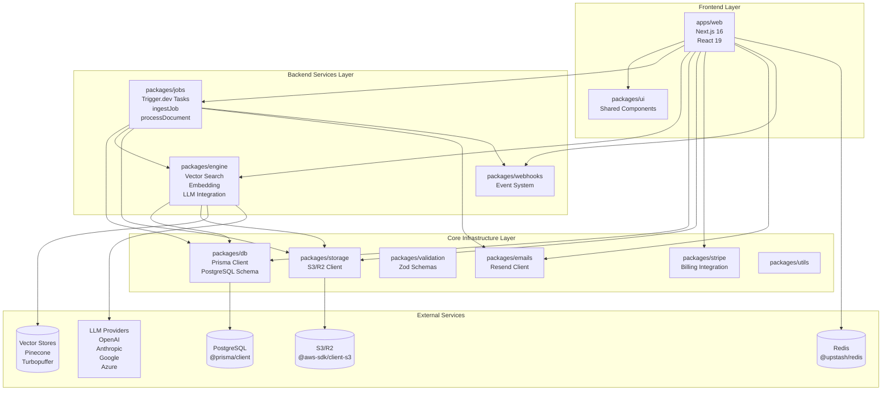
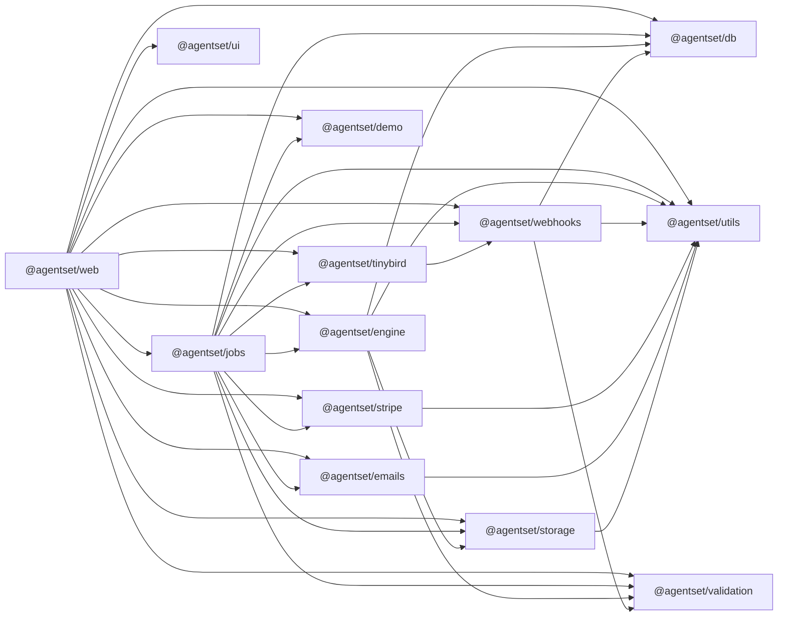

<!-- source: DeepWiki mcp.deepwiki.com · repo agentset-ai/agentset · page 1 Overview · fetched 2026-10-27 -->

# Overview

<details>
<summary>Relevant source files</summary>

The following files were used as context for generating this wiki page:

- [.github/ISSUE_TEMPLATE/bug_report.md](.github/ISSUE_TEMPLATE/bug_report.md)
- [.github/ISSUE_TEMPLATE/feature_request.md](.github/ISSUE_TEMPLATE/feature_request.md)
- [.github/assets/.gitkeep](.github/assets/.gitkeep)
- [.github/assets/readme-cover.png](.github/assets/readme-cover.png)
- [.github/assets/screenshot.png](.github/assets/screenshot.png)
- [.github/assets/star-us.png](.github/assets/star-us.png)
- [LICENSE.md](LICENSE.md)
- [README.md](README.md)
- [apps/web/next.config.ts](apps/web/next.config.ts)
- [apps/web/package.json](apps/web/package.json)
- [bun.lock](bun.lock)
- [package.json](package.json)
- [packages/db/package.json](packages/db/package.json)
- [packages/jobs/package.json](packages/jobs/package.json)
- [packages/ui/package.json](packages/ui/package.json)
- [packages/ui/src/components/image-uploader.tsx](packages/ui/src/components/image-uploader.tsx)

</details>


This document provides a high-level introduction to the AgentSet platform, explaining its purpose, architecture, and organization. It serves as the entry point for understanding how the system is structured and how its major components interact.

For detailed information about specific subsystems, see:
- Architecture details: [Architecture Overview](#1.1)
- Repository organization: [Monorepo Structure](#1.2)
- Technology choices: [Technology Stack](#1.3)
- Data storage: [Data Layer](#2)
- Document processing: [Document Processing](#3)
- Search and RAG: [RAG and Search System](#4)

## What is AgentSet

AgentSet is an open-source platform for building, evaluating, and deploying production-ready Retrieval-Augmented Generation (RAG) and agentic applications. The platform provides end-to-end tooling for document ingestion, vector indexing, semantic search, chat playgrounds, and public hosting with custom domains [README.md:33-35]().

The platform is built as a multi-tenant application where each organization can create isolated namespaces containing their own documents and configurations [README.md:46](). It is model-agnostic, supporting various LLM providers, embedding models, and vector stores [README.md:41-42]().

**Sources:** [README.md:1-48](), [apps/web/package.json:1-86]()

## Core Capabilities

AgentSet provides the following primary capabilities:

| Capability | Description | Key Components |
|------------|-------------|----------------|
| **Document Ingestion** | Upload files, crawl websites, ingest YouTube videos, or submit text directly | `@agentset/jobs` package, Trigger.dev tasks |
| **Vector Search** | Semantic search across ingested documents using multiple vector store providers | `@agentset/engine` package, Pinecone/Turbopuffer |
| **Chat Interfaces** | Interactive chat with RAG-enhanced responses, supports agentic reasoning | `apps/web` routes, AI SDK integration |
| **Public Hosting** | Deploy chat interfaces with custom domains and branding | `Hosting` configuration, Vercel deployment |
| **API Access** | RESTful API with OpenAPI spec and typed SDKs | `zod-openapi` integration, Next.js API routes |
| **Multi-tenancy** | Organization and namespace isolation with resource limits | `Better-Auth`, Prisma schema models |

**Sources:** [README.md:39-47](), [apps/web/package.json:19-70](), [bun.lock:14-447]()

## System Architecture

AgentSet follows a three-layer architecture with clear separation of concerns:



**Frontend Layer** (`apps/web`): Next.js application providing dashboard UI, chat interfaces, and API routes [apps/web/package.json:54](). Built with React 19 and Server Components [package.json:59-64]().

**Backend Services Layer**: Stateless compute services that handle resource-intensive operations:
- `packages/jobs`: Background job processing via Trigger.dev orchestration [packages/jobs/package.json:30]().
- `packages/engine`: AI/ML capabilities including vector search, embeddings, and LLM interactions [packages/engine/package.json:147-154]().
- `packages/webhooks`: Event notification system for external integrations [apps/web/package.json:31]().

**Core Infrastructure Layer**: Foundational packages providing shared functionality:
- `packages/db`: Prisma ORM with PostgreSQL schema and type-safe database client [packages/db/package.json:26-33]().
- `packages/storage`: S3-compatible file storage abstraction [packages/storage/package.json:205-206]().
- `packages/validation`: Shared Zod schemas for runtime validation [package.json:47-49]().
- `packages/stripe`: Stripe integration for billing and subscription management [apps/web/package.json:26]().

**Sources:** [apps/web/package.json:19-31](), [bun.lock:14-447](), [apps/web/next.config.ts:24-37]()

## Package Architecture and Dependencies

The monorepo is organized as a Bun workspace with the following structure:



**Key Dependency Patterns:**
- `apps/web` consumes all packages, serving as the main application entry point [apps/web/package.json:20-31]().
- `packages/jobs` depends on most packages to coordinate background processing [packages/jobs/package.json:20-29]().
- `packages/engine` is isolated with minimal dependencies (db, storage, validation, utils) [packages/engine/package.json:143-146]().
- Core packages like `@agentset/utils` and `@agentset/validation` have no internal dependencies, ensuring clean separation [packages/storage/package.json:204]().

**Sources:** [package.json:36-66](), [bun.lock:4-447](), [apps/web/package.json:20-31]()

## Technology Stack

AgentSet is built on modern, production-grade technologies:

### Frontend Stack

| Technology | Version | Purpose |
|------------|---------|---------|
| **Next.js** | 16.1.6 | React framework with App Router and API routes [apps/web/package.json:54]() |
| **React** | 19.2.3 | UI library with latest concurrent features [package.json:60]() |
| **tRPC** | 11.7.2 | End-to-end type-safe APIs [package.json:53-55]() |
| **TanStack Query** | 5.90.18 | Data fetching and state management [package.json:52]() |
| **AI SDK** | 5.0.44 | Vercel AI SDK for streaming LLM responses [package.json:51]() |
| **Tailwind CSS** | 4.1.18 | Utility-first CSS framework [package.json:45]() |
| **Better Auth** | 1.4.13 | Authentication framework [apps/web/package.json:48]() |

### Backend Stack

| Technology | Version | Purpose |
|------------|---------|---------|
| **Prisma** | 7.4.1 | ORM with type-safe database client [packages/db/package.json:28]() |
| **Trigger.dev** | 4.3.0 | Job orchestration and background tasks [packages/jobs/package.json:30]() |
| **PostgreSQL** | - | Primary database (via `@prisma/adapter-pg`) [packages/db/package.json:27]() |
| **Redis** | - | Session storage and caching (via `@upstash/redis`) [apps/web/package.json:44]() |
| **Bun** | 1.3.6 | JavaScript runtime and package manager [package.json:4]() |
| **Zod** | 4.3.6 | Schema validation and type inference [package.json:47]() |

### AI/ML Stack

| Technology | Purpose |
|------------|---------|
| **OpenAI** | Embeddings and chat models [packages/engine/package.json:150]() |
| **Anthropic** | Claude models for chat [packages/engine/package.json:147]() |
| **Google AI** | Gemini models for chat [packages/engine/package.json:149]() |
| **Azure OpenAI** | Enterprise OpenAI deployments [packages/engine/package.json:148]() |
| **Voyage AI** | Specialized embedding models [packages/engine/package.json:156]() |
| **Cohere** | Reranking services [packages/engine/package.json:155]() |
| **Pinecone** | Serverless vector database [packages/engine/package.json:152]() |
| **Turbopuffer** | High-performance vector database [packages/engine/package.json:154]() |

**Sources:** [apps/web/package.json:19-70](), [package.json:42-66](), [packages/engine/package.json:142-159]()

## Development Workflow

AgentSet uses Turbo for monorepo orchestration and Bun for fast package management:

```bash
# Install dependencies
bun install

# Database operations
bun db:deploy      # Run migrations [package.json:12]
bun db:studio      # Open Prisma Studio [package.json:13]
bun db:generate    # Generate Prisma Client [package.json:15]

# Development
bun dev            # Watch all packages [package.json:17]
bun dev:web        # Run only web app [package.json:18]
bun dev:emails     # Preview email templates [package.json:19]

# Build and deployment
bun build          # Build all packages [package.json:9]
bun typecheck      # Type check all packages [package.json:26]
bun lint           # Lint all packages [package.json:22]
```

### Environment Configuration

AgentSet uses `@t3-oss/env-nextjs` for type-safe environment variable management [apps/web/package.json:38](). Configuration is validated during the build process, preventing runtime errors due to missing secrets [apps/web/next.config.ts:2-4]().

**Sources:** [package.json:8-27](), [apps/web/package.json:6-17](), [apps/web/next.config.ts:1-59]()

## Multi-Tenancy Model

AgentSet implements a hierarchical multi-tenant architecture managed via Prisma [packages/db/package.json:31-33]().

**Isolation Boundaries:**
- **Organization**: Billing boundary, resource limits, and team membership.
- **Namespace**: Logical container for documents, embeddings, and vector store configurations.
- **Document**: Individual content units tracked via `IngestJob` status.

Each namespace maintains its own configuration for embedding models and vector store providers, enabling organizations to tailor their RAG pipeline to specific use cases.

**Sources:** [README.md:46](), [packages/db/package.json:1-46](), [packages/jobs/package.json:20-35]()

## Key Entry Points

Understanding AgentSet's codebase requires familiarity with these key entry points:

### Web Application Routes

| Route Pattern | Purpose |
|---------------|---------|
| `/apps/web/src/app` | Main dashboard and chat interfaces |
| `/apps/web/src/app/api` | Internal and public API endpoints |
| `/apps/web/src/app/api/stripe/webhook` | Stripe payment event handling [package.json:16]() |

### Background Job Tasks

| Task Name | Purpose |
|-----------|---------|
| `trigger:dev` | Runs Trigger.dev in development mode [packages/jobs/package.json:6]() |
| `trigger:deploy` | Deploys background jobs to Trigger.dev cloud [packages/jobs/package.json:7]() |

### Core Service Packages

| Package | Purpose |
|----------|----------|
| `@agentset/engine` | AI/ML core: LLM providers, vector stores, and embeddings [packages/engine/package.json:141]() |
| `@agentset/db` | Database client and schema management [packages/db/package.json:2]() |
| `@agentset/ui` | Shared UI component library based on shadcn/ui [packages/ui/package.json:2]() |

**Sources:** [package.json:8-27](), [apps/web/package.json:1-86](), [packages/jobs/package.json:1-47]()

---

