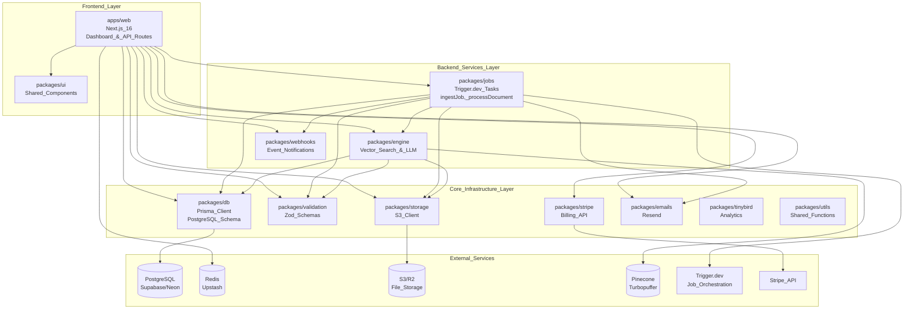
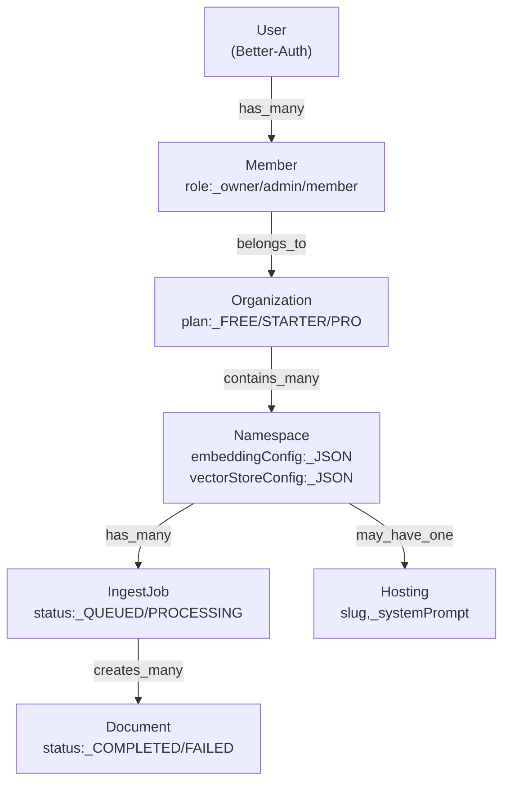
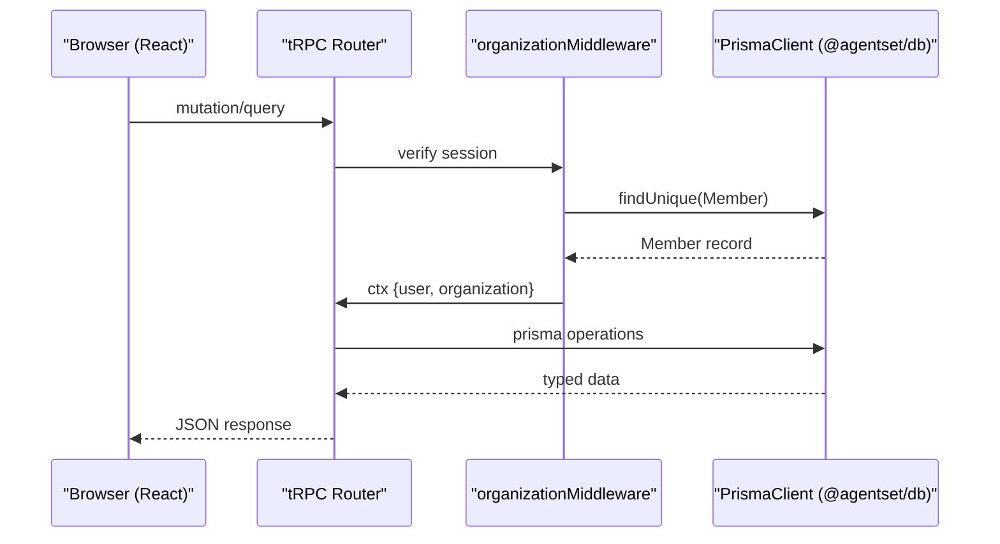
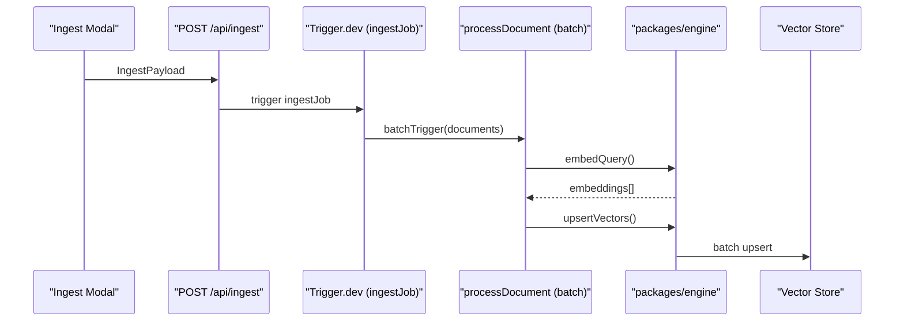
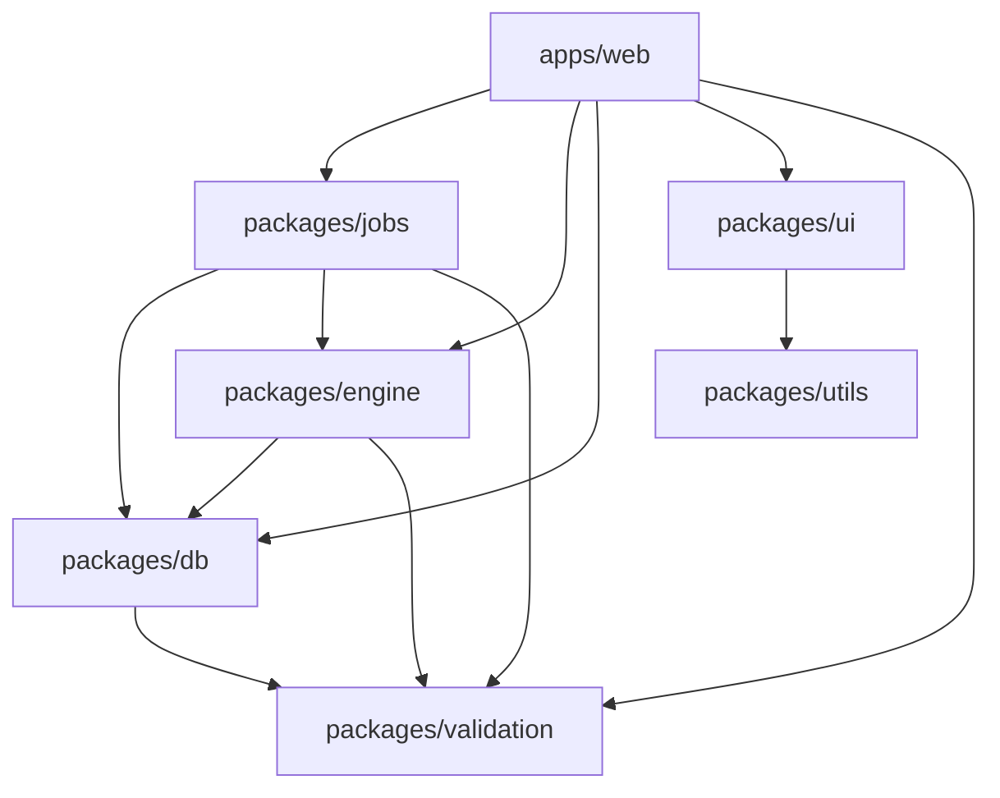

<!-- source: DeepWiki mcp.deepwiki.com · repo agentset-ai/agentset · page 1.1 Architecture Overview · fetched 2026-10-27 -->

# Architecture Overview

Relevant source files

The following files were used as context for generating this wiki page:

- [.cursor/rules/project-structure.mdc](.cursor/rules/project-structure.mdc)
- [.github/ISSUE_TEMPLATE/bug_report.md](.github/ISSUE_TEMPLATE/bug_report.md)
- [.github/ISSUE_TEMPLATE/feature_request.md](.github/ISSUE_TEMPLATE/feature_request.md)
- [.github/assets/.gitkeep](.github/assets/.gitkeep)
- [.github/assets/readme-cover.png](.github/assets/readme-cover.png)
- [.github/assets/screenshot.png](.github/assets/screenshot.png)
- [.github/assets/star-us.png](.github/assets/star-us.png)
- [LICENSE.md](LICENSE.md)
- [README.md](README.md)
- [apps/web/next.config.ts](apps/web/next.config.ts)
- [apps/web/package.json](apps/web/package.json)
- [bun.lock](bun.lock)
- [package.json](package.json)
- [packages/db/package.json](packages/db/package.json)
- [packages/jobs/package.json](packages/jobs/package.json)
- [packages/ui/package.json](packages/ui/package.json)
- [packages/ui/src/components/image-uploader.tsx](packages/ui/src/components/image-uploader.tsx)

## Purpose and Scope

This document describes the overall system architecture of the AgentSet platform, including its three-layer design (frontend, backend services, and core infrastructure), multi-tenancy model, and how components interact. This page provides a high-level view of the system structure and package organization.

For details on specific subsystems, see:
- Monorepo structure and build system: [Monorepo Structure](#1.2)
- Database schema and data model: [Database Schema](#2.1)
- Document processing pipeline: [Document Processing](#3)
- RAG and search implementation: [RAG and Search System](#4)
- External service integrations: [9.3 External Service Integration]()

---

## System Architecture

AgentSet is structured as a monorepo with clear separation of concerns across three primary architectural layers:

1. **Frontend Layer**: Next.js application providing the user interface.
2. **Backend Services Layer**: Compute-intensive operations for document processing and AI/ML.
3. **Core Infrastructure Layer**: Foundational services for data access, validation, and shared utilities.

The platform implements a multi-tenant architecture where organizations contain namespaces, which serve as isolated data containers with independent configuration for embeddings, vector stores, and file storage.

### Three-Layer Architecture

**Sources**: [package.json:1-67](), [apps/web/package.json:1-86](), [bun.lock:1-447]()

---

## Frontend Layer

The frontend layer consists of the Next.js application (`apps/web`) and shared UI components (`packages/ui`).

### apps/web - Next.js Application

The primary application is built with Next.js 16 and implements:
- **Server Components**: Dashboard pages, authentication flows, settings.
- **API Routes**: tRPC endpoints, public REST API, webhook handlers.
- **Client Components**: Interactive chat interface, document management UI.

Key dependencies in [apps/web/package.json:19-70]():
- `next` (16.1.6) - Framework.
- `@trpc/server`, `@trpc/client` - Type-safe API layer.
- `ai` - Vercel AI SDK for streaming LLM responses.
- `better-auth` - Authentication system.
- `@upstash/redis`, `@upstash/ratelimit` - Session and rate limiting.
- `posthog-js`, `posthog-node` - Analytics.

### packages/ui - Shared Components

Provides reusable UI components built on Radix UI:
- Form components: `input`, `textarea`, `select`, `checkbox`.
- Data display: `data-table`, `avatar`, `badge`.
- Feedback: `dialog`, `alert`, `sonner` (toast notifications).
- Custom: `image-uploader`, `file-uploader`, `copy-button`.

The `ImageUploader` component [packages/ui/src/components/image-uploader.tsx:51-227]() demonstrates the frontend architecture: it uses the `useFileUpload` hook [packages/ui/src/components/image-uploader.tsx:73-87]() for file handling, client-side image compression with `browser-image-compression` [packages/ui/src/components/image-uploader.tsx:12-31](), and base64 encoding for state management.

**Sources**: [apps/web/package.json:1-86](), [packages/ui/package.json:1-109](), [packages/ui/src/components/image-uploader.tsx:1-227]()

---

## Backend Services Layer

The backend services layer handles compute-intensive operations independently from the web application, enabling horizontal scaling.

### packages/jobs - Background Job Processing

Implements the document processing pipeline using Trigger.dev. Core tasks include:

| Task Name | Purpose | Batch Size |
|-----------|---------|------------|
| `ingestJob` | Orchestrates ingestion, creates document records | N/A |
| `processDocument` | Generates embeddings, upserts to vector stores | Spawned in batches |
| `deleteIngestJob` | Cascading deletion of ingestion data | N/A |
| `deleteDocument` | Removes document from vector store and S3 | N/A |

Job dependencies in [packages/jobs/package.json:19-35]():
- `@trigger.dev/sdk` (4.3.0) - Job orchestration framework.
- `@agentset/db`, `@agentset/engine`, `@agentset/storage` - Core services.
- `@agentset/webhooks` - Event emission.
- `@upstash/redis` - Temporary chunk storage during partitioning.

### packages/engine - AI/ML Processing

Provides abstractions for vector search, embeddings, and LLM interactions. It integrates multiple AI providers:

**Vector Store Abstraction**: Unified interface for Pinecone and Turbopuffer implementations.
- Supports `@pinecone-database/pinecone` (5.1.1) [packages/engine/package.json:152]().
- Supports `@turbopuffer/turbopuffer` (1.10.0) [packages/engine/package.json:154]().

**Embedding Generation**: Multi-provider support via `voyage-ai-provider`, `cohere-ai`, and Azure/OpenAI [packages/engine/package.json:147-156]().

**LLM Integration**: Uses Vercel AI SDK with provider adapters:
- `@ai-sdk/anthropic`, `@ai-sdk/openai`, `@ai-sdk/google`, `@ai-sdk/azure` [packages/engine/package.json:147-150]().

**Sources**: [packages/jobs/package.json:1-47](), [packages/engine/package.json:141-158](), [bun.lock:139-168]()

---

## Core Infrastructure Layer

The core infrastructure provides foundational services shared across all layers.

### packages/db - Database Client

Exposes Prisma client with multiple entry points as defined in [packages/db/package.json:5-12]():

| Export Path | Purpose |
|-------------|---------|
| `@agentset/db` | Main entry point |
| `@agentset/db/client` | PrismaClient singleton instance |
| `@agentset/db/trigger` | Trigger.dev-specific client integration |
| `@agentset/db/types` | Generated Prisma types |
| `@agentset/db/schemas` | Zod validation schemas |

The client uses `@prisma/adapter-pg` [packages/db/package.json:27]() for connection pooling.

### packages/storage - S3 Integration

Provides S3 client wrapper using `@aws-sdk/client-s3` [packages/storage/package.json:205]() for Cloudflare R2 or AWS S3:
- File upload with presigned URLs [packages/storage/package.json:206]().
- Chunk storage for document processing.

**Sources**: [packages/db/package.json:1-46](), [packages/storage/package.json:201-217](), [bun.lock:84-102]()

---

## Multi-Tenancy Model

The platform implements multi-tenancy through a hierarchical data model where `Organization` is the root tenant and `Namespace` is the data isolation boundary.

### Isolation Boundaries

**Organization Level**:
- Billing and subscription management via `@agentset/stripe`.
- Team membership via `Member` table with roles.

**Namespace Level**:
- Independent vector store instances (Pinecone namespace or Turbopuffer namespace).
- Separate embedding model configuration stored in `embeddingConfig`.
- Independent hosting configuration for public chat interfaces.

**Sources**: [README.md:33-48](), [bun.lock:14-83](), [.cursor/rules/project-structure.mdc:177-190]()

---

## Component Interaction Patterns

### Request Flow: Web App → tRPC → Database

### Request Flow: Document Ingestion

**Sources**: [apps/web/package.json:19-70](), [packages/jobs/package.json:19-35](), [packages/engine/package.json:141-158]()

---

## Package Dependency Graph

The monorepo structure enforces dependency directionality to prevent circular imports as defined in [.cursor/rules/project-structure.mdc:185-190]().

### Build Orchestration

Turbo [package.json:8-27]() orchestrates builds:
- `turbo run build`: Builds all packages in dependency order.
- `turbo watch dev`: Development mode with hot reload.
- Transpilation: Next.js is configured to transpile workspace packages directly [apps/web/next.config.ts:24-37]().

**Sources**: [package.json:1-67](), [apps/web/next.config.ts:1-59](), [.cursor/rules/project-structure.mdc:130-141]()

---

