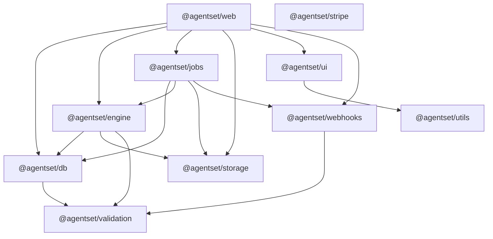
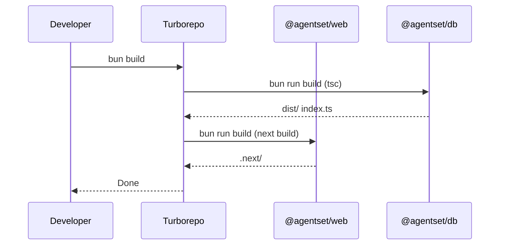

<!-- source: DeepWiki mcp.deepwiki.com · repo agentset-ai/agentset · page 1.2 Monorepo Structure · fetched 2026-10-27 -->

# Monorepo Structure

<details>
<summary>Relevant source files</summary>

The following files were used as context for generating this wiki page:

- [.cursor/mcp.json](.cursor/mcp.json)
- [.cursor/rules/animations.mdc](.cursor/rules/animations.mdc)
- [.cursor/rules/project-structure.mdc](.cursor/rules/project-structure.mdc)
- [.cursor/rules/shadcn.mdc](.cursor/rules/shadcn.mdc)
- [.cursor/rules/tailwind.mdc](.cursor/rules/tailwind.mdc)
- [apps/web/next.config.ts](apps/web/next.config.ts)
- [apps/web/package.json](apps/web/package.json)
- [apps/web/src/app/app.agentset.ai/(dashboard)/[slug]/webhooks/layout.tsx](apps/web/src/app/app.agentset.ai/(dashboard)/[slug]/webhooks/layout.tsx)
- [apps/web/src/app/app.agentset.ai/(dashboard)/[slug]/webhooks/new/page.tsx](apps/web/src/app/app.agentset.ai/(dashboard)/[slug]/webhooks/new/page.tsx)
- [apps/web/src/app/app.agentset.ai/(dashboard)/[slug]/webhooks/page.tsx](apps/web/src/app/app.agentset.ai/(dashboard)/[slug]/webhooks/page.tsx)
- [apps/web/src/app/robots.ts](apps/web/src/app/robots.ts)
- [bun.lock](bun.lock)
- [package.json](package.json)
- [packages/db/package.json](packages/db/package.json)
- [packages/jobs/package.json](packages/jobs/package.json)
- [packages/ui/package.json](packages/ui/package.json)
- [packages/ui/src/components/image-uploader.tsx](packages/ui/src/components/image-uploader.tsx)

</details>


## Purpose and Scope

This document details the physical organization of the Agentset monorepo, including workspace configuration, package dependencies, catalog-based dependency management, and build orchestration. Agentset uses **Bun** as its primary package manager and runtime, with **Turborepo** managing the build pipeline and caching.

## Workspace Organization

The Agentset monorepo uses Bun workspaces with a three-tier directory structure defined in the root [package.json:36-41]():

```json
"workspaces": {
  "packages": [
    "apps/*",
    "packages/*",
    "tooling/*"
  ]
}
```

### Directory Structure

```mermaid
graph TB
    subgraph "Root"
        Root["/"]
    end
    
    subgraph "Applications Layer"
        AppsDir["apps/"]
        Web["apps/web<br/>Next.js Application"]
    end
    
    subgraph "Core Packages Layer"
        PackagesDir["packages/"]
        DB["packages/db<br/>Prisma Client & Migrations"]
        Engine["packages/engine<br/>RAG Engine & Vector Store"]
        Jobs["packages/jobs<br/>Trigger.dev Background Tasks"]
        Storage["packages/storage<br/>S3 File Utilities"]
        Stripe["packages/stripe<br/>Billing Integration"]
        Emails["packages/emails<br/>React Email Templates"]
        UI["packages/ui<br/>Shared Shadcn Components"]
        Utils["packages/utils<br/>Shared Helpers"]
        Validation["packages/validation<br/>Shared Zod Schemas"]
        Webhooks["packages/webhooks<br/>Webhook Handlers"]
        Tinybird["packages/tinybird<br/>Analytics & Warehousing"]
    end
    
    subgraph "Tooling Layer"
        ToolingDir["tooling/"]
        ESLint["tooling/eslint<br/>Shared Lint Config"]
        Prettier["tooling/prettier<br/>Formatting Config"]
        TSConfig["tooling/typescript<br/>Base TS Configs"]
    end
    
    Root --> AppsDir
    Root --> PackagesDir
    Root --> ToolingDir
    
    AppsDir --> Web
    
    PackagesDir --> DB
    PackagesDir --> Engine
    PackagesDir --> Jobs
    PackagesDir --> Storage
    PackagesDir --> Stripe
    PackagesDir --> Emails
    PackagesDir --> UI
    PackagesDir --> Utils
    PackagesDir --> Validation
    PackagesDir --> Webhooks
    PackagesDir --> Tinybird
    
    ToolingDir --> ESLint
    ToolingDir --> Prettier
    ToolingDir --> TSConfig
```

**Sources:** [package.json:36-41](), [.cursor/rules/project-structure.mdc:13-33]()

### Package Types

The monorepo contains three categories of packages, all using the `@agentset/*` namespace:

| Category | Purpose | Packages |
|----------|---------|----------|
| **Applications** | Deployable services | `@agentset/web` |
| **Core Packages** | Shared logic & infrastructure | `db`, `engine`, `jobs`, `storage`, `stripe`, `emails`, `ui`, `utils`, `validation`, `webhooks`, `tinybird`, `demo` |
| **Tooling** | Dev environment config | `eslint-config`, `prettier-config`, `tsconfig` |

Packages are configured to export specific entry points. For example, `@agentset/db` provides separate exports for the client, types, and browser-safe schemas [packages/db/package.json:5-12]().

**Sources:** [apps/web/package.json:2-3](), [packages/db/package.json:2-12](), [packages/jobs/package.json:2-3]()

## Package Dependencies

### Dependency Graph (Code Entity Space)

The following diagram illustrates how the core code entities (packages) depend on one another.



**Sources:** [apps/web/package.json:19-31](), [packages/jobs/package.json:19-29](), [packages/engine/package.json:142-146]()

### Workspace Management

Internal dependencies are linked using the `workspace:*` protocol [apps/web/package.json:20-31](). This ensures that changes in a package like `@agentset/ui` are immediately reflected in `@agentset/web` without requiring a publish step.

To facilitate local development, the Next.js configuration in `apps/web` uses the `transpilePackages` option to automatically handle these local workspace dependencies [apps/web/next.config.ts:24-37]().

**Sources:** [apps/web/package.json:20-31](), [apps/web/next.config.ts:24-37]()

## Catalog-Based Dependency Management

Agentset uses Bun's **Catalog** feature to centralize versions of external dependencies across the monorepo, preventing version drift. These are defined in the root [package.json:42-65]().

### Standard Catalog

The primary catalog [package.json:42-57]() standardizes versions for core libraries:

| Dependency | Version | Reference Syntax |
|------------|---------|------------------|
| `typescript` | ^5.9.3 | `"typescript": "catalog:"` |
| `zod` | 4.3.6 | `"zod": "catalog:"` |
| `ai` | ^5.0.44 | `"ai": "catalog:"` |
| `@trpc/server` | ^11.7.2 | `"@trpc/server": "catalog:"` |
| `vitest` | ^3.2.4 | `"vitest": "catalog:"` |

### React19 Catalog

A specialized catalog manages the React 19 ecosystem [package.json:58-65]():

```json
"catalogs": {
  "react19": {
    "react": "19.2.3",
    "react-dom": "19.2.3",
    "@types/react": "19.2.6"
  }
}
```

Packages reference this using `"react": "catalog:react19"` [apps/web/package.json:57-58]().

**Sources:** [package.json:42-65](), [apps/web/package.json:38-42](), [apps/web/package.json:57-58]()

## Build Orchestration with Turborepo

Turborepo is used to manage the build pipeline and cache results locally and in CI.

### Task Execution Flow

The root `package.json` provides scripts that delegate to `turbo` [package.json:8-27]():



| Command | Internal Logic |
|---------|----------------|
| `bun build` | `turbo run build` [package.json:9]() |
| `bun dev` | `turbo watch dev --continue` [package.json:17]() |
| `bun db:generate` | `turbo -F @agentset/db db:generate` [package.json:15]() |
| `bun typecheck` | `turbo run typecheck` [package.json:26]() |

### Environment Handling

Environment variables are managed at the root in a `.env` file. Package scripts often reference this file directly using Bun's `--env-file` flag to ensure consistent configuration [apps/web/package.json:7-16](), [packages/db/package.json:20-23]().

**Sources:** [package.json:8-27](), [apps/web/package.json:7-16](), [packages/db/package.json:20-23]()

## Key Package Implementation Details

### `@agentset/ui` (Shared Components)
This package exports individual UI components based on **Shadcn UI**. It uses a granular export strategy [packages/ui/package.json:5-62](), allowing apps to import only what they need:
- `./button`: [packages/ui/package.json:29]()
- `./data-table`: [packages/ui/package.json:34]()
- `./ai/*`: [packages/ui/package.json:60]()

### `@agentset/db` (Data Layer)
Manages the Prisma schema and client. It provides a `db:generate` script to sync the Prisma client with the schema [packages/db/package.json:20]().

### `@agentset/jobs` (Background Processing)
Contains the **Trigger.dev** task definitions. It depends on nearly all other packages to perform actions like document ingestion, email sending, and vector indexing [packages/jobs/package.json:19-29]().

**Sources:** [packages/ui/package.json:5-62](), [packages/db/package.json:20](), [packages/jobs/package.json:19-29]()

---

