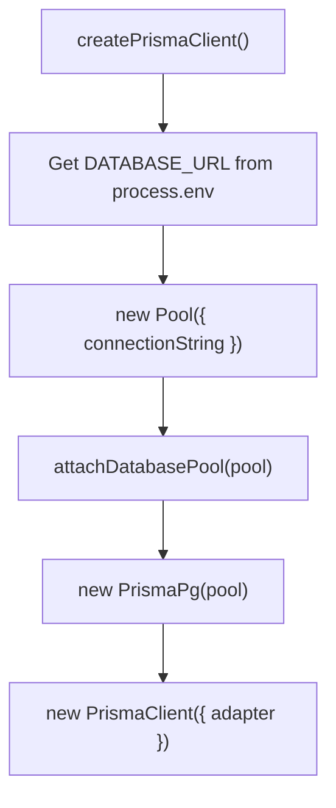
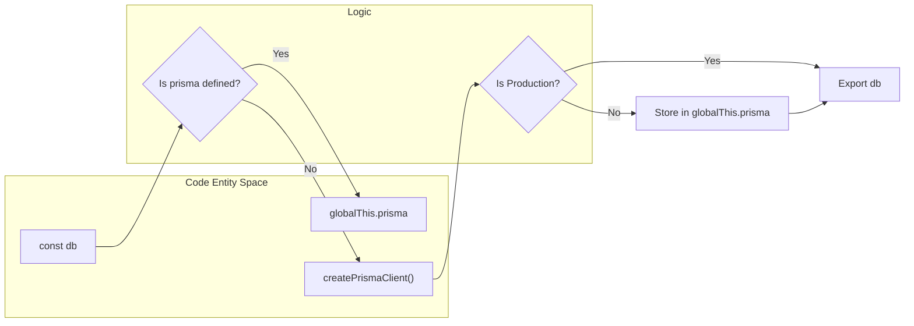
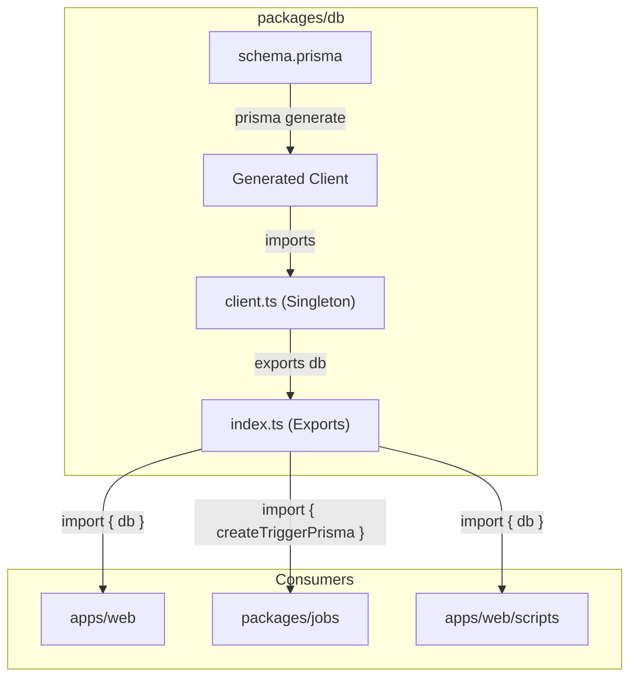

<!-- source: DeepWiki mcp.deepwiki.com · repo agentset-ai/agentset · page 2.2 Database Client Configuration · fetched 2026-10-27 -->

# Database Client Configuration

<details>
<summary>Relevant source files</summary>

The following files were used as context for generating this wiki page:

- [apps/web/scripts/populate-document-namespace-id.ts](apps/web/scripts/populate-document-namespace-id.ts)
- [packages/db/.gitignore](packages/db/.gitignore)
- [packages/db/eslint.config.js](packages/db/eslint.config.js)
- [packages/db/prisma/schema/schema.prisma](packages/db/prisma/schema/schema.prisma)
- [packages/db/src/client.ts](packages/db/src/client.ts)
- [packages/db/src/index.ts](packages/db/src/index.ts)
- [packages/db/tsconfig.json](packages/db/tsconfig.json)
- [packages/jobs/src/db.ts](packages/jobs/src/db.ts)
- [packages/jobs/trigger.config.ts](packages/jobs/trigger.config.ts)

</details>


## Purpose and Scope

This document explains the Prisma database client configuration used throughout the AgentSet codebase. It covers the creation and initialization of the `PrismaClient`, connection pooling using the `pg` adapter with Vercel's database pool attachment, the global singleton pattern to prevent connection exhaustion, and specialized integration for **Trigger.dev** background job contexts. For information about the database schema itself, see [2.1 Database Schema]().

---

## Client Creation and Initialization

### Connection Pooling and Adapter Setup

The database client is initialized using the `PrismaPg` adapter, which allows Prisma to communicate with PostgreSQL via the `pg` driver's connection pool. This is specifically integrated with Vercel's infrastructure using `attachDatabasePool`.

#### Initialization Flow



**Implementation Details**

Sources: [packages/db/src/client.ts:7-19]()

The `createPrismaClient` function performs the following steps:
1.  **Connection String**: Retrieves the `DATABASE_URL` from environment variables [packages/db/src/client.ts:8]().
2.  **Pool Creation**: Instantiates a new `Pool` from the `pg` package [packages/db/src/client.ts:9]().
3.  **Vercel Optimization**: Calls `attachDatabasePool(pool)` to manage connection persistence in serverless environments [packages/db/src/client.ts:10]().
4.  **Adapter Injection**: Passes the `PrismaPg` adapter into the `PrismaClient` constructor [packages/db/src/client.ts:13]().

### Logging Configuration

The client is configured with environment-aware logging levels to balance visibility and performance:

| Environment | Log Levels | Purpose |
| :--- | :--- | :--- |
| **Development** | `query`, `error`, `warn` | Full visibility into generated SQL and potential issues. |
| **Production** | `error` | Minimize log noise and overhead while capturing failures. |

Sources: [packages/db/src/client.ts:14-17]()

---

## Global Singleton Pattern

To prevent exhausting database connections during development (where Hot Module Replacement might otherwise instantiate multiple clients), the system employs a global singleton pattern.



**Singleton Implementation**

Sources: [packages/db/src/client.ts:21-27]()

1.  **Global Object**: A `globalForPrisma` object is defined on `globalThis` to persist the client across module reloads [packages/db/src/client.ts:21-23]().
2.  **Initialization**: The `db` constant is assigned either the existing global instance or a newly created one [packages/db/src/client.ts:25]().
3.  **Persistence**: In non-production environments, the newly created client is saved back to the global object [packages/db/src/client.ts:27]().

---

## Trigger.dev Integration

Background jobs require a specialized database lifecycle because they may be paused and resumed by the **Trigger.dev** engine.

### Task Middleware and Locals

The jobs package uses Trigger.dev `locals` to provide a thread-safe, task-scoped database client.

Sources: [packages/jobs/src/db.ts:1-18]()

*   **`DbLocal`**: A local storage container for the database client [packages/jobs/src/db.ts:6]().
*   **`getDb()`**: A utility function to retrieve the client instance for the current task execution context [packages/jobs/src/db.ts:8-10]().
*   **`tasks.middleware`**: Automatically initializes and cleans up the database connection for every job run [packages/jobs/src/db.ts:12-18]().

### Lifecycle Hooks

Because jobs can enter a "waiting" state (e.g., waiting for an external webhook or delay), the client must manage connections to avoid holding them open unnecessarily.

| Hook | Function | Action |
| :--- | :--- | :--- |
| **Middleware Start** | `db.$connect()` | Opens connection before task logic runs [packages/jobs/src/db.ts:15](). |
| **Middleware End** | `db.$disconnect()` | Closes connection after task logic finishes [packages/jobs/src/db.ts:17](). |
| **`onWait`** | `db.$disconnect()` | Closes connection when the run is paused [packages/jobs/src/db.ts:21-24](). |
| **`onResume`** | `db.$connect()` | Re-establishes connection when the run resumes [packages/jobs/src/db.ts:27-30](). |

### Build Configuration

The `trigger.config.ts` includes a Prisma extension to ensure the client is correctly bundled and generated for the job runtime.

Sources: [packages/jobs/trigger.config.ts:19-25]()

```typescript
build: {
  extensions: [
    prismaExtension({
      mode: "modern",
    }),
  ],
},
```

---

## Data Flow and Exports

The `@agentset/db` package acts as the central source of truth for data access. It exports the client, schemas, and generated types.



**Key Export Locations**
*   **Client Instance**: `db` is exported for general use in the web application and scripts [packages/db/src/client.ts:25]().
*   **Generated Types**: All Prisma-generated models and types are re-exported from the package root [packages/db/src/index.ts:1-4]().
*   **Scripts**: Direct usage of the client can be seen in utility scripts like `populate-document-namespace-id.ts` [apps/web/scripts/populate-document-namespace-id.ts:1-3]().

Sources: [packages/db/src/index.ts:1-4](), [apps/web/scripts/populate-document-namespace-id.ts:1-3]()

---

